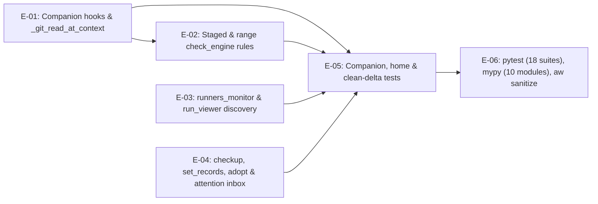
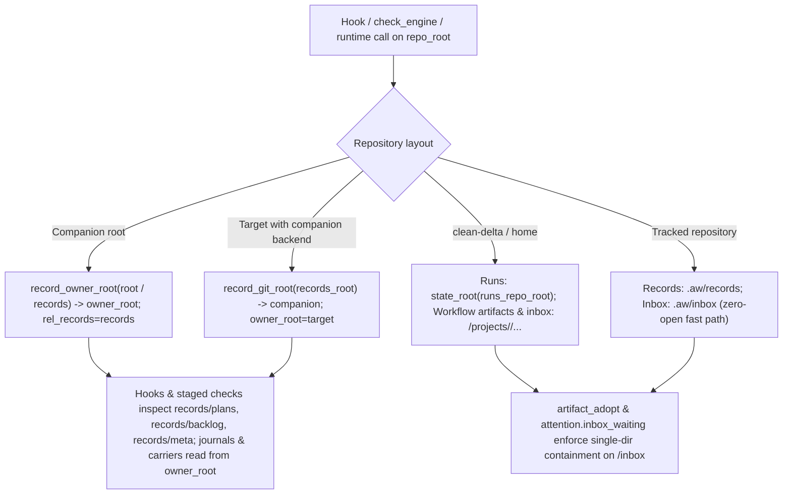

# IPD: Fix pre-commit hooks staged gates runners monitor run viewer checkup and clean-delta inbox

- Date: 2026-11-24
- Kind: child
- Concern: Eight verified bugs break pre-commit hooks, staged `agent_workflows/check_engine.py` governance rules, run monitoring and viewing, checkup, and `clean-delta` inbox adoption in companion repositories (`records_backend == "companion"`) and `~/.aw/` (`AW_HOME` / `records_backend == "home"` / `clean-delta`) layouts: (1) `agent_workflows/hooks/executed_transition_gate.py` hardcodes `.aw/records/plans/` (failing open on companion `records/plans/` and `home` local-git `plans/`), misses companion `records/meta/*.jsonl`, and looks for finalize journals and `m0001` migration markers in the companion repository instead of the owning target repository; (2) `agent_workflows/hooks/meta_log_append_gate.py` and `agent_workflows/check_engine.py::_git_read_at_context` miss companion `records/meta/*.jsonl`; (3) `agent_workflows/check_engine.py::check_status_untooled`, `check_status_untooled_range`, `check_staged_illegal_backlog_transition`, `_staged_backlog_done_items`, `check_release_gate_consistency`, `check_commit_invariants`, and `_lane_carrier_is_executed` (plus `_is_plan_ipd_path` and `_plan_lifecycle_bucket`) hardcode `target_repo` and `.aw/records/...` pathspecs, causing `hooks/status_untooled_gate.py`, `hooks/backlog_blocking_close_gate.py`, `hooks/precommit_scope_gate.py`, and staged `aw check` rules to fail open or misresolve companion carriers; (4) `agent_workflows/hooks/ipd_dependency_statement_gate.py` falsely rejects valid companion dependencies as `dangling` because it passes the companion repository root instead of the owning target repository resolved via `project_context.py::record_owner_root(root / "records")` to `check_engine.py::evaluate_ipd_dependencies`; (5) `agent_workflows/runners_monitor.py::find_active_runners` hardcodes `.aw/records/runs` and reports zero active runners; (6) `agent_workflows/run_viewer.py::discover_runs_in_directory` misses companion `records/runs` and external `runner_shared.py::state_root(p)`, and `run_viewer.py::_find_stem_for_id6` hardcodes `.aw/records/plans`; (7) `agent_workflows/checkup.py::run_start_checkup` (when `events_path` and `run_dir` are omitted) and `agent_workflows/set_records.py::run_artifacts_dir` hardcode target `.aw/` paths; and (8) `agent_workflows/artifact_adopt.py` and `agent_workflows/attention.py::inbox_waiting` hardcode `<repo_root>/.aw/inbox`, violating `clean-delta`'s zero-footprint contract.
- Scope: Fix all eight bugs across `agent_workflows/hooks/executed_transition_gate.py`, `agent_workflows/hooks/meta_log_append_gate.py`, `agent_workflows/hooks/ipd_dependency_statement_gate.py`, `agent_workflows/check_engine.py`, `agent_workflows/runners_monitor.py`, `agent_workflows/run_viewer.py`, `agent_workflows/checkup.py`, `agent_workflows/artifact_adopt.py`, `agent_workflows/attention.py`, and `agent_workflows/set_records.py`, with behavioral tests covering companion, `~/.aw/`, and `clean-delta` repositories.
- Scope-Paths: agent_workflows/hooks/executed_transition_gate.py, agent_workflows/hooks/meta_log_append_gate.py, agent_workflows/hooks/ipd_dependency_statement_gate.py, agent_workflows/check_engine.py, agent_workflows/runners_monitor.py, agent_workflows/run_viewer.py, agent_workflows/checkup.py, agent_workflows/artifact_adopt.py, agent_workflows/attention.py, agent_workflows/set_records.py, tests/test_companion_doctor_and_carriers.py, tests/test_home_isolation.py, .aw/records/plans/pending/20261124-comphome-05-7hfx7r-fix-pre-commit-hooks-staged-gates-runners-monitor-run-viewer.ipd.md
- Item-Dependencies: executed:ywl7uc
- Status: reviewed
- Readiness: go-pending-approval
- Review-Depth: complex
- Priority: high
- Work-Kind: bug
- Blocks-Release: next
- Set: comphome
- Order: 5
- Highest E allocated: 6
- Id: 7hfx7r
- Author: antigravity

> Write and proofread this plan per the technical writing standard, `.aw/system/workflows/technical-writing/technical-writing.md` (`.agents/workflows/technical-writing/technical-writing.md` in a legacy-layout install), including requirement 12 (diagrams).

## Workflow history

- 2026-11-25 reviewed (aw set): APPROVE WITH REVISIONS APPLIED; PR-001..PR-007
- 2026-11-25 /plan-review (antigravity/Gemini 4 Neon (High)): APPROVE WITH REVISIONS APPLIED; PR-001..PR-007
- 2026-11-24 to-review (antigravity): authored Order 05 child IPD for `/assess-bugs` (Set `comphome`).

## Goal

Restore fail-closed pre-commit and staged governance hooks inside companion and `home` local-git repositories, make `aw runners` and `aw runs` discover companion and `~/.aw/` runs accurately, and eliminate remaining hardcoded target-repo `.aw/` paths in `checkup`, `set_records`, and `clean-delta` inbox adoption.

## Detailed Implementation Checklist (TODO)

Execution-state rule: mark an `E-*` item complete only after performing the action. That mark is not validation. Accepted execution states: blocked, failed, pending, performed; terminal gate demands 'performed'.

### Task group 1: Companion pre-commit hooks and `_git_read_at_context`

- [ ] E-01 Fix companion repository detection and owning-target lookup in `agent_workflows/check_engine.py::_git_read_at_context`, `agent_workflows/hooks/executed_transition_gate.py`, `agent_workflows/hooks/meta_log_append_gate.py`, and `agent_workflows/hooks/ipd_dependency_statement_gate.py`:
  1. In `agent_workflows/check_engine.py::_git_read_at_context`, normalize `repo_root` to its git toplevel when inside a git subdirectory, and check for a companion repository layout BEFORE calling `project_context.py::resolve_project_context(target_repo=str(root))`:
     - Probe `owner = project_context.py::record_owner_root(root / "records")` when `(root / "records").is_dir()` or `norm_rel.startswith("records/")` (never pass bare `root`, because `record_owner_root` requires a `"records"` path component in Branch B). When `owner` resolves, return `project_context.py::resolve_project_context(target_repo=str(owner))` so `logical_roots["records"]` points to `<companion>/records` and `logical_roots["state"]` points to the owning target repository's state directory.
     - Otherwise, when `storage.py::load_companion_identity(root)` is non-None or `(norm_rel.startswith("records/") and (root / "records").is_dir() and not (root / ".aw" / "records").is_dir())`, return `_GitReadAtCtx` with `logical_roots={"records": root / "records", "state": root / ".aw" / "state"}` so standalone companion fixtures still resolve `rel_records == "records"` and `meta_dir == "records/meta"`.
  2. In `agent_workflows/hooks/meta_log_append_gate.py::_staged_meta_logs`, delegate `(repo_dir, rel_records)` resolution to `check_engine.py::_staged_meta_layout(root, ctx)` so the hook and `check_engine.py` share one layout derivation for `.aw/records/meta`, companion `records/meta`, and `home` local-git `meta`.
  3. In `agent_workflows/hooks/executed_transition_gate.py`:
     - Derive the plans pathspec for `root`'s own git index (`plans_prefix = "records/plans/"` when `root` is a companion repository, `"plans/"` when `records_root == root`, else `".aw/records/plans/"`) and update `_is_plan_path` and `_staged_plan_executed_transitions` to use that prefix so committing code in `target_repo` is not blocked by unrelated staged files in a companion repository while commits inside a companion repository gate `records/plans/` and `records/meta/*.jsonl`.
     - Resolve the owning target repository via `owner_root = project_context.py::record_owner_root(root / "records") or root` (passing `root / "records"`, never bare `root`) and use `owner_root` in `_finalize_evidence_ok` (`ipd_lifecycle.py::read_finalize_journal(owner_root, plan_id)`) and in `_candidate_state_durable_dirs` (so `m0001` migration markers stored in the owning target repository are recognized when committing in a companion repository, including from `hooks/backlog_blocking_close_gate.py`).
  4. In `agent_workflows/hooks/ipd_dependency_statement_gate.py::check`, normalize `repo_root` to its git toplevel (`git rev-parse --show-toplevel`), resolve `owner_root` by passing a staged plan path from `overlay_states` (or `root / "records"`) to `project_context.py::record_owner_root` with fallback to `root`, and pass `owner_root` into `check_engine.py::evaluate_ipd_dependencies`.
  - Depends on: none
  - Expected outcome: companion pre-commit hooks catch raw `executed` transitions and non-append `records/meta/*.jsonl` edits, accept legitimate `aw ipd finalize` commits using the owning target repository's finalize journal and `m0001` migration marker, and accept valid cross-IPD dependencies inside companion repositories (including when invoked from subdirectories).
  - Execution state: pending

### Task group 2: Staged and range governance rules in `check_engine.py`

- [ ] E-02 Route staged and range governance rules in `agent_workflows/check_engine.py` through resolved git roots, records-relative prefixes, and owning target repositories:
  1. Update `agent_workflows/check_engine.py::_is_plan_ipd_path`, `_plan_lifecycle_bucket`, and `_check_untooled_plan_transition` to accept an explicit `plans_prefix` (defaulting to `_PLANS_PREFIX`, or matching `.aw/records/plans/`, `records/plans/`, and `plans/` when resolved from `_staged_meta_layout`) so companion `records/plans/...` and `home` local-git `plans/...` paths are recognized instead of skipped.
  2. In `agent_workflows/check_engine.py::check_status_untooled`, `check_staged_illegal_backlog_transition`, and `_staged_backlog_done_items`, resolve `ctx = _git_read_at_context(repo_root)` and `(repo_dir, rel_records) = _staged_meta_layout(repo_root, ctx)`, derive records-relative pathspecs (`plans_prefix = f"{rel_records}/plans/" if rel_records else "plans/"`; backlog pathspecs `[f"{rel_records}/backlog"]` plus `".agents/backlog"` when `repo_dir == repo_root`), and run `git diff --cached` against `repo_dir`.
  3. In `agent_workflows/check_engine.py::check_release_gate_consistency` (staged arm) and `check_commit_invariants`, resolve `owner_root = project_context.py::record_owner_root(repo_dir / rel_records) or repo_root` when invoked on a companion repository root so `evaluate_blocking_close(owner_root, repo_dir / staged_path, "done", item_state=st)`, the at-rest arm, and `check_scope_drift(owner_root)` resolve `From-Backlog` carriers, evidence, and begin receipts from the owning target project rather than `<companion>/.aw/records`; this also fixes `hooks/status_untooled_gate.py`, `hooks/backlog_blocking_close_gate.py`, and `hooks/precommit_scope_gate.py` without duplicating hook logic.
  4. In `agent_workflows/check_engine.py::check_status_untooled_range(repo_root, base, head)`, determine which git repository owns the `base..head` commits before running `git log`/`git diff`: check whether `base` and `head` resolve (`git rev-parse --verify <rev>^{commit}`) in `repo_root` first (preserving isolated target-repo lane checks from `runner_shared.py` where `lane_base`/`lane_head` live in `target_repo`, using a `ctx` bound to `repo_root` and `.aw/records/plans/` when `repo_dir != repo_root`), and otherwise run against `repo_dir` (`record_git_root(records_root)`) with `plans_prefix = f"{rel_records}/plans/" if rel_records else "plans/"` and the companion `ctx`.
  5. In `agent_workflows/check_engine.py::_lane_carrier_is_executed(repo_root, carrier_path, ref)`, probe candidate git roots (`record_git_root(carrier_path)`, `record_git_root(project_records_dir(repo_root))`, and `repo_root`, deduplicated) for the repository where `git rev-parse --verify <ref>^{tree}` succeeds, run `git ls-tree -r --name-only <ref>` in that repository, and for `.spec.md` carriers bind the `read_at` context to that same repository so both companion-repo refs and target-repo lane refs resolve cleanly.
  - Depends on: E-01
  - Expected outcome: staging an untooled plan status flip, illegal backlog transition, or ungated backlog close in a companion repository is caught by `aw check` and by `status_untooled_gate`, `backlog_blocking_close_gate`, and `precommit_scope_gate`; legitimate companion handoffs pass inside companion pre-commit hooks; `check_status_untooled_range` works on both target-lane SHAs and companion-repo SHAs; and `_lane_carrier_is_executed` resolves both companion-repo and target-lane carrier refs cleanly.
  - Execution state: pending

### Task group 3: `runners_monitor`, `run_viewer`, `checkup`, `set_records`, and `clean-delta` inbox

- [ ] E-03 Fix run discovery and monitoring in `agent_workflows/runners_monitor.py` and `agent_workflows/run_viewer.py`:
  1. In `agent_workflows/runners_monitor.py::find_active_runners(repo)`, resolve `runs_dir = runner_shared.py::state_root(runner_shared.py::runs_repo_root(repo))`; if `runs_dir` does not exist and `(repo / "records" / "runs").is_dir()` (for example when `--repo` points directly at a companion repository), fall back to `repo / "records" / "runs"`.
  2. In `agent_workflows/run_viewer.py::discover_runs_in_directory(directory, repo_root=None)`, probe `p / "records" / "runs"` and (guarded with `try`/`except Exception`) `runner_shared.py::state_root(runner_shared.py::runs_repo_root(p))` alongside the existing `.aw/records/runs`, `.aw/runs`, and `.agents/runs` candidates while continuing to exclude any `analytics/` tree.
  3. In `agent_workflows/run_viewer.py::_find_stem_for_id6(repo_root, id6)`, search `project_context.py::project_records_dir(repo_root) / "plans"` across `pending`, `executed` (including `executed/*` shards if present), and `reusable` before falling back to legacy `repo_root / ".agents" / "plans" / {pending,executed}`.
  - Depends on: none
  - Expected outcome: `aw runners` (and `pwatch --runners`) reports active runners on companion, linked-worktree, and `~/.aw/` repositories, and `aw runs` discovers runs and resolves plan stems accurately in companion and `~/.aw/` layouts.
  - Execution state: pending

- [ ] E-04 Fix runtime-artifact and inbox directory placement in `agent_workflows/checkup.py`, `agent_workflows/set_records.py`, `agent_workflows/artifact_adopt.py`, and `agent_workflows/attention.py`:
  1. In `agent_workflows/checkup.py::run_start_checkup`, replace the hardcoded `runs_repo_root(repo_path) / ".aw" / "runs" / run_id / "events.jsonl"` fallback (used when `events_path` and `run_dir` are omitted and `run_id` is provided) with `runner_shared.py::state_root(runner_shared.py::runs_repo_root(repo_path)) / run_id / "events.jsonl"`, preserving `events_path`, `run_dir`, and existing `else` precedence.
  2. In `agent_workflows/set_records.py::run_artifacts_dir(repo_root, workflow, run_id)`, route `clean-delta` repositories to `<AW_HOME>/projects/<project_id>/workflow-artifacts/<workflow>/<run_id>` via `ipd_lifecycle.py::clean_delta_control_root(repo_root)` (falling back to `Path(ctx.logical_roots["config"]).parent` when `(Path(repo_root) / ".git").exists()`, `(Path(repo_root) / ".aw" / "config" / "project.json")` is absent, and `resolve_project_context(target_repo=str(repo_root)).delivery_mode == "clean-delta"`, covering `Preset.LOCAL_ONLY` from `ywl7uc` `E-02`), while preserving `repo_root / ".aw/workflow-artifacts" / workflow / run_id` for non-`clean-delta` repositories.
  3. Add one canonical helper `agent_workflows/artifact_adopt.py::resolve_inbox_dir(repo_root: Path) -> Tuple[Path, str]` returning `(inbox_path, display_label)` and consume it from both `artifact_adopt.py` (`plan_adoption`, `apply_adoption`) and `attention.py` (`inbox_waiting`, footer nudge):
     - Fast-path with zero file opens: when `not (repo_root / ".git").exists()` OR `(repo_root / ".aw" / "config" / "project.json").is_file()`, immediately return `(repo_root / INBOX_REL, INBOX_REL)` so `tests/test_attention.py::InboxWaitingCountTests.test_counts_without_opening_any_file` and tracked-repo performance remain intact.
     - Otherwise resolve `ctx = project_context.py::resolve_project_context(target_repo=str(repo_root))`: when `ctx.delivery_mode == "clean-delta"`, return `(Path(ctx.logical_roots["config"]).parent / "inbox", "<project home>/inbox")` (`<AW_HOME>/projects/<project_id>/inbox`, matching `checkup.py`'s `<project home>/...` leak-free display convention); else return `(repo_root / INBOX_REL, INBOX_REL)`.
     - Preserve strict single-directory containment (`resolved.relative_to(inbox)`): in `clean-delta` mode, paths inside `<target>/.aw/inbox/` or symlinks escaping `<AW_HOME>/projects/<pid>/inbox` are refused; in tracked mode, paths inside `<AW_HOME>/projects/<pid>/inbox` are refused.
     - Update `attention.py` human footer output to use `display_label` (preserving `` `.aw/inbox/` `` in tracked mode and rendering `` `<project home>/inbox/` `` in `clean-delta` mode without leaking raw home paths).
  - Depends on: none
  - Expected outcome: `checkup.run_start_checkup`, `set_records.run_artifacts_dir`, `aw adopt`, and `attention.inbox_waiting` operate with zero target-repo footprint in `clean-delta` repositories, preserve zero-file-open counting in `inbox_waiting`, emit leak-free labels, and refuse any path outside the single configured inbox directory.
  - Execution state: pending

### Task group 4: Behavioral verification

- [ ] E-05 Add behavioral regression tests covering all eight fixes (positive and negative cases) in `tests/test_companion_doctor_and_carriers.py` and `tests/test_home_isolation.py`:
  1. In `tests/test_companion_doctor_and_carriers.py`: test companion `executed_transition_gate.check` (rejects raw status flip, raw move to `records/plans/executed/`, and log-only transition; accepts valid `aw ipd finalize` with target-repo finalize journal; accepts `m0001` target-repo marker; target-repo code commit is unaffected by unrelated staged companion files), `meta_log_append_gate.check` (rejects non-append rewrite of `records/meta/<id6>.jsonl`, accepts valid append), `ipd_dependency_statement_gate.check` (accepts valid companion dependency including from a subdirectory, rejects dangling/cyclic dependency), `status_untooled_gate.check`, `backlog_blocking_close_gate.check` (rejects ungated companion close, accepts legitimate companion `From-Backlog` handoff), `precommit_scope_gate.check`, `check_engine.check_status_untooled`, `check_status_untooled_range` (both target-lane SHAs and companion-repo SHAs), `check_staged_illegal_backlog_transition`, `_lane_carrier_is_executed` (companion-repo ref and target-lane ref), `runners_monitor.find_active_runners` (from target repo, linked worktree, and companion repo), `run_viewer.discover_runs_in_directory`, and `run_viewer._find_stem_for_id6`.
  2. In `tests/test_home_isolation.py`: test `~/.aw/` (`home` local-git `plans/` and `meta/` prefixes) hooks/staged gates, `runners_monitor.find_active_runners` and `run_viewer.discover_runs_in_directory` / `_find_stem_for_id6` on `~/.aw/` repos, `checkup.run_start_checkup(repo, run_id=...)` writing under `state_root` instead of target `.aw/runs/`, `set_records.run_artifacts_dir` routing under `<AW_HOME>/projects/<pid>/workflow-artifacts/` in `clean-delta` mode with zero target `.aw/` creation, and `artifact_adopt` + `attention.inbox_waiting` (including footer label) in `clean-delta` mode (accepts drop in `<AW_HOME>/projects/<pid>/inbox/`, refuses `<target>/.aw/inbox/drop.md` and escaping symlinks, creates zero files under `<target>/.aw/`).
  - Depends on: E-01, E-02, E-03, E-04
  - Expected outcome: every new regression test fails without the corresponding fix and passes with it using real temporary git/companion/`clean-delta` repositories (zero code-pinning source inspections).
  - Execution state: pending

- [ ] E-06 Run bare `python3 -m pytest` on all new and existing regression suites listed in `## Required tests / validation`, `python3 -m mypy` on all 10 modified modules, and `aw sanitize`.
  - Depends on: E-05
  - Expected outcome: all pytest suites pass with zero failures, `mypy` reports zero errors on all 10 modified modules, and `aw sanitize` reports clean.
  - Execution state: pending

## Project conventions discovered (Step 0)

- Never write code-pinning source-inspection tests (`inspect`, `ast`, regex over production source; `GUIDING_PRINCIPLES.md` P16); run real hook functions and CLI/module entrypoints against real temporary git, companion, and `clean-delta` repositories and assert exit codes, refusal rules, and filesystem side effects.
- Run pytest bare (`python3 -m pytest <targets>` without `-n0`, `-q`, or `-p no:randomly`).
- Never leak machine-local `~/.aw/` paths in human, JSON, or `--agent` output (`docs/cli-output-contract.md`; follow `checkup.py`'s `<project home>/...` convention for clean-delta display paths).
- Commit path-scoped via `aw commit 7hfx7r -- <paths>` inside an isolated git worktree.

## Findings

Eight verified bugs from `/assess-bugs` run `20261124-213000` (with site and contract verification from `/plan-review`):
- High: `agent_workflows/hooks/executed_transition_gate.py` misses companion `records/plans/`, `home` local-git `plans/`, and `records/meta/*.jsonl`, and looks for finalize journals and `m0001` migration markers in the companion repository instead of the owning target repository (`record_owner_root(root / "records")`).
- High: `agent_workflows/hooks/meta_log_append_gate.py` and `agent_workflows/check_engine.py::_git_read_at_context` miss companion `records/meta/*.jsonl` because `_git_read_at_context` resolves `<companion>/.aw/records` before checking companion layout.
- High: `agent_workflows/check_engine.py` staged and range rules (`check_status_untooled`, `check_status_untooled_range`, `_is_plan_ipd_path`, `_plan_lifecycle_bucket`, `check_staged_illegal_backlog_transition`, `_staged_backlog_done_items`, `check_release_gate_consistency`, `check_commit_invariants`, `_lane_carrier_is_executed`) fail open or misresolve companion carriers, breaking `hooks/status_untooled_gate.py`, `hooks/backlog_blocking_close_gate.py`, and `hooks/precommit_scope_gate.py`.
- High: `agent_workflows/hooks/ipd_dependency_statement_gate.py` falsely rejects every valid companion dependency as `dangling` and does not normalize subdirectories to git toplevel.
- High: `agent_workflows/runners_monitor.py::find_active_runners` hardcodes `.aw/records/runs` and reports zero active runners on companion and `~/.aw/` repositories.
- Medium: `agent_workflows/run_viewer.py::discover_runs_in_directory` and `_find_stem_for_id6` miss companion and `~/.aw/` layouts.
- Medium: `agent_workflows/artifact_adopt.py` and `agent_workflows/attention.py::inbox_waiting` (and its human footer nudge) hardcode `<repo_root>/.aw/inbox`, violating `clean-delta` zero-footprint containment.
- Low: `agent_workflows/checkup.py::run_start_checkup` (`run_id` fallback) and `agent_workflows/set_records.py::run_artifacts_dir` hardcode target `.aw/` paths.

## Proposed changes (ordered, validatable)

1. Make companion pre-commit hooks (`executed_transition_gate.py`, `meta_log_append_gate.py`, `ipd_dependency_statement_gate.py`) and `check_engine.py::_git_read_at_context` companion-aware using `record_owner_root(root / "records")` (`E-01`).
2. Route staged and range `check_engine.py` governance checks through resolved git roots, records-relative prefixes, and owning target repositories (`E-02`).
3. Fix `runners_monitor.py` and `run_viewer.py` companion and `~/.aw/` run discovery and plan-stem lookup (`E-03`).
4. Fix `checkup.py`, `set_records.py`, `artifact_adopt.py`, and `attention.py` for `clean-delta` with one shared zero-open-fast-path `resolve_inbox_dir` helper (`E-04`).
5. Add behavioral regression tests (`E-05`) and run full targeted validation (`E-06`).

## Deferred / out of scope (with reason)

- Core storage, unified `AW_HOME` resolution, companion security/cache invalidation, and `artifact_core.py::git_mv` are owned by Order 01 (`ywl7uc`).
  - Carrier: ywl7uc
- Installer policy alignment and `leak_sanitizer` allowlist placement are owned by Order 02 (`7gverp`).
  - Carrier: 7gverp
- `status_set.py` self-commits, companion finalize locking, `selectors.py`, and `artifact_meta.py` are owned by Order 03 (`mmuv3v`).
  - Carrier: mmuv3v
- CLI record verbs (`aw rename`/`group`/`archive`/`partition`/`search`/`ipd board`), `attention.py::scan`, `plan_readiness.py`, and non-staged `check_engine.py` rules are owned by Order 04 (`7eivm2`).
  - Carrier: 7eivm2
- Runner-side untooled `executed/` move gate bypass in isolated lanes, `consume_answers`, `process_backlog_close`, and `~/.aw/` lane staging/routing are owned by Order 06 (`4vnd36`), which depends on `7hfx7r`.
  - Carrier: 4vnd36

## Scope check

- Over-scope: none.
- Under-scope: none; all hook, staged-gate, monitoring, viewer, checkup, set-records, and clean-delta inbox bugs from `/assess-bugs` are covered, and the thin hook wrappers (`status_untooled_gate.py`, `backlog_blocking_close_gate.py`, `precommit_scope_gate.py`) are fixed through their shared `check_engine.py` and `executed_transition_gate.py` delegates without requiring edits to those wrapper files.

## Required tests / validation

- `python3 -m pytest tests/test_companion_doctor_and_carriers.py tests/test_home_isolation.py tests/test_executed_transition_gate.py tests/test_executed_transition_gate_e2e.py tests/test_meta_log_append_gate.py tests/test_cutover_log_gates.py tests/test_m0001_gate_marker.py tests/test_ipd_dependency_statement_gate.py tests/test_staged_illegal_backlog_transition_gate.py tests/test_precommit_scope_gate_severity.py tests/test_readers_read_at_gates.py tests/test_runners_monitor.py tests/test_run_viewer.py tests/test_checkup.py tests/test_artifact_adopt.py tests/test_attention.py tests/test_exec_set_workflow.py tests/test_clean_target_control_state.py`
- `python3 -m mypy agent_workflows/hooks/executed_transition_gate.py agent_workflows/hooks/meta_log_append_gate.py agent_workflows/hooks/ipd_dependency_statement_gate.py agent_workflows/check_engine.py agent_workflows/runners_monitor.py agent_workflows/run_viewer.py agent_workflows/checkup.py agent_workflows/artifact_adopt.py agent_workflows/attention.py agent_workflows/set_records.py`
- `aw sanitize`

## Spec / documentation sync

No spec or user-doc edit is required. Checked `.aw/records/specs/` (`4sd62s` metadata log append/mirror rules, `25kzda` IPD dependency statement gates) and `docs/cli-output-contract.md`: all eight fixes align pre-commit hooks, staged `check_engine` checks, run monitoring/viewing, `checkup`, `set_records`, and `clean-delta` inbox containment with existing documented contracts (including `<project home>/...` leak-free display labels matching `checkup.py`).

## Open questions

None.

## Validation and cross-check (verify before reporting done)

Validation-state rule: inspect evidence in a separate pass. Do not mark a `V-*` item complete from memory or from the matching execution checkmark. Accepted validation results: blocked, failed, pass, pending; terminal gate demands 'pass'.

- [ ] V-01 validates E-01
  - Required evidence: paste bare `python3 -m pytest` output proving `hooks/executed_transition_gate.py`, `hooks/meta_log_append_gate.py`, `hooks/ipd_dependency_statement_gate.py`, and `check_engine.py::_git_read_at_context` reject raw `records/plans/` transitions and `records/meta/*.jsonl` rewrites, accept valid companion finalize commits (reading the owning target repo's finalize journal and `m0001` marker via `record_owner_root(root / "records")`), accept valid companion cross-IPD dependencies (including from subdirectories), and do not block unrelated target-repo commits.
  - Observed evidence:
  - Result: pending

- [ ] V-02 validates E-02
  - Required evidence: paste bare `python3 -m pytest` output proving `check_engine.py::check_status_untooled`, `check_status_untooled_range` (on both target-lane SHAs and companion-repo SHAs), `check_staged_illegal_backlog_transition`, `_staged_backlog_done_items`, `check_release_gate_consistency`, `check_commit_invariants`, and `_lane_carrier_is_executed` (companion-repo and target-lane refs) detect staged violations and honor legitimate companion handoffs across `aw check`, `status_untooled_gate`, `backlog_blocking_close_gate`, and `precommit_scope_gate`.
  - Observed evidence:
  - Result: pending

- [ ] V-03 validates E-03
  - Required evidence: paste bare `python3 -m pytest` output proving `runners_monitor.py::find_active_runners` (from target repo, linked worktree, companion repo, and `~/.aw/` repo), `run_viewer.py::discover_runs_in_directory`, and `run_viewer.py::_find_stem_for_id6` discover companion and `~/.aw/` runs and resolve external plan stems cleanly without breaking legacy `.agents/` fallback.
  - Observed evidence:
  - Result: pending

- [ ] V-04 validates E-04
  - Required evidence: paste bare `python3 -m pytest` output proving `checkup.py::run_start_checkup` (`run_id` fallback), `set_records.py::run_artifacts_dir`, `artifact_adopt.py`, and `attention.py::inbox_waiting` (and footer label) use external `AW_HOME` paths in `clean-delta` mode with zero target `.aw/` writes, reject outside/target `.aw/inbox` paths and escaping symlinks, and pass `tests/test_attention.py::InboxWaitingCountTests.test_counts_without_opening_any_file`.
  - Observed evidence:
  - Result: pending

- [ ] V-05 validates E-05
  - Required evidence: paste bare `python3 -m pytest` output for the new companion, `~/.aw/`, and `clean-delta` regression tests in `tests/test_companion_doctor_and_carriers.py` and `tests/test_home_isolation.py`.
  - Observed evidence:
  - Result: pending

- [ ] V-06 validates E-06
  - Required evidence: paste full bare `python3 -m pytest` summary across all 18 suites listed in `## Required tests / validation`, `python3 -m mypy` zero-error output on all 10 modified modules, and `aw sanitize` clean output.
  - Observed evidence:
  - Result: pending

## Approval and execution gate

- Size assessment: exception
- Cohesion rationale: The three pre-commit hooks (`executed_transition_gate.py`, `meta_log_append_gate.py`, `ipd_dependency_statement_gate.py`) and three thin hook delegates (`status_untooled_gate.py`, `backlog_blocking_close_gate.py`, `precommit_scope_gate.py`) directly invoke `check_engine.py`'s staged rules (`_git_read_at_context`, `_staged_meta_layout`, `check_status_untooled`, `check_release_gate_consistency`, `check_commit_invariants`), while the remaining six modules (`runners_monitor.py`, `run_viewer.py`, `checkup.py`, `set_records.py`, `artifact_adopt.py`, `attention.py`) are small directory-resolution fixes sharing the same companion and `clean-delta` runtime-root helpers (`state_root`, `runs_repo_root`, `clean_delta_control_root`, `project_records_dir`). Landing them together as Order 05 in Set `comphome` satisfies `4vnd36`'s prerequisite (`executed:7hfx7r`) without churning orchestrator `92ujfc`'s child table.

Execution contract:
- **Approval and open questions:** Execute only after human approval (`Status: approved`) and after `executed:ywl7uc`. No open questions remain.
- **Scope fence:** `- Scope-Paths:` declares the expected edit surface. If execution genuinely requires editing a file outside `- Scope-Paths:` or leaving a declared path unmodified, complete the work and supply `--scope-reason` / `--scope-ack` at finalize (do not abandon the turn over a scope declaration; stop only for an unsafe condition such as an unresolvable concurrent-edit conflict or absent prerequisite symbols).
- **Honesty rule (MUST):** Paste actual command output in `Observed evidence:` for every `V-*` item; never claim a pytest, `mypy`, or `aw sanitize` run passed without executing it on the final code.
- **Commit and push:** Commit only path-scoped files you modified via `aw commit 7hfx7r -- <paths>` inside an isolated git worktree (never `git add -A`, `-a`, or bare `git add`); never push, tag, or release.
- **Lifecycle transition:** Finalize is mandatory once all `E-*` items are `performed` and all `V-*` items are `pass`. When executed by an automated runner (`aw oc run` / `aw agy run`), leave status transition and finalize to the runner; when executed standalone by an agent or human, run `aw ipd finalize 7hfx7r`. Never hand-roll `git mv` into `.aw/records/plans/executed/`.
