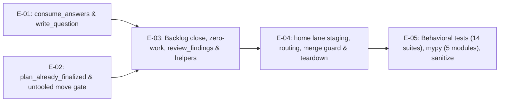
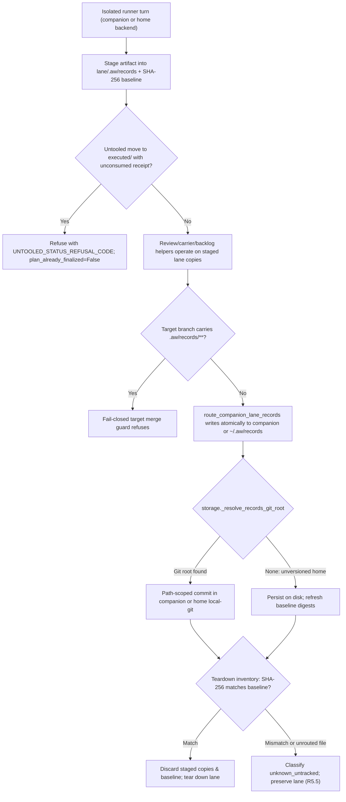

# IPD: Fix runner question inbox untooled finalize gate backlog close companion review and AW_HOME lanes

- Date: 2026-11-24
- Kind: child
- Concern: Nine verified runner and lane-containment bugs break companion (`records_backend == "companion"`) and `~/.aw/` (`AW_HOME` / `records_backend == "home"` / `clean-delta`) execution, review, and answer handling: (1) `agent_workflows/runner_shared.py::consume_answers` fails to commit and rolls back every human preflight answer on companion and unversioned `~/.aw/` artifacts (and both `agent_workflows/question_inbox.py::write_question` and `consume_answers` walk up to `<companion>` or `$HOME` instead of `project_context.py::record_owner_root(run_dir)`, while `consume_answers`'s fallback clears `rel_art_path` on external paths); (2) `agent_workflows/ipd_lifecycle.py::plan_already_finalized` and `runner_shared.py::execute_item_core` / `finalize_already_done` allow an untooled hand move into `executed/` to pass as exit 0 in companion and `~/.aw/` lanes; (3) `runner_shared.py::process_backlog_close` fails in both modes (`lane_executed_carrier_override` misses staged `executed/` plans, isolated companion/`home` closes mutate live external records or try to commit `.aw/records/**` onto target branches, and `commit_backlog_close` returns `None` for external records); (4) `runner_shared.py::read_zero_work_evidence` crashes with `TypeError: 'bool' object is not iterable` or overwrites `bool` `lane["dirty"]` with a `list[str]` in companion mode; (5) `agent_workflows/review_findings.py::review_dirs` and `_cached_subject_review_files` ignore staged lane reviews, causing `aw specs set reviewed` to refuse; (6) `runner_shared.py::handle_review_orchestrator_readiness`, `_promote_reviewed_plan`, `execute_item_core`'s re-review demote path, `perform_carrier_verification`, `reconcile_disposition` retirement detection, `commit_review_shared_output`, and `check_review_lane_artifacts` (`evaluate_durable_carrier` for newly created lane carriers) read or mutate live external records instead of staged lane copies; (7) `runner_shared.py::integrate_lane_branch` hardcodes `repo / ".aw" / "records" / "runs"` for `spec-anchor-check-unknown`; (8) `agent_workflows/lane_containment.py::driver_written_lane_paths` / `inventory_lane` does not account for digest-verified staged `.aw/records/**` paths (or the baseline manifest itself), stranding teardown on un-upgraded companion and `clean-delta` repos lacking `/records/` in `.aw/.gitignore`; and (9) `~/.aw/` (`records_backend == "home"`) lacks isolated-lane staging, prompt projection, routing, and the fail-closed target-repo `.aw/records/**` merge guard.
- Scope: Fix all nine runner, question-inbox, review-findings, and lane-containment bugs in `agent_workflows/runner_shared.py`, `agent_workflows/question_inbox.py`, `agent_workflows/review_findings.py`, `agent_workflows/lane_containment.py`, and `agent_workflows/ipd_lifecycle.py`, with behavioral tests covering companion and `~/.aw/` (`home`) runners across both `oc_runipd` and `agy_runipd`.
- Scope-Paths: agent_workflows/runner_shared.py, agent_workflows/question_inbox.py, agent_workflows/review_findings.py, agent_workflows/lane_containment.py, agent_workflows/ipd_lifecycle.py, tests/test_companion_runner_integration.py, tests/test_companion_ipd_lifecycle.py, tests/test_question_inbox.py, tests/test_home_isolation.py, .aw/records/plans/pending/20261124-comphome-06-4vnd36-fix-runner-question-inbox-untooled-finalize-gate-backlog-clo.ipd.md
- Item-Dependencies: executed:7hfx7r, executed:mmuv3v, executed:ywl7uc
- Status: approved
- Readiness: go-pending-approval
- Review-Depth: complex
- Priority: high
- Work-Kind: bug
- Blocks-Release: next
- Set: comphome
- Order: 6
- Highest E allocated: 5
- Id: 4vnd36
- Approval: 2026-11-27, recorded via aw ipd set: status set to approved
- Author: antigravity

> Write and proofread this plan per the technical writing standard, `.aw/system/workflows/technical-writing/technical-writing.md` (`.agents/workflows/technical-writing/technical-writing.md` in a legacy-layout install), including requirement 12 (diagrams).

## Workflow history

- 2026-11-27 approved (aw set): status set to approved
- 2026-11-25 reviewed (aw set): APPROVE WITH REVISIONS APPLIED; PR-001..PR-007
- 2026-11-25 /plan-review (antigravity/Gemini 4 Neon (High)): APPROVE WITH REVISIONS APPLIED; PR-001..PR-007
- 2026-11-24 to-review (antigravity): authored Order 06 child IPD for `/assess-bugs` (Set `comphome`).

## Goal

Close every runner gate bypass, preflight answer-rollback bug, backlog-close failure, companion review and carrier blind spot, and `~/.aw/` (`home`) isolated-lane gap across both `oc_runipd` and `agy_runipd`.

## Detailed Implementation Checklist (TODO)

Execution-state rule: mark an `E-*` item complete only after performing the action. That mark is not validation. Accepted execution states: blocked, failed, pending, performed; terminal gate demands 'performed'.

### Task group 1: Question inbox preflight answers and untooled `executed/` move gate

- [ ] E-01 Fix preflight answer persistence and repository resolution in `agent_workflows/runner_shared.py::consume_answers` and `agent_workflows/question_inbox.py::write_question`:
  1. When `repo` is not explicitly provided (or missing from `state["repo"]`), check `project_context.py::record_owner_root(run_dir)` FIRST (and, in `write_question`, also `record_owner_root(Path(cfg))` when `configured_file` is an absolute external path) before falling back to the `.git`/`.aw` parent walk, so companion `<companion>/records/runs/...` and `~/.aw/projects/<pid>/records/runs/...` runs resolve to their owning target repository instead of `<companion>` or `$HOME`.
  2. In `runner_shared.py::consume_answers`, when `rel_art_path` is absent and falls back to `queue_artifact_path(repo, item)`, preserve `art_p.resolve().as_posix()` on `ValueError` from `art_p.relative_to(repo)` instead of clearing `rel_art_path` to `""`.
  3. In `runner_shared.py::consume_answers`'s preflight-parked commit branch, resolve `commit_git_root = project_context.py::record_git_root(art_full)`:
     - When `commit_git_root is None` (unversioned `~/.aw/` or unversioned companion), accept the durable on-disk write from `record_oq_answer` without calling `git_commit_helper.py::offer_commit`, without restoring `pre_answer_snaps`, and without marking the question `stale` (recording `"commit": None, "unversioned": True` on the `answer-consumed` event).
     - When `commit_git_root is not None` (tracked, companion git, or `home` local-git), compute `commit_rel = art_full.resolve().relative_to(commit_git_root.resolve()).as_posix()` and invoke `git_commit_helper.py::offer_commit(commit_git_root, [commit_rel], ...)`, retaining snapshot rollback only when a versioned commit fails.
  - Depends on: none
  - Expected outcome: answering a preflight question on a companion or `~/.aw/` artifact resolves the owning target repository, commits cleanly inside `record_git_root` for versioned external repos, and persists durably without rollback on unversioned `~/.aw/` records instead of reverting and marking the answer `stale`.
  - Execution state: pending

- [ ] E-02 Close the untooled `executed/` move gate bypass in `agent_workflows/ipd_lifecycle.py::plan_already_finalized` and `agent_workflows/runner_shared.py::execute_item_core` / `finalize_already_done`:
  1. In `agent_workflows/ipd_lifecycle.py::plan_already_finalized(repo_root, plan_path, plan_id)`, check `read_receipt(repo_root, plan_id)` when `plan_id` is present and `bucket == "executed"`: if an unconsumed begin receipt still exists on disk, return `AlreadyFinalizedVerdict(False, bucket, commit)` so an untooled hand move into `executed/` (or an incomplete finalize whose receipt was never consumed) is never classified as already finalized, while preserving `AlreadyFinalizedVerdict(True, "executed", commit)` when finalize legitimately ran and consumed the receipt.
  2. In `agent_workflows/runner_shared.py::finalize_already_done`, ensure the external-lane containment guard (`companion-staged-baseline.json` check) covers both `companion` and `home` staged lanes so an external source file cannot substitute for a lane-staged plan.
  3. In `agent_workflows/runner_shared.py::execute_item_core` right beside the `check_status_untooled_range` check, also inspect staged external-records changes (`_collect_companion_lane_record_changes` generalized to `companion` and `home` backends against `read_companion_staged_baseline(lane_path)`): if a plan staged in the lane moved from a non-`executed` baseline path into `plans/executed/...` or gained `- Status: executed`/`done` while its begin receipt is still unconsumed on disk, synthesize a `check.status-untooled` drift finding and route it through the existing `UNTOOLED_STATUS_REFUSAL_CODE` retry/send-back path.
  - Depends on: none
  - Expected outcome: a worker moving a companion or `~/.aw/` plan by hand into `executed/` is refused with `UNTOOLED_STATUS_REFUSAL_CODE` and never passes `finalize_outcome` as exit 0, while genuine prior finalizes whose begin receipt was consumed retain idempotent exit-0 behavior.
  - Execution state: pending

### Task group 2: Backlog close, zero-work evidence, companion review/carrier helpers, and `review_findings`

- [ ] E-03 Fix companion and `~/.aw/` execution, review, backlog-close, and carrier helpers in `agent_workflows/runner_shared.py` and `agent_workflows/review_findings.py`:
  1. **Backlog close (`lane_executed_carrier_override`, `process_backlog_close`, `commit_backlog_close`):**
     - In `runner_shared.py::lane_executed_carrier_override`, probe `lane_containment.py::companion_staged_records_root(Path(lane_repo))` (or `ipd_lifecycle.py::_resolve_staged_companion_lane_plan`) first so a plan moved to `plans/executed/` inside a companion or `home` lane produces a valid override entry.
     - In `runner_shared.py::process_backlog_close`, when `isolated` and `write_repo` is an active external-records lane (`companion_staged_records_root(write_repo) is not None`), stage the resolved backlog item into `write_repo / ".aw" / "records"` via `resolve_companion_lane_path(write_repo, item_path, repo=repo, overwrite=False)` before calling `close_backlog_item` (so live external records are never mutated before integration), emit a logical `.aw/records/...` evidence path, and skip `commit_backlog_close` on `write_repo` (recording `closed=True, commit=None, wrote_in="lane"`, because `route_companion_lane_records` atomically routes the staged lane backlog move at integration without committing `.aw/records/**` onto the target lane branch).
     - For non-isolated closes (`not isolated`), update `runner_shared.py::commit_backlog_close` to resolve `git_root = project_context.py::record_git_root(project_records_dir(repo))` and run `git status --porcelain -uall` and `git_commit_helper.py::offer_commit` against `git_root` using `git_root`-relative backlog paths; when `git_root is None` (unversioned `~/.aw/` or unversioned companion), have `process_backlog_close` treat the on-disk move as succeeded (`closed=True, commit=None`) without failing on `commit_backlog_close` returning `None` (preserving `commit_backlog_close`'s `None`-means-refused contract on versioned repos).
  2. **Zero-work evidence (`read_zero_work_evidence`):** preserve `bool` `lane["dirty"] = True` (never calling `list(lane.get("dirty"))` or overwriting `bool` with a `list[str]`), record sorted external changed paths in `lane["companion_dirty_paths"]`, update `lane["dirty_count"]` safely, and cover both `companion` and `home` backends.
  3. **Staged review discovery (`review_findings.py::review_dirs` and `_cached_subject_review_files`):** prepend `staged_root / REVIEW_RECORD_CLASS` in `review_findings.py::review_dirs(repo_root)` whenever `lane_containment.py::companion_staged_records_root(Path(repo_root))` is present, so both `review_dirs` and `_cached_subject_review_files` (whose external-dir fallback scans any `review_dirs` entry outside `rec_resolved`) find newly written staged reviews in companion and `home` lanes and unblock `aw specs set reviewed`.
  4. **Orchestrator readiness, review promotion, and re-review demote (`handle_review_orchestrator_readiness`, `_promote_reviewed_plan`, `execute_item_core`):**
     - In `handle_review_orchestrator_readiness`, resolve `plan_file` via `lane_containment.py::resolve_companion_lane_path(tree, plan_path, repo=repo, overwrite=False)` when `tree != repo`, and when demoting back to `to-review` inside an external-records lane, update the staged lane file directly without mutating live external records and without running `git add`/`git commit` on `.aw/records/**` in the target lane.
     - In `_promote_reviewed_plan` and `execute_item_core`'s re-review demote path, resolve/stage the lane copy BEFORE running `aw ipd set reviewed|to-review` and target the staged file path (never bare `id6` against live external records), and stop passing `overwrite=True` after re-review demote so the freshly demoted staged copy is preserved while live external records stay untouched.
  5. **Carrier verification, retirement detection, shared-review commit, durable-carrier overlay, and runs fallback:**
     - In `perform_carrier_verification`, overlay any staged pending plans under `companion_staged_records_root(Path(work_dir))` when re-checking `check_engine.py::find_obligations_carried_by` so in-lane `- Carrier-Evidence:` edits clear the refusal.
     - In `reconcile_disposition`, when `plan_repo != repo` and `companion_staged_records_root(plan_repo)` is present, also check `staged_root / "plans" / <retired_bucket>` for `RETIRED_PLAN_BUCKETS` (`superseded`, `not-executed`) so in-lane companion/`home` retirements are detected.
     - In `commit_review_shared_output`, when `rec_git_root = project_context.py::record_git_root(project_records_dir(repo))` differs from `repo`, commit matching companion review/plan paths in `rec_git_root` with `_companion_git_base_env(repo, rec_git_root)` (and skip cleanly when `rec_git_root is None`).
     - In `check_review_lane_artifacts`, when `check_engine.py::evaluate_durable_carrier` reports a missing carrier `id6` and `wt_path / ".aw" / "records"` exists, accept the carrier if a conforming backlog/plan/spec file declaring that `id6` was newly created inside `wt_path / ".aw" / "records"`.
     - In `integrate_lane_branch`, replace hardcoded `runs_dir = repo / ".aw" / "records" / "runs"` in the `spec-anchor-check-unknown` branch with `state_root(runs_repo_root(repo))`.
  - Depends on: E-01, E-02
  - Expected outcome: `process_backlog_close`, zero-work recovery, companion and `home` spec/plan/orchestrator reviews, carrier verification, in-lane retirement detection, non-isolated companion review commits, durable-carrier checks, and `spec-anchor-check-unknown` logging all operate on the proper tree without mutating live external records prematurely or crashing.
  - Execution state: pending

### Task group 3: External `home` (`~/.aw/`) lane staging, routing, merge guard, and teardown manifest

- [ ] E-04 Extend isolated-lane external-records staging, prompt projection, routing, fail-closed target-repo `.aw/records/**` merge guard, and teardown accounting in `agent_workflows/lane_containment.py`, `agent_workflows/runner_shared.py`, and `agent_workflows/ipd_lifecycle.py`:
  1. Introduce one shared predicate `is_external_records_backend(ctx)` (`getattr(ctx, "records_backend", None) in ("companion", "home")` or `git_policies.get("records") == "companion-git"`) and route all external-records checks in `lane_containment.py` (`companion_staged_records_root`, `resolve_companion_lane_path`) and `runner_shared.py` (`_is_companion_records_context`, `_companion_aware_eval_root`, `route_companion_lane_records`, `integrate_lane_branch`, `read_zero_work_evidence`, `review_has_positive_evidence`, `reconcile_disposition`, `commit_plan_production_output`, `commit_spec_production_output`, and `execute_item_core`) through it while keeping existing function names backwards-compatible.
  2. Verify `route_companion_lane_records` routes writes and deletes back to `<AW_HOME>/projects/<pid>/records` cleanly for both unversioned `home` (`storage.py::_resolve_records_git_root` returns `None`, skipping git commit) and `home` local-git (`_resolve_records_git_root` returns `records_root`, committing path-scoped), and that `integrate_lane_branch`'s fail-closed `.aw/records/**` target-repo merge guard fires identically for both `companion` and `home` backends.
  3. Update `lane_containment.py::driver_written_lane_paths(lane_root)` (and `inventory_lane` teardown accounting) to include:
     - `COMPANION_STAGED_BASELINE_REL` (`.aw/state/companion-staged-baseline.json`) when present (needed on `clean-delta` and un-upgraded companion repos lacking `.aw/.gitignore` rules); and
     - each staged `.aw/records/<rel>` path recorded in `read_companion_staged_baseline(lane_root)` ONLY when its current on-disk SHA-256 matches the recorded baseline digest (covering both untouched staged inputs and already-routed files whose baseline `route_companion_lane_records` refreshed), while leaving any modified-but-unrouted or newly-created unrouted `.aw/records/**` file classified as `unknown_untracked` so spec `7ckptx` R5.5 fail-toward-preservation is strictly upheld.
  - Depends on: E-03
  - Expected outcome: `aw oc run` and `aw agy run` on a `records_backend == "home"` (`~/.aw/` / `clean-delta`) repo satisfy R1 prompt purity, work under OpenCode's `external_directory=deny`, route edits atomically back to `~/.aw/projects/<pid>/records`, refuse any `.aw/records/**` landing on target `main`, and tear down cleanly on both un-upgraded companion and `clean-delta` repos while still preserving lanes holding unrouted record edits.
  - Execution state: pending

### Task group 4: Behavioral verification

- [ ] E-05 Add end-to-end behavioral tests covering all nine fixes (positive and negative cases) in `tests/test_companion_runner_integration.py`, `tests/test_companion_ipd_lifecycle.py`, `tests/test_question_inbox.py`, and `tests/test_home_isolation.py`, then run bare `python3 -m pytest` on all 14 suites in `## Required tests / validation`, `python3 -m mypy` on all 5 modified modules, and `aw sanitize`:
  1. `tests/test_question_inbox.py`: test `write_question` and `consume_answers` on companion git and unversioned `~/.aw/` repos (verifying `record_owner_root(run_dir)`, external `rel_art_path` preservation, companion git commit in `record_git_root`, and non-rollback persistence on unversioned `~/.aw/`).
  2. `tests/test_companion_ipd_lifecycle.py`: test `plan_already_finalized` returning `already=False` when an unconsumed begin receipt exists vs `already=True` when consumed, and untooled hand-move into `executed/` refusal in companion and `~/.aw/` lanes.
  3. `tests/test_companion_runner_integration.py`: test `process_backlog_close` (isolated companion lane + non-isolated companion), `read_zero_work_evidence` with `lane["dirty"] is True` and companion edits (no `TypeError`, `dirty` stays `bool`, `companion_dirty_paths` populated), `review_findings.review_dirs` / `_cached_subject_review_files` seeing staged companion reviews (`aw specs set reviewed`), `handle_review_orchestrator_readiness`, `_promote_reviewed_plan`, re-review demote keeping live companion untouched, `perform_carrier_verification` seeing staged `- Carrier-Evidence:`, `reconcile_disposition` in-lane retirement detection, `commit_review_shared_output`, `check_review_lane_artifacts` accepting newly created lane carriers, `integrate_lane_branch` `spec-anchor-check-unknown` using `state_root`, and un-upgraded companion teardown (clean when routed/untouched; preserved when unrouted `.aw/records/` edits exist).
  4. `tests/test_home_isolation.py`: test `records_backend == "home"` (`~/.aw/` and `clean-delta`) isolated-lane staging, prompt projection, routing back to `~/.aw/projects/<pid>/records` (unversioned and local-git), fail-closed `.aw/records/**` target-repo merge guard refusal, non-isolated `process_backlog_close` on unversioned `~/.aw/`, and clean `clean-delta` lane teardown.
  - Depends on: E-04
  - Expected outcome: all 14 targeted pytest suites pass with zero failures (zero code-pinning source inspections), `mypy` reports zero errors on all 5 modified modules, and `aw sanitize` reports clean.
  - Execution state: pending

## Project conventions discovered (Step 0)

- Run pytest bare (`python3 -m pytest <targets>` without `-n0`, `-q`, or `-p no:randomly`).
- Test observable behavior only (`GUIDING_PRINCIPLES.md` P16; never write `inspect`/`ast`/regex production source inspections).
- Uphold spec `7ckptx` R5.5 fail-toward-preservation during lane teardown: only digest-verified baseline-matched files may be marked discardable.
- Commit path-scoped via `aw commit 4vnd36 -- <paths>` inside an isolated git worktree.

## Findings

Nine verified bugs from `/assess-bugs` run `20261124-213000` (with code-verified contracts from `/plan-review`):
- Blocker: `runner_shared.py::consume_answers` reverts and marks `stale` every human preflight answer on companion and unversioned `~/.aw/` artifacts, clears `rel_art_path` on external fallback, and falls back with `question_inbox.py::write_question` to `<companion>` / `$HOME` instead of `record_owner_root(run_dir)`.
- Blocker: untooled `executed/` move gate bypassed in companion and `~/.aw/` modes (`plan_already_finalized` returns `already=True` even with an unconsumed begin receipt, and `execute_item_core` does not inspect staged external-records moves).
- Blocker: `~/.aw/` (`records_backend == "home"`) lacks isolated-lane staging, prompt projection, routing, and the fail-closed target-repo `.aw/records/**` merge guard across 12 `records_backend == "companion"` checks.
- High: `runner_shared.py::process_backlog_close` fails in companion and `~/.aw/` modes (`lane_executed_carrier_override`, live-companion mutation or target-branch commit hazard in isolated lanes, and `commit_backlog_close` returning `None` for external records).
- High: `runner_shared.py::read_zero_work_evidence` raises `TypeError` on `list(True)` or breaks `isinstance(dirty, bool)`.
- High: `review_findings.py::review_dirs` and `_cached_subject_review_files` ignore staged companion/`home` lane reviews, breaking `aw specs set reviewed`.
- High: `handle_review_orchestrator_readiness`, `_promote_reviewed_plan`, re-review demote (`overwrite=True`), `perform_carrier_verification`, and `check_review_lane_artifacts` durable-carrier check read or mutate live external records instead of staged lane copies.
- Medium: `reconcile_disposition` misses companion/`home` in-lane retirement; `commit_review_shared_output` ignores companion git repos; un-upgraded companion and `clean-delta` repos strand lane teardown unless digest-verified baseline paths and `.aw/state/companion-staged-baseline.json` are accounted for.
- Low: `integrate_lane_branch` hardcodes `repo / ".aw" / "records" / "runs"` for `spec-anchor-check-unknown`.

## Proposed changes (ordered, validatable)

1. Fix `runner_shared.py::consume_answers` and `question_inbox.py::write_question` owner resolution, external path preservation, and versioned/unversioned persistence (`E-01`).
2. Close the untooled `executed/` move bypass in `ipd_lifecycle.py::plan_already_finalized` and `runner_shared.py::execute_item_core` / `finalize_already_done` (`E-02`).
3. Fix backlog close, zero-work evidence, `review_findings.py`, and all companion/`home` review, carrier, retirement, and shared-commit helpers (`E-03`).
4. Generalize lane staging, prompt projection, routing, target-repo `.aw/records/**` merge guard, and digest-verified teardown accounting to `records_backend in ("companion", "home")` (`E-04`).
5. Add end-to-end behavioral tests and run all 14 pytest suites, `mypy`, and `aw sanitize` (`E-05`).

## Deferred / out of scope (with reason)

- Core storage, unified `AW_HOME`, and `artifact_core.py::git_mv` are owned by Order 01 (`ywl7uc`).
  - Carrier: ywl7uc
- Installer policy alignment and `leak_sanitizer` allowlist placement are owned by Order 02 (`7gverp`).
  - Carrier: 7gverp
- `status_set.py` self-commits, companion finalize locking, `selectors.py`, and `artifact_meta.py` are owned by Order 03 (`mmuv3v`).
  - Carrier: mmuv3v
- CLI record verbs, `attention.py::scan`, `plan_readiness.py`, and non-staged `check_engine.py` rules are owned by Order 04 (`7eivm2`).
  - Carrier: 7eivm2
- Companion pre-commit hooks, staged `check_engine.py` gates, `runners_monitor`, `run_viewer`, `checkup`, `set_records`, and `clean-delta` inbox are owned by Order 05 (`7hfx7r`).
  - Carrier: 7hfx7r
- Companion `action=plan` backlog/spec production, `ipd_authoring.run_scaffold`, `backlog_graduate_legitimacy`, `route_companion_lane_records --no-renames`, `resolve_companion_lane_path` non-resurrection, and `artifact_meta.legacy_context` state-root fixes already landed in commit `c8a130148`.
  - Carrier-Declined: already landed on main in commit c8a130148

## Scope check

- Over-scope: none.
- Under-scope: none; covers every open runner, question-inbox, review-findings, and lane-containment bug from `/assess-bugs`.

## Required tests / validation

- `python3 -m pytest tests/test_companion_runner_integration.py tests/test_companion_ipd_lifecycle.py tests/test_question_inbox.py tests/test_home_isolation.py tests/test_question_preflight.py tests/test_question_resume.py tests/test_finalize_stale_plan_path.py tests/test_finidem_reusable_not_finalized.py tests/test_runner_backlog_close_behavior.py tests/test_inlane_retirement_lands.py tests/test_isolation_per_action.py tests/test_carrier_finished_verification.py tests/test_review_findings_gate.py tests/test_clean_target_control_state.py`
- `python3 -m mypy agent_workflows/runner_shared.py agent_workflows/question_inbox.py agent_workflows/review_findings.py agent_workflows/lane_containment.py agent_workflows/ipd_lifecycle.py`
- `aw sanitize`

## Spec / documentation sync

No spec or user-doc edit is required. Checked `.aw/records/specs/` (`7ckptx` lane containment including R1 prompt purity and R5.5 fail-toward-preservation, `6kwd2e` question inbox, `25kzda` runner gates, and `4sd62s` metadata store): all nine fixes enforce those documented contracts on companion and `~/.aw/` (`home`) backends without altering public CLI flags or schemas.

## Open questions

None.

## Validation and cross-check (verify before reporting done)

Validation-state rule: inspect evidence in a separate pass. Do not mark a `V-*` item complete from memory or from the matching execution checkmark. Accepted validation results: blocked, failed, pass, pending; terminal gate demands 'pass'.

- [ ] V-01 validates E-01
  - Required evidence: paste bare `python3 -m pytest tests/test_question_inbox.py tests/test_question_preflight.py tests/test_question_resume.py` output proving preflight answers commit cleanly inside `record_git_root` for companion git repos, persist without rollback on unversioned `~/.aw/` records, preserve external `rel_art_path` on fallback, and resolve `record_owner_root(run_dir)` instead of `<companion>` or `$HOME`.
  - Observed evidence:
  - Result: pending

- [ ] V-02 validates E-02
  - Required evidence: paste bare `python3 -m pytest tests/test_companion_ipd_lifecycle.py tests/test_finalize_stale_plan_path.py tests/test_finidem_reusable_not_finalized.py` output proving `plan_already_finalized` returns `already=False` while an unconsumed begin receipt exists on disk (and `already=True` when consumed), and a hand move into `executed/` in a companion or `~/.aw/` lane is refused with `UNTOOLED_STATUS_REFUSAL_CODE` instead of passing `finalize_outcome` as exit 0.
  - Observed evidence:
  - Result: pending

- [ ] V-03 validates E-03
  - Required evidence: paste bare `python3 -m pytest tests/test_companion_runner_integration.py tests/test_runner_backlog_close_behavior.py tests/test_inlane_retirement_lands.py tests/test_isolation_per_action.py tests/test_carrier_finished_verification.py tests/test_review_findings_gate.py` output proving `process_backlog_close` (isolated lane + non-isolated companion/unversioned `home`), `read_zero_work_evidence` (`dirty=True` + companion changes without `TypeError`), `review_findings.review_dirs`/`_cached_subject_review_files` (`aw specs set reviewed`), `handle_review_orchestrator_readiness`, `_promote_reviewed_plan`, re-review demote, `perform_carrier_verification`, `reconcile_disposition`, `commit_review_shared_output`, `check_review_lane_artifacts` durable-carrier overlay, and `integrate_lane_branch` `state_root` fallback all pass without prematurely mutating live external records.
  - Observed evidence:
  - Result: pending

- [ ] V-04 validates E-04
  - Required evidence: paste bare `python3 -m pytest tests/test_companion_runner_integration.py tests/test_home_isolation.py tests/test_clean_target_control_state.py` output proving `lane_containment.py` and `runner_shared.py` stage and project lane-local paths for `records_backend == "home"`, route edits back to `~/.aw/projects/<pid>/records` (unversioned and local-git), refuse `.aw/records/**` merges into target `main`, and tear down cleanly on un-upgraded companion and `clean-delta` repos when baseline digests match while preserving lanes with unrouted `.aw/records/**` edits.
  - Observed evidence:
  - Result: pending

- [ ] V-05 validates E-05
  - Required evidence: paste full bare `python3 -m pytest` summary across all 14 suites listed in `## Required tests / validation`, `python3 -m mypy` zero-error output on all 5 modified modules (`runner_shared.py`, `question_inbox.py`, `review_findings.py`, `lane_containment.py`, `ipd_lifecycle.py`), and `aw sanitize` clean output.
  - Observed evidence:
  - Result: pending

## Approval and execution gate

- Size assessment: exception
- Cohesion rationale: The 5 runner and lane modules (`runner_shared.py`, `question_inbox.py`, `review_findings.py`, `lane_containment.py`, `ipd_lifecycle.py`) and 4 companion/home test suites share one external-records lane-staging, routing, baseline-accounting, and gate contract across both `companion` and `home` backends; landing them together as Order 06 in Set `comphome` prevents half-wired lane isolation and closes the Set cleanly after `ywl7uc`, `mmuv3v`, and `7hfx7r`.

Execution contract:
- **Approval and open questions:** Execute only after human approval (`Status: approved`) and after `executed:ywl7uc`, `executed:mmuv3v`, and `executed:7hfx7r`. No open questions remain.
- **Scope fence:** `- Scope-Paths:` declares the expected edit surface. If execution genuinely requires editing a file outside `- Scope-Paths:` or leaving a declared path unmodified, complete the work and supply `--scope-reason` / `--scope-ack` at finalize (do not abandon the turn over a scope declaration; stop only for an unsafe condition such as an unresolvable concurrent-edit conflict or absent prerequisite symbols).
- **Honesty rule (MUST):** Paste actual command output in `Observed evidence:` for every `V-*` item; never claim a pytest, `mypy`, or `aw sanitize` run passed without executing it on the final code.
- **Commit and push:** Commit only path-scoped files you modified via `aw commit 4vnd36 -- <paths>` inside an isolated git worktree (never `git add -A`, `-a`, or bare `git add`); never push, tag, or release.
- **Lifecycle transition:** Finalize is mandatory once all `E-*` items are `performed` and all `V-*` items are `pass`. When executed by an automated runner (`aw oc run` / `aw agy run`), leave status transition and finalize to the runner; when executed standalone by an agent or human, run `aw ipd finalize 4vnd36`. Never hand-roll `git mv` into `.aw/records/plans/executed/`.
