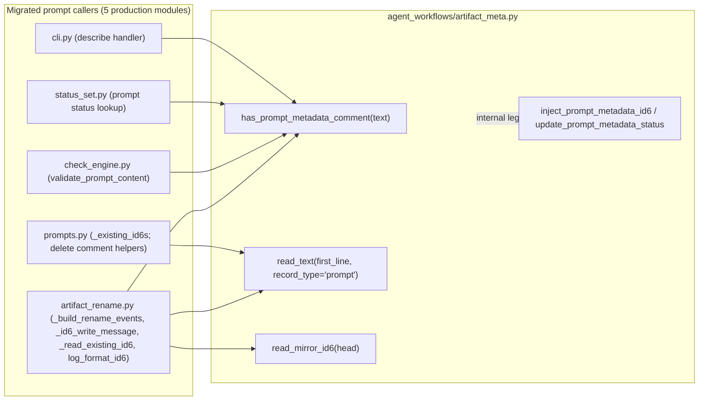

# IPD: Move surviving aw-prompt and managed-prompt comment helpers into artifact_meta

- Date: 2026-11-24
- Kind: child
- Concern: Spec `4sd62s` C5 and AC-1 part (1) require all artifact metadata readers and writers to live exclusively in `agent_workflows/artifact_meta.py` (plus `agent_workflows/migrations/m0001_*.py`). Plan `9o83cr` E-14 found surviving `<!-- aw-prompt: ... -->` and `<!-- aw-managed-prompt: ... -->` metadata parsers and writers in `prompts.py` (`_METADATA_ID_RE`, `has_metadata_comment`, `inject_metadata_id6`, `update_metadata_status`, `inject_metadata_status`), `check_engine.py` (`validate_prompt_content`), and `artifact_rename.py` (`_build_rename_events` inline `Set:` regexes, `_MIRROR_ID_RE`, `_MANAGED_PROMPT_ID_RE`), with callers in `artifact_meta.py`, `cli.py`, and `status_set.py` (tracked in backlog `iedbnn`). This focused plan consolidates those helpers into `artifact_meta.py` ahead of `9o83cr` (replacing E-02 of superseded `rgva3w`).
- Scope: Move prompt metadata comment detection, `id6`/`Set` injection, status update, trailer constant, and post-cutover mirror-id reading (`PROMPT_METADATA_TRAILER`, `has_prompt_metadata_comment`, `inject_prompt_metadata_id6`, `update_prompt_metadata_status`, `read_mirror_id6`) into `agent_workflows/artifact_meta.py`; remove the reverse-delegation imports from `artifact_meta.py` into `prompts.py`; remove the surviving prompt metadata parsers and writers from `prompts.py`, `check_engine.py`, and `artifact_rename.py` (retargeting callers in `prompts.py`, `cli.py`, `status_set.py`, `check_engine.py`, and `artifact_rename.py`); and verify with `@pytest.mark.core` behavioral tests in `tests/test_prompts_set_surface.py`. Excludes `Workflow history` readers (`wgn3bl`), specs/backlog `^-` regexes (`fkvrc7`), `Scope-Paths` writer and widened front-matter readers (`75jciz`), `cli.py` user-facing help text (`90iqr1`), and the `9o83cr` final AC-1 audit.
- Scope-Paths: agent_workflows/artifact_meta.py, agent_workflows/prompts.py, agent_workflows/check_engine.py, agent_workflows/artifact_rename.py, agent_workflows/cli.py, agent_workflows/status_set.py, tests/test_prompts_set_surface.py, .aw/records/plans/pending/20261124-metastore-302-t3t7za-move-surviving-aw-prompt-and-managed-prompt-comment-helpers.ipd.md
- Item-Dependencies: executed:0xsx2n, executed:e8420v, executed:k6jd6l, executed:q6epwc, executed:snin8q
- Status: reviewed
- Readiness: go-pending-approval
- Review-Depth: complex
- From-Spec: 4sd62s
- From-Backlog: iedbnn
- Priority: high
- Work-Kind: bug
- Blocks-Release: next
- Set: metastore
- Order: 302
- Highest E allocated: 4
- Id: t3t7za
- Author: antigravity

> Write and proofread this plan per the technical writing standard, `.aw/system/workflows/technical-writing/technical-writing.md` (`.agents/workflows/technical-writing/technical-writing.md` in a legacy-layout install), including requirement 12 (diagrams).

## Workflow history

- 2026-11-25 reviewed (aw set): APPROVE WITH REVISIONS APPLIED; PR-001..PR-008 FIXED
- 2026-11-25 /plan-review (antigravity/gemini): APPROVE WITH REVISIONS APPLIED; PR-001, PR-002, PR-003, PR-004, PR-005, PR-006, PR-007, PR-008; review record .aw/records/reviews/20261124-metastore-302-t3t7za-move-surviving-aw-prompt-and-managed-prompt-comment-helpers.review.md
- 2026-11-24 to-review (antigravity): authored Order 302 child plan (split from superseded `rgva3w` per maintainer decision 2026-11-25, ahead of `9o83cr`) covering `iedbnn`.

## Goal

Consolidate every `aw-prompt` and `aw-managed-prompt` metadata comment parser, writer, and mirror-id reader into `agent_workflows/artifact_meta.py` (enforcing spec `4sd62s` C5 and AC-1 part (1)) so zero prompt metadata regexes or comment writers remain in `prompts.py`, `check_engine.py`, `artifact_rename.py`, `cli.py`, or `status_set.py` ahead of `9o83cr`.

## Detailed Implementation Checklist (TODO)

Execution-state rule: mark an `E-*` item complete only after performing the action. That mark is not validation. Accepted execution states: blocked, failed, pending, performed; terminal gate demands 'performed'.

### Task group 1: Move prompt comment helpers into `artifact_meta.py` (`4sd62s` C5)

- [ ] E-01 Move prompt metadata comment ownership into `agent_workflows/artifact_meta.py` and retarget `artifact_meta.py`, `prompts.py`, `cli.py`, and `status_set.py`:
  1. Add `PROMPT_METADATA_TRAILER`, `has_prompt_metadata_comment(text: str) -> bool`, `inject_prompt_metadata_id6(text: str, *, id6: str, set_id: Optional[str] = None) -> str`, `update_prompt_metadata_status(text: str, status: str) -> str`, and `read_mirror_id6(text: str) -> Optional[str]` (handling optional UTF-8 BOM `\ufeff`, `---\nid: <id6>`, and `<!-- aw-managed-prompt: id: <id6> ... -->` via `artifact_meta`'s own mirror parsers) to `agent_workflows/artifact_meta.py`. Preserve refusal-to-mint purity on commentless prompts (returning `text` unchanged) and idempotency when `Id:` or the target `Status:` already exists.
  2. Update `agent_workflows/artifact_meta.py`'s own six reverse-delegation sites (`_parse_metadata_comment`, `_render_status`, `_split_prompt_comment`, `_render_prompt_create_comment`, `_render_field`, `_render_checkpoint`) to call `artifact_meta`'s own helpers and `PROMPT_METADATA_TRAILER` directly instead of importing `prompts`.
  3. In `agent_workflows/prompts.py`: delete `_METADATA_ID_RE`, `has_metadata_comment`, `inject_metadata_id6`, `update_metadata_status`, and `inject_metadata_status`; retarget `prompts._existing_id6s` onto `artifact_meta.read_text(first, record_type="prompt").id6`; keep `_METADATA_TRAILER = _meta.PROMPT_METADATA_TRAILER` as a plain-text constant alias so `tests/test_writers_create_summary.py` remains unchanged.
  4. Update `agent_workflows/cli.py` (describe handler, `_prompts.has_metadata_comment`) and `agent_workflows/status_set.py` (`_prompts.has_metadata_comment`) to call `artifact_meta.has_prompt_metadata_comment(text)`.
  - Depends on: none
  - Expected outcome: `artifact_meta.py` owns all prompt metadata comment helpers with zero reverse imports of `prompts`, `prompts.py` contains zero `aw-prompt` regexes or comment writers, and prompt creation, describe, and status-transition tests pass.
  - Execution state: pending

### Task group 2: Retarget `check_engine.py` and `artifact_rename.py` (`4sd62s` C5)

- [ ] E-02 Replace all surviving prompt comment and mirror-id parsers in `agent_workflows/check_engine.py` and `agent_workflows/artifact_rename.py` with `artifact_meta` readers:
  1. In `agent_workflows/check_engine.py::validate_prompt_content`, replace the inline first-line check (`first_line.startswith("<!--") and "aw-prompt:" in first_line`) with `artifact_meta.has_prompt_metadata_comment(text)` (not `read_text`, which would misclassify minimal comments lacking `id`/`status` or body bullets).
  2. In `agent_workflows/artifact_rename.py`: replace all three `_prompts.has_metadata_comment` calls (`_build_rename_events`, `_id6_write_message`, `_read_existing_id6`) with `artifact_meta.has_prompt_metadata_comment(text)`; replace both inline `Set:` regexes in `_build_rename_events` (`r"(?:\A|\|)\s*Set:\s*[^|]+"`) with `artifact_meta.read_text(text.split("\n", 1)[0], record_type="prompt").fields.get("set")`; delete `_MIRROR_ID_RE` and `_MANAGED_PROMPT_ID_RE` and replace their `log_format_id6` match loop with `artifact_meta.read_mirror_id6(head)`.
  - Depends on: E-01
  - Expected outcome: zero `aw-prompt`, `aw-managed-prompt`, `Set:`, or mirror-id regexes or inline comment parsers remain in `check_engine.py` and `artifact_rename.py`, while prompt content validation, `--to-id6` / `Set:` renames, and `log_format_id6` preserve existing contracts.
  - Execution state: pending

### Task group 3: Behavioral tests and validation (`4sd62s` AC-1, C10a)

- [ ] E-03 Update `tests/test_prompts_set_surface.py` (retargeting `prompts.has_metadata_comment` to `artifact_meta.has_prompt_metadata_comment`) and add a `@pytest.mark.core` behavioral test class exercising:
  1. `artifact_meta.has_prompt_metadata_comment` (conforming `aw-prompt`, minimal `Kind`-only comment, commentless prompt, non-leading body comment ignored).
  2. `artifact_meta.inject_prompt_metadata_id6` and `update_prompt_metadata_status` (inject `Id:`/`Set:`, idempotency, status update and insertion, commentless refusal-to-mint purity).
  3. `check_engine.validate_prompt_content` (missing comment, minimal comment without `Id:`, mismatched `Id:`/`Status:`, conforming prompt).
  4. `artifact_rename` prompt `Set:`/`--to-id6` renames (with and without comment) and `artifact_rename.log_format_id6` on front-matter `---\nid:` and `<!-- aw-managed-prompt: id: ... -->` mirrors (including leading UTF-8 BOM).
  Assert observable outputs, diagnostics, exit codes, and file bytes only; zero code-pinning source reads.
  - Depends on: E-02
  - Expected outcome: all existing and new `@pytest.mark.core` behavioral tests in `tests/test_prompts_set_surface.py` pass under `python3 -m pytest`.
  - Execution state: pending

- [ ] E-04 Run targeted pytest suites across all affected prompt, rename, check-engine, and `artifact_meta` test modules, bare core-tier `python3 -m pytest`, `python3 -m mypy` on all 6 modified production files, `rg` over `prompts.py`, `check_engine.py`, `artifact_rename.py`, `cli.py`, and `status_set.py` confirming zero surviving prompt-comment parsers/writers/regexes (only docstrings, comments, and user-facing messages), and `aw sanitize --agent`.
  - Depends on: E-03
  - Expected outcome: all targeted tests and the bare core gate pass, `mypy` reports zero errors across all 6 production files, `rg` confirms zero parser/writer/regex hits remain outside `artifact_meta.py` and `migrations/m0001_*.py`, and `aw sanitize --agent` reports clean (`pass`).
  - Execution state: pending

## Project conventions discovered (Step 0)

- Spec `4sd62s` C5 and AC-1 part (1) require `agent_workflows/artifact_meta.py` to be the sole metadata reader and writer outside `agent_workflows/migrations/m0001_*.py`.
- Spec `4sd62s` C10a requires every pre-cutover commit on `main` to keep the legacy bullet/comment format working and pass the bare core pytest gate (`python3 -m pytest`).
- Prompt purity (`prompt-purity-lint` R1/P4; `ubac5n` OQ-02): a commentless prompt must never have a metadata comment minted on `inject` or `status` update; its identity or status stays in the filename/directory only.
- Tests must test observable behavior only (no `inspect`, `ast`, regex, or source-reading assertions, per `GUIDING_PRINCIPLES.md` P16).
- Commit path-scoped via `aw commit t3t7za -- <paths>` in an isolated worktree.

## Findings

Verified statically against the repository (tracked in graduated backlog `iedbnn`):

| Module & symbol | Current behavior | Target `artifact_meta` helper |
|---|---|---|
| `agent_workflows/prompts.py::_METADATA_ID_RE`, `_existing_id6s` | Parses line 1 `Id:` with local regex. | `artifact_meta.read_text(first, record_type="prompt").id6`. |
| `agent_workflows/prompts.py::has_metadata_comment`, `inject_metadata_id6`, `update_metadata_status`, `inject_metadata_status`, `_METADATA_TRAILER` | Local comment detector, writers, alias, and trailer constant (also reverse-imported by `artifact_meta.py` at 6 sites). | Move into `artifact_meta.py` (`PROMPT_METADATA_TRAILER`, `has_prompt_metadata_comment`, `inject_prompt_metadata_id6`, `update_prompt_metadata_status`); keep plain-text `_METADATA_TRAILER` alias in `prompts.py`. |
| `agent_workflows/cli.py` (`14687`), `agent_workflows/status_set.py` (`1607`) | Call `_prompts.has_metadata_comment(text)`. | `artifact_meta.has_prompt_metadata_comment(text)`. |
| `agent_workflows/check_engine.py::validate_prompt_content` | Inline `first_line.startswith("<!--") and "aw-prompt:" in first_line`. | `artifact_meta.has_prompt_metadata_comment(text)`. |
| `agent_workflows/artifact_rename.py::_build_rename_events`, `_id6_write_message`, `_read_existing_id6` | 3 calls to `_prompts.has_metadata_comment` plus 2 inline `r"(?:\A|\|)\s*Set:\s*[^|]+"` regexes. | `artifact_meta.has_prompt_metadata_comment(text)` and `artifact_meta.read_text(first_line, record_type="prompt").fields.get("set")`. |
| `agent_workflows/artifact_rename.py::_MIRROR_ID_RE`, `_MANAGED_PROMPT_ID_RE`, `log_format_id6` | Local BOM-tolerant regexes for `---\nid:` and `<!-- aw-managed-prompt: id:`. | `artifact_meta.read_mirror_id6(head)`. |

## Proposed changes (ordered, validatable)

1. Move prompt comment helpers, trailer constant, and `read_mirror_id6` into `agent_workflows/artifact_meta.py`, remove `artifact_meta.py`'s reverse imports of `prompts`, remove the surviving parser/writer symbols from `prompts.py`, and retarget `prompts._existing_id6s`, `cli.py`, and `status_set.py` (`E-01`).
2. Retarget `check_engine.validate_prompt_content` and `artifact_rename.py` (`_build_rename_events`, `_id6_write_message`, `_read_existing_id6`, `log_format_id6`) onto `artifact_meta` readers (`E-02`).
3. Update `tests/test_prompts_set_surface.py` and add `@pytest.mark.core` behavioral tests (`E-03`), then run targeted pytest suites, bare core pytest, `mypy`, `rg`, and `aw sanitize --agent` (`E-04`).

## Deferred / out of scope (with reason)

- `Workflow history` section readers are owned by Order 301 (`wgn3bl`).
  - Carrier: wgn3bl
- Specs/backlog `^-` regexes are owned by Order 303 (`fkvrc7`).
  - Carrier: fkvrc7
- `Scope-Paths` writer and widened front-matter readers are owned by Order 304 (`75jciz`).
  - Carrier: 75jciz
- User-facing help text referencing `<!-- aw-prompt: ... -->` in `agent_workflows/cli.py` is owned by the cutover documentation plan (`90iqr1`).
  - Carrier: 90iqr1
- Final AC-1 zero-survivors audit across `agent_workflows/` is owned by `9o83cr`.
  - Carrier: 9o83cr

## Scope check

- Over-scope: none; strictly limited to prompt metadata comment helpers, mirror-id extraction in `artifact_rename.py`, and their callers.
- Under-scope: none; covers every `iedbnn` survivor including `prompts._METADATA_ID_RE`, `artifact_rename._build_rename_events` inline `Set:` regexes, and `artifact_meta.py`'s reverse imports of `prompts`.

## Required tests / validation

- Targeted suites:
  - `python3 -m pytest tests/test_prompts_set_surface.py tests/test_prompts_new.py tests/test_prompts_index.py tests/test_prompts_attention.py tests/test_writers_create_summary.py`
  - `python3 -m pytest tests/test_artifact_rename.py tests/test_log_rename_events.py tests/test_readers_check_engine.py tests/test_readers_record_modules.py tests/test_artifact_meta_legacy.py tests/test_artifact_meta_legacy_writer.py tests/test_artifact_meta_legacy_write.py`
- Core gate: `python3 -m pytest`
- Type check: `python3 -m mypy agent_workflows/artifact_meta.py agent_workflows/prompts.py agent_workflows/check_engine.py agent_workflows/artifact_rename.py agent_workflows/cli.py agent_workflows/status_set.py`
- Survivor search: `rg -n "aw-prompt|aw-managed-prompt|_METADATA_ID_RE|has_metadata_comment|inject_metadata_id6|update_metadata_status|inject_metadata_status|_MIRROR_ID_RE|_MANAGED_PROMPT_ID_RE" agent_workflows/prompts.py agent_workflows/check_engine.py agent_workflows/artifact_rename.py agent_workflows/cli.py agent_workflows/status_set.py`
- Sanitizer: `aw sanitize --agent`

## Spec / documentation sync

N/A: enforces existing approved spec `4sd62s` C5 and AC-1 part (1) in phase B without changing any public CLI syntax, file format, or prompt-purity rule; post-cutover documentation updates remain owned by `90iqr1` and `cxxmyv`.

## Open questions

None.

## Validation and cross-check (verify before reporting done)

Validation-state rule: inspect evidence in a separate pass. Do not mark a `V-*` item complete from memory or from the matching execution checkmark. Accepted validation results: blocked, failed, pass, pending; terminal gate demands 'pass'.

- [ ] V-01 validates E-01
  - Required evidence: paste `rg -n "aw-prompt|aw-managed-prompt|_METADATA_ID_RE|has_metadata_comment|inject_metadata_id6|update_metadata_status|inject_metadata_status" agent_workflows/prompts.py agent_workflows/cli.py agent_workflows/status_set.py` confirming zero parser/writer/regex hits (only docstrings, comments, or `cli.py` help strings), `rg -n "from agent_workflows import prompts" agent_workflows/artifact_meta.py` empty, and `python3 -m pytest tests/test_prompts_new.py tests/test_prompts_set_surface.py tests/test_writers_create_summary.py tests/test_artifact_meta_legacy.py tests/test_artifact_meta_legacy_writer.py tests/test_artifact_meta_legacy_write.py` passing summary.
  - Observed evidence:
  - Result: pending

- [ ] V-02 validates E-02
  - Required evidence: paste `rg -n "aw-prompt|aw-managed-prompt|_MIRROR_ID_RE|_MANAGED_PROMPT_ID_RE|has_metadata_comment|\\\\|\\\\)\\\\s\\*Set:" agent_workflows/check_engine.py agent_workflows/artifact_rename.py` (or `rg -n "aw-prompt|aw-managed-prompt|_MIRROR_ID_RE|_MANAGED_PROMPT_ID_RE|has_metadata_comment" agent_workflows/check_engine.py agent_workflows/artifact_rename.py` plus checking `_build_rename_events`) confirming zero parser/writer/regex hits (only docstrings and user-facing Drift/CLI message strings), and `python3 -m pytest tests/test_prompts_index.py tests/test_readers_check_engine.py tests/test_readers_record_modules.py tests/test_artifact_rename.py tests/test_log_rename_events.py` passing summary.
  - Observed evidence:
  - Result: pending

- [ ] V-03 validates E-03
  - Required evidence: paste `python3 -m pytest -v tests/test_prompts_set_surface.py` showing all existing and new `@pytest.mark.core` behavioral tests passing (covering `has_prompt_metadata_comment`, `inject_prompt_metadata_id6`, `update_prompt_metadata_status`, `validate_prompt_content`, prompt `Set:`/`--to-id6` renames, and `log_format_id6` mirror id extraction with BOM), and `rg -n "inspect\.|import ast|getsource|read_text\(.*agent_workflows" tests/test_prompts_set_surface.py` empty.
  - Observed evidence:
  - Result: pending

- [ ] V-04 validates E-04
  - Required evidence: paste the bare `python3 -m pytest` summary line (`N passed`), `python3 -m mypy agent_workflows/artifact_meta.py agent_workflows/prompts.py agent_workflows/check_engine.py agent_workflows/artifact_rename.py agent_workflows/cli.py agent_workflows/status_set.py` zero-error output, the full `rg` survivor-search output over `prompts.py`, `check_engine.py`, `artifact_rename.py`, `cli.py`, and `status_set.py` confirming zero parser/writer/regex hits, and `aw sanitize --agent` clean (`pass`) output.
  - Observed evidence:
  - Result: pending

## Approval and execution gate

- Size assessment: standard
- Cohesion rationale: not required

Execute only after human approval (`Status: approved`) and after every plan in `- Item-Dependencies:` is `executed` (`0xsx2n`, `e8420v`, `k6jd6l`, `q6epwc`, `snin8q`). Open questions: none.

Scope fence: `- Scope-Paths:` declares every file this plan intends to modify. Any needed file outside `- Scope-Paths:` is edited and justified at finalize with `--scope-reason`; any declared file left unmodified is acknowledged with `--scope-ack`.

Safety: if any prerequisite prompt/mirror parser in `agent_workflows/artifact_meta.py` is absent, or an unresolvable concurrent-edit conflict occurs in a shared file, stop and report immediately rather than overwriting or guessing.

Honesty rule: run every command listed in `## Required tests / validation` and `V-01..V-04`, and paste the actual runner output; never claim a test, type check, search, or sanitizer run passed without running it.

Commits: commit only files you modified for this task via `aw commit t3t7za -- <paths>` (never `git add -A`, bare `git add`, or `git commit -a`); never push.

Lifecycle transition: move the plan to `.aw/records/plans/executed/` only via `aw ipd finalize` (never a hand `git mv`), and only after `aw ipd lint --phase pre-transition` conforms, every `E-*` is `performed`, and every `V-*` is `pass` with pasted evidence. When `aw oc run` or `aw agy run` executes the plan, the runner performs finalize; a hand executor runs `aw ipd finalize t3t7za` itself.
