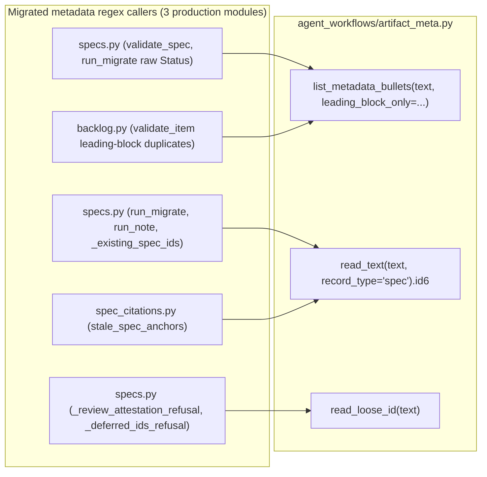

# IPD: Replace surviving specs and backlog front-matter regexes via artifact_meta bullet helper

- Date: 2026-11-24
- Kind: child
- Concern: Spec `4sd62s` C5 and AC-1 part (1) forbid `^-` metadata regular-expression literals outside `agent_workflows/artifact_meta.py` and `agent_workflows/migrations/m0001_*.py`. Five surviving `^-` metadata regexes remain in `agent_workflows/specs.py` (`_SPEC_ID_RE`, `_TOP_KEY_RE`, the `^- Status:` match in `run_migrate`, `_SPEC_ID_BULLET_RE`) and `agent_workflows/backlog.py` (`_TOP_KEY_RE`), with a cross-module caller in `agent_workflows/spec_citations.py::stale_spec_anchors` (backlog `ebbfmn`), and `artifact_meta.py` lacks a public helper listing every metadata bullet with its original key spelling and duplicate values (backlog `vl7ybn`). This focused plan adds `artifact_meta.list_metadata_bullets` and eliminates all five surviving `^-` metadata regexes ahead of `9o83cr` (replacing E-03 of superseded `rgva3w`).
- Scope: Add `list_metadata_bullets(text: str, *, leading_block_only: bool = False) -> List[Tuple[str, str]]` in `agent_workflows/artifact_meta.py` (delivering the helper requested by `vl7ybn`); delete `specs._SPEC_ID_RE`, `specs._TOP_KEY_RE`, the inline `^- Status:` regex in `specs.run_migrate`, `specs._SPEC_ID_BULLET_RE`, and `backlog._TOP_KEY_RE`, retargeting all six call sites in `specs.py`, `backlog.py`, and `spec_citations.py` onto `artifact_meta` readers (`ebbfmn`); and verify with `@pytest.mark.core` behavioral tests in `tests/test_backlog_metadata_duplicate_and_gate_summary.py` and `tests/test_specs_metadata_duplicate_bullet.py`. Excludes `Workflow history` readers including `migrations/chain.py::_WORKFLOW_HISTORY_RE` (`wgn3bl`), prompt comment helpers (`t3t7za`), `Scope-Paths` writer and widened front-matter readers (`75jciz`), optional follow-up simplification of `runner_shared._region_bullet_keys` and `plans_refs._check_order_lines` (carried by `vl7ybn`), and the `9o83cr` final AC-1 audit.
- Scope-Paths: agent_workflows/artifact_meta.py, agent_workflows/specs.py, agent_workflows/backlog.py, agent_workflows/spec_citations.py, tests/test_backlog_metadata_duplicate_and_gate_summary.py, tests/test_specs_metadata_duplicate_bullet.py, .aw/records/plans/pending/20261124-metastore-303-fkvrc7-replace-surviving-specs-and-backlog-front-matter-regexes-via.ipd.md
- Item-Dependencies: executed:0xsx2n, executed:e8420v, executed:k6jd6l, executed:q6epwc, executed:snin8q
- Status: approved
- Readiness: go-pending-approval
- Review-Depth: complex
- From-Spec: 4sd62s
- From-Backlog: ebbfmn
- Priority: high
- Work-Kind: bug
- Blocks-Release: next
- Set: metastore
- Order: 303
- Highest E allocated: 4
- Id: fkvrc7
- Approval: 2026-11-25, recorded via aw ipd set: status set to approved
- Author: antigravity

> Write and proofread this plan per the technical writing standard, `.aw/system/workflows/technical-writing/technical-writing.md` (`.agents/workflows/technical-writing/technical-writing.md` in a legacy-layout install), including requirement 12 (diagrams).

## Workflow history

- 2026-11-25 approved (aw set): status set to approved
- 2026-11-25 reviewed (aw set): APPROVE WITH REVISIONS APPLIED; PR-001..PR-007 FIXED
- 2026-11-25 /plan-review (antigravity/gemini): APPROVE WITH REVISIONS APPLIED; PR-001, PR-002, PR-003, PR-004, PR-005, PR-006, PR-007; review record .aw/records/reviews/20261124-metastore-303-fkvrc7-replace-surviving-specs-and-backlog-front-matter-regexes-via.review.md
- 2026-11-24 to-review (antigravity): authored Order 303 child plan (split from superseded `rgva3w` per maintainer decision 2026-11-25, ahead of `9o83cr`) covering `ebbfmn` and `vl7ybn`.

## Goal

Add the public `list_metadata_bullets` helper to `agent_workflows/artifact_meta.py` and eliminate all five surviving `^-` metadata regex literals in `agent_workflows/specs.py` and `agent_workflows/backlog.py` (plus the caller in `agent_workflows/spec_citations.py`) ahead of `9o83cr` (enforcing spec `4sd62s` C5 and AC-1 part (1)).

## Detailed Implementation Checklist (TODO)

Execution-state rule: mark an `E-*` item complete only after performing the action. That mark is not validation. Accepted execution states: blocked, failed, pending, performed; terminal gate demands 'performed'.

### Task group 1: Public metadata-bullet listing helper in `artifact_meta.py` (`vl7ybn`, `4sd62s` C5)

- [x] E-01 Add `list_metadata_bullets(text: str, *, leading_block_only: bool = False) -> List[Tuple[str, str]]` to `agent_workflows/artifact_meta.py`:
  1. Normalize `\r\n` to `\n` and split on `\n` (never `str.splitlines()`, which splits on bare `\r` or U+2028).
  2. Match top-level metadata bullets with `r"^- ([A-Za-z0-9_-]+):(?:\s*(.*))?$"`, returning `(original_key, raw_value)` tuples in file order while preserving original key spelling and every duplicate occurrence.
  3. When `leading_block_only=False` (default, for specs and general metadata blocks), scan every line before the first `line.startswith("## ")`, skipping `# Title`, blank lines, and non-bullet prose.
  4. When `leading_block_only=True` (for backlog items), stop at the first `line.startswith("## ")` OR the first non-blank line that does not start with `"- "` (including indented sub-bullets such as `"  - ..."`, preserving the deliberate sub-bullet boundary contract pinned by `tests/test_backlog_metadata_duplicate_and_gate_summary.py::test_sub_bullet_boundary_deliberate_non_finding`).
  - Depends on: none
  - Expected outcome: `agent_workflows/artifact_meta.py` exposes `list_metadata_bullets` preserving original key spelling, duplicate values, and both boundary modes without changing any existing `artifact_meta` reader.
  - Execution state: performed

### Task group 2: Replace all five `^-` metadata regexes in `specs.py`, `backlog.py`, and `spec_citations.py` (`ebbfmn`, `4sd62s` C5)

- [x] E-02 Delete the five surviving `^-` metadata regex literals and retarget all callers onto `artifact_meta`:
  1. In `agent_workflows/specs.py`:
     - Delete `_TOP_KEY_RE` and replace `validate_spec`'s duplicate-bullet loop with `artifact_meta.list_metadata_bullets(text, leading_block_only=False)`, keeping `SPEC_MULTI_VALUED_KEYS` and exact `spec.metadata-bullet-repeated` detail wording unchanged.
     - Replace the inline `re.match(r"^- Status:\s*(.*)$", line)` in `specs.run_migrate` with a lookup over `artifact_meta.list_metadata_bullets(text, leading_block_only=False)` for key `"Status"` (preserving capture of legacy trailing-prose status lines such as `- Status: approved (2026-09-25)`).
     - Delete `_SPEC_ID_RE` and replace its three call sites (`run_migrate`, `run_note`, `_existing_spec_ids`) with `artifact_meta.read_text(text, record_type="spec").id6` (validated via `core.is_valid_id6`).
     - Delete `_SPEC_ID_BULLET_RE` and replace its two call sites (`_review_attestation_refusal`, `_deferred_ids_refusal`) with `artifact_meta.read_loose_id(text or "")` (preserving loose whitespace tolerance after `-`).
  2. In `agent_workflows/backlog.py`:
     - Delete `_TOP_KEY_RE` and replace `validate_item`'s duplicate-bullet loop with `artifact_meta.list_metadata_bullets(text, leading_block_only=True)`, keeping the `Kind -> Work-Kind` canonicalization and `backlog.metadata-bullet-repeated` detail wording unchanged.
  3. In `agent_workflows/spec_citations.py`:
     - Replace `specs._SPEC_ID_RE.search(sp.read_text(encoding="utf-8"))` in `stale_spec_anchors` with `artifact_meta.read_text(sp.read_text(encoding="utf-8"), record_type="spec").id6` (validated via `core.is_valid_id6`).
  - Depends on: E-01
  - Expected outcome: `specs.py`, `backlog.py`, and `spec_citations.py` contain zero `^-` metadata regex literals while preserving duplicate-bullet detection (including backlog indented sub-bullet boundary), spec id lookup, `specs.run_migrate`, review-attestation / deferred-ID transition gates, and `stale_spec_anchors`.
  - Execution state: performed

### Task group 3: Behavioral tests and validation (`4sd62s` AC-1, C10a)

- [x] E-03 Add `@pytest.mark.core` behavioral tests in `tests/test_backlog_metadata_duplicate_and_gate_summary.py` and `tests/test_specs_metadata_duplicate_bullet.py` covering:
  1. `artifact_meta.list_metadata_bullets` (original key spelling, duplicate values in order, `leading_block_only=False` vs. `leading_block_only=True` stopping at indented sub-bullets, post-`## ` prose ignored, `\r\n` normalization).
  2. `specs.run_migrate` capturing raw trailing-prose `- Status:` values via `artifact_meta`, `specs._review_attestation_refusal` / `_deferred_ids_refusal` reading loose `-Id:` / `-  Id:` bullets via `read_loose_id`, and `spec_citations.stale_spec_anchors` resolving spec id6 via `artifact_meta`.
  Assert observable outputs, diagnostics, and file bytes only; zero source-reading assertions.
  - Depends on: E-02
  - Expected outcome: all existing and new `@pytest.mark.core` duplicate-bullet, spec-id, spec-migration, and citation-anchor behavioral tests pass.
  - Execution state: performed

- [x] E-04 Run targeted pytest suites across all affected spec, backlog, citation, and `artifact_meta` test modules, bare core-tier `python3 -m pytest`, `python3 -m mypy` on all 4 modified production files, `rg` confirming zero `^-` metadata regex literals in `specs.py`, `backlog.py`, and `spec_citations.py`, and `aw sanitize --agent`.
  - Depends on: E-03
  - Expected outcome: all targeted tests and the bare core gate pass, `mypy` reports zero errors across all 4 production files, `rg` reports zero `^-` metadata regex hits in `specs.py`, `backlog.py`, and `spec_citations.py`, and `aw sanitize --agent` reports clean (`pass`).
  - Execution state: performed

## Project conventions discovered (Step 0)

- Spec `4sd62s` C5 and AC-1 part (1) forbid `^-` metadata regexes outside `agent_workflows/artifact_meta.py` and `agent_workflows/migrations/m0001_*.py`.
- Spec `4sd62s` C10a requires every pre-cutover commit on `main` to keep the legacy bullet-block format working and pass the bare core pytest gate (`python3 -m pytest`).
- `specs.validate_spec` scans all lines before `## `, whereas `backlog.validate_item` stops at the first non-blank non-`- ` line (including indented sub-bullets, pinned by `tests/test_backlog_metadata_duplicate_and_gate_summary.py::test_sub_bullet_boundary_deliberate_non_finding`).
- `artifact_meta.read_loose_id(text)` already exists (`agent_workflows/artifact_meta.py::read_loose_id`) for loose-whitespace `- Id:` bullets.
- `- From-Backlog:` is single-valued (`ipd_schema.py::META_FROM_BACKLOG`), so this plan carries `- From-Backlog: ebbfmn` while also delivering the public bullet-listing helper of `vl7ybn`.
- Tests must test observable behavior only (no `inspect`, `ast`, regex, or source-reading assertions, per `GUIDING_PRINCIPLES.md` P16).
- Commit path-scoped via `aw commit fkvrc7 -- <paths>` in an isolated worktree.

## Findings

Verified statically against the repository (covering graduated backlog `ebbfmn` and open backlog `vl7ybn`):

| Module & symbol | Current behavior | Target `artifact_meta` reader |
|---|---|---|
| `agent_workflows/specs.py::_TOP_KEY_RE` (`validate_spec`) | Matches `^- ([A-Za-z0-9_-]+):...` across `lines[:_metadata_end(lines)]` to emit `spec.metadata-bullet-repeated`. | `artifact_meta.list_metadata_bullets(text, leading_block_only=False)`. |
| `agent_workflows/specs.py::run_migrate` (`^- Status:`) | Inline `re.match(r"^- Status:\s*(.*)$", line)` captures non-bare-enum status prose for migration history. | `artifact_meta.list_metadata_bullets(text, leading_block_only=False)` (first `"Status"` entry). |
| `agent_workflows/specs.py::_SPEC_ID_RE` (`run_migrate`, `run_note`, `_existing_spec_ids`) | Matches `(?m)^- Id:\s*([0-9a-z]{6})\s*$`. | `artifact_meta.read_text(text, record_type="spec").id6` (validated `core.is_valid_id6`). |
| `agent_workflows/specs.py::_SPEC_ID_BULLET_RE` (`_review_attestation_refusal`, `_deferred_ids_refusal`) | Matches `(?m)^-[ \t]*Id:[ \t]*([0-9a-z]{6})[ \t]*$`. | `artifact_meta.read_loose_id(text or "")`. |
| `agent_workflows/backlog.py::_TOP_KEY_RE` (`validate_item`) | Matches `^- ([A-Za-z0-9_-]+):...` over leading contiguous `- ` block (stopping at `## ` or indented/prose line) to emit `backlog.metadata-bullet-repeated`. | `artifact_meta.list_metadata_bullets(text, leading_block_only=True)`. |
| `agent_workflows/spec_citations.py::stale_spec_anchors` | Calls `specs._SPEC_ID_RE.search(...)` to map spec id6 to path. | `artifact_meta.read_text(text, record_type="spec").id6` (validated `core.is_valid_id6`). |

## Proposed changes (ordered, validatable)

1. Add `list_metadata_bullets(text, *, leading_block_only=False)` to `agent_workflows/artifact_meta.py` (`E-01`).
2. Delete the five surviving `^-` metadata regex literals in `specs.py` and `backlog.py` and retarget all six call sites across `specs.py`, `backlog.py`, and `spec_citations.py` onto `artifact_meta` (`E-02`).
3. Add `@pytest.mark.core` behavioral tests in `tests/test_backlog_metadata_duplicate_and_gate_summary.py` and `tests/test_specs_metadata_duplicate_bullet.py` (`E-03`) and run targeted pytest suites, bare core pytest, `mypy`, `rg`, and `aw sanitize --agent` (`E-04`).

## Deferred / out of scope (with reason)

- `Workflow history` section readers (including `agent_workflows/migrations/chain.py::_WORKFLOW_HISTORY_RE`) are owned by Order 301 (`wgn3bl`).
  - Carrier: wgn3bl
  - Carrier-Evidence: .aw/records/plans/executed/20261124-metastore-301-wgn3bl-migrate-surviving-workflow-history-section-readers-onto-arti.ipd.md
- Prompt comment helpers are owned by Order 302 (`t3t7za`).
  - Carrier: t3t7za
  - Carrier-Evidence: .aw/records/plans/executed/20261124-metastore-302-t3t7za-move-surviving-aw-prompt-and-managed-prompt-comment-helpers.ipd.md
- `Scope-Paths` writer and widened front-matter readers are owned by Order 304 (`75jciz`).
  - Carrier: 75jciz
- Optional follow-up simplification of `agent_workflows/runner_shared.py::_region_bullet_keys` and `agent_workflows/plans_refs.py::_check_order_lines` to call the new `artifact_meta.list_metadata_bullets` helper (neither contains a `^-` regex) remains tracked in backlog `vl7ybn`.
  - Carrier: vl7ybn
- Final AC-1 zero-survivors audit across `agent_workflows/` is owned by `9o83cr`.
  - Carrier: 9o83cr

## Scope check

- Over-scope: none; strictly limited to `artifact_meta.list_metadata_bullets` and removing the five surviving `^-` metadata regexes in `specs.py` and `backlog.py` (plus the `spec_citations.py` caller). `migrations/chain.py` is excluded because it has zero `^-` regexes and its `_WORKFLOW_HISTORY_RE` is owned by `wgn3bl`.
- Under-scope: none for `ebbfmn` (all five `^-` regexes and all six call sites are removed ahead of `9o83cr`); `vl7ybn`'s helper is delivered here while optional refactoring of `runner_shared._region_bullet_keys` and `plans_refs._check_order_lines` stays carried by `vl7ybn`.

## Required tests / validation

- Targeted suites:
  - `python3 -m pytest tests/test_artifact_meta_legacy.py tests/test_backlog_metadata_duplicate_and_gate_summary.py tests/test_specs_metadata_duplicate_bullet.py`
  - `python3 -m pytest tests/test_specs_verbs.py tests/test_spec_id6_filenames.py tests/test_spec_citation_anchors.py tests/test_specs_status_dirs.py tests/test_specs_set_adapter.py tests/test_specs_evidence_gate_parity.py tests/test_specs_recursive_read.py tests/test_spec_review_attestation.py tests/test_implementing_spec_replan.py tests/test_backlog.py`
- Core gate: `python3 -m pytest`
- Type check: `python3 -m mypy agent_workflows/artifact_meta.py agent_workflows/specs.py agent_workflows/backlog.py agent_workflows/spec_citations.py`
- Survivor search: `rg -n "re\.(compile|search|match|finditer|findall|sub|fullmatch)\(\s*r?[\"'](\(\?m\))?\^-" agent_workflows/specs.py agent_workflows/backlog.py agent_workflows/spec_citations.py`
- Sanitizer: `aw sanitize --agent`

## Spec / documentation sync

N/A: enforces existing approved spec `4sd62s` C5 and AC-1 part (1) in phase B without changing any public CLI syntax, file format, or duplicate-bullet rule; post-cutover documentation updates remain owned by `90iqr1` and `cxxmyv`.

## Open questions

None.

## Validation and cross-check (verify before reporting done)

Validation-state rule: inspect evidence in a separate pass. Do not mark a `V-*` item complete from memory or from the matching execution checkmark. Accepted validation results: blocked, failed, pass, pending; terminal gate demands 'pass'.

- [x] V-01 validates E-01
  - Required evidence: paste `python3 -m pytest tests/test_artifact_meta_legacy.py tests/test_backlog_metadata_duplicate_and_gate_summary.py tests/test_specs_metadata_duplicate_bullet.py` output proving `artifact_meta.list_metadata_bullets` preserves original key spelling, duplicate values in order, and both `leading_block_only=False` and `leading_block_only=True` boundary modes.
  - Observed evidence: `python3 -m pytest tests/test_artifact_meta_legacy.py tests/test_backlog_metadata_duplicate_and_gate_summary.py tests/test_specs_metadata_duplicate_bullet.py` -> `46 passed in 7.74s` (exit 0).
  - Result: pass

- [x] V-02 validates E-02
  - Required evidence: paste `rg -n "re\.(compile|search|match|finditer|findall|sub|fullmatch)\(\s*r?[\"'](\(\?m\))?\^-" agent_workflows/specs.py agent_workflows/backlog.py agent_workflows/spec_citations.py` showing zero hits, `rg -n "_SPEC_ID_RE|_TOP_KEY_RE|_SPEC_ID_BULLET_RE" agent_workflows/specs.py agent_workflows/backlog.py agent_workflows/spec_citations.py` showing zero code hits, plus `python3 -m pytest tests/test_specs_verbs.py tests/test_spec_id6_filenames.py tests/test_spec_citation_anchors.py tests/test_specs_status_dirs.py tests/test_specs_set_adapter.py tests/test_specs_evidence_gate_parity.py tests/test_specs_recursive_read.py tests/test_spec_review_attestation.py tests/test_implementing_spec_replan.py tests/test_backlog.py` passing summary.
  - Observed evidence: `rg -n "re\.(compile|search|match|finditer|findall|sub|fullmatch)\(\s*r?[\"'](\(\?m\))?\^-" agent_workflows/specs.py agent_workflows/backlog.py agent_workflows/spec_citations.py` -> empty (0 hits, exit 1); `rg -n "_SPEC_ID_RE|_TOP_KEY_RE|_SPEC_ID_BULLET_RE" agent_workflows/specs.py agent_workflows/backlog.py agent_workflows/spec_citations.py` -> empty (0 hits, exit 1); `python3 -m pytest tests/test_specs_verbs.py tests/test_spec_id6_filenames.py tests/test_spec_citation_anchors.py tests/test_specs_status_dirs.py tests/test_specs_set_adapter.py tests/test_specs_evidence_gate_parity.py tests/test_specs_recursive_read.py tests/test_spec_review_attestation.py tests/test_implementing_spec_replan.py tests/test_backlog.py` -> `169 passed in 16.37s` (exit 0).
  - Result: pass

- [x] V-03 validates E-03
  - Required evidence: paste `python3 -m pytest -v tests/test_backlog_metadata_duplicate_and_gate_summary.py tests/test_specs_metadata_duplicate_bullet.py` showing all existing and new `@pytest.mark.core` behavioral tests passing, and `rg -n "inspect\.|import ast|getsource|read_text\(.*agent_workflows" tests/test_backlog_metadata_duplicate_and_gate_summary.py tests/test_specs_metadata_duplicate_bullet.py` empty.
  - Observed evidence: `python3 -m pytest -v tests/test_backlog_metadata_duplicate_and_gate_summary.py tests/test_specs_metadata_duplicate_bullet.py` -> `20 passed in 2.35s` (exit 0); `python3 -m pytest -vv tests/test_backlog_metadata_duplicate_and_gate_summary.py tests/test_specs_metadata_duplicate_bullet.py` -> `20 passed in 4.24s` (including `test_list_metadata_bullets_preserves_spelling_duplicates_and_crlf`, `test_list_metadata_bullets_boundary_modes`, `test_run_migrate_captures_trailing_prose_status_via_artifact_meta`, `test_refusals_read_loose_id_bullets_via_artifact_meta`, `test_stale_spec_anchors_resolves_spec_id_via_artifact_meta`); `rg -n "inspect\.|import ast|getsource|read_text\(.*agent_workflows" tests/test_backlog_metadata_duplicate_and_gate_summary.py tests/test_specs_metadata_duplicate_bullet.py` -> empty (0 hits, exit 1).
  - Result: pass

- [x] V-04 validates E-04
  - Required evidence: paste the bare `python3 -m pytest` summary line (`N passed`), `python3 -m mypy agent_workflows/artifact_meta.py agent_workflows/specs.py agent_workflows/backlog.py agent_workflows/spec_citations.py` zero-error output, the zero-hit `rg` output over `specs.py`, `backlog.py`, and `spec_citations.py`, and `aw sanitize --agent` clean (`pass`) output.
  - Observed evidence: bare `python3 -m pytest` -> `2917 passed, 1 skipped, 11 warnings in 177.60s (0:02:57)` (exit 0); `python3 -m mypy agent_workflows/artifact_meta.py agent_workflows/specs.py agent_workflows/backlog.py agent_workflows/spec_citations.py` -> `Success: no issues found in 4 source files` (exit 0); `rg -n "re\.(compile|search|match|finditer|findall|sub|fullmatch)\(\s*r?[\"'](\(\?m\))?\^-" agent_workflows/specs.py agent_workflows/backlog.py agent_workflows/spec_citations.py` -> empty (0 hits, exit 1); `aw sanitize --agent` -> `{"schema":"aw.agent/v1","kind":"result","cmd":"check-local-leaks","outcome":"clean","exit":0,"verified":true,"complete":true,"checked":7225,"findings":0,"evidence":["leak-scan"],"next":null}`.
  - Result: pass

## Approval and execution gate

- Size assessment: standard
- Cohesion rationale: not required

Execute only after human approval (`Status: approved`) and after every plan in `- Item-Dependencies:` is `executed` (`0xsx2n`, `e8420v`, `k6jd6l`, `q6epwc`, `snin8q`). Open questions: none.

Scope fence: `- Scope-Paths:` declares every file this plan intends to modify. Any needed file outside `- Scope-Paths:` is edited and justified at finalize with `--scope-reason`; any declared file left unmodified is acknowledged with `--scope-ack`.

Safety: if any prerequisite reader in `agent_workflows/artifact_meta.py` (`read_text`, `read_loose_id`) is absent, or an unresolvable concurrent-edit conflict occurs in a shared file, stop and report immediately rather than overwriting or guessing.

Honesty rule: run every command listed in `## Required tests / validation` and `V-01..V-04`, and paste the actual runner output; never claim a test, type check, search, or sanitizer run passed without running it.

Commits: commit only files you modified for this task via `aw commit fkvrc7 -- <paths>` (never `git add -A`, bare `git add`, or `git commit -a`); never push.

Lifecycle transition: move the plan to `.aw/records/plans/executed/` only via `aw ipd finalize` (never a hand `git mv`), and only after `aw ipd lint --phase pre-transition` conforms, every `E-*` is `performed`, and every `V-*` is `pass` with pasted evidence. When `aw oc run` or `aw agy run` executes the plan, the runner performs finalize; a hand executor runs `aw ipd finalize fkvrc7` itself.
