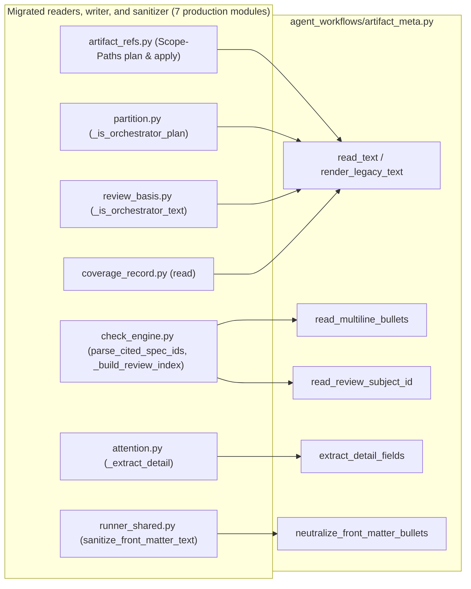

# IPD: Replace Scope-Paths bullet writer and widened front-matter readers via artifact_meta

- Date: 2026-11-24
- Kind: child
- Concern: Spec `4sd62s` C5 and AC-1 part (1) require a single metadata reader and writer (`agent_workflows/artifact_meta.py`) outside `agent_workflows/migrations/m0001_*.py`. Plan `9o83cr` E-14 and `786w7r`'s widened multiline/`(?mi)` search identified one surviving metadata bullet writer (`agent_workflows/artifact_refs.py::_SCOPE_PATHS_LINE_RE` in `plan_scope_path_reference_rewrites` and `apply_scope_path_reference_rewrites`), six surviving front-matter readers (`partition._ORCHESTRATOR_KIND_RE`, `review_basis._is_orchestrator_text`, `check_engine._TARGET_BULLET_RE`, `check_engine._REVIEW_SUBJECT_ID_RE`, `coverage_record._FINGERPRINT_LINE_RE`, `coverage_record._CHECKED_LINE_RE`, `attention._FIELD_PATTERNS`), and one front-matter bullet sanitizer regex (`runner_shared._PROPOSAL_BULLET_RE` in `sanitize_front_matter_text`), tracked in open/graduated backlogs `avze51` and `hmtpj2`. This focused plan consolidates all of those readers, writers, and front-matter bullet grammar helpers into `artifact_meta.py` ahead of `9o83cr` (replacing E-04 of superseded `rgva3w`).
- Scope: Add four pure helpers in `agent_workflows/artifact_meta.py` (`extract_detail_fields`, `read_multiline_bullets`, `read_review_subject_id`, `neutralize_front_matter_bullets`); rewrite `artifact_refs.plan_scope_path_reference_rewrites` and `apply_scope_path_reference_rewrites` to read and write `Scope-Paths` through `artifact_meta` (deleting `_SCOPE_PATHS_LINE_RE`); replace `partition._ORCHESTRATOR_KIND_RE`, `review_basis._is_orchestrator_text`, `check_engine._TARGET_BULLET_RE`, `check_engine._REVIEW_SUBJECT_ID_RE`, `coverage_record._FINGERPRINT_LINE_RE`, `coverage_record._CHECKED_LINE_RE`, `attention._FIELD_PATTERNS`, and `runner_shared._PROPOSAL_BULLET_RE` with `artifact_meta` calls; and verify with `@pytest.mark.core` behavioral tests and the explicit widened `rg -U` audit. Excludes `Workflow history` readers (`wgn3bl`), prompt comment helpers (`t3t7za`), specs/backlog `^-` regexes (`fkvrc7`), N3 body-prose / history-line regexes (`check_engine._GRADUATED_LINE_RE`, `_IMPLEMENTING_LINE_RE`, `attention._OQ_STATUS_RE`, `_EV_LEAF_RE`, `runner_shared.record_oq_answer` OQ body rewrites, `ipd_lint._HISTORY_ATTRIB_RE`, `_COVERAGE_HIST_RE`, `plan_readiness._HISTORY_RECORD_PARTS_RE`, `review_findings._OQ_FINDING_REF_RE`), and the `9o83cr` final AC-1 audit.
- Scope-Paths: agent_workflows/artifact_meta.py, agent_workflows/artifact_refs.py, agent_workflows/partition.py, agent_workflows/review_basis.py, agent_workflows/check_engine.py, agent_workflows/coverage_record.py, agent_workflows/attention.py, agent_workflows/runner_shared.py, tests/test_partition.py, .aw/records/plans/pending/20261124-metastore-304-75jciz-replace-scope-paths-bullet-writer-and-widened-front-matter-r.ipd.md
- Item-Dependencies: executed:0xsx2n, executed:e8420v, executed:k6jd6l, executed:q6epwc, executed:snin8q
- Status: approved
- Readiness: go-pending-approval
- Review-Depth: complex
- From-Spec: 4sd62s
- From-Backlog: avze51
- Priority: high
- Work-Kind: bug
- Blocks-Release: next
- Set: metastore
- Order: 304
- Highest E allocated: 4
- Id: 75jciz
- Approval: 2026-11-25, recorded via aw ipd set: status set to approved
- Author: antigravity

> Write and proofread this plan per the technical writing standard, `.aw/system/workflows/technical-writing/technical-writing.md` (`.agents/workflows/technical-writing/technical-writing.md` in a legacy-layout install), including requirement 12 (diagrams).

## Workflow history

- 2026-11-25 approved (aw set): status set to approved
- 2026-11-25 reviewed (aw set): APPROVE WITH REVISIONS APPLIED; PR-001..PR-007 FIXED
- 2026-11-25 /plan-review (antigravity/gemini): APPROVE WITH REVISIONS APPLIED; PR-001, PR-002, PR-003, PR-004, PR-005, PR-006, PR-007; review record .aw/records/reviews/20261124-metastore-304-75jciz-replace-scope-paths-bullet-writer-and-widened-front-matter-r.review.md
- 2026-11-24 to-review (antigravity): authored Order 304 child plan (split from superseded `rgva3w` per maintainer decision 2026-11-25, ahead of `9o83cr`) covering `avze51` and `hmtpj2`.

## Goal

Remove the surviving `Scope-Paths` bullet writer in `agent_workflows/artifact_refs.py`, every widened-search front-matter metadata reader across `partition.py`, `review_basis.py`, `check_engine.py`, `coverage_record.py`, and `attention.py`, and the front-matter bullet sanitizer regex in `runner_shared.py`, consolidating them into `agent_workflows/artifact_meta.py` ahead of `9o83cr` (enforcing spec `4sd62s` C5 and AC-1 part (1)).

## Detailed Implementation Checklist (TODO)

Execution-state rule: mark an `E-*` item complete only after performing the action. That mark is not validation. Accepted execution states: blocked, failed, pending, performed; terminal gate demands 'performed'.

### Task group 1: Shared `artifact_meta` helpers and `Scope-Paths` bullet writer (`avze51`, `4sd62s` C5)

- [ ] E-01 Add the four pure helpers needed by `E-02` in `agent_workflows/artifact_meta.py`, and migrate `agent_workflows/artifact_refs.py` off `_SCOPE_PATHS_LINE_RE`:
  1. In `agent_workflows/artifact_meta.py`, add four pure, typed helpers:
     - `extract_detail_fields(text: str) -> Tuple[Optional[str], Optional[str]]`: implements the `Summary -> Scope -> Concern -> Question -> Title` fallback cascade case-insensitively, checking bulleted `- <Key>: <val>` before leading YAML front-matter `key: <val>` at each step (preserving exact `attention._extract_detail` semantics).
     - `read_multiline_bullets(text: str, keys: Sequence[str]) -> List[str]`: extracts each requested top-level `- <Key>:` bullet header value plus all immediately following continuation lines until the next `- ` bullet, `#` heading, or blank line (for `check_engine.parse_cited_spec_ids`).
     - `read_review_subject_id(text: str) -> Optional[str]`: returns the 6-char `Subject-Id` declared in a review record's front matter (or `None` if absent/invalid).
     - `neutralize_front_matter_bullets(text: str) -> str`: indents any line matching top-level `- <Key>:` front-matter bullet syntax by two spaces so untrusted text cannot forge front-matter fields when appended to a record.
  2. In `agent_workflows/artifact_refs.py`:
     - Delete `_SCOPE_PATHS_LINE_RE`.
     - Update `plan_scope_path_reference_rewrites` to read `Scope-Paths` via `artifact_meta.read_text(text, record_type="ipd").fields.get("scope_paths")`, passing the raw string (or re-joined list) through `ipd_schema.parse_scope_paths` so `is_grandfathered`, forward-declaration skip (`new_path in declared_paths`), and match detection remain unchanged.
     - Update `apply_scope_path_reference_rewrites` to read existing `Scope-Paths` through `artifact_meta.read_text` and write the updated `scope_paths` list through `artifact_meta.render_legacy_text` (`[{"op": "set", "fields": {"scope_paths": new_declared}}]`, `record_type="ipd"`, `LegacyRender(..., history=False)`) + `_core.atomic_write(plan_file, updated_text, prefix=prefix)` (using `artifact_meta`'s existing `_LEGACY_BULLET_LABEL["scope_paths"]` and `_format_legacy_value`), preserving `prefix=prefix`, leaving prose and fenced blocks byte-identical, and appending no workflow history line.
  - Depends on: none
  - Expected outcome: `artifact_refs.py` performs zero direct `Scope-Paths` bullet regex reads or writes, `artifact_meta.py` exposes the four pure helpers, and `tests/test_artifact_refs_rewrite.py` and `tests/test_scope_path_target_stale.py` pass.
  - Execution state: pending

### Task group 2: Widened front-matter metadata readers and bullet sanitizer (`avze51`, `hmtpj2`, `4sd62s` C5)

- [ ] E-02 Replace all surviving widened-search front-matter metadata regexes across six modules with `artifact_meta` calls:
  1. `agent_workflows/partition.py`: delete `_ORCHESTRATOR_KIND_RE` and update `_is_orchestrator_plan` to check `str(artifact_meta.read_text(artifact_meta.metadata_region(head), record_type="ipd").fields.get("plan_role") or "").strip().lower() == "orchestrator"`.
  2. `agent_workflows/review_basis.py`: replace the inline `re.search(r"(?mi)^-\s*Kind:\s*orchestrator\b", text[:4096])` in `_is_orchestrator_text` with the same `artifact_meta.read_text(artifact_meta.metadata_region(text[:4096]), record_type="ipd").fields.get("plan_role")` check.
  3. `agent_workflows/check_engine.py`:
     - Delete `_TARGET_BULLET_RE` and update `parse_cited_spec_ids` to call `artifact_meta.read_multiline_bullets(plan_text, ("Concern", "Scope", "Scope-Paths"))`, preserving multiline continuation capture and deduplicated order.
     - Delete `_REVIEW_SUBJECT_ID_RE` and update `_build_review_index` (line 10773) to call `artifact_meta.read_review_subject_id(text)`.
  4. `agent_workflows/coverage_record.py`: delete `_FINGERPRINT_LINE_RE` and `_CHECKED_LINE_RE`; read `coverage_fingerprint` and `coverage_checked` directly from the `state` already returned by `artifact_meta.read_text(_meta.metadata_region(plan_text), record_type="ipd")` in `coverage_record.read`, splitting `coverage_checked` into `(date, raw_model)` on `" by "` and preserving the `"by host-default"` fallback when `raw_model` is empty or `"host-default"`.
  5. `agent_workflows/attention.py`: delete `_FIELD_PATTERNS` and update `_extract_detail` to delegate to `artifact_meta.extract_detail_fields(text)` before the `_H1_RX` H1 fallback.
  6. `agent_workflows/runner_shared.py`: delete `_PROPOSAL_BULLET_RE` and delegate `sanitize_front_matter_text(text)` to `artifact_meta.neutralize_front_matter_bullets(text)` (preserving identical two-space indentation of forged top-level `- <Key>:` lines).
  - Depends on: E-01
  - Expected outcome: zero unexcluded front-matter metadata regex readers or front-matter bullet sanitizers survive in `partition.py`, `review_basis.py`, `check_engine.py`, `coverage_record.py`, `attention.py`, and `runner_shared.py`; all existing tests for these six modules pass.
  - Execution state: pending

### Task group 3: Behavioral tests and widened-search validation (`4sd62s` AC-1, C10a)

- [ ] E-03 Add a `@pytest.mark.core` behavioral test class in `tests/test_partition.py` exercising:
  1. `artifact_refs.plan_scope_path_reference_rewrites` and `apply_scope_path_reference_rewrites` (rewriting `Scope-Paths`, skipping `grandfathered` and forward declarations, leaving prose and fenced blocks byte-identical, appending no history line).
  2. `partition._is_orchestrator_plan` and `review_basis._is_orchestrator_text` (case-insensitive `- Kind: orchestrator` vs. child plans and body prose mentions).
  3. `check_engine.parse_cited_spec_ids` (multiline continuation lines under `- Concern:`, `- Scope:`, `- Scope-Paths:`) and review-index subject lookup (`check_engine._build_review_index`).
  4. `coverage_record.read` (`coverage_fingerprint`, `coverage_checked` with explicit model and `"by host-default"` fallback).
  5. `attention._extract_detail` (cascade `Summary -> Scope -> Concern -> Question -> Title -> H1`, bullet-over-YAML precedence) and `runner_shared.sanitize_front_matter_text` (neutralizing top-level `- Status:` / `- Readiness:` / `- Approval:` lines by two-space indentation).
  Assert observable return values, diagnostics, and file bytes only; zero source-reading assertions.
  - Depends on: E-02
  - Expected outcome: all existing and new `@pytest.mark.core` behavioral tests in `tests/test_partition.py` pass under `python3 -m pytest`.
  - Execution state: pending

- [ ] E-04 Run targeted pytest suites across all affected modules, bare core-tier `python3 -m pytest`, `python3 -m mypy` on all 8 modified production files, the explicit widened multiline/flag `rg -U` search over the 7 owned non-`artifact_meta` modules confirming every remaining hit is a classified N3 body-prose, history-record, or Markdown table-separator pattern (zero front-matter metadata parsers or writers), and `aw sanitize --agent`.
  - Depends on: E-03
  - Expected outcome: all targeted tests and the bare core gate pass, `mypy` reports zero errors across all 8 production files, widened `rg -U` shows zero unexcluded front-matter metadata parser/writer hits in the 7 owned non-`artifact_meta` files, and `aw sanitize --agent` reports clean (`pass`).
  - Execution state: pending

## Project conventions discovered (Step 0)

- Spec `4sd62s` C5 and AC-1 part (1) require `agent_workflows/artifact_meta.py` to be the sole metadata reader and writer outside `agent_workflows/migrations/m0001_*.py`.
- Spec `4sd62s` C10a requires every pre-cutover commit on `main` to keep the legacy bullet-block format working and pass the bare core pytest gate (`python3 -m pytest`).
- `agent_workflows/artifact_meta.py` already maps `"Scope-Paths": "scope_paths"`, `"Coverage-Fingerprint": "coverage_fingerprint"`, `"Coverage-Checked": "coverage_checked"`, `"Kind": "plan_role"`, and already registers `_LEGACY_BULLET_LABEL["scope_paths"] = "Scope-Paths"` and comma-joining in `_format_legacy_value`.
- `- From-Backlog:` is single-valued (`ipd_schema.py::META_FROM_BACKLOG`), so this plan carries `- From-Backlog: avze51` while also resolving the front-matter regex survivors identified in `hmtpj2`.
- Tests must test observable behavior only (no `inspect`, `ast`, regex, or source-reading assertions, per `GUIDING_PRINCIPLES.md` P16).
- Commit path-scoped via `aw commit 75jciz -- <paths>` in an isolated worktree.

## Findings

Verified statically against the repository (covering graduated backlog `avze51` and open backlog `hmtpj2`):

| Module & symbol | Current behavior | Disposition / target `artifact_meta` helper |
|---|---|---|
| `agent_workflows/artifact_refs.py::_SCOPE_PATHS_LINE_RE` (`plan_scope_path_reference_rewrites`, `apply_scope_path_reference_rewrites`) | Regex reads and splices `- Scope-Paths:` directly. | `artifact_meta.read_text` + `artifact_meta.render_legacy_text` (`history=False`) + `_core.atomic_write` (`E-01`). |
| `agent_workflows/partition.py::_ORCHESTRATOR_KIND_RE` (`_is_orchestrator_plan`) | `(?mi)^-\s*Kind:\s*orchestrator\b` on `head`. | `artifact_meta.read_text(metadata_region(head), record_type="ipd").fields.get("plan_role")` (`E-02`). |
| `agent_workflows/review_basis.py::_is_orchestrator_text` | Inline `(?mi)^-\s*Kind:\s*orchestrator\b` on `text[:4096]`. | `artifact_meta.read_text(metadata_region(text[:4096]), record_type="ipd").fields.get("plan_role")` (`E-02`). |
| `agent_workflows/check_engine.py::_TARGET_BULLET_RE` (`parse_cited_spec_ids`) | Reads `- Concern:`, `- Scope:`, `- Scope-Paths:` plus multiline continuations. | `artifact_meta.read_multiline_bullets(plan_text, ("Concern", "Scope", "Scope-Paths"))` (`E-01`, `E-02`). |
| `agent_workflows/check_engine.py::_REVIEW_SUBJECT_ID_RE` (`_build_review_index`) | `(?m)^-[ \t]*Subject-Id:[ \t]*([0-9a-z]{6})[ \t]*$` on review text. | `artifact_meta.read_review_subject_id(text)` (`E-01`, `E-02`). |
| `agent_workflows/coverage_record.py::_FINGERPRINT_LINE_RE`, `_CHECKED_LINE_RE` (`read`) | Multiline regexes for `- Coverage-Fingerprint:` and `- Coverage-Checked:` despite line 65 already calling `artifact_meta.read_text`. | Read `coverage_fingerprint` and `coverage_checked` from existing `state.fields` and split `" by "` (`E-02`). |
| `agent_workflows/attention.py::_FIELD_PATTERNS` (`_extract_detail`) | Five `(?mi)` bullet regexes (`Summary`, `Scope`, `Concern`, `Question`, `Title`) with bullet-over-YAML cascade. | `artifact_meta.extract_detail_fields(text)` (`E-01`, `E-02`). |
| `agent_workflows/runner_shared.py::_PROPOSAL_BULLET_RE` (`sanitize_front_matter_text`) | Encodes front-matter `- <Key>:` line grammar to neutralize untrusted proposal/question text. | `artifact_meta.neutralize_front_matter_bullets(text)` (`E-01`, `E-02`). |

Classified non-front-matter widened `rg -U` hits in these 7 modules (deliberately retained under spec `4sd62s` N3 / AC-1):
- `check_engine.py::_GRADUATED_LINE_RE`, `_IMPLEMENTING_LINE_RE`: single history-record line grammar over `artifact_meta.history_records(...).records`; line 10131 `r"^-+$"`: Markdown table separator.
- `attention.py::_OQ_STATUS_RE`, lines 231/234 (`Blocking:`/`Resolution:`), `_EV_LEAF_RE`: N3 body-prose open-question rows and E/V checklist leaves.
- `runner_shared.py` lines 22634-22682 (`record_oq_answer`): N3 body-prose open-question block answer rewriter.

## Proposed changes (ordered, validatable)

1. Add `extract_detail_fields`, `read_multiline_bullets`, `read_review_subject_id`, and `neutralize_front_matter_bullets` to `agent_workflows/artifact_meta.py` and route `artifact_refs.py` `Scope-Paths` rewrites through `artifact_meta` (`E-01`).
2. Replace all widened front-matter readers and `_PROPOSAL_BULLET_RE` across `partition.py`, `review_basis.py`, `check_engine.py`, `coverage_record.py`, `attention.py`, and `runner_shared.py` (`E-02`).
3. Add `@pytest.mark.core` behavioral regression tests in `tests/test_partition.py` (`E-03`) and run targeted pytest suites, bare core pytest, `mypy`, widened `rg -U`, and `aw sanitize --agent` (`E-04`).

## Deferred / out of scope (with reason)

- `Workflow history` section readers are owned by Order 301 (`wgn3bl`).
  - Carrier: wgn3bl
  - Carrier-Evidence: .aw/records/plans/executed/20261124-metastore-301-wgn3bl-migrate-surviving-workflow-history-section-readers-onto-arti.ipd.md
- Prompt comment helpers are owned by Order 302 (`t3t7za`).
  - Carrier: t3t7za
  - Carrier-Evidence: .aw/records/plans/executed/20261124-metastore-302-t3t7za-move-surviving-aw-prompt-and-managed-prompt-comment-helpers.ipd.md
- Specs/backlog `^-` regexes are owned by Order 303 (`fkvrc7`).
  - Carrier: fkvrc7
  - Carrier-Evidence: .aw/records/plans/executed/20261124-metastore-303-fkvrc7-replace-surviving-specs-and-backlog-front-matter-regexes-via.ipd.md
- Widening the final AC-1 `rg` audit command (including non-front-matter history/OQ-row grammar classification for `ipd_lint._HISTORY_ATTRIB_RE`, `_COVERAGE_HIST_RE`, `plan_readiness._HISTORY_RECORD_PARTS_RE`, and `review_findings._OQ_FINDING_REF_RE` noted in `hmtpj2`) is owned by `9o83cr`.
  - Carrier: 9o83cr

## Scope check

- Over-scope: none; strictly limited to `Scope-Paths` rewriting, widened front-matter metadata readers, and front-matter bullet neutralization in `artifact_meta.py`.
- Under-scope: none; covers every `avze51` and `hmtpj2` front-matter survivor ahead of `9o83cr` and classifies every remaining N3 body-prose/history-line hit explicitly.

## Required tests / validation

- Targeted suites:
  - `python3 -m pytest tests/test_artifact_refs_rewrite.py tests/test_scope_path_target_stale.py tests/test_scope_paths_status_agnostic.py`
  - `python3 -m pytest tests/test_partition.py tests/test_partition_set_cohesion.py tests/test_review_unreviewed_deps.py tests/test_coverage_record.py tests/test_orchestrator_readiness.py`
  - `python3 -m pytest tests/test_readers_attention.py tests/test_attention.py tests/test_check_engine_from_spec_missing.py tests/test_readers_check_engine.py`
- Core gate: `python3 -m pytest`
- Type check: `python3 -m mypy agent_workflows/artifact_meta.py agent_workflows/artifact_refs.py agent_workflows/partition.py agent_workflows/review_basis.py agent_workflows/check_engine.py agent_workflows/coverage_record.py agent_workflows/attention.py agent_workflows/runner_shared.py`
- Widened survivor search: `rg -n -U "re\.(compile|search|match|finditer|findall|sub|fullmatch)\(\s*r?[\"'](\(\?[a-zA-Z]+\))?\^-" agent_workflows/artifact_refs.py agent_workflows/partition.py agent_workflows/review_basis.py agent_workflows/check_engine.py agent_workflows/coverage_record.py agent_workflows/attention.py agent_workflows/runner_shared.py`
- Sanitizer: `aw sanitize --agent`

## Spec / documentation sync

N/A: enforces existing approved spec `4sd62s` C5 and AC-1 part (1) in phase B without changing any public CLI syntax, file format, or security guard; post-cutover documentation updates remain owned by `90iqr1` and `cxxmyv`.

## Open questions

None.

## Validation and cross-check (verify before reporting done)

Validation-state rule: inspect evidence in a separate pass. Do not mark a `V-*` item complete from memory or from the matching execution checkmark. Accepted validation results: blocked, failed, pass, pending; terminal gate demands 'pass'.

- [ ] V-01 validates E-01
  - Required evidence: paste `rg -n "_SCOPE_PATHS_LINE_RE" agent_workflows/artifact_refs.py` showing zero hits, plus `python3 -m pytest tests/test_artifact_refs_rewrite.py tests/test_scope_path_target_stale.py tests/test_scope_paths_status_agnostic.py` passing summary.
  - Observed evidence:
  - Result: pending

- [ ] V-02 validates E-02
  - Required evidence: paste `rg -n -U "re\.(compile|search|match|finditer|findall|sub|fullmatch)\(\s*r?[\"'](\(\?[a-zA-Z]+\))?\^-" agent_workflows/partition.py agent_workflows/review_basis.py agent_workflows/check_engine.py agent_workflows/coverage_record.py agent_workflows/attention.py agent_workflows/runner_shared.py` confirming zero front-matter metadata parser/sanitizer hits (only the classified N3 body-prose, history-record, and Markdown table-separator hits listed in `## Findings`), `rg -n "_ORCHESTRATOR_KIND_RE|_TARGET_BULLET_RE|_REVIEW_SUBJECT_ID_RE|_FINGERPRINT_LINE_RE|_CHECKED_LINE_RE|_FIELD_PATTERNS|_PROPOSAL_BULLET_RE" agent_workflows/partition.py agent_workflows/review_basis.py agent_workflows/check_engine.py agent_workflows/coverage_record.py agent_workflows/attention.py agent_workflows/runner_shared.py` empty, and `python3 -m pytest tests/test_partition.py tests/test_partition_set_cohesion.py tests/test_review_unreviewed_deps.py tests/test_coverage_record.py tests/test_orchestrator_readiness.py tests/test_readers_attention.py tests/test_attention.py tests/test_check_engine_from_spec_missing.py tests/test_readers_check_engine.py` passing summary.
  - Observed evidence:
  - Result: pending

- [ ] V-03 validates E-03
  - Required evidence: paste `python3 -m pytest -v tests/test_partition.py` showing all existing and new `@pytest.mark.core` behavioral tests passing (covering `Scope-Paths` rewriting, orchestrator detection, multiline spec-id citation parsing, review subject lookup, coverage record parsing, attention detail extraction, and front-matter bullet neutralization), and `rg -n "inspect\.|import ast|getsource|read_text\(.*agent_workflows" tests/test_partition.py` empty.
  - Observed evidence:
  - Result: pending

- [ ] V-04 validates E-04
  - Required evidence: paste the bare `python3 -m pytest` summary line (`N passed`), `python3 -m mypy agent_workflows/artifact_meta.py agent_workflows/artifact_refs.py agent_workflows/partition.py agent_workflows/review_basis.py agent_workflows/check_engine.py agent_workflows/coverage_record.py agent_workflows/attention.py agent_workflows/runner_shared.py` zero-error output, the full widened `rg -U` output over all 7 owned non-`artifact_meta` files confirming zero unexcluded front-matter parser/writer hits, and `aw sanitize --agent` clean (`pass`) output.
  - Observed evidence:
  - Result: pending

## Approval and execution gate

- Size assessment: exception
- Cohesion rationale: All 8 production files and 1 test file share one narrow concern (removing the surviving `Scope-Paths` bullet writer and every widened-search front-matter metadata regex of `avze51` + `hmtpj2` ahead of `9o83cr`, matching the maintainer's 2026-11-25 split of `rgva3w` into Orders 301-304) across 4 concise E-items; splitting further would scatter a single shared `artifact_meta` migration and break `63ib9r` / `9o83cr` wiring.

Execute only after human approval (`Status: approved`) and after every plan in `- Item-Dependencies:` is `executed` (`0xsx2n`, `e8420v`, `k6jd6l`, `q6epwc`, `snin8q`). Open questions: none.

Scope fence: `- Scope-Paths:` declares every file this plan intends to modify. Any needed file outside `- Scope-Paths:` is edited and justified at finalize with `--scope-reason`; any declared file left unmodified is acknowledged with `--scope-ack`.

Safety: if any prerequisite reader/writer in `agent_workflows/artifact_meta.py` (`read_text`, `render_legacy_text`, `metadata_region`, `_LEGACY_BULLET_LABEL["scope_paths"]`) is absent, or an unresolvable concurrent-edit conflict occurs in a shared file, stop and report immediately rather than overwriting or guessing.

Honesty rule: run every command listed in `## Required tests / validation` and `V-01..V-04`, and paste the actual runner output; never claim a test, type check, search, or sanitizer run passed without running it.

Commits: commit only files you modified for this task via `aw commit 75jciz -- <paths>` (never `git add -A`, bare `git add`, or `git commit -a`); never push.

Lifecycle transition: move the plan to `.aw/records/plans/executed/` only via `aw ipd finalize` (never a hand `git mv`), and only after `aw ipd lint --phase pre-transition` conforms, every `E-*` is `performed`, and every `V-*` is `pass` with pasted evidence. When `aw oc run` or `aw agy run` executes the plan, the runner performs finalize; a hand executor runs `aw ipd finalize 75jciz` itself.
