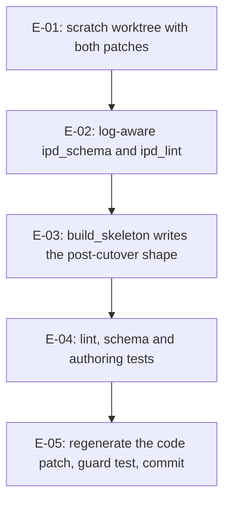

# IPD: Make ipd lint and ipd scaffold log-aware in the cutover code patch

- Date: 2026-11-25
- Kind: child
- Concern: Backlog `jycxw8`: after the cutover loader and writer switch, `aw ipd scaffold --apply` writes a log-backed plan but `ipd_authoring.build_skeleton` still emits the legacy bullet block and a `## Workflow history` H2, and `ipd_lint` still requires `Date`, `Concern` and `Scope` as bullets and `Workflow history` as an H2, so a plan in the post-cutover shape of spec `4sd62s` 4.1 fails lint. Every later metastore child that builds log-format plans (`89mtbl`, the test batches) needs a lint that accepts that shape.
- Scope: In a scratch worktree with both cutover patches applied, make `ipd_schema` and `ipd_lint` accept a log-format plan (required fields from `artifact_meta` State, `Concern` and `Scope` as body sections, no `Workflow history` H2), make `ipd_authoring.build_skeleton` and its placeholders write the post-cutover shape, update `tests/test_ipd_lint.py`, `tests/test_ipd_schema.py` and `tests/test_ipd_authoring.py` for the new shape, and regenerate `.aw/system/cutover/metastore-code.cutover.patch`. No live code changes.
- Scope-Paths: .aw/records/plans/pending/20261125-metastore-305-hdwqex-make-ipd-lint-and-ipd-scaffold-log-aware-in-the-cutover-code.ipd.md, .aw/system/cutover/metastore-code.cutover.patch
- Item-Dependencies: executed:2k5t16, executed:g45vyv
- Status: to-review
- From-Spec: 4sd62s
- Work-Kind: bug
- Priority: high
- From-Backlog: jycxw8
- Blocks-Release: next
- Set: metastore
- Order: 305
- Highest E allocated: 05
- Author: opencode its_direct/pt3-claude-opus-5.5-1m-us
- Id: hdwqex

> Write and proofread this plan per the technical writing standard, `.aw/system/workflows/technical-writing/technical-writing.md` (`.agents/workflows/technical-writing/technical-writing.md` in a legacy-layout install), including requirement 12 (diagrams).

## Workflow history

- 2026-11-26 to-review (aw set): authored as part of the x1mmdp split per maintainer answer to run-20261125T162650Z-1337442 question 06-x1mmdp-a1-Q-01 (Split into new children; fix jycxw8 first)
- 2026-11-26 draft (opencode its_direct/pt3-claude-opus-5.5-1m-us): created.

## Goal

Make `aw ipd lint` and `aw ipd scaffold` agree on the post-cutover plan shape inside the cumulative code patch, so a plan with its metadata in `meta/<id6>.jsonl` and only the two-key mirror in the file lints as conforming. This closes backlog `jycxw8` and unblocks the log-format test builder (`89mtbl`).

## Detailed Implementation Checklist (TODO)

Execution-state rule: mark an `E-*` item complete only after performing the action. That mark is not validation. Right-sizing rule: write for a modest executor that cannot hold much in its head. Each E-item is one step (one concern, about one file, executable in one focused pass) and its V-item names each unit it covers with its own check; a plan stays at about 5 E-items and 8 work Scope-Paths, else split it into more child plans (guidance, `IPD-Z603`). Accepted execution states: blocked, failed, pending, performed; terminal gate demands 'performed'.

### Task group 1: scratch worktree

- [ ] E-01 Create the scratch worktree with the SCRATCH PROCEDURE of `2k5t16` (Step 0): `git worktree add --detach .aw/state/hdwqex/scratch HEAD`, apply the docs patch with `git apply --index`, record `BASE=$(git write-tree)` in F-01, then apply the code patch with `git apply --index`. If either patch does not apply, stop and report.
  - Depends on: none
  - Expected outcome: the scratch worktree holds HEAD plus both patches, staged; F-01 holds the base tree id.
  - Execution state: pending

### Task group 2: lint and scaffold (scratch worktree only)

- [ ] E-02 In `agent_workflows/ipd_schema.py` and `agent_workflows/ipd_lint.py`, make the metadata and heading checks read a log-format plan: take `Date` from State `created_day` (falling back to the filename date), `Highest E allocated` from State `highest_e_allocated` (add the row to `ipd_lint._STATE_FIELD_TO_META`), and `Concern` and `Scope` from the `## Concern` and `## Scope` body sections that `m0001_convert` writes (`FieldDestination("body_section", ...)`); drop `H_WORKFLOW_HISTORY` from `CHILD_H2_ORDER` and `ORCHESTRATOR_H2_ORDER` for a log-format plan. The ready-to-execute gates (`IPD-M106` Scope-Paths, `IPD-M110` Priority) and the checkpoint check (`IPD-S404`, status) must read the overlaid State rather than only `doc.meta_fields` bullets. Keep the legacy reading for a plan that still carries bullets, since `m0001` and the legacy loader tests read them.
  - Depends on: E-01
  - Expected outcome: the `jycxw8` probe plan (F-02) lints with no IPD-M101, I304, H202, S404, M106 or M110 finding; a bullet-format plan lints as before.
  - Execution state: pending

- [ ] E-03 In `agent_workflows/ipd_authoring.py`, make `build_skeleton` write the post-cutover shape: no metadata bullet block and no `## Workflow history` section, with `## Concern` and `## Scope` placeholder sections in the body; update `_AUTHORING_PLACEHOLDERS` to match. Leave `set_records` alone unless E-04's runs show it writes a metadata bullet into a log-format record (its `- Set:`/`- Run:` lines are walkthrough body prose, not metadata).
  - Depends on: E-02
  - Expected outcome: `aw ipd scaffold --apply` in a throwaway repository on the scratch tree writes a plan that `aw ipd lint` reports as conforming at the author checkpoint.
  - Execution state: pending

- [ ] E-04 Update `tests/test_ipd_lint.py`, `tests/test_ipd_schema.py` and `tests/test_ipd_authoring.py` so that each asserts the post-cutover shape on the scratch tree (add a log-format case beside each bullet-format case it keeps), then run those three modules plus `tests/test_readers_ipd_lint.py` with `python3 -m pytest -o addopts="" --noconftest` in the scratch worktree. `--noconftest` is required until `89mtbl` switches the builder (the repo `conftest.py` imports `tests/record_builder.py`, which needs symbols the switched tree removes; `g45vyv` V-02); a module that itself imports `tests.record_builder` and cannot run yet is listed in F-03 with its import error rather than edited here.
  - Depends on: E-03
  - Expected outcome: every module that can import on the switched tree passes; F-03 lists any module deferred to `89mtbl` with its import error.
  - Execution state: pending

### Task group 3: package

- [ ] E-05 In the scratch worktree run `git add -A`, write `git diff --cached --binary $BASE` over `.aw/system/cutover/metastore-code.cutover.patch`, remove the scratch worktree (`git worktree remove --force .aw/state/hdwqex/scratch`), run `python3 -m pytest -o addopts="" tests/test_metastore_cutover_code_patch.py` in the executing checkout, and commit through `aw commit hdwqex -- <this plan> .aw/system/cutover/metastore-code.cutover.patch`; never push.
  - Depends on: E-04
  - Expected outcome: the regenerated code patch holds the earlier changes plus this plan's; the guard test passes; one path-scoped commit.
  - Execution state: pending

## Project conventions discovered (Step 0)

- The scratch procedure and the cumulative code patch are defined in `2k5t16`; executed siblings `g45vyv` and `2k5t16` follow it.
- Tests exercise code and assert on outcomes (AGENTS.md "TEST OUTCOMES, NOT CODE STRUCTURE").
- Cite code by SYMBOL (`module.function`) or by a quoted content string, with a line number only appended to one of those and never alone: an offset expires before this plan executes (advisory `IPD-C801`).

## Findings

| Id | Evidence | Finding |
|---|---|---|
| F-01 | (written by E-01) | Base tree id after the docs patch. |
| F-02 | `x1mmdp` F-07 (2026-11-25): a plan from `ipd_authoring.build_skeleton` behind the log mirror fails `ipd_lint.lint_file` with IPD-M101, I304, H202, S404, M106, M110. Backlog `jycxw8` records the cause: `ipd_schema.META_REQUIRED` lists `Date`, `Concern`, `Scope`; `CHILD_H2_ORDER` starts with `H_WORKFLOW_HISTORY`; `ipd_lint._STATE_FIELD_TO_META` has no `highest_e_allocated` row; the M106 and M110 gates read `doc.meta_fields` only | The lint and the scaffold disagree with spec `4sd62s` 4.1 on the scratch tree. |
| F-03 | (written by E-04) | Modules deferred to `89mtbl` because they import `tests/record_builder.py`, with the import error. |

## Proposed changes (ordered, validatable)

1. E-01: scratch worktree with both patches.
2. E-02: log-aware schema and lint.
3. E-03: log-shape scaffold.
4. E-04: lint, schema and authoring tests.
5. E-05: regenerate the code patch and commit.

## Deferred / out of scope (with reason)

- Switching `tests/record_builder.py` and `tools/fixture_codemod.py` to the log format: needs this plan first.
  - Carrier: 89mtbl
- Applying the patch on the real tree: the attended cutover.
  - Carrier: cxxmyv

## Scope check

- Over-scope: none.
- Under-scope: none. Every cause `jycxw8` lists maps to E-02 (schema, lint) or E-03 (scaffold, placeholders).

## Required tests / validation

- Named runs in the scratch worktree (V-02 to V-04); the `2k5t16` guard test (V-05).

## Spec / documentation sync

No spec change: spec `4sd62s` 4.1 already defines the post-cutover shape, and the docs patch already describes it in `ipd-spec` and the templates (`.aw/system/workflows/assess/templates/ipd.md` in the docs patch carries no bullet block and no `## Workflow history`). This plan brings the code into line with them.

## Open questions

None open.

## Validation and cross-check (verify before reporting done)

Validation-state rule: inspect evidence in a separate pass. Do not mark a `V-*` item complete from memory or from the matching execution checkmark. Accepted validation results: blocked, failed, pass, pending; terminal gate demands 'pass'. Runtime-demonstration reachability rule: for each `V-*` item demanding the software be observed acting (such as a run, a dispatch, or a transition) - as distinct from items demanding a diff, a file's content, or a test result, which are reachable by construction - name the code path that produces the observation or the sibling `E-*` that creates it, else the demand is UNDER-SCOPE.

- [ ] V-01 validates E-01
  - Required evidence: paste the worktree command and both `git apply --index` commands with exit status 0, and F-01.
  - Observed evidence:
  - Result: pending
- [ ] V-02 validates E-02
  - Required evidence: paste the `ipd_lint.lint_file` (or `aw ipd lint`) output for a log-format plan in a throwaway repository on the scratch tree showing no IPD-M101, I304, H202, S404, M106 or M110 diagnostic, and the output for a bullet-format plan showing its disposition unchanged from HEAD.
  - Observed evidence:
  - Result: pending
- [ ] V-03 validates E-03
  - Required evidence: paste `aw ipd scaffold --apply` in a throwaway repository on the scratch tree (E-03 creates the code path), the head of the written file showing the two-key mirror and no bullet block or `## Workflow history`, and `aw ipd lint` on it reporting conforming at the author checkpoint.
  - Observed evidence:
  - Result: pending
- [ ] V-04 validates E-04
  - Required evidence: paste the pytest summary line for each of `tests/test_ipd_lint.py`, `tests/test_ipd_schema.py`, `tests/test_ipd_authoring.py` and `tests/test_readers_ipd_lint.py` in the scratch worktree, or the F-03 entry with the import error for any module deferred to `89mtbl`.
  - Observed evidence:
  - Result: pending
- [ ] V-05 validates E-05
  - Required evidence: paste `git apply --stat .aw/system/cutover/metastore-code.cutover.patch`, the `tests/test_metastore_cutover_code_patch.py` run with each test PASSED, `git worktree list` showing the scratch worktree removed, and the `aw commit` output naming the commit hash.
  - Observed evidence:
  - Result: pending

## Approval and execution gate

- Size assessment: standard
- Cohesion rationale: not required

Execute only after human approval (`Status: approved`) and after every plan in `- Item-Dependencies:` is executed. Code and tests are edited ONLY in the scratch worktree. Scope fence: the paths in `- Scope-Paths:` are a declaration; a needed file outside the fence is edited and then justified at finalize (`--scope-reason`), and a declared path left unmodified is acknowledged (`--scope-ack`). Stop and report rather than editing production code outside the scratch worktree or weakening test assertions if an unexpected failure occurs on unmodified code, if a patch hunk rejects, or if an unresolvable concurrent-edit conflict occurs. Honesty rule: paste the ACTUAL output of every command named above; never claim a result you did not run. Commits: commit only through `aw commit hdwqex -- <paths>`; never push. Lifecycle transition: the plan moves to `.aw/records/plans/executed/` only through `aw ipd finalize`, after `aw ipd lint --phase pre-transition` conforms and every `V-*` reads `pass` with pasted evidence.
