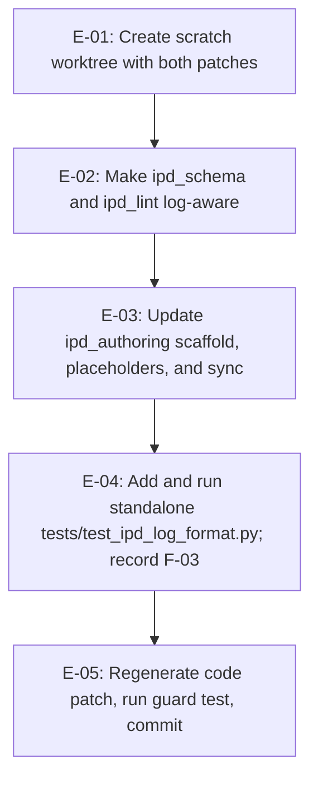

# IPD: Make ipd lint and ipd scaffold log-aware in the cutover code patch

- Date: 2026-11-25
- Kind: child
- Concern: Backlog `jycxw8` (post-cutover IPD lint and scaffold mismatch): after the cutover loader and writer switch (`2k5t16`, `g45vyv`), `aw ipd scaffold --apply` writes a log-backed plan (`.aw/records/meta/<id6>.jsonl` plus the two-key YAML mirror), but `agent_workflows/ipd_authoring.py::build_skeleton` still emits the legacy bullet block and a `## Workflow history` heading, `agent_workflows/ipd_authoring.py::compute_sync` parses without `artifact_meta.State`, and `agent_workflows/ipd_lint.py` plus `agent_workflows/ipd_schema.py` still require bullet-block fields (`Date`, `Concern`, `Scope`), `## Workflow history`, legacy `coverage_checked`, and bullet-only ready-to-execute metadata. As a result, a plan in the post-cutover shape of spec `4sd62s` Section 4.1 and the patched `ipd-structure-and-linting.spec.md` Sections 4.3 and 4.4 fails lint and `aw ipd sync`. Every later metastore child that builds log-format plans (`89mtbl` and the test batches `nv3upa` to `x3mig6`) needs a lint, scaffold, and sync path that agrees on that shape.
- Scope: In an isolated scratch worktree with both cutover patches applied, make `agent_workflows/ipd_schema.py` and `agent_workflows/ipd_lint.py` accept a log-format plan matching spec `4sd62s` Section 4.1 and the patched `ipd-structure-and-linting.spec.md` Sections 4.3 and 4.4 (required metadata `Date`, `Kind`/`plan_role`, `Status`, `Author`, `Id` overlaid from `artifact_meta.State` with date resolution across `created_day`, `filename_date`, filename prefix, and `created_at`; `Highest E allocated` overlaid from `highest_e_allocated`; optional `## Concern` and `## Scope` body sections tolerated; no required `## Workflow history` H2; ready-to-execute gates `IPD-M106`, `IPD-M110`, `IPD-M111`, `check_item_dependencies`, `IPD-S404`, and `IPD-M112` reading overlaid State while keeping legacy bullet-format reading intact), update `agent_workflows/ipd_authoring.py` (`build_skeleton`, `_AUTHORING_PLACEHOLDERS`/`authoring_placeholders_resolved`, and `compute_sync`/`run_sync`) for the post-cutover shape, add and run a standalone core behavioral test module `tests/test_ipd_log_format.py` in the scratch worktree (recording the `tests/record_builder.py` import error on the four deferred legacy test modules in F-03), and regenerate `.aw/system/cutover/metastore-code.cutover.patch`. No live code changes.
- Scope-Paths: .aw/records/plans/pending/20261125-metastore-305-hdwqex-make-ipd-lint-and-ipd-scaffold-log-aware-in-the-cutover-code.ipd.md, .aw/system/cutover/metastore-code.cutover.patch
- Item-Dependencies: executed:2k5t16, executed:g45vyv
- Status: reviewed
- Review-Depth: standard
- Readiness: go-pending-approval
- From-Spec: 4sd62s
- Work-Kind: bug
- Priority: high
- From-Backlog: jycxw8
- Blocks-Release: next
- Set: metastore
- Order: 305
- Highest E allocated: 05
- Author: opencode its_direct/pt3-claude-opus-5.5-1m-us
- Id: hdwqex

> Write and proofread this plan per the technical writing standard, `.aw/system/workflows/technical-writing/technical-writing.md` (`.agents/workflows/technical-writing/technical-writing.md` in a legacy-layout install), including requirement 12 (diagrams).

## Workflow history

- 2026-11-26 reviewed (aw set): APPROVE WITH REVISIONS APPLIED; PR-001..PR-006 FIXED
- 2026-11-26 /plan-review (antigravity/gemini): APPROVE WITH REVISIONS APPLIED; PR-001, PR-002, PR-003, PR-004, PR-005, PR-006; review record .aw/records/reviews/20261125-metastore-305-hdwqex-make-ipd-lint-and-ipd-scaffold-log-aware-in-the-cutover-code.review.md
- 2026-11-26 to-review (aw set): authored as part of the x1mmdp split per maintainer answer to run-20261125T162650Z-1337442 question 06-x1mmdp-a1-Q-01 (Split into new children; fix jycxw8 first)
- 2026-11-26 draft (opencode its_direct/pt3-claude-opus-5.5-1m-us): created.

## Goal

Make `aw ipd lint`, `aw ipd scaffold`, and `aw ipd sync` agree on the post-cutover plan shape inside `.aw/system/cutover/metastore-code.cutover.patch`, so a plan whose metadata lives in `.aw/records/meta/<id6>.jsonl` with only the two-key YAML mirror and `aw-managed` banner in the file lints as conforming and syncs cleanly (spec `4sd62s` Section 4.1). This closes backlog `jycxw8` and unblocks the log-format test builder (`89mtbl`).

## Detailed Implementation Checklist (TODO)

Execution-state rule: mark an `E-*` item complete only after performing the action. That mark is not validation. Right-sizing rule: write for a modest executor that cannot hold much in its head. Each E-item is one step (one concern, about one file, executable in one focused pass) and its V-item names each unit it covers with its own check; a plan stays at about 5 E-items and 8 work Scope-Paths, else split it into more child plans (guidance, `IPD-Z603`). Accepted execution states: blocked, failed, pending, performed; terminal gate demands 'performed'.

### Task group 1: scratch worktree

- [ ] E-01 Create the scratch worktree following the SCRATCH PROCEDURE of `2k5t16` (Step 0): run `git worktree add --detach .aw/state/hdwqex/scratch HEAD`; inside `.aw/state/hdwqex/scratch`, run `git apply --index .aw/system/cutover/metastore-docs.cutover.patch`, record `BASE=$(git write-tree)` in F-01, and then run `git apply --index .aw/system/cutover/metastore-code.cutover.patch`. If either patch rejects, stop and report.
  - Depends on: none
  - Expected outcome: `.aw/state/hdwqex/scratch` holds HEAD plus both patches staged, and F-01 records the base tree id.
  - Execution state: pending

### Task group 2: lint, scaffold, and standalone tests (scratch worktree only)

- [ ] E-02 Make `agent_workflows/ipd_schema.py` and `agent_workflows/ipd_lint.py` log-aware for spec `4sd62s` Section 4.1 and patched `ipd-structure-and-linting.spec.md` Sections 4.3 and 4.4, while keeping bullet-format reading intact for legacy tests and `m0001`:
  1. In `ipd_schema.py`, remove `H_WORKFLOW_HISTORY` from `CHILD_H2_ORDER` and `ORCHESTRATOR_H2_ORDER` (matching patched templates `.aw/system/workflows/assess/templates/ipd.md` and `orchestrator-ipd.md`; `check_headings` already tolerates an extra legacy `## Workflow history` H2 on bullet-format plans), and support log-format required metadata `("Date", "Kind", "Status", "Author", "Id")` in `validate_metadata` (omitting `Concern` and `Scope`, which live as optional body sections post-cutover, while keeping `META_REQUIRED` unchanged for legacy bullet-format calls).
  2. In `ipd_lint.py`, add `("highest_e_allocated", S.META_WATERMARK)` to `_STATE_FIELD_TO_META`; resolve log-format `Date` through one shared helper checking `state.created_day` -> `state.fields.get("date")` -> `state.filename_date` -> filename `YYYYMMDD` prefix from `state.path` or `path` (formatted `YYYY-MM-DD`) -> `state.created_at[:10]` (used by `_overlay_state_into_meta_fields`, `_citation_anchor_applies`, and `_m105_terminal_applies`); extract `## Concern` and `## Scope` body sections when present without breaking `Set`/`Order` overlay from `state.set_id`/`state.order_nn`; when `item_dependencies` overlays as an empty list `[]`, fall back to `state.fields.get("dependency_declaration")` (`none`/`unresolved`); allow YAML front-matter mirror `id` and `status` through `_overlay_state_into_meta_fields` and `_read_state_status` when no bullet block exists (preserving fence protection against fenced/quoted bullets); make ready-to-execute gates (`IPD-M106` `check_scope_paths`, `IPD-M110` `check_plan_priority`, `IPD-M111` `check_plan_work_kind`, `check_item_dependencies`) and `IPD-S404` (`check_checkpoint`) read overlaid `State`; and in `check_coverage_record` (`IPD-M112`), accept post-cutover `op: "coverage"` events that write `coverage` and `coverage_fingerprint` without migration-only `coverage_checked`.
  - Depends on: E-01
  - Expected outcome: a freshly scaffolded or migrated log-format plan (child or orchestrator) lints with no `IPD-M101`, `IPD-I304`, `IPD-H202`, `IPD-S404`, `IPD-M106`, `IPD-M110`, `IPD-M111`, or `IPD-M112` error; a legacy bullet-format plan retains its HEAD disposition.
  - Execution state: pending

- [ ] E-03 Update `agent_workflows/ipd_authoring.py` for the post-cutover plan shape (spec `4sd62s` Section 4.1):
  1. Update `build_skeleton` (keeping its existing parameter signature backward-compatible) to emit no metadata bullet block and no `## Workflow history` section, starting its H2 sequence at `## Goal` to match `ipd_schema.H2_ORDER_BY_KIND` and the patched templates `ipd.md` and `orchestrator-ipd.md`.
  2. Update `_AUTHORING_PLACEHOLDERS` and `authoring_placeholders_resolved` so anchored body placeholders remain matched without false-positiving on ordinary prose (no bare `TODO.`), and accept an optional `state` parameter to check unresolved log-field placeholders (`scope_paths` starting with `TODO`, or `item_dependencies`/`priority`/`work_kind` equal to `unresolved`), passing `state` from `ipd_lint._draft_ready_advisory` and `check_engine.check_ipd_draft_ready`.
  3. Update `compute_sync` to accept an optional `state` parameter passed to `LINT.parse(text, state=state)` and pass the tracked `State` from `run_sync`, so `aw ipd sync` reads `Status` and `Highest E allocated` from `.aw/records/meta/<id6>.jsonl` on log-format plans, refuses sync on `approved`/`auto-approved` plans, and bumps `highest_e_allocated` in the log. Leave `agent_workflows/set_records.py` unchanged (its `- Set:`/`- Run:` lines in `render_walkthrough` are walkthrough body prose, not plan metadata).
  - Depends on: E-02
  - Expected outcome: in a throwaway repository on the scratch tree, `aw ipd scaffold --apply` writes a log-format plan that `aw ipd lint` reports as conforming at the `author` checkpoint, and `aw ipd sync --apply` assigns an `E-NEW` leaf and updates `highest_e_allocated` in `meta/<id6>.jsonl`.
  - Execution state: pending

- [ ] E-04 In the scratch worktree, add and run standalone core test module `tests/test_ipd_log_format.py` (stdlib, `pytest`, and `agent_workflows.*` only; no `tests.record_builder` or `tests.support` import), then record the deferred modules' import errors in F-03:
  1. Cover `ipd_schema` post-cutover H2 orders against the patched templates and log-format `validate_metadata`.
  2. Cover `ipd_lint.lint_file` and `ipd_lint.lint_text` on log-format child and orchestrator plans across checkpoints (`author`, `pre-execution`, `pre-transition`, `post-transition`, date resolution for `created_day`/filename/`created_at`, `IPD-M106`/`M110`/`M111`/`M112`/`S404`/`I304`, optional `## Concern`/`## Scope` body sections, and legacy bullet-format parity).
  3. Cover `ipd_authoring` (`build_skeleton`, `run_scaffold --apply`, `run_sync --apply`, `authoring_placeholders_resolved`).
  4. Run `python3 -m pytest -o addopts="" --noconftest -v tests/test_ipd_log_format.py` in the scratch worktree, and record in F-03 the measured `tests.record_builder` import error for the four deferred existing modules (`tests/test_ipd_lint.py`, `tests/test_ipd_schema.py`, `tests/test_ipd_authoring.py`, `tests/test_readers_ipd_lint.py`).
  - Depends on: E-03
  - Expected outcome: `tests/test_ipd_log_format.py` passes every test in the scratch worktree with `--noconftest`; F-03 records the measured import error on the four deferred modules.
  - Execution state: pending

### Task group 3: package

- [ ] E-05 In `.aw/state/hdwqex/scratch`, run `git add -A` and write `git diff --cached --binary $BASE` over `.aw/system/cutover/metastore-code.cutover.patch` in the executing checkout; remove the scratch worktree (`git worktree remove --force .aw/state/hdwqex/scratch`); run `python3 -m pytest -o addopts="" tests/test_metastore_cutover_code_patch.py` in the executing checkout; verify `git status --short` shows only `- Scope-Paths:` modified; and commit through `aw commit hdwqex -- .aw/records/plans/pending/20261125-metastore-305-hdwqex-make-ipd-lint-and-ipd-scaffold-log-aware-in-the-cutover-code.ipd.md .aw/system/cutover/metastore-code.cutover.patch`; never push.
  - Depends on: E-04
  - Expected outcome: `.aw/system/cutover/metastore-code.cutover.patch` contains all prior code-patch hunks plus this plan's changes; `tests/test_metastore_cutover_code_patch.py` passes; scratch worktree is removed; one path-scoped commit is created.
  - Execution state: pending

## Project conventions discovered (Step 0)

- The scratch procedure and cumulative code patch are defined in executed plan `2k5t16` (Step 0, OQ-01); executed sibling `g45vyv` follows the same procedure.
- `.aw/system/cutover/metastore-docs.cutover.patch` already updates `.aw/records/specs/implemented/20260802-1904-01-ipd-structure-and-linting.spec.md` (Sections 4.3 and 4.4) and both templates (`.aw/system/workflows/assess/templates/ipd.md` and `orchestrator-ipd.md`) to remove the bullet block and `## Workflow history` and start directly at `## Goal`.
- Tests must exercise real behavior and assert on observable outcomes (AGENTS.md "TEST OUTCOMES, NOT CODE STRUCTURE"); no `inspect`, `ast`, regex, or substring code-pinning tests.
- Cite code by symbol (`path::Symbol`) or by a quoted content string, with a line number only appended as a hint and never alone (advisory `IPD-C801`).

## Findings

| Id | Evidence | Finding |
|---|---|---|
| F-01 | (written by E-01) | Base tree id after applying `.aw/system/cutover/metastore-docs.cutover.patch`. |
| F-02 | `x1mmdp` F-07 (2026-11-25) and backlog `jycxw8`: a plan from `agent_workflows/ipd_authoring.py::build_skeleton` behind the log mirror fails `agent_workflows/ipd_lint.py::lint_file` with `IPD-M101`, `IPD-I304`, `IPD-H202`, `IPD-S404`, `IPD-M106`, `IPD-M110`. Verified in HEAD: `agent_workflows/ipd_schema.py::META_REQUIRED` lists `Date`, `Concern`, `Scope`; `CHILD_H2_ORDER` and `ORCHESTRATOR_H2_ORDER` start with `H_WORKFLOW_HISTORY`; `agent_workflows/ipd_lint.py::_STATE_FIELD_TO_META` omits `highest_e_allocated`; ready-to-execute gates (`check_scope_paths`, `check_plan_priority`, `check_plan_work_kind`, `check_item_dependencies`) read `doc.meta_fields` only; `_overlay_state_into_meta_fields` drops YAML mirror `id`/`status` under `authoritative_keys_only=True` when no bullets exist. | `ipd_schema`, `ipd_lint`, and `ipd_authoring` disagree with spec `4sd62s` Section 4.1 on the scratch tree. |
| F-03 | (written by E-04) | Measured import errors for `tests/test_ipd_lint.py`, `tests/test_ipd_schema.py`, `tests/test_ipd_authoring.py`, and `tests/test_readers_ipd_lint.py` (all four import `tests/record_builder.py` directly or via `tests/support.py::_conforming_orchestrator_path`, which fails with `AttributeError` on `_LEGACY_BULLET_LABEL` until `89mtbl` switches the builder). |
| F-04 | `agent_workflows/artifact_meta.py::FIELD_REGISTRY` (`"created_day"` is `"migration-only"`), `agent_workflows/artifact_meta.py::replay` (`state.created_at = created_at_val`), `agent_workflows/ipd_authoring.py::run_scaffold` (passes neither `created_day` nor `filename_date`), `agent_workflows/ipd_lint.py::_overlay_state_into_meta_fields`, `_citation_anchor_applies`, `_m105_terminal_applies`. | Newly created post-cutover plans have `state.created_day == None` and `state.filename_date == None`; `Date` resolution must fall back through `created_day` -> `fields["date"]` -> `filename_date` -> filename `YYYYMMDD` prefix -> `state.created_at[:10]`. |
| F-05 | `.aw/system/cutover/metastore-docs.cutover.patch` (`ipd-structure-and-linting.spec.md` Sections 4.3 and 4.4; `.aw/system/workflows/assess/templates/ipd.md`; `.aw/system/workflows/assess/templates/orchestrator-ipd.md`); `agent_workflows/migrations/m0001_convert.py::_insert_body_sections`. | The patched templates and spec Section 4.3 start directly at `## Goal` with no `## Concern` or `## Scope` headings, and patched spec Section 4.4 lists required logical fields as `Date`, `plan_role`, `Status`, `Author`, `Id` while noting prose `Concern` and `Scope` live in body sections. `m0001_convert` inserts `## Concern`/`## Scope` before `## Goal` on migrated plans, which `check_headings` already permits. |
| F-06 | `agent_workflows/ipd_authoring.py::compute_sync` (`LINT.parse(text)` with no `state`), `run_sync` (patched in `.aw/system/cutover/metastore-code.cutover.patch`), `agent_workflows/ipd_lint.py::check_coverage_record` (requires migration-only `coverage_checked`), `agent_workflows/artifact_meta.py::replay` (`op: "coverage"` writes only `coverage` and `coverage_fingerprint`; `item_dependencies` may replay as `[]` with `dependency_declaration`). | `compute_sync`/`run_sync` fail on log-format plans without `state`; `check_coverage_record` (`IPD-M112`) rejects post-cutover coverage events lacking `coverage_checked`; empty `item_dependencies` lists need `dependency_declaration` fallback. |

## Proposed changes (ordered, validatable)

1. E-01: Create scratch worktree `.aw/state/hdwqex/scratch` and apply both cutover patches.
2. E-02: Make `agent_workflows/ipd_schema.py` and `agent_workflows/ipd_lint.py` log-aware across metadata overlay, date resolution, heading order, ready-to-execute gates, and coverage attestation while keeping legacy bullet-format parity.
3. E-03: Update `agent_workflows/ipd_authoring.py` (`build_skeleton`, `_AUTHORING_PLACEHOLDERS`/`authoring_placeholders_resolved`, and `compute_sync`/`run_sync`) plus `state` wiring in `ipd_lint._draft_ready_advisory` and `check_engine.check_ipd_draft_ready`.
4. E-04: Add and run standalone core test module `tests/test_ipd_log_format.py` in the scratch worktree, and record the four `RecordBuilder`-blocked modules in F-03.
5. E-05: Regenerate `.aw/system/cutover/metastore-code.cutover.patch`, remove the scratch worktree, pass `tests/test_metastore_cutover_code_patch.py`, and commit path-scoped.

## Deferred / out of scope (with reason)

- Switching `tests/record_builder.py` and `tools/fixture_codemod.py` to the log format: depends on this plan executing first.
  - Carrier: 89mtbl
- Updating and running `tests/test_ipd_schema.py` once `tests/record_builder.py` is switched (cannot import on the scratch tree before `89mtbl`).
  - Carrier: x8id25
- Updating and running `tests/test_ipd_lint.py`, `tests/test_ipd_authoring.py`, and `tests/test_readers_ipd_lint.py` once `tests/record_builder.py` is switched (re-measured by `89mtbl` F-04 census and settled before final packaging).
  - Carrier: x1mmdp
- Applying the cutover patches on the real tree: the attended cutover commit.
  - Carrier: cxxmyv

## Scope check

- Over-scope: none. No live code or test files are modified outside `.aw/system/cutover/metastore-code.cutover.patch`.
- Under-scope: none. Every cause recorded in backlog `jycxw8` plus the verified companion defects (`Date` resolution on freshly created plans, `IPD-M111`/`IPD-M112`/`item_dependencies` overlay, `compute_sync`/`run_sync` log-state reading, and standalone test execution without `RecordBuilder`) maps to E-02 through E-04.

## Required tests / validation

- Standalone core behavioral suite `tests/test_ipd_log_format.py` run with `python3 -m pytest -o addopts="" --noconftest -v tests/test_ipd_log_format.py` in `.aw/state/hdwqex/scratch` (V-04).
- CLI and API smoke runs in a throwaway repository on `.aw/state/hdwqex/scratch` exercising `ipd_lint.lint_file`, `ipd_lint.lint_text`, `aw ipd scaffold --apply`, `aw ipd lint`, and `aw ipd sync --apply` (V-02, V-03).
- Cumulative patch guard test `python3 -m pytest -o addopts="" tests/test_metastore_cutover_code_patch.py` in the executing checkout (V-05).

## Spec / documentation sync

No spec or documentation change is needed in this plan. Spec `4sd62s` Section 4.1 already defines the post-cutover shape, and `.aw/system/cutover/metastore-docs.cutover.patch` already updates `.aw/records/specs/implemented/20260802-1904-01-ipd-structure-and-linting.spec.md` (Sections 4.3 and 4.4), `.aw/records/specs/implemented/20260726-1340-01-ipd-spec.spec.md`, `.aw/system/workflows/assess/templates/ipd.md`, and `.aw/system/workflows/assess/templates/orchestrator-ipd.md` (no bullet block, no `## Workflow history`, required logical fields `Date`, `plan_role`, `Status`, `Author`, `Id`). This plan brings the cutover code patch into agreement with those already-patched specifications and templates.

## Open questions

None open.

## Validation and cross-check (verify before reporting done)

Validation-state rule: inspect evidence in a separate pass. Do not mark a `V-*` item complete from memory or from the matching execution checkmark. Accepted validation results: blocked, failed, pass, pending; terminal gate demands 'pass'. Runtime-demonstration reachability rule: for each `V-*` item demanding the software be observed acting (such as a run, a dispatch, or a transition) - as distinct from items demanding a diff, a file's content, or a test result, which are reachable by construction - name the code path that produces the observation or the sibling `E-*` that creates it, else the demand is UNDER-SCOPE.

- [ ] V-01 validates E-01
  - Required evidence: paste the `git worktree add --detach .aw/state/hdwqex/scratch HEAD` command, both `git apply --index` commands (for `.aw/system/cutover/metastore-docs.cutover.patch` and `.aw/system/cutover/metastore-code.cutover.patch`) with exit status 0, and the base tree id recorded in F-01.
  - Observed evidence:
  - Result: pending
- [ ] V-02 validates E-02
  - Required evidence: paste the `ipd_lint.lint_file` / `ipd_lint.lint_text` output in a throwaway repository on the scratch tree (code paths updated by E-02) for (a) a newly created log-format child plan with `created_day` absent (showing conforming disposition and no `IPD-M101`, `IPD-I304`, `IPD-H202`, `IPD-S404`, `IPD-M106`, `IPD-M110`, or `IPD-M111` error, including at `pre-execution` with valid `Scope-Paths`, `Priority`, `Work-Kind`, and `Item-Dependencies`), (b) a migrated-style log-format plan carrying `## Concern` and `## Scope` sections and a post-cutover `op: "coverage"` orchestrator event (showing no `IPD-M112` error), and (c) a legacy bullet-format plan (showing its disposition unchanged from HEAD).
  - Observed evidence:
  - Result: pending
- [ ] V-03 validates E-03
  - Required evidence: paste `aw ipd scaffold --apply` in a throwaway repository on the scratch tree (code paths updated by E-03), the head of the written `.ipd.md` file showing the two-key YAML mirror, `aw-managed` banner, H1, writing-standard pointer, and `## Goal` with no bullet block or `## Workflow history`, `aw ipd lint` reporting conforming at `author`, and `aw ipd sync --apply` assigning an `E-NEW` leaf and bumping `highest_e_allocated` in `meta/<id6>.jsonl`.
  - Observed evidence:
  - Result: pending
- [ ] V-04 validates E-04
  - Required evidence: paste the full `python3 -m pytest -o addopts="" --noconftest -v tests/test_ipd_log_format.py` output in the scratch worktree showing every test PASSED (naming the schema, lint, scaffold, placeholder, and sync units covered), plus the F-03 entry recording the measured `tests.record_builder` import error for `tests/test_ipd_lint.py`, `tests/test_ipd_schema.py`, `tests/test_ipd_authoring.py`, and `tests/test_readers_ipd_lint.py`.
  - Observed evidence:
  - Result: pending
- [ ] V-05 validates E-05
  - Required evidence: paste `git apply --stat .aw/system/cutover/metastore-code.cutover.patch`, the `python3 -m pytest -o addopts="" tests/test_metastore_cutover_code_patch.py` run with all 3 tests PASSED, `git worktree list` showing `.aw/state/hdwqex/scratch` removed, `git status --short` confirming no live code edits outside `- Scope-Paths:`, and the `aw commit hdwqex` output naming the commit hash.
  - Observed evidence:
  - Result: pending

## Approval and execution gate

- Size assessment: standard
- Cohesion rationale: not required

Execute only after human approval (`Status: approved`) and after every plan in `- Item-Dependencies:` (`2k5t16`, `g45vyv`) is executed; open questions: none open. Code and tests are edited ONLY inside `.aw/state/hdwqex/scratch` and packaged into `.aw/system/cutover/metastore-code.cutover.patch`. Scope fence: `- Scope-Paths:` is a declaration; any needed edit outside it must be justified at finalize (`--scope-reason`), and any declared path left unmodified must be acknowledged (`--scope-ack`). Safety stop conditions: stop and report rather than editing live production code outside the scratch worktree or weakening test assertions if a patch hunk rejects, an unexpected failure occurs on unmodified code, or an unresolvable concurrent-edit conflict occurs. Honesty rule: you MUST paste the ACTUAL runner output of every command named in V-01 through V-05; never claim a result you did not run. Commits: commit only through `aw commit hdwqex -- <paths>`; never push. Lifecycle transition: after `aw ipd lint --phase pre-transition` conforms and every `V-*` reads `pass` with pasted evidence, in a managed runner lane stop after committing the updated plan and let the runner run `aw ipd finalize`; in a hand-run session run `aw ipd finalize` to move the plan to `.aw/records/plans/executed/` (never use a raw `git mv` to `executed/`).
