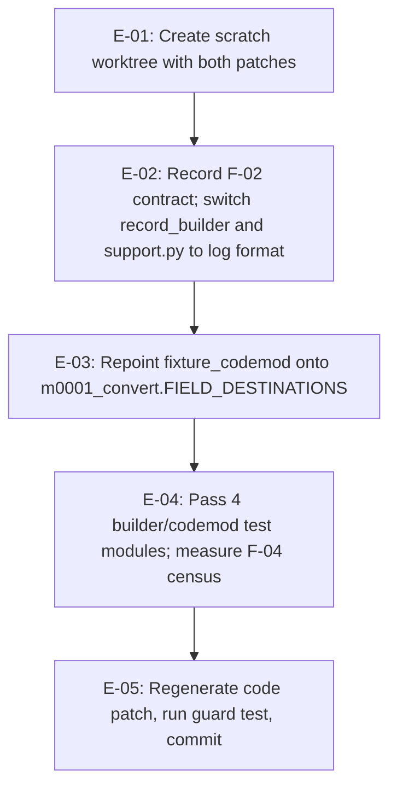

# IPD: Switch the shared test record builder and codemod to the log format in the cutover code patch

- Date: 2026-11-25
- Kind: child
- Concern: Backlog `ldfefd` (`x1mmdp` F-05 to F-07): the cutover code patch removes the legacy bullet API (`_LEGACY_BULLET_LABEL`, `LegacyRender`, `LegacyTarget`, `render_legacy_text`, `set_legacy_bullet_line`, `_format_legacy_value`, `_RESEARCH_YAML_KEY`, `_format_yaml_value`, `_PROMPT_COMMENT_KEY`) that `tests/record_builder.py` and `tools/fixture_codemod.py` call. On the switched tree, the shared builder fails at import (`AttributeError` on `_LEGACY_BULLET_LABEL`) and every test importing `tests/support.py` fails with it. In addition, the builder's `text_only=True` mode (about 1690 calls across 310 files, about 650 written to disk by callers) needs an explicit log-format contract because a log-format artifact requires a paired `meta/<id6>.jsonl` log (and a review record stores events in its subject's log per spec `4sd62s` Section 4.1a).
- Scope: In an isolated scratch worktree with both cutover patches applied (including `hdwqex`), record the log-format `text_only` and `raw_fields` contract in F-02, switch `tests/record_builder.py` to `RECORD_FORMAT = "log"` across all eight record types (7 log-backed artifact types through `artifact_meta.create`/`append`, plus `review` through `artifact_meta.render_review_mirror` and subject-log `op: "review"` events per spec `4sd62s` Section 4.1a) with the log branch of `assert_field`/`assert_no_field`, update `tests/support.py` (`_conforming_orchestrator_path` and `ready_plan_text`) as required by F-02, repoint `tools/fixture_codemod.py::_registry_field_map` onto `agent_workflows/migrations/m0001_convert.py::FIELD_DESTINATIONS` and align its rewrite/proof target with F-02, update and pass the four builder and codemod test modules (plus their fixture/golden baselines), measure the per-module core-gate failure census in F-04, and regenerate `.aw/system/cutover/metastore-code.cutover.patch`. No live code changes.
- Scope-Paths: .aw/records/plans/pending/20261125-metastore-306-89mtbl-switch-the-shared-test-record-builder-and-codemod-to-the-log.ipd.md, .aw/system/cutover/metastore-code.cutover.patch
- Item-Dependencies: executed:hdwqex
- Status: reviewed
- Review-Depth: standard
- Readiness: go-pending-approval
- From-Spec: 4sd62s
- Work-Kind: followup
- Priority: high
- From-Backlog: ldfefd
- Blocks-Release: next
- Set: metastore
- Order: 306
- Highest E allocated: 05
- Author: opencode its_direct/pt3-claude-opus-5.5-1m-us
- Id: 89mtbl

> Write and proofread this plan per the technical writing standard, `.aw/system/workflows/technical-writing/technical-writing.md` (`.agents/workflows/technical-writing/technical-writing.md` in a legacy-layout install), including requirement 12 (diagrams).

## Workflow history

- 2026-11-26 reviewed (aw set): APPROVE WITH REVISIONS APPLIED; PR-001..PR-006 FIXED
- 2026-11-26 /plan-review (antigravity/gemini): APPROVE WITH REVISIONS APPLIED; PR-001, PR-002, PR-003, PR-004, PR-005, PR-006; review record .aw/records/reviews/20261125-metastore-306-89mtbl-switch-the-shared-test-record-builder-and-codemod-to-the-log.review.md
- 2026-11-26 to-review (aw set): authored as part of the x1mmdp split per maintainer answer to run-20261125T162650Z-1337442 question 06-x1mmdp-a1-Q-01 (Split into new children; fix jycxw8 first)
- 2026-11-26 draft (opencode its_direct/pt3-claude-opus-5.5-1m-us): created.

## Goal

Make `tests/record_builder.py`, `tests/support.py`, and `tools/fixture_codemod.py` work on the switched log-format tree, with a written `text_only` and `raw_fields` contract (F-02) and a fresh per-module core-gate failure census (F-04) that the batch children (`nv3upa` to `x3mig6`) follow so converting the remaining failing test modules is mechanical.

## Detailed Implementation Checklist (TODO)

Execution-state rule: mark an `E-*` item complete only after performing the action. That mark is not validation. Right-sizing rule: write for a modest executor that cannot hold much in its head. Each E-item is one step (one concern, about one file, executable in one focused pass) and its V-item names each unit it covers with its own check; a plan stays at about 5 E-items and 8 work Scope-Paths, else split it into more child plans (guidance, `IPD-Z603`). Accepted execution states: blocked, failed, pending, performed; terminal gate demands 'performed'.

### Task group 1: scratch worktree

- [ ] E-01 Create the scratch worktree following the SCRATCH PROCEDURE of `2k5t16` (Step 0): run `git worktree add --detach .aw/state/89mtbl/scratch HEAD`; inside `.aw/state/89mtbl/scratch`, run `git apply --index .aw/system/cutover/metastore-docs.cutover.patch`, record `BASE=$(git write-tree)` in F-01, and then run `git apply --index .aw/system/cutover/metastore-code.cutover.patch`. If either patch rejects, stop and report.
  - Depends on: none
  - Expected outcome: `.aw/state/89mtbl/scratch` holds HEAD plus both patches staged, and F-01 records the base tree id.
  - Execution state: pending

### Task group 2: builder and codemod (scratch worktree only)

- [ ] E-02 Record the log-format `text_only` and `raw_fields` contract in F-02, then switch `tests/record_builder.py` (and `tests/support.py` callers as needed) to `RECORD_FORMAT = "log"`:
  1. In F-02, document the `text_only` and `raw_fields` contract with one concrete example call of each form that batch children (`nv3upa` to `x3mig6`) use. Default (to adopt unless a measured finding in F-02 requires adjustment): `text_only=True` returns the in-file text that `artifact_meta.create(..., dry_run=True)["text"]` renders (the in-file mirror, banner, and body) for in-memory readers (`artifact_meta.read_text`, `ipd_lint.lint_text` on mirror+body), while any caller that writes a record to disk must call `RecordBuilder(repo)` without `text_only` (or a new `RecordBuilder.materialize` helper calling `artifact_meta.create`) so `meta/<id6>.jsonl` exists beside the file. Also state how `raw_fields` operates in log format without calling removed `set_legacy_bullet_line` (for example mutating the mirror/body text or raw log fields for negative-input fixtures).
  2. In `tests/record_builder.py`, set `RECORD_FORMAT = "log"`, update `_require_legacy_format` to accept `"log"` (refusing unknown values), and remove all module-level reads of removed `artifact_meta` symbols (`_LEGACY_BULLET_LABEL`, `LegacyRender`, `LegacyTarget`, `render_legacy_text`, `set_legacy_bullet_line`, `_format_legacy_value`, `_RESEARCH_YAML_KEY`, `_format_yaml_value`, `_PROMPT_COMMENT_KEY`).
  3. Rewrite `_emit_record` and the seven log-backed artifact methods (`plan`, `spec`, `backlog`, `research`, `release`, `prompt`, `walkthrough`) to pass complete registry fields (`plan_role`, `author`, `set`, `order`, `title`, `highest_e_allocated`, etc. that legacy bullets or filenames used to carry) into `artifact_meta.create(id6, record_type, fields, body, destination=rel_path, project_context=ctx, actor=_ACTOR, ...)` (consuming the returned dict `res["text"]`, with no `legacy_render` or `repo_root` keyword) and follow-up/history events through `artifact_meta.append(id6, events, project_context=ctx, actor=_ACTOR, ...)` (emitting valid `op: "review"` events carrying `round`, `review_kind`, `verdict`, and `readiness` when `readiness` is set, and never editing a `## Workflow history` body section).
  4. Update `RecordBuilder.review` per spec `4sd62s` Section 4.1a: a review has NO `meta/<id6>.jsonl` log of its own; write the `.review.md` file with `artifact_meta.render_review_mirror(subject, subject_type, ref=...)` plus the `## Round <n>` / `### Findings` / `### Decisions` tables, and when `text_only=False` and `meta/<subject>.jsonl` exists, append one `op: "review"` event per round to the subject's log via `artifact_meta.append(subject, ...)`.
  5. Implement the log-format branch of `assert_field` and `assert_no_field`: for log-backed types read `artifact_meta.read(id6, project_context=...)` AND verify the on-disk mirror (`id`/`status` YAML front matter or staged-prompt comment mirror); for `review`, read the review front matter and (when present) the subject log's `op: "review"` events.
  6. Update `tests/support.py::_conforming_orchestrator_path` and `ready_plan_text` as needed under F-02 so `import tests.support` succeeds cleanly and `CONFORMING_ORCHESTRATOR` works in the log format.
  - Depends on: E-01
  - Expected outcome: F-02 holds the contract; `python3 -c "import tests.support"` exits 0 in the scratch worktree; all 7 log-backed artifact types read back via `artifact_meta.read` with the fields given; and `review` reads back via `review_findings.parse_review_file` plus `artifact_meta.history(subject)` showing the `op: "review"` event.
  - Execution state: pending

- [ ] E-03 In `tools/fixture_codemod.py`, replace the removed `artifact_meta` label-map reads in `_registry_field_map` with `agent_workflows/migrations/m0001_convert.py::FIELD_DESTINATIONS` (deriving legacy label -> registry field mappings for `identity`, `status`, and `log_field` destinations per record type; record the exact symbol and helper in F-03), and align the codemod's rewrite target and equivalence proof with the F-02 contract.
  - Depends on: E-02
  - Expected outcome: `python3 tools/fixture_codemod.py --dry-run --format json tests/test_fixture_codemod.py` runs in the scratch worktree with exit 0 and no `AttributeError`.
  - Execution state: pending

- [ ] E-04 Update and run the four builder and codemod test modules in the scratch worktree, then measure the core-gate failure census in F-04:
  1. Update `tests/test_record_builder.py` (including regenerating or updating `tests/fixtures/record_builder/ready_plan_text_golden.json` and `test_lint_ready_plan_conforms` for the F-02 log format), `tests/test_record_builder_slow.py`, `tests/test_record_builder_assert_field.py` (replacing legacy bullet-spacing strictness checks with log-plus-mirror strictness checks), and `tests/test_fixture_codemod.py` (including any `tests/fixtures/fixture_codemod/` fixtures whose assertions assumed bullet-block `read_text` fields under `text_only=True`).
  2. Run `python3 -m pytest -o addopts="" -m '' tests/test_record_builder.py tests/test_record_builder_slow.py tests/test_record_builder_assert_field.py tests/test_fixture_codemod.py` in the scratch worktree; all four modules must exit 0 with every test PASSED.
  3. Run the bare core gate (`python3 -m pytest`) in the scratch worktree (a nonzero exit is expected until batches `nv3upa` to `x3mig6` run) and record the per-module failure census in F-04 as a Markdown table with columns `| Module | Failed | Errors | Category (schema-1 refusal / removed-API / assertion / REPO_ROOT) |` alongside the core-gate summary line.
  - Depends on: E-03
  - Expected outcome: all four builder and codemod test modules pass; F-04 holds the per-module failure census table and the core-gate summary line.
  - Execution state: pending

### Task group 3: package

- [ ] E-05 In `.aw/state/89mtbl/scratch`, run `git add -A` and write `git diff --cached --binary $BASE` over `.aw/system/cutover/metastore-code.cutover.patch` in the executing checkout; remove the scratch worktree (`git worktree remove --force .aw/state/89mtbl/scratch`); run `python3 -m pytest -o addopts="" tests/test_metastore_cutover_code_patch.py` in the executing checkout; verify `git status --short` shows only `- Scope-Paths:` modified; and commit through `aw commit 89mtbl -- .aw/records/plans/pending/20261125-metastore-306-89mtbl-switch-the-shared-test-record-builder-and-codemod-to-the-log.ipd.md .aw/system/cutover/metastore-code.cutover.patch`; never push.
  - Depends on: E-04
  - Expected outcome: `.aw/system/cutover/metastore-code.cutover.patch` contains all prior changes plus this plan's; `tests/test_metastore_cutover_code_patch.py` passes; scratch worktree is removed; one path-scoped commit is created.
  - Execution state: pending

## Project conventions discovered (Step 0)

- The scratch procedure and cumulative code patch are defined in executed plan `2k5t16` (Step 0, OQ-01); executed sibling `g45vyv` follows it.
- Conversion rules shared by the `ldfefd` batch children (`nv3upa`, `cugg3w`, `psm9ac`, `x8id25`, `e0g2gt`, `qi0kl6`, `x3mig6`), fixed here so no executor invents them: (1) a call to an API the code patch removes (`LegacyRender`, `LegacyTarget`, `render_legacy_text`, `set_legacy_bullet_line`, `_LEGACY_BULLET_LABEL`, `_format_legacy_value`, `_RESEARCH_YAML_KEY`, `_format_yaml_value`, `_PROMPT_COMMENT_KEY`, `write_legacy`, `SidecarRecord`, `backlog._render_item`'s bullet form) is replaced by its log-format equivalent: `artifact_meta.create` or `artifact_meta.append` keyed by id6, or `tests.record_builder.assert_field`/`assert_no_field`; (2) a fixture written as bullet-format literal text is rebuilt through `tests.record_builder.RecordBuilder` under the `text_only` contract that `89mtbl` F-02 records; (3) a test whose SUBJECT is legacy input (the legacy loader, migration, conversion) keeps its literal input and calls `m0001` (`agent_workflows.migrations.m0001_metadata_v2.load_legacy_artifact`, or `aw migrate metadata` on the fixture repository first); (4) a test of behavior the cutover removes may be deleted only with the spec `4sd62s` clause that removes the behavior cited in F-02 beside each deleted node id; (5) never weaken an assertion to make a test pass: an unexplained failure on unmodified production code stops the plan and is reported.
- A fixture repository written by the switched builder is log-format, so `migrations.chain.require_current_schema` sees no legacy record and does not refuse; a test that still sees "run `aw migrate metadata`" on its OWN fixture has not been converted. Only tests reading this repository's own unmigrated records (`livecorpus`, `REPO_ROOT`) may still refuse, and those are listed in F-03, not edited.
- Per spec `4sd62s` Section 4.1a, review files carry `subject` / `subject_type` / optional `ref` front matter (no `id:` key and no own `meta/<id6>.jsonl` log); each review round is an `op: "review"` event in its subject's log.
- Tests exercise code and assert on observable outcomes (AGENTS.md "TEST OUTCOMES, NOT CODE STRUCTURE").
- Cite code by symbol (`path::Symbol`) or by a quoted content string, with a line number only appended as a hint and never alone (advisory `IPD-C801`).

## Findings

| Id | Evidence | Finding |
|---|---|---|
| F-01 | (written by E-01) | Base tree id after applying `.aw/system/cutover/metastore-docs.cutover.patch`. |
| F-02 | (written by E-02) | The log-format `text_only` and `raw_fields` contract and one concrete example call of each form. |
| F-03 | (written by E-03) | The exact symbol (`agent_workflows/migrations/m0001_convert.py::FIELD_DESTINATIONS`) and mapping helper that `tools/fixture_codemod.py::_registry_field_map` now reads. |
| F-04 | (written by E-04) | Per-module core-gate failure census table (`Module`, `Failed`, `Errors`, `Category`) and core-gate summary line on the switched tree after this plan. |
| F-05 | `x1mmdp` F-05 to F-07 (2026-11-25, historical attempt-1 run `run-20261125T162650Z-1337442` provenance; lane submission file is gitignored and not present in fresh lanes): on the switched tree with copies of the removed helpers, the core gate reported `567 failed, 2348 passed, 1 skipped, 11 warnings, 66 errors` across 71 modules, 385 of them `MetadataSchemaError` from fixture repositories the tests build themselves. | A fixture repository with bullet records counts as schema 1 under `migrations.chain.require_current_schema`; switching the builder to log format removes most of those refusals. |
| F-06 | Spec `4sd62s` Section 4.1a; `agent_workflows/artifact_meta.py::render_review_mirror`; `tests/record_builder.py::RecordBuilder.review`; `agent_workflows/migrations/m0001_convert.py::FIELD_DESTINATIONS`; `tests/fixtures/fixture_codemod/plain_constant.py.txt`; `tests/test_record_builder.py::RecordBuilderGoldenTests.test_golden_ready_plan_text`; `tests/support.py::_conforming_orchestrator_path`. | Reviews have no log of their own (events live in the subject's log); `m0001_convert.py::FIELD_DESTINATIONS` (not `m0001_metadata_v2.py`) holds the per-type legacy label maps; `tests/record_builder.py` must supply complete `create` fields and consume `artifact_meta.create`'s dict return; and `plain_constant.py.txt`, `ready_plan_text_golden.json`, and `tests/support.py` must align with the F-02 log-format contract. |

## Proposed changes (ordered, validatable)

1. E-01: Create scratch worktree `.aw/state/89mtbl/scratch` with both cutover patches staged.
2. E-02: Record the F-02 `text_only`/`raw_fields` contract; switch `tests/record_builder.py` (all 8 types, `assert_field`/`assert_no_field`) and `tests/support.py` to log format.
3. E-03: Repoint `tools/fixture_codemod.py::_registry_field_map` onto `m0001_convert.FIELD_DESTINATIONS` and align its rewrite/proof target with F-02.
4. E-04: Update and pass the four builder and codemod test modules (and fixtures/golden baseline); measure the core-gate failure census in F-04.
5. E-05: Regenerate `.aw/system/cutover/metastore-code.cutover.patch`, remove the scratch worktree, pass the guard test, and commit path-scoped.

## Deferred / out of scope (with reason)

- Converting the remaining failing test modules that call removed legacy APIs or fail on the switched tree (starting from F-04): batch children `nv3upa` through `x3mig6`.
  - Carrier: nv3upa
- Updating exact-spelling rows, settling the `review-pilot` corpus, and assembling the final refusal list: narrowed parent step.
  - Carrier: x1mmdp
- Applying the cutover patches on the real tree: attended cutover commit.
  - Carrier: cxxmyv

## Scope check

- Over-scope: none. No live code or test files are modified outside `.aw/system/cutover/metastore-code.cutover.patch`.
- Under-scope: none. Backlog `ldfefd`'s builder, `assert_field`/`assert_no_field`, `text_only`/`raw_fields` contract, `tests/support.py` alignment, codemod, and refreshed census items map to E-02 through E-05.

## Required tests / validation

- Builder and codemod suites in `.aw/state/89mtbl/scratch`: `python3 -m pytest -o addopts="" -m '' tests/test_record_builder.py tests/test_record_builder_slow.py tests/test_record_builder_assert_field.py tests/test_fixture_codemod.py` (V-04).
- Bare core-gate census measurement `python3 -m pytest` in `.aw/state/89mtbl/scratch` (V-04).
- Cumulative patch guard test `python3 -m pytest -o addopts="" tests/test_metastore_cutover_code_patch.py` in the executing checkout (V-05).

## Spec / documentation sync

No spec or documentation change is needed in this plan. Spec `4sd62s` Sections 4.1 through 4.3 already define the log format, review-event model (Section 4.1a), and cutover, and `.aw/system/cutover/metastore-docs.cutover.patch` already updates the documentation and templates. This plan brings the shared test builder and codemod inside the cutover code patch into line with them.

## Open questions

None open.

## Validation and cross-check (verify before reporting done)

Validation-state rule: inspect evidence in a separate pass. Do not mark a `V-*` item complete from memory or from the matching execution checkmark. Accepted validation results: blocked, failed, pass, pending; terminal gate demands 'pass'. Runtime-demonstration reachability rule: for each `V-*` item demanding the software be observed acting (such as a run, a dispatch, or a transition) - as distinct from items demanding a diff, a file's content, or a test result, which are reachable by construction - name the code path that produces the observation or the sibling `E-*` that creates it, else the demand is UNDER-SCOPE.

- [ ] V-01 validates E-01
  - Required evidence: paste the `git worktree add --detach .aw/state/89mtbl/scratch HEAD` command, both `git apply --index` commands (for `.aw/system/cutover/metastore-docs.cutover.patch` and `.aw/system/cutover/metastore-code.cutover.patch`) with exit status 0, and the base tree id recorded in F-01.
  - Observed evidence:
  - Result: pending
- [ ] V-02 validates E-02
  - Required evidence: paste F-02 with the `text_only`/`raw_fields` contract and one concrete example call of each form; the diff hunks in `tests/record_builder.py` setting `RECORD_FORMAT = "log"` and adding the log branch of `assert_field`/`assert_no_field`; `python3 -c "import tests.support"` exiting 0 in the scratch worktree; and a verification run (code paths updated by E-02) building one record of each of the 7 log-backed artifact types (`ipd`, `spec`, `backlog`, `research`, `release`, `prompt`, `walkthrough`) reading each back via `artifact_meta.read`, plus one `review` record verified via `review_findings.parse_review_file` and `artifact_meta.history(subject)` showing the `op: "review"` event.
  - Observed evidence:
  - Result: pending
- [ ] V-03 validates E-03
  - Required evidence: paste F-03 naming `m0001_convert.FIELD_DESTINATIONS`, the `_registry_field_map` diff hunk in `tools/fixture_codemod.py`, and the `python3 tools/fixture_codemod.py --dry-run --format json tests/test_fixture_codemod.py` output exiting 0 in the scratch worktree.
  - Observed evidence:
  - Result: pending
- [ ] V-04 validates E-04
  - Required evidence: paste the pytest summary line for each of the four modules (`tests/test_record_builder.py`, `tests/test_record_builder_slow.py`, `tests/test_record_builder_assert_field.py`, `tests/test_fixture_codemod.py`) showing every test PASSED with exit 0 in the scratch worktree; then paste F-04 containing the per-module failure census table and the bare core-gate summary line.
  - Observed evidence:
  - Result: pending
- [ ] V-05 validates E-05
  - Required evidence: paste `git apply --stat .aw/system/cutover/metastore-code.cutover.patch`, the `python3 -m pytest -o addopts="" tests/test_metastore_cutover_code_patch.py` run with all 3 tests PASSED, `git worktree list` showing `.aw/state/89mtbl/scratch` removed, `git status --short` confirming no live edits outside `- Scope-Paths:`, and the `aw commit 89mtbl` output naming the commit hash.
  - Observed evidence:
  - Result: pending

## Approval and execution gate

- Size assessment: standard
- Cohesion rationale: not required

Execute only after human approval (`Status: approved`) and after every plan in `- Item-Dependencies:` (`hdwqex`) is executed; open questions: none open. Code and tests are edited ONLY inside `.aw/state/89mtbl/scratch` and packaged into `.aw/system/cutover/metastore-code.cutover.patch`. Scope fence: `- Scope-Paths:` is a declaration; any needed edit outside it must be justified at finalize (`--scope-reason`), and any declared path left unmodified must be acknowledged (`--scope-ack`). Safety stop conditions: stop and report rather than editing live production code outside the scratch worktree or weakening test assertions if a patch hunk rejects, an unexpected failure occurs on unmodified code, or an unresolvable concurrent-edit conflict occurs. Honesty rule: you MUST paste the ACTUAL runner output of every command named in V-01 through V-05; never claim a result you did not run. Commits: commit only through `aw commit 89mtbl -- <paths>`; never push. Lifecycle transition: after `aw ipd lint --phase pre-transition` conforms and every `V-*` reads `pass` with pasted evidence, in a managed runner lane stop after committing the updated plan and let the runner run `aw ipd finalize`; in a hand-run session run `aw ipd finalize` to move the plan to `.aw/records/plans/executed/` (never use a raw `git mv` to `executed/`).
