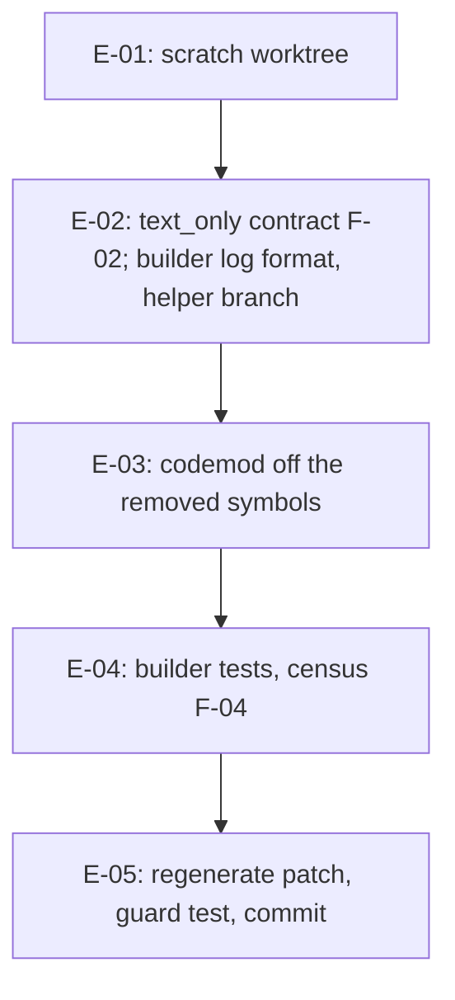

# IPD: Switch the shared test record builder and codemod to the log format in the cutover code patch

- Date: 2026-11-25
- Kind: child
- Concern: Backlog `ldfefd` (`x1mmdp` F-05 to F-07): the cutover code patch removes the legacy bullet API that `tests/record_builder.py` and `tools/fixture_codemod.py` call, so on the switched tree the shared builder fails at import (`AttributeError: ... '_LEGACY_BULLET_LABEL'`) and every test that imports `tests.support` fails with it; and the builder's `text_only=True` form (about 1690 calls in 310 files, about 650 of them written to disk by the caller) has no log-format meaning, because a log-format record needs `meta/<id6>.jsonl` beside its file.
- Scope: In a scratch worktree with both cutover patches applied (now including `hdwqex`), record the log-format `text_only` contract, switch `tests/record_builder.py` to `RECORD_FORMAT = "log"` with the log branch of `assert_field`/`assert_no_field`, repoint `tools/fixture_codemod.py` off the removed symbols, make the builder's own tests pass, re-measure the per-module failure census for the batch children, and regenerate `.aw/system/cutover/metastore-code.cutover.patch`. No live code changes.
- Scope-Paths: .aw/records/plans/pending/20261125-metastore-306-89mtbl-switch-the-shared-test-record-builder-and-codemod-to-the-log.ipd.md, .aw/system/cutover/metastore-code.cutover.patch
- Item-Dependencies: executed:hdwqex
- Status: to-review
- From-Spec: 4sd62s
- Work-Kind: followup
- Priority: high
- From-Backlog: ldfefd
- Blocks-Release: next
- Set: metastore
- Order: 306
- Highest E allocated: 05
- Author: opencode its_direct/pt3-claude-opus-5.5-1m-us
- Id: 89mtbl

> Write and proofread this plan per the technical writing standard, `.aw/system/workflows/technical-writing/technical-writing.md` (`.agents/workflows/technical-writing/technical-writing.md` in a legacy-layout install), including requirement 12 (diagrams).

## Workflow history

- 2026-11-26 to-review (aw set): authored as part of the x1mmdp split per maintainer answer to run-20261125T162650Z-1337442 question 06-x1mmdp-a1-Q-01 (Split into new children; fix jycxw8 first)
- 2026-11-26 draft (opencode its_direct/pt3-claude-opus-5.5-1m-us): created.

## Goal

Make the shared test record builder and the fixture codemod work on the switched tree, with a written `text_only` contract the batch children (`nv3upa` to `x3mig6`) follow, so converting the failing test modules becomes mechanical.

## Detailed Implementation Checklist (TODO)

Execution-state rule: mark an `E-*` item complete only after performing the action. That mark is not validation. Right-sizing rule: write for a modest executor that cannot hold much in its head. Each E-item is one step (one concern, about one file, executable in one focused pass) and its V-item names each unit it covers with its own check; a plan stays at about 5 E-items and 8 work Scope-Paths, else split it into more child plans (guidance, `IPD-Z603`). Accepted execution states: blocked, failed, pending, performed; terminal gate demands 'performed'.

### Task group 1: scratch worktree

- [ ] E-01 Create the scratch worktree with the SCRATCH PROCEDURE of `2k5t16` (Step 0): `git worktree add --detach .aw/state/89mtbl/scratch HEAD`, apply the docs patch with `git apply --index`, record `BASE=$(git write-tree)` in F-01, then apply the code patch with `git apply --index`. If either patch does not apply, stop and report.
  - Depends on: none
  - Expected outcome: the scratch worktree holds HEAD plus both patches, staged; F-01 holds the base tree id.
  - Execution state: pending

### Task group 2: builder and codemod (scratch worktree only)

- [ ] E-02 First record the log-format `text_only` contract in F-02, then edit. Default, to adopt unless a measured reason in F-02 says otherwise: `text_only=True` returns the in-file text that `artifact_meta.create(..., dry_run=True)` renders (the two-key mirror, the banner and the body), so `artifact_meta.read_text` and `ipd_lint.lint_text` callers keep working in memory (spec `4sd62s` 4.3 defines `read_text` as an in-memory phase-B parse); a caller that writes that text to disk must instead call the builder without `text_only` (or a new `RecordBuilder.materialize(text, path)` helper that writes `meta/<id6>.jsonl` through `artifact_meta.create`), because a mirror with no log is an orphan. Record in F-02 which of these the batch children use, with one example call of each. Then, in `tests/record_builder.py`, set `RECORD_FORMAT = "log"` and rewrite `RecordBuilder._emit_record` for the log format: the file path goes through `artifact_meta.create(id6, record_type, fields, body, destination=..., project_context=...)` (no `legacy_render` or `repo_root` keyword, which the switched `create` does not take) and the follow-up event through `artifact_meta.append(id6, [event], ...)` (no `LegacyTarget`); `post_process` steps edit the body, not metadata (history becomes events, not a `## Workflow history` section); the `text_only` branch follows F-02. Add the log branch of `assert_field`/`assert_no_field` (`iog3cw` E-01 added the helper): it reads `artifact_meta.read` and the in-file mirror. Drop the module-level reads of removed symbols (`_LEGACY_BULLET_LABEL` and the others) and `_require_legacy_format`'s refusal of the log format.
  - Depends on: E-01
  - Expected outcome: F-02 holds the contract; `python3 -c "import tests.support"` succeeds in the scratch worktree, and a plan, spec, backlog, research, release, prompt, walkthrough and review built through the builder each read back through `artifact_meta.read` with the fields given.
  - Execution state: pending

- [ ] E-03 In `tools/fixture_codemod.py`, replace the reads of `artifact_meta._LEGACY_BULLET_LABEL`, `_RESEARCH_YAML_KEY` and `_PROMPT_COMMENT_KEY` in `_registry_field_map` with the legacy label maps the code patch keeps in `agent_workflows/migrations/` (the `m0001` loader reads the same labels; name the symbol used in F-03), so the codemod still recognizes legacy literal fixtures, and make its rewrite target the F-02 contract.
  - Depends on: E-02
  - Expected outcome: `python3 tools/fixture_codemod.py --dry-run --format json tests/test_fixture_codemod.py` runs in the scratch worktree without an `AttributeError`.
  - Execution state: pending

- [ ] E-04 Update and run the builder and codemod tests in the scratch worktree: `tests/test_record_builder.py`, `tests/test_record_builder_slow.py`, `tests/test_record_builder_assert_field.py` and `tests/test_fixture_codemod.py`, with `python3 -m pytest -o addopts="" -m ''`. Then run the bare core gate (`python3 -m pytest`) and write the per-module failure census to F-04 in the shape of the `x1mmdp` attempt-1 evidence `.aw/state/lane-submissions/run-20261125T162650Z-1337442/06-x1mmdp/attempt-1/evidence/failing-modules.txt` (count, module, refusal or other), so each batch child starts from a measured list.
  - Depends on: E-03
  - Expected outcome: the four modules pass; F-04 holds the census and the core gate summary line.
  - Execution state: pending

### Task group 3: package

- [ ] E-05 In the scratch worktree run `git add -A`, write `git diff --cached --binary $BASE` over `.aw/system/cutover/metastore-code.cutover.patch`, remove the scratch worktree (`git worktree remove --force .aw/state/89mtbl/scratch`), run `python3 -m pytest -o addopts="" tests/test_metastore_cutover_code_patch.py` in the executing checkout, and commit through `aw commit 89mtbl -- <this plan> .aw/system/cutover/metastore-code.cutover.patch`; never push.
  - Depends on: E-04
  - Expected outcome: the regenerated code patch holds the earlier changes plus this plan's; the guard test passes; one path-scoped commit.
  - Execution state: pending

## Project conventions discovered (Step 0)

- The scratch procedure and the cumulative code patch are defined in `2k5t16`; executed siblings `g45vyv` and `2k5t16` follow it.
- Conversion rules shared by the `ldfefd` batch children (`nv3upa`, `cugg3w`, `psm9ac`, `x8id25`, `e0g2gt`, `qi0kl6`, `x3mig6`), fixed here so no executor chooses them: (1) a call to an API the code patch removes (`LegacyRender`, `LegacyTarget`, `render_legacy_text`, `set_legacy_bullet_line`, `_LEGACY_BULLET_LABEL`, `_format_legacy_value`, `_RESEARCH_YAML_KEY`, `_format_yaml_value`, `_PROMPT_COMMENT_KEY`, `write_legacy`, `SidecarRecord`, `backlog._render_item`'s bullet form) is replaced by its log-format equivalent: `artifact_meta.create` or `artifact_meta.append` keyed by id6, or `tests.record_builder.assert_field`/`assert_no_field`; (2) a fixture written as bullet-format literal text is rebuilt through `tests.record_builder.RecordBuilder` under the `text_only` contract that `89mtbl` F-02 records; (3) a test whose SUBJECT is legacy input (the legacy loader, migration, conversion) keeps its literal input and calls `m0001` (`agent_workflows.migrations.m0001_metadata_v2.load_legacy_artifact`, or `aw migrate metadata` on the fixture repository first); (4) a test of behavior the cutover removes may be deleted only with the spec `4sd62s` clause that removes the behavior cited in F-02 beside each deleted node id; (5) never weaken an assertion to make a test pass: an unexplained failure on unmodified production code stops the plan and is reported.
- A fixture repository the switched builder writes is log-format, so `migrations.chain.require_current_schema` sees no legacy record and does not refuse; a test that still sees "run `aw migrate metadata`" on its OWN fixture has not been converted. Only tests that read this repository's own records (`livecorpus`, `REPO_ROOT`) may still refuse, and those are listed in F-03, not edited.
- Tests exercise code and assert on outcomes (AGENTS.md "TEST OUTCOMES, NOT CODE STRUCTURE").
- Cite code by SYMBOL (`module.function`) or by a quoted content string, with a line number only appended to one of those and never alone: an offset expires before this plan executes (advisory `IPD-C801`).

## Findings

| Id | Evidence | Finding |
|---|---|---|
| F-01 | (written by E-01) | Base tree id after the docs patch. |
| F-02 | (written by E-02) | The log-format `text_only` contract and its example calls. |
| F-03 | (written by E-03) | The legacy label map the codemod now reads. |
| F-04 | (written by E-04) | Core-gate failure census on the switched tree after this plan, per module. |
| F-05 | `x1mmdp` F-05 to F-07 (2026-11-25) and `.aw/state/lane-submissions/run-20261125T162650Z-1337442/06-x1mmdp/attempt-1/evidence/failing-modules.txt`: on the switched tree with copies of the removed helpers the core gate reported `567 failed, 2348 passed, 1 skipped, 11 warnings, 66 errors` across 71 modules, 385 of them `MetadataSchemaError` from fixture repositories the tests build themselves | A fixture repository with bullet records counts as schema 1 under `migrations.chain.require_current_schema`; a log-format builder removes most of those refusals. |

## Proposed changes (ordered, validatable)

1. E-01: scratch worktree with both patches.
2. E-02: the `text_only` contract; switch the builder and the field helper.
3. E-03: repoint the codemod.
4. E-04: builder and codemod tests; failure census.
5. E-05: regenerate the code patch and commit.

## Deferred / out of scope (with reason)

- Converting the test modules that call the removed API or fail on the switched tree: batch children.
  - Carrier: nv3upa
- The exact-spelling rows, the `review-pilot` corpus and the final refusal list: the narrowed parent step.
  - Carrier: x1mmdp

## Scope check

- Over-scope: none.
- Under-scope: none. `ldfefd`'s builder, codemod and `text_only` items map to E-02 to E-05.

## Required tests / validation

- Named runs in the scratch worktree (V-02 to V-04); the `2k5t16` guard test (V-05).

## Spec / documentation sync

No spec change: spec `4sd62s` 4.1 to 4.3 already define the log format and the cutover, and the docs patch already describes it. This plan brings the tests in the code patch into line with them.

## Open questions

None open.

## Validation and cross-check (verify before reporting done)

Validation-state rule: inspect evidence in a separate pass. Do not mark a `V-*` item complete from memory or from the matching execution checkmark. Accepted validation results: blocked, failed, pass, pending; terminal gate demands 'pass'. Runtime-demonstration reachability rule: for each `V-*` item demanding the software be observed acting (such as a run, a dispatch, or a transition) - as distinct from items demanding a diff, a file's content, or a test result, which are reachable by construction - name the code path that produces the observation or the sibling `E-*` that creates it, else the demand is UNDER-SCOPE.

- [ ] V-01 validates E-01
  - Required evidence: paste the worktree command and both `git apply --index` commands with exit status 0, and F-01.
  - Observed evidence:
  - Result: pending
- [ ] V-02 validates E-02
  - Required evidence: paste F-02 with the contract and one example call of each form it names; the diff hunk setting `RECORD_FORMAT = "log"`; the hunk adding the log branch of `assert_field`/`assert_no_field`; `python3 -c "import tests.support"` exiting 0; and a run building one record of each of the eight types and reading each back through `artifact_meta.read`.
  - Observed evidence:
  - Result: pending
- [ ] V-03 validates E-03
  - Required evidence: paste the `_registry_field_map` hunk and the `tools/fixture_codemod.py --dry-run --format json` run exiting 0.
  - Observed evidence:
  - Result: pending
- [ ] V-04 validates E-04
  - Required evidence: paste the pytest summary line of each module by name: `tests/test_record_builder.py`, `tests/test_record_builder_slow.py`, `tests/test_record_builder_assert_field.py` and `tests/test_fixture_codemod.py`; then F-04 with the core gate summary line.
  - Observed evidence:
  - Result: pending
- [ ] V-05 validates E-05
  - Required evidence: paste `git apply --stat .aw/system/cutover/metastore-code.cutover.patch`, the `tests/test_metastore_cutover_code_patch.py` run with each test PASSED, `git worktree list` showing the scratch worktree removed, and the `aw commit` output naming the commit hash.
  - Observed evidence:
  - Result: pending

## Approval and execution gate

- Size assessment: standard
- Cohesion rationale: not required

Execute only after human approval (`Status: approved`) and after every plan in `- Item-Dependencies:` is executed. Code and tests are edited ONLY in the scratch worktree. Scope fence: the paths in `- Scope-Paths:` are a declaration; a needed file outside the fence is edited and then justified at finalize (`--scope-reason`), and a declared path left unmodified is acknowledged (`--scope-ack`). Stop and report rather than editing production code outside the scratch worktree or weakening test assertions if an unexpected failure occurs on unmodified code, if a patch hunk rejects, or if an unresolvable concurrent-edit conflict occurs. Honesty rule: paste the ACTUAL output of every command named above; never claim a result you did not run. Commits: commit only through `aw commit 89mtbl -- <paths>`; never push. Lifecycle transition: the plan moves to `.aw/records/plans/executed/` only through `aw ipd finalize`, after `aw ipd lint --phase pre-transition` conforms and every `V-*` reads `pass` with pasted evidence.
