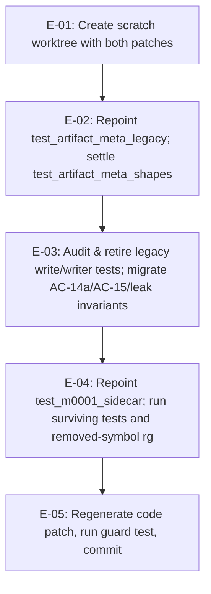

# IPD: Retire or repoint the legacy loader and writer unit tests in the cutover code patch

- Date: 2026-11-25
- Kind: child
- Concern: Backlog `ldfefd`: five test modules fail on the switched log-format tree (`x1mmdp` F-05; historical attempt-1 counts: `tests/test_artifact_meta_legacy.py` 14 failing, `tests/test_artifact_meta_shapes.py` 15 failing, `tests/test_artifact_meta_legacy_write.py` 31 failing, `tests/test_artifact_meta_legacy_writer.py` 11 failing, `tests/test_m0001_sidecar.py` 1 failing) because the cutover code patch moves `load_legacy_artifact` and `derive_id6` out of `agent_workflows/artifact_meta.py` into `agent_workflows/migrations/m0001_metadata_v2.py` and removes the phase-B legacy cache scanner and legacy writer API (`LegacyRender`, `LegacyTarget`, `render_legacy_text`, `write_legacy`, `SidecarRecord`, `restore_legacy_snapshot`, `LEGACY_LOADER_VERSION`) per spec `4sd62s` C10a and Sections 5.2 and 5.3.
- Scope: In an isolated scratch worktree with both cutover patches applied (including `hdwqex` and `89mtbl`), repoint `tests/test_artifact_meta_legacy.py` onto `agent_workflows/migrations/m0001_metadata_v2.py::load_legacy_artifact`, retain `m0001_metadata_v2.derive_id6` determinism/collision coverage from `tests/test_artifact_meta_shapes.py` while retiring its phase-B legacy cache-scan and `LegacyRender`/`SidecarRecord` tests, audit and retire `tests/test_artifact_meta_legacy_write.py` and `tests/test_artifact_meta_legacy_writer.py` (migrating any uncovered AC-14a, AC-15, or writer-leak invariant to `tests/test_artifact_meta_write.py` and citing the removing spec `4sd62s` clause per deleted node id in F-02), repoint `tests/test_m0001_sidecar.py` from `artifact_meta.load_legacy_artifact` to `m0001_metadata_v2.load_legacy_artifact`, verify all surviving modules pass with zero removed-symbol references, and regenerate `.aw/system/cutover/metastore-code.cutover.patch`. No live code changes.
- Scope-Paths: .aw/records/plans/pending/20261125-metastore-307-nv3upa-retire-or-repoint-the-legacy-loader-and-writer-unit-tests-in.ipd.md, .aw/system/cutover/metastore-code.cutover.patch
- Item-Dependencies: executed:89mtbl
- Status: reviewed
- Review-Depth: standard
- Readiness: go-pending-approval
- From-Spec: 4sd62s
- Work-Kind: followup
- Priority: high
- From-Backlog: ldfefd
- Blocks-Release: next
- Set: metastore
- Order: 307
- Highest E allocated: 05
- Author: opencode its_direct/pt3-claude-opus-5.5-1m-us
- Id: nv3upa

> Write and proofread this plan per the technical writing standard, `.aw/system/workflows/technical-writing/technical-writing.md` (`.agents/workflows/technical-writing/technical-writing.md` in a legacy-layout install), including requirement 12 (diagrams).

## Workflow history

- 2026-11-26 reviewed (aw set): APPROVE WITH REVISIONS APPLIED; PR-001..PR-005 FIXED
- 2026-11-26 /plan-review (antigravity/gemini): APPROVE WITH REVISIONS APPLIED; PR-001, PR-002, PR-003, PR-004, PR-005; review record .aw/records/reviews/20261125-metastore-307-nv3upa-retire-or-repoint-the-legacy-loader-and-writer-unit-tests-in.review.md
- 2026-11-26 to-review (aw set): authored as part of the x1mmdp split per maintainer answer to run-20261125T162650Z-1337442 question 06-x1mmdp-a1-Q-01 (Split into new children; fix jycxw8 first)
- 2026-11-26 draft (opencode its_direct/pt3-claude-opus-5.5-1m-us): created.

## Goal

Remove every reference to deleted legacy `artifact_meta` loader and writer symbols across these five test modules inside `.aw/system/cutover/metastore-code.cutover.patch`, while keeping all surviving `m0001` legacy-loader behavior (`load_legacy_artifact`, `derive_id6`, sidecar migration) and all surviving log-writer invariants (spec `4sd62s` AC-14a, AC-15, writer leak refusals) under test.

## Detailed Implementation Checklist (TODO)

Execution-state rule: mark an `E-*` item complete only after performing the action. That mark is not validation. Right-sizing rule: write for a modest executor that cannot hold much in its head. Each E-item is one step (one concern, about one file, executable in one focused pass) and its V-item names each unit it covers with its own check; a plan stays at about 5 E-items and 8 work Scope-Paths, else split it into more child plans (guidance, `IPD-Z603`). Accepted execution states: blocked, failed, pending, performed; terminal gate demands 'performed'.

### Task group 1: scratch worktree

- [ ] E-01 Create the scratch worktree following the SCRATCH PROCEDURE of `2k5t16` (Step 0): run `git worktree add --detach .aw/state/nv3upa/scratch HEAD`; inside `.aw/state/nv3upa/scratch`, run `git apply --index .aw/system/cutover/metastore-docs.cutover.patch`, record `BASE=$(git write-tree)` in F-01, and then run `git apply --index .aw/system/cutover/metastore-code.cutover.patch`. If either patch rejects, stop and report.
  - Depends on: none
  - Expected outcome: `.aw/state/nv3upa/scratch` holds HEAD plus both patches staged, and F-01 records the base tree id.
  - Execution state: pending

### Task group 2: legacy unit tests (scratch worktree only)

- [ ] E-02 Repoint `tests/test_artifact_meta_legacy.py` and settle `tests/test_artifact_meta_shapes.py` against `m0001_metadata_v2`:
  1. In `tests/test_artifact_meta_legacy.py`, repoint every `meta.load_legacy_artifact(...)` call to `agent_workflows.migrations.m0001_metadata_v2.load_legacy_artifact(...)`, keeping literal legacy inputs and field assertions intact (`load_legacy_review`, `read_text`, `history_records`, `_newest_history_record`, and `_last_history_at` remain in `artifact_meta.py`).
  2. In `tests/test_artifact_meta_shapes.py`, preserve `derive_id6` determinism and collision coverage by calling `m0001_metadata_v2.derive_id6` directly (either in `tests/test_artifact_meta_shapes.py` or moved into `tests/test_artifact_meta_legacy.py`), and retire the phase-B legacy cache-scanning (`artifact_meta.query`/`read`/`history` over unmigrated `.agents/` and id-less legacy repos) and `LegacyRender`/`SidecarRecord` tests (`test_a`..`test_d`, `test_f`, and the phase-B cache portion of `test_e`) under conversion rule 4, recording each deleted node id in F-02 beside spec `4sd62s` C10a and Sections 5.2 and 5.3 (multi-shape migration coverage lives in `tests/test_m0001_any_repo.py`).
  - Depends on: E-01
  - Expected outcome: `tests/test_artifact_meta_legacy.py` (and `tests/test_artifact_meta_shapes.py` if retained for `derive_id6`) imports no removed symbol and passes; any retired node id is recorded in F-02 with its `4sd62s` clause.
  - Execution state: pending

- [ ] E-03 Audit and retire `tests/test_artifact_meta_legacy_write.py` and `tests/test_artifact_meta_legacy_writer.py` under conversion rule 4:
  1. Audit every test in both files against surviving log-writer coverage in `tests/test_artifact_meta_write.py` and `tests/test_artifact_meta_replay.py`, specifically checking AC-14a (`review_kind` gate vs refinement validation and sequential refinement rounds), AC-15 (event-owned `readiness`, `coverage`, `approval`, and backward-transition `unset readiness` refusals), and writer-side leak refusals (`home` path in `message`).
  2. Migrate any surviving log-writer invariant that has no existing log-format test into `tests/test_artifact_meta_write.py` (exercising `artifact_meta.create`/`append` on log-format records), and record every deleted node id in F-02 beside the removing spec `4sd62s` clause (C10a, Sections 4.3 and 5.2) and the receiving test node id where applicable.
  - Depends on: E-02
  - Expected outcome: F-02 lists every deleted node id with its `4sd62s` clause and receiving test; no surviving AC-14a, AC-15, or writer-refusal invariant loses test coverage; receiving test modules pass.
  - Execution state: pending

- [ ] E-04 Repoint `tests/test_m0001_sidecar.py` from `artifact_meta.load_legacy_artifact` to `m0001_metadata_v2.load_legacy_artifact` (recording the repointed call in F-03), then run all surviving modules of the five plus any receiving test module from E-03 with `python3 -m pytest -o addopts="" -m ''` in the scratch worktree and run `rg` over those surviving paths for every removed symbol.
  - Depends on: E-03
  - Expected outcome: every surviving module passes; `rg` over the surviving paths for removed symbols returns no matches.
  - Execution state: pending

### Task group 3: package

- [ ] E-05 In `.aw/state/nv3upa/scratch`, run `git add -A` and write `git diff --cached --binary $BASE` over `.aw/system/cutover/metastore-code.cutover.patch` in the executing checkout; remove the scratch worktree (`git worktree remove --force .aw/state/nv3upa/scratch`); run `python3 -m pytest -o addopts="" tests/test_metastore_cutover_code_patch.py` in the executing checkout; verify `git status --short` shows only `- Scope-Paths:` modified; and commit through `aw commit nv3upa -- .aw/records/plans/pending/20261125-metastore-307-nv3upa-retire-or-repoint-the-legacy-loader-and-writer-unit-tests-in.ipd.md .aw/system/cutover/metastore-code.cutover.patch`; never push.
  - Depends on: E-04
  - Expected outcome: `.aw/system/cutover/metastore-code.cutover.patch` holds all earlier changes plus this plan's; `tests/test_metastore_cutover_code_patch.py` passes; scratch worktree is removed; one path-scoped commit is created.
  - Execution state: pending

## Project conventions discovered (Step 0)

- The scratch procedure and cumulative code patch are defined in executed plan `2k5t16` (Step 0, OQ-01).
- Conversion rules shared by the `ldfefd` batch children (`nv3upa`, `cugg3w`, `psm9ac`, `x8id25`, `e0g2gt`, `qi0kl6`, `x3mig6`), fixed here so no executor invents them: (1) a call to an API the code patch removes (`LegacyRender`, `LegacyTarget`, `render_legacy_text`, `set_legacy_bullet_line`, `_LEGACY_BULLET_LABEL`, `_format_legacy_value`, `_RESEARCH_YAML_KEY`, `_format_yaml_value`, `_PROMPT_COMMENT_KEY`, `write_legacy`, `append_legacy`, `SidecarRecord`, `restore_legacy_snapshot`, `LEGACY_LOADER_VERSION`, `backlog._render_item`'s bullet form) is replaced by its log-format equivalent: `artifact_meta.create` or `artifact_meta.append` keyed by id6, or `tests.record_builder.assert_field`/`assert_no_field`; (2) a fixture written as bullet-format literal text is rebuilt through `tests.record_builder.RecordBuilder` under the `text_only` contract that `89mtbl` F-02 records; (3) a test whose SUBJECT is legacy input (the legacy loader, migration, conversion) keeps its literal input and calls `m0001` (`agent_workflows.migrations.m0001_metadata_v2.load_legacy_artifact`, `m0001_metadata_v2.derive_id6`, or `aw migrate metadata` on the fixture repository first); (4) a test of behavior the cutover removes may be deleted only with the spec `4sd62s` clause that removes the behavior cited in F-02 beside each deleted node id; (5) never weaken an assertion to make a test pass: an unexplained failure on unmodified production code stops the plan and is reported.
- Start from `89mtbl` F-04's refreshed core-gate census rather than any gitignored attempt-1 lane file.
- Tests exercise code and assert on observable outcomes (AGENTS.md "TEST OUTCOMES, NOT CODE STRUCTURE").
- Cite code by symbol (`path::Symbol`) or by a quoted content string, with a line number only appended as a hint and never alone (advisory `IPD-C801`).

## Findings

| Id | Evidence | Finding |
|---|---|---|
| F-01 | (written by E-01) | Base tree id after applying `.aw/system/cutover/metastore-docs.cutover.patch`. |
| F-02 | (written by E-02 and E-03) | Every deleted node id from `test_artifact_meta_shapes.py`, `test_artifact_meta_legacy_write.py`, and `test_artifact_meta_legacy_writer.py`, each beside its removing spec `4sd62s` clause and any receiving test node id in `tests/test_artifact_meta_write.py` or `tests/test_artifact_meta_legacy.py`. |
| F-03 | (written by E-04) | The repointed `m0001_metadata_v2.load_legacy_artifact` call in `tests/test_m0001_sidecar.py` (confirming `test_m0001_sidecar.py` uses `m0001_metadata_v2.run`/`rollback` and never imported `SidecarRecord`). |
| F-04 | `x1mmdp` F-05 (historical attempt-1 census provenance from `run-20261125T162650Z-1337442`; lane file is gitignored); verified statically across all five files and `.aw/system/cutover/metastore-code.cutover.patch`: `tests/test_artifact_meta_legacy.py` calls `meta.load_legacy_artifact` (moved to `m0001_metadata_v2`); `tests/test_artifact_meta_shapes.py` tests phase-B legacy cache scanning plus `artifact_meta.derive_id6` (moved to `m0001_metadata_v2`), `LegacyRender`, and `SidecarRecord`; `tests/test_artifact_meta_legacy_write.py` tests `LegacyRender`/`LegacyTarget`/`SidecarRecord` plus surviving AC-14a, AC-15, and writer-leak invariants not yet in `tests/test_artifact_meta_write.py`; `tests/test_artifact_meta_legacy_writer.py` tests `write_legacy`/`render_legacy_text`/`restore_legacy_snapshot`; `tests/test_m0001_sidecar.py` calls `artifact_meta.load_legacy_artifact` once and never imports `SidecarRecord`. | Exact per-module migration/retirement classification across all five target test modules. |

## Proposed changes (ordered, validatable)

1. E-01: Create scratch worktree `.aw/state/nv3upa/scratch` with both cutover patches staged.
2. E-02: Repoint `tests/test_artifact_meta_legacy.py` onto `m0001_metadata_v2.load_legacy_artifact` and settle `tests/test_artifact_meta_shapes.py` (`m0001_metadata_v2.derive_id6` kept; phase-B cache-scan tests retired to F-02).
3. E-03: Audit and retire `tests/test_artifact_meta_legacy_write.py` and `tests/test_artifact_meta_legacy_writer.py` (migrating uncovered AC-14a, AC-15, and writer-leak invariants to `tests/test_artifact_meta_write.py`; recording all deletions in F-02).
4. E-04: Repoint `tests/test_m0001_sidecar.py` onto `m0001_metadata_v2.load_legacy_artifact`, run all surviving modules plus receiving tests, and verify zero removed-symbol matches via `rg`.
5. E-05: Regenerate `.aw/system/cutover/metastore-code.cutover.patch`, remove the scratch worktree, pass the guard test, and commit path-scoped.

## Deferred / out of scope (with reason)

- Converting the remaining failing test modules (batches A through F): later batch children.
  - Carrier: cugg3w
- Applying the cutover patches on the real tree: attended cutover commit.
  - Carrier: cxxmyv

## Scope check

- Over-scope: none. No live code or test files are modified outside `.aw/system/cutover/metastore-code.cutover.patch`.
- Under-scope: none. All five legacy loader/writer/sidecar modules plus surviving AC-14a/AC-15/writer-leak invariant migration map to E-02 through E-04.

## Required tests / validation

- Surviving modules of the five plus receiving test modules (`tests/test_artifact_meta_write.py` if modified) run with `python3 -m pytest -o addopts="" -m ''` in `.aw/state/nv3upa/scratch` (V-02 to V-04).
- Removed-symbol `rg` check over the surviving target paths in `.aw/state/nv3upa/scratch` (V-04).
- Cumulative patch guard test `python3 -m pytest -o addopts="" tests/test_metastore_cutover_code_patch.py` in the executing checkout (V-05).

## Spec / documentation sync

No spec or documentation change is needed in this plan. Spec `4sd62s` C10a and Sections 4.1 through 4.3, 5.2, and 5.3 already define the log format, legacy-writer removal, and cutover, and `.aw/system/cutover/metastore-docs.cutover.patch` already updates the documentation. This plan brings these five legacy test modules inside the cutover code patch into line with them.

## Open questions

None open.

## Validation and cross-check (verify before reporting done)

Validation-state rule: inspect evidence in a separate pass. Do not mark a `V-*` item complete from memory or from the matching execution checkmark. Accepted validation results: blocked, failed, pass, pending; terminal gate demands 'pass'. Runtime-demonstration reachability rule: for each `V-*` item demanding the software be observed acting (such as a run, a dispatch, or a transition) - as distinct from items demanding a diff, a file's content, or a test result, which are reachable by construction - name the code path that produces the observation or the sibling `E-*` that creates it, else the demand is UNDER-SCOPE.

- [ ] V-01 validates E-01
  - Required evidence: paste the `git worktree add --detach .aw/state/nv3upa/scratch HEAD` command, both `git apply --index` commands (for `.aw/system/cutover/metastore-docs.cutover.patch` and `.aw/system/cutover/metastore-code.cutover.patch`) with exit status 0, and the base tree id recorded in F-01.
  - Observed evidence:
  - Result: pending
- [ ] V-02 validates E-02
  - Required evidence: paste the pytest summary line for `tests/test_artifact_meta_legacy.py` (and `tests/test_artifact_meta_shapes.py` if kept for `derive_id6`) in the scratch worktree showing all tests PASSED, one diff hunk showing a call to `m0001_metadata_v2.load_legacy_artifact`, one hunk showing `m0001_metadata_v2.derive_id6`, and the `test_artifact_meta_shapes.py` F-02 retirement rows citing spec `4sd62s` C10a / Sections 5.2 and 5.3.
  - Observed evidence:
  - Result: pending
- [ ] V-03 validates E-03
  - Required evidence: paste F-02 (every deleted node id from `test_artifact_meta_legacy_write.py` and `test_artifact_meta_legacy_writer.py` beside its removing spec `4sd62s` clause, plus the AC-14a, AC-15, and writer-leak invariant audit naming each receiving test) and the pytest summary line of each receiving test module (`tests/test_artifact_meta_write.py`, `tests/test_artifact_meta_replay.py`) in the scratch worktree showing all tests PASSED.
  - Observed evidence:
  - Result: pending
- [ ] V-04 validates E-04
  - Required evidence: paste F-03 showing the repointed `m0001_metadata_v2.load_legacy_artifact` call in `tests/test_m0001_sidecar.py`, the pytest summary line for every surviving module of the five (`tests/test_artifact_meta_legacy.py`, `tests/test_m0001_sidecar.py`, and `tests/test_artifact_meta_shapes.py` if retained) showing all tests PASSED in the scratch worktree, and `rg -n 'LegacyRender|LegacyTarget|render_legacy_text|set_legacy_bullet_line|_LEGACY_BULLET_LABEL|_format_legacy_value|_RESEARCH_YAML_KEY|_format_yaml_value|_PROMPT_COMMENT_KEY|write_legacy|append_legacy|SidecarRecord|restore_legacy_snapshot|LEGACY_LOADER_VERSION|artifact_meta\.load_legacy_artifact|meta\.load_legacy_artifact|artifact_meta\.derive_id6'` over those surviving paths (plus any receiving test module modified in E-03) returning exit 1 with no matches.
  - Observed evidence:
  - Result: pending
- [ ] V-05 validates E-05
  - Required evidence: paste `git apply --stat .aw/system/cutover/metastore-code.cutover.patch`, the `python3 -m pytest -o addopts="" tests/test_metastore_cutover_code_patch.py` run with all 3 tests PASSED, `git worktree list` showing `.aw/state/nv3upa/scratch` removed, `git status --short` confirming no live edits outside `- Scope-Paths:`, and the `aw commit nv3upa` output naming the commit hash.
  - Observed evidence:
  - Result: pending

## Approval and execution gate

- Size assessment: standard
- Cohesion rationale: not required

Execute only after human approval (`Status: approved`) and after every plan in `- Item-Dependencies:` (`89mtbl`) is executed; open questions: none open. Code and tests are edited ONLY inside `.aw/state/nv3upa/scratch` and packaged into `.aw/system/cutover/metastore-code.cutover.patch`. Scope fence: `- Scope-Paths:` is a declaration; any needed edit outside it must be justified at finalize (`--scope-reason`), and any declared path left unmodified must be acknowledged (`--scope-ack`). Safety stop conditions: stop and report rather than editing live production code outside the scratch worktree or weakening test assertions if a patch hunk rejects, an unexpected failure occurs on unmodified code, or an unresolvable concurrent-edit conflict occurs. Honesty rule: you MUST paste the ACTUAL runner output of every command named in V-01 through V-05; never claim a result you did not run. Commits: commit only through `aw commit nv3upa -- <paths>`; never push. Lifecycle transition: after `aw ipd lint --phase pre-transition` conforms and every `V-*` reads `pass` with pasted evidence, in a managed runner lane stop after committing the updated plan and let the runner run `aw ipd finalize`; in a hand-run session run `aw ipd finalize` to move the plan to `.aw/records/plans/executed/` (never use a raw `git mv` to `executed/`).
