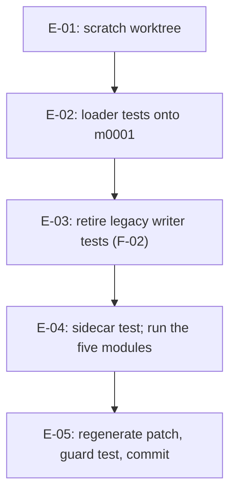

# IPD: Retire or repoint the legacy loader and writer unit tests in the cutover code patch

- Date: 2026-11-25
- Kind: child
- Concern: Backlog `ldfefd`: five test modules exist to test the legacy loader and writer API that the cutover code patch removes from `artifact_meta` (`x1mmdp` F-05, census `.aw/state/lane-submissions/run-20261125T162650Z-1337442/06-x1mmdp/attempt-1/evidence/failing-modules.txt`): `test_artifact_meta_legacy` (14 failing), `test_artifact_meta_shapes` (15 failing), `test_artifact_meta_legacy_write` (31 failing), `test_artifact_meta_legacy_writer` (11 failing), `test_m0001_sidecar` (1 failing). Their subject either moves to `m0001` (the legacy loader, `load_legacy_artifact`) or is removed by spec `4sd62s` (the legacy writer, `LegacyRender`, `write_legacy`, `SidecarRecord`).
- Scope: In a scratch worktree with both cutover patches applied (now including `hdwqex` and `89mtbl`), repoint the legacy loader tests to `m0001`, retire the legacy writer tests with the removing spec clause cited per node id, convert `tests/test_m0001_sidecar.py` off `SidecarRecord`, and regenerate `.aw/system/cutover/metastore-code.cutover.patch`. No live code changes.
- Scope-Paths: .aw/records/plans/pending/20261125-metastore-307-nv3upa-retire-or-repoint-the-legacy-loader-and-writer-unit-tests-in.ipd.md, .aw/system/cutover/metastore-code.cutover.patch
- Item-Dependencies: executed:89mtbl
- Status: to-review
- From-Spec: 4sd62s
- Work-Kind: followup
- Priority: high
- From-Backlog: ldfefd
- Blocks-Release: next
- Set: metastore
- Order: 307
- Highest E allocated: 05
- Author: opencode its_direct/pt3-claude-opus-5.5-1m-us
- Id: nv3upa

> Write and proofread this plan per the technical writing standard, `.aw/system/workflows/technical-writing/technical-writing.md` (`.agents/workflows/technical-writing/technical-writing.md` in a legacy-layout install), including requirement 12 (diagrams).

## Workflow history

- 2026-11-26 to-review (aw set): authored as part of the x1mmdp split per maintainer answer to run-20261125T162650Z-1337442 question 06-x1mmdp-a1-Q-01 (Split into new children; fix jycxw8 first)
- 2026-11-26 draft (opencode its_direct/pt3-claude-opus-5.5-1m-us): created.

## Goal

Leave no test on the switched tree that imports a removed legacy symbol, while keeping every legacy-input behavior that survives (the `m0001` loader) under test.

## Detailed Implementation Checklist (TODO)

Execution-state rule: mark an `E-*` item complete only after performing the action. That mark is not validation. Right-sizing rule: write for a modest executor that cannot hold much in its head. Each E-item is one step (one concern, about one file, executable in one focused pass) and its V-item names each unit it covers with its own check; a plan stays at about 5 E-items and 8 work Scope-Paths, else split it into more child plans (guidance, `IPD-Z603`). Accepted execution states: blocked, failed, pending, performed; terminal gate demands 'performed'.

### Task group 1: scratch worktree

- [ ] E-01 Create the scratch worktree with the SCRATCH PROCEDURE of `2k5t16` (Step 0): `git worktree add --detach .aw/state/nv3upa/scratch HEAD`, apply the docs patch with `git apply --index`, record `BASE=$(git write-tree)` in F-01, then apply the code patch with `git apply --index`. If either patch does not apply, stop and report.
  - Depends on: none
  - Expected outcome: the scratch worktree holds HEAD plus both patches, staged; F-01 holds the base tree id.
  - Execution state: pending

### Task group 2: legacy unit tests (scratch worktree only)

- [ ] E-02 Repoint `tests/test_artifact_meta_legacy.py` and `tests/test_artifact_meta_shapes.py` at the surviving loader: each test of reading a legacy record calls `agent_workflows.migrations.m0001_metadata_v2.load_legacy_artifact` with the same literal input and asserts the same fields. A test whose only subject is a removed symbol is handled as in E-03.
  - Depends on: E-01
  - Expected outcome: both modules import no removed symbol and pass.
  - Execution state: pending

- [ ] E-03 Retire `tests/test_artifact_meta_legacy_write.py` and `tests/test_artifact_meta_legacy_writer.py` (conversion rule 4): list in F-02 each node id deleted beside the spec `4sd62s` clause that removes the legacy writer, and move to a log-format writer test any assertion about behavior the log writer keeps (for example the event content of `create`/`append`), naming the receiving test in F-02.
  - Depends on: E-02
  - Expected outcome: F-02 lists every deleted node id with its clause; no surviving behavior lost its only test.
  - Execution state: pending

- [ ] E-04 Convert `tests/test_m0001_sidecar.py` off `artifact_meta.SidecarRecord` (use the `m0001` sidecar reader the code patch keeps, named in F-03), then run the five modules with `python3 -m pytest -o addopts="" -m ''` in the scratch worktree.
  - Depends on: E-03
  - Expected outcome: every surviving module passes; `rg` for the removed symbols over the five paths finds none.
  - Execution state: pending

### Task group 3: package

- [ ] E-05 In the scratch worktree run `git add -A`, write `git diff --cached --binary $BASE` over `.aw/system/cutover/metastore-code.cutover.patch`, remove the scratch worktree (`git worktree remove --force .aw/state/nv3upa/scratch`), run `python3 -m pytest -o addopts="" tests/test_metastore_cutover_code_patch.py` in the executing checkout, and commit through `aw commit nv3upa -- <this plan> .aw/system/cutover/metastore-code.cutover.patch`; never push.
  - Depends on: E-04
  - Expected outcome: the regenerated code patch holds the earlier changes plus this plan's; the guard test passes; one path-scoped commit.
  - Execution state: pending

## Project conventions discovered (Step 0)

- The scratch procedure and the cumulative code patch are defined in `2k5t16`.
- Conversion rules shared by the `ldfefd` batch children (`nv3upa`, `cugg3w`, `psm9ac`, `x8id25`, `e0g2gt`, `qi0kl6`, `x3mig6`), fixed here so no executor chooses them: (1) a call to an API the code patch removes (`LegacyRender`, `LegacyTarget`, `render_legacy_text`, `set_legacy_bullet_line`, `_LEGACY_BULLET_LABEL`, `_format_legacy_value`, `_RESEARCH_YAML_KEY`, `_format_yaml_value`, `_PROMPT_COMMENT_KEY`, `write_legacy`, `SidecarRecord`, `backlog._render_item`'s bullet form) is replaced by its log-format equivalent: `artifact_meta.create` or `artifact_meta.append` keyed by id6, or `tests.record_builder.assert_field`/`assert_no_field`; (2) a fixture written as bullet-format literal text is rebuilt through `tests.record_builder.RecordBuilder` under the `text_only` contract that `89mtbl` F-02 records; (3) a test whose SUBJECT is legacy input (the legacy loader, migration, conversion) keeps its literal input and calls `m0001` (`agent_workflows.migrations.m0001_metadata_v2.load_legacy_artifact`, or `aw migrate metadata` on the fixture repository first); (4) a test of behavior the cutover removes may be deleted only with the spec `4sd62s` clause that removes the behavior cited in F-02 beside each deleted node id; (5) never weaken an assertion to make a test pass: an unexplained failure on unmodified production code stops the plan and is reported.
- A fixture repository the switched builder writes is log-format, so `migrations.chain.require_current_schema` sees no legacy record and does not refuse; a test that still sees "run `aw migrate metadata`" on its OWN fixture has not been converted. Only tests that read this repository's own records (`livecorpus`, `REPO_ROOT`) may still refuse, and those are listed in F-03, not edited.
- Tests exercise code and assert on outcomes (AGENTS.md "TEST OUTCOMES, NOT CODE STRUCTURE").
- Cite code by SYMBOL (`module.function`) or by a quoted content string, with a line number only appended to one of those and never alone: an offset expires before this plan executes (advisory `IPD-C801`).

## Findings

| Id | Evidence | Finding |
|---|---|---|
| F-01 | (written by E-01) | Base tree id after the docs patch. |
| F-02 | (written by E-03) | Deleted node ids, each with its spec `4sd62s` clause, and any receiving test. |
| F-03 | (written by E-04) | The `m0001` sidecar reader the sidecar test now uses. |
| F-04 | `.aw/state/lane-submissions/run-20261125T162650Z-1337442/06-x1mmdp/attempt-1/evidence/failing-modules.txt` | The five modules fail on the switched tree because they import removed symbols (`x1mmdp` F-05). |

## Proposed changes (ordered, validatable)

1. E-01: scratch worktree.
2. E-02: loader tests onto `m0001`.
3. E-03: retire the legacy writer tests.
4. E-04: sidecar test; run the five modules.
5. E-05: regenerate the code patch and commit.

## Deferred / out of scope (with reason)

- The other failing modules: later batch children.
  - Carrier: cugg3w

## Scope check

- Over-scope: none.
- Under-scope: none. Each of the five modules maps to E-02, E-03 or E-04.

## Required tests / validation

- Named runs in the scratch worktree (V-02 to V-04); the `2k5t16` guard test (V-05).

## Spec / documentation sync

No spec change: spec `4sd62s` 4.1 to 4.3 already define the log format and the cutover, and the docs patch already describes it. This plan brings the tests in the code patch into line with them.

## Open questions

None open.

## Validation and cross-check (verify before reporting done)

Validation-state rule: inspect evidence in a separate pass. Do not mark a `V-*` item complete from memory or from the matching execution checkmark. Accepted validation results: blocked, failed, pass, pending; terminal gate demands 'pass'. Runtime-demonstration reachability rule: for each `V-*` item demanding the software be observed acting (such as a run, a dispatch, or a transition) - as distinct from items demanding a diff, a file's content, or a test result, which are reachable by construction - name the code path that produces the observation or the sibling `E-*` that creates it, else the demand is UNDER-SCOPE.

- [ ] V-01 validates E-01
  - Required evidence: paste the worktree command and both `git apply --index` commands with exit status 0, and F-01.
  - Observed evidence:
  - Result: pending
- [ ] V-02 validates E-02
  - Required evidence: paste the pytest summary line for `tests/test_artifact_meta_legacy.py` and `tests/test_artifact_meta_shapes.py` in the scratch worktree and one hunk showing a call to `load_legacy_artifact`.
  - Observed evidence:
  - Result: pending
- [ ] V-03 validates E-03
  - Required evidence: paste F-02 (each deleted node id with its clause and any receiving test) and the summary line of each receiving test module.
  - Observed evidence:
  - Result: pending
- [ ] V-04 validates E-04
  - Required evidence: paste the pytest summary line for each surviving module of the five and the `rg` over the five paths printing nothing.
  - Observed evidence:
  - Result: pending
- [ ] V-05 validates E-05
  - Required evidence: paste `git apply --stat .aw/system/cutover/metastore-code.cutover.patch`, the `tests/test_metastore_cutover_code_patch.py` run with each test PASSED, `git worktree list` showing the scratch worktree removed, and the `aw commit` output naming the commit hash.
  - Observed evidence:
  - Result: pending

## Approval and execution gate

- Size assessment: standard
- Cohesion rationale: not required

Execute only after human approval (`Status: approved`) and after every plan in `- Item-Dependencies:` is executed. Code and tests are edited ONLY in the scratch worktree. Scope fence: the paths in `- Scope-Paths:` are a declaration; a needed file outside the fence is edited and then justified at finalize (`--scope-reason`), and a declared path left unmodified is acknowledged (`--scope-ack`). Stop and report rather than editing production code outside the scratch worktree or weakening test assertions if an unexpected failure occurs on unmodified code, if a patch hunk rejects, or if an unresolvable concurrent-edit conflict occurs. Honesty rule: paste the ACTUAL output of every command named above; never claim a result you did not run. Commits: commit only through `aw commit nv3upa -- <paths>`; never push. Lifecycle transition: the plan moves to `.aw/records/plans/executed/` only through `aw ipd finalize`, after `aw ipd lint --phase pre-transition` conforms and every `V-*` reads `pass` with pasted evidence.
