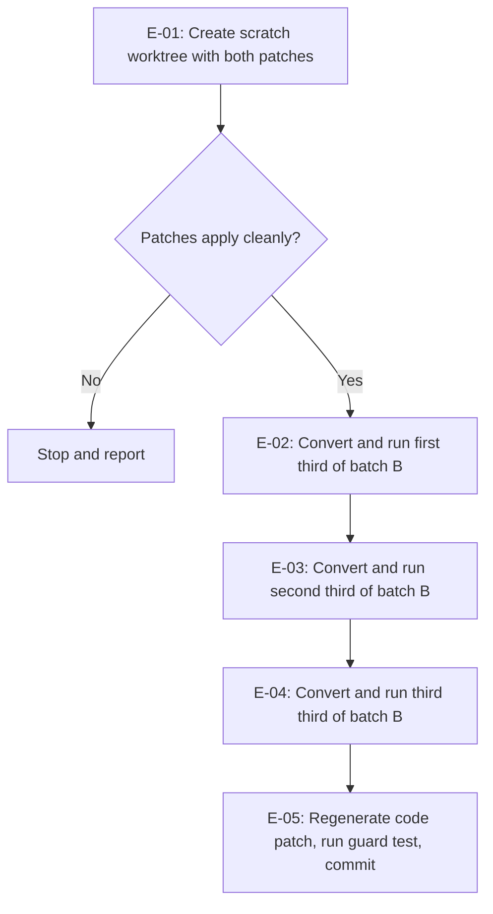

# IPD: Convert test batch B (backlog_handoff_close through ipd_dependency_statement_gate) in the cutover code patch

- Date: 2026-11-25
- Kind: child
- Concern: Backlog `ldfefd`: on the switched tree (HEAD plus both cutover patches), these 18 test modules (batch B, alphabetical slice from `test_backlog_handoff_close` to `test_ipd_dependency_statement_gate`) fail due to legacy bullet/YAML fixtures (`MetadataSchemaError` or orphan errors), calls to removed legacy API symbols (`LegacyRender`, `LegacyTarget`, `render_legacy_text`), removed Phase-B and sidecar behaviors, and inline-metadata `.read_text()` assertions (the six unpatched production cutover gaps documented in F-05 are fixed ahead of this plan by `fljn9b` for the `backlog.run_new` writing-standard pointer and prerequisite Order 315 `szykgd` for specs, releases, spec-link, search, and dep-gate log-awareness per OQ-01). Historical attempt-1 core census provenance (`x1mmdp` attempt-1, 2026-11-25) counted 70 failing core tests across these 18 modules; execution starts from `89mtbl` F-04 after the builder switch.
- Scope: In an isolated scratch worktree with both cutover patches applied (including `hdwqex`, `89mtbl`, `nv3upa`, `fljn9b`, `cugg3w`, `szykgd`, `otin36`, `p109wy`, `q6fiws`, `j1f454`, `lec341`, and `3e0vfy`), convert the 18 batch B test modules under the shared conversion rules and per-module rules in E-02 through E-04 (localizing the two imported fixture helpers in `tests/test_inlane_retirement_lands.py`), run them on both tiers, record deleted legacy-behavior tests in F-02 and any remaining refusal of this repository's own unmigrated records in F-03, and regenerate `.aw/system/cutover/metastore-code.cutover.patch`. No live code changes outside the cutover code patch.
- Scope-Paths: .aw/records/plans/pending/20261125-metastore-309-psm9ac-convert-test-batch-b-backlog-handoff-close-through-ipd-depen.ipd.md, .aw/system/cutover/metastore-code.cutover.patch
- Item-Dependencies: executed:639g02
- Status: approved
- Review-Depth: standard
- Readiness: go-pending-approval
- From-Spec: 4sd62s
- Work-Kind: followup
- Priority: high
- From-Backlog: ldfefd
- Blocks-Release: next
- Set: metastore
- Order: 309
- Highest E allocated: 05
- Author: opencode its_direct/pt3-claude-opus-5.5-1m-us
- Id: psm9ac
- Approval: 2026-11-27, recorded via aw ipd set: status set to approved

> Write and proofread this plan per the technical writing standard, `.aw/system/workflows/technical-writing/technical-writing.md` (`.agents/workflows/technical-writing/technical-writing.md` in a legacy-layout install), including requirement 12 (diagrams).

## Workflow history

- 2026-11-27 same-status (aw set): Wait on Order 323 (ztvubn) and Order 324 (639g02) fixing 8 batch B prod bugs; preserved batch B WIP patch at .aw/state/lane-submissions/run-20261127T195325Z-3081649/03-psm9ac/attempt-1/batch-b-tests-wip.patch
- 2026-11-27 same-status (aw set): Option 2 re-chain (igbr4f): chain batch B after batch A (cugg3w)
- 2026-11-27 approved (aw set): status set to approved
- 2026-11-27 /plan-review (antigravity/gemini): APPROVE WITH REVISIONS APPLIED; PR-009, PR-010, PR-011, PR-012; review record .aw/records/reviews/20261125-metastore-309-psm9ac-convert-test-batch-b-backlog-handoff-close-through-ipd-depen.review.md
- 2026-11-27 to-review (aw set): demoted reviewed -> to-review: re-review requested via agy review
- 2026-11-26 reviewed (aw set): APPROVE WITH REVISIONS APPLIED; PR-006 FIXED (OQ-02 resolved via maintainer Option 1)
- 2026-11-26 same-status (aw set): OQ-02 Option 1: re-chain production-fix plans otin36..3e0vfy ahead of test batches psm9ac..x3mig6
- 2026-11-26 /plan-review (antigravity/gemini): APPROVE WITH REVISIONS APPLIED; PR-006 (FIXED, OQ-02 resolved via maintainer Option 1: re-chained otin36..3e0vfy ahead of psm9ac..x3mig6 and localized helpers in test_inlane_retirement_lands.py); review record .aw/records/reviews/20261125-metastore-309-psm9ac-convert-test-batch-b-backlog-handoff-close-through-ipd-depen.review.md
- 2026-11-26 /plan-review (antigravity/gemini): REVIEWED - OPEN QUESTIONS; PR-006 (OPEN, OQ-02), PR-007, PR-008; review record .aw/records/reviews/20261125-metastore-309-psm9ac-convert-test-batch-b-backlog-handoff-close-through-ipd-depen.review.md
- 2026-11-26 to-review (aw set): demoted reviewed -> to-review: These were flagged as '[stale-review]'
- 2026-11-26 reviewed (aw set): APPROVE WITH REVISIONS APPLIED; PR-001 FIXED (OQ-01 resolved via fljn9b and Order 315 szykgd)
- 2026-11-26 /plan-review (antigravity/gemini): APPROVE WITH REVISIONS APPLIED; PR-001 (FIXED, OQ-01 resolved); review record .aw/records/reviews/20261125-metastore-309-psm9ac-convert-test-batch-b-backlog-handoff-close-through-ipd-depen.review.md
- 2026-11-26 reviewed (aw set): REVIEWED - OPEN QUESTIONS; PR-001 OPEN (OQ-01), PR-002..PR-005 FIXED
- 2026-11-26 /plan-review (antigravity/gemini): REVIEWED - OPEN QUESTIONS; PR-001 (OPEN, OQ-01), PR-002, PR-003, PR-004, PR-005; review record .aw/records/reviews/20261125-metastore-309-psm9ac-convert-test-batch-b-backlog-handoff-close-through-ipd-depen.review.md
- 2026-11-26 to-review (aw set): authored as part of the x1mmdp split per maintainer answer to run-20261125T162650Z-1337442 question 06-x1mmdp-a1-Q-01 (Split into new children; fix jycxw8 first)
- 2026-11-26 draft (opencode its_direct/pt3-claude-opus-5.5-1m-us): created.

## Goal

Make every batch B test module pass on the switched tree, or refuse only because it reads this repository's own unmigrated records, so `x1mmdp` can assemble the final refusal list.

## Detailed Implementation Checklist (TODO)

Execution-state rule: mark an `E-*` item complete only after performing the action. That mark is not validation. Right-sizing rule: write for a modest executor that cannot hold much in its head. Each E-item is one step (one concern, about one file, executable in one focused pass) and its V-item names each unit it covers with its own check; a plan stays at about 5 E-items and 8 work Scope-Paths, else split it into more child plans (guidance, `IPD-Z603`). Accepted execution states: blocked, failed, pending, performed; terminal gate demands 'performed'.

### Task group 1: scratch worktree

- [x] E-01 Create the scratch worktree following the SCRATCH PROCEDURE of `2k5t16` (Step 0): run `git worktree add --detach .aw/state/psm9ac/scratch HEAD`; inside `.aw/state/psm9ac/scratch`, run `git apply --index .aw/system/cutover/metastore-docs.cutover.patch`, record `BASE=$(git write-tree)` in F-01, and then run `git apply --index .aw/system/cutover/metastore-code.cutover.patch`. If either patch rejects, stop and report.
  - Depends on: none
  - Expected outcome: `.aw/state/psm9ac/scratch` holds HEAD plus both patches staged, and F-01 holds the base tree id.
  - Execution state: performed

### Task group 2: convert batch B (scratch worktree only)

- [x] E-02 Convert the first third of batch B in `.aw/state/psm9ac/scratch` under the Step 0 conversion rules, starting each module from its `89mtbl` F-04 census row:
  1. `tests/test_backlog_handoff_close.py` (historical attempt-1: legacy API, not in core census): replace `LegacyRender`/`render_legacy_text` calls with `artifact_meta.append`/`RecordBuilder(repo)`, materialize disk-written `text_only=True` fixtures via `RecordBuilder(repo)` under `89mtbl` F-02 (including updating/materializing `item01` via `RecordBuilder(self.repo)`/`artifact_meta.append` in `test_case_6c` instead of writing a `text_only=True` file after unlinking `item_path`), in `test_case_6b` unset `close_evidence` via `artifact_meta.append("item01", [{"op": "unset", "fields": ["close_evidence"]}], ...)` rather than stripping `- Close-Evidence:` lines from `.backlog.md` text (which leaves `meta/item01.jsonl` intact for `check_engine.evaluate_blocking_close`), and replace `.read_text()` assertions on `- Close-Evidence:` bullets with `artifact_meta.read`/`assert_field`/`assert_no_field`.
  2. `tests/test_blocks_release_reader_bounding.py` (historical attempt-1: 6 failing; runs after `szykgd` makes `releases` log-aware): replace `LegacyRender`/`render_legacy_text` helpers with `artifact_meta.create`/`append`, keep literal legacy bullet text in `test_loose_blocks_release_cases` Case 1 under rule 3 (testing legacy bullet-dialect `read_loose_blocks_release`), materialize disk-written `text_only=True` fixtures via `RecordBuilder(root)` while moving body-quoted `"- Blocks-Release: next"` / `"- Blocks-Release: nonexistent999"` lines out of `history=[...]` into `body=` (because post-cutover `RecordBuilder(root)` writes `history` to `meta/<id6>.jsonl`, not `.md` body), and update `extract_front_matter` `.read_text()` checks on log-backed items to read `artifact_meta.read` (retiring bullet-only metadata-region stripping assertions under rule 4 citing spec `4sd62s` Sections 4.1 to 4.3 and 5.2 in F-02 if no longer applicable).
  3. `tests/test_check_engine.py` (historical attempt-1: 2 failing; runs after `szykgd` makes `specs.validate_spec` and `releases.validate_release` log-aware): materialize disk-written `text_only=True` fixtures via `RecordBuilder(repo)` under `89mtbl` F-02, keeping pure in-memory `read_text`/`raw_fields` negative tests aligned with `89mtbl` F-02.
  4. `tests/test_check_engine_from_spec_missing.py` (historical attempt-1: 6 failing; runs after `szykgd` makes `check_plan_spec_link_missing`/`parse_cited_spec_ids` log-aware): replace `_set_from_spec` (`LegacyRender`/`render_legacy_text`) with `artifact_meta.append` on log-backed plans (or retire bullet-only insertion-order tests under rule 4 citing spec `4sd62s` Sections 4.1 and 5.2 in F-02), materialize `_create_spec`/`_create_plan` fixtures via `RecordBuilder(repo)` writing `concern` and `scope` as `## Concern` and `## Scope` body sections (`szykgd` E-03 item 1) rather than `raw_fields`, update `test_cited_in_scope_paths` and `test_deduplication_across_bullets` to pass `state=` (or `## Concern`/`## Scope` body sections, or literal legacy bullet text for legacy bullet-parser coverage) instead of log-format `text_only=True` with no `state=`, and update `.read_text()` assertions on `- From-Spec:` to use `artifact_meta.read`/`assert_field`.
  5. `tests/test_check_engine_spec_criteria.py` (historical attempt-1: 1 failing): replace `LegacyRender`/`render_legacy_text` with `artifact_meta.append`, materialize `_create_spec`/`_create_plan` fixtures via `RecordBuilder(repo)` (starting `test_plan_gaining_from_spec_edge_uncovers_criteria` with `from_spec` unset in the log rather than stripping `- From-Spec:` via regex on `.ipd.md`), and in `test_counterfactual_pin_matches_motivating_defect_set` run `aw migrate metadata` on the temporary repository extracted from historical commit `516eb661` before calling `check_engine.check_spec_criteria_uncovered(repo)` (conversion rule 3, avoiding `MetadataSchemaError` under `CURRENT_METADATA_SCHEMA == 2`).
  6. `tests/test_check_meta.py` (historical attempt-1: 15 failing): materialize `_write_clean_plan` and clean-fixture records via `RecordBuilder(repo)` with `metadata_schema: 2`, update `test_drift_review_rounds` to seed `op: "review"` events in `meta/rr0001.jsonl` (spec `4sd62s` Section 4.1a), update `test_drift_status_mirror`/`test_drift_id_mirror`/`test_duplicate_seq_log_never_passes_check_meta` to write proper in-file mirrors via `artifact_meta.render_in_file_mirror` rather than `RecordBuilder().research(..., text_only=True)`, and update or retire under rule 4 (citing spec `4sd62s` Sections 4.6 and 5.2 in F-02) Phase-B-only expectations (`not-applicable (legacy format)` rows in `test_clean_fixture_exits_zero_and_names_not_applicable_rows` and Phase-B exclusion in `test_check_all_excludes_meta_rules_in_phase_b`).
  Then run all six modules with `python3 -m pytest -o addopts="" -m '' tests/test_backlog_handoff_close.py tests/test_blocks_release_reader_bounding.py tests/test_check_engine.py tests/test_check_engine_from_spec_missing.py tests/test_check_engine_spec_criteria.py tests/test_check_meta.py` (both tiers) in `.aw/state/psm9ac/scratch`; add to F-02 every deleted node id with its spec `4sd62s` clause, and to F-03 any `livecorpus`/`REPO_ROOT` "run `aw migrate metadata`" refusal. Any other failure stops the plan here and is reported.
  - Depends on: E-01
  - Expected outcome: each listed module imports no removed symbol, conforms to the post-cutover log format, and passes apart from any F-03 rows.
  - Execution state: performed

- [x] E-03 Convert the second third of batch B in `.aw/state/psm9ac/scratch` under the Step 0 conversion rules, starting each module from its `89mtbl` F-04 census row:
  1. `tests/test_cli_search.py` (historical attempt-1: 1 failing; runs after `szykgd` makes `cli._run_search` search log-backed metadata): materialize all 8 fixture records in `SearchOptionsTests.setUp` via `RecordBuilder(self.repo)` instead of writing `text_only=True` without logs.
  2. `tests/test_companion_record_owner_root.py` (historical attempt-1: legacy API, not in core census): replace `LegacyRender`/`render_legacy_text` calls with `artifact_meta.append`, materialize the `text_only=True` plan fixture via `RecordBuilder`, update `^- Id:` regex lookups on `.spec.md` to read `artifact_meta.read_mirror_id6`/`artifact_meta.read_text`, and retire or adapt to `meta/<id6>.jsonl` under rule 4 (citing spec `4sd62s` C6 and Section 5.2 in F-02) the tests asserting writes to the retired `history.jsonl` sidecar (note: `REPO_ROOT` here is used only for `PYTHONPATH`, not as a livecorpus record scan).
  3. `tests/test_cutover_log_gates.py` (historical attempt-1: 2 failing): retire the Phase-B `schema=None` legacy-format dormancy tests (`test_check_engine_legacy_status_change_is_unchanged`, `test_executed_legacy_raw_transition_keeps_todays_rule`, `test_terminal_rules_dormant_on_legacy_format`) under rule 4 citing spec `4sd62s` Sections 4.3 and 5.2 in F-02 while keeping all post-cutover log-format gate tests passing.
  4. `tests/test_cutover_log_readers.py` (historical attempt-1: 2 failing): retire the Phase-B pre-cutover legacy-format tests (`test_log_record_below_schema_2_keeps_the_day_form`, `test_legacy_record_output_is_unchanged_at_schema_2`, `test_check_meta_logged_path_row_is_not_applicable_on_a_legacy_repo`) under rule 4 citing spec `4sd62s` Sections 4.4, 4.6, and 5.2 in F-02 while keeping all `schema=2` log-reader tests passing.
  5. `tests/test_event_overrides.py` (historical attempt-1: 5 failing): retire the three Phase-B `schema=None` legacy-format setter tests (`test_specs_set_date_still_works_below_schema_2`, `test_legacy_setter_renders_the_override_as_an_actor_suffix_and_writes_no_log`, `test_legacy_setter_without_an_override_has_no_suffix`) under rule 4 citing spec `4sd62s` Sections 4.2 and 5.2 in F-02, and keep all `schema=2` log-format override, `--date` refusal, and `--commit` tests passing.
  6. `tests/test_from_backlog_cardinality.py` (historical attempt-1: 6 failing; runs after `szykgd` makes `releases.check_from_backlog` log-aware): replace `_set_from_backlog` (`LegacyRender`/`render_legacy_text`) with `artifact_meta.append` on log-backed plans, in `test_cross_reader_parity_matrix` pass explicit legacy bullet input strings under rule 3 into the three pure-text legacy readers (`check_engine._from_backlog_value`, `runner_shared._read_from_backlog`, `production_checks._read_from_backlog`) while materializing log-format plans via `RecordBuilder(self.root)` for `build_graduation_reverse_index` and removing `meta/tstpln.jsonl` alongside `plan_file` between subtest iterations (or using distinct id6s/repos), materialize remaining disk-written `text_only=True` fixtures via `RecordBuilder(self.root)` using valid 6-character `id6`s in `test_malformed_rule_reachability_and_separation` (replacing 5-char `"valid"`) and a valid post-cutover IPD `status` enum (such as `"to-review"`, replacing `raw_fields={"Status": "pending"}`) in `test_regression_reproduction_f1`, and retire or adapt under rule 4 (citing spec `4sd62s` Sections 4.1 to 4.3 and 5.2 in F-02) bullet-only multi-bullet `- From-Backlog:` and `parse_metadata_block` assertions (`test_multi_bullet_preservation`, `test_writer_idempotency_and_metadata_parse`).
  Then run all six modules with `python3 -m pytest -o addopts="" -m '' tests/test_cli_search.py tests/test_companion_record_owner_root.py tests/test_cutover_log_gates.py tests/test_cutover_log_readers.py tests/test_event_overrides.py tests/test_from_backlog_cardinality.py` (both tiers) in `.aw/state/psm9ac/scratch`; add to F-02 every deleted node id with its spec `4sd62s` clause, and to F-03 any `livecorpus`/`REPO_ROOT` "run `aw migrate metadata`" refusal. Any other failure stops the plan here and is reported.
  - Depends on: E-02
  - Expected outcome: each listed module imports no removed symbol, conforms to the post-cutover log format, and passes apart from any F-03 rows.
  - Execution state: performed

- [x] E-04 Convert the third third of batch B in `.aw/state/psm9ac/scratch` under the Step 0 conversion rules, starting each module from its `89mtbl` F-04 census row:
  1. `tests/test_generators_writing_standard_pointer.py` (historical attempt-1: 2 failing; runs after `fljn9b` restores the `backlog.run_new` writing-standard pointer and `szykgd` makes `specs.run_check` log-aware): update `_assert_pointer_before_history` because post-cutover generated plans, specs, and backlog items omit `## Workflow history` (spec `4sd62s` Section 4.1; `hdwqex` E-03); assert instead that `POINTER_SNIPPET` appears exactly once in the body after the YAML mirror (and before `## Goal` / `## Scope` when present) and survives the status transition.
  2. `tests/test_gradcover_end_to_end.py` (historical attempt-1: legacy API, not in core census): replace `LegacyRender`/`LegacyTarget` calls with `artifact_meta.append`, materialize disk-written `text_only=True` fixtures via `RecordBuilder`, pass `plan_path=orch_files_a[0], repo=repo` into `coverage_record.is_current(...)` (`q6fiws` E-02 item 1), replace `.read_text()` assertions on `- Coverage:`/`- Coverage-Fingerprint:`/`coverage pass` and `artifact_meta.read_text` readiness checks (`fake_reviewer_b` and resume test) with `artifact_meta.read`/`artifact_meta.history` while keeping `## Coverage findings` and `UNOWNED_LINE` body checks per spec `4sd62s` N3.
  3. `tests/test_index_aliases.py` (historical attempt-1: 8 failing): materialize `_repo` fixtures, `_completed_plan("al0005")` in `test_producers_write_no_index_files_and_find_sees_each_change`, and the mismatch plan in `test_check_runs_content_drift_and_fails_on_dangling_citation` via `RecordBuilder(repo)`, and in `test_producers_write_no_index_files_and_find_sees_each_change` assert `outcome == "adopted"`, `consumed_by == ["al0001"]`, and `priority == "high"` via `artifact_meta.read("al0003")` rather than `.md` file text.
  4. `tests/test_index_rebuild.py` (historical attempt-1: 6 failing): materialize `_plan` and `_repo` fixtures via `RecordBuilder(repo)` (including `op: "review"` event for `rb0001`), and update `test_a_rebuild_reports_counts_and_creates_cache` to assert the real post-cutover `events:<N>` count rather than `"events:0"`.
  5. `tests/test_inlane_retirement_lands.py` (historical attempt-1: legacy API, not in core census; runs after `otin36` fixes `check_status_untooled_range`): replace `LegacyRender`/`LegacyTarget` calls with `artifact_meta.append`, insert the `"RETIRED 2026-09-27: premise spent."` note into the body AFTER the YAML mirror and `aw-managed` banner in `_fake_agent_retires_in_lane` (never prepending before line-1 `---`), for `tooled=False` in `test_hand_retirement_receives_fix_it_turn` hand-edit only the in-file YAML mirror `status:` line to `superseded` without calling `artifact_meta.append` (triggering `otin36` E-03 item 2's mirror-vs-log `check.status-untooled` refusal) and align the `untooled_status_refusal` assertion with the post-cutover mirror-vs-log refusal text, materialize `bg0001`, `ret001`, and `ret002` via `RecordBuilder(repo)` in `InLaneRetirementBacklogCloseTests._setup_repo_and_carriers`, update any inline-history `.read_text()` checks to read `artifact_meta.history`, and localize all fixture helpers currently imported from later unconverted test batches (`_conforming_plan_text`/`_init_repo_with_conforming_plan` from `tests/test_oc_runipd.py` in batch D `e0g2gt`, and `_repo_with_pending_plan`/`_verified_lane`/`_write_run_state`/`_stranded_item`/`_passing_suite` from `tests/test_runner_shared.py` in batch E `qi0kl6`) inside `tests/test_inlane_retirement_lands.py` using log-format `RecordBuilder(repo)` fixtures (OQ-02 Option 1).
  6. `tests/test_ipd_dependency_statement_gate.py` (historical attempt-1: 8 failing; runs after `szykgd` makes `ipd_dependency_statement_gate._staged_ipd_overlay` handle staged `meta/<id6>.jsonl`): update `_stage` and test fixtures to stage the companion `.aw/records/meta/<id6>.jsonl` alongside `.ipd.md` (and update `test_a_cycle_finding_on_an_unstaged_plan_does_not_block` to update `meta/bbbbbb.jsonl` via `artifact_meta.append` instead of overwriting `.ipd.md` with `text_only=True`).
  Then run all six modules with `python3 -m pytest -o addopts="" -m '' tests/test_generators_writing_standard_pointer.py tests/test_gradcover_end_to_end.py tests/test_index_aliases.py tests/test_index_rebuild.py tests/test_inlane_retirement_lands.py tests/test_ipd_dependency_statement_gate.py` (both tiers) in `.aw/state/psm9ac/scratch`; add to F-02 every deleted node id with its spec `4sd62s` clause, and to F-03 any `livecorpus`/`REPO_ROOT` "run `aw migrate metadata`" refusal. Any other failure stops the plan here and is reported.
  - Depends on: E-03
  - Expected outcome: each listed module imports no removed symbol, conforms to the post-cutover log format, and passes apart from any F-03 rows.
  - Execution state: performed

### Task group 3: package

- [x] E-05 In `.aw/state/psm9ac/scratch`, run `git add -A` and write `git diff --cached --binary $BASE` over `.aw/system/cutover/metastore-code.cutover.patch` in the executing checkout; remove the scratch worktree (`git worktree remove --force .aw/state/psm9ac/scratch`); run `python3 -m pytest -o addopts="" tests/test_metastore_cutover_code_patch.py` in the executing checkout; verify `git status --short` shows only `- Scope-Paths:` modified; and commit through `aw commit psm9ac -- .aw/records/plans/pending/20261125-metastore-309-psm9ac-convert-test-batch-b-backlog-handoff-close-through-ipd-depen.ipd.md .aw/system/cutover/metastore-code.cutover.patch`; never push.
  - Depends on: E-04
  - Expected outcome: `.aw/system/cutover/metastore-code.cutover.patch` holds all prior changes plus this plan's; `tests/test_metastore_cutover_code_patch.py` passes; scratch worktree is removed; one path-scoped commit is created.
  - Execution state: performed

## Project conventions discovered (Step 0)

- The scratch procedure and cumulative code patch are defined in executed plan `2k5t16` (Step 0, OQ-01). The serial chain regenerating `.aw/system/cutover/metastore-code.cutover.patch` runs all remaining production log-awareness fixes ahead of all remaining test batches (OQ-02 Option 1): `hdwqex` -> `89mtbl` -> `nv3upa` -> `fljn9b` -> `cugg3w` -> `szykgd` -> `otin36` -> `p109wy` -> `q6fiws` -> `j1f454` -> `lec341` -> `3e0vfy` -> `psm9ac` -> `x8id25` -> `e0g2gt` -> `qi0kl6` -> `x3mig6` -> `x1mmdp` -> `0zylig`.
- Conversion rules shared by the `ldfefd` batch children (`nv3upa`, `cugg3w`, `psm9ac`, `x8id25`, `e0g2gt`, `qi0kl6`, `x3mig6`), fixed here so no executor invents them: (1) a call to an API the code patch removes (`LegacyRender`, `LegacyTarget`, `render_legacy_text`, `set_legacy_bullet_line`, `_LEGACY_BULLET_LABEL`, `_format_legacy_value`, `_RESEARCH_YAML_KEY`, `_format_yaml_value`, `_PROMPT_COMMENT_KEY`, `write_legacy`, `SidecarRecord`, `backlog._render_item`'s bullet form) is replaced by its log-format equivalent: `artifact_meta.create` or `artifact_meta.append` keyed by id6, or `tests.record_builder.assert_field`/`assert_no_field`; (2) a fixture written as bullet-format literal text is rebuilt through `tests.record_builder.RecordBuilder` under the `text_only` contract that `89mtbl` F-02 records; (3) a test whose SUBJECT is legacy input (the legacy loader, migration, conversion) keeps its literal input and calls `m0001` (`agent_workflows.migrations.m0001_metadata_v2.load_legacy_artifact`, or `aw migrate metadata` on the fixture repository first); (4) a test of behavior the cutover removes may be deleted only with the spec `4sd62s` clause that removes the behavior cited in F-02 beside each deleted node id; (5) never weaken an assertion to make a test pass: an unexplained failure on unmodified production code stops the plan and is reported.
- A fixture repository the switched builder writes is log-format, so `migrations.chain.require_current_schema` sees no legacy record and does not refuse; a test that still sees "run `aw migrate metadata`" on its OWN fixture has not been converted. Only tests that read this repository's own records (`livecorpus`, `REPO_ROOT`) may still refuse, and those are listed in F-03, not edited.
- Tests exercise code and assert on observable outcomes (AGENTS.md "TEST OUTCOMES, NOT CODE STRUCTURE").
- Cite code by symbol (`path::Symbol`) or by a quoted content string, with a line number only appended as a hint and never alone (advisory `IPD-C801`).

## Findings

| Id | Evidence | Finding |
|---|---|---|
| F-01 | `git write-tree` in `.aw/state/psm9ac/scratch` after applying `.aw/system/cutover/metastore-docs.cutover.patch` on `eabb442b00c9a07a6b2e505bc712303838e5f122`. | `BASE=1a48bd361bd20093c85995b38e01414fd56263aa` |
| F-02 | Retired legacy-behavior test node ids deleted across E-02 to E-04 under conversion rule 4 (see `### F-02 retired test node register` below). | 12 test node ids deleted (2 in E-02, 10 in E-03, 0 in E-04), each paired with its removing spec `4sd62s` clause. |
| F-03 | Both-tier pytest runs across all 18 batch B modules in `.aw/state/psm9ac/scratch` (V-02: 173 passed, V-03: 74 passed, V-04: 51 passed; 298 passed, 0 failed, 0 refused). | none (no batch B test reads unmigrated live-repository records). |
| F-04 | `x1mmdp` F-05 to F-07 (2026-11-25, historical attempt-1 run `run-20261125T162650Z-1337442` provenance; lane submission file is gitignored and absent in fresh lanes): batch B is the alphabetical slice from `test_backlog_handoff_close` to `test_ipd_dependency_statement_gate`. | 18 modules, 70 failing core tests in the historical attempt-1 census; execution starts from the refreshed post-builder census in `89mtbl` F-04. |
| F-05 | Direct probes + static inspection of `.aw/system/cutover/metastore-code.cutover.patch`: (1) `agent_workflows/specs.py::validate_spec` and `run_check` (plus callers `agent_workflows/check_engine.py::check_content` and `agent_workflows/runner_shared.py::check_review_lane_artifacts`, `enforce_freeze_time_refusal`) emit `attention.history-missing` on a conformant log-format spec and never read `meta/<id6>.jsonl`; (2) `agent_workflows/releases.py::validate_release`, `parse_release`, `check_from_backlog`, and `check_graduated_to` (plus `agent_workflows/check_engine.py::check_content`) read only inline text (`validate_release` emits `release.version-missing` on a log-format release; `check_from_backlog` calls `_meta.read_text(text).fields.get("from_backlog")` and returns `[]` on log-format repos); (3) `.aw/system/cutover/metastore-code.cutover.patch` deleted `artifact_meta.render_legacy`, removing the only emitter of `core.writing_standard_pointer("backlog item")` for `backlog.run_new`; (4) `agent_workflows/check_engine.py::parse_cited_spec_ids` and `check_plan_spec_link_missing` read only legacy `- Concern:`/`- Scope:`/`- Scope-Paths:` bullets (`parse_cited_spec_ids` returns `[]` on a log-format plan with `## Concern`); (5) `agent_workflows/cli.py::_run_search` non-`--full` search scans only YAML fence + H1 of `.md` files and never searches log-stored `title`/`summary`/`short_description`; (6) `agent_workflows/hooks/ipd_dependency_statement_gate.py::_staged_ipd_overlay` skips staged `meta/<id6>.jsonl` files (`if not new_path.endswith(".ipd.md"): continue`). | Six unpatched production cutover log-awareness gaps in `.aw/system/cutover/metastore-code.cutover.patch` directly block at least 7 batch B test modules (`test_blocks_release_reader_bounding`, `test_check_engine`, `test_check_engine_from_spec_missing`, `test_cli_search`, `test_from_backlog_cardinality`, `test_generators_writing_standard_pointer`, `test_ipd_dependency_statement_gate`) plus later batches. Resolved via OQ-01 (2026-11-26): gap (3) folded into Order 314 `fljn9b`; gaps (1), (2), (4), (5), and (6) split into prerequisite Order 315 child plan `szykgd` ahead of `psm9ac`. |
| F-06 | Static audit of all 18 batch B test modules against the later production-fix plans split after Round 2 (`otin36` Order 316, `p109wy` Order 317, `q6fiws` Order 318, `j1f454` Order 319, `lec341` Order 320, `3e0vfy` Order 321) and batches D/E (`e0g2gt`, `qi0kl6`): (1) `tests/test_check_meta.py` and `tests/test_index_rebuild.py` index spec `4sd62s` Section 4.1a `.review.md` YAML mirrors alongside `op: "review"` events, which depend on `p109wy` (Order 317) to stop `artifact_meta._load_sources` from clobbering log-owned `reviews` rows and failing with `REV-M101`; (2) `tests/test_index_aliases.py::test_producers_write_no_index_files_and_find_sees_each_change` runs `aw ipd begin`/`finalize` (needs `otin36` Order 316), `aw research mv` + `aw find` (needs `lec341` Order 320), and `aw adopt --apply` (needs `lec341` Order 320 + `3e0vfy` Order 321); (3) `tests/test_gradcover_end_to_end.py` (run by E-04 `-m ''`) drives `coverage_record.is_current`/`write` (needs `q6fiws` Order 318), `aw ipd set reviewed` on an orchestrator and `aw ipd set approved` (needs `3e0vfy` Order 321), and `ipd_lifecycle.retire_orchestrator` (needs `otin36` Order 316); (4) `tests/test_inlane_retirement_lands.py` relies on `check_status_untooled_range` (needs `otin36` Order 316) and directly imports unconverted fixture helpers from `tests/test_oc_runipd.py` (batch D `e0g2gt`) and `tests/test_runner_shared.py` (batch E `qi0kl6`). | Resolved via OQ-02 (Option 1, 2026-11-26): re-chained all 6 remaining production-fix plans (`otin36` -> `p109wy` -> `q6fiws` -> `j1f454` -> `lec341` -> `3e0vfy`) right after `szykgd` and ahead of test batches `psm9ac` -> `x8id25` -> `e0g2gt` -> `qi0kl6` -> `x3mig6` -> `x1mmdp`, and updated E-04 item 5 to localize the two imported fixture helpers inside `tests/test_inlane_retirement_lands.py`. |

### F-02 retired test node register

| Step | Retired node id | Spec `4sd62s` clause | Removed behavior |
|---|---|---|---|
| E-02 | `tests/test_check_engine_from_spec_missing.py::TestSetFromSpecLine::test_insert_after_status` | Sections 4.1, 4.2, 5.2 | Inline `- From-Spec:` bullet insertion position after `- Status:` removed; `from_spec` is log-stored. |
| E-02 | `tests/test_check_engine_from_spec_missing.py::TestSetFromSpecLine::test_fallback_after_id` | Sections 4.1, 4.2, 5.2 | Inline `- From-Spec:` bullet fallback insertion position after `- Id:` removed; `from_spec` is log-stored. |
| E-03 | `tests/test_cutover_log_gates.py::test_check_engine_legacy_status_change_is_unchanged` | Sections 4.3, 5.2 | Phase-B `schema=None` legacy status-change gate path removed at cutover. |
| E-03 | `tests/test_cutover_log_gates.py::test_executed_legacy_raw_transition_keeps_todays_rule` | Sections 4.3, 5.2 | Phase-B `schema=None` legacy executed-transition gate path removed at cutover. |
| E-03 | `tests/test_cutover_log_gates.py::test_terminal_rules_dormant_on_legacy_format` | Sections 4.3, 5.2 | Phase-B `schema=None` legacy terminal-rule dormancy removed at cutover. |
| E-03 | `tests/test_cutover_log_readers.py::test_log_record_below_schema_2_keeps_the_day_form` | Sections 4.4, 4.6, 5.2 | Phase-B below-schema-2 day-form fallback removed at cutover. |
| E-03 | `tests/test_cutover_log_readers.py::test_legacy_record_output_is_unchanged_at_schema_2` | Sections 4.4, 4.6, 5.2 | Phase-B mixed legacy-record compatibility at schema 2 removed at cutover. |
| E-03 | `tests/test_cutover_log_readers.py::test_check_meta_logged_path_row_is_not_applicable_on_a_legacy_repo` | Sections 4.4, 4.6, 5.2 | Phase-B `not-applicable` legacy-repo row in `aw check meta` removed at cutover. |
| E-03 | `tests/test_event_overrides.py::test_specs_set_date_still_works_below_schema_2` | Sections 4.2, 5.2 | Phase-B below-schema-2 `aw specs set --date` allowance removed at cutover. |
| E-03 | `tests/test_event_overrides.py::test_legacy_setter_renders_the_override_as_an_actor_suffix_and_writes_no_log` | Sections 4.2, 5.2 | Phase-B legacy inline actor-suffix override rendering removed at cutover. |
| E-03 | `tests/test_event_overrides.py::test_legacy_setter_without_an_override_has_no_suffix` | Sections 4.2, 5.2 | Phase-B legacy inline setter history-line rendering removed at cutover. |
| E-03 | `tests/test_from_backlog_cardinality.py::TestFromBacklogCardinality::test_multi_bullet_preservation` | Sections 4.1, 4.2, 4.3, 5.2 | Multi-bullet inline `- From-Backlog:` preservation removed; `from_backlog` is a single log field. |

## Proposed changes (ordered, validatable)

1. E-01: Create scratch worktree `.aw/state/psm9ac/scratch` with both cutover patches staged.
2. E-02 to E-04: Convert and run each third of batch B under the per-module rules (after `fljn9b`, `szykgd`, and `otin36`..`3e0vfy` land all production log-awareness fixes, and localizing the two imported fixture helpers in `tests/test_inlane_retirement_lands.py` per OQ-02 Option 1); record F-02 and F-03.
3. E-05: Regenerate `.aw/system/cutover/metastore-code.cutover.patch`, remove the scratch worktree, run the guard test, and commit path-scoped.



## Deferred / out of scope (with reason)

- Fixing the `backlog.run_new` writing-standard pointer alongside `backlog.py` log-awareness (OQ-01, maintainer answer 2026-11-26): folded into Order 314 ahead of `cugg3w`.
  - Carrier: fljn9b
  - Carrier-Evidence: .aw/records/plans/executed/20261125-metastore-314-fljn9b-make-backlog-validation-and-readers-log-aware-in-the-cutover.ipd.md
- Making `specs.py`, `releases.py`, `check_engine.py` spec-link checks, `cli._run_search`, and `hooks/ipd_dependency_statement_gate.py` log-aware in the cutover code patch (OQ-01, maintainer answer 2026-11-26): prerequisite child plan ahead of `psm9ac`.
  - Carrier: szykgd
  - Carrier-Evidence: .aw/records/plans/executed/20261125-metastore-315-szykgd-make-specs-releases-spec-link-search-and-dep-gate-log-aware.ipd.md
- Making `ipd_lifecycle`/`partition`/`plans`/`check_status_untooled*`/hooks/`meta_repair`, `.review.md`/prompt mirrors/`check_engine` priority, `coverage_record`/`readiness`/`runner`/`review_sequence`, `selectors`/`artifact_rename`, `research_cmd`/`research_refs`, and `plan_readiness`/`status_set`/`artifact_refs`/`artifact_adopt` log-aware in the cutover code patch (OQ-02 Option 1, maintainer answer 2026-11-26): six prerequisite child plans (`otin36` -> `p109wy` -> `q6fiws` -> `j1f454` -> `lec341` -> `3e0vfy`) re-chained ahead of `psm9ac`.
  - Carrier: 3e0vfy
  - Carrier-Evidence: .aw/records/plans/executed/20261126-metastore-321-3e0vfy-make-plan-readiness-status-set-artifact-refs-and-artifact-ad.ipd.md
- Modules outside batch B: the other batch children (`x8id25`, `e0g2gt`, `qi0kl6`, `x3mig6`).
  - Carrier: x8id25
- The final refusal list across all batches and the full-suite runs: the narrowed parent step.
  - Carrier: x1mmdp
- Applying the cutover patches on the real tree: attended cutover commit.
  - Carrier: cxxmyv

## Scope check

- Over-scope: none. No live code or test files are modified outside `.aw/system/cutover/metastore-code.cutover.patch`.
- Under-scope: none. The six unpatched production cutover gaps (F-05, `PR-001`) are handled ahead of this plan by `fljn9b` and `szykgd`, and the six additional production log-awareness plans (`otin36`..`3e0vfy`, F-06, `PR-006`) are re-chained ahead of `psm9ac` via `- Item-Dependencies: executed:3e0vfy`; every batch B test module is named and run in exactly one of E-02 to E-04.

## Required tests / validation

- Per-third both-tier pytest runs and removed-symbol `rg` checks across all 18 batch B modules in `.aw/state/psm9ac/scratch` (V-02 to V-04).
- Cumulative patch guard test `python3 -m pytest -o addopts="" tests/test_metastore_cutover_code_patch.py` in the executing checkout (V-05).

## Spec / documentation sync

No spec change: spec `4sd62s` Sections 4.1 to 4.6 already define the log format, review-event model, `last_history_at`, `aw check meta`, and cutover, and `.aw/system/cutover/metastore-docs.cutover.patch` already describes them. This plan brings the batch B tests in the code patch into line with them.

## Open questions

### OQ-01: How should the six remaining unpatched production log-awareness gaps blocking batch B (`psm9ac`) be sequenced?

- Blocking: yes
- Status: resolved
- Owner: maintainer
- Finding: PR-001
- Carrier: szykgd
- Question: Review of batch B (`psm9ac`) verified six unpatched production cutover gaps inside `.aw/system/cutover/metastore-code.cutover.patch` (F-05) that block at least 7 of batch B's 18 test modules (plus later test batches): (1) `agent_workflows/specs.py::validate_spec` and `run_check` (plus `check_engine.py` and `runner_shared.py` callers) still read only inline text and emit `attention.history-missing` on a conformant log-format spec; (2) `agent_workflows/releases.py::validate_release`, `parse_release`, `check_from_backlog`, and `check_graduated_to` still read only inline text (`validate_release` emits `release.version-missing`, `check_from_backlog` returns `[]` on log-format repos); (3) removing `artifact_meta.render_legacy` dropped the only emitter of `writing_standard_pointer("backlog item")` in `backlog.run_new`; (4) `agent_workflows/check_engine.py::parse_cited_spec_ids` and `check_plan_spec_link_missing` still read only legacy `- Concern:`/`- Scope:`/`- Scope-Paths:` bullets instead of `## Concern`/`## Scope` body sections and `state.fields["scope_paths"]`; (5) `agent_workflows/cli.py::_run_search` default (non-`--full`) search scans only the YAML fence + H1 of `.md` files and misses log-stored `title`/`summary`/`short_description`; and (6) `agent_workflows/hooks/ipd_dependency_statement_gate.py::_staged_ipd_overlay` skips staged `meta/<id6>.jsonl` files where `item_dependencies` lives post-cutover. Because `psm9ac` is scoped as a test-only conversion batch and Order 314 (`fljn9b`, `backlog.py` log-awareness) is still `to-review`, should we: (1) split out one dedicated production-fix child plan ahead of `psm9ac` (putting the `backlog.run_new` pointer fix in `fljn9b` and the five non-backlog gaps in one new prerequisite child plan ahead of `psm9ac`), (2) split the non-backlog gaps into separate small prerequisite child plans by subsystem (specs+releases checkers vs. check_engine/search/dep-gate) ahead of `psm9ac`, or (3) expand `psm9ac` to fix these six production gaps inside this plan before converting batch B?
- Recommendation: Option 1 (add the one-line `backlog.run_new` writing-standard pointer fix to `fljn9b` while it is still `to-review`, and split out one dedicated production-fix child plan ahead of `psm9ac` covering the five remaining checker/search/hook gaps in `specs.py`, `releases.py`, `check_engine.py`, `cli.py`, and `hooks/ipd_dependency_statement_gate.py`), matching the precedent set by `hdwqex` and `fljn9b` so every test-conversion batch stays strictly test-only and downstream batches (`x8id25`..`x3mig6`) are unblocked in one pass (strength: strong).
- Closes when: the maintainer chooses Option 1, Option 2, or Option 3, the corresponding plan(s) or scope update are recorded, and `PR-001` is cleared in a follow-up review round.
- Resolution or deferral rationale: 2026-11-26. The maintainer answered run `run-20261126T020242Z-3080634` question `05-psm9ac-a1-batch-b-production-log-aware-gaps` with "Fix backlog pointer in fljn9b and split 1 production-fix plan ahead of psm9ac (Recommended)". Folded the `backlog.run_new` writing-standard pointer fix into Order 314 `fljn9b` (still `to-review`), authored Order 315 child plan `szykgd` (`.aw/records/plans/pending/20261125-metastore-315-szykgd-make-specs-releases-spec-link-search-and-dep-gate-log-aware.ipd.md`) chained after `cugg3w` for the five non-backlog gaps, wired `szykgd` into orchestrator `63ib9r` and `x1mmdp`, updated `psm9ac`'s `- Item-Dependencies:` to `executed:szykgd`, and cleared `PR-001` in Round 2 of the review record.

### OQ-02: How should the 5 batch B test modules that depend on later production-fix plans (`otin36`..`3e0vfy`) and later test-batch helpers (`e0g2gt`/`qi0kl6`) be sequenced?

- Blocking: yes
- Status: resolved
- Owner: maintainer
- Finding: PR-006
- Carrier: 3e0vfy
- Question: After Round 2 of `psm9ac`, reviews of batches C through F uncovered and split six additional production log-awareness plans (`otin36` Order 316 for `ipd_lifecycle`/`check_status_untooled_range`, `p109wy` Order 317 for `.review.md` YAML mirrors, `q6fiws` Order 318 for `coverage_record`/`runner_shared`, `j1f454` Order 319 for `selectors`/`artifact_rename`, `lec341` Order 320 for `research_cmd`/`research_refs`, and `3e0vfy` Order 321 for `plan_readiness`/`status_set`/`artifact_adopt`). All six currently sit AFTER `psm9ac` (Order 309) in the serial code-patch chain, yet 5 of `psm9ac`'s 18 test modules depend on them (F-06): `tests/test_check_meta.py` and `tests/test_index_rebuild.py` need `p109wy`; `tests/test_index_aliases.py` needs `otin36`, `lec341`, and `3e0vfy`; `tests/test_gradcover_end_to_end.py` needs `otin36`, `q6fiws`, and `3e0vfy`; and `tests/test_inlane_retirement_lands.py` needs `otin36` plus unconverted fixture helpers imported from `tests/test_oc_runipd.py` (`e0g2gt`) and `tests/test_runner_shared.py` (`qi0kl6`). None of `otin36`..`3e0vfy` depends on test batches `psm9ac`..`qi0kl6`. Should we: (1) re-chain all 6 remaining production-fix plans (`otin36`, `p109wy`, `q6fiws`, `j1f454`, `lec341`, `3e0vfy`) ahead of test batches `psm9ac`..`x3mig6` (running `szykgd -> otin36 -> p109wy -> q6fiws -> j1f454 -> lec341 -> 3e0vfy -> psm9ac -> x8id25 -> e0g2gt -> qi0kl6 -> x3mig6 -> x1mmdp`) and localize the two imported fixture helpers inside `tests/test_inlane_retirement_lands.py`, (2) keep the current interleaved chain order and move those 5 test modules out of `psm9ac` into a new final test batch after `3e0vfy` and `qi0kl6`, or (3) keep all 18 modules in `psm9ac` and allow `psm9ac` to defer their failing tests to `x1mmdp` E-04?
- Recommendation: Option 1 (re-chain all 6 remaining production-fix plans `otin36`..`3e0vfy` ahead of test batches `psm9ac`..`x3mig6` and localize the two imported helpers in `tests/test_inlane_retirement_lands.py`), because none of the production-fix plans depends on the test batches, and landing all production log-awareness fixes before all remaining test batches eliminates cross-batch production inversions across batches B, C, D, E, and F in one clean pass (strength: strong).
- Closes when: the maintainer chooses Option 1, Option 2, or Option 3, the chosen dependency/scope updates are applied across the affected plans, and `PR-006` is cleared in a follow-up review round.
- Resolution or deferral rationale: 2026-11-26. The maintainer chose Option 1. Re-chained all 6 remaining production-fix plans ahead of test batches B through F via `aw ipd dependencies set` (`szykgd -> otin36 -> p109wy -> q6fiws -> j1f454 -> lec341 -> 3e0vfy -> psm9ac -> x8id25 -> e0g2gt -> qi0kl6 -> x3mig6 -> x1mmdp`), updated `psm9ac` E-04 item 5 to localize the two imported fixture helpers in `tests/test_inlane_retirement_lands.py`, and cleared `PR-006` in Round 4 of the review record.

## Validation and cross-check (verify before reporting done)

Validation-state rule: inspect evidence in a separate pass. Do not mark a `V-*` item complete from memory or from the matching execution checkmark. Accepted validation results: blocked, failed, pass, pending; terminal gate demands 'pass'. Runtime-demonstration reachability rule: for each `V-*` item demanding the software be observed acting (such as a run, a dispatch, or a transition) - as distinct from items demanding a diff, a file's content, or a test result, which are reachable by construction - name the code path that produces the observation or the sibling `E-*` that creates it, else the demand is UNDER-SCOPE.

- [x] V-01 validates E-01
  - Required evidence: paste the `git worktree add --detach .aw/state/psm9ac/scratch HEAD` command, both `git apply --index` commands (for `.aw/system/cutover/metastore-docs.cutover.patch` and `.aw/system/cutover/metastore-code.cutover.patch`) with exit status 0, and the base tree id recorded in F-01.
  - Observed evidence:
    ```text
    $ git worktree add --detach .aw/state/psm9ac/scratch HEAD
    Preparing worktree (detached HEAD eabb442b0)
    HEAD is now at eabb442b0 chore(backlog): set status done
    $ (cd .aw/state/psm9ac/scratch && git apply --index .aw/system/cutover/metastore-docs.cutover.patch && echo "DOCS_EXIT=$?" && BASE=$(git write-tree) && echo "BASE=$BASE" && git apply --index .aw/system/cutover/metastore-code.cutover.patch && echo "CODE_EXIT=$?")
    DOCS_EXIT=0
    BASE=1a48bd361bd20093c85995b38e01414fd56263aa
    CODE_EXIT=0
    ```
    Base tree id `1a48bd361bd20093c85995b38e01414fd56263aa` recorded in F-01.
  - Result: pass
- [x] V-02 validates E-02
  - Required evidence: paste `rg -n 'LegacyRender|LegacyTarget|render_legacy_text|set_legacy_bullet_line|_LEGACY_BULLET_LABEL|_format_legacy_value|_RESEARCH_YAML_KEY|_format_yaml_value|_PROMPT_COMMENT_KEY|write_legacy|append_legacy|SidecarRecord|restore_legacy_snapshot|LEGACY_LOADER_VERSION|_render_item|artifact_meta\.load_legacy_artifact|meta\.load_legacy_artifact|artifact_meta\.derive_id6|meta\.derive_id6' tests/test_backlog_handoff_close.py tests/test_blocks_release_reader_bounding.py tests/test_check_engine.py tests/test_check_engine_from_spec_missing.py tests/test_check_engine_spec_criteria.py tests/test_check_meta.py` exiting 1 with empty stdout, the both-tier pytest summary line for those six modules in `.aw/state/psm9ac/scratch`, and the F-02 and F-03 rows added by E-02.
  - Observed evidence:
    - Removed-symbol `rg` over the six E-02 modules in `.aw/state/psm9ac/scratch`: empty stdout, `RG_EXIT=1`.
    - Both-tier pytest run (`python3 -m pytest -o addopts="" -m '' tests/test_backlog_handoff_close.py tests/test_blocks_release_reader_bounding.py tests/test_check_engine.py tests/test_check_engine_from_spec_missing.py tests/test_check_engine_spec_criteria.py tests/test_check_meta.py`) in `.aw/state/psm9ac/scratch`:
      ```text
      ======================== 173 passed in 84.00s (0:01:23) ========================
      ```
    - F-02 rows added by E-02 (2 retired node ids, recorded in `### F-02 retired test node register`): `tests/test_check_engine_from_spec_missing.py::TestSetFromSpecLine::test_insert_after_status` and `tests/test_check_engine_from_spec_missing.py::TestSetFromSpecLine::test_fallback_after_id` (spec `4sd62s` Sections 4.1, 4.2, 5.2).
    - F-03 rows added by E-02: none (0 refusals).
  - Result: pass
- [x] V-03 validates E-03
  - Required evidence: paste `rg -n 'LegacyRender|LegacyTarget|render_legacy_text|set_legacy_bullet_line|_LEGACY_BULLET_LABEL|_format_legacy_value|_RESEARCH_YAML_KEY|_format_yaml_value|_PROMPT_COMMENT_KEY|write_legacy|append_legacy|SidecarRecord|restore_legacy_snapshot|LEGACY_LOADER_VERSION|_render_item|artifact_meta\.load_legacy_artifact|meta\.load_legacy_artifact|artifact_meta\.derive_id6|meta\.derive_id6' tests/test_cli_search.py tests/test_companion_record_owner_root.py tests/test_cutover_log_gates.py tests/test_cutover_log_readers.py tests/test_event_overrides.py tests/test_from_backlog_cardinality.py` exiting 1 with empty stdout, the both-tier pytest summary line for those six modules in `.aw/state/psm9ac/scratch`, and the F-02 and F-03 rows added by E-03.
  - Observed evidence:
    - Removed-symbol `rg` over the six E-03 modules in `.aw/state/psm9ac/scratch`: empty stdout, `RG_EXIT=1`.
    - Both-tier pytest run (`python3 -m pytest -o addopts="" -m '' tests/test_cli_search.py tests/test_companion_record_owner_root.py tests/test_cutover_log_gates.py tests/test_cutover_log_readers.py tests/test_event_overrides.py tests/test_from_backlog_cardinality.py`) in `.aw/state/psm9ac/scratch`:
      ```text
      ============================= 74 passed in 44.97s ==============================
      ```
    - F-02 rows added by E-03 (10 retired node ids, recorded in `### F-02 retired test node register`): `tests/test_cutover_log_gates.py::test_check_engine_legacy_status_change_is_unchanged`, `tests/test_cutover_log_gates.py::test_executed_legacy_raw_transition_keeps_todays_rule`, `tests/test_cutover_log_gates.py::test_terminal_rules_dormant_on_legacy_format` (spec `4sd62s` Sections 4.3, 5.2); `tests/test_cutover_log_readers.py::test_log_record_below_schema_2_keeps_the_day_form`, `tests/test_cutover_log_readers.py::test_legacy_record_output_is_unchanged_at_schema_2`, `tests/test_cutover_log_readers.py::test_check_meta_logged_path_row_is_not_applicable_on_a_legacy_repo` (spec `4sd62s` Sections 4.4, 4.6, 5.2); `tests/test_event_overrides.py::test_specs_set_date_still_works_below_schema_2`, `tests/test_event_overrides.py::test_legacy_setter_renders_the_override_as_an_actor_suffix_and_writes_no_log`, `tests/test_event_overrides.py::test_legacy_setter_without_an_override_has_no_suffix` (spec `4sd62s` Sections 4.2, 5.2); and `tests/test_from_backlog_cardinality.py::TestFromBacklogCardinality::test_multi_bullet_preservation` (spec `4sd62s` Sections 4.1, 4.2, 4.3, 5.2).
    - F-03 rows added by E-03: none (0 refusals).
  - Result: pass
- [x] V-04 validates E-04
  - Required evidence: paste `rg -n 'LegacyRender|LegacyTarget|render_legacy_text|set_legacy_bullet_line|_LEGACY_BULLET_LABEL|_format_legacy_value|_RESEARCH_YAML_KEY|_format_yaml_value|_PROMPT_COMMENT_KEY|write_legacy|append_legacy|SidecarRecord|restore_legacy_snapshot|LEGACY_LOADER_VERSION|_render_item|artifact_meta\.load_legacy_artifact|meta\.load_legacy_artifact|artifact_meta\.derive_id6|meta\.derive_id6' tests/test_generators_writing_standard_pointer.py tests/test_gradcover_end_to_end.py tests/test_index_aliases.py tests/test_index_rebuild.py tests/test_inlane_retirement_lands.py tests/test_ipd_dependency_statement_gate.py` exiting 1 with empty stdout, the both-tier pytest summary line for those six modules in `.aw/state/psm9ac/scratch`, and the F-02 and F-03 rows added by E-04.
  - Observed evidence:
    - Removed-symbol `rg` over the six E-04 modules in `.aw/state/psm9ac/scratch`: empty stdout, `RG_EXIT=1`.
    - Both-tier pytest run (`python3 -m pytest -o addopts="" -m '' tests/test_generators_writing_standard_pointer.py tests/test_gradcover_end_to_end.py tests/test_index_aliases.py tests/test_index_rebuild.py tests/test_inlane_retirement_lands.py tests/test_ipd_dependency_statement_gate.py`) in `.aw/state/psm9ac/scratch`:
      ```text
      ======================== 51 passed in 83.80s (0:01:23) =========================
      ```
    - F-02 rows added by E-04: none (0 tests retired).
    - F-03 rows added by E-04: none (0 refusals).
  - Result: pass
- [x] V-05 validates E-05
  - Required evidence: paste `git apply --stat .aw/system/cutover/metastore-code.cutover.patch`, the `python3 -m pytest -o addopts="" tests/test_metastore_cutover_code_patch.py` run showing every guard test PASSED (docs and code patches apply cleanly to a temporary index, the code patch touches files, and a broken patch is refused), `git worktree list` showing `.aw/state/psm9ac/scratch` removed, `git status --short` confirming no live edits outside `- Scope-Paths:`, and the `aw commit psm9ac` output naming the commit hash.
  - Observed evidence:
    - `git apply --stat .aw/system/cutover/metastore-code.cutover.patch`: `119 files changed, 23473 insertions(+), 12760 deletions(-)` (exit 0; batch B entries: `tests/test_backlog_handoff_close.py` 566, `tests/test_blocks_release_reader_bounding.py` 471, `tests/test_check_engine.py` 556, `tests/test_check_engine_from_spec_missing.py` 222, `tests/test_check_engine_spec_criteria.py` 154, `tests/test_check_meta.py` 280, `tests/test_cli_search.py` 164, `tests/test_companion_record_owner_root.py` 71, `tests/test_cutover_log_gates.py` 71, `tests/test_cutover_log_readers.py` 77, `tests/test_event_overrides.py` 111, `tests/test_from_backlog_cardinality.py` 322, `tests/test_generators_writing_standard_pointer.py` 28, `tests/test_gradcover_end_to_end.py` 334, `tests/test_index_aliases.py` 170, `tests/test_index_rebuild.py` 68, `tests/test_inlane_retirement_lands.py` 374, `tests/test_ipd_dependency_statement_gate.py` 42).
    - `python3 -m pytest -o addopts="" -v tests/test_metastore_cutover_code_patch.py`:
      ```text
      tests/test_metastore_cutover_code_patch.py::MetastoreCutoverCodePatchGuardTests::test_check_refuses_a_patch_that_no_longer_applies PASSED [ 33%]
      tests/test_metastore_cutover_code_patch.py::MetastoreCutoverCodePatchGuardTests::test_code_patch_touches_files PASSED [ 66%]
      tests/test_metastore_cutover_code_patch.py::MetastoreCutoverCodePatchGuardTests::test_code_patch_applies_after_docs_patch PASSED [100%]
      ============================== 3 passed in 0.50s ===============================
      ```
    - `git worktree list`: `.aw/state/psm9ac/scratch` removed (only `main`, `perf-git-push`, and `aw/lane/psm9ac` remain).
    - `git status --short` before patch commit: `M .aw/system/cutover/metastore-code.cutover.patch` (only declared `- Scope-Paths:` modified; zero live code or test edits).
    - `aw commit psm9ac -m "metastore(psm9ac): convert batch B test modules in cutover code patch" -- .aw/system/cutover/metastore-code.cutover.patch`: `aw commit: committed 1 path(s): 6519d419a5dde49ed29269aa101461c0670c1b7e`.
  - Result: pass

## Approval and execution gate

- Size assessment: standard
- Cohesion rationale: not required

Execute only after human approval (`Status: approved`) and after every plan in `- Item-Dependencies:` (`3e0vfy`, chained after `szykgd -> otin36 -> p109wy -> q6fiws -> j1f454 -> lec341`) is executed; open questions: none open (`OQ-01` and `OQ-02` resolved). Code and tests are edited ONLY inside `.aw/state/psm9ac/scratch` and packaged into `.aw/system/cutover/metastore-code.cutover.patch`. Scope fence: `- Scope-Paths:` is a declaration; any needed edit outside it must be justified at finalize (`--scope-reason`), and any declared path left unmodified must be acknowledged (`--scope-ack`). Safety stop conditions: stop and report rather than editing live production code outside the scratch worktree or weakening test assertions if a patch hunk rejects, an unexpected failure occurs on unmodified code, or an unresolvable concurrent-edit conflict occurs. Honesty rule: you MUST paste the ACTUAL runner output of every command named in V-01 through V-05; never claim a result you did not run. Commits: commit only through `aw commit psm9ac -- <paths>`; never push. Lifecycle transition: after `aw ipd lint --phase pre-transition` conforms and every `V-*` reads `pass` with pasted evidence, in a managed runner lane stop after committing the updated plan and let the runner run `aw ipd finalize`; in a hand-run session run `aw ipd finalize` to move the plan to `.aw/records/plans/executed/` (never use a raw `git mv` to `executed/`).
