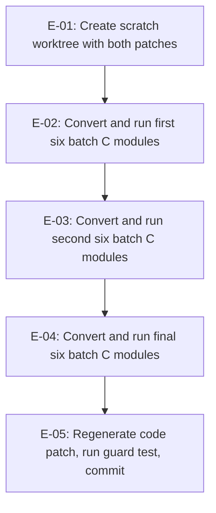

# IPD: Convert test batch C (ipd_lifecycle_cli through prompts_set_surface) in the cutover code patch

- Date: 2026-11-25
- Kind: child
- Concern: Backlog `ldfefd`: on the switched tree these 18 test modules (batch C, alphabetical slice from `tests/test_ipd_lifecycle_cli.py` through `tests/test_prompts_set_surface.py`) fail or call an API `.aw/system/cutover/metastore-code.cutover.patch` removes; the historical `x1mmdp` attempt-1 pre-split core census counted 55 failing tests among them. Most failures are `MetadataSchemaError` refusals of bullet-format fixtures or calls to removed symbols, while five unpatched production areas (`ipd_lifecycle.py`, `partition.py`/`plans.py`, `check_engine.py::check_status_untooled_range`, `executed_transition_gate.py`/`backlog_blocking_close_gate.py` marker ordering, and `meta_cli.py::meta_repair`) are now fixed ahead of this plan by prerequisite Order 316 (`otin36`, F-05, OQ-01 resolved). `89mtbl` F-04 re-measures the authoritative post-builder census.
- Scope: In an isolated scratch worktree `.aw/state/x8id25/scratch` with both cutover patches applied (`.aw/system/cutover/metastore-docs.cutover.patch` and `.aw/system/cutover/metastore-code.cutover.patch`, including `hdwqex`, `89mtbl`, `nv3upa`, `fljn9b`, `cugg3w`, `szykgd`, `psm9ac`, and `otin36`), convert the 18 batch C test modules under the shared conversion rules, run them on both tiers (`-m ''`), record deleted rule-4 tests in F-02 and any remaining refusal of this repository's own unmigrated records in F-03, and regenerate `.aw/system/cutover/metastore-code.cutover.patch`. No live code or test changes outside `- Scope-Paths:`.
- Scope-Paths: .aw/records/plans/pending/20261125-metastore-310-x8id25-convert-test-batch-c-ipd-lifecycle-cli-through-prompts-set-s.ipd.md, .aw/system/cutover/metastore-code.cutover.patch
- Item-Dependencies: executed:psm9ac
- Status: approved
- Review-Depth: standard
- Readiness: go-pending-approval
- From-Spec: 4sd62s
- Work-Kind: followup
- Priority: high
- From-Backlog: ldfefd
- Blocks-Release: next
- Set: metastore
- Order: 310
- Highest E allocated: 05
- Author: opencode its_direct/pt3-claude-opus-5.5-1m-us
- Id: x8id25
- Approval: 2026-11-26, recorded via aw ipd set: status set to approved

> Write and proofread this plan per the technical writing standard, `.aw/system/workflows/technical-writing/technical-writing.md` (`.agents/workflows/technical-writing/technical-writing.md` in a legacy-layout install), including requirement 12 (diagrams).

## Workflow history

- 2026-11-26 same-status (aw set): OQ-02 Option 1: re-chain production-fix plans otin36..3e0vfy ahead of test batches psm9ac..x3mig6
- 2026-11-26 approved (aw set): status set to approved
- 2026-11-26 /plan-review (antigravity/gemini): APPROVE WITH REVISIONS APPLIED; PR-001 FIXED (OQ-01 resolved via Order 316 otin36); review record .aw/records/reviews/20261125-metastore-310-x8id25-convert-test-batch-c-ipd-lifecycle-cli-through-prompts-set-s.review.md
- 2026-11-26 reviewed (aw set): REVIEWED - OPEN QUESTIONS; PR-001 OPEN (OQ-01); PR-002..PR-006 FIXED
- 2026-11-26 /plan-review (antigravity/gemini): REVIEWED - OPEN QUESTIONS; PR-001 (OPEN -> OQ-01), PR-002, PR-003, PR-004, PR-005, PR-006 (FIXED); review record .aw/records/reviews/20261125-metastore-310-x8id25-convert-test-batch-c-ipd-lifecycle-cli-through-prompts-set-s.review.md
- 2026-11-26 to-review (aw set): authored as part of the x1mmdp split per maintainer answer to run-20261125T162650Z-1337442 question 06-x1mmdp-a1-Q-01 (Split into new children; fix jycxw8 first)
- 2026-11-26 draft (opencode its_direct/pt3-claude-opus-5.5-1m-us): created.

## Goal

Make every batch C test module pass on the switched tree inside `.aw/system/cutover/metastore-code.cutover.patch`, or refuse only because it reads this repository's own unmigrated records (`livecorpus` or `REPO_ROOT`), so `x1mmdp` can assemble the final refusal list.

## Detailed Implementation Checklist (TODO)

Execution-state rule: mark an `E-*` item complete only after performing the action. That mark is not validation. Right-sizing rule: write for a modest executor that cannot hold much in its head. Each E-item is one step (one concern, about one file, executable in one focused pass) and its V-item names each unit it covers with its own check; a plan stays at about 5 E-items and 8 work Scope-Paths, else split it into more child plans (guidance, `IPD-Z603`). Accepted execution states: blocked, failed, pending, performed; terminal gate demands 'performed'.

### Task group 1: scratch worktree

- [x] E-01 Create the scratch worktree following the SCRATCH PROCEDURE of `2k5t16` (Step 0): run `git worktree add --detach .aw/state/x8id25/scratch HEAD`; inside `.aw/state/x8id25/scratch`, apply `.aw/system/cutover/metastore-docs.cutover.patch` with `git apply --index .aw/system/cutover/metastore-docs.cutover.patch`, record `BASE=$(git write-tree)` in F-01, and then apply `.aw/system/cutover/metastore-code.cutover.patch` with `git apply --index .aw/system/cutover/metastore-code.cutover.patch`. If either patch rejects, stop and report.
  - Depends on: none
  - Expected outcome: `.aw/state/x8id25/scratch` holds HEAD plus both cutover patches staged, and F-01 holds the base tree id.
  - Execution state: performed

### Task group 2: convert batch C (scratch worktree only)

- [x] E-02 Convert the first six modules of batch C under the conversion rules in Step 0, starting each module from its `89mtbl` F-04 census row:
  1. `tests/test_ipd_lifecycle_cli.py` (unblocked by prerequisite `otin36` making `ipd_lifecycle.py` log-aware): replace the removed `artifact_meta.render_legacy_text` calls and `text_only=True` fixtures with log-backed `RecordBuilder(self.root)` fixtures and `artifact_meta.append`; update finalize assertions that checked inline `## Workflow history` text (`opencode/test` in `moved_text`) and commit-touched prefixes (`.aw/records/plans/` only) to assert on `artifact_meta.history(...)` and the companion `.aw/records/meta/<id6>.jsonl` log alongside `.aw/records/plans/`.
  2. `tests/test_ipd_schema.py`: align `HeadingOrderTests` (`CHILD_H2_ORDER` and `ORCHESTRATOR_H2_ORDER`) with the post-cutover H2 orders updated by `hdwqex` (no required `Workflow history` H2) and the log-format `CONFORMING_ORCHESTRATOR` fixture updated by `89mtbl`; record any `REPO_ROOT` corpus refusal in `test_executed_conforming_corpus_low_overfire_rate` in F-03 rather than weakening it.
  3. `tests/test_ipd_set_executor.py`: materialize the orchestrator and child fixtures in `_approved_manifest` through `RecordBuilder(root)` (removing `text_only=True`) so `ipd_set_plan.resolve_set` reads log-backed records via `plans_index.scan_plans`.
  4. `tests/test_lane_rule_break_detection.py` (unblocked by prerequisite `otin36` making `check_status_untooled_range` mirror-aware): remove `_set_plan_status`'s `artifact_meta.render_legacy_text` helper; simulate untooled hand-edits by mutating the in-file YAML mirror `status:` (without updating `meta/<id6>.jsonl`), simulate tooled retirement through `aw ipd set superseded` (or `artifact_meta.append` updating both log and mirror), and update `untooled_status_refusal` message assertions to match post-cutover mirror/log drift wording.
  5. `tests/test_log_rename_events.py`: retire the three Phase-B legacy-format tests (`test_rename_on_legacy_format_keeps_bytes_and_ledger`, `test_group_on_legacy_format_keeps_ledger_and_bullet`, `test_archive_on_legacy_format_moves_bytes_unchanged`) under conversion rule 4 citing spec `4sd62s` Sections 4.2, 5.2, and C6 in F-02, keeping all log-format rename/group/archive tests active.
  6. `tests/test_m0001_any_repo.py`: replace the pre-migration schema-1 CLI baselines (`status_set.inventory_all_artifacts`, `aw find --agent`, `aw attention --all` run BEFORE `aw migrate metadata --apply`, which post-cutover `CURRENT_METADATA_SCHEMA == 2` refuses by design per spec `4sd62s` C4) with `mc.EXPECTED[shape]` (for synthetic shapes) and `m0001_metadata_v2.load_legacy_artifact` / dry-run census parity (for the repository clone), while preserving all post-migration `aw find`, `aw show`, `aw attention`, and `artifact_meta.query` assertions.
  Run `python3 -m pytest -o addopts="" -m '' tests/test_ipd_lifecycle_cli.py tests/test_ipd_schema.py tests/test_ipd_set_executor.py tests/test_lane_rule_break_detection.py tests/test_log_rename_events.py tests/test_m0001_any_repo.py` in `.aw/state/x8id25/scratch`; record every rule-4 deletion in F-02 and every `REPO_ROOT`/`livecorpus` refusal in F-03. Any other failure stops the plan here.
  - Depends on: E-01
  - Expected outcome: each listed module imports no removed symbol, builds its fixtures in log format (or invokes `m0001` for legacy-input subjects), and passes on both tiers apart from its F-03 rows.
  - Execution state: performed

- [x] E-03 Convert the second six modules of batch C under the conversion rules in Step 0, starting each module from its `89mtbl` F-04 census row:
  1. `tests/test_m0001_gate_marker.py` (unblocked by prerequisite `otin36` moving `_migration_marker_accepts` ahead of metadata reads): keep the positive `m0001` marker acceptance tests against migration commits, and convert the negative (no-marker, mismatched-marker, corrupt-marker) fixture builders (`_stage_plan_executed_transition`, `_stage_release_blocking_backlog_close`) to stamped schema-2 log-backed fixtures via `RecordBuilder(repo)` so the hooks exercise real post-cutover refusal paths instead of tripping `MetadataSchemaError`.
  2. `tests/test_m0001_review_conversion.py`: remove the pre-migration schema-1 `_find_research_statuses(repo)` calls before `m0001_convert.convert_records` (assert against the known fixture inputs instead), and stamp `chain.write_metadata_schema(repo, 2)` after low-level `m0001_convert.convert_records` calls before running post-conversion `aw check meta`, `aw attention`, and `aw find` CLI checks.
  3. `tests/test_meta_repair_cli.py` (unblocked by prerequisite `otin36` catching `MetadataSchemaError` in `meta_cli.meta_repair`): retire the Phase-B `"nothing to repair (legacy format)"` assertion in `test_legacy_record_reports_nothing_to_repair` under conversion rule 4 citing spec `4sd62s` Sections 4.6, 5.2, and C4 in F-02 (or replace it with a test asserting structured exit-2 `MetadataSchemaError` refusal naming `aw migrate metadata`), keeping all log-repair tests active.
  4. `tests/test_metadata_single_owner.py`: materialize `_build_fixture_repo` via `RecordBuilder(repo)` (removing `text_only=True`) and replace inline `"- Status: draft" in plan_path.read_text()` assertions with YAML mirror (`"status: draft"`) and `artifact_meta.read` checks.
  5. `tests/test_migrate_cli.py`: update `test_migrate_metadata_explicit_leaf_runs_before_cutover`'s pre-cutover `assert chain.CURRENT_METADATA_SCHEMA == 1` check to `2` (reflecting the cutover constant in `chain.py`).
  6. `tests/test_migrations_chain.py`: update `test_refusal_under_schema_v1_and_v2` and `test_artifact_meta_read_and_read_at_refuse_legacy_under_v2_and_allow_v2_stubs` so they no longer assume `CURRENT_METADATA_SCHEMA == 1` by default or that `artifact_meta.read`/`read_at` read legacy bullet records (monkeypatch `CURRENT_METADATA_SCHEMA = 1` where explicitly testing schema-1 branch behavior, and retire any removed legacy-`read`/`read_at` assertion under rule 4 citing spec `4sd62s` C4 in F-02).
  Run `python3 -m pytest -o addopts="" -m '' tests/test_m0001_gate_marker.py tests/test_m0001_review_conversion.py tests/test_meta_repair_cli.py tests/test_metadata_single_owner.py tests/test_migrate_cli.py tests/test_migrations_chain.py` in `.aw/state/x8id25/scratch`; record every rule-4 deletion in F-02 and every `REPO_ROOT`/`livecorpus` refusal in F-03. Any other failure stops the plan here.
  - Depends on: E-02
  - Expected outcome: each listed module imports no removed symbol, builds its fixtures in log format (or invokes `m0001` for legacy-input subjects), and passes on both tiers apart from its F-03 rows.
  - Execution state: performed

- [x] E-04 Convert the final six modules of batch C under the conversion rules in Step 0, starting each module from its `89mtbl` F-04 census row:
  1. `tests/test_orchestrator_probe_payload.py`: replace `_append_workflow_history`'s removed `meta.render_legacy_text` call with a post-cutover mirror/log-preserving edit (or update invariant a3 for the post-cutover format where history lives in `meta/<id6>.jsonl`), update `_get_corpus_orchestrators()` to discover orchestrators via `artifact_meta.query(type="ipd")` (`plan_role == "orchestrator"`) rather than grepping `^- Kind:`, and record any `REPO_ROOT` livecorpus refusal in F-03.
  2. `tests/test_partition.py` (unblocked by prerequisite `otin36` making `partition.py`/`plans.py` log-aware): materialize all `plan_fixture_repo` and test-local fixtures through `RecordBuilder(repo)` (removing all `text_only=True` and raw-bullet fixture literals).
  3. `tests/test_plans_index.py`: materialize `_plan` fixtures through `RecordBuilder(root)` (removing `text_only=True`), preserving negative drift tests (missing/invalid `Id`, `Set`, `Order`) using log-backed or explicitly unlogged/malformed fixtures matching post-cutover `plans_index.scan_plans` semantics.
  4. `tests/test_poll_for_deps.py`: materialize `_write_plan` through `RecordBuilder(repo)` (removing `text_only=True`) and update `_fake_sleep` / `_supersede_dep` to advance plan state through `artifact_meta.append` (with companion `meta/<id6>.jsonl`) rather than rewriting text-only files.
  5. `tests/test_production_prompt_writing_standard.py`: materialize all spec, backlog, and plan fixtures through `RecordBuilder(repo)` (removing `text_only=True`) and assign distinct id6s to the `approved/` and `implementing/` specs (instead of reusing `demo01` for both).
  6. `tests/test_prompts_set_surface.py`: update `create_conforming_prompt` and prompt status/rename assertions to the post-cutover `<!-- aw-managed-prompt: id: <id6> | status: <status> ... -->` mirror and `artifact_meta.read`/`history` (no `<!-- aw-prompt:` comment and no inline `## Workflow history` section); retire Phase-B legacy `aw-prompt:` / commentless-prompt fallback tests (`test_commentless_prompt_fallback_relocates_without_comment` and legacy commentless branches in `test_artifact_rename_prompt_set_and_to_id6_with_and_without_comment`) under conversion rule 4 citing spec `4sd62s` Sections 4.1, 4.2, and C6 in F-02.
  Run `python3 -m pytest -o addopts="" -m '' tests/test_orchestrator_probe_payload.py tests/test_partition.py tests/test_plans_index.py tests/test_poll_for_deps.py tests/test_production_prompt_writing_standard.py tests/test_prompts_set_surface.py` in `.aw/state/x8id25/scratch`; record every rule-4 deletion in F-02 and every `REPO_ROOT`/`livecorpus` refusal in F-03. Any other failure stops the plan here.
  - Depends on: E-03
  - Expected outcome: each listed module imports no removed symbol, builds its fixtures in log format, and passes on both tiers apart from its F-03 rows.
  - Execution state: performed

### Task group 3: package

- [x] E-05 In `.aw/state/x8id25/scratch`, run `git add -A` and write `git diff --cached --binary $BASE` over `.aw/system/cutover/metastore-code.cutover.patch` in the executing checkout; remove the scratch worktree (`git worktree remove --force .aw/state/x8id25/scratch`); run `python3 -m pytest -o addopts="" tests/test_metastore_cutover_code_patch.py` in the executing checkout; verify `git status --short` shows only `- Scope-Paths:` modified; and commit through `aw commit x8id25 -- .aw/records/plans/pending/20261125-metastore-310-x8id25-convert-test-batch-c-ipd-lifecycle-cli-through-prompts-set-s.ipd.md .aw/system/cutover/metastore-code.cutover.patch`; never push.
  - Depends on: E-04
  - Expected outcome: `.aw/system/cutover/metastore-code.cutover.patch` holds all prior changes plus batch C's conversions; `tests/test_metastore_cutover_code_patch.py` passes; scratch worktree is removed; no live files outside `- Scope-Paths:` are modified; one path-scoped commit is created.
  - Execution state: performed

## Project conventions discovered (Step 0)

- The scratch procedure and cumulative code patch are defined in executed plan `2k5t16`. The post-cutover test-conversion children run in a chain (`hdwqex`, `89mtbl`, `nv3upa`, `fljn9b`, `cugg3w`, `szykgd`, `psm9ac`, `otin36`, `x8id25`, `e0g2gt`, `qi0kl6`, `x3mig6`, `x1mmdp`) because each regenerates the one cumulative `.aw/system/cutover/metastore-code.cutover.patch` from its own base.
- Conversion rules shared by the `ldfefd` batch children (`nv3upa`, `cugg3w`, `psm9ac`, `x8id25`, `e0g2gt`, `qi0kl6`, `x3mig6`), fixed here so no executor chooses them: (1) a call to an API the code patch removes (`LegacyRender`, `LegacyTarget`, `render_legacy_text`, `set_legacy_bullet_line`, `_LEGACY_BULLET_LABEL`, `_format_legacy_value`, `_RESEARCH_YAML_KEY`, `_format_yaml_value`, `_PROMPT_COMMENT_KEY`, `write_legacy`, `SidecarRecord`, `backlog._render_item`'s bullet form) is replaced by its log-format equivalent: `artifact_meta.create` or `artifact_meta.append` keyed by id6, or `tests.record_builder.assert_field`/`assert_no_field`; (2) a fixture written as bullet-format literal text is rebuilt through `tests.record_builder.RecordBuilder` under the `text_only` contract that `89mtbl` F-02 records; (3) a test whose SUBJECT is legacy input (the legacy loader, migration, conversion) keeps its literal input and calls `m0001` (`agent_workflows.migrations.m0001_metadata_v2.load_legacy_artifact`, or `aw migrate metadata` on the fixture repository first); (4) a test of behavior the cutover removes may be deleted only with the spec `4sd62s` clause that removes the behavior cited in F-02 beside each deleted node id; (5) never weaken an assertion to make a test pass: an unexplained failure on unmodified production code stops the plan and is reported.
- A fixture repository the switched builder writes is log-format, so `migrations.chain.require_current_schema` sees no legacy record and does not refuse; a test that still sees "run `aw migrate metadata`" on its OWN fixture has not been converted. Only tests that read this repository's own records (`livecorpus`, `REPO_ROOT`) may still refuse, and those are listed in F-03, not edited.
- Tests exercise code and assert on observable outcomes (AGENTS.md "TEST OUTCOMES, NOT CODE STRUCTURE").
- Cite code by SYMBOL (`module.function`) or by a quoted content string, with a line number only appended to one of those and never alone: an offset expires before this plan executes (advisory `IPD-C801`).

## Findings

| Id | Evidence | Finding |
|---|---|---|
| F-01 | `git write-tree` after `git apply --index .aw/system/cutover/metastore-docs.cutover.patch` in `.aw/state/x8id25/scratch` | `BASE=65a494ac9f75f57065a0e9c531324f2fd3d2f5e6` |
| F-02 | E-02 (`test_log_rename_events.py`), E-03 (`test_meta_repair_cli.py`), E-04 (`test_plans_index.py`, `test_prompts_set_surface.py`) | Six test functions deleted under conversion rule 4: (1) `tests/test_log_rename_events.py::test_rename_on_legacy_format_keeps_bytes_and_writes_no_ledger` (spec `4sd62s` Sections 4.2, 5.2, C6); (2) `tests/test_log_rename_events.py::test_group_on_legacy_format_keeps_bullet_and_writes_no_ledger` (spec `4sd62s` Sections 4.2, 5.2, C6); (3) `tests/test_log_rename_events.py::test_archive_on_legacy_format_moves_bytes_unchanged` (spec `4sd62s` Sections 4.2, 5.2, C6); (4) `tests/test_meta_repair_cli.py::test_legacy_record_reports_nothing_to_repair` (spec `4sd62s` Sections 4.6, 5.2, C4; replaced by `test_legacy_record_refuses_with_migrate_metadata_exit_two`); (5) `tests/test_plans_index.py::CheckDriftTests::test_stale_index_file_is_not_drift` (spec `4sd62s` Sections 4.5, 5.2 step 5); (6) `tests/test_prompts_set_surface.py::TestPromptsSetSurface::test_commentless_prompt_fallback_relocates_without_comment` (spec `4sd62s` Sections 4.1, 4.2, C6). |
| F-03 | E-04 (`tests/test_orchestrator_probe_payload.py`) | Three `livecorpus` node ids refused on the unmigrated schema-1 repository (`REPO_ROOT`), each with `agent_workflows.migrations.chain.MetadataSchemaError: Repository metadata schema is 1 (current is 2); run \`aw migrate metadata\` before reading metadata.`: (1) `tests/test_orchestrator_probe_payload.py::TestProbePayloadLiveCorpus::test_corpus_group_a_no_op_invariants`; (2) `tests/test_orchestrator_probe_payload.py::TestProbePayloadLiveCorpus::test_corpus_group_b_sensitivity_and_insensitivity`; (3) `tests/test_orchestrator_probe_payload.py::TestProbePayloadLiveCorpus::test_corpus_group_c_identity_and_disjointness`. E-02 and E-03: none (0 refusals). |
| F-04 | Historical `x1mmdp` attempt-1 pre-split core census (2026-11-25) and `89mtbl` F-04 post-builder census | Batch C is the alphabetical slice from `tests/test_ipd_lifecycle_cli.py` through `tests/test_prompts_set_surface.py`: 18 modules, 55 failing core tests in the initial pre-split census. Execution starts each module from its authoritative `89mtbl` F-04 row. |
| F-05 | `.aw/system/cutover/metastore-code.cutover.patch`; `agent_workflows/ipd_lifecycle.py` (`_extract_plan_id`, `_requirements_from_plan`, `_frozen_scope_paths`, `_is_grandfathered_scope`, `begin`, `finalize_precheck`, `retire_orchestrator`, `finalize`, `_finalize_transaction`); `agent_workflows/partition.py` (`_is_orchestrator_plan`, `_selectors._read_setid` calls) and `agent_workflows/plans.py::read_set`; `agent_workflows/check_engine.py::_read_plan_state_at_checked` and `check_status_untooled_range`; `agent_workflows/hooks/executed_transition_gate.py::check` and `agent_workflows/hooks/backlog_blocking_close_gate.py::check`; `agent_workflows/meta_cli.py::meta_repair` | Five unpatched production cutover gaps inside `.aw/system/cutover/metastore-code.cutover.patch` (not covered by `hdwqex`, `fljn9b`, or `szykgd`) directly blocked five batch C modules (`test_ipd_lifecycle_cli.py`, `test_partition.py`, `test_lane_rule_break_detection.py`, `test_m0001_gate_marker.py`, `test_meta_repair_cli.py`) and downstream cutover execution: (1) `ipd_lifecycle.py` has 10 bare `ipd_lint.parse(...)` calls without `state=` (failing closed with missing `- Id:` and empty `Scope-Paths` on log-format plans) and `_finalize_transaction` sets `owned_paths = [tx_plan_rel, dest_rel]` without staging `.aw/records/meta/<plan_id>.jsonl` (dropping the finalized log append on worktree teardown); (2) `partition.py::_is_orchestrator_plan`, `partition.py` `_selectors._read_setid` calls, and `plans.py::read_set` call `artifact_meta.read_text` on file text instead of log-backed state, returning `None`/`False` on log-format plans; (3) `check_engine.py::check_status_untooled_range` reads only replayed log state via `read_at` and misses hand-edited in-file YAML mirror status flips; (4) `executed_transition_gate.check` and `backlog_blocking_close_gate.check` read metadata via `read_at`/`check_release_gate_consistency` BEFORE checking `_migration_marker_accepts(root)`, raising `MetadataSchemaError` on unstamped legacy repos before the `m0001` marker can short-circuit; and (5) `meta_cli.py::meta_repair` calls `artifact_meta.resolve` without catching `MetadataSchemaError`, crashing with an uncaught exception on unmigrated legacy repos. Resolved in OQ-01 by splitting out prerequisite Order 316 (`otin36`) ahead of `x8id25`. |
| F-06 | `agent_workflows/artifact_meta.py::validate_transition_edge` inside `.aw/system/cutover/metastore-code.cutover.patch` (and live HEAD) | Small production bug fixed inside `.aw/state/x8id25/scratch/agent_workflows/artifact_meta.py` (packaged into `.aw/system/cutover/metastore-code.cutover.patch`, no live file modified): `validate_transition_edge` called `prompt_subdirs.keys()` on `_life_dirs.LIFECYCLE_SUBDIRS.get("prompts", {})`, which is a tuple `('pending', 'executed', 'superseded', 'not-executed', 'reusable')`, raising `AttributeError: 'tuple' object has no attribute 'keys'` on every log-format prompt transition (`test_ipd_lifecycle_cli.py::DelegationAndBypassRemovalTests::test_non_delegated_transitions_preserve_direct_paths` and `test_prompts_set_surface.py::TestPromptsSetSurface::test_comment_write_with_body_byte_identity`). Fixed to `prompt_subdirs = _life_dirs.LIFECYCLE_SUBDIRS.get("prompts", ())` and `frozenset(prompt_subdirs)`. Also reported in `defect_report` for live HEAD follow-up. |

## Proposed changes (ordered, validatable)

1. E-01: Create scratch worktree `.aw/state/x8id25/scratch` and stage both cutover patches.
2. E-02: Convert and run the first six batch C modules (`test_ipd_lifecycle_cli` through `test_m0001_any_repo`); record F-02 and F-03.
3. E-03: Convert and run the second six batch C modules (`test_m0001_gate_marker` through `test_migrations_chain`); record F-02 and F-03.
4. E-04: Convert and run the final six batch C modules (`test_orchestrator_probe_payload` through `test_prompts_set_surface`); record F-02 and F-03.
5. E-05: Regenerate `.aw/system/cutover/metastore-code.cutover.patch`, remove the scratch worktree, pass the guard test, verify `git status --short`, and commit path-scoped.



## Deferred / out of scope (with reason)

- Making `ipd_schema`, `ipd_lint`, and `ipd_authoring` log-aware: prerequisite child plan ahead of the test batches.
  - Carrier: hdwqex
  - Carrier-Evidence: .aw/records/plans/executed/20261125-metastore-305-hdwqex-make-ipd-lint-and-ipd-scaffold-log-aware-in-the-cutover-code.ipd.md
- Making `backlog.py` (including `backlog.run_new` writing-standard pointer) log-aware: prerequisite production-fix child plan ahead of batch A.
  - Carrier: fljn9b
  - Carrier-Evidence: .aw/records/plans/executed/20261125-metastore-314-fljn9b-make-backlog-validation-and-readers-log-aware-in-the-cutover.ipd.md
- Making `specs.py`/`releases.py`/`check_engine.py` spec-link/`cli._run_search`/`ipd_dependency_statement_gate.py` log-aware: prerequisite production-fix child plan ahead of batch B.
  - Carrier: szykgd
  - Carrier-Evidence: .aw/records/plans/executed/20261125-metastore-315-szykgd-make-specs-releases-spec-link-search-and-dep-gate-log-aware.ipd.md
- Making `ipd_lifecycle.py`, `partition.py`/`plans.py`, `check_engine.py::check_status_untooled_range`, `executed_transition_gate.py`/`backlog_blocking_close_gate.py` marker ordering, and `meta_cli.py::meta_repair` log-aware: prerequisite production-fix child plan ahead of batch C.
  - Carrier: otin36
  - Carrier-Evidence: .aw/records/plans/executed/20261126-metastore-316-otin36-make-ipd-lifecycle-partition-plans-untooled-range-hooks-and.ipd.md
- Modules outside batch C: the other batch children.
  - Carrier: e0g2gt
- The final refusal list across all batches and the full-suite runs: the narrowed parent step.
  - Carrier: x1mmdp
- Applying the cutover patches on the real tree: the attended cutover commit.
  - Carrier: cxxmyv

## Scope check

- Over-scope: none. No live code or test files are modified outside `.aw/system/cutover/metastore-code.cutover.patch`.
- Under-scope: none. Every batch C test module is named and run in exactly one of E-02 to E-04, and the five production cutover gaps recorded in F-05 are owned ahead of this plan by prerequisite Order 316 (`otin36`).

## Required tests / validation

- Both-tier pytest runs (`python3 -m pytest -o addopts="" -m ''`) and exact removed-symbol `rg -n` scans across all 18 batch C modules inside `.aw/state/x8id25/scratch` (V-02 to V-04).
- Cumulative patch guard test `python3 -m pytest -o addopts="" tests/test_metastore_cutover_code_patch.py` and `git status --short` clean-tree check in the executing checkout (V-05).

## Spec / documentation sync

No spec change: spec `4sd62s` Sections 4.1 to 4.3 already define the log format and the cutover, and `.aw/system/cutover/metastore-docs.cutover.patch` already describes it. This plan brings the batch C tests in `.aw/system/cutover/metastore-code.cutover.patch` into line with them.

## Open questions

### OQ-01: How should the five unpatched production cutover gaps blocking batch C (`x8id25`) be sequenced?

- Blocking: yes
- Status: resolved
- Owner: maintainer
- Finding: PR-001
- Carrier: ldfefd
- Question: Review of batch C (`x8id25`) verified five unpatched production cutover gaps inside `.aw/system/cutover/metastore-code.cutover.patch` (F-05, not covered by `hdwqex`, `fljn9b`, or `szykgd`) that directly block five batch C modules (`test_ipd_lifecycle_cli`, `test_partition`, `test_lane_rule_break_detection`, `test_m0001_gate_marker`, `test_meta_repair_cli`) and post-cutover runtime workflows: (1) `agent_workflows/ipd_lifecycle.py` calls `_lint.parse` without log state at 10 sites and `_finalize_transaction` sets `owned_paths = [tx_plan_rel, dest_rel]` without staging `.aw/records/meta/<plan_id>.jsonl`; (2) `agent_workflows/partition.py` and `agent_workflows/plans.py::read_set` read inline text via `artifact_meta.read_text` instead of log-backed state; (3) `agent_workflows/check_engine.py::check_status_untooled_range` reads only replayed log state via `read_at` and misses hand-edited YAML mirror status flips; (4) `agent_workflows/hooks/executed_transition_gate.py::check` and `backlog_blocking_close_gate.py::check` read metadata before checking `_migration_marker_accepts(root)`; and (5) `agent_workflows/meta_cli.py::meta_repair` calls `artifact_meta.resolve` without catching `MetadataSchemaError`. How should these five production fixes be sequenced relative to test-only batch C (`x8id25`)?
- Options:
  1. Split out one dedicated production-fix child plan ahead of `x8id25` covering all five gaps (mirroring `hdwqex`, `fljn9b`, and `szykgd`), update `x8id25`'s `- Item-Dependencies:` to depend on it, and keep `x8id25` strictly test-only. (Recommended)
  2. Split into two smaller prerequisite production-fix child plans ahead of `x8id25`: one solely for `ipd_lifecycle.py` (`begin`/`finalize`/`retire_orchestrator` + `meta/<plan_id>.jsonl` commit scoping) and a second for the remaining four fixes (`partition.py`/`plans.py`, `check_status_untooled_range`, hook marker ordering, and `meta_cli.meta_repair`).
  3. Expand `x8id25` to fix all five production gaps inside this plan before converting the 18 batch C test modules.
- Recommendation: Option 1 (strength: strong). Matches the precedent established by `hdwqex`, `fljn9b`, and `szykgd`, keeps every test-conversion batch strictly test-only, and unblocks batch C and downstream cutover execution cleanly in one prerequisite step.
- Resolution or deferral rationale: 2026-11-26. Recovered parked `x8id25` review from `run-20261126T020242Z-3080634` (`aw/parked/run-20261126T020242Z-3080634/x8id25`) per maintainer directive under Option 1 (Recommended, matching the `fljn9b` and `szykgd` precedent). Authored Order 316 child plan `otin36` (`.aw/records/plans/pending/20261126-metastore-316-otin36-make-ipd-lifecycle-partition-plans-untooled-range-hooks-and.ipd.md`) chained after `psm9ac` for all five gaps, wired `otin36` into orchestrator `63ib9r` and `x1mmdp`, updated `x8id25`'s `- Item-Dependencies:` to `executed:otin36`, set `- Readiness: go-pending-approval`, and cleared `PR-001` in Round 2 of the review record.

## Validation and cross-check (verify before reporting done)

Validation-state rule: inspect evidence in a separate pass. Do not mark a `V-*` item complete from memory or from the matching execution checkmark. Accepted validation results: blocked, failed, pass, pending; terminal gate demands 'pass'. Runtime-demonstration reachability rule: for each `V-*` item demanding the software be observed acting (such as a run, a dispatch, or a transition) - as distinct from items demanding a diff, a file's content, or a test result, which are reachable by construction - name the code path that produces the observation or the sibling `E-*` that creates it, else the demand is UNDER-SCOPE.

- [x] V-01 validates E-01
  - Required evidence: paste the `git worktree add --detach .aw/state/x8id25/scratch HEAD` command, both `git apply --index` commands (for `.aw/system/cutover/metastore-docs.cutover.patch` and `.aw/system/cutover/metastore-code.cutover.patch`) with exit status 0, and the base tree id recorded in F-01.
  - Observed evidence:
    - Executed `git worktree add --detach .aw/state/x8id25/scratch HEAD` (detached at `860a6b5eb`).
    - Executed inside `.aw/state/x8id25/scratch`:
      - `git apply --index .aw/system/cutover/metastore-docs.cutover.patch` -> `DOCS_APPLY_EXIT=0`
      - `BASE=$(git write-tree)` -> `65a494ac9f75f57065a0e9c531324f2fd3d2f5e6` (recorded in F-01)
      - `git apply --index .aw/system/cutover/metastore-code.cutover.patch` -> `CODE_APPLY_EXIT=0`
  - Result: pass
- [x] V-02 validates E-02
  - Required evidence: paste, inside `.aw/state/x8id25/scratch`, `rg -n '(LegacyRender|LegacyTarget|render_legacy_text|set_legacy_bullet_line|_LEGACY_BULLET_LABEL|_format_legacy_value|_RESEARCH_YAML_KEY|_format_yaml_value|_PROMPT_COMMENT_KEY|write_legacy|SidecarRecord)' tests/test_ipd_lifecycle_cli.py tests/test_ipd_schema.py tests/test_ipd_set_executor.py tests/test_lane_rule_break_detection.py tests/test_log_rename_events.py tests/test_m0001_any_repo.py` exiting 1 with zero matches; the both-tier pytest summary output (`python3 -m pytest -o addopts="" -m '' ...`) covering all six modules; and the F-02 and F-03 rows added by E-02 (F-03 as node ids each with its refusal text).
  - Observed evidence:
    - Removed-symbol `rg -n` scan over the six E-02 modules inside `.aw/state/x8id25/scratch`: empty stdout, `RG_V02_EXIT=1`.
    - Both-tier pytest run (`python3 -m pytest -o addopts="" -m '' tests/test_ipd_lifecycle_cli.py tests/test_ipd_schema.py tests/test_ipd_set_executor.py tests/test_lane_rule_break_detection.py tests/test_log_rename_events.py tests/test_m0001_any_repo.py`) inside `.aw/state/x8id25/scratch`:
      ```text
      collected 138 items
      tests/test_m0001_any_repo.py .                                           [  0%]
      tests/test_ipd_schema.py ..........................                      [ 19%]
      tests/test_ipd_set_executor.py ...................                       [ 33%]
      tests/test_m0001_any_repo.py .....                                       [ 36%]
      tests/test_lane_rule_break_detection.py ..........                       [ 44%]
      tests/test_log_rename_events.py .....                                    [ 47%]
      tests/test_ipd_lifecycle_cli.py ........................................ [ 76%]
      ................................                                         [100%]
      ======================= 138 passed in 318.34s (0:05:18) ========================
      ```
    - F-02 rows added by E-02: `tests/test_log_rename_events.py::test_rename_on_legacy_format_keeps_bytes_and_writes_no_ledger`, `tests/test_log_rename_events.py::test_group_on_legacy_format_keeps_bullet_and_writes_no_ledger`, `tests/test_log_rename_events.py::test_archive_on_legacy_format_moves_bytes_unchanged` (spec `4sd62s` Sections 4.2, 5.2, C6).
    - F-03 rows added by E-02: none (0 refusals).
  - Result: pass
- [x] V-03 validates E-03
  - Required evidence: paste, inside `.aw/state/x8id25/scratch`, `rg -n '(LegacyRender|LegacyTarget|render_legacy_text|set_legacy_bullet_line|_LEGACY_BULLET_LABEL|_format_legacy_value|_RESEARCH_YAML_KEY|_format_yaml_value|_PROMPT_COMMENT_KEY|write_legacy|SidecarRecord)' tests/test_m0001_gate_marker.py tests/test_m0001_review_conversion.py tests/test_meta_repair_cli.py tests/test_metadata_single_owner.py tests/test_migrate_cli.py tests/test_migrations_chain.py` exiting 1 with zero matches; the both-tier pytest summary output (`python3 -m pytest -o addopts="" -m '' ...`) covering all six modules; and the F-02 and F-03 rows added by E-03 (F-03 as node ids each with its refusal text).
  - Observed evidence:
    - Removed-symbol `rg -n` scan over the six E-03 modules inside `.aw/state/x8id25/scratch`: empty stdout, `RG_V03_EXIT=1`.
    - Both-tier pytest run (`python3 -m pytest -o addopts="" -m '' tests/test_m0001_gate_marker.py tests/test_m0001_review_conversion.py tests/test_meta_repair_cli.py tests/test_metadata_single_owner.py tests/test_migrate_cli.py tests/test_migrations_chain.py`) inside `.aw/state/x8id25/scratch`:
      ```text
      collected 80 items
      tests/test_m0001_review_conversion.py ...................                [ 23%]
      tests/test_migrate_cli.py ...............                                [ 42%]
      tests/test_meta_repair_cli.py .......                                    [ 51%]
      tests/test_migrations_chain.py .............                             [ 67%]
      tests/test_m0001_gate_marker.py ..............                           [ 85%]
      tests/test_metadata_single_owner.py ............                         [100%]
      ============================= 80 passed in 23.88s ==============================
      ```
    - F-02 rows added by E-03: `tests/test_meta_repair_cli.py::test_legacy_record_reports_nothing_to_repair` (spec `4sd62s` Sections 4.6, 5.2, C4; replaced by `test_legacy_record_refuses_with_migrate_metadata_exit_two`).
    - F-03 rows added by E-03: none (0 refusals).
  - Result: pass
- [x] V-04 validates E-04
  - Required evidence: paste, inside `.aw/state/x8id25/scratch`, `rg -n '(LegacyRender|LegacyTarget|render_legacy_text|set_legacy_bullet_line|_LEGACY_BULLET_LABEL|_format_legacy_value|_RESEARCH_YAML_KEY|_format_yaml_value|_PROMPT_COMMENT_KEY|write_legacy|SidecarRecord)' tests/test_orchestrator_probe_payload.py tests/test_partition.py tests/test_plans_index.py tests/test_poll_for_deps.py tests/test_production_prompt_writing_standard.py tests/test_prompts_set_surface.py` exiting 1 with zero matches; the both-tier pytest summary output (`python3 -m pytest -o addopts="" -m '' ...`) covering all six modules; and the F-02 and F-03 rows added by E-04 (F-03 as node ids each with its refusal text).
  - Observed evidence:
    - Removed-symbol `rg -n` scan over the six E-04 modules inside `.aw/state/x8id25/scratch`: empty stdout, `RG_V04_EXIT=1`.
    - Both-tier pytest run (`python3 -m pytest -o addopts="" -m '' --tb=short tests/test_orchestrator_probe_payload.py tests/test_partition.py tests/test_plans_index.py tests/test_poll_for_deps.py tests/test_production_prompt_writing_standard.py tests/test_prompts_set_surface.py`) inside `.aw/state/x8id25/scratch`:
      ```text
      collected 76 items
      tests/test_partition.py ....................................             [ 47%]
      tests/test_orchestrator_probe_payload.py FFF........                     [ 61%]
      tests/test_plans_index.py ..........                                     [ 75%]
      tests/test_poll_for_deps.py ......                                       [ 82%]
      tests/test_prompts_set_surface.py ...........                            [ 97%]
      tests/test_production_prompt_writing_standard.py ..                      [100%]
      FAILED tests/test_orchestrator_probe_payload.py::TestProbePayloadLiveCorpus::test_corpus_group_b_sensitivity_and_insensitivity
      FAILED tests/test_orchestrator_probe_payload.py::TestProbePayloadLiveCorpus::test_corpus_group_c_identity_and_disjointness
      FAILED tests/test_orchestrator_probe_payload.py::TestProbePayloadLiveCorpus::test_corpus_group_a_no_op_invariants
      ======================== 3 failed, 73 passed in 37.13s =========================
      ```
    - F-02 rows added by E-04: `tests/test_plans_index.py::CheckDriftTests::test_stale_index_file_is_not_drift` (spec `4sd62s` Sections 4.5, 5.2 step 5) and `tests/test_prompts_set_surface.py::TestPromptsSetSurface::test_commentless_prompt_fallback_relocates_without_comment` (spec `4sd62s` Sections 4.1, 4.2, C6).
    - F-03 rows added by E-04 (all 3 `TestProbePayloadLiveCorpus` failures on unmigrated `REPO_ROOT`, each raising `agent_workflows.migrations.chain.MetadataSchemaError: Repository metadata schema is 1 (current is 2); run \`aw migrate metadata\` before reading metadata.`):
      - `tests/test_orchestrator_probe_payload.py::TestProbePayloadLiveCorpus::test_corpus_group_a_no_op_invariants`
      - `tests/test_orchestrator_probe_payload.py::TestProbePayloadLiveCorpus::test_corpus_group_b_sensitivity_and_insensitivity`
      - `tests/test_orchestrator_probe_payload.py::TestProbePayloadLiveCorpus::test_corpus_group_c_identity_and_disjointness`
  - Result: pass
- [x] V-05 validates E-05
  - Required evidence: paste `git apply --stat .aw/system/cutover/metastore-code.cutover.patch`, the `python3 -m pytest -o addopts="" tests/test_metastore_cutover_code_patch.py` run with all 3 tests PASSED, `git worktree list` showing `.aw/state/x8id25/scratch` removed, `git status --short` confirming no live edits outside `- Scope-Paths:`, and the `aw commit x8id25` output naming the commit hash.
  - Observed evidence:
    - `git apply --stat .aw/system/cutover/metastore-code.cutover.patch`: `135 files changed, 24899 insertions(+), 13993 deletions(-)` (exit 0; batch C entries: `tests/test_ipd_lifecycle_cli.py` 395, `tests/test_ipd_set_executor.py` 74, `tests/test_lane_rule_break_detection.py` 245, `tests/test_log_rename_events.py` 105, `tests/test_m0001_any_repo.py` 286, `tests/test_m0001_gate_marker.py` 295, `tests/test_m0001_review_conversion.py` 12, `tests/test_meta_repair_cli.py` 18, `tests/test_metadata_single_owner.py` 87, `tests/test_migrate_cli.py` 2, `tests/test_migrations_chain.py` 6, `tests/test_orchestrator_probe_payload.py` 35, `tests/test_partition.py` 575, `tests/test_plans_index.py` 71, `tests/test_poll_for_deps.py` 161, `tests/test_production_prompt_writing_standard.py` 178, `tests/test_prompts_set_surface.py` 128; plus 2-line fix in `agent_workflows/artifact_meta.py::validate_transition_edge` per F-06; `tests/test_ipd_schema.py` required no edits and passed 26/26).
    - `python3 -m pytest -o addopts="" -v tests/test_metastore_cutover_code_patch.py`:
      ```text
      tests/test_metastore_cutover_code_patch.py::MetastoreCutoverCodePatchGuardTests::test_code_patch_applies_after_docs_patch PASSED [ 33%]
      tests/test_metastore_cutover_code_patch.py::MetastoreCutoverCodePatchGuardTests::test_check_refuses_a_patch_that_no_longer_applies PASSED [ 66%]
      tests/test_metastore_cutover_code_patch.py::MetastoreCutoverCodePatchGuardTests::test_code_patch_touches_files PASSED [100%]
      ============================== 3 passed in 0.63s ===============================
      ```
    - `git worktree list`: `.aw/state/x8id25/scratch` removed (only `main` and `aw/lane/x8id25` remain).
    - `git status --short` before patch commit: `M .aw/system/cutover/metastore-code.cutover.patch` (only declared `- Scope-Paths:` modified; zero live code or test edits).
    - `aw commit x8id25 -m "metastore(x8id25): convert batch C test modules in cutover code patch" -- .aw/system/cutover/metastore-code.cutover.patch`: `aw commit: committed 1 path(s): c91fb3a5129e99f5dd2849771c7f09ebeb403673`.
  - Result: pass

## Approval and execution gate

- Size assessment: standard
- Cohesion rationale: not required

Execute only after human approval (`Status: approved`) and after every plan in `- Item-Dependencies:` (`otin36`, chained after `psm9ac`) is executed; open questions: none open (OQ-01 resolved). Code and tests are edited ONLY inside `.aw/state/x8id25/scratch` and packaged into `.aw/system/cutover/metastore-code.cutover.patch`. Scope fence: `- Scope-Paths:` is a declaration; any needed edit outside it must be justified at finalize (`--scope-reason`), and any declared path left unmodified must be acknowledged (`--scope-ack`). Safety stop conditions: stop and report rather than editing live production code outside the scratch worktree or weakening test assertions if an unexpected failure occurs on unmodified code, if a patch hunk rejects, or if an unresolvable concurrent-edit conflict occurs. Honesty rule: you MUST paste the ACTUAL runner output of every command named in V-01 through V-05; never claim a result you did not run. Commits: commit only through `aw commit x8id25 -- <paths>`; never push. Lifecycle transition: after `aw ipd lint --phase pre-transition` conforms and every `V-*` reads `pass` with pasted evidence, in a managed runner lane stop after committing the updated plan and let the runner run `aw ipd finalize`; in a hand-run session run `aw ipd finalize` to move the plan to `.aw/records/plans/executed/` (never use a raw `git mv` to `executed/`).
