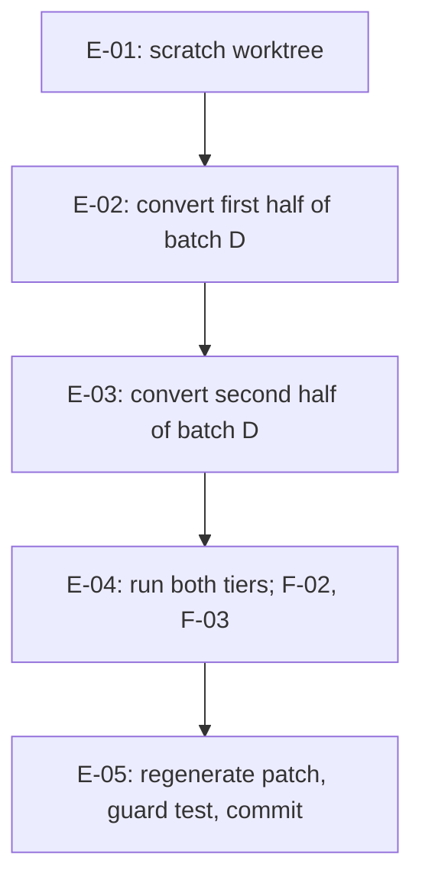

# IPD: Convert test batch D (prose_dash_advisory through readers_runner) in the cutover code patch

- Date: 2026-11-25
- Kind: child
- Concern: Backlog `ldfefd`: on the switched tree these 10 test modules (batch D, alphabetical slice) fail or call an API the cutover code patch removes; the `x1mmdp` attempt-1 core census `.aw/state/lane-submissions/run-20261125T162650Z-1337442/06-x1mmdp/attempt-1/evidence/failing-modules.txt` counts 134 failing tests among them. Most failures are `MetadataSchemaError` refusals of fixtures written as bullet records, the rest calls to removed symbols. `89mtbl` F-04 re-measures the census after the builder switch.
- Scope: In a scratch worktree with both cutover patches applied (including `hdwqex`, `89mtbl` and the earlier batch children), convert the batch D modules under the shared conversion rules, run them on both tiers, record any remaining refusal of this repository's own records in F-03, and regenerate `.aw/system/cutover/metastore-code.cutover.patch`. No live code changes.
- Scope-Paths: .aw/records/plans/pending/20261125-metastore-311-e0g2gt-convert-test-batch-d-prose-dash-advisory-through-readers-run.ipd.md, .aw/system/cutover/metastore-code.cutover.patch
- Item-Dependencies: executed:x8id25
- Status: to-review
- From-Spec: 4sd62s
- Work-Kind: followup
- Priority: high
- From-Backlog: ldfefd
- Blocks-Release: next
- Set: metastore
- Order: 311
- Highest E allocated: 05
- Author: opencode its_direct/pt3-claude-opus-5.5-1m-us
- Id: e0g2gt

> Write and proofread this plan per the technical writing standard, `.aw/system/workflows/technical-writing/technical-writing.md` (`.agents/workflows/technical-writing/technical-writing.md` in a legacy-layout install), including requirement 12 (diagrams).

## Workflow history

- 2026-11-26 to-review (aw set): authored as part of the x1mmdp split per maintainer answer to run-20261125T162650Z-1337442 question 06-x1mmdp-a1-Q-01 (Split into new children; fix jycxw8 first)
- 2026-11-26 draft (opencode its_direct/pt3-claude-opus-5.5-1m-us): created.

## Goal

Make every batch D test module pass on the switched tree, or refuse only because it reads this repository's own unmigrated records, so `x1mmdp` can assemble the final refusal list.

## Detailed Implementation Checklist (TODO)

Execution-state rule: mark an `E-*` item complete only after performing the action. That mark is not validation. Right-sizing rule: write for a modest executor that cannot hold much in its head. Each E-item is one step (one concern, about one file, executable in one focused pass) and its V-item names each unit it covers with its own check; a plan stays at about 5 E-items and 8 work Scope-Paths, else split it into more child plans (guidance, `IPD-Z603`). Accepted execution states: blocked, failed, pending, performed; terminal gate demands 'performed'.

### Task group 1: scratch worktree

- [ ] E-01 Create the scratch worktree with the SCRATCH PROCEDURE of `2k5t16` (Step 0): `git worktree add --detach .aw/state/e0g2gt/scratch HEAD`, apply the docs patch with `git apply --index`, record `BASE=$(git write-tree)` in F-01, then apply the code patch with `git apply --index`. If either patch does not apply, stop and report.
  - Depends on: none
  - Expected outcome: the scratch worktree holds HEAD plus both patches, staged; F-01 holds the base tree id.
  - Execution state: pending

### Task group 2: convert batch D (scratch worktree only)

- [ ] E-02 Convert the first half of batch D under the conversion rules in Step 0: `tests/test_prose_dash_advisory.py` (1 failing), `tests/test_readers_attention.py` (14 failing), `tests/test_readers_cache_parity.py` (24 failing), `tests/test_readers_check_engine.py` (20 failing), `tests/test_readers_gate_cache_parity.py` (25 failing). Start each module from its `89mtbl` F-04 census row.
  - Depends on: E-01
  - Expected outcome: each listed module imports no removed symbol and builds its fixtures in the log format.
  - Execution state: pending

- [ ] E-03 Convert the second half of batch D under the same rules: `tests/test_readers_offline.py` (2 failing), `tests/test_readers_read_at_gates.py` (16 failing), `tests/test_readers_record_modules.py` (14 failing), `tests/test_readers_review_modules.py` (14 failing), `tests/test_readers_runner.py` (4 failing).
  - Depends on: E-02
  - Expected outcome: each listed module imports no removed symbol and builds its fixtures in the log format.
  - Execution state: pending

- [ ] E-04 Run every batch D module in the scratch worktree with `python3 -m pytest -o addopts="" -m '' <modules>` (both tiers). Record in F-02 any node id deleted under conversion rule 4 with its clause, and in F-03 every node id that still fails, each with its failure text; each F-03 entry must be a "run `aw migrate metadata`" refusal of a test reading this repository's own records (`livecorpus` or `REPO_ROOT`). Any other failure stops the plan here and is reported.
  - Depends on: E-03
  - Expected outcome: every other test passes; F-03 lists the allowed refusals only.
  - Execution state: pending

### Task group 3: package

- [ ] E-05 In the scratch worktree run `git add -A`, write `git diff --cached --binary $BASE` over `.aw/system/cutover/metastore-code.cutover.patch`, remove the scratch worktree (`git worktree remove --force .aw/state/e0g2gt/scratch`), run `python3 -m pytest -o addopts="" tests/test_metastore_cutover_code_patch.py` in the executing checkout, and commit through `aw commit e0g2gt -- <this plan> .aw/system/cutover/metastore-code.cutover.patch`; never push.
  - Depends on: E-04
  - Expected outcome: the regenerated code patch holds the earlier changes plus this plan's; the guard test passes; one path-scoped commit.
  - Execution state: pending

## Project conventions discovered (Step 0)

- The scratch procedure and the cumulative code patch are defined in `2k5t16`. The batch children run in a chain (`nv3upa`, `cugg3w`, `psm9ac`, `x8id25`, `e0g2gt`, `qi0kl6`, `x3mig6`) because each regenerates the one cumulative code patch from its own base.
- Conversion rules shared by the `ldfefd` batch children (`nv3upa`, `cugg3w`, `psm9ac`, `x8id25`, `e0g2gt`, `qi0kl6`, `x3mig6`), fixed here so no executor chooses them: (1) a call to an API the code patch removes (`LegacyRender`, `LegacyTarget`, `render_legacy_text`, `set_legacy_bullet_line`, `_LEGACY_BULLET_LABEL`, `_format_legacy_value`, `_RESEARCH_YAML_KEY`, `_format_yaml_value`, `_PROMPT_COMMENT_KEY`, `write_legacy`, `SidecarRecord`, `backlog._render_item`'s bullet form) is replaced by its log-format equivalent: `artifact_meta.create` or `artifact_meta.append` keyed by id6, or `tests.record_builder.assert_field`/`assert_no_field`; (2) a fixture written as bullet-format literal text is rebuilt through `tests.record_builder.RecordBuilder` under the `text_only` contract that `89mtbl` F-02 records; (3) a test whose SUBJECT is legacy input (the legacy loader, migration, conversion) keeps its literal input and calls `m0001` (`agent_workflows.migrations.m0001_metadata_v2.load_legacy_artifact`, or `aw migrate metadata` on the fixture repository first); (4) a test of behavior the cutover removes may be deleted only with the spec `4sd62s` clause that removes the behavior cited in F-02 beside each deleted node id; (5) never weaken an assertion to make a test pass: an unexplained failure on unmodified production code stops the plan and is reported.
- A fixture repository the switched builder writes is log-format, so `migrations.chain.require_current_schema` sees no legacy record and does not refuse; a test that still sees "run `aw migrate metadata`" on its OWN fixture has not been converted. Only tests that read this repository's own records (`livecorpus`, `REPO_ROOT`) may still refuse, and those are listed in F-03, not edited.
- Tests exercise code and assert on outcomes (AGENTS.md "TEST OUTCOMES, NOT CODE STRUCTURE").
- Cite code by SYMBOL (`module.function`) or by a quoted content string, with a line number only appended to one of those and never alone: an offset expires before this plan executes (advisory `IPD-C801`).

## Findings

| Id | Evidence | Finding |
|---|---|---|
| F-01 | (written by E-01) | Base tree id after the docs patch. |
| F-02 | (written by E-04) | Node ids deleted under conversion rule 4, each with its spec `4sd62s` clause (or "none"). |
| F-03 | (written by E-04) | Node ids still refused on the switched, unmigrated tree, each with its refusal text; `x1mmdp` E-04 merges this into its list. |
| F-04 | `.aw/state/lane-submissions/run-20261125T162650Z-1337442/06-x1mmdp/attempt-1/evidence/failing-modules.txt` and the census the batch boundaries were cut from (2026-11-25) | Batch D is the alphabetical slice from `test_prose_dash_advisory` to `test_readers_runner`: 10 modules, 134 failing core tests in the attempt-1 census. |

## Proposed changes (ordered, validatable)

1. E-01: scratch worktree.
2. E-02 and E-03: convert the two halves of batch D.
3. E-04: run both tiers; record F-02 and F-03.
4. E-05: regenerate the code patch and commit.

## Deferred / out of scope (with reason)

- Modules outside batch D: the other batch children.
  - Carrier: qi0kl6
- The final refusal list across all batches and the full-suite runs: the narrowed parent step.
  - Carrier: x1mmdp

## Scope check

- Over-scope: none.
- Under-scope: none. Every batch D module is named in E-02 or E-03 and run in E-04.

## Required tests / validation

- Named runs in the scratch worktree (V-02 to V-04); the `2k5t16` guard test (V-05).

## Spec / documentation sync

No spec change: spec `4sd62s` 4.1 to 4.3 already define the log format and the cutover, and the docs patch already describes it. This plan brings the tests in the code patch into line with them.

## Open questions

None open.

## Validation and cross-check (verify before reporting done)

Validation-state rule: inspect evidence in a separate pass. Do not mark a `V-*` item complete from memory or from the matching execution checkmark. Accepted validation results: blocked, failed, pass, pending; terminal gate demands 'pass'. Runtime-demonstration reachability rule: for each `V-*` item demanding the software be observed acting (such as a run, a dispatch, or a transition) - as distinct from items demanding a diff, a file's content, or a test result, which are reachable by construction - name the code path that produces the observation or the sibling `E-*` that creates it, else the demand is UNDER-SCOPE.

- [ ] V-01 validates E-01
  - Required evidence: paste the worktree command and both `git apply --index` commands with exit status 0, and F-01.
  - Observed evidence:
  - Result: pending
- [ ] V-02 validates E-02
  - Required evidence: paste, for each first-half module, `rg` for the removed symbols printing nothing and the pytest summary line from a run of that module in the scratch worktree.
  - Observed evidence:
  - Result: pending
- [ ] V-03 validates E-03
  - Required evidence: paste, for each second-half module, `rg` for the removed symbols printing nothing and the pytest summary line from a run of that module in the scratch worktree.
  - Observed evidence:
  - Result: pending
- [ ] V-04 validates E-04
  - Required evidence: paste the combined both-tier pytest summary line for batch D, F-02, and F-03 as a table of node ids each shown with its refusal text.
  - Observed evidence:
  - Result: pending
- [ ] V-05 validates E-05
  - Required evidence: paste `git apply --stat .aw/system/cutover/metastore-code.cutover.patch`, the `tests/test_metastore_cutover_code_patch.py` run with each test PASSED, `git worktree list` showing the scratch worktree removed, and the `aw commit` output naming the commit hash.
  - Observed evidence:
  - Result: pending

## Approval and execution gate

- Size assessment: standard
- Cohesion rationale: not required

Execute only after human approval (`Status: approved`) and after every plan in `- Item-Dependencies:` is executed. Code and tests are edited ONLY in the scratch worktree. Scope fence: the paths in `- Scope-Paths:` are a declaration; a needed file outside the fence is edited and then justified at finalize (`--scope-reason`), and a declared path left unmodified is acknowledged (`--scope-ack`). Stop and report rather than editing production code outside the scratch worktree or weakening test assertions if an unexpected failure occurs on unmodified code, if a patch hunk rejects, or if an unresolvable concurrent-edit conflict occurs. Honesty rule: paste the ACTUAL output of every command named above; never claim a result you did not run. Commits: commit only through `aw commit e0g2gt -- <paths>`; never push. Lifecycle transition: the plan moves to `.aw/records/plans/executed/` only through `aw ipd finalize`, after `aw ipd lint --phase pre-transition` conforms and every `V-*` reads `pass` with pasted evidence.
