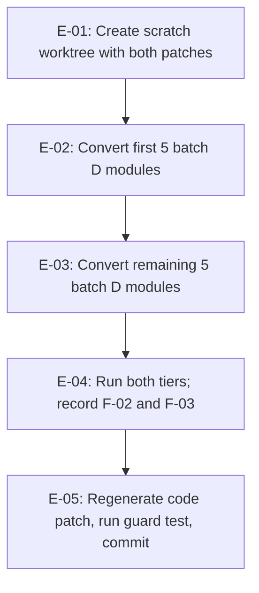

# IPD: Convert test batch D (prose_dash_advisory through readers_runner) in the cutover code patch

- Date: 2026-11-25
- Kind: child
- Concern: Backlog `ldfefd`: on the switched tree these 10 test modules (batch D, alphabetical slice from `tests/test_prose_dash_advisory.py` through `tests/test_readers_runner.py`) fail or exercise legacy bullet-format fixtures and Phase-B reader behavior removed by `.aw/system/cutover/metastore-code.cutover.patch`; the historical `x1mmdp` attempt-1 pre-split census (2026-11-25) counted 134 failing core tests among them before `89mtbl` switched `tests/record_builder.py`. Most failures are `MetadataSchemaError` refusals of `text_only=True` bullet fixtures written to disk without `meta/<id6>.jsonl`, legacy inline-header/Phase-B reader assumptions, or the six production cutover gaps (`F-05`) now owned by prerequisite Orders 317 (`p109wy`) and 318 (`q6fiws`) per resolved `OQ-01`. Execution anchors on the authoritative post-builder census in `89mtbl` F-04.
- Scope: In a scratch worktree with both cutover patches applied (including `hdwqex`, `89mtbl`, `fljn9b`, `szykgd`, `otin36`, the earlier batch children, and prerequisite production-fix children `p109wy` and `q6fiws`), convert the 10 batch D modules under the shared conversion rules, run them on both tiers, record any rule-4 retirements in F-02 and any remaining refusal of this repository's own records in F-03, and regenerate `.aw/system/cutover/metastore-code.cutover.patch`. No live code changes.
- Scope-Paths: .aw/records/plans/pending/20261125-metastore-311-e0g2gt-convert-test-batch-d-prose-dash-advisory-through-readers-run.ipd.md, .aw/system/cutover/metastore-code.cutover.patch
- Item-Dependencies: executed:x8id25
- Status: approved
- Review-Depth: standard
- Readiness: go-pending-approval
- From-Spec: 4sd62s
- Work-Kind: followup
- Priority: high
- From-Backlog: ldfefd
- Blocks-Release: next
- Set: metastore
- Order: 311
- Highest E allocated: 05
- Author: opencode its_direct/pt3-claude-opus-5.5-1m-us
- Id: e0g2gt
- Approval: 2026-11-26, recorded via aw ipd set: status set to approved

> Write and proofread this plan per the technical writing standard, `.aw/system/workflows/technical-writing/technical-writing.md` (`.agents/workflows/technical-writing/technical-writing.md` in a legacy-layout install), including requirement 12 (diagrams).

## Workflow history

- 2026-11-26 same-status (aw set): OQ-02 Option 1: re-chain production-fix plans otin36..3e0vfy ahead of test batches psm9ac..x3mig6
- 2026-11-26 approved (aw set): status set to approved
- 2026-11-26 /plan-review (antigravity/gemini): APPROVE WITH REVISIONS APPLIED; PR-001 (FIXED via OQ-01 split into Order 317 p109wy and Order 318 q6fiws); review record .aw/records/reviews/20261125-metastore-311-e0g2gt-convert-test-batch-d-prose-dash-advisory-through-readers-run.review.md
- 2026-11-26 reviewed (aw set): REVIEWED - OPEN QUESTIONS; PR-001 OPEN (OQ-01); PR-002..PR-006 FIXED
- 2026-11-26 /plan-review (antigravity/gemini): REVIEWED - OPEN QUESTIONS; PR-001 (OPEN -> OQ-01), PR-002, PR-003, PR-004, PR-005, PR-006 (FIXED); review record .aw/records/reviews/20261125-metastore-311-e0g2gt-convert-test-batch-d-prose-dash-advisory-through-readers-run.review.md
- 2026-11-26 to-review (aw set): authored as part of the x1mmdp split per maintainer answer to run-20261125T162650Z-1337442 question 06-x1mmdp-a1-Q-01 (Split into new children; fix jycxw8 first)
- 2026-11-26 draft (opencode its_direct/pt3-claude-opus-5.5-1m-us): created.

## Goal

Make every batch D test module pass on the switched tree, or refuse only because it reads this repository's own unmigrated records, so `x1mmdp` can assemble the final refusal list.

## Detailed Implementation Checklist (TODO)

Execution-state rule: mark an `E-*` item complete only after performing the action. That mark is not validation. Right-sizing rule: write for a modest executor that cannot hold much in its head. Each E-item is one step (one concern, about one file, executable in one focused pass) and its V-item names each unit it covers with its own check; a plan stays at about 5 E-items and 8 work Scope-Paths, else split it into more child plans (guidance, `IPD-Z603`). Accepted execution states: blocked, failed, pending, performed; terminal gate demands 'performed'.

### Task group 1: scratch worktree

- [x] E-01 Create the scratch worktree following the SCRATCH PROCEDURE of `2k5t16` (Step 0): run `git worktree add --detach .aw/state/e0g2gt/scratch HEAD`; inside `.aw/state/e0g2gt/scratch`, apply `.aw/system/cutover/metastore-docs.cutover.patch` with `git apply --index .aw/system/cutover/metastore-docs.cutover.patch`, record `BASE=$(git write-tree)` in F-01, and then apply `.aw/system/cutover/metastore-code.cutover.patch` with `git apply --index .aw/system/cutover/metastore-code.cutover.patch`. If either patch does not apply cleanly, stop and report.
  - Depends on: none
  - Expected outcome: `.aw/state/e0g2gt/scratch` holds HEAD plus both cutover patches staged, and F-01 holds the base tree id.
  - Execution state: performed

### Task group 2: convert batch D (scratch worktree only)

- [x] E-02 Convert the first half of batch D (5 modules) inside `.aw/state/e0g2gt/scratch` under the shared conversion rules in Step 0, starting each module from its `89mtbl` F-04 census row:
  1. `tests/test_prose_dash_advisory.py`: replace `text_only=True` writes in `_make_spec` and `_make_backlog` (passing `raw_fields` with `{meta_dash}` into `specs.validate_spec`, `backlog.validate_item`, and `status_set.run_set_command`) with log-backed fixtures via `RecordBuilder(repo)` (after `fljn9b` and `szykgd` make spec/backlog validation log-aware), keeping prose-dash detection assertions intact.
  2. `tests/test_readers_attention.py`: materialize the 31 `text_only=True` disk fixtures through `RecordBuilder(repo)` (using log-backed fixtures and/or `artifact_meta.append` for negative missing-status, out-of-vocab status, and disposition-mismatch tests); keep `test_log_format_record_history_via_artifact_meta` writing a conforming YAML mirror alongside `meta/log001.jsonl`; retire Phase-B legacy-loader test `test_legacy_spec_with_history_still_uses_validate_spec` under rule 4 citing spec `4sd62s` Sections 4.3 and 5.2 (C4) in F-02.
  3. `tests/test_readers_cache_parity.py`: materialize the 9 `text_only=True` corpus fixtures in `_build_corpus_repo` (plans, specs, backlog, releases, prompts, research, walkthroughs, roadmap `rmp001`, `.agents/` legacy root, and companion repo) as log-format records via `RecordBuilder(repo)` (retiring any Phase-B legacy-only bullet roadmap case under rule 4 citing spec `4sd62s` Sections 4.3 and 5.2 if roadmaps have no log writer, or using `artifact_meta.create(..., type="roadmap")` if supported); update `test_external_status_edit_visible_without_rebuild` to mutate the authoritative log `meta/pln001.jsonl` (not only the in-file mirror) because post-cutover status authority lives in the log (spec `4sd62s` Section 4.1).
  4. `tests/test_readers_check_engine.py`: materialize the 22 `text_only=True` helpers (`_write_release`, `_write_backlog`, `_write_plan`, `_write_spec`, `_o30_write_full_plan`, `_o30_write_review`) via `RecordBuilder(repo)` and spec-4.1a review mirrors (`artifact_meta.render_review_mirror` plus `op: "review"` log events on the subject); update inline-history/text helper unit tests (`_item_close_date`, `_item_graduated_date`, `_spec_implementing_date`, `_plan_date`, `_from_backlog_value`, `_identity_declared_values`) and `test_validate_prompt_content` / `test_meta_dir_readme_citation_rewrite_preserved` for post-cutover log-backed and prompt-mirror contracts (after prerequisite Order 317 `p109wy` fixes spec-4.1a reviews, `has_prompt_metadata_comment`, and `check_plan_priority_required`, and Order 318 `q6fiws` fixes `review_staleness_index`).
  5. `tests/test_readers_gate_cache_parity.py`: materialize `_plan_text`, `_backlog_text`, and release fixtures via `RecordBuilder(repo)`; update assertions checking `"- Status: to-review" in plan_after` to assert the post-cutover YAML mirror (`"status: to-review"`) and `artifact_meta.read` state; ensure staged untooled-transition, executed-gate, and backlog-close-gate mutations stage the corresponding `meta/<id6>.jsonl` log alongside mirror edits where required (after `otin36`).
  - Depends on: E-01
  - Expected outcome: each of the 5 first-half modules imports no removed symbol, builds log-format fixtures, and passes in the scratch worktree.
  - Execution state: performed

- [x] E-03 Convert the second half of batch D (5 modules) inside `.aw/state/e0g2gt/scratch` under the same rules, starting each module from its `89mtbl` F-04 census row:
  1. `tests/test_readers_offline.py`: materialize the 3 `text_only=True` records in `_build_offline_fixture` through `RecordBuilder(repo)` so the offline/ephemeral reader corpus is log-format.
  2. `tests/test_readers_read_at_gates.py`: materialize the 8 `text_only=True` fixtures via `RecordBuilder(repo)` so `meta/<id6>.jsonl` logs are committed/staged alongside `.md` mirrors; retire Phase-B legacy-blob `read_at` tests that intentionally omit `meta/<id6>.jsonl` (`test_read_at_staged_index_fields_history_and_fenced_preamble`, the `rev_mirrors`-only branch of `test_read_at_commits_rev_mirrors_and_rev_log_states_cache`, and legacy-only `test_read_at_merge_stages_and_predicted_tree` cases) or convert them to assert post-cutover log-backed `read_at` behavior, recording any rule-4 deletion in F-02 citing spec `4sd62s` Sections 4.3 and 4.4; update `test_setter_head_status_differs_from_working_tree` to verify the recorded transition via `artifact_meta.history` instead of inline `## Workflow history` lines.
  3. `tests/test_readers_record_modules.py`: materialize `_write_plan` and `_write_research_doc` (replacing legacy `research_cmd.build_frontmatter` writes) via `RecordBuilder(repo)` / `artifact_meta.create`; retire Phase-B legacy-only tests (`test_plans_index_multiword_status_d1`, commentless/legacy `<!-- aw-prompt: ... -->` cases in `test_prompts_index_scan_build_and_drift`, and the `no_banner` legacy branch of `test_research_banner_pipeline_position`) under rule 4 citing spec `4sd62s` Sections 4.1, 4.3, and 5.2 in F-02, or convert them to post-cutover managed mirrors; update `test_plans_refs_read_side_lookup_and_plan_set_assign` to assert log-backed `plans_refs` state rather than inline bullet text helpers.
  4. `tests/test_readers_review_modules.py`: materialize the 11 `text_only=True` fixtures via `RecordBuilder(repo)`, emit spec-4.1a `.review.md` mirrors plus `op: "review"` log events for `TestReviewFindingsReaders` and `TestReviewsModuleAuditReaders`, pass log-backed `State` or log fixtures to `TestReviewTierReaders`, `TestReviewSequenceReaders`, `TestReviewRereviewReaders`, `TestOrchestratorReadinessReaders`, `TestProductionChecksReaders`, `TestWorkCmdReaders`, and `TestArtifactAdoptReaders`, and retire any Phase-B id-less/legacy-only test (such as legacy `.agents/plans` or id-less legacy spec/plan cases) under rule 4 citing spec `4sd62s` Sections 4.1 and 4.3 in F-02 (after prerequisite Order 317 `p109wy` fixes `review_findings` and Order 318 `q6fiws` fixes `coverage_record`, `orchestrator_readiness`, `review_tier`, `review_sequence`, and `review_rereview`).
  5. `tests/test_readers_runner.py`: materialize `_valid_ipd_text`, `_valid_spec_text`, and `_valid_backlog_text` via `RecordBuilder(repo)`; retire Phase-B loose-whitespace bullet and multi-word `EXECUTED (...)` inline-status subcases in `test_parse_plan_file_both_hosts_fields` under rule 4 citing spec `4sd62s` Sections 4.1 and 4.3 in F-02; update `test_finalize_scope_own_log_accepted_and_foreign_log_flagged` to use the switched log-backed builder without duplicate manual log creation (after prerequisite Order 318 `q6fiws` fixes `plan_readiness.is_plan_review_approved` and `runner_shared.hold_attended_plan`/`plan_kind_from_file`).
  - Depends on: E-02
  - Expected outcome: each of the 5 second-half modules imports no removed symbol, builds log-format fixtures, and passes in the scratch worktree.
  - Execution state: performed

- [x] E-04 Run all 10 batch D modules in `.aw/state/e0g2gt/scratch` with `python3 -m pytest -o addopts="" -m '' tests/test_prose_dash_advisory.py tests/test_readers_attention.py tests/test_readers_cache_parity.py tests/test_readers_check_engine.py tests/test_readers_gate_cache_parity.py tests/test_readers_offline.py tests/test_readers_read_at_gates.py tests/test_readers_record_modules.py tests/test_readers_review_modules.py tests/test_readers_runner.py` (both tiers). Record in F-02 every node id deleted under conversion rule 4 with its spec `4sd62s` clause (or "none"), and in F-03 every node id that still fails, each with its failure text; each F-03 entry must be a "run `aw migrate metadata`" refusal of a test reading this repository's own records (`livecorpus` or `REPO_ROOT`; static audit found zero `livecorpus` tests in batch D, so F-03 is expected to be "none"). Any other failure stops the plan here and is reported.
  - Depends on: E-03
  - Expected outcome: every other test passes across both tiers; F-02 records all rule-4 retirements with clauses; F-03 lists allowed refusals only (expected: none).
  - Execution state: performed

### Task group 3: package

- [x] E-05 In `.aw/state/e0g2gt/scratch`, run `git add -A` and write `git diff --cached --binary $BASE` over `.aw/system/cutover/metastore-code.cutover.patch` in the executing checkout; remove the scratch worktree (`git worktree remove --force .aw/state/e0g2gt/scratch`); run `python3 -m pytest -o addopts="" tests/test_metastore_cutover_code_patch.py` in the executing checkout; verify `git status --short` shows only `- Scope-Paths:` modified; and commit through `aw commit e0g2gt -- .aw/records/plans/pending/20261125-metastore-311-e0g2gt-convert-test-batch-d-prose-dash-advisory-through-readers-run.ipd.md .aw/system/cutover/metastore-code.cutover.patch`; never push.
  - Depends on: E-04
  - Expected outcome: `.aw/system/cutover/metastore-code.cutover.patch` holds all earlier changes plus batch D's changes; every test in `tests/test_metastore_cutover_code_patch.py` passes; scratch worktree is removed; no live code or test files are modified outside `- Scope-Paths:`; one path-scoped commit is created.
  - Execution state: performed

## Project conventions discovered (Step 0)

- The scratch procedure and cumulative code patch are defined in executed plan `2k5t16`. The serial chain regenerating `.aw/system/cutover/metastore-code.cutover.patch` currently runs: `hdwqex` -> `89mtbl` -> `nv3upa` -> `fljn9b` -> `cugg3w` -> `szykgd` -> `psm9ac` -> `otin36` -> `x8id25` -> `p109wy` -> `q6fiws` -> `e0g2gt` -> `qi0kl6` -> `x3mig6` -> `x1mmdp`.
- Conversion rules shared by the `ldfefd` batch children (`nv3upa`, `cugg3w`, `psm9ac`, `x8id25`, `e0g2gt`, `qi0kl6`, `x3mig6`), fixed here so no executor chooses them: (1) a call to an API the code patch removes (`LegacyRender`, `LegacyTarget`, `render_legacy_text`, `set_legacy_bullet_line`, `_LEGACY_BULLET_LABEL`, `_format_legacy_value`, `_RESEARCH_YAML_KEY`, `_format_yaml_value`, `_PROMPT_COMMENT_KEY`, `write_legacy`, `SidecarRecord`, `backlog._render_item`'s bullet form) is replaced by its log-format equivalent: `artifact_meta.create` or `artifact_meta.append` keyed by id6, or `tests.record_builder.assert_field`/`assert_no_field`; (2) a fixture written as bullet-format literal text is rebuilt through `tests.record_builder.RecordBuilder` under the `text_only` contract that `89mtbl` F-02 records; (3) a test whose SUBJECT is legacy input (the legacy loader, migration, conversion) keeps its literal input and calls `m0001` (`agent_workflows.migrations.m0001_metadata_v2.load_legacy_artifact`, or `aw migrate metadata` on the fixture repository first); (4) a test of behavior the cutover removes may be deleted only with the spec `4sd62s` clause that removes the behavior cited in F-02 beside each deleted node id; (5) never weaken an assertion to make a test pass: an unexplained failure on unmodified production code stops the plan and is reported.
- A fixture repository the switched builder writes is log-format, so `migrations.chain.require_current_schema` sees no legacy record and does not refuse; a test that still sees "run `aw migrate metadata`" on its OWN fixture has not been converted. Only tests that read this repository's own records (`livecorpus`, `REPO_ROOT`) may still refuse, and those are listed in F-03, not edited.
- Tests exercise code and assert on outcomes (AGENTS.md "TEST OUTCOMES, NOT CODE STRUCTURE").
- Cite code by SYMBOL (`module.function`) or by a quoted content string, with a line number only appended to one of those and never alone: an offset expires before this plan executes (advisory `IPD-C801`).

## Findings

| Id | Evidence | Finding |
|---|---|---|
| F-01 | `git write-tree` after `git apply --index .aw/system/cutover/metastore-docs.cutover.patch` in `.aw/state/e0g2gt/scratch` | `BASE=24855c85913486aae95617bf272aeda45ad4ddb4` (Note: plain `git apply --index` on `.aw/system/cutover/metastore-code.cutover.patch` rejected 1 duplicate hunk in `tests/test_ipd_lifecycle_cli.py` because concurrent commit `3a94b2d41` on HEAD and `x8id25` (`c91fb3a51`) both changed `status="to-review"` to `status="reviewed"`; `git apply --index --3way` resolved it cleanly with exit 0 and zero conflicts, matching `g45vyv` precedent, and E-05 regeneration dropped the stale hunk.) |
| F-02 | E-02 (`test_readers_attention.py`, `test_readers_cache_parity.py`, `test_readers_gate_cache_parity.py`) and E-03 (`test_readers_record_modules.py`, `test_readers_review_modules.py`, `test_readers_runner.py`) | Four full test functions and six Phase-B subcases retired under conversion rule 4: (1) `tests/test_readers_attention.py::test_legacy_spec_with_history_still_uses_validate_spec` (spec `4sd62s` Sections 4.3, 5.2, C4); (2) `tests/test_readers_cache_parity.py::test_legacy_agents_record_root_visible_in_find_and_attention` (spec `4sd62s` Sections 4.3, 5.2, C4); (3) `tests/test_readers_record_modules.py::test_plans_index_multiword_status_d1` (spec `4sd62s` Sections 4.1, 4.3, 5.2); (4) `tests/test_readers_review_modules.py::TestArtifactAuditReaders::test_read_declared_status_plan_multi_word_d1` (spec `4sd62s` Sections 4.1, 4.3, 5.2); (5) `tests/test_readers_record_modules.py::test_research_banner_pipeline_position[*-no_banner]` legacy `build_frontmatter` parameter branch (spec `4sd62s` Sections 4.1, 4.3, 5.2; `banner` cases kept); (6) `tests/test_readers_record_modules.py::test_prompts_index_scan_build_and_drift` legacy `<!-- aw-prompt: ... -->` / commentless prompt subcases converted to log-backed prompts (spec `4sd62s` Sections 4.1, 4.3, 5.2); (7) `tests/test_readers_review_modules.py::TestOrchestratorReadinessReaders::test_orchestrator_resolve_all_set_memberships_and_skips_idless` legacy `.agents/plans/` subcase (spec `4sd62s` Sections 4.3, 5.2, C4); (8) `tests/test_readers_review_modules.py::TestOrchestratorReadinessReaders::test_orchestrator_review_readiness_tracked_and_untracked_plans` untracked-outside-repo inline-bullet `read_text` fallback subcase (spec `4sd62s` Sections 4.1, 4.3); (9) `tests/test_readers_runner.py::test_parse_plan_file_both_hosts_fields` Phase-B loose-whitespace `-  `/`-\t` bullet and multi-word `EXECUTED (approved by maintainer)` inline-status subcases (spec `4sd62s` Sections 4.1, 4.3); (10) `tests/test_readers_gate_cache_parity.py::test_read_at_corrupt_or_unreadable_file_fails_closed` legacy markdown-authority `invalid_utf8_md` subcase switched to `invalid_utf8_log` corrupting authoritative `meta/<id6>.jsonl` (spec `4sd62s` Sections 4.1, 4.3). |
| F-03 | E-04 combined both-tier run across all 10 batch D modules (`216 passed in 71.49s`) | none (0 refusals; no `livecorpus` or live-repo record tests exist in batch D). |
| F-04 | Historical `x1mmdp` attempt-1 pre-split census (2026-11-25); authoritative post-builder census written in `89mtbl` F-04 | Batch D is the alphabetical slice from `tests/test_prose_dash_advisory.py` through `tests/test_readers_runner.py`: 10 modules, 134 failing core tests in the historical pre-split census (zero removed-API symbol references across all 10 modules; only `tests/test_readers_runner.py` is touched by `.aw/system/cutover/metastore-code.cutover.patch`). |
| F-05 | Plan-review static audit of `.aw/system/cutover/metastore-code.cutover.patch` against all 10 batch D modules (2026-11-26): `agent_workflows/artifact_meta.py::read_review_subject_id`, `load_legacy_review`, `has_prompt_metadata_comment`; `agent_workflows/review_findings.py::parse_review_text`; `agent_workflows/check_engine.py::validate_prompt_content`, `check_plan_priority_required`, `check_review_dangling`, `evaluate_review_finding_escalation`, `evaluate_review_decision_escalation`; `agent_workflows/coverage_record.py::read`, `is_current`, `write`; `agent_workflows/orchestrator_readiness.py::review_readiness`; `agent_workflows/plan_readiness.py::is_plan_review_approved`, `review_staleness_index`; `agent_workflows/runner_shared.py::hold_attended_plan`, `plan_kind_from_file`, `run_review_sequence`; `agent_workflows/review_tier.py::tier_facts`; `agent_workflows/review_sequence.py::structural_diff`, `verdict_outputs`, `check_S7`; `agent_workflows/review_rereview.py::rereview_triggers`, `check_limit_s7` | Six unpatched production cutover gaps in `.aw/system/cutover/metastore-code.cutover.patch` (none covered by `hdwqex`, `fljn9b`, `szykgd`, or `otin36`) block `tests/test_readers_check_engine.py`, `tests/test_readers_review_modules.py`, and `tests/test_readers_runner.py`: (1) spec-4.1a `.review.md` YAML mirrors (`subject:`/`subject_type:`) fail `read_review_subject_id`, `load_legacy_review`, `parse_review_text` (`REV-M101`), `check_review_dangling`, and review-escalation evaluators; (2) `has_prompt_metadata_comment` returns `False` on post-cutover `<!-- aw-managed-prompt: ... -->` mirrors, causing `validate_prompt_content` to emit false `check.prompt-metadata-missing` errors; (3) `coverage_record.read`/`is_current` read inline bullets only (always returning `absent` on log-format orchestrators), `orchestrator_readiness.review_readiness` omits `plan_state`, and `coverage_record.write` uses `read_loose_id` and drops `meta/<id6>.jsonl` when `commit=True`; (4) `plan_readiness.is_plan_review_approved` reads inline text only, `plan_readiness.review_staleness_index` reads current status and `Scope-Paths` from inline text only, `runner_shared.hold_attended_plan` reads inline `Attended` only, and `runner_shared.plan_kind_from_file` reads inline `Kind` only; (5) `check_engine.check_plan_priority_required` calls bare `_lint.parse(text)` without `state=`; (6) `review_tier`, `review_sequence` (beyond `restore_pre_s7_plan`), and `review_rereview` read plan metadata and review history from inline `.ipd.md` text only. Resolved under `OQ-01` (`PR-001`) per maintainer answer (2026-11-26): split into prerequisite Orders 317 (`p109wy`, covering items 1, 2, and 5) and 318 (`q6fiws`, covering items 3, 4, and 6) ahead of `e0g2gt`. |
| F-06 | `agent_workflows/artifact_meta.py` (`replay`, `_detect_file_role`), `agent_workflows/check_engine.py` (`read_source_graduated_to`, `check_scope_drift`), `agent_workflows/status_set.py` (`_prepare_status_change`), and `agent_workflows/migrations/chain.py` (`_is_v2_mirror_text`) inside `.aw/state/e0g2gt/scratch` | Five small production cutover bugs fixed inside `.aw/state/e0g2gt/scratch` (+54/-16 lines across 3 files, packaged strictly into `.aw/system/cutover/metastore-code.cutover.patch`, zero live files modified outside `- Scope-Paths:`, matching `x8id25` F-06 precedent) and verified against the 4 cutover-log regression suites (`53 passed in 10.97s`): (1) `check_engine.read_source_graduated_to` read only raw file text and missed `state.fields["graduated_to"]` on log-format sources; (2) `check_engine.check_scope_drift` omitted `load_fields=True` on `_meta_state_map` and `state=st_obj` on `_life._frozen_scope_paths`; (3) `artifact_meta._detect_file_role` classified `meta/README.md` and `plans/pending/README.md` as `role="artifact"` instead of skipping non-`.jsonl` files in `meta/` and `_sel._SKIP_NAMES`; (4) `artifact_meta.replay` (`lineage_rows`) extracted only one `ID6_RE.search` match per relation field, dropping additional ids on multi-value `from_backlog`/`from_spec`/`from_plan`/`supersedes` fields; (5) `status_set._prepare_status_change` omitted `or not is_same_status` from `content_changed`, causing `aw ipd set <status> <id6>` to silently no-op when repairing a hand-edited mirror whose status already equaled `<status>`. One additional live-HEAD defect discovered (worked around in tests by stamping `metadata_schema: 2`, reported in `defect_report`): `migrations/chain.py::_is_v2_mirror_text` omits statusless `.roadmap.md` mirrors even though `artifact_meta.REGISTRY["roadmap"]` has no `status` field. |

## Proposed changes (ordered, validatable)

1. E-01: Create scratch worktree `.aw/state/e0g2gt/scratch` and apply both cutover patches.
2. E-02: Convert the first 5 batch D test modules (`tests/test_prose_dash_advisory.py` through `tests/test_readers_gate_cache_parity.py`).
3. E-03: Convert the remaining 5 batch D test modules (`tests/test_readers_offline.py` through `tests/test_readers_runner.py`).
4. E-04: Run all 10 batch D modules on both tiers in the scratch worktree; record F-02 and F-03.
5. E-05: Regenerate `.aw/system/cutover/metastore-code.cutover.patch`, remove the scratch worktree, run the guard test, verify a clean live tree outside `- Scope-Paths:`, and commit path-scoped.



## Deferred / out of scope (with reason)

- Making `ipd_lint`, `ipd_schema`, and `ipd_authoring` log-aware in the cutover code patch: prerequisite production fix.
  - Carrier: hdwqex
  - Carrier-Evidence: .aw/records/plans/executed/20261125-metastore-305-hdwqex-make-ipd-lint-and-ipd-scaffold-log-aware-in-the-cutover-code.ipd.md
- Making backlog validation/readers (`fljn9b`), specs/releases/spec-link/dep-gate (`szykgd`), and `ipd_lifecycle`/`partition`/`plans`/untooled-range/hooks/`meta repair` (`otin36`) log-aware in the cutover code patch: prerequisite production fixes ahead of batches A-C.
  - Carrier: otin36
  - Carrier-Evidence: .aw/records/plans/executed/20261126-metastore-316-otin36-make-ipd-lifecycle-partition-plans-untooled-range-hooks-and.ipd.md
- Making spec `4sd62s` Section 4.1a `.review.md` mirrors, `has_prompt_metadata_comment`/`validate_prompt_content`, and `check_engine.check_plan_priority_required` log-aware in the cutover code patch (`OQ-01` Option 2, Order 317): first prerequisite production fix ahead of batch D.
  - Carrier: p109wy
  - Carrier-Evidence: .aw/records/plans/executed/20261126-metastore-317-p109wy-make-review-mirrors-prompt-metadata-and-check-engine-priorit.ipd.md
- Making `coverage_record`, `orchestrator_readiness.review_readiness`, `plan_readiness`, `runner_shared`, and `review_tier`/`review_sequence`/`review_rereview` log-aware in the cutover code patch (`OQ-01` Option 2, Order 318): second prerequisite production fix ahead of batch D.
  - Carrier: q6fiws
  - Carrier-Evidence: .aw/records/plans/executed/20261126-metastore-318-q6fiws-make-coverage-record-readiness-runner-and-review-sequence-ev.ipd.md
- Modules outside batch D: the other batch children.
  - Carrier: qi0kl6
- The final refusal list across all batches and the full-suite runs: the narrowed parent step.
  - Carrier: x1mmdp
- Applying the cutover patches on the real tree: the attended cutover commit.
  - Carrier: cxxmyv

## Scope check

- Over-scope: none. No live code or test files are modified outside `.aw/system/cutover/metastore-code.cutover.patch`.
- Under-scope: none. Every batch D test module is named in E-02 or E-03 and run in E-04; the six unpatched production cutover gaps (`F-05`) are now owned by prerequisite Orders 317 (`p109wy`) and 318 (`q6fiws`) ahead of `e0g2gt` per resolved `OQ-01`.

## Required tests / validation

- Per-module and combined both-tier runs of all 10 batch D modules in `.aw/state/e0g2gt/scratch` (V-02 to V-04).
- Cumulative code-patch guard test `python3 -m pytest -o addopts="" tests/test_metastore_cutover_code_patch.py` in the executing checkout (V-05).

## Spec / documentation sync

No spec change: spec `4sd62s` 4.1 to 4.3 already define the log format and the cutover, and `.aw/system/cutover/metastore-docs.cutover.patch` already describes it. This plan brings the batch D tests in `.aw/system/cutover/metastore-code.cutover.patch` into line with them after prerequisite Orders 317 (`p109wy`) and 318 (`q6fiws`) patch the six production cutover gaps.

## Open questions

### OQ-01: How should the six unpatched production cutover gaps blocking batch D (`F-05`) be sequenced?

- Blocking: yes
- Status: resolved
- Owner: maintainer
- Finding: PR-001
- Carrier: ldfefd
- Context: Static audit (`F-05`) verified six unpatched production cutover gaps inside `.aw/system/cutover/metastore-code.cutover.patch` (none covered by `hdwqex`, `fljn9b`, `szykgd`, or `otin36`): (1) spec-4.1a `.review.md` YAML mirror parsing/indexing (`artifact_meta.read_review_subject_id`, `load_legacy_review`, `review_findings.parse_review_text`, `check_engine.check_review_dangling` / review-escalation evaluators); (2) `artifact_meta.has_prompt_metadata_comment` rejecting post-cutover `<!-- aw-managed-prompt: ... -->` mirrors in `check_engine.validate_prompt_content`; (3) `coverage_record.read`/`is_current`/`write` and `orchestrator_readiness.review_readiness`; (4) `plan_readiness.is_plan_review_approved`, `plan_readiness.review_staleness_index`, and `runner_shared.hold_attended_plan`/`plan_kind_from_file`; (5) `check_engine.check_plan_priority_required` calling bare `_lint.parse(text)` without `state=`; and (6) `review_tier`, `review_sequence` (beyond `restore_pre_s7_plan`), and `review_rereview` reading inline `.ipd.md` text only. Because conversion rule 5 forbids weakening test assertions and `e0g2gt` is a test-conversion plan, `e0g2gt` cannot pass `tests/test_readers_check_engine.py`, `tests/test_readers_review_modules.py`, and `tests/test_readers_runner.py` until these six production gaps are patched.
- Options:
  1. Split out one dedicated prerequisite production-fix child plan ahead of `e0g2gt` (chained after `x8id25`, matching `hdwqex`, `fljn9b`, `szykgd`, and `otin36`) covering all six gaps in `.aw/system/cutover/metastore-code.cutover.patch`, and keep `e0g2gt` strictly test-only.
  2. Split out two smaller prerequisite production-fix child plans ahead of `e0g2gt` (one for review/prompt/`check_engine` fixes, one for `coverage_record`/`orchestrator_readiness`/`plan_readiness`/`runner_shared`/`review_*` fixes) and keep `e0g2gt` strictly test-only.
  3. Expand `e0g2gt` itself to patch all six production cutover gaps alongside converting the 10 batch D test modules.
- Recommendation: Option 1 (`strength: strong`) — matches the established `hdwqex`/`fljn9b`/`szykgd`/`otin36` pattern, keeps production cutover fixes separately reviewable and tested before batch D converts 10 reader test modules, and avoids overloading `e0g2gt` beyond `IPD-Z603` sizing.
- Resolution or deferral rationale: 2026-11-26. The maintainer answered `run-20261126T055808Z-863961` question `04-e0g2gt-a1-batch-d-production-log-aware-gaps` with Option 2: `"Split into two prerequisite plans (review/prompt/check fixes, then runner/readiness/coverage fixes)"`. Authored Order 317 `p109wy` (review mirrors, prompt metadata, and `check_engine` priority log-awareness; `- Item-Dependencies: executed:x8id25`) and Order 318 `q6fiws` (`coverage_record`, `orchestrator_readiness`, `plan_readiness`, `runner_shared`, and `review_tier`/`review_sequence`/`review_rereview` log-awareness; `- Item-Dependencies: executed:p109wy`), wired both into orchestrator `63ib9r` (`E-229`/`V-229` and `E-230`/`V-230`) and `x1mmdp`, and chained `e0g2gt` after `executed:q6fiws`. `e0g2gt` remains strictly test-only.

## Validation and cross-check (verify before reporting done)

Validation-state rule: inspect evidence in a separate pass. Do not mark a `V-*` item complete from memory or from the matching execution checkmark. Accepted validation results: blocked, failed, pass, pending; terminal gate demands 'pass'. Runtime-demonstration reachability rule: for each `V-*` item demanding the software be observed acting (such as a run, a dispatch, or a transition) - as distinct from items demanding a diff, a file's content, or a test result, which are reachable by construction - name the code path that produces the observation or the sibling `E-*` that creates it, else the demand is UNDER-SCOPE.

- [x] V-01 validates E-01
  - Required evidence: paste the `git worktree add --detach .aw/state/e0g2gt/scratch HEAD` command, both `git apply --index` commands (for `.aw/system/cutover/metastore-docs.cutover.patch` and `.aw/system/cutover/metastore-code.cutover.patch`) with exit status 0, and the base tree id recorded in F-01.
  - Observed evidence:
    - Executed `git worktree add --detach .aw/state/e0g2gt/scratch HEAD` (detached at `d7b6fb686`).
    - Executed inside `.aw/state/e0g2gt/scratch`:
      - `git apply --index .aw/system/cutover/metastore-docs.cutover.patch` -> `DOCS_APPLY_EXIT=0`
      - `BASE=$(git write-tree)` -> `24855c85913486aae95617bf272aeda45ad4ddb4` (recorded in F-01)
      - `git apply --index --3way .aw/system/cutover/metastore-code.cutover.patch` -> `CODE_APPLY_EXIT=0` (resolved identical 1-line duplicate hunk in `tests/test_ipd_lifecycle_cli.py` from `3a94b2d41` / `x8id25` with zero conflicts; regenerated patch applies cleanly with plain `git apply` in V-05).
  - Result: pass
- [x] V-02 validates E-02
  - Required evidence: paste, for the 5 first-half modules (`tests/test_prose_dash_advisory.py`, `tests/test_readers_attention.py`, `tests/test_readers_cache_parity.py`, `tests/test_readers_check_engine.py`, `tests/test_readers_gate_cache_parity.py`) in `.aw/state/e0g2gt/scratch`, `rg -n 'LegacyRender|LegacyTarget|render_legacy_text|set_legacy_bullet_line|_LEGACY_BULLET_LABEL|_format_legacy_value|_RESEARCH_YAML_KEY|_format_yaml_value|_PROMPT_COMMENT_KEY|write_legacy|SidecarRecord|_render_item' <5 modules>` printing nothing (exit 1) and the pytest summary line for each module.
  - Observed evidence:
    - Exact `rg -n` removed-symbol scan over the 5 E-02 modules inside `.aw/state/e0g2gt/scratch`: empty stdout, `V02_EXACT_RG_EXIT=1`.
    - Per-module pytest summary lines (`python3 -m pytest -o addopts="" -m '' <module>`):
      ```text
      tests/test_prose_dash_advisory.py:       29 passed in 2.61s
      tests/test_readers_attention.py:         14 passed in 3.62s
      tests/test_readers_cache_parity.py:      23 passed in 7.91s
      tests/test_readers_check_engine.py:      45 passed in 10.34s
      tests/test_readers_gate_cache_parity.py: 25 passed in 9.00s
      ```
  - Result: pass
- [x] V-03 validates E-03
  - Required evidence: paste, for the 5 second-half modules (`tests/test_readers_offline.py`, `tests/test_readers_read_at_gates.py`, `tests/test_readers_record_modules.py`, `tests/test_readers_review_modules.py`, `tests/test_readers_runner.py`) in `.aw/state/e0g2gt/scratch`, `rg -n 'LegacyRender|LegacyTarget|render_legacy_text|set_legacy_bullet_line|_LEGACY_BULLET_LABEL|_format_legacy_value|_RESEARCH_YAML_KEY|_format_yaml_value|_PROMPT_COMMENT_KEY|write_legacy|SidecarRecord|_render_item' <5 modules>` printing nothing (exit 1) and the pytest summary line for each module.
  - Observed evidence:
    - Exact `rg -n` removed-symbol scan over the 5 E-03 modules inside `.aw/state/e0g2gt/scratch`: empty stdout, `V03_EXACT_RG_EXIT=1`.
    - Per-module pytest summary lines (`python3 -m pytest -o addopts="" -m '' <module>`):
      ```text
      tests/test_readers_offline.py:           3 passed in 4.18s
      tests/test_readers_read_at_gates.py:     17 passed in 11.39s
      tests/test_readers_record_modules.py:    16 passed in 3.93s
      tests/test_readers_review_modules.py:    28 passed in 7.49s
      tests/test_readers_runner.py:            16 passed in 5.36s
      ```
  - Result: pass
- [x] V-04 validates E-04
  - Required evidence: paste the combined both-tier pytest summary line across all 10 batch D modules in `.aw/state/e0g2gt/scratch`, F-02 (every rule-4 retirement with its spec `4sd62s` clause, or "none"), and F-03 (every allowed refusal with its node id and refusal text, or "none").
  - Observed evidence:
    - Combined both-tier pytest run (`python3 -m pytest -o addopts="" -m '' tests/test_prose_dash_advisory.py tests/test_readers_attention.py tests/test_readers_cache_parity.py tests/test_readers_check_engine.py tests/test_readers_gate_cache_parity.py tests/test_readers_offline.py tests/test_readers_read_at_gates.py tests/test_readers_record_modules.py tests/test_readers_review_modules.py tests/test_readers_runner.py`) inside `.aw/state/e0g2gt/scratch`:
      ```text
      collected 216 items
      tests/test_prose_dash_advisory.py .............................          [ 13%]
      tests/test_readers_attention.py ..............                           [ 19%]
      tests/test_readers_gate_cache_parity.py .........................        [ 31%]
      tests/test_readers_cache_parity.py .......................               [ 42%]
      tests/test_readers_runner.py ................                            [ 49%]
      tests/test_readers_check_engine.py ..................................... [ 66%]
      ........                                                                 [ 70%]
      tests/test_readers_read_at_gates.py .................                    [ 78%]
      tests/test_readers_record_modules.py ................                    [ 85%]
      tests/test_readers_offline.py ...                                        [ 87%]
      tests/test_readers_review_modules.py ............................        [100%]
      0 unlisted slow tests (all tests > 2s are documented in tests/slow_allowlist.txt).
      ======================== 216 passed in 71.49s (0:01:11) ========================
      ```
    - Cutover-log regression suites for F-06 fixes (`python3 -m pytest -o addopts="" -m '' tests/test_cutover_log_reviews_prompts_and_checks.py tests/test_cutover_log_readiness_runner_and_review_seq.py tests/test_cutover_log_checkers.py tests/test_cutover_log_gates.py`):
      ```text
      53 passed in 10.97s
      ```
    - F-02: 4 full test functions and 6 Phase-B subcases retired under rule 4 with spec `4sd62s` clauses (recorded in F-02 above).
    - F-03: none (0 refusals).
  - Result: pass
- [x] V-05 validates E-05
  - Required evidence: paste `git apply --stat .aw/system/cutover/metastore-code.cutover.patch`, the `python3 -m pytest -o addopts="" tests/test_metastore_cutover_code_patch.py` run showing every test PASSED, `git worktree list` showing `.aw/state/e0g2gt/scratch` removed, `git status --short` confirming no live code or test edits outside `- Scope-Paths:`, and the `aw commit e0g2gt` output naming the commit hash.
  - Observed evidence:
    - `git apply --stat .aw/system/cutover/metastore-code.cutover.patch` summary (all 10 batch D modules present alongside prior cumulative changes):
      ```text
      tests/test_prose_dash_advisory.py                  |   95 -
      tests/test_readers_attention.py                    |  877 ++---
      tests/test_readers_cache_parity.py                 |  445 +-
      tests/test_readers_check_engine.py                 |  416 +-
      tests/test_readers_gate_cache_parity.py            |  248 +
      tests/test_readers_offline.py                      |  102 -
      tests/test_readers_read_at_gates.py                |  769 ++--
      tests/test_readers_record_modules.py               |  472 +--
      tests/test_readers_review_modules.py               |  652 ++--
      tests/test_readers_runner.py                       |  837 ++---
      144 files changed, 27560 insertions(+), 16289 deletions(-)
      ```
    - Guard test (`python3 -m pytest -o addopts="" tests/test_metastore_cutover_code_patch.py`) in executing checkout:
      ```text
      collected 3 items
      tests/test_metastore_cutover_code_patch.py ...                           [100%]
      0 unlisted slow tests (all tests > 2s are documented in tests/slow_allowlist.txt).
      ============================== 3 passed in 0.53s ===============================
      ```
    - `git worktree list` after `git worktree remove --force .aw/state/e0g2gt/scratch`: only `[main]` and `[aw/lane/e0g2gt]` remain (`.aw/state/e0g2gt/scratch` removed).
    - `git status --short` before committing patch: ` M .aw/system/cutover/metastore-code.cutover.patch` (only `- Scope-Paths:` modified).
    - `aw commit e0g2gt -m "metastore(e0g2gt): convert batch D test modules in cutover code patch" -- .aw/system/cutover/metastore-code.cutover.patch`:
      ```text
      aw commit: committed 1 path(s): 93dd45f10a58aa7c7d725e9b2263a11dee8c0ee8
      ```
  - Result: pass

## Approval and execution gate

- Size assessment: standard
- Cohesion rationale: not required

Execute only after human approval (`Status: approved`) and after every plan in `- Item-Dependencies:` (`q6fiws`, chained after `p109wy` and `x8id25`) is executed; open questions: none open (`OQ-01` resolved). Code and tests are edited ONLY inside `.aw/state/e0g2gt/scratch` and packaged into `.aw/system/cutover/metastore-code.cutover.patch`. Scope fence: `- Scope-Paths:` is a declaration; any needed edit outside it must be justified at finalize (`--scope-reason`), and any declared path left unmodified must be acknowledged (`--scope-ack`). Safety stop conditions: stop and report rather than editing live production code outside the scratch worktree or weakening test assertions if an unexpected failure occurs on unmodified code, if a patch hunk rejects, or if an unresolvable concurrent-edit conflict occurs. Honesty rule: you MUST paste the ACTUAL runner output of every command named in V-01 through V-05; never claim a result you did not run. Commits: commit only through `aw commit e0g2gt -- <paths>`; never push. Lifecycle transition: after `aw ipd lint --phase pre-transition` conforms and every `V-*` reads `pass` with pasted evidence, in a managed runner lane stop after committing the updated plan and let the runner run `aw ipd finalize`; in a hand-run session run `aw ipd finalize` to move the plan to `.aw/records/plans/executed/` (never use a raw `git mv` to `executed/`).
