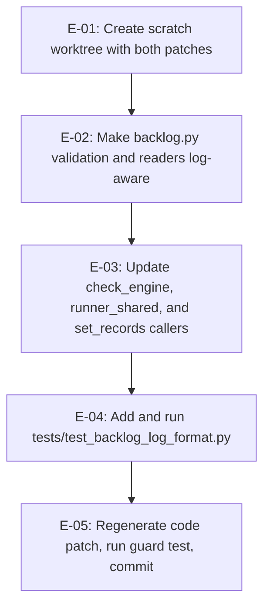

# IPD: Make backlog validation and readers log-aware in the cutover code patch

- Date: 2026-11-25
- Kind: child
- Concern: Backlog `ldfefd` (`cugg3w` F-05 and OQ-01, maintainer answer to `run-20261126T020242Z-3080634` question `04-cugg3w-a1-backlog-log-aware-gap`): in `.aw/system/cutover/metastore-code.cutover.patch`, `agent_workflows/backlog.py::run_new` and `run_note` write log-format backlog records whose `.backlog.md` file holds only the two-key YAML mirror (`id`, `status`) while `priority`, `work_kind`, `set`, `summary`, gates, release exemptions, close evidence, and history live in `.aw/records/meta/<id6>.jsonl`. However, `backlog.validate_item`, `backlog.run_check`, and `backlog.item_from_text` callers (`existing_backlog_ids`, `blocks_release_of_item`, `find_item`, `find_duplicate_candidates`, `run_new`'s duplicate scan, `agent_workflows/check_engine.py::check_content`, `agent_workflows/runner_shared.py::enforce_freeze_time_refusal` and `perform_coordinator_proposal_file`, and `agent_workflows/set_records.py::promote_question_to_backlog` and `close_on_answer`) were never updated to read from `meta/<id6>.jsonl`. Probing `backlog.validate_item` on a conformant post-cutover backlog item produces 5 false-positive errors (`backlog.priority-invalid`, `backlog.kind-invalid`, `backlog.set-missing`, `backlog.summary-missing`, `backlog.history-empty`), blocking `tests/test_backlog.py` in `cugg3w` and 13 sibling `tests/test_backlog_*.py` modules.
- Scope: In an isolated scratch worktree with both cutover patches applied (including `hdwqex`, `89mtbl`, and `nv3upa`), make `agent_workflows/backlog.py` (`item_from_state`, `validate_item_state`, `validate_item`, `run_check`, `existing_backlog_ids`, `blocks_release_of_item`, `find_item`, `find_duplicate_candidates`, and `run_new`'s duplicate scan) and its production callers (`agent_workflows/check_engine.py::check_content`, `agent_workflows/runner_shared.py::enforce_freeze_time_refusal` and `perform_coordinator_proposal_file`, and `agent_workflows/set_records.py::promote_question_to_backlog` and `close_on_answer`) log-aware while keeping legacy bullet-format parity intact, add and pass a core behavioral test module `tests/test_backlog_log_format.py` in the scratch worktree, and regenerate `.aw/system/cutover/metastore-code.cutover.patch`. No live code changes outside the cutover code patch.
- Scope-Paths: .aw/records/plans/pending/20261125-metastore-314-fljn9b-make-backlog-validation-and-readers-log-aware-in-the-cutover.ipd.md, .aw/system/cutover/metastore-code.cutover.patch
- Item-Dependencies: executed:nv3upa
- Status: to-review
- From-Spec: 4sd62s
- Work-Kind: bug
- Priority: high
- From-Backlog: ldfefd
- Blocks-Release: next
- Set: metastore
- Order: 314
- Highest E allocated: 05
- Author: antigravity/gemini
- Id: fljn9b

> Write and proofread this plan per the technical writing standard, `.aw/system/workflows/technical-writing/technical-writing.md` (`.agents/workflows/technical-writing/technical-writing.md` in a legacy-layout install), including requirement 12 (diagrams).

## Workflow history

- 2026-11-26 note (antigravity/gemini): added backlog.run_new writing-standard pointer fix (core.writing_standard_pointer("backlog item"), lost when metastore-code.cutover.patch removed artifact_meta.render_legacy) per maintainer answer to run-20261126T020242Z-3080634 question 05-psm9ac-a1-batch-b-production-log-aware-gaps.
- 2026-11-26 to-review (antigravity/gemini): authored as Order 314 ahead of cugg3w per maintainer answer to run-20261126T020242Z-3080634 question 04-cugg3w-a1-backlog-log-aware-gap ("Split out a dedicated production-fix child plan ahead of cugg3w (Recommended)").
- 2026-11-26 draft (antigravity/gemini): created.

## Goal

Make `agent_workflows/backlog.py` validation and reader functions and their production callers agree with `artifact_meta` log-backed backlog records inside `.aw/system/cutover/metastore-code.cutover.patch`, so a post-cutover backlog item created by `aw backlog new --apply` validates cleanly, exposes all fields through backlog lookup and duplicate-detection helpers, and unblocks `cugg3w` (`tests/test_backlog.py`) and all 13 sibling `tests/test_backlog_*.py` modules.

## Detailed Implementation Checklist (TODO)

Execution-state rule: mark an `E-*` item complete only after performing the action. That mark is not validation. Right-sizing rule: write for a modest executor that cannot hold much in its head. Each E-item is one step (one concern, about one file, executable in one focused pass) and its V-item names each unit it covers with its own check; a plan stays at about 5 E-items and 8 work Scope-Paths, else split it into more child plans (guidance, `IPD-Z603`). Accepted execution states: blocked, failed, pending, performed; terminal gate demands 'performed'.

### Task group 1: scratch worktree

- [ ] E-01 Create the scratch worktree following the SCRATCH PROCEDURE of `2k5t16` (Step 0): run `git worktree add --detach .aw/state/fljn9b/scratch HEAD`; inside `.aw/state/fljn9b/scratch`, run `git apply --index .aw/system/cutover/metastore-docs.cutover.patch`, record `BASE=$(git write-tree)` in F-01, and then run `git apply --index .aw/system/cutover/metastore-code.cutover.patch`. If either patch rejects, stop and report.
  - Depends on: none
  - Expected outcome: `.aw/state/fljn9b/scratch` holds HEAD plus both patches staged, and F-01 records the base tree id.
  - Execution state: pending

### Task group 2: log-aware backlog validation, readers, and callers (scratch worktree only)

- [ ] E-02 Make `agent_workflows/backlog.py` log-aware for spec `4sd62s` Section 4.1 while preserving legacy bullet-format parity for pure-text inputs and `m0001`:
  1. Add `item_from_state(state)` extracting all 12 `BacklogItem` fields (`id`, `status`, `set`, `priority`, `kind` from `work_kind`, `summary`, `gate_kind`, `gate_ref`, `blocks_release`, `release_exempt_kind`, `release_exempt_ref`, `close_evidence`) from an `artifact_meta.State` using `_single_token` and `_nonempty` (reading `state.id6`, `state.status`, and `state.set_id` with fallback to `state.fields`).
  2. Add a shared log-aware reader helper that builds an `artifact_meta` context rooted at `_resolve_backlog_root(repo_root).parent` (or infers the records root by walking up from `path` to `.aw/records` or `.agents` when `repo_root` is omitted), resolves `id6` via `artifact_meta.read_mirror_id6(text)` or `artifact_meta.file_id6(path)`, and reads `artifact_meta.read(id6, project_context=ctx)` plus `artifact_meta.history(id6, project_context=ctx)` when `records_root / "meta" / f"{id6}.jsonl"` exists; when no companion log exists, fall back to `artifact_meta.read_text(text, record_type="backlog")`.
  3. Add `validate_item_state(path, state, *, has_history, text=None)` (mirroring `specs.validate_spec_state`) and extend `validate_item(path, text, *, state=None, has_history=None, repo_root=None)` so that when `state` is supplied or a companion `meta/<id6>.jsonl` exists under the resolved records root, it validates every backlog invariant (`backlog.id-invalid`, `backlog.status-invalid`, `backlog.status-dir-mismatch`, `backlog.priority-invalid`, `backlog.kind-invalid`, `backlog.set-missing`, `backlog.summary-missing`, `backlog.summary-unsafe`, `backlog.gate-missing`, `backlog.gate-kind-invalid`, `backlog.gate-ref-invalid`, `backlog.gate-unexpected`, `backlog.gate-summary-unexpected`, `backlog.gate-descriptive-unsafe`, `backlog.release-exempt-incomplete`, `backlog.release-exempt-kind-invalid`, `backlog.release-exempt-ref-invalid`, `backlog.release-exempt-contradicts-gate`, `backlog.close-evidence-unsafe`, and `backlog.history-empty` when `not has_history`) against `state` and `has_history` (also refusing a YAML mirror `id` or `status` in `text` that contradicts `state`, while keeping `backlog.metadata-bullet-repeated` only when leading metadata bullets appear in `text` and keeping legacy bullet-format validation unchanged when no `meta/<id6>.jsonl` exists).
  4. Update `run_check`, `existing_backlog_ids`, `blocks_release_of_item`, `find_item`, `find_duplicate_candidates`, and the `existing_items_data` scan inside `run_new` to read log-backed state via the helper in (2) (passing `repo_root=repo_root` or resolved `state` and `has_history` into `validate_item` inside `run_check` and reading `pid` from `state.id6`).
  5. In `run_new`, prepend `core.writing_standard_pointer("backlog item")` to the Markdown body passed to `artifact_meta.create` (when not already present), restoring the technical-writing-standard pointer that was lost when `.aw/system/cutover/metastore-code.cutover.patch` removed `artifact_meta.render_legacy` (matching `specs._new_spec_body` and `ipd_authoring.build_skeleton`).
  - Depends on: E-01
  - Expected outcome: in a throwaway repository on `.aw/state/fljn9b/scratch`, `aw backlog new --apply` produces a log-format item carrying the technical-writing-standard pointer that `aw backlog check` and `backlog.validate_item` report clean (exit 0, empty drift), and `backlog.find_item`, `backlog.blocks_release_of_item`, `backlog.existing_backlog_ids`, and `backlog.find_duplicate_candidates` return full log-backed metadata.
  - Execution state: pending

- [ ] E-03 Update production callers of `backlog.validate_item` and `backlog.item_from_text` inside `.aw/state/fljn9b/scratch`:
  1. In `agent_workflows/check_engine.py::check_content` (`record_type == "backlog"`), pass `repo_root=repo_root` (or resolved `state` and `has_history`) to `_backlog.validate_item`.
  2. In `agent_workflows/runner_shared.py::enforce_freeze_time_refusal` (`atype == "backlog"`), pass `repo_root=repo_root` (or resolved `state` and `has_history`) to `backlog.validate_item`, and include the companion `meta/<id6>.jsonl` bytes (when present) in the `_FREEZE_GATE_CACHE` digest key so changes to `meta/<id6>.jsonl` never hit a stale cache entry.
  3. In `agent_workflows/runner_shared.py::perform_coordinator_proposal_file`, when validating and recovering a lane-added `.backlog.md` blob from `branch_ref`, also check `branch_ref` for its companion `meta/<id6>.jsonl` blob: when present, replay the log through `artifact_meta.replay` into `bk_state`, validate via `backlog.validate_item(target_path, text, state=bk_state, has_history=bool(events))`, and copy `meta/<id6>.jsonl` beside the recovered `.backlog.md` into the target records root (keeping legacy bullet-only lane blobs working when no log exists on `branch_ref`).
  4. In `agent_workflows/set_records.py::promote_question_to_backlog` and `close_on_answer`, use the log-aware backlog reader (`backlog.existing_backlog_ids(repo_root)` and `backlog.find_item` / `artifact_meta.read`) so `id` and `status` come from log-backed state rather than `item_from_text(text)` alone.
  5. Verify `agent_workflows/status_set.py` (`blocks_release_of_item`) and `agent_workflows/ipd_authoring.py` (`find_item`) receive full log-backed fields through E-02 without extra caller changes, and record the verified caller audit in F-02.
  - Depends on: E-02
  - Expected outcome: every production caller of `backlog.validate_item` and `backlog.item_from_text` handles log-backed backlog items cleanly, and F-02 records the caller audit.
  - Execution state: pending

- [ ] E-04 Add and run behavioral test module `tests/test_backlog_log_format.py` in `.aw/state/fljn9b/scratch` (asserting on real outputs, exit codes, and side effects; no code-pinning tests):
  1. Cover `aw backlog new --apply` emitting `core.writing_standard_pointer("backlog item")` exactly once in the body and surviving `aw backlog set`, followed by `aw backlog check` and `backlog.validate_item` on conformant log-format items (open, blocked with valid gate, release-exempt, blocks-release).
  2. Cover negative `backlog.validate_item` and `validate_item_state` cases on log-format items (status-dir mismatch, missing/invalid gate on blocked, unexpected gate on non-blocked, incomplete/contradictory release exemption, unsafe summary and close evidence, empty history, orphan without `meta/<id6>.jsonl`, mirror/log status mismatch) plus legacy bullet-format parity.
  3. Cover `backlog.find_item`, `backlog.blocks_release_of_item`, `backlog.existing_backlog_ids`, `backlog.find_duplicate_candidates`, and `backlog.run_new` duplicate-advisory detection on log-format items.
  4. Cover `check_engine.check_content(..., "backlog")`, `runner_shared.enforce_freeze_time_refusal` (including cache invalidation when `meta/<id6>.jsonl` changes), `runner_shared.perform_coordinator_proposal_file` lane recovery with companion `meta/<id6>.jsonl`, and `set_records.promote_question_to_backlog` plus `close_on_answer`.
  5. Run `python3 -m pytest -o addopts="" -m '' -v tests/test_backlog_log_format.py` in `.aw/state/fljn9b/scratch` and confirm every test passes.
  - Depends on: E-03
  - Expected outcome: `tests/test_backlog_log_format.py` passes every test in `.aw/state/fljn9b/scratch`.
  - Execution state: pending

### Task group 3: package

- [ ] E-05 In `.aw/state/fljn9b/scratch`, run `git add -A` and write `git diff --cached --binary $BASE` over `.aw/system/cutover/metastore-code.cutover.patch` in the executing checkout; remove the scratch worktree (`git worktree remove --force .aw/state/fljn9b/scratch`); run `python3 -m pytest -o addopts="" tests/test_metastore_cutover_code_patch.py` in the executing checkout; verify `git status --short` shows only `- Scope-Paths:` modified; and commit through `aw commit fljn9b -- .aw/records/plans/pending/20261125-metastore-314-fljn9b-make-backlog-validation-and-readers-log-aware-in-the-cutover.ipd.md .aw/system/cutover/metastore-code.cutover.patch`; never push.
  - Depends on: E-04
  - Expected outcome: `.aw/system/cutover/metastore-code.cutover.patch` contains all prior code-patch hunks plus this plan's changes; `tests/test_metastore_cutover_code_patch.py` passes; scratch worktree is removed; one path-scoped commit is created.
  - Execution state: pending

## Project conventions discovered (Step 0)

- The scratch procedure and cumulative code patch are defined in executed plan `2k5t16` (Step 0, OQ-01); executed sibling `g45vyv` and reviewed sibling `hdwqex` follow the same procedure.
- `agent_workflows/specs.py::validate_spec_state` and `agent_workflows/attention.py::_spec_record` establish the repository pattern for validating a log-backed artifact from `artifact_meta.State` plus a `has_history` boolean while preserving legacy text validation (`validate_spec`) for unmigrated or pure-text inputs.
- In `.aw/system/cutover/metastore-code.cutover.patch`, `agent_workflows/backlog.py::run_new` and `run_note` construct a records-root context pointing `logical_roots["records"]` at `_resolve_backlog_root(repo_root).parent` so both `.aw/records/backlog/` and legacy `.agents/backlog/` test repositories resolve `meta/<id6>.jsonl` consistently.
- Tests exercise real behavior and assert on observable outcomes (AGENTS.md "TEST OUTCOMES, NOT CODE STRUCTURE"); no `inspect`, `ast`, regex, or substring code-pinning tests.
- Cite code by symbol (`path::Symbol`) or by a quoted content string, with a line number only appended as a hint and never alone (advisory `IPD-C801`).

## Findings

| Id | Evidence | Finding |
|---|---|---|
| F-01 | (written by E-01) | Base tree id after applying `.aw/system/cutover/metastore-docs.cutover.patch`. |
| F-02 | (written by E-03) | Caller audit confirming `check_engine.py`, `runner_shared.py`, `set_records.py`, `status_set.py`, and `ipd_authoring.py` all handle log-backed backlog items cleanly. |
| F-03 | `cugg3w` F-05 and `.aw/system/cutover/metastore-code.cutover.patch` (`agent_workflows/backlog.py` hunks); direct probe of `backlog.validate_item` on `artifact_meta.render_in_file_mirror("abc123", "backlog", "open")`. | `backlog.run_new` creates log-format backlog records carrying only the two-key YAML mirror (`id`, `status`) in `.backlog.md`, but `validate_item`, `run_check`, and `item_from_text` callers (`existing_backlog_ids`, `blocks_release_of_item`, `find_item`, `find_duplicate_candidates`, `run_new` duplicate scan) were never made log-aware; `validate_item` emits 5 false-positive errors on conformant post-cutover backlog items. |
| F-04 | `agent_workflows/check_engine.py::check_content`; `agent_workflows/runner_shared.py::enforce_freeze_time_refusal` (with `_FREEZE_GATE_CACHE` keyed only on `.backlog.md` bytes) and `perform_coordinator_proposal_file` (reading `.backlog.md` blobs without companion `meta/<id6>.jsonl`); `agent_workflows/set_records.py::promote_question_to_backlog` and `close_on_answer`. | Four production caller sites outside `backlog.py` call `backlog.validate_item` or `backlog.item_from_text` on disk or branch-ref backlog items and need log-aware state/history plumbing and cache-key coverage. |

## Proposed changes (ordered, validatable)

1. E-01: Create scratch worktree `.aw/state/fljn9b/scratch` with both cutover patches staged.
2. E-02: Make `agent_workflows/backlog.py` (`item_from_state`, `validate_item_state`, `validate_item`, `run_check`, `existing_backlog_ids`, `blocks_release_of_item`, `find_item`, `find_duplicate_candidates`, `run_new` duplicate scan) log-aware while keeping legacy bullet-format parity.
3. E-03: Update production callers in `agent_workflows/check_engine.py`, `agent_workflows/runner_shared.py`, and `agent_workflows/set_records.py`, and audit `status_set.py` and `ipd_authoring.py` in F-02.
4. E-04: Add and pass `tests/test_backlog_log_format.py` covering backlog validation, readers, and all updated callers in `.aw/state/fljn9b/scratch`.
5. E-05: Regenerate `.aw/system/cutover/metastore-code.cutover.patch`, remove the scratch worktree, pass `tests/test_metastore_cutover_code_patch.py`, and commit path-scoped.

## Deferred / out of scope (with reason)

- Converting `tests/test_backlog.py` and the other batch A test modules: runs immediately after this plan executes.
  - Carrier: cugg3w
- Converting the remaining 13 `tests/test_backlog_*.py` modules and later test batches: later batch children.
  - Carrier: psm9ac
- Applying the cutover patches on the real tree: attended cutover commit.
  - Carrier: cxxmyv

## Scope check

- Over-scope: none. No live code or test files are modified outside `.aw/system/cutover/metastore-code.cutover.patch`.
- Under-scope: none. Every backlog reader/validator gap recorded in `cugg3w` F-05 plus every production caller in `check_engine.py`, `runner_shared.py`, and `set_records.py` maps to E-02 through E-04.

## Required tests / validation

- CLI and API smoke runs in a throwaway repository on `.aw/state/fljn9b/scratch` exercising `aw backlog new --apply`, `aw backlog check`, `backlog.validate_item`, `backlog.find_item`, `backlog.blocks_release_of_item`, and `backlog.find_duplicate_candidates` (V-02).
- Caller verification for `check_engine.check_content`, `runner_shared.enforce_freeze_time_refusal`, `runner_shared.perform_coordinator_proposal_file`, and `set_records` (V-03).
- Core behavioral test module `python3 -m pytest -o addopts="" -m '' -v tests/test_backlog_log_format.py` in `.aw/state/fljn9b/scratch` (V-04).
- Cumulative patch guard test `python3 -m pytest -o addopts="" tests/test_metastore_cutover_code_patch.py` in the executing checkout (V-05).

## Spec / documentation sync

No spec or documentation change is needed in this plan. Spec `4sd62s` Section 4.1 already defines the post-cutover log-backed backlog format, and `.aw/system/cutover/metastore-docs.cutover.patch` already updates `.aw/records/backlog/README.md` for that format. This plan brings `agent_workflows/backlog.py` and its callers inside the cutover code patch into agreement with them.

## Open questions

None open.

## Validation and cross-check (verify before reporting done)

Validation-state rule: inspect evidence in a separate pass. Do not mark a `V-*` item complete from memory or from the matching execution checkmark. Accepted validation results: blocked, failed, pass, pending; terminal gate demands 'pass'. Runtime-demonstration reachability rule: for each `V-*` item demanding the software be observed acting (such as a run, a dispatch, or a transition) - as distinct from items demanding a diff, a file's content, or a test result, which are reachable by construction - name the code path that produces the observation or the sibling `E-*` that creates it, else the demand is UNDER-SCOPE.

- [ ] V-01 validates E-01
  - Required evidence: paste the `git worktree add --detach .aw/state/fljn9b/scratch HEAD` command, both `git apply --index` commands (for `.aw/system/cutover/metastore-docs.cutover.patch` and `.aw/system/cutover/metastore-code.cutover.patch`) with exit status 0, and the base tree id recorded in F-01.
  - Observed evidence:
  - Result: pending
- [ ] V-02 validates E-02
  - Required evidence: paste a throwaway-repository run on `.aw/state/fljn9b/scratch` (code paths updated by E-02) showing `aw backlog new --apply` emitting the technical-writing-standard pointer in the body followed by `aw backlog check` exiting 0 with zero findings, `backlog.validate_item` returning `[]` on a conformant log-format item and catching an invalid log-format item (for example status-dir mismatch or empty history), and `backlog.find_item`, `backlog.blocks_release_of_item`, and `backlog.find_duplicate_candidates` returning the log-stored fields.
  - Observed evidence:
  - Result: pending
- [ ] V-03 validates E-03
  - Required evidence: paste F-02 (caller audit across `check_engine.py`, `runner_shared.py`, `set_records.py`, `status_set.py`, and `ipd_authoring.py`) and observed outputs on `.aw/state/fljn9b/scratch` (code paths updated by E-03) showing `check_engine.check_content(..., "backlog")` returning zero errors on a log-format backlog item, `runner_shared.enforce_freeze_time_refusal` invalidating `_FREEZE_GATE_CACHE` when `meta/<id6>.jsonl` changes, `runner_shared.perform_coordinator_proposal_file` recovering a log-backed lane backlog item with its companion `meta/<id6>.jsonl`, and `set_records.promote_question_to_backlog` plus `close_on_answer` succeeding cleanly.
  - Observed evidence:
  - Result: pending
- [ ] V-04 validates E-04
  - Required evidence: paste the full `python3 -m pytest -o addopts="" -m '' -v tests/test_backlog_log_format.py` output in `.aw/state/fljn9b/scratch` showing every test PASSED across backlog validation, readers, legacy parity, and updated callers.
  - Observed evidence:
  - Result: pending
- [ ] V-05 validates E-05
  - Required evidence: paste `git apply --stat .aw/system/cutover/metastore-code.cutover.patch`, the `python3 -m pytest -o addopts="" tests/test_metastore_cutover_code_patch.py` run with all 3 tests PASSED, `git worktree list` showing `.aw/state/fljn9b/scratch` removed, `git status --short` confirming no live edits outside `- Scope-Paths:`, and the `aw commit fljn9b` output naming the commit hash.
  - Observed evidence:
  - Result: pending

## Approval and execution gate

- Size assessment: standard
- Cohesion rationale: not required

Execute only after `/plan-review`, human approval (`Status: approved`), and after every plan in `- Item-Dependencies:` (`nv3upa`) is executed; open questions: none open. Code and tests are edited ONLY inside `.aw/state/fljn9b/scratch` and packaged into `.aw/system/cutover/metastore-code.cutover.patch`. Scope fence: `- Scope-Paths:` is a declaration; any needed edit outside it must be justified at finalize (`--scope-reason`), and any declared path left unmodified must be acknowledged (`--scope-ack`). Safety stop conditions: stop and report rather than editing live production code outside the scratch worktree or weakening test assertions if a patch hunk rejects, an unexpected failure occurs on unmodified code, or an unresolvable concurrent-edit conflict occurs. Honesty rule: you MUST paste the ACTUAL runner output of every command named in V-01 through V-05; never claim a result you did not run. Commits: commit only through `aw commit fljn9b -- <paths>`; never push. Lifecycle transition: after `aw ipd lint --phase pre-transition` conforms and every `V-*` reads `pass` with pasted evidence, in a managed runner lane stop after committing the updated plan and let the runner run `aw ipd finalize`; in a hand-run session run `aw ipd finalize` to move the plan to `.aw/records/plans/executed/` (never use a raw `git mv` to `executed/`).
