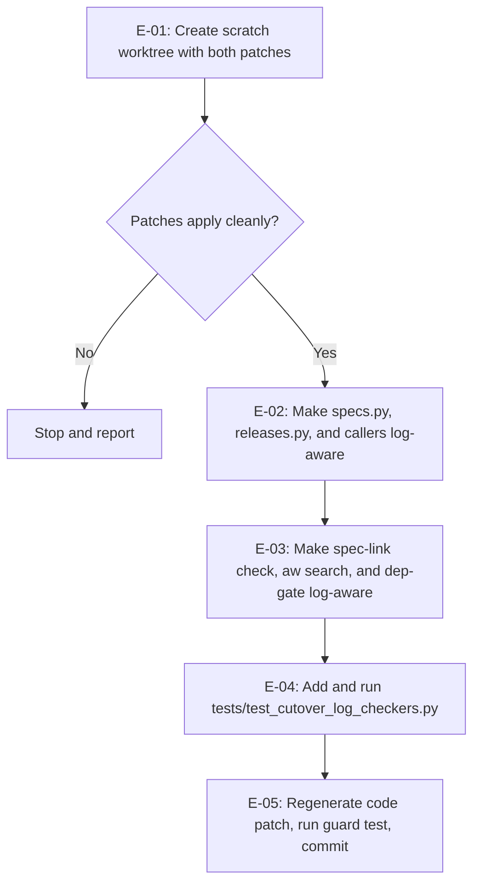

# IPD: Make specs, releases, spec-link, search, and dep-gate log-aware in the cutover code patch

- Date: 2026-11-25
- Kind: child
- Concern: Backlog `ldfefd` (metastore cutover test conversion; recorded in batch B plan `psm9ac` F-05 and OQ-01, split per maintainer answer to `run-20261126T020242Z-3080634` question `05-psm9ac-a1-batch-b-production-log-aware-gaps`): inside `.aw/system/cutover/metastore-code.cutover.patch`, writers already create post-cutover log-backed records whose `.md` file holds only the two-key YAML mirror (`id`, `status`) while all other fields and history live in `.aw/records/meta/<id6>.jsonl`. Five non-backlog production areas were not updated to read companion logs: (1) `agent_workflows/specs.py` (`validate_spec`, `run_check`, `_review_attestation_refusal`, `_deferred_ids_refusal`) and its callers (`agent_workflows/check_engine.py::check_content`, `agent_workflows/runner_shared.py::check_review_lane_artifacts`, `agent_workflows/runner_shared.py::enforce_freeze_time_refusal`) fail on conformant log-format specs with `attention.history-missing` or miss mirror `id` values; (2) `agent_workflows/releases.py` (`validate_release`, `parse_release`, `resolve_release_outcome`, `describe_planned_release`, `list_releases`, `get_release`, `check_from_backlog`, `check_graduated_to`, `get_release_blockers`, `_declared_blocks_release`, `count_blocks_release_sentinel`, `check_blocks_release`, and `run_new` dry-run) plus `agent_workflows/check_engine.py::check_content` read inline text only (`validate_release` emits `release.version-missing`, `resolve_release` fails by version, and `check_from_backlog` returns `[]`); (3) `agent_workflows/check_engine.py::parse_cited_spec_ids` and `check_plan_spec_link_missing` read only legacy `- Concern:`/`- Scope:`/`- Scope-Paths:` bullets instead of `## Concern`/`## Scope` body sections and log-stored `scope_paths`; (4) `agent_workflows/cli.py::_run_search` skips `# <Title>` behind the `<!-- aw-managed: ... -->` banner and misses log-stored `title`/`summary`/`short_description`; and (5) `agent_workflows/hooks/ipd_dependency_statement_gate.py::_staged_ipd_overlay` skips staged `meta/<id6>.jsonl` files where `item_dependencies` lives post-cutover. These five gaps block at least 6 batch B test modules (`psm9ac`) plus later test batches.
- Scope: In an isolated scratch worktree with both cutover patches applied (including prerequisite plans `hdwqex`, `89mtbl`, `nv3upa`, `fljn9b`, and `cugg3w`), make `agent_workflows/specs.py` (and its `check_engine`/`runner_shared` callers), `agent_workflows/releases.py` (and its `check_engine` caller), `agent_workflows/check_engine.py::parse_cited_spec_ids`/`check_plan_spec_link_missing`, `agent_workflows/cli.py::_run_search`, and `agent_workflows/hooks/ipd_dependency_statement_gate.py::_staged_ipd_overlay` log-aware while preserving legacy bullet-format parity. Add and pass core behavioral test module `tests/test_cutover_log_checkers.py` in the scratch worktree, and regenerate `.aw/system/cutover/metastore-code.cutover.patch`. Make no live code changes outside the cutover code patch.
- Scope-Paths: .aw/records/plans/pending/20261125-metastore-315-szykgd-make-specs-releases-spec-link-search-and-dep-gate-log-aware.ipd.md, .aw/system/cutover/metastore-code.cutover.patch
- Item-Dependencies: executed:cugg3w
- Status: approved
- Review-Depth: standard
- Readiness: go-pending-approval
- From-Spec: 4sd62s
- Work-Kind: bug
- Priority: high
- From-Backlog: ldfefd
- Blocks-Release: next
- Set: metastore
- Order: 315
- Highest E allocated: 05
- Author: antigravity/gemini
- Id: szykgd
- Approval: 2026-11-27, recorded via aw ipd set: status set to approved

> Write and proofread this plan per the technical writing standard, `.aw/system/workflows/technical-writing/technical-writing.md` (`.agents/workflows/technical-writing/technical-writing.md` in a legacy-layout install), including requirement 12 (diagrams).

## Workflow history

- 2026-11-27 approved (aw set): status set to approved
- 2026-11-26 /plan-review (antigravity/gemini): APPROVE WITH REVISIONS APPLIED; PR-006, PR-007, PR-008; review record .aw/records/reviews/20261125-metastore-315-szykgd-make-specs-releases-spec-link-search-and-dep-gate-log-aware.review.md
- 2026-11-26 to-review (aw set): demoted reviewed -> to-review: These were flagged as '[stale-review]'
- 2026-11-26 reviewed (aw set): APPROVE WITH REVISIONS APPLIED; PR-001..PR-005 FIXED
- 2026-11-26 /plan-review (antigravity/gemini): APPROVE WITH REVISIONS APPLIED; PR-001, PR-002, PR-003, PR-004, PR-005; review record .aw/records/reviews/20261125-metastore-315-szykgd-make-specs-releases-spec-link-search-and-dep-gate-log-aware.review.md
- 2026-11-26 to-review (antigravity/gemini): authored as Order 315 ahead of psm9ac per maintainer answer to run-20261126T020242Z-3080634 question 05-psm9ac-a1-batch-b-production-log-aware-gaps ("Fix backlog pointer in fljn9b and split 1 production-fix plan ahead of psm9ac (Recommended)").
- 2026-11-26 draft (antigravity/gemini): created.

## Goal

Make spec and release validation, lookup, and link checkers, `check_plan_spec_link_missing`, `aw search`, and the `ipd_dependency_statement_gate` pre-commit hook log-aware inside `.aw/system/cutover/metastore-code.cutover.patch`, unblocking batch B (`psm9ac`) and later test batches while keeping legacy text fallback intact.

## Detailed Implementation Checklist (TODO)

Execution-state rule: mark an `E-*` item complete only after performing the action. That mark is not validation. Right-sizing rule: write for a modest executor that cannot hold much in its head. Each E-item is one step (one concern, about one file, executable in one focused pass) and its V-item names each unit it covers with its own check; a plan stays at about 5 E-items and 8 work Scope-Paths, else split it into more child plans (guidance, `IPD-Z603`). Accepted execution states: blocked, failed, pending, performed; terminal gate demands 'performed'.

### Task group 1: scratch worktree

- [ ] E-01 Create the scratch worktree following the SCRATCH PROCEDURE of executed plan `2k5t16` (Step 0): run `git worktree add --detach .aw/state/szykgd/scratch HEAD`; inside `.aw/state/szykgd/scratch`, run `git apply --index .aw/system/cutover/metastore-docs.cutover.patch`, record `BASE=$(git write-tree)` in F-01, and then run `git apply --index .aw/system/cutover/metastore-code.cutover.patch`. If either patch rejects, stop and report.
  - Depends on: none
  - Expected outcome: `.aw/state/szykgd/scratch` holds HEAD plus both patches staged, and F-01 records the base tree id.
  - Execution state: pending

### Task group 2: log-aware checkers, search, and dep-gate (scratch worktree only)

- [ ] E-02 Make `agent_workflows/specs.py`, `agent_workflows/releases.py`, and their `check_engine.py` / `runner_shared.py` callers log-aware in `.aw/state/szykgd/scratch` while keeping legacy bullet-format parity intact:
  1. In `agent_workflows/specs.py`:
     - Extend `validate_spec(path, text, *, state=None, has_history=None, repo_root=None)` with a shared companion-log resolver that derives `records_root` from `path` (supporting `.aw/records/specs/...`, legacy `.agents/docs/specs/...`, and companion/home roots via `project_context.record_owner_root`) or `repo_root`, extracts `id6` via `agent_workflows/artifact_meta.py::read_mirror_id6(text)` (never crashing on pure-text or legacy calls), and reads `artifact_meta.read` + `artifact_meta.history` inside `artifact_meta.ephemeral_if_uninitialized()` when `records_root / "meta" / f"{id6}.jsonl"` exists (avoiding stray `.aw/state/index.db` creation on uninitialized directories). Let `MetadataSchemaError` propagate untouched (spec `4sd62s` AC-11); catch corrupt-log `ValueError` fail-closed as an `attention.unreadable` drift finding. When `state` is supplied or loaded from a companion log, validate via `validate_spec_state(path, state, has_history=has_history)`; when `text` starts with a YAML mirror (`---`), parse it via `artifact_meta.parse_artifact_mirror` and emit registered rules (`attention.missing-status` or `attention.unknown-status`) if the mirror is malformed or its `id`/`status` contradicts `state`; keep `spec.metadata-bullet-repeated` only when leading metadata bullets appear in `text`, and fall back to legacy bullet validation when no companion log exists.
     - Update `specs._review_attestation_refusal` and `specs._deferred_ids_refusal` to read `id6` via `artifact_meta.read_mirror_id6(text)` before falling back to `artifact_meta.read_loose_id(text)` so post-cutover `to-review -> reviewed` and `-> implemented` spec transitions resolve the spec's `id6`.
     - Update `specs.run_check` to wrap its loop in `artifact_meta.scan_once()` and `artifact_meta.ephemeral_if_uninitialized()` and pass `repo_root=repo_root` (or resolved `state` and `has_history`) into `validate_spec`.
     - Update callers `agent_workflows/check_engine.py::check_content` (`record_type == "specs"`), `agent_workflows/runner_shared.py::check_review_lane_artifacts` (specs branch: resolve `wt_path / norm_p` with `repo_root=eval_root` when a worktree exists, and when `wt_path` is `None` read companion `res.state` and `res.history` at `branch` via `artifact_meta.read_at` using `read_mirror_id6(content)` or `resolve_id_at` before calling `specs.validate_spec`), and `agent_workflows/runner_shared.py::enforce_freeze_time_refusal` (specs branch: pass `repo_root=repo` and include an explicit absent-vs-present digest of the companion `meta/<id6>.jsonl` bytes in the `_FREEZE_GATE_CACHE` key).
  2. In `agent_workflows/releases.py` (and `agent_workflows/check_engine.py::build_plan_setid_index`):
     - Add a shared log-aware release reader helper (inferring `records_root` from `path.parent.parent` when `path.parent.name == "releases"`, else `project_records_dir(repo_root)`, reading `id6`, `status`, `version`, and `short_description` from `artifact_meta.read` plus `artifact_meta.history` inside `artifact_meta.ephemeral_if_uninitialized()` when `meta/<id6>.jsonl` exists, letting `MetadataSchemaError` propagate and falling back to `artifact_meta.read_text` for legacy text). Wrap multi-file walks (`resolve_release_outcome`, `list_releases`, `_existing_ids`, `check_from_backlog`, `check_graduated_to`, `count_blocks_release_sentinel`, `check_blocks_release`) in `artifact_meta.scan_once()` and `artifact_meta.ephemeral_if_uninitialized()`.
     - Add `validate_release_state` and extend `validate_release(path, text, *, state=None, repo_root=None)` (also catching corrupt-log `ValueError` fail-closed and rejecting a YAML mirror `id`/`status` contradicting `state` with `release.id-missing`/`release.status-invalid`) and `parse_release(path, text, *, state=None, repo_root=None)` (reading `summary` from `state.fields.get("summary")` -> `state.short_description` -> `_summary_section(text)` and populating `history` from log events when log-backed).
     - Update `resolve_release_outcome` (version matching), `describe_planned_release`, `list_releases`, `get_release`, `_existing_ids`, and `run_new` (keeping `plan_release` and `create_release` public signatures unchanged, passing `state=preview.get("state")` on dry-run where `artifact_meta.create(..., dry_run=True)` returns `"state"` and `repo_root=repo_root` on `--apply` so both dry-run and `--apply` `--json`/`--agent` output populate `version`, `status`, and `history`) to use the log-aware release reader.
     - Update `check_from_backlog`, `check_graduated_to`, `get_release_blockers` (including `_declared_blocks_release`), `count_blocks_release_sentinel`, and `check_blocks_release` to read `from_backlog`, `graduated_to`, and `blocks_release` from `artifact_meta` state (`query(..., include_fields=True)` / `read`) rather than `_meta.read_text(text)` / `read_loose_blocks_release(text)` alone. In `check_graduated_to`, parse `state.fields.get("graduated_to")` through `agent_workflows/artifact_meta.py::parse_graduated_to` (accepting both `list[str]` and comma-separated `str` while preserving duplicates and malformed entries), and update `agent_workflows/check_engine.py::build_plan_setid_index` to read `setid = st_obj.legacy_raw_set or st_obj.set_id` (matching lines 6511 and 12469) so log-format plans populate `known_setids` instead of causing `check_graduated_to` to bail out with empty findings.
     - Pass `repo_root=repo_root` (or `state`) from `agent_workflows/check_engine.py::check_content` (`record_type == "releases"`).
  - Depends on: E-01
  - Expected outcome: in a throwaway repository on `.aw/state/szykgd/scratch`, `aw specs new --apply` followed by `aw specs check` exits 0 and `_review_attestation_refusal` resolves mirror `id6`; `releases.create_release` followed by `releases.validate_release`, `resolve_release(repo, version)`, `describe_planned_release`, `list_releases`, and `check_engine.check_content(..., "releases")` succeed; `run_new` dry-run returns populated `version`; and `releases.check_from_backlog`, `check_graduated_to`, `count_blocks_release_sentinel`, `check_blocks_release`, and `get_release_blockers` see log-stored links and gates.
  - Execution state: pending

- [ ] E-03 Make `check_plan_spec_link_missing`, `aw search`, and `ipd_dependency_statement_gate` log-aware in `.aw/state/szykgd/scratch`:
  1. In `agent_workflows/check_engine.py`, extend `parse_cited_spec_ids(plan_text, known_spec_ids, *, state=None)` to scan `## Concern` and `## Scope` body sections (respecting fenced code blocks) and `state.fields.get("scope_paths")` (accepting both `list[str]` and `str`) when present, in addition to legacy `- Concern:`/`- Scope:`/`- Scope-Paths:` bullets. In `check_plan_spec_link_missing`, pass `state=st_obj` to `parse_cited_spec_ids` and read `scope_paths` from `st_obj.fields.get("scope_paths")` (normalizing a `list[str]` into path strings directly or joining before `_ipd_schema.parse_scope_paths`, because `parse_scope_paths` expects a `str` and calls `.strip()`; falling back to `_declared_bullet_fields(text).get("scope_paths")`) for the spec-edit exemption.
  2. In `agent_workflows/cli.py::_run_search`:
     - Populate `cached_by_path` via `artifact_meta.query(project_context=search_ctx, include_fields=True)` whenever `search_has_tree` is true (not only when status filters are set).
     - Update the post-YAML-fence H1 scan (`m_h1`) so an optional `<!-- aw-managed: ... -->` banner line between the closing `---` and `# <Title>` does not prevent matching `# <Title>` in default search.
     - Match the regex against log-stored header and descriptive metadata (`title`, `summary`, `short_description`, `set`, `status`, `id6`, and string metadata values from `st_row.fields`) in BOTH default (`full_search=False`) and `--full` (`full_search=True`) modes so `--full` remains a strict superset of default search while still excluding Markdown body sections unless `-F`/`--full` is passed; emit deduplicated `line: 0` metadata matches only when not already matched by `search_lines`.
  3. In `agent_workflows/hooks/ipd_dependency_statement_gate.py::_staged_ipd_overlay`, in addition to staged `.ipd.md` paths, inspect staged `<records_rel>/meta/<stem>.jsonl` paths (under `.aw/records/meta/` or `.agents/meta/`) where `core.is_valid_id6(stem)` is true: resolve the staged state via `artifact_meta.read_at(stem, ":0:", project_context=ctx)`; when `res.kind == "ok"`, `res.state is not None`, `res.state.type == "ipd"`, and `res.state.path` is non-empty, resolve `abs_ps = str(_meta.source_path(res.state.path, Path(ctx.logical_roots["records"]), repo_root).resolve())` and add it to `overlay_states` and `statuses` (preserving any already-staged `.ipd.md` entry for the same `abs_ps`, and leaving corrupt-log syntax enforcement to `meta_log_append_gate`) so staging a log-only `item_dependencies` edit triggers the same cycle, dangling, malformed, and advancing-unresolved gate as staging `.ipd.md`.
  4. Record the verified caller and behavior audit across all five areas (including `agent_workflows/attention.py` release/spec readers) in F-02.
  - Depends on: E-02
  - Expected outcome: `check_plan_spec_link_missing` detects spec citations in log-format plans and honors list-valued log-stored `scope_paths` exemptions; `aw search` matches banner-preceded `# <Title>` and log-stored metadata in both default and `-F` modes while excluding body-only tokens without `-F`; and `ipd_dependency_statement_gate.check` catches staged `meta/<id6>.jsonl` dependency violations.
  - Execution state: pending

- [ ] E-04 Add and run core behavioral test module `tests/test_cutover_log_checkers.py` (`pytestmark = pytest.mark.core`) in `.aw/state/szykgd/scratch` (asserting real outputs, exit codes, and side effects; no code-pinning tests):
  1. Cover `aw specs new --apply` -> `aw specs check` clean, `specs._review_attestation_refusal` and `_deferred_ids_refusal` resolving YAML mirror `id6`, negative `specs.validate_spec` log-format cases (deferred missing gate, invalid priority/work_kind, empty history, corrupt log failing closed, mirror/log mismatch), read-only `validate_spec` not creating `.aw/state/index.db` on an uninitialized directory, `check_engine.check_content(..., "specs")`, `runner_shared.check_review_lane_artifacts` (worktree and branch-only spec), and `runner_shared.enforce_freeze_time_refusal` cache invalidation when `meta/<id6>.jsonl` is added, modified, or deleted.
  2. Cover `releases.create_release` and `aw releases new` (dry-run and `--apply` with `--json`) -> `releases.validate_release`, `parse_release`, `resolve_release(repo, version)`, `describe_planned_release`, `list_releases`, and `check_engine.check_content(..., "releases")` clean and negative cases, plus `releases.check_from_backlog` (`malformed` and `dangling`), `releases.check_graduated_to` (verifying `check_engine.build_plan_setid_index` populates log-format plan setids and `check_graduated_to` detects dangling, malformed, and repeated entries on list-valued log-stored `graduated_to` without passing explicit `plan_setids`), `releases.count_blocks_release_sentinel`, `releases.check_blocks_release`, and `releases.get_release_blockers` on log-format fixtures.
  3. Cover `check_engine.parse_cited_spec_ids` and `check_plan_spec_link_missing` on log-format plans citing a known spec in `## Concern` / `## Scope` / list-valued log-stored `scope_paths` (including spec-edit exemption via list-valued log-stored `scope_paths`).
  4. Cover `aw search` without `-F` matching banner-preceded `# <Title>` and log-stored `title`, `summary`, and `short_description` across plans, specs, backlog, research, and prompts while excluding body-only tokens, plus verifying `-F`/`--full` remains a strict superset matching both log-stored metadata and body tokens.
  5. Cover `ipd_dependency_statement_gate.check` refusing staged malformed, dangling, cyclic, and advancing-unresolved `item_dependencies` both when `.ipd.md` + `meta/<id6>.jsonl` are staged and when only `meta/<id6>.jsonl` is staged, while remaining a no-op on untouched files.
  6. Run `python3 -m pytest -o addopts="" -m '' -v tests/test_cutover_log_checkers.py` in `.aw/state/szykgd/scratch` and confirm every test passes.
  - Depends on: E-03
  - Expected outcome: `tests/test_cutover_log_checkers.py` passes every test in `.aw/state/szykgd/scratch`.
  - Execution state: pending

### Task group 3: package

- [ ] E-05 In `.aw/state/szykgd/scratch`, run `git add -A` and write `git diff --cached --binary $BASE` over `.aw/system/cutover/metastore-code.cutover.patch` in the executing checkout; remove the scratch worktree (`git worktree remove --force .aw/state/szykgd/scratch`); run `python3 -m pytest -o addopts="" tests/test_metastore_cutover_code_patch.py` in the executing checkout; verify `git status --short` shows only `- Scope-Paths:` modified; and commit through `aw commit szykgd -- .aw/records/plans/pending/20261125-metastore-315-szykgd-make-specs-releases-spec-link-search-and-dep-gate-log-aware.ipd.md .aw/system/cutover/metastore-code.cutover.patch`; never push.
  - Depends on: E-04
  - Expected outcome: `.aw/system/cutover/metastore-code.cutover.patch` contains all prior code-patch hunks plus this plan's changes; `tests/test_metastore_cutover_code_patch.py` passes; scratch worktree is removed; one path-scoped commit is created.
  - Execution state: pending

## Project conventions discovered (Step 0)

- The scratch procedure and cumulative code patch are defined in executed plan `2k5t16` (Step 0, OQ-01); executed sibling `g45vyv`, reviewed sibling `hdwqex`, and Order 314 sibling `fljn9b` follow the same procedure.
- `agent_workflows/specs.py::validate_spec_state` and `agent_workflows/attention.py::_spec_record` establish the repository pattern for validating a log-backed artifact from `artifact_meta.State` plus a `has_history` boolean while preserving legacy text validation (`validate_spec`) for unmigrated or pure-text inputs.
- `agent_workflows/artifact_meta.py::read_loose_id` reads bullet dialect only and returns `None` on YAML mirrors; callers needing an id6 from post-cutover `.md` text must check `artifact_meta.read_mirror_id6(text)` first.
- `agent_workflows/migrations/chain.py::MetadataSchemaError` subclasses `RuntimeError` (not `ValueError`), so catching `ValueError` for corrupt logs never suppresses schema-2 refusals (spec `4sd62s` AC-11).
- Tests exercise real behavior and assert on observable outcomes (AGENTS.md "TEST OUTCOMES, NOT CODE STRUCTURE"); no `inspect`, `ast`, regex, or substring code-pinning tests.
- Cite code by symbol (`path::Symbol`) or by a quoted content string, with a line number only appended as a hint and never alone (advisory `IPD-C801`).

## Findings

| Id | Evidence | Finding |
|---|---|---|
| F-01 | (written by E-01) | Base tree id after applying `.aw/system/cutover/metastore-docs.cutover.patch`. |
| F-02 | (written by E-03) | Caller and behavior audit across `specs.py`, `releases.py`, `check_engine.py`, `cli.py`, `runner_shared.py`, `attention.py`, and `hooks/ipd_dependency_statement_gate.py`. |
| F-03 | `psm9ac` F-05 and direct probes: `specs.validate_spec` on a log-format spec returned `[('attention.history-missing', ...)]`; `releases.validate_release` on a log-format release returned `[('release.version-missing', ...)]`; `releases.check_from_backlog` calls `_meta.read_text(text).fields.get("from_backlog")`; `check_engine.parse_cited_spec_ids` on a log-format plan with `## Concern` returned `[]`; `cli._run_search` non-`--full` mode scans only YAML fence + H1; `hooks/ipd_dependency_statement_gate.py::_staged_ipd_overlay` skips staged `meta/<id6>.jsonl`. | Five verified non-backlog production cutover gaps in `.aw/system/cutover/metastore-code.cutover.patch` block `psm9ac` (batch B) and later test batches. |
| F-04 | `agent_workflows/releases.py` (`resolve_release_outcome`, `describe_planned_release`, `list_releases`, `get_release`, `_declared_blocks_release`, `count_blocks_release_sentinel`, `check_graduated_to`, `run_new`); `agent_workflows/check_engine.py::build_plan_setid_index`; `agent_workflows/specs.py` (`_review_attestation_refusal`, `_deferred_ids_refusal`); `agent_workflows/runner_shared.py::check_review_lane_artifacts` and `enforce_freeze_time_refusal`; `agent_workflows/cli.py::_run_search`; `agent_workflows/ipd_schema.py::parse_scope_paths`; `agent_workflows/artifact_meta.py::render_in_file_mirror`, `read_at`, `parse_graduated_to`, `scan_once`, and `ephemeral_if_uninitialized`. | Additional concrete cutover hazards verified during review: (1) six additional `releases.py` readers (`resolve_release_outcome`, `describe_planned_release`, `list_releases`, `get_release`, `count_blocks_release_sentinel`, `_declared_blocks_release`) and `run_new` dry-run/`--apply` still read text-only (with `artifact_meta.create` returning `"state"` only on `dry_run=True`); (2) `check_engine.build_plan_setid_index` reads only `st_obj.legacy_raw_set` (which is `None` on log-format plans, silently returning `{}` and causing `releases.check_graduated_to` to bail out with 0 findings), and `check_graduated_to` must parse list/string `graduated_to` through `artifact_meta.parse_graduated_to`; (3) `specs._review_attestation_refusal` and `_deferred_ids_refusal` call bullet-only `read_loose_id`, and read-only `specs.py`/`releases.py` lookups and walks need `ephemeral_if_uninitialized()` and `scan_once()`; (4) `cli._run_search` `m_h1` is blocked by `<!-- aw-managed: ... -->` and needs log-metadata search in `--full` mode too to keep `--full` a superset; (5) `ipd_schema.parse_scope_paths` expects `str` while log `state.fields["scope_paths"]` is `list[str]`; (6) `ipd_dependency_statement_gate._staged_ipd_overlay` must resolve records-root-relative `res.state.path` through `artifact_meta.source_path`. |

## Proposed changes (ordered, validatable)

1. E-01: Create scratch worktree `.aw/state/szykgd/scratch` with both cutover patches staged.
2. E-02: Make `agent_workflows/specs.py` (validation, transition gates, and `check_engine`/`runner_shared` callers), `agent_workflows/releases.py` (validation, parsing, resolution, listing, link/gate checks, dry-run/`--apply` preview, and `check_engine` caller), and `agent_workflows/check_engine.py::build_plan_setid_index` log-aware while keeping legacy parity.
3. E-03: Make `check_engine.parse_cited_spec_ids`/`check_plan_spec_link_missing`, `cli._run_search` (banner-aware H1 plus log-metadata search in default and `-F` modes), and `hooks/ipd_dependency_statement_gate.py::_staged_ipd_overlay` log-aware; record F-02.
4. E-04: Add and pass core behavioral test module `tests/test_cutover_log_checkers.py` in `.aw/state/szykgd/scratch`.
5. E-05: Regenerate `.aw/system/cutover/metastore-code.cutover.patch`, remove the scratch worktree, pass `tests/test_metastore_cutover_code_patch.py`, and commit path-scoped.

## Deferred / out of scope (with reason)

- Making `agent_workflows/backlog.py` (including the `backlog.run_new` writing-standard pointer) log-aware: already owned by Order 314 ahead of `cugg3w`.
  - Carrier: fljn9b
- Remaining production log-awareness fixes (`otin36` -> `p109wy` -> `q6fiws` -> `j1f454` -> `lec341` -> `3e0vfy`): chained immediately after this plan (`otin36` depends on `executed:szykgd`) and ahead of test batches B through F per `psm9ac` OQ-02 Option 1.
  - Carrier: otin36
- Converting batch B's 18 test modules (`test_backlog_handoff_close` through `test_ipd_dependency_statement_gate`): runs after `3e0vfy` lands the remaining production log-awareness fixes.
  - Carrier: psm9ac
- Converting later test batches (batches C through F): later batch children.
  - Carrier: x8id25
- Applying the cutover patches on the real tree: attended cutover commit.
  - Carrier: cxxmyv

## Scope check

- Over-scope: none. No live code or test files are modified outside `.aw/system/cutover/metastore-code.cutover.patch`.
- Under-scope: none. All five non-backlog production cutover gaps recorded in `psm9ac` F-05 plus the co-located `specs.py`/`releases.py`/`cli.py` edge cases in F-04 map to E-02 through E-04 (while the `backlog.run_new` pointer gap is folded into `fljn9b`).

## Required tests / validation

- Throwaway-repository smoke checks on `.aw/state/szykgd/scratch` for `aw specs check`, `specs._review_attestation_refusal`, `releases.validate_release`/`resolve_release`/`describe_planned_release`/`check_from_backlog`, `check_plan_spec_link_missing`, `aw search`, and `ipd_dependency_statement_gate` (V-02, V-03).
- Core behavioral test module `python3 -m pytest -o addopts="" -m '' -v tests/test_cutover_log_checkers.py` in `.aw/state/szykgd/scratch` (V-04).
- Cumulative patch guard test `python3 -m pytest -o addopts="" tests/test_metastore_cutover_code_patch.py` in the executing checkout (V-05).

## Spec / documentation sync

No spec or documentation change is needed in this plan. Spec `4sd62s` Sections 4.1 through 4.6 already define the post-cutover log format, and `.aw/system/cutover/metastore-docs.cutover.patch` already updates the documentation. This plan brings these five production checker, search, and hook paths inside the cutover code patch into agreement with them.

## Open questions

None open.

## Validation and cross-check (verify before reporting done)

Validation-state rule: inspect evidence in a separate pass. Do not mark a `V-*` item complete from memory or from the matching execution checkmark. Accepted validation results: blocked, failed, pass, pending; terminal gate demands 'pass'. Runtime-demonstration reachability rule: for each `V-*` item demanding the software be observed acting (such as a run, a dispatch, or a transition) - as distinct from items demanding a diff, a file's content, or a test result, which are reachable by construction - name the code path that produces the observation or the sibling `E-*` that creates it, else the demand is UNDER-SCOPE.

- [ ] V-01 validates E-01
  - Required evidence: paste the `git worktree add --detach .aw/state/szykgd/scratch HEAD` command, both `git apply --index` commands (for `.aw/system/cutover/metastore-docs.cutover.patch` and `.aw/system/cutover/metastore-code.cutover.patch`) with exit status 0, and the base tree id recorded in F-01.
  - Observed evidence:
  - Result: pending
- [ ] V-02 validates E-02
  - Required evidence: paste a throwaway-repository run on `.aw/state/szykgd/scratch` (code paths updated by E-02) showing `aw specs new --apply` followed by `aw specs check` exiting 0 with zero findings, `specs._review_attestation_refusal` resolving YAML mirror `id6` on a reviewed log-format spec, `specs.validate_spec` catching negative log-format spec cases (for example deferred without gate, corrupt log, or empty history) without creating `.aw/state/index.db` on an uninitialized directory, `releases.create_release` and `aw releases new` dry-run and `--apply` (`--json`) followed by `releases.validate_release`, `resolve_release(repo, version)`, `describe_planned_release`, `list_releases`, and `check_engine.check_content(..., "releases")` succeeding, `releases.check_from_backlog` reporting `check.from-backlog-malformed` and `check.from-backlog-dangling`, and `releases.check_graduated_to` (using `check_engine.build_plan_setid_index` without an explicit `plan_setids` override) detecting dangling, malformed, and repeated entries on log-format fixtures.
  - Observed evidence:
  - Result: pending
- [ ] V-03 validates E-03
  - Required evidence: paste F-02 (audit across all five areas including `attention.py`) and observed outputs on `.aw/state/szykgd/scratch` (code paths updated by E-03) showing `check_engine.check_plan_spec_link_missing` flagging a log-format plan citing a known spec in `## Concern` (and exempting it when list-valued log-stored `scope_paths` lists that spec), `aw search` without `-F` matching banner-preceded `# <Title>` and a log-stored backlog/research summary while excluding a body-only token (and `-F` matching both metadata and body), and `ipd_dependency_statement_gate.check` returning exit 1 when only `meta/<id6>.jsonl` is staged with a cyclic or dangling dependency.
  - Observed evidence:
  - Result: pending
- [ ] V-04 validates E-04
  - Required evidence: paste the full `python3 -m pytest -o addopts="" -m '' -v tests/test_cutover_log_checkers.py` output in `.aw/state/szykgd/scratch` showing every test PASSED across specs, releases, spec-link checks, `aw search`, and `ipd_dependency_statement_gate`.
  - Observed evidence:
  - Result: pending
- [ ] V-05 validates E-05
  - Required evidence: paste `git apply --stat .aw/system/cutover/metastore-code.cutover.patch`, the `python3 -m pytest -o addopts="" tests/test_metastore_cutover_code_patch.py` run showing every guard test PASSED (docs + code patch apply cleanly, patch touches files, and a broken patch is refused), `git worktree list` showing `.aw/state/szykgd/scratch` removed, `git status --short` confirming no live edits outside `- Scope-Paths:`, and the `aw commit szykgd` output naming the commit hash.
  - Observed evidence:
  - Result: pending

## Approval and execution gate

- Size assessment: standard
- Cohesion rationale: not required

Execute only after human approval (`Status: approved`) and after every plan in `- Item-Dependencies:` (`cugg3w`) is executed; open questions: none open. Code and tests are edited ONLY inside `.aw/state/szykgd/scratch` and packaged into `.aw/system/cutover/metastore-code.cutover.patch`. Scope fence: `- Scope-Paths:` is a declaration; any needed edit outside it must be justified at finalize (`--scope-reason`), and any declared path left unmodified must be acknowledged (`--scope-ack`). Safety stop conditions: stop and report rather than editing live production code outside the scratch worktree or weakening test assertions if a patch hunk rejects, an unexpected failure occurs on unmodified code, or an unresolvable concurrent-edit conflict occurs. Honesty rule: you MUST paste the ACTUAL runner output of every command named in V-01 through V-05; never claim a result you did not run. Commits: commit only through `aw commit szykgd -- <paths>`; never push. Lifecycle transition: after `aw ipd lint --phase pre-transition` conforms and every `V-*` reads `pass` with pasted evidence, in a managed runner lane stop after committing the updated plan and let the runner run `aw ipd finalize`; in a hand-run session run `aw ipd finalize` to move the plan to `.aw/records/plans/executed/` (never use a raw `git mv` to `executed/`).
