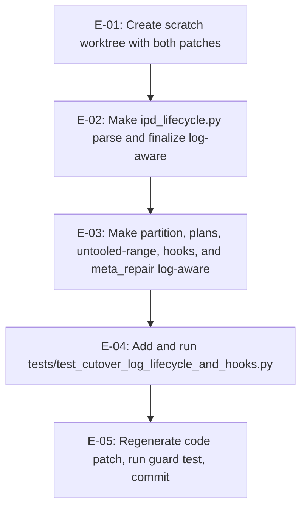

# IPD: Make ipd_lifecycle, partition, plans, untooled-range, hooks, and meta_repair log-aware in the cutover code patch

- Date: 2026-11-26
- Kind: child
- Concern: Backlog `ldfefd` (`x8id25` F-05 and OQ-01, recovered from `run-20261126T020242Z-3080634` parked branch `aw/parked/run-20261126T020242Z-3080634/x8id25` under Option 1): in `.aw/system/cutover/metastore-code.cutover.patch`, writers already create post-cutover log-backed records whose `.md` file holds only the two-key YAML mirror (`id`, `status`) while all other fields and history live in `.aw/records/meta/<id6>.jsonl`. However, five production areas were never made log-aware in the cutover code patch: (1) `agent_workflows/ipd_lifecycle.py` calls `_lint.parse` without log state at 10 sites (`_extract_plan_id`, `_requirements_from_plan`, `_frozen_scope_paths`, `_is_grandfathered_scope`, `begin`, `finalize_precheck`, `retire_orchestrator`, `finalize`) so log-format plans fail closed with missing `- Id:` or empty `Scope-Paths`, and `_finalize_transaction` sets `owned_paths = [tx_plan_rel, dest_rel]` without staging `.aw/records/meta/<plan_id>.jsonl`, dropping the appended `executed` log event on worktree teardown; (2) `agent_workflows/partition.py` (`_is_orchestrator_plan` and `_selectors._read_setid` calls) and `agent_workflows/plans.py` (`read_set` and `scan`) read inline text via `artifact_meta.read_text` instead of log-backed `State`, returning `None`/`False` for `plan_role`, `set`, and `order` on log-format plans; (3) `agent_workflows/check_engine.py` (`_read_plan_state_at_checked`, `_check_untooled_plan_transition`, and `check_status_untooled_range`) compares only replayed log state via `artifact_meta.read_at` and ignores the in-file YAML mirror `status:`, missing hand-edited mirror status flips across `base..head` in worker lanes; (4) `agent_workflows/hooks/executed_transition_gate.py::check` and `agent_workflows/hooks/backlog_blocking_close_gate.py::check` read metadata before calling `_migration_marker_accepts(root)`, raising `MetadataSchemaError` on unstamped legacy repositories before the `m0001` terminal-commit marker can short-circuit; and (5) `agent_workflows/meta_cli.py::meta_repair` calls `_meta.resolve(tok, project_context=ctx)` without catching `MetadataSchemaError`, crashing with an uncaught exception on unmigrated legacy repositories instead of returning a structured exit-2 `CommandResult` naming `aw migrate metadata`. Together these five gaps directly block five batch C test modules (`x8id25`) and post-cutover lifecycle workflows.
- Scope: In an isolated scratch worktree `.aw/state/otin36/scratch` with both cutover patches applied (including `hdwqex`, `89mtbl`, `nv3upa`, `fljn9b`, `cugg3w`, `szykgd`, and `psm9ac`), make `agent_workflows/ipd_lifecycle.py`, `agent_workflows/partition.py`, `agent_workflows/plans.py`, `agent_workflows/check_engine.py::check_status_untooled_range`, `agent_workflows/hooks/executed_transition_gate.py::check`, `agent_workflows/hooks/backlog_blocking_close_gate.py::check`, and `agent_workflows/meta_cli.py::meta_repair` log-aware while keeping legacy bullet-format parity intact, add and pass behavioral test module `tests/test_cutover_log_lifecycle_and_hooks.py` in the scratch worktree, and regenerate `.aw/system/cutover/metastore-code.cutover.patch`. No live code changes outside `- Scope-Paths:`.
- Scope-Paths: .aw/records/plans/pending/20261126-metastore-316-otin36-make-ipd-lifecycle-partition-plans-untooled-range-hooks-and.ipd.md, .aw/system/cutover/metastore-code.cutover.patch
- Item-Dependencies: executed:psm9ac
- Status: to-review
- From-Spec: 4sd62s
- Work-Kind: bug
- Priority: high
- From-Backlog: ldfefd
- Blocks-Release: next
- Set: metastore
- Order: 316
- Highest E allocated: 05
- Author: antigravity/gemini
- Id: otin36

> Write and proofread this plan per the technical writing standard, `.aw/system/workflows/technical-writing/technical-writing.md` (`.agents/workflows/technical-writing/technical-writing.md` in a legacy-layout install), including requirement 12 (diagrams).

## Workflow history

- 2026-11-26 to-review (aw set): authored as Order 316 ahead of x8id25 per recovery of run-20261126T020242Z-3080634 parked x8id25 OQ-01 Option 1
- 2026-11-26 draft (antigravity/gemini): created.

## Goal

Make IPD lifecycle transactions, work partitioning and plan scanning, untooled-status range checks, migration-marker pre-commit gates, and `aw meta repair` log-aware inside `.aw/system/cutover/metastore-code.cutover.patch`, unblocking `x8id25` (batch C) and downstream cutover execution while preserving legacy parity.

## Detailed Implementation Checklist (TODO)

Execution-state rule: mark an `E-*` item complete only after performing the action. That mark is not validation. Right-sizing rule: write for a modest executor that cannot hold much in its head. Each E-item is one step (one concern, about one file, executable in one focused pass) and its V-item names each unit it covers with its own check; a plan stays at about 5 E-items and 8 work Scope-Paths, else split it into more child plans (guidance, `IPD-Z603`). Accepted execution states: blocked, failed, pending, performed; terminal gate demands 'performed'.

### Task group 1: scratch worktree

- [ ] E-01 Create the scratch worktree following the SCRATCH PROCEDURE of `2k5t16` (Step 0): run `git worktree add --detach .aw/state/otin36/scratch HEAD`; inside `.aw/state/otin36/scratch`, run `git apply --index .aw/system/cutover/metastore-docs.cutover.patch`, record `BASE=$(git write-tree)` in F-01, and then run `git apply --index .aw/system/cutover/metastore-code.cutover.patch`. If either patch rejects, stop and report.
  - Depends on: none
  - Expected outcome: `.aw/state/otin36/scratch` holds HEAD plus both patches staged, and F-01 records the base tree id.
  - Execution state: pending

### Task group 2: log-aware lifecycle, partition/plans, untooled-range, hooks, and meta_repair (scratch worktree only)

- [ ] E-02 Make `agent_workflows/ipd_lifecycle.py` log-aware in `.aw/state/otin36/scratch` while keeping legacy bullet-format parity intact:
  1. Add a shared helper that resolves optional companion `artifact_meta.State` for a plan path and passes `state=` to `_lint.parse(...)` at all 10 bare `_lint.parse` sites in `agent_workflows/ipd_lifecycle.py` (covering plan-id extraction, requirement parsing, frozen scope-path reads, grandfathered-scope checks, `begin`, `finalize_precheck`, `retire_orchestrator`, and `finalize`) so log-format plans yield accurate `Id`, `Status`, `Scope-Paths`, and metadata fields.
  2. Update `agent_workflows/ipd_lifecycle.py::_finalize_transaction` (and any sibling finalize commit-path builder) so when a companion log `.aw/records/meta/<plan_id>.jsonl` (or `.agents/meta/<plan_id>.jsonl`) exists for the finalized plan, its repo-relative path is included in `owned_paths` alongside `tx_plan_rel` and `dest_rel` so the appended `executed` event is staged and committed in the atomic finalize transaction rather than dropped on worktree teardown.
  - Depends on: E-01
  - Expected outcome: in a throwaway log-format repository on `.aw/state/otin36/scratch`, `aw ipd begin` and `aw ipd finalize` succeed, move the plan to `.aw/records/plans/executed/`, and commit both the moved plan file and `.aw/records/meta/<plan_id>.jsonl` with the `executed` event.
  - Execution state: pending

- [ ] E-03 Make `agent_workflows/partition.py`, `agent_workflows/plans.py`, `agent_workflows/check_engine.py`, `agent_workflows/hooks/executed_transition_gate.py`, `agent_workflows/hooks/backlog_blocking_close_gate.py`, and `agent_workflows/meta_cli.py` log-aware in `.aw/state/otin36/scratch`:
  1. In `agent_workflows/partition.py` (`_is_orchestrator_plan` and both `_selectors._read_setid` call sites) and `agent_workflows/plans.py` (`read_set` and `scan`), read `plan_role`, `set`, and `order` from companion `artifact_meta.State` when a log exists (falling back to `artifact_meta.read_text` for unlogged legacy text).
  2. In `agent_workflows/check_engine.py` (`_read_plan_state_at_checked`, `_check_untooled_plan_transition`, and `check_status_untooled_range`), compare the in-file YAML mirror `status:` against the replayed log state across `base..head` so hand-edited YAML mirror status flips in worker lanes are detected and reported as untooled status edits.
  3. In `agent_workflows/hooks/executed_transition_gate.py::check` and `agent_workflows/hooks/backlog_blocking_close_gate.py::check`, call `_migration_marker_accepts(root)` BEFORE reading artifact metadata or running release-gate metadata queries, so unstamped legacy repositories running an `m0001` terminal commit short-circuit cleanly instead of raising `MetadataSchemaError` under `CURRENT_METADATA_SCHEMA == 2`.
  4. In `agent_workflows/meta_cli.py::meta_repair`, catch `MetadataSchemaError` around `_meta.resolve(tok, project_context=ctx)` and return a structured `CommandResult(command="meta repair", status="cannot-run", exit_code=2, ...)` whose summary names `aw migrate metadata` instead of raising an uncaught exception on unmigrated legacy repositories.
  5. Record the verified caller and behavior audit across all five areas in F-02.
  - Depends on: E-02
  - Expected outcome: `partition` and `plans.read_set`/`scan` return accurate `plan_role`, `set`, and `order` on log-format plans; `check_status_untooled_range` catches hand-edited YAML mirror status flips; both pre-commit hooks accept valid `m0001` migration markers on unstamped legacy repos; and `meta_cli.meta_repair` returns exit 2 naming `aw migrate metadata` on unmigrated legacy repos.
  - Execution state: pending

- [ ] E-04 Add and run behavioral test module `tests/test_cutover_log_lifecycle_and_hooks.py` in `.aw/state/otin36/scratch` (asserting real outputs, exit codes, and side effects; no code-pinning tests):
  1. Cover `ipd_lifecycle.begin`, `finalize_precheck`, `finalize`, and `retire_orchestrator` on log-format plans, verifying `Scope-Paths` parsing and verifying the finalize commit includes both the moved plan file and `.aw/records/meta/<plan_id>.jsonl` with `status == "executed"`.
  2. Cover `partition._is_orchestrator_plan`, `plans.read_set`, and `plans.scan` on log-format orchestrator and child plans.
  3. Cover `check_engine.check_status_untooled_range` catching a hand-edited YAML mirror `status:` flip in a commit while accepting a tooled `artifact_meta.append` transition that updates both log and mirror.
  4. Cover `executed_transition_gate.check` and `backlog_blocking_close_gate.check` accepting a valid `m0001` migration marker commit on an unstamped schema-1 legacy repo without raising `MetadataSchemaError`, while still refusing an unmarkered violation on a schema-2 log-format repo.
  5. Cover `meta_cli.meta_repair` returning structured exit-2 `CommandResult` naming `aw migrate metadata` on an unmigrated legacy repo without raising an uncaught exception.
  6. Run `python3 -m pytest -o addopts="" -m '' -v tests/test_cutover_log_lifecycle_and_hooks.py` in `.aw/state/otin36/scratch` and confirm every test passes.
  - Depends on: E-03
  - Expected outcome: `tests/test_cutover_log_lifecycle_and_hooks.py` passes every test in `.aw/state/otin36/scratch`.
  - Execution state: pending

### Task group 3: package

- [ ] E-05 In `.aw/state/otin36/scratch`, run `git add -A` and write `git diff --cached --binary $BASE` over `.aw/system/cutover/metastore-code.cutover.patch` in the executing checkout; remove the scratch worktree (`git worktree remove --force .aw/state/otin36/scratch`); run `python3 -m pytest -o addopts="" tests/test_metastore_cutover_code_patch.py` in the executing checkout; verify `git status --short` shows only `- Scope-Paths:` modified; and commit through `aw commit otin36 -- .aw/records/plans/pending/20261126-metastore-316-otin36-make-ipd-lifecycle-partition-plans-untooled-range-hooks-and.ipd.md .aw/system/cutover/metastore-code.cutover.patch`; never push.
  - Depends on: E-04
  - Expected outcome: `.aw/system/cutover/metastore-code.cutover.patch` contains all prior code-patch hunks plus this plan's changes; `tests/test_metastore_cutover_code_patch.py` passes; scratch worktree is removed; one path-scoped commit is created.
  - Execution state: pending

## Project conventions discovered (Step 0)

- The scratch procedure and cumulative code patch are defined in executed plan `2k5t16` (Step 0, OQ-01); executed sibling `g45vyv`, reviewed sibling `hdwqex`, Order 314 sibling `fljn9b`, and Order 315 sibling `szykgd` follow the same procedure.
- `agent_workflows/ipd_lint.py` (updated by `hdwqex`) accepts an optional `state` parameter on `parse(...)` so log-backed plans expose `Id`, `Status`, `Scope-Paths`, and other fields without inline metadata bullets.
- Tests exercise real behavior and assert on observable outcomes (AGENTS.md "TEST OUTCOMES, NOT CODE STRUCTURE"); no `inspect`, `ast`, regex, or substring code-pinning tests.
- Cite code by symbol (`path::Symbol`) or by a quoted content string, with a line number only appended as a hint and never alone (advisory `IPD-C801`).

## Findings

| Id | Evidence | Finding |
|---|---|---|
| F-01 | (written by E-01) | Base tree id after applying `.aw/system/cutover/metastore-docs.cutover.patch`. |
| F-02 | (written by E-03) | Caller and behavior audit across `ipd_lifecycle.py`, `partition.py`, `plans.py`, `check_engine.py`, `hooks/executed_transition_gate.py`, `hooks/backlog_blocking_close_gate.py`, and `meta_cli.py`. |
| F-03 | `x8id25` F-05 and static audit of `.aw/system/cutover/metastore-code.cutover.patch` and live modules: 10 bare `_lint.parse(...)` calls and `owned_paths` in `ipd_lifecycle.py::_finalize_transaction`; `partition.py::_is_orchestrator_plan` and `_selectors._read_setid` calls plus `plans.py::read_set`/`scan`; `check_engine.py::check_status_untooled_range`; `_migration_marker_accepts` placement in `hooks/executed_transition_gate.py::check` and `hooks/backlog_blocking_close_gate.py::check`; and uncaught `MetadataSchemaError` in `meta_cli.py::meta_repair`. | Five verified production cutover gaps in `.aw/system/cutover/metastore-code.cutover.patch` block `x8id25` (batch C) and downstream cutover execution. |

## Proposed changes (ordered, validatable)

1. E-01: Create scratch worktree `.aw/state/otin36/scratch` with both cutover patches staged.
2. E-02: Make `agent_workflows/ipd_lifecycle.py` parse calls and `_finalize_transaction` log-aware while keeping legacy parity.
3. E-03: Make `partition.py`, `plans.py`, `check_engine.py::check_status_untooled_range`, `executed_transition_gate.py`/`backlog_blocking_close_gate.py` marker checks, and `meta_cli.py::meta_repair` log-aware; record F-02.
4. E-04: Add and pass `tests/test_cutover_log_lifecycle_and_hooks.py` in `.aw/state/otin36/scratch`.
5. E-05: Regenerate `.aw/system/cutover/metastore-code.cutover.patch`, remove the scratch worktree, pass `tests/test_metastore_cutover_code_patch.py`, and commit path-scoped.

## Deferred / out of scope (with reason)

- Making `ipd_lint`, `ipd_schema`, and `ipd_authoring` log-aware: already owned by Order 305.
  - Carrier: hdwqex
- Making `backlog.py` and `specs.py`/`releases.py`/`check_engine.py` spec-link/`cli._run_search`/`ipd_dependency_statement_gate.py` log-aware: already owned by Orders 314 and 315.
  - Carrier: fljn9b, szykgd
- Converting batch C's 18 test modules (`test_ipd_lifecycle_cli` through `test_prompts_set_surface`): runs immediately after this plan executes.
  - Carrier: x8id25
- Converting later test batches (batches D through F): later batch children.
  - Carrier: e0g2gt
- Applying the cutover patches on the real tree: attended cutover commit.
  - Carrier: cxxmyv

## Scope check

- Over-scope: none. No live code or test files are modified outside `.aw/system/cutover/metastore-code.cutover.patch`.
- Under-scope: none. All five production cutover gaps recorded in `x8id25` F-05 map to E-02 through E-04.

## Required tests / validation

- Throwaway-repository smoke checks on `.aw/state/otin36/scratch` for `ipd_lifecycle` begin/finalize, `partition`/`plans`, `check_status_untooled_range`, both pre-commit migration-marker hooks, and `meta_cli.meta_repair` (V-02, V-03).
- Core behavioral test module `python3 -m pytest -o addopts="" -m '' -v tests/test_cutover_log_lifecycle_and_hooks.py` in `.aw/state/otin36/scratch` (V-04).
- Cumulative patch guard test `python3 -m pytest -o addopts="" tests/test_metastore_cutover_code_patch.py` in the executing checkout (V-05).

## Spec / documentation sync

No spec or documentation change is needed in this plan. Spec `4sd62s` Sections 4.1 through 4.6 and 5.2 already define the post-cutover log format, and `.aw/system/cutover/metastore-docs.cutover.patch` already updates the documentation. This plan brings these five production lifecycle, partitioning, range-check, pre-commit hook, and repair paths inside the cutover code patch into agreement with them.

## Open questions

None open.

## Validation and cross-check (verify before reporting done)

Validation-state rule: inspect evidence in a separate pass. Do not mark a `V-*` item complete from memory or from the matching execution checkmark. Accepted validation results: blocked, failed, pass, pending; terminal gate demands 'pass'. Runtime-demonstration reachability rule: for each `V-*` item demanding the software be observed acting (such as a run, a dispatch, or a transition) - as distinct from items demanding a diff, a file's content, or a test result, which are reachable by construction - name the code path that produces the observation or the sibling `E-*` that creates it, else the demand is UNDER-SCOPE.

- [ ] V-01 validates E-01
  - Required evidence: paste the `git worktree add --detach .aw/state/otin36/scratch HEAD` command, both `git apply --index` commands (for `.aw/system/cutover/metastore-docs.cutover.patch` and `.aw/system/cutover/metastore-code.cutover.patch`) with exit status 0, and the base tree id recorded in F-01.
  - Observed evidence:
  - Result: pending
- [ ] V-02 validates E-02
  - Required evidence: paste a throwaway-repository run on `.aw/state/otin36/scratch` (code paths updated by E-02) showing `aw ipd begin` and `aw ipd finalize` succeeding on a log-format plan, moving it to `.aw/records/plans/executed/`, and `git show --name-only HEAD` listing both the moved plan file and `.aw/records/meta/<plan_id>.jsonl`.
  - Observed evidence:
  - Result: pending
- [ ] V-03 validates E-03
  - Required evidence: paste F-02 (audit across all five areas) and observed outputs on `.aw/state/otin36/scratch` (code paths updated by E-03) showing `partition._is_orchestrator_plan` and `plans.read_set` returning log-stored values, `check_engine.check_status_untooled_range` flagging a hand-edited YAML mirror `status:` flip, `executed_transition_gate.check` and `backlog_blocking_close_gate.check` returning exit 0 on a valid `m0001` migration marker commit in an unstamped schema-1 repo, and `meta_cli.meta_repair` returning exit 2 naming `aw migrate metadata` on an unmigrated legacy repo.
  - Observed evidence:
  - Result: pending
- [ ] V-04 validates E-04
  - Required evidence: paste the full `python3 -m pytest -o addopts="" -m '' -v tests/test_cutover_log_lifecycle_and_hooks.py` output in `.aw/state/otin36/scratch` showing every test PASSED across `ipd_lifecycle`, `partition`/`plans`, `check_status_untooled_range`, both migration-marker hooks, and `meta_cli.meta_repair`.
  - Observed evidence:
  - Result: pending
- [ ] V-05 validates E-05
  - Required evidence: paste `git apply --stat .aw/system/cutover/metastore-code.cutover.patch`, the `python3 -m pytest -o addopts="" tests/test_metastore_cutover_code_patch.py` run with all 3 tests PASSED, `git worktree list` showing `.aw/state/otin36/scratch` removed, `git status --short` confirming no live edits outside `- Scope-Paths:`, and the `aw commit otin36` output naming the commit hash.
  - Observed evidence:
  - Result: pending

## Approval and execution gate

- Size assessment: standard
- Cohesion rationale: not required

Execute only after `/plan-review`, human approval (`Status: approved`), and after every plan in `- Item-Dependencies:` (`psm9ac`) is executed; open questions: none open. Code and tests are edited ONLY inside `.aw/state/otin36/scratch` and packaged into `.aw/system/cutover/metastore-code.cutover.patch`. Scope fence: `- Scope-Paths:` is a declaration; any needed edit outside it must be justified at finalize (`--scope-reason`), and any declared path left unmodified must be acknowledged (`--scope-ack`). Safety stop conditions: stop and report rather than editing live production code outside the scratch worktree or weakening test assertions if a patch hunk rejects, an unexpected failure occurs on unmodified code, or an unresolvable concurrent-edit conflict occurs. Honesty rule: you MUST paste the ACTUAL runner output of every command named in V-01 through V-05; never claim a result you did not run. Commits: commit only through `aw commit otin36 -- <paths>`; never push. Lifecycle transition: after `aw ipd lint --phase pre-transition` conforms and every `V-*` reads `pass` with pasted evidence, in a managed runner lane stop after committing the updated plan and let the runner run `aw ipd finalize`; in a hand-run session run `aw ipd finalize` to move the plan to `.aw/records/plans/executed/` (never use a raw `git mv` to `executed/`).
