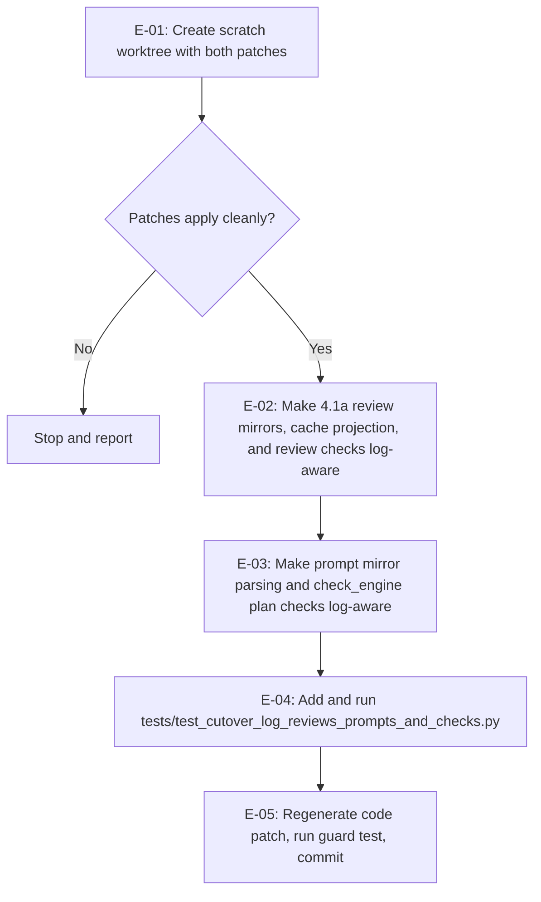

# IPD: Make review mirrors, prompt metadata, and check_engine priority log-aware in the cutover code patch

- Date: 2026-11-26
- Kind: child
- Concern: Backlog `ldfefd` (metastore cutover test conversion) and batch D test-conversion plan `e0g2gt` (F-05 and resolved OQ-01, split per maintainer answer to `run-20261126T055808Z-863961` question `04-e0g2gt-a1-batch-d-production-log-aware-gaps` into two prerequisite production-fix plans ahead of `e0g2gt`): inside `.aw/system/cutover/metastore-code.cutover.patch`, three production review, prompt, and `check_engine` paths still assume pre-cutover inline metadata and fail on post-cutover log-format records. First, post-cutover `.review.md` files use a short spec `4sd62s` Section 4.1a YAML header (`subject:`, `subject_type:`, optional `ref:`) while round metadata (`reviewed-at`, `reviewer`, `verdict`) lives in the subject's `.aw/records/meta/<subject_id>.jsonl`; yet `agent_workflows/artifact_meta.py` (`parse_review_mirror`, `read_review_subject_id`, `load_legacy_review`, `_delete_artifact_projection`, `_load_sources`), `agent_workflows/review_findings.py::parse_review_text`, and `agent_workflows/check_engine.py` (`check_review_dangling`, `evaluate_review_finding_escalation`, `evaluate_review_decision_escalation`) either require the five legacy bullet keys (`REV-M101`), omit log `proj["reviews"]` projection, clobber log-owned `reviews` rows when indexing or removing `.review.md` files, or cache malformed reviews as `parse_ok = 1`. Second, post-cutover staged prompt files open with `<!-- aw-managed-prompt: id: <id6> | status: <status> ... -->`, but `agent_workflows/artifact_meta.py::has_prompt_metadata_comment` matches only the legacy `<!-- aw-prompt:` prefix, `_parse_metadata_comment` leaves the `. Pipeline metadata only...` trailer attached to `status`, and `read_text`/`parse_staged_prompt_mirror` do not strip a leading UTF-8 BOM, causing `agent_workflows/check_engine.py::validate_prompt_content` and downstream callers (`prompts.py`, `status_set.py`, `artifact_rename.py`, `cli.py`) to emit false `check.prompt-metadata-missing` errors or miss `check.prompt-status-mismatch`. Third, `agent_workflows/check_engine.py::check_plan_priority_required`, `stale_record_scope_paths`, and `evaluate_carrier_ungated` call bare `_lint.parse(text)` without passing companion `state=`, reading empty `Status`, `Priority`, `Work-Kind`, `Scope-Paths`, and `Item-Dependencies` on every log-format plan.
- Scope: In an isolated scratch worktree `.aw/state/p109wy/scratch` with both cutover patches applied (including earlier prerequisite and test-batch plans `hdwqex`, `89mtbl`, `nv3upa`, `fljn9b`, `cugg3w`, `szykgd`, `psm9ac`, `otin36`, and `x8id25`), make spec `4sd62s` Section 4.1a `.review.md` YAML mirror parsing and SQLite review projection (`artifact_meta.py`, `review_findings.py`, `check_engine.py`), staged-prompt mirror detection and parsing (`artifact_meta.py`, `check_engine.py::validate_prompt_content`), and `check_engine.py` log-backed plan checks (`check_plan_priority_required`, `stale_record_scope_paths`, `evaluate_carrier_ungated`, `find_obligations_carried_by`) log-aware while keeping legacy parity intact. Add and pass core behavioral test module `tests/test_cutover_log_reviews_prompts_and_checks.py` in the scratch worktree, and regenerate `.aw/system/cutover/metastore-code.cutover.patch`. Make no live code changes outside `- Scope-Paths:`.
- Scope-Paths: .aw/records/plans/pending/20261126-metastore-317-p109wy-make-review-mirrors-prompt-metadata-and-check-engine-priorit.ipd.md, .aw/system/cutover/metastore-code.cutover.patch
- Item-Dependencies: executed:x8id25
- Status: approved
- Review-Depth: standard
- Readiness: go-pending-approval
- From-Spec: 4sd62s
- Work-Kind: bug
- Priority: high
- From-Backlog: ldfefd
- Blocks-Release: next
- Set: metastore
- Order: 317
- Highest E allocated: 05
- Author: antigravity/gemini
- Id: p109wy
- Approval: 2026-11-26, recorded via aw ipd set: status set to approved

> Write and proofread this plan per the technical writing standard, `.aw/system/workflows/technical-writing/technical-writing.md` (`.agents/workflows/technical-writing/technical-writing.md` in a legacy-layout install), including requirement 12 (diagrams).

## Workflow history

- 2026-11-26 approved (aw set): status set to approved
- 2026-11-26 reviewed (aw set): APPROVE WITH REVISIONS APPLIED; PR-001..PR-005 FIXED
- 2026-11-26 /plan-review (antigravity/gemini): APPROVE WITH REVISIONS APPLIED; PR-001, PR-002, PR-003, PR-004, PR-005 (all FIXED); review record .aw/records/reviews/20261126-metastore-317-p109wy-make-review-mirrors-prompt-metadata-and-check-engine-priorit.review.md
- 2026-11-26 to-review (aw set): authored as Order 317 (part 1 of 2) ahead of e0g2gt per maintainer answer to run-20261126T055808Z-863961 question 04-e0g2gt-a1-batch-d-production-log-aware-gaps
- 2026-11-26 draft (antigravity/gemini): created.

## Goal

Make spec `4sd62s` Section 4.1a review mirror parsing, SQLite review projection, and review escalation checks, post-cutover staged-prompt mirror detection and validation, and `check_engine` log-backed plan checks (`check_plan_priority_required`, `stale_record_scope_paths`, `evaluate_carrier_ungated`) log-aware inside `.aw/system/cutover/metastore-code.cutover.patch`. This plan is the first of two prerequisite production-fix plans ahead of Order 318 (`q6fiws`, coverage/readiness/runner/review-sequence fixes) and batch D (`e0g2gt`).

## Detailed Implementation Checklist (TODO)

Execution-state rule: mark an `E-*` item complete only after performing the action. That mark is not validation. Right-sizing rule: write for a modest executor that cannot hold much in its head. Each E-item is one step (one concern, about one file, executable in one focused pass) and its V-item names each unit it covers with its own check; a plan stays at about 5 E-items and 8 work Scope-Paths, else split it into more child plans (guidance, `IPD-Z603`). Accepted execution states: blocked, failed, pending, performed; terminal gate demands 'performed'.

### Task group 1: scratch worktree

- [ ] E-01 Create the scratch worktree following the SCRATCH PROCEDURE of executed plan `2k5t16` (Step 0): run `git worktree add --detach .aw/state/p109wy/scratch HEAD`; inside `.aw/state/p109wy/scratch`, run `git apply --index .aw/system/cutover/metastore-docs.cutover.patch`, record `BASE=$(git write-tree)` in F-01, and then run `git apply --index .aw/system/cutover/metastore-code.cutover.patch`. If either patch rejects, stop and report.
  - Depends on: none
  - Expected outcome: `.aw/state/p109wy/scratch` holds HEAD plus both patches staged, and F-01 records the base tree id.
  - Execution state: pending

### Task group 2: log-aware review mirrors, prompt mirrors, and check_engine checks (scratch worktree only)

- [ ] E-02 Make spec `4sd62s` Section 4.1a `.review.md` YAML mirror parsing, SQLite cache projection, and review-check readers log-aware in `.aw/state/p109wy/scratch` while keeping legacy 5-bullet review parity intact:
  1. In `agent_workflows/artifact_meta.py`:
     - In `parse_review_mirror(text)`, strip an optional leading UTF-8 BOM (`\ufeff`) before checking the `---` delimiter and reject unknown YAML keys outside `{"subject", "subject_type", "ref"}` so malformed review mirrors fail closed (spec `4sd62s` Section 4.1a).
     - In `read_review_subject_id(text)`, try `parse_review_mirror(text)` first and return `data["subject"]` when the review opens with a valid spec `4sd62s` Section 4.1a YAML mirror, falling back to `read_text(metadata_region(text)).fields.get("subject_id")` for legacy 5-bullet reviews.
  2. In `agent_workflows/artifact_meta.py` cache indexing (`load_legacy_review`, `_delete_artifact_projection`, and `_load_sources`):
     - In `_delete_artifact_projection`, also execute `DELETE FROM reviews WHERE subject_id6 = ?` when clearing a log-backed artifact's prior projection, and in `_load_sources` (`role == "log"`), insert `proj["reviews"]` into the SQLite `reviews` table (all 12 columns: `subject_id6, seq, review_ref, round, review_kind, verdict, legacy_verdict, observed_day, readiness, review_depth, findings_summary, reviewer`) so `artifact_meta.query(latest_gate_review_of=...)` and `review_findings._cached_gate_review_in_reviews_table` see log-sourced `op: "review"` events.
     - In `load_legacy_review`, try `parse_review_mirror(text)` first: when it succeeds, read `subject_id` from `mirror["subject"]`, read `review_ref` from `mirror.get("ref")` before falling back to `filename_id` when `filename_id != subject_id` (spec `4sd62s` Section 4.1a K4), check `doc = _rev_findings.parse_review_text(text)` and set `parse_ok = 0 if doc.diagnostics else 1` (because `parse_review_text` never raises on malformed input), and return `reviews_list = []` because the subject's `.aw/records/meta/<subject_id>.jsonl` log owns `op: "review"` rows. For legacy 5-bullet reviews, also set `parse_ok = 0 if doc.diagnostics else 1` while preserving existing `reviews_list` projection.
     - In `_load_sources` (`role == "review"` and the `role == "removed"` / missing-file cleanup branch for `prior_role == "review"`), do NOT run `DELETE FROM reviews` or insert synthetic rows into `reviews` when the file is a spec-4.1a YAML mirror or when the subject already has a tracked `meta/<subject_id>.jsonl` log (`files` row with `file_role = 'log'`); update only `review_files` and `files` so log-owned `reviews` rows are never clobbered or wiped.
  3. In `agent_workflows/review_findings.py::parse_review_text`, when `artifact_meta.parse_review_mirror(text)` succeeds, populate `subject-id` (`data["subject"]`) and `subject-type` (`data["subject_type"]`) from the YAML mirror and do not emit `REV-M101` (`D_MISSING_META`) diagnostics for `reviewed-at`, `reviewer`, or `verdict` (which spec `4sd62s` Section 4.1a stores in the subject's JSONL log). Continue failing closed on an invalid `subject_type` (`REV-M102` / `D_UNKNOWN_SUBJECT_TYPE`), missing `## Round <N>` headings (`REV-R001` / `D_NO_ROUNDS`), duplicate rounds (`REV-R002` / `D_DUPLICATE_ROUND`), malformed finding/decision rows (`REV-P001`), and unknown severities or decisions (`REV-P002`, `REV-P003`). Keep the five-key legacy metadata check intact for non-mirror legacy `.review.md` files and fail closed with `REV-M101` on malformed `---` YAML headers.
  4. In `agent_workflows/check_engine.py`:
     - In `check_review_dangling`, read `subject_id` and `subject_type` from `artifact_meta.parse_review_mirror(text)` first before falling back to `artifact_meta.read_text(text)` for legacy 5-bullet reviews, preserving the fail-closed rule that an absent or unknown `subject_type` never defaults to `"ipd"`.
     - In `_review_index`, continue delegating to `artifact_meta.read_review_subject_id(text)`.
     - In `evaluate_review_finding_escalation` and `evaluate_review_decision_escalation`, resolve `plan_id6` via `artifact_meta.read_mirror_id6(plan_text)` before falling back to `_meta_declared_id6(_meta.read_text(plan_text, record_type="ipd"))` so log-format plans join against their spec-4.1a `.review.md` files without skipping or emitting false malformed-review (`REV-M101`) errors.
  - Depends on: E-01
  - Expected outcome: spec `4sd62s` Section 4.1a `.review.md` files parse with zero `REV-M101` diagnostics, log-sourced `op: "review"` rows project into SQLite `reviews` and survive `.review.md` indexing/removal, malformed reviews cache `parse_ok = 0`, `check_review_dangling` resolves `ipd` and `spec` subjects, and `evaluate_review_finding_escalation` / `evaluate_review_decision_escalation` fire accurately on log-format plans while legacy 5-bullet reviews keep existing behavior.
  - Execution state: pending

- [ ] E-03 Make staged-prompt mirror detection/parsing and `check_engine.py` log-backed plan checks log-aware in `.aw/state/p109wy/scratch`:
  1. In `agent_workflows/artifact_meta.py` and `agent_workflows/check_engine.py::validate_prompt_content`:
     - In `artifact_meta.has_prompt_metadata_comment(text)`, strip an optional leading UTF-8 BOM (`\ufeff`) and accept both post-cutover `<!-- aw-managed-prompt: ... -->` mirrors (`_MANAGED_PROMPT_COMMENT_RE`) and legacy `<!-- aw-prompt: ... -->` comments (`_AW_PROMPT_OPEN_RE`) on line 1, while still returning `False` for commentless prompts or comments appearing after line 1.
     - In `artifact_meta._parse_metadata_comment(first_line)`, strip an optional leading `\ufeff` and, for `_MANAGED_PROMPT_COMMENT_RE` matches, strip the `. Pipeline metadata only...` trailer (matching `parse_staged_prompt_mirror` token extraction for `id` and `status`) so `comment_bullets["status"]` is the clean status token (e.g. `"pending"`) rather than `"pending . Pipeline metadata only; ..."`. Also strip an optional leading `\ufeff` in `artifact_meta.parse_staged_prompt_mirror(text)` and in `artifact_meta.read_text(text, record_type="prompt")` before checking `startswith("<!--")`.
     - In `artifact_meta.inject_prompt_metadata_id6` and `artifact_meta.update_prompt_metadata_status`, guard on legacy `_AW_PROMPT_OPEN_RE` only (not the widened `has_prompt_metadata_comment`) so legacy `Id:`/`Status:` rewriters never corrupt a post-cutover `<!-- aw-managed-prompt: ... -->` mirror.
     - Verify `check_engine.validate_prompt_content` (updating the `check.prompt-metadata-missing` detail wording to name `<!-- aw-managed-prompt: ... -->` while keeping rule id `check.prompt-metadata-missing` intact) and downstream callers (`prompts.py`, `status_set.py`, `artifact_rename.py`, `cli.py`) recognize post-cutover staged prompts cleanly, flag `check.prompt-id-mismatch` and `check.prompt-status-mismatch` (both with and without a companion log), and flag commentless post-cutover prompts with `check.prompt-metadata-missing`.
  2. In `agent_workflows/check_engine.py`, thread log-backed `artifact_meta.State` into every `_lint.parse(...)` call that reads plan front-matter fields:
     - In `check_plan_priority_required`, look up `st_obj = state_map.get(p.resolve())` (falling back to `_meta.read_text(text, record_type="ipd")`) before calling `_lint.parse(text, state=st_obj)`, so `_lint._scope_paths_gate_applies`, `_lint.check_plan_priority`, and `_lint.check_plan_work_kind` read authoritative log-stored `Status`, `Priority`, and `Work-Kind` fields on log-format plans.
     - In `stale_record_scope_paths(repo_root, plan_text, *, state=None)` (and its caller `check_scope_path_target_stale`), accept optional `state=None` and, when `state is None`, resolve companion `State` via `artifact_meta.read_mirror_id6(plan_text)` and `artifact_meta.read` (inside `ephemeral_if_uninitialized()`, falling back safely to `None` when unlogged) before calling `_lint.parse(plan_text, state=state)` so `Scope-Paths` is read from log state on log-format plans (covering both `check_scope_path_target_stale` and `runner_shared` callers without editing `runner_shared.py`).
     - In `evaluate_carrier_ungated(repo_root, *, plan_path, plan_text, open_questions=None, state=None)` (and its caller `check_carrier_ungated`), resolve companion `State` (from `state`, `state_map`, or `read_mirror_id6` + `artifact_meta.read`, falling back to `None` when unlogged) before calling `_lint.parse(plan_text, state=state)` so `Item-Dependencies` is read from log state on log-format plans and `check.ipd-carrier-ungated` does not false-fire when a declared log edge already covers the carrier.
     - In `find_obligations_carried_by`, resolve `plan_id6` via `artifact_meta.read_mirror_id6(text)` before falling back to `_meta_declared_id6(_meta.read_text(text, record_type="ipd"))`.
     - Record the complete audit of all `_lint.parse(...)` callers in `check_engine.py` and `has_prompt_metadata_comment` callers in F-02.
  - Depends on: E-02
  - Expected outcome: `has_prompt_metadata_comment`, `_parse_metadata_comment`, `parse_staged_prompt_mirror`, and `read_text` handle BOM-prefixed and canonical `<!-- aw-managed-prompt: ... -->` mirrors with clean `id`/`status` tokens and zero corruption from legacy comment helpers; `validate_prompt_content` validates post-cutover prompts accurately; `check_plan_priority_required`, `stale_record_scope_paths`, and `evaluate_carrier_ungated` read log-stored metadata; and F-02 records the verified caller audit.
  - Execution state: pending

- [ ] E-04 Add and run core behavioral test module `tests/test_cutover_log_reviews_prompts_and_checks.py` (`pytestmark = pytest.mark.core`) in `.aw/state/p109wy/scratch` (asserting real outputs, exit codes, and side effects; no code-pinning tests):
  1. Cover spec `4sd62s` Section 4.1a `.review.md` YAML mirrors (`artifact_meta.render_review_mirror`) across `artifact_meta.parse_review_mirror` (valid mirror, BOM-prefixed mirror, unknown-key rejection), `artifact_meta.read_review_subject_id`, SQLite cache projection (subject log `op: "review"` event visible to `artifact_meta.query(latest_gate_review_of=...)` and `review_findings.review_attestation_missing`, preserved without clobber when `.review.md` is indexed or removed, explicit `ref:` preserved, and malformed `.review.md` cached with `parse_ok=False`), `review_findings.parse_review_text` / `parse_review_file` (valid mirror produces zero diagnostics; invalid `subject_type` produces `REV-M102`; missing rounds produces `REV-R001` / `D_NO_ROUNDS`; legacy 5-bullet review preserves existing validation), `check_engine.check_review_dangling` (valid vs. dangling `ipd` and `spec` subjects, plus invalid `subject_type` not defaulting to `ipd`), `evaluate_review_finding_escalation` (flags unescalated `HIGH`/`BLOCKER` finding on a log-format plan and clears when escalated via a blocking `OQ-*` carrying `- Finding:`), and `evaluate_review_decision_escalation` (flags unescalated `Reversible: no` decision on a log-format plan).
  2. Cover `artifact_meta.has_prompt_metadata_comment`, `parse_staged_prompt_mirror`, `read_text(..., record_type="prompt")`, legacy `inject_prompt_metadata_id6`/`update_prompt_metadata_status` non-corruption, and `check_engine.validate_prompt_content` on post-cutover `<!-- aw-managed-prompt: id: <id6> | status: <status> . Pipeline metadata only... -->` prompts (valid prompt yields zero drift; filename/id mismatch yields `check.prompt-id-mismatch`; status/bucket mismatch yields `check.prompt-status-mismatch` both with and without a companion log; commentless post-cutover prompt yields `check.prompt-metadata-missing`; BOM-prefixed mirror extracts clean `id` and `status`; line-2 comment returns `False`; legacy helpers leave a managed prompt mirror unchanged).
  3. Cover `check_engine.check_plan_priority_required`, `stale_record_scope_paths` / `check_scope_path_target_stale`, and `evaluate_carrier_ungated` / `check_carrier_ungated` on log-format plans: `to-review` or `approved` plan missing `Priority` or `Work-Kind` in its log emits `check.ipd-priority-required` / `check.ipd-work-kind-required` while populated values pass and `draft` is exempt; a log-format plan declaring a moved/vanished `.aw/records/...` entry in log `scope_paths` is flagged by `stale_record_scope_paths`; and a log-format plan declaring a carrier edge in log `item_dependencies` produces zero `check.ipd-carrier-ungated` drift while an unedged carrier is flagged.
  4. Run `python3 -m pytest -o addopts="" -m '' -v tests/test_cutover_log_reviews_prompts_and_checks.py` in `.aw/state/p109wy/scratch` and confirm every test passes.
  - Depends on: E-03
  - Expected outcome: `tests/test_cutover_log_reviews_prompts_and_checks.py` passes every test in `.aw/state/p109wy/scratch`.
  - Execution state: pending

### Task group 3: package

- [ ] E-05 In `.aw/state/p109wy/scratch`, run `git add -A` and write `git diff --cached --binary $BASE` over `.aw/system/cutover/metastore-code.cutover.patch` in the executing checkout; remove the scratch worktree (`git worktree remove --force .aw/state/p109wy/scratch`); run `python3 -m pytest -o addopts="" tests/test_metastore_cutover_code_patch.py` in the executing checkout; verify `git status --short` shows only `- Scope-Paths:` modified; and commit through `aw commit p109wy -- .aw/records/plans/pending/20261126-metastore-317-p109wy-make-review-mirrors-prompt-metadata-and-check-engine-priorit.ipd.md .aw/system/cutover/metastore-code.cutover.patch`; never push.
  - Depends on: E-04
  - Expected outcome: `.aw/system/cutover/metastore-code.cutover.patch` contains all prior code-patch hunks plus this plan's changes; `tests/test_metastore_cutover_code_patch.py` passes; scratch worktree is removed; no live files outside `- Scope-Paths:` are modified; one path-scoped commit is created.
  - Execution state: pending

## Project conventions discovered (Step 0)

- The scratch procedure and cumulative code patch are defined in executed plan `2k5t16` (Step 0, OQ-01); executed log-writer plan `g45vyv` and prerequisite plans `hdwqex`, `fljn9b`, `szykgd`, and `otin36` follow the same procedure.
- `agent_workflows/artifact_meta.py` already provides `render_review_mirror`, `parse_review_mirror`, `parse_staged_prompt_mirror`, `read_mirror_id6`, and `_MANAGED_PROMPT_COMMENT_RE` for spec `4sd62s` Section 4.1 / 4.1a mirrors, and `replay(...)` already produces `projection_data["reviews"]` with all 12 `reviews` table columns.
- `agent_workflows/ipd_lint.py` (updated by `hdwqex`) accepts an optional `state=` parameter on `parse(...)` so log-backed plans expose `Status`, `Priority`, `Work-Kind`, `Id`, `Scope-Paths`, and `Item-Dependencies` without inline bullet front matter.
- Tests exercise real behavior and assert on observable outcomes (AGENTS.md "TEST OUTCOMES, NOT CODE STRUCTURE"); no `inspect`, `ast`, regex, or substring code-pinning tests.
- Cite code by symbol (`path::Symbol`) or by a quoted content string, with a line number only appended as a hint and never alone (advisory `IPD-C801`).

## Findings

| Id | Evidence | Finding |
|---|---|---|
| F-01 | (written by E-01) | Base tree id after applying `.aw/system/cutover/metastore-docs.cutover.patch`. |
| F-02 | (written by E-03) | Complete caller and behavior audit across `artifact_meta.py`, `review_findings.py`, `check_engine.py` (`_lint.parse` callers), and `has_prompt_metadata_comment` callers (`prompts.py`, `status_set.py`, `artifact_rename.py`, `cli.py`). |
| F-03 | `e0g2gt` F-05 and static audit of `.aw/system/cutover/metastore-code.cutover.patch`: `artifact_meta.py::read_review_subject_id`, `load_legacy_review`, `has_prompt_metadata_comment`; `review_findings.py::parse_review_text`; `check_engine.py::validate_prompt_content`, `check_plan_priority_required`, `check_review_dangling`, `evaluate_review_finding_escalation`, `evaluate_review_decision_escalation` | Three verified production cutover gaps (items 1, 2, and 5 of `e0g2gt` F-05) block `tests/test_readers_check_engine.py`, `tests/test_readers_review_modules.py`, and post-cutover review/prompt/priority checks; split into Order 317 (`p109wy`) ahead of Order 318 (`q6fiws`) and `e0g2gt` per maintainer decision on `run-20261126T055808Z-863961` question `04-e0g2gt-a1-batch-d-production-log-aware-gaps`. |
| F-04 | Plan-review static audit of post-patch `agent_workflows/artifact_meta.py` (`replay`, `parse_review_mirror`, `parse_staged_prompt_mirror`, `load_legacy_review`, `_delete_artifact_projection`, `_load_sources`, `has_prompt_metadata_comment`, `inject_prompt_metadata_id6`, `update_prompt_metadata_status`, `_parse_metadata_comment`, `read_text`), `agent_workflows/review_findings.py::D_NO_ROUNDS`, and `agent_workflows/check_engine.py` (`stale_record_scope_paths`, `evaluate_carrier_ungated`, `find_obligations_carried_by`) | Verified four additional cutover defects folded into E-02 through E-04: (1) missing-rounds diagnostic code is `REV-R001` (`review_findings.D_NO_ROUNDS`), not `REV-S201`; (2) `_load_sources` (`role == "log"`) omits inserting `proj["reviews"]` into SQLite `reviews`, `_delete_artifact_projection` omits `reviews`, `role == "review"` / `role == "removed"` clobbers log-owned `reviews` rows, `load_legacy_review` always caches `parse_ok = 1` because `parse_review_text` never raises, and `parse_review_mirror` lacks BOM and unknown-key guards; (3) `_parse_metadata_comment` leaves the `. Pipeline metadata only...` trailer on `status` in `<!-- aw-managed-prompt: ... -->`, `read_text`/`parse_staged_prompt_mirror` do not strip leading `\ufeff`, and `inject_prompt_metadata_id6`/`update_prompt_metadata_status` would corrupt managed prompt mirrors if gated on the widened `has_prompt_metadata_comment`; (4) `stale_record_scope_paths` and `evaluate_carrier_ungated` call bare `_lint.parse(plan_text)` and read `Scope-Paths` / `Item-Dependencies` from empty `meta_fields` on log-format plans. |

## Proposed changes (ordered, validatable)

1. E-01: Create scratch worktree `.aw/state/p109wy/scratch` with both cutover patches staged.
2. E-02: Make spec `4sd62s` Section 4.1a `.review.md` mirror parsing, SQLite `reviews`/`review_files` projection, dangling-review checks, and review-escalation evaluators log-aware while preserving legacy 5-bullet parity.
3. E-03: Make staged-prompt mirror detection/parsing (`has_prompt_metadata_comment`, `_parse_metadata_comment`, `parse_staged_prompt_mirror`, `read_text`, `validate_prompt_content`) and `check_engine` log-backed plan checks (`check_plan_priority_required`, `stale_record_scope_paths`, `evaluate_carrier_ungated`, `find_obligations_carried_by`) log-aware while protecting managed prompts from legacy rewriters; record F-02.
4. E-04: Add and pass core behavioral test module `tests/test_cutover_log_reviews_prompts_and_checks.py` in `.aw/state/p109wy/scratch`.
5. E-05: Regenerate `.aw/system/cutover/metastore-code.cutover.patch`, remove the scratch worktree, pass `tests/test_metastore_cutover_code_patch.py`, verify a clean live tree outside `- Scope-Paths:`, and commit path-scoped.

## Deferred / out of scope (with reason)

- Making `coverage_record`, `orchestrator_readiness.review_readiness`, `plan_readiness`, `runner_shared`, and `review_tier`/`review_sequence`/`review_rereview` log-aware in the cutover code patch: second prerequisite production-fix plan split per maintainer decision.
  - Carrier: q6fiws
- Converting batch D's 10 test modules (`tests/test_prose_dash_advisory.py` through `tests/test_readers_runner.py`): runs after `p109wy` and `q6fiws` execute.
  - Carrier: e0g2gt
- Prior prerequisite production fixes (`hdwqex`, `fljn9b`, `szykgd`, `otin36`): already owned by Orders 305 and 314-316.
  - Carrier: otin36
- Applying the cutover patches on the real tree: attended cutover commit.
  - Carrier: cxxmyv

## Scope check

- Over-scope: none. No live code or test files are modified outside `.aw/system/cutover/metastore-code.cutover.patch`.
- Under-scope: none. All three review/prompt/`check_engine` gaps (items 1, 2, and 5 of `e0g2gt` F-05) plus the co-located `artifact_meta` review projection, prompt trailer/BOM/legacy-helper guards, and `stale_record_scope_paths`/`evaluate_carrier_ungated` defects (`F-04`) map to E-02 through E-04; the remaining three runner/readiness/coverage gaps map to Order 318 (`q6fiws`).

## Required tests / validation

- Throwaway-repository checks on `.aw/state/p109wy/scratch` for spec `4sd62s` Section 4.1a review parsing, SQLite `reviews`/`review_files` projection, and escalation checks; post-cutover prompt mirror parsing/validation; and log-format plan priority, stale-scope, and carrier-ungated checks (V-02, V-03).
- Core behavioral test module `python3 -m pytest -o addopts="" -m '' -v tests/test_cutover_log_reviews_prompts_and_checks.py` in `.aw/state/p109wy/scratch` (V-04).
- Cumulative patch guard test `python3 -m pytest -o addopts="" tests/test_metastore_cutover_code_patch.py` in the executing checkout (V-05).

## Spec / documentation sync

No spec or documentation change is needed in this plan. Spec `4sd62s` Sections 4.1, 4.1a, 4.3, and 4.5a already define review mirrors, subject-log review projection, staged-prompt mirrors, and log-backed plan metadata, and `.aw/system/cutover/metastore-docs.cutover.patch` already documents them. This plan brings the review, prompt, and `check_engine` code paths inside `.aw/system/cutover/metastore-code.cutover.patch` into agreement with them.

## Open questions

None open.

## Validation and cross-check (verify before reporting done)

Validation-state rule: inspect evidence in a separate pass. Do not mark a `V-*` item complete from memory or from the matching execution checkmark. Accepted validation results: blocked, failed, pass, pending; terminal gate demands 'pass'. Runtime-demonstration reachability rule: for each `V-*` item demanding the software be observed acting (such as a run, a dispatch, or a transition) - as distinct from items demanding a diff, a file's content, or a test result, which are reachable by construction - name the code path that produces the observation or the sibling `E-*` that creates it, else the demand is UNDER-SCOPE.

- [ ] V-01 validates E-01
  - Required evidence: paste the `git worktree add --detach .aw/state/p109wy/scratch HEAD` command, both `git apply --index` commands (for `.aw/system/cutover/metastore-docs.cutover.patch` and `.aw/system/cutover/metastore-code.cutover.patch`) with exit status 0, and the base tree id recorded in F-01.
  - Observed evidence:
  - Result: pending
- [ ] V-02 validates E-02
  - Required evidence: paste observed outputs on `.aw/state/p109wy/scratch` (code paths updated by E-02) showing a spec `4sd62s` Section 4.1a `.review.md` mirror parsed by `artifact_meta.parse_review_mirror`, `artifact_meta.read_review_subject_id`, and `review_findings.parse_review_text` with zero `REV-M101` diagnostics (`REV-M102` on invalid `subject_type`, `REV-R001` on missing rounds, rejection on unknown mirror keys), a subject log `op: "review"` event visible to `artifact_meta.query(latest_gate_review_of=...)` and preserved when `.review.md` is indexed or removed, a malformed review cached with `parse_ok=False`, `check_engine.check_review_dangling` distinguishing valid vs. dangling `ipd` and `spec` subjects without defaulting invalid `subject_type` to `ipd`, and `evaluate_review_finding_escalation` / `evaluate_review_decision_escalation` flagging unescalated gating findings and irreversible decisions on a log-format plan.
  - Observed evidence:
  - Result: pending
- [ ] V-03 validates E-03
  - Required evidence: paste F-02 (verified caller audit) and observed outputs on `.aw/state/p109wy/scratch` (code paths updated by E-03) showing `artifact_meta.has_prompt_metadata_comment` returning `True` for canonical and BOM-prefixed `<!-- aw-managed-prompt: ... -->` mirrors (and `False` for commentless or line-2 comments), `artifact_meta.read_text(..., record_type="prompt")` returning clean `id6` and `status` without the pipeline trailer, `inject_prompt_metadata_id6` / `update_prompt_metadata_status` leaving a managed prompt mirror unchanged, `check_engine.validate_prompt_content` emitting zero drift on a valid post-cutover prompt while flagging id mismatch, status-vs-bucket mismatch (with and without a companion log), and missing comment, `check_engine.check_plan_priority_required` flagging missing `Priority`/`Work-Kind` on a log-format `to-review` plan while passing a populated one, `stale_record_scope_paths` flagging a vanished `.aw/records/...` target from log `scope_paths`, and `evaluate_carrier_ungated` clearing a log-format plan whose log `item_dependencies` covers its open question's carrier.
  - Observed evidence:
  - Result: pending
- [ ] V-04 validates E-04
  - Required evidence: paste the full `python3 -m pytest -o addopts="" -m '' -v tests/test_cutover_log_reviews_prompts_and_checks.py` output in `.aw/state/p109wy/scratch` showing every test PASSED across spec-4.1a reviews and SQLite projection, staged-prompt mirrors, and log-format `check_engine` plan checks.
  - Observed evidence:
  - Result: pending
- [ ] V-05 validates E-05
  - Required evidence: paste `git apply --stat .aw/system/cutover/metastore-code.cutover.patch`, the `python3 -m pytest -o addopts="" tests/test_metastore_cutover_code_patch.py` run showing every guard behavior (docs+code patch apply check, non-empty numstat, bad-patch refusal) PASSED, `git worktree list` showing `.aw/state/p109wy/scratch` removed, `git status --short` confirming no live edits outside `- Scope-Paths:`, and the `aw commit p109wy` output naming the commit hash.
  - Observed evidence:
  - Result: pending

## Approval and execution gate

- Size assessment: standard
- Cohesion rationale: not required

Execute only after human approval (`Status: approved`) and after every plan in `- Item-Dependencies:` (`x8id25`) is executed; open questions: none open. Code and tests are edited ONLY inside `.aw/state/p109wy/scratch` and packaged into `.aw/system/cutover/metastore-code.cutover.patch`. Scope fence: `- Scope-Paths:` is a declaration; any needed edit outside it must be justified at finalize (`--scope-reason`), and any declared path left unmodified must be acknowledged (`--scope-ack`). Safety stop conditions: stop and report rather than editing live production code outside the scratch worktree or weakening test assertions if a patch hunk rejects, an unexpected failure occurs on unmodified code, or an unresolvable concurrent-edit conflict occurs. Honesty rule: you MUST paste the ACTUAL runner output of every command named in V-01 through V-05; never claim a result you did not run. Commits: commit only through `aw commit p109wy -- <paths>`; never push. Lifecycle transition: after `aw ipd lint --phase pre-transition` conforms and every `V-*` reads `pass` with pasted evidence, in a managed runner lane stop after committing the updated plan and let the runner run `aw ipd finalize`; in a hand-run session run `aw ipd finalize` to move the plan to `.aw/records/plans/executed/` (never use a raw `git mv` to `executed/`).
