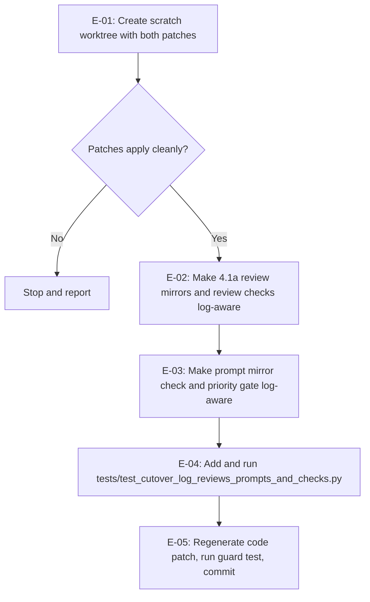

# IPD: Make review mirrors, prompt metadata, and check_engine priority log-aware in the cutover code patch

- Date: 2026-11-26
- Kind: child
- Concern: Backlog `ldfefd` (metastore cutover test conversion; recorded in batch D plan `e0g2gt` F-05 and OQ-01, split per maintainer answer to `run-20261126T055808Z-863961` question `04-e0g2gt-a1-batch-d-production-log-aware-gaps` into two prerequisite plans ahead of `e0g2gt`): inside `.aw/system/cutover/metastore-code.cutover.patch`, three production review, prompt, and `check_engine` paths still assume pre-cutover inline metadata and break on post-cutover log-format records: (1) post-cutover `.review.md` files use a short spec `4sd62s` Section 4.1a YAML header (`subject:` and `subject_type:`, plus optional `ref:`) while round metadata (`reviewed-at`, `reviewer`, `verdict`) lives in the subject's `.aw/records/meta/<subject_id>.jsonl`, yet `agent_workflows/artifact_meta.py` (`read_review_subject_id`, `load_legacy_review`), `agent_workflows/review_findings.py` (`parse_review_text`), and `agent_workflows/check_engine.py` (`check_review_dangling`, `evaluate_review_finding_escalation`, `evaluate_review_decision_escalation`) still require the five legacy bullet keys (`Subject-Id`, `Subject-Type`, `Reviewed-At`, `Reviewer`, `Verdict`), causing every post-cutover review file to fail parsing with `REV-M101` or be skipped silently; (2) post-cutover staged prompt files open with `<!-- aw-managed-prompt: id: <id6> | status: <status> ... -->`, but `agent_workflows/artifact_meta.py::has_prompt_metadata_comment` matches only the legacy `<!-- aw-prompt:` prefix, causing `agent_workflows/check_engine.py::validate_prompt_content` (and callers in `prompts.py`, `status_set.py`, `artifact_rename.py`, `cli.py`, and `artifact_meta.py`) to flag every post-cutover prompt as missing metadata (`check.prompt-metadata-missing`) and skip id6/status validation; and (3) `agent_workflows/check_engine.py::check_plan_priority_required` calls bare `_lint.parse(text)` without passing companion `state=st_obj`, reading empty `Status`, `Priority`, and `Work-Kind` and silently skipping the priority/work-kind gate on every log-format plan.
- Scope: In an isolated scratch worktree `.aw/state/p109wy/scratch` with both cutover patches applied (including prerequisite plans `hdwqex`, `89mtbl`, `nv3upa`, `fljn9b`, `cugg3w`, `szykgd`, `psm9ac`, `otin36`, and `x8id25`), make spec `4sd62s` Section 4.1a `.review.md` YAML mirror parsing and indexing (`artifact_meta.py`, `review_findings.py`, `check_engine.py`), staged-prompt mirror detection (`artifact_meta.py::has_prompt_metadata_comment` and `check_engine.py::validate_prompt_content`), and `check_engine.py::check_plan_priority_required` log-aware while keeping legacy parity intact. Add and pass core behavioral test module `tests/test_cutover_log_reviews_prompts_and_checks.py` in the scratch worktree, and regenerate `.aw/system/cutover/metastore-code.cutover.patch`. Make no live code changes outside `- Scope-Paths:`.
- Scope-Paths: .aw/records/plans/pending/20261126-metastore-317-p109wy-make-review-mirrors-prompt-metadata-and-check-engine-priorit.ipd.md, .aw/system/cutover/metastore-code.cutover.patch
- Item-Dependencies: executed:x8id25
- Status: to-review
- From-Spec: 4sd62s
- Work-Kind: bug
- Priority: high
- From-Backlog: ldfefd
- Blocks-Release: next
- Set: metastore
- Order: 317
- Highest E allocated: 05
- Author: antigravity/gemini
- Id: p109wy

> Write and proofread this plan per the technical writing standard, `.aw/system/workflows/technical-writing/technical-writing.md` (`.agents/workflows/technical-writing/technical-writing.md` in a legacy-layout install), including requirement 12 (diagrams).

## Workflow history

- 2026-11-26 to-review (aw set): authored as Order 317 (part 1 of 2) ahead of e0g2gt per maintainer answer to run-20261126T055808Z-863961 question 04-e0g2gt-a1-batch-d-production-log-aware-gaps
- 2026-11-26 draft (antigravity/gemini): created.

## Goal

Make spec `4sd62s` Section 4.1a review mirror parsing and escalation checks, post-cutover staged-prompt mirror detection, and `check_engine` plan priority/work-kind checks log-aware inside `.aw/system/cutover/metastore-code.cutover.patch`, serving as the first of two prerequisite production-fix plans ahead of Order 318 (`q6fiws`) and batch D (`e0g2gt`).

## Detailed Implementation Checklist (TODO)

Execution-state rule: mark an `E-*` item complete only after performing the action. That mark is not validation. Right-sizing rule: write for a modest executor that cannot hold much in its head. Each E-item is one step (one concern, about one file, executable in one focused pass) and its V-item names each unit it covers with its own check; a plan stays at about 5 E-items and 8 work Scope-Paths, else split it into more child plans (guidance, `IPD-Z603`). Accepted execution states: blocked, failed, pending, performed; terminal gate demands 'performed'.

### Task group 1: scratch worktree

- [ ] E-01 Create the scratch worktree following the SCRATCH PROCEDURE of executed plan `2k5t16` (Step 0): run `git worktree add --detach .aw/state/p109wy/scratch HEAD`; inside `.aw/state/p109wy/scratch`, run `git apply --index .aw/system/cutover/metastore-docs.cutover.patch`, record `BASE=$(git write-tree)` in F-01, and then run `git apply --index .aw/system/cutover/metastore-code.cutover.patch`. If either patch rejects, stop and report.
  - Depends on: none
  - Expected outcome: `.aw/state/p109wy/scratch` holds HEAD plus both patches staged, and F-01 records the base tree id.
  - Execution state: pending

### Task group 2: log-aware review mirrors, prompt mirrors, and check_engine priority (scratch worktree only)

- [ ] E-02 Make spec `4sd62s` Section 4.1a `.review.md` YAML mirror parsing, cache indexing, and review-check readers log-aware in `.aw/state/p109wy/scratch` while keeping legacy 5-bullet review parity intact:
  1. In `agent_workflows/artifact_meta.py::read_review_subject_id`, try `parse_review_mirror(text)` first and return `data["subject"]` when the review opens with a valid spec `4sd62s` Section 4.1a YAML mirror (`subject:` and `subject_type:`), falling back to `read_text(metadata_region(text)).fields.get("subject_id")` for legacy bullet reviews.
  2. In `agent_workflows/artifact_meta.py::load_legacy_review` (and its `role == "review"` indexing branch in `artifact_meta.py`), recognize spec `4sd62s` Section 4.1a YAML mirrors via `parse_review_mirror(text)` so `subject_id6`, `review_ref`, `round_count`, and `parse_ok` index cleanly on post-cutover `.review.md` files without overwriting or duplicating log-sourced `op: "review"` rows when the subject's `.aw/records/meta/<subject_id>.jsonl` already records round metadata.
  3. In `agent_workflows/review_findings.py::parse_review_text`, when `artifact_meta.parse_review_mirror(text)` succeeds, populate `subject-id` (`data["subject"]`) and `subject-type` (`data["subject_type"]`) from the YAML mirror and do not emit `REV-M101` (`D_MISSING_META`) diagnostics for `reviewed-at`, `reviewer`, or `verdict` (which spec `4sd62s` Section 4.1a stores in the subject's JSONL log). Continue failing closed on an invalid `subject_type` (`REV-M102`), missing `## Round <N>` headings (`REV-S201`), malformed finding/decision rows, and unknown severities or decisions. Keep the five-key legacy metadata check intact for non-mirror legacy `.review.md` files.
  4. In `agent_workflows/check_engine.py::check_review_dangling`, `evaluate_review_finding_escalation`, and `evaluate_review_decision_escalation`, read `subject_id` and `subject_type` from spec `4sd62s` Section 4.1a review mirrors (via `artifact_meta.parse_review_mirror` / `read_review_subject_id`) in `check_review_dangling` and `_review_index`; in `evaluate_review_finding_escalation` and `evaluate_review_decision_escalation`, resolve `plan_id6` via `artifact_meta.read_mirror_id6(plan_text)` before falling back to `_meta_declared_id6(_meta.read_text(plan_text, record_type="ipd"))` so log-format plans join against their spec-4.1a `.review.md` files without skipping or emitting false malformed-review (`REV-M101`) errors.
  - Depends on: E-01
  - Expected outcome: spec `4sd62s` Section 4.1a `.review.md` files parse with zero `REV-M101` diagnostics, resolve `subject_id` and `subject_type` in `artifact_meta` and `check_review_dangling`, and drive `evaluate_review_finding_escalation` and `evaluate_review_decision_escalation` accurately on log-format plans while legacy 5-bullet reviews keep existing behavior.
  - Execution state: pending

- [ ] E-03 Make staged-prompt mirror detection and `check_engine.py::check_plan_priority_required` log-aware in `.aw/state/p109wy/scratch`:
  1. In `agent_workflows/artifact_meta.py::has_prompt_metadata_comment`, accept both post-cutover `<!-- aw-managed-prompt: ... -->` mirrors (`_MANAGED_PROMPT_COMMENT_RE`) and legacy `<!-- aw-prompt: ... -->` comments (`_AW_PROMPT_OPEN_RE`) on line 1 (stripping an optional leading UTF-8 BOM `\ufeff`), while still returning `False` for commentless prompts or comments appearing after line 1. Verify that `agent_workflows/check_engine.py::validate_prompt_content` (and downstream callers in `prompts.py`, `status_set.py`, `artifact_rename.py`, `cli.py`, and `artifact_meta.py`) recognizes post-cutover staged prompts without emitting false `check.prompt-metadata-missing` drift and continues flagging id6-in-name mismatches (`check.prompt-id-mismatch`) and status-vs-bucket mismatches.
  2. In `agent_workflows/check_engine.py::check_plan_priority_required`, look up `st_obj = state_map.get(p.resolve())` (falling back to `_meta.read_text(text, record_type="ipd")`) before calling `_lint.parse(text, state=st_obj)`, so `_lint._scope_paths_gate_applies`, `_lint.check_plan_priority`, and `_lint.check_plan_work_kind` read authoritative log-stored `Status`, `Priority`, and `Work-Kind` fields on log-format plans. Audit co-located bare `_lint.parse(...)` calls in `check_engine.py` that depend on plan front-matter fields (beyond open-question body parsing) and record the verified caller audit in F-02.
  - Depends on: E-02
  - Expected outcome: `has_prompt_metadata_comment` returns `True` for `<!-- aw-managed-prompt: ... -->` mirrors, `validate_prompt_content` validates post-cutover prompts without false missing-metadata errors, `check_plan_priority_required` enforces `Priority` and `Work-Kind` on log-format plans, and F-02 records the verified caller audit.
  - Execution state: pending

- [ ] E-04 Add and run core behavioral test module `tests/test_cutover_log_reviews_prompts_and_checks.py` (`pytestmark = pytest.mark.core`) in `.aw/state/p109wy/scratch` (asserting real outputs, exit codes, and side effects; no code-pinning tests):
  1. Cover spec `4sd62s` Section 4.1a `.review.md` YAML mirrors (`artifact_meta.render_review_mirror`) across `artifact_meta.read_review_subject_id`, cache indexing (`artifact_meta` review load), `review_findings.parse_review_text` / `parse_review_file` (valid mirror produces zero diagnostics; invalid `subject_type` produces `REV-M102`; missing rounds produces `REV-S201`; legacy 5-bullet review preserves existing validation), `check_engine.check_review_dangling` (valid vs. dangling `ipd` and `spec` subjects), `evaluate_review_finding_escalation` (flags unescalated `HIGH`/`BLOCKER` finding on a log-format plan and clears when escalated via a blocking `OQ-*` carrying `- Finding:`), and `evaluate_review_decision_escalation` (flags unescalated `Reversible: no` decision on a log-format plan).
  2. Cover `artifact_meta.has_prompt_metadata_comment` and `check_engine.validate_prompt_content` on post-cutover `<!-- aw-managed-prompt: id: <id6> | status: <status> ... -->` prompts (valid prompt yields zero drift; filename/id mismatch yields `check.prompt-id-mismatch`; status/bucket mismatch yields drift; commentless post-cutover prompt still yields `check.prompt-metadata-missing`; BOM-prefixed mirror works; line-2 comment returns `False`).
  3. Cover `check_engine.check_plan_priority_required` on log-format plans: `to-review` or `approved` plan missing `Priority` or `Work-Kind` in its log emits `check.ipd-priority-required` / `check.ipd-work-kind-required`; populated values emit zero drift; `draft` plan is exempt.
  4. Run `python3 -m pytest -o addopts="" -m '' -v tests/test_cutover_log_reviews_prompts_and_checks.py` in `.aw/state/p109wy/scratch` and confirm every test passes.
  - Depends on: E-03
  - Expected outcome: `tests/test_cutover_log_reviews_prompts_and_checks.py` passes every test in `.aw/state/p109wy/scratch`.
  - Execution state: pending

### Task group 3: package

- [ ] E-05 In `.aw/state/p109wy/scratch`, run `git add -A` and write `git diff --cached --binary $BASE` over `.aw/system/cutover/metastore-code.cutover.patch` in the executing checkout; remove the scratch worktree (`git worktree remove --force .aw/state/p109wy/scratch`); run `python3 -m pytest -o addopts="" tests/test_metastore_cutover_code_patch.py` in the executing checkout; verify `git status --short` shows only `- Scope-Paths:` modified; and commit through `aw commit p109wy -- .aw/records/plans/pending/20261126-metastore-317-p109wy-make-review-mirrors-prompt-metadata-and-check-engine-priorit.ipd.md .aw/system/cutover/metastore-code.cutover.patch`; never push.
  - Depends on: E-04
  - Expected outcome: `.aw/system/cutover/metastore-code.cutover.patch` contains all prior code-patch hunks plus this plan's changes; `tests/test_metastore_cutover_code_patch.py` passes; scratch worktree is removed; no live files outside `- Scope-Paths:` are modified; one path-scoped commit is created.
  - Execution state: pending

## Project conventions discovered (Step 0)

- The scratch procedure and cumulative code patch are defined in executed plan `2k5t16` (Step 0, OQ-01); siblings `g45vyv`, `hdwqex`, `fljn9b`, `szykgd`, and `otin36` follow the same procedure.
- `agent_workflows/artifact_meta.py` already provides `render_review_mirror`, `parse_review_mirror`, `parse_staged_prompt_mirror`, `read_mirror_id6`, and `_MANAGED_PROMPT_COMMENT_RE` for spec `4sd62s` Section 4.1 / 4.1a mirrors.
- `agent_workflows/ipd_lint.py` (updated by `hdwqex`) accepts an optional `state=` parameter on `parse(...)` so log-backed plans expose `Status`, `Priority`, `Work-Kind`, `Id`, and `Scope-Paths` without inline bullet front matter.
- Tests exercise real behavior and assert on observable outcomes (AGENTS.md "TEST OUTCOMES, NOT CODE STRUCTURE"); no `inspect`, `ast`, regex, or substring code-pinning tests.
- Cite code by symbol (`path::Symbol`) or by a quoted content string, with a line number only appended as a hint and never alone (advisory `IPD-C801`).

## Findings

| Id | Evidence | Finding |
|---|---|---|
| F-01 | (written by E-01) | Base tree id after applying `.aw/system/cutover/metastore-docs.cutover.patch`. |
| F-02 | (written by E-03) | Caller and behavior audit across `artifact_meta.py`, `review_findings.py`, `check_engine.py`, and `has_prompt_metadata_comment` callers. |
| F-03 | `e0g2gt` F-05 and static audit of `.aw/system/cutover/metastore-code.cutover.patch`: `artifact_meta.py::read_review_subject_id`, `load_legacy_review`, `has_prompt_metadata_comment`; `review_findings.py::parse_review_text`; `check_engine.py::validate_prompt_content`, `check_plan_priority_required`, `check_review_dangling`, `evaluate_review_finding_escalation`, `evaluate_review_decision_escalation` | Three verified production cutover gaps (items 1, 2, and 5 of `e0g2gt` F-05) block `tests/test_readers_check_engine.py`, `tests/test_readers_review_modules.py`, and post-cutover review/prompt/priority checks; split into Order 317 (`p109wy`) ahead of Order 318 (`q6fiws`) and `e0g2gt` per maintainer decision on `run-20261126T055808Z-863961` question `04-e0g2gt-a1-batch-d-production-log-aware-gaps`. |

## Proposed changes (ordered, validatable)

1. E-01: Create scratch worktree `.aw/state/p109wy/scratch` with both cutover patches staged.
2. E-02: Make spec `4sd62s` Section 4.1a `.review.md` mirror parsing, cache indexing, dangling-review checks, and review-escalation evaluators log-aware while preserving legacy 5-bullet parity.
3. E-03: Make `artifact_meta.has_prompt_metadata_comment` accept `<!-- aw-managed-prompt: ... -->` mirrors and thread log `state=` into `check_engine.check_plan_priority_required`; record F-02.
4. E-04: Add and pass core behavioral test module `tests/test_cutover_log_reviews_prompts_and_checks.py` in `.aw/state/p109wy/scratch`.
5. E-05: Regenerate `.aw/system/cutover/metastore-code.cutover.patch`, remove the scratch worktree, pass `tests/test_metastore_cutover_code_patch.py`, verify a clean live tree outside `- Scope-Paths:`, and commit path-scoped.

## Deferred / out of scope (with reason)

- Making `coverage_record`, `orchestrator_readiness.review_readiness`, `plan_readiness`, `runner_shared`, and `review_tier`/`review_sequence`/`review_rereview` log-aware in the cutover code patch: second prerequisite production-fix plan split per maintainer decision.
  - Carrier: q6fiws
- Converting batch D's 10 test modules (`tests/test_prose_dash_advisory.py` through `tests/test_readers_runner.py`): runs after `p109wy` and `q6fiws` execute.
  - Carrier: e0g2gt
- Prior prerequisite production fixes (`hdwqex`, `fljn9b`, `szykgd`, `otin36`): already owned by Orders 305 and 314-316.
  - Carrier: otin36
- Applying the cutover patches on the real tree: attended cutover commit.
  - Carrier: cxxmyv

## Scope check

- Over-scope: none. No live code or test files are modified outside `.aw/system/cutover/metastore-code.cutover.patch`.
- Under-scope: none. All three review/prompt/`check_engine` gaps (items 1, 2, and 5 of `e0g2gt` F-05) map to E-02 through E-04; the remaining three runner/readiness/coverage gaps map to Order 318 (`q6fiws`).

## Required tests / validation

- Throwaway-repository checks on `.aw/state/p109wy/scratch` for spec `4sd62s` Section 4.1a review parsing/escalation, post-cutover prompt mirror validation, and log-format plan priority/work-kind checks (V-02, V-03).
- Core behavioral test module `python3 -m pytest -o addopts="" -m '' -v tests/test_cutover_log_reviews_prompts_and_checks.py` in `.aw/state/p109wy/scratch` (V-04).
- Cumulative patch guard test `python3 -m pytest -o addopts="" tests/test_metastore_cutover_code_patch.py` in the executing checkout (V-05).

## Spec / documentation sync

No spec or documentation change is needed in this plan. Spec `4sd62s` Sections 4.1, 4.1a, and 4.3 already define review mirrors, staged-prompt mirrors, and log-backed plan metadata, and `.aw/system/cutover/metastore-docs.cutover.patch` already documents them. This plan brings the review, prompt, and priority-check code paths inside `.aw/system/cutover/metastore-code.cutover.patch` into agreement with them.

## Open questions

None open.

## Validation and cross-check (verify before reporting done)

Validation-state rule: inspect evidence in a separate pass. Do not mark a `V-*` item complete from memory or from the matching execution checkmark. Accepted validation results: blocked, failed, pass, pending; terminal gate demands 'pass'. Runtime-demonstration reachability rule: for each `V-*` item demanding the software be observed acting (such as a run, a dispatch, or a transition) - as distinct from items demanding a diff, a file's content, or a test result, which are reachable by construction - name the code path that produces the observation or the sibling `E-*` that creates it, else the demand is UNDER-SCOPE.

- [ ] V-01 validates E-01
  - Required evidence: paste the `git worktree add --detach .aw/state/p109wy/scratch HEAD` command, both `git apply --index` commands (for `.aw/system/cutover/metastore-docs.cutover.patch` and `.aw/system/cutover/metastore-code.cutover.patch`) with exit status 0, and the base tree id recorded in F-01.
  - Observed evidence:
  - Result: pending
- [ ] V-02 validates E-02
  - Required evidence: paste observed outputs on `.aw/state/p109wy/scratch` (code paths updated by E-02) showing a spec `4sd62s` Section 4.1a `.review.md` mirror parsed by `artifact_meta.read_review_subject_id` and `review_findings.parse_review_text` with zero `REV-M101` diagnostics (and `REV-M102` on an invalid `subject_type`), `check_engine.check_review_dangling` distinguishing valid vs. dangling `ipd` and `spec` subjects, and `evaluate_review_finding_escalation` / `evaluate_review_decision_escalation` flagging unescalated gating findings and irreversible decisions on a log-format plan.
  - Observed evidence:
  - Result: pending
- [ ] V-03 validates E-03
  - Required evidence: paste F-02 (verified caller audit) and observed outputs on `.aw/state/p109wy/scratch` (code paths updated by E-03) showing `artifact_meta.has_prompt_metadata_comment` returning `True` for `<!-- aw-managed-prompt: ... -->` (and `False` for commentless or line-2 comments), `check_engine.validate_prompt_content` emitting zero drift on a valid post-cutover prompt while still flagging id mismatch, status-vs-bucket mismatch, and missing comment, and `check_engine.check_plan_priority_required` flagging missing `Priority`/`Work-Kind` on a log-format `to-review` plan while passing a populated one.
  - Observed evidence:
  - Result: pending
- [ ] V-04 validates E-04
  - Required evidence: paste the full `python3 -m pytest -o addopts="" -m '' -v tests/test_cutover_log_reviews_prompts_and_checks.py` output in `.aw/state/p109wy/scratch` showing every test PASSED across spec-4.1a reviews, staged-prompt mirrors, and log-format plan priority/work-kind checks.
  - Observed evidence:
  - Result: pending
- [ ] V-05 validates E-05
  - Required evidence: paste `git apply --stat .aw/system/cutover/metastore-code.cutover.patch`, the `python3 -m pytest -o addopts="" tests/test_metastore_cutover_code_patch.py` run showing every guard test PASSED, `git worktree list` showing `.aw/state/p109wy/scratch` removed, `git status --short` confirming no live edits outside `- Scope-Paths:`, and the `aw commit p109wy` output naming the commit hash.
  - Observed evidence:
  - Result: pending

## Approval and execution gate

- Size assessment: standard
- Cohesion rationale: not required

Execute only after human approval (`Status: approved`) and after every plan in `- Item-Dependencies:` (`x8id25`) is executed; open questions: none open. Code and tests are edited ONLY inside `.aw/state/p109wy/scratch` and packaged into `.aw/system/cutover/metastore-code.cutover.patch`. Scope fence: `- Scope-Paths:` is a declaration; any needed edit outside it must be justified at finalize (`--scope-reason`), and any declared path left unmodified must be acknowledged (`--scope-ack`). Safety stop conditions: stop and report rather than editing live production code outside the scratch worktree or weakening test assertions if a patch hunk rejects, an unexpected failure occurs on unmodified code, or an unresolvable concurrent-edit conflict occurs. Honesty rule: you MUST paste the ACTUAL runner output of every command named in V-01 through V-05; never claim a result you did not run. Commits: commit only through `aw commit p109wy -- <paths>`; never push. Lifecycle transition: after `aw ipd lint --phase pre-transition` conforms and every `V-*` reads `pass` with pasted evidence, in a managed runner lane stop after committing the updated plan and let the runner run `aw ipd finalize`; in a hand-run session run `aw ipd finalize` to move the plan to `.aw/records/plans/executed/` (never use a raw `git mv` to `executed/`).
