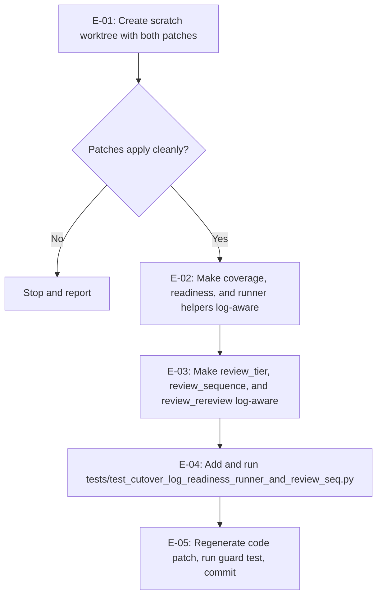

# IPD: Make coverage_record, readiness, runner, and review-sequence evaluators log-aware in the cutover code patch

- Date: 2026-11-26
- Kind: child
- Concern: Backlog `ldfefd` (metastore cutover test conversion; recorded in batch D plan `e0g2gt` F-05 and OQ-01, split per maintainer answer to `run-20261126T055808Z-863961` question `04-e0g2gt-a1-batch-d-production-log-aware-gaps` as the second of two prerequisite plans ahead of `e0g2gt`, chained after Order 317 `p109wy`): inside `.aw/system/cutover/metastore-code.cutover.patch`, three production coverage, readiness, runner, and review-sequence areas still read pre-cutover inline markdown instead of `.aw/records/meta/<id6>.jsonl`: (1) `agent_workflows/coverage_record.py::write` appends `op: "coverage"` to the orchestrator's JSONL log, yet `coverage_record.py::read` and `is_current` still parse inline markdown bullets only (always reporting `absent` on log-format orchestrators), `agent_workflows/orchestrator_readiness.py::review_readiness` and `agent_workflows/runner_shared.py` do not pass log state to them, and `coverage_record.py::write` calls bullet-only `read_loose_id` and omits `.aw/records/meta/<id6>.jsonl` when `commit=True`; (2) `agent_workflows/plan_readiness.py::is_plan_review_approved` reads inline `Readiness` and `## Workflow history` text only (returning `False` on log-format plans), `plan_readiness.py::review_staleness_index` reads current status and `Scope-Paths` from inline text only, `agent_workflows/runner_shared.py::hold_attended_plan` checks inline `Attended` bullets only (failing to hold log-format attended plans in headless runs), and `runner_shared.py::plan_kind_from_file` reads inline `Kind` bullets only; and (3) `agent_workflows/review_tier.py::tier_facts`, `agent_workflows/review_sequence.py` (`structural_diff`, `verdict_outputs`, `check_S7`), and `agent_workflows/review_rereview.py` (`rereview_triggers`, `check_limit_s7`), called by `agent_workflows/runner_shared.py::run_review_sequence`, still read plan metadata and review history from inline `.ipd.md` text only.
- Scope: In an isolated scratch worktree `.aw/state/q6fiws/scratch` with both cutover patches applied (including prerequisite plans `hdwqex`, `89mtbl`, `nv3upa`, `fljn9b`, `cugg3w`, `szykgd`, `psm9ac`, `otin36`, `x8id25`, and `p109wy`), make `agent_workflows/coverage_record.py`, `agent_workflows/orchestrator_readiness.py::review_readiness`, `agent_workflows/plan_readiness.py` (`is_plan_review_approved`, `review_staleness_index`), `agent_workflows/runner_shared.py` (`hold_attended_plan`, `plan_kind_from_file`, orchestrator coverage gate, `run_review_sequence`), `agent_workflows/review_tier.py::tier_facts`, `agent_workflows/review_sequence.py` (`structural_diff`, `verdict_outputs`, `check_S7`), and `agent_workflows/review_rereview.py` (`rereview_triggers`, `check_limit_s7`) log-aware while keeping legacy parity intact. Add and pass core behavioral test module `tests/test_cutover_log_readiness_runner_and_review_seq.py` in the scratch worktree, and regenerate `.aw/system/cutover/metastore-code.cutover.patch`. Make no live code changes outside `- Scope-Paths:`.
- Scope-Paths: .aw/records/plans/pending/20261126-metastore-318-q6fiws-make-coverage-record-readiness-runner-and-review-sequence-ev.ipd.md, .aw/system/cutover/metastore-code.cutover.patch
- Item-Dependencies: executed:p109wy
- Status: to-review
- From-Spec: 4sd62s
- Work-Kind: bug
- Priority: high
- From-Backlog: ldfefd
- Blocks-Release: next
- Set: metastore
- Order: 318
- Highest E allocated: 05
- Author: antigravity/gemini
- Id: q6fiws

> Write and proofread this plan per the technical writing standard, `.aw/system/workflows/technical-writing/technical-writing.md` (`.agents/workflows/technical-writing/technical-writing.md` in a legacy-layout install), including requirement 12 (diagrams).

## Workflow history

- 2026-11-26 to-review (aw set): authored as Order 318 (part 2 of 2) ahead of e0g2gt per maintainer answer to run-20261126T055808Z-863961 question 04-e0g2gt-a1-batch-d-production-log-aware-gaps
- 2026-11-26 draft (antigravity/gemini): created.

## Goal

Make coverage records, orchestrator and plan readiness checks, runner attended-plan and kind helpers, and review-sequence/tier/rereview evaluators log-aware inside `.aw/system/cutover/metastore-code.cutover.patch`, completing the two-plan production prerequisite chain ahead of batch D (`e0g2gt`).

## Detailed Implementation Checklist (TODO)

Execution-state rule: mark an `E-*` item complete only after performing the action. That mark is not validation. Right-sizing rule: write for a modest executor that cannot hold much in its head. Each E-item is one step (one concern, about one file, executable in one focused pass) and its V-item names each unit it covers with its own check; a plan stays at about 5 E-items and 8 work Scope-Paths, else split it into more child plans (guidance, `IPD-Z603`). Accepted execution states: blocked, failed, pending, performed; terminal gate demands 'performed'.

### Task group 1: scratch worktree

- [ ] E-01 Create the scratch worktree following the SCRATCH PROCEDURE of executed plan `2k5t16` (Step 0): run `git worktree add --detach .aw/state/q6fiws/scratch HEAD`; inside `.aw/state/q6fiws/scratch`, run `git apply --index .aw/system/cutover/metastore-docs.cutover.patch`, record `BASE=$(git write-tree)` in F-01, and then run `git apply --index .aw/system/cutover/metastore-code.cutover.patch`. If either patch rejects, stop and report.
  - Depends on: none
  - Expected outcome: `.aw/state/q6fiws/scratch` holds HEAD plus both patches staged, and F-01 records the base tree id.
  - Execution state: pending

### Task group 2: log-aware coverage, readiness, runner helpers, and review-sequence evaluators (scratch worktree only)

- [ ] E-02 Make `agent_workflows/coverage_record.py`, `agent_workflows/orchestrator_readiness.py::review_readiness`, `agent_workflows/plan_readiness.py`, and `agent_workflows/runner_shared.py` (`hold_attended_plan`, `plan_kind_from_file`, and the orchestrator coverage gate) log-aware in `.aw/state/q6fiws/scratch` while keeping legacy parity intact:
  1. In `agent_workflows/coverage_record.py`:
     - Add optional `state: Any = None` (and/or `plan_path: Path | str | None = None`, `repo: Path | str | None = None`) keyword parameters to `read` and `is_current` so when a log-backed `artifact_meta.State` is supplied or resolved from `plan_path`/`repo`, `read` reads `coverage`, `coverage_fingerprint`, and `coverage_checked` from `state.fields` while continuing to parse `## Coverage findings` quotes from `plan_text` (spec `4sd62s` N3), falling back to `artifact_meta.read_text` when no log state exists.
     - In `coverage_record.write`, resolve `id6` via `artifact_meta.read_mirror_id6(plan_text) or artifact_meta.read_loose_id(plan_text)` (both before appending and when building the commit message); when `commit=True`, check dirtiness and stage/commit the companion log `.aw/records/meta/<id6>.jsonl` (or `.agents/meta/<id6>.jsonl` / companion-repo log path) alongside `rel_path` (restoring all staged paths if the commit fails) so `op: "coverage"` events are committed rather than left unstaged.
     - Update `agent_workflows/orchestrator_readiness.py::review_readiness` and `agent_workflows/runner_shared.py` (the orchestrator coverage gate calling `coverage_record.read` and `coverage_record.is_current`) to pass the orchestrator's log-backed `State` (and `plan_path`/`repo`) into `coverage_record.read` and `coverage_record.is_current`.
  2. In `agent_workflows/plan_readiness.py`:
     - Update `is_plan_review_approved(plan_path)` to resolve companion `artifact_meta.State` and log history (`artifact_meta.read` / `artifact_meta.history`) when a companion log exists for `plan_path` (falling back to inline text parsing for unlogged legacy plans): read `readiness` from `state.fields.get("readiness")`, verify review provenance from log history (an `op: "review"` event or a `status` transition to `reviewed` / review-tagged history row), reject out-of-vocab `readiness` without fallback, and keep `has_unresolved_blocking_question(text)` for body open-question blocks.
     - Update `review_staleness_index(repo_root, plan_paths)` to read each candidate's current status from log-backed `artifact_meta.State` (falling back to `artifact_meta.read_text` for unlogged legacy plans) and compare log-backed `Scope-Paths` at the latest `plan-review:` commit (via `artifact_meta.read_at`) against current log-backed `Scope-Paths` alongside body open-question and `frozen_region_digest` checks so a log-only `Scope-Paths` change after review marks the plan stale.
  3. In `agent_workflows/runner_shared.py`:
     - Update `hold_attended_plan(q_entry, plan_path, *, interactive=False)` to resolve companion `artifact_meta.State` for `plan_path` and check `state.fields.get("attended")` (`"required"`, case-insensitive) before falling back to `_schema.plan_requires_attended(text)`, so log-format attended plans (`tub3ir`, `5qyba0`, `cxxmyv`) are held `not-run` in headless runs and marked `ATTENDED_KEY` in interactive runs.
     - Update `plan_kind_from_file(path)` to resolve companion `artifact_meta.State` for `path` and read `state.fields.get("plan_role")` before falling back to `_read_text_with_loose(text, record_type="ipd")`.
  - Depends on: E-01
  - Expected outcome: coverage reads, writes, commits, and cache checks work on log-format orchestrators; `is_plan_review_approved`, `review_staleness_index`, `hold_attended_plan`, and `plan_kind_from_file` read authoritative log state on log-format plans while preserving legacy fallback parity.
  - Execution state: pending

- [ ] E-03 Make `agent_workflows/review_tier.py`, `agent_workflows/review_sequence.py`, `agent_workflows/review_rereview.py`, and their caller `agent_workflows/runner_shared.py::run_review_sequence` log-aware in `.aw/state/q6fiws/scratch` while keeping legacy parity intact:
  1. In `agent_workflows/review_tier.py::tier_facts(plan_text, *, state=None)`, accept optional `state: Any = None` and pass `state=state` into `ipd_lint.parse(plan_text or "", state=state)` (using `state` instead of `artifact_meta.read_text` when provided) so `kind`, `scope_paths`, `names_spec`, `e_items`, `task_groups`, `exceeds_size`, and `in_set` reflect log-backed metadata.
  2. In `agent_workflows/review_sequence.py`:
     - Update `structural_diff(before, after, *, state_before=None, state_after=None)` to pass optional `state_before` and `state_after` into `ipd_lint.parse` and `_state_to_front_matter` (falling back to `artifact_meta.read_text` when omitted).
     - Update `verdict_outputs(plan_text, *, state=None, history=None)` to read `readiness` and `status` from `state` and the newest verdict entry from log `history` when provided (falling back to inline `read_text` and `plan_readiness.newest_verdict` when omitted).
     - Update `check_S7(plan_text_before, plan_text_after, review_text, reply_text, *, state_before=None, state_after=None, history_before=None, history_after=None)` to read `readiness`/`status` from `state_after`, count verdict-bearing transitions from `history_before`/`history_after` when provided, and pass `state=state_before` / `state=state_after` into `ipd_lint.lint_text(...)` so log-format plans validate cleanly at S7 without requiring inline front matter or inline history lines.
  3. In `agent_workflows/review_rereview.py`:
     - Update `rereview_triggers(pass_start_text, now_text, *, after_r_text, state_start=None, state_now=None, state_after_r=None)` to read `scope_paths`, `item_dependencies`, and `structural_diff` from the supplied log `State` objects when provided.
     - Update `check_limit_s7(plan_before, plan_after, *, state_after=None)` to read `readiness` from `state_after` when provided.
  4. In `agent_workflows/runner_shared.py::run_review_sequence`, resolve companion log `State` and `history` for `plan_file` at pass start, after R2/R4, and at S7, and pass them into `ipd_lint.parse`, `review_tier.tier_facts`, `review_sequence.verdict_outputs`, `review_sequence.structural_diff`, `review_sequence.check_S7`, `review_rereview.rereview_triggers`, and `review_rereview.check_limit_s7`. Record the verified caller audit in F-02.
  - Depends on: E-02
  - Expected outcome: review tier facts, structural diff, MD-15 verdict guards, S7 postcondition checks, re-review triggers, and limit-S7 checks work on log-format plans while keeping legacy text calls unchanged; F-02 records the verified caller audit.
  - Execution state: pending

- [ ] E-04 Add and run core behavioral test module `tests/test_cutover_log_readiness_runner_and_review_seq.py` (`pytestmark = pytest.mark.core`) in `.aw/state/q6fiws/scratch` (asserting real outputs, exit codes, and side effects; no code-pinning tests):
  1. Cover `coverage_record.write` (`commit=True` and `commit=False`), `coverage_record.read`, `coverage_record.is_current`, `orchestrator_readiness.review_readiness`, and `runner_shared`'s orchestrator coverage gate on a log-format orchestrator: verify `git show --name-only HEAD` includes `.aw/records/meta/<id6>.jsonl`, current coverage hits cache (0 model calls), and a body edit invalidates the fingerprint.
  2. Cover `plan_readiness.is_plan_review_approved` (True on log-backed `readiness=go-pending-approval` with review history, False without review provenance, False on `no-go` or out-of-vocab), `plan_readiness.review_staleness_index` (clean vs. stale after a log-only `Scope-Paths` update or body edit), `runner_shared.hold_attended_plan` (holds headless and marks interactive on a log-format `attended=required` plan), and `runner_shared.plan_kind_from_file` (reads `orchestrator` and `child` from log state).
  3. Cover `review_tier.tier_facts`, `review_sequence.structural_diff`, `review_sequence.verdict_outputs`, `review_sequence.check_S7`, `review_rereview.rereview_triggers`, and `review_rereview.check_limit_s7` on log-format plans with companion `State` and `history` (plus legacy inline text parity).
  4. Run `python3 -m pytest -o addopts="" -m '' -v tests/test_cutover_log_readiness_runner_and_review_seq.py` in `.aw/state/q6fiws/scratch` and confirm every test passes.
  - Depends on: E-03
  - Expected outcome: `tests/test_cutover_log_readiness_runner_and_review_seq.py` passes every test in `.aw/state/q6fiws/scratch`.
  - Execution state: pending

### Task group 3: package

- [ ] E-05 In `.aw/state/q6fiws/scratch`, run `git add -A` and write `git diff --cached --binary $BASE` over `.aw/system/cutover/metastore-code.cutover.patch` in the executing checkout; remove the scratch worktree (`git worktree remove --force .aw/state/q6fiws/scratch`); run `python3 -m pytest -o addopts="" tests/test_metastore_cutover_code_patch.py` in the executing checkout; verify `git status --short` shows only `- Scope-Paths:` modified; and commit through `aw commit q6fiws -- .aw/records/plans/pending/20261126-metastore-318-q6fiws-make-coverage-record-readiness-runner-and-review-sequence-ev.ipd.md .aw/system/cutover/metastore-code.cutover.patch`; never push.
  - Depends on: E-04
  - Expected outcome: `.aw/system/cutover/metastore-code.cutover.patch` contains all prior code-patch hunks plus this plan's changes; `tests/test_metastore_cutover_code_patch.py` passes; scratch worktree is removed; no live files outside `- Scope-Paths:` are modified; one path-scoped commit is created.
  - Execution state: pending

## Project conventions discovered (Step 0)

- The scratch procedure and cumulative code patch are defined in executed plan `2k5t16` (Step 0, OQ-01); siblings `g45vyv`, `hdwqex`, `fljn9b`, `szykgd`, `otin36`, and `p109wy` follow the same procedure.
- `agent_workflows/ipd_lint.py` (updated by `hdwqex`) accepts an optional `state=` parameter on `parse(...)` and `lint_text(...)` so log-backed plans expose metadata without inline bullets.
- `agent_workflows/coverage_record.py::write` was partially switched by `.aw/system/cutover/metastore-code.cutover.patch` to append `op: "coverage"` through `artifact_meta.append`, while `read`, `is_current`, id lookup, and `commit=True` log staging remain unpatched.
- `agent_workflows/review_sequence.py::restore_pre_s7_plan` was already switched by `.aw/system/cutover/metastore-code.cutover.patch` to preserve the YAML mirror, while `structural_diff`, `verdict_outputs`, `check_S7`, `review_tier.tier_facts`, and `review_rereview` still read inline text only.
- Tests exercise real behavior and assert on observable outcomes (AGENTS.md "TEST OUTCOMES, NOT CODE STRUCTURE"); no `inspect`, `ast`, regex, or substring code-pinning tests.
- Cite code by symbol (`path::Symbol`) or by a quoted content string, with a line number only appended as a hint and never alone (advisory `IPD-C801`).

## Findings

| Id | Evidence | Finding |
|---|---|---|
| F-01 | (written by E-01) | Base tree id after applying `.aw/system/cutover/metastore-docs.cutover.patch`. |
| F-02 | (written by E-03) | Caller and behavior audit across `coverage_record.py`, `orchestrator_readiness.py`, `plan_readiness.py`, `runner_shared.py`, `review_tier.py`, `review_sequence.py`, and `review_rereview.py`. |
| F-03 | `e0g2gt` F-05 and static audit of `.aw/system/cutover/metastore-code.cutover.patch`: `coverage_record.py::read`, `is_current`, `write`; `orchestrator_readiness.py::review_readiness`; `plan_readiness.py::is_plan_review_approved`, `review_staleness_index`; `runner_shared.py::hold_attended_plan`, `plan_kind_from_file`, `run_review_sequence`, orchestrator coverage gate; `review_tier.py::tier_facts`; `review_sequence.py::structural_diff`, `verdict_outputs`, `check_S7`; `review_rereview.py::rereview_triggers`, `check_limit_s7` | Three verified production cutover gaps (items 3, 4, and 6 of `e0g2gt` F-05) block `tests/test_readers_review_modules.py`, `tests/test_readers_runner.py`, and post-cutover runner/readiness/coverage workflows; split into Order 318 (`q6fiws`) after Order 317 (`p109wy`) and ahead of `e0g2gt` per maintainer decision on `run-20261126T055808Z-863961` question `04-e0g2gt-a1-batch-d-production-log-aware-gaps`. |

## Proposed changes (ordered, validatable)

1. E-01: Create scratch worktree `.aw/state/q6fiws/scratch` with both cutover patches staged.
2. E-02: Make `coverage_record`, `orchestrator_readiness.review_readiness`, `plan_readiness`, and `runner_shared` (`hold_attended_plan`, `plan_kind_from_file`, coverage gate) log-aware while preserving legacy parity.
3. E-03: Make `review_tier.tier_facts`, `review_sequence` (`structural_diff`, `verdict_outputs`, `check_S7`), `review_rereview` (`rereview_triggers`, `check_limit_s7`), and `runner_shared.run_review_sequence` log-aware; record F-02.
4. E-04: Add and pass core behavioral test module `tests/test_cutover_log_readiness_runner_and_review_seq.py` in `.aw/state/q6fiws/scratch`.
5. E-05: Regenerate `.aw/system/cutover/metastore-code.cutover.patch`, remove the scratch worktree, pass `tests/test_metastore_cutover_code_patch.py`, verify a clean live tree outside `- Scope-Paths:`, and commit path-scoped.

## Deferred / out of scope (with reason)

- Making spec `4sd62s` Section 4.1a `.review.md` mirrors, `has_prompt_metadata_comment`, and `check_engine.check_plan_priority_required` log-aware: prerequisite Order 317 plan that executes immediately before this plan.
  - Carrier: p109wy
- Converting batch D's 10 test modules (`tests/test_prose_dash_advisory.py` through `tests/test_readers_runner.py`): runs immediately after this plan executes.
  - Carrier: e0g2gt
- Prior prerequisite production fixes (`hdwqex`, `fljn9b`, `szykgd`, `otin36`): already owned by Orders 305 and 314-316.
  - Carrier: otin36
- Applying the cutover patches on the real tree: attended cutover commit.
  - Carrier: cxxmyv

## Scope check

- Over-scope: none. No live code or test files are modified outside `.aw/system/cutover/metastore-code.cutover.patch`.
- Under-scope: none. All three coverage/readiness/runner/review-sequence gaps (items 3, 4, and 6 of `e0g2gt` F-05) map to E-02 through E-04; items 1, 2, and 5 map to prerequisite Order 317 (`p109wy`).

## Required tests / validation

- Throwaway-repository checks on `.aw/state/q6fiws/scratch` for `coverage_record`/`orchestrator_readiness`, `plan_readiness`, `runner_shared`, and `review_tier`/`review_sequence`/`review_rereview` (V-02, V-03).
- Core behavioral test module `python3 -m pytest -o addopts="" -m '' -v tests/test_cutover_log_readiness_runner_and_review_seq.py` in `.aw/state/q6fiws/scratch` (V-04).
- Cumulative patch guard test `python3 -m pytest -o addopts="" tests/test_metastore_cutover_code_patch.py` in the executing checkout (V-05).

## Spec / documentation sync

No spec or documentation change is needed in this plan. Spec `4sd62s` Sections 4.1 through 4.4 and N3 already define log-backed metadata, coverage events, and body-section boundaries, and `.aw/system/cutover/metastore-docs.cutover.patch` already documents them. This plan brings the coverage, readiness, runner, and review-sequence code paths inside `.aw/system/cutover/metastore-code.cutover.patch` into agreement with them.

## Open questions

None open.

## Validation and cross-check (verify before reporting done)

Validation-state rule: inspect evidence in a separate pass. Do not mark a `V-*` item complete from memory or from the matching execution checkmark. Accepted validation results: blocked, failed, pass, pending; terminal gate demands 'pass'. Runtime-demonstration reachability rule: for each `V-*` item demanding the software be observed acting (such as a run, a dispatch, or a transition) - as distinct from items demanding a diff, a file's content, or a test result, which are reachable by construction - name the code path that produces the observation or the sibling `E-*` that creates it, else the demand is UNDER-SCOPE.

- [ ] V-01 validates E-01
  - Required evidence: paste the `git worktree add --detach .aw/state/q6fiws/scratch HEAD` command, both `git apply --index` commands (for `.aw/system/cutover/metastore-docs.cutover.patch` and `.aw/system/cutover/metastore-code.cutover.patch`) with exit status 0, and the base tree id recorded in F-01.
  - Observed evidence:
  - Result: pending
- [ ] V-02 validates E-02
  - Required evidence: paste observed outputs on `.aw/state/q6fiws/scratch` (code paths updated by E-02) showing `coverage_record.write(..., commit=True)` committing `.aw/records/meta/<id6>.jsonl` (`git show --name-only HEAD`), `coverage_record.read`/`is_current` and `orchestrator_readiness.review_readiness` recognizing the recorded log coverage as current, `plan_readiness.is_plan_review_approved` returning `True` on a log-format reviewed plan (and `False` without review provenance), `plan_readiness.review_staleness_index` flagging a log-only `Scope-Paths` mutation after review, `runner_shared.hold_attended_plan` holding a log-format attended plan headless, and `runner_shared.plan_kind_from_file` returning the log-stored `plan_role`.
  - Observed evidence:
  - Result: pending
- [ ] V-03 validates E-03
  - Required evidence: paste F-02 (verified caller audit) and observed outputs on `.aw/state/q6fiws/scratch` (code paths updated by E-03) showing `review_tier.tier_facts`, `review_sequence.structural_diff`, `review_sequence.verdict_outputs`, `review_sequence.check_S7`, `review_rereview.rereview_triggers`, and `review_rereview.check_limit_s7` returning accurate results on log-format plans when given companion log `State` and `history` (and keeping legacy text parity when omitted).
  - Observed evidence:
  - Result: pending
- [ ] V-04 validates E-04
  - Required evidence: paste the full `python3 -m pytest -o addopts="" -m '' -v tests/test_cutover_log_readiness_runner_and_review_seq.py` output in `.aw/state/q6fiws/scratch` showing every test PASSED across `coverage_record`/`orchestrator_readiness`, `plan_readiness`, `runner_shared`, and `review_tier`/`review_sequence`/`review_rereview`.
  - Observed evidence:
  - Result: pending
- [ ] V-05 validates E-05
  - Required evidence: paste `git apply --stat .aw/system/cutover/metastore-code.cutover.patch`, the `python3 -m pytest -o addopts="" tests/test_metastore_cutover_code_patch.py` run showing every guard test PASSED, `git worktree list` showing `.aw/state/q6fiws/scratch` removed, `git status --short` confirming no live edits outside `- Scope-Paths:`, and the `aw commit q6fiws` output naming the commit hash.
  - Observed evidence:
  - Result: pending

## Approval and execution gate

- Size assessment: standard
- Cohesion rationale: not required

Execute only after human approval (`Status: approved`) and after every plan in `- Item-Dependencies:` (`p109wy`, chained after `x8id25`) is executed; open questions: none open. Code and tests are edited ONLY inside `.aw/state/q6fiws/scratch` and packaged into `.aw/system/cutover/metastore-code.cutover.patch`. Scope fence: `- Scope-Paths:` is a declaration; any needed edit outside it must be justified at finalize (`--scope-reason`), and any declared path left unmodified must be acknowledged (`--scope-ack`). Safety stop conditions: stop and report rather than editing live production code outside the scratch worktree or weakening test assertions if a patch hunk rejects, an unexpected failure occurs on unmodified code, or an unresolvable concurrent-edit conflict occurs. Honesty rule: you MUST paste the ACTUAL runner output of every command named in V-01 through V-05; never claim a result you did not run. Commits: commit only through `aw commit q6fiws -- <paths>`; never push. Lifecycle transition: after `aw ipd lint --phase pre-transition` conforms and every `V-*` reads `pass` with pasted evidence, in a managed runner lane stop after committing the updated plan and let the runner run `aw ipd finalize`; in a hand-run session run `aw ipd finalize` to move the plan to `.aw/records/plans/executed/` (never use a raw `git mv` to `executed/`).
