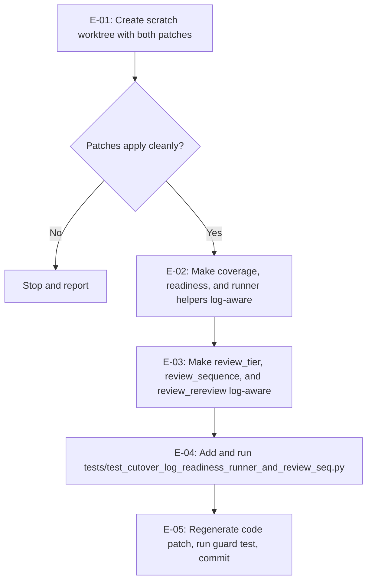

# IPD: Make coverage_record, readiness, runner, and review-sequence evaluators log-aware in the cutover code patch

- Date: 2026-11-26
- Kind: child
- Concern: Backlog `ldfefd` (metastore cutover test conversion; recorded in batch D plan `e0g2gt` F-05 and OQ-01, split per maintainer answer to `run-20261126T055808Z-863961` question `04-e0g2gt-a1-batch-d-production-log-aware-gaps` as the second of two prerequisite plans ahead of `e0g2gt`, chained after Order 317 `p109wy`): inside `.aw/system/cutover/metastore-code.cutover.patch`, three production areas still read pre-cutover inline markdown instead of `.aw/records/meta/<id6>.jsonl`. First, `agent_workflows/coverage_record.py::write` appends `op: "coverage"` to the orchestrator's JSONL log, yet `coverage_record.py::read` and `is_current` still parse inline markdown bullets only (always reporting `absent` on log-format orchestrators and omitting log-event `date`/`model` derivation because `coverage_checked` is migration-only), `agent_workflows/orchestrator_readiness.py::review_readiness` calls bare `_ipd_lint.parse(text)` (silently skipping Condition 3 row conformance on log-format orchestrators) and does not pass log state into `coverage_record`, `agent_workflows/runner_shared.py::probe_orchestrator` passes text only into `coverage_record`, and `coverage_record.py::write` calls bullet-only `read_loose_id` and omits `.aw/records/meta/<id6>.jsonl` from dirty checks and `commit=True` staging. Second, `agent_workflows/plan_readiness.py::is_plan_review_approved` reads inline `Readiness` and `## Workflow history` text only (returning `False` on log-format plans), `plan_readiness.py::review_staleness_index` and `review_staleness_from_texts` read status and `Scope-Paths` from inline text only (and cache without the companion log's mtime, short-circuit when plan text is unchanged, and filter `git log` by plan path only), `agent_workflows/runner_shared.py::hold_attended_plan` checks inline `Attended` bullets only (failing to hold log-format attended plans in headless runs), and `runner_shared.py::plan_kind_from_file` reads inline `Kind` bullets only. Third, `agent_workflows/review_tier.py::tier_facts`, `agent_workflows/review_sequence.py` (`structural_diff`, `check_S5`, `verdict_outputs`, `count_verdict_bearing_entries`, `check_S7`), and `agent_workflows/review_rereview.py` (`rereview_triggers`, `check_limit_s7`, `run_rereview_loop`), called by `agent_workflows/runner_shared.py::run_review_sequence`, still read plan metadata and review history from inline `.ipd.md` text only (and `tier_facts` stringifies list `scope_paths`, `check_S5` prepends legacy bullets above spec-4.1a YAML review mirrors, and `check_S7` omits `_history_loader` when linting log-format plans).
- Scope: In an isolated scratch worktree `.aw/state/q6fiws/scratch` with both cutover patches applied (including prerequisite plans `hdwqex`, `89mtbl`, `nv3upa`, `fljn9b`, `cugg3w`, `szykgd`, `psm9ac`, `otin36`, `x8id25`, and `p109wy`), make `agent_workflows/coverage_record.py`, `agent_workflows/orchestrator_readiness.py::review_readiness`, `agent_workflows/plan_readiness.py` (`is_plan_review_approved`, `review_staleness_from_texts`, `review_staleness_index`), `agent_workflows/runner_shared.py` (`hold_attended_plan`, `plan_kind_from_file`, `probe_orchestrator`, `run_review_sequence`), `agent_workflows/review_tier.py::tier_facts`, `agent_workflows/review_sequence.py` (`structural_diff`, `check_S5`, `verdict_outputs`, `count_verdict_bearing_entries`, `check_S7`), and `agent_workflows/review_rereview.py` (`rereview_triggers`, `check_limit_s7`, `run_rereview_loop`) log-aware while keeping legacy parity intact. Add and pass core behavioral test module `tests/test_cutover_log_readiness_runner_and_review_seq.py` in the scratch worktree, and regenerate `.aw/system/cutover/metastore-code.cutover.patch`. Make no live code changes outside `- Scope-Paths:`.
- Scope-Paths: .aw/records/plans/pending/20261126-metastore-318-q6fiws-make-coverage-record-readiness-runner-and-review-sequence-ev.ipd.md, .aw/system/cutover/metastore-code.cutover.patch
- Item-Dependencies: executed:p109wy
- Status: approved
- Review-Depth: standard
- Readiness: go-pending-approval
- From-Spec: 4sd62s
- Work-Kind: bug
- Priority: high
- From-Backlog: ldfefd
- Blocks-Release: next
- Set: metastore
- Order: 318
- Highest E allocated: 05
- Author: antigravity/gemini
- Id: q6fiws
- Approval: 2026-11-26, recorded via aw ipd set: status set to approved

> Write and proofread this plan per the technical writing standard, `.aw/system/workflows/technical-writing/technical-writing.md` (`.agents/workflows/technical-writing/technical-writing.md` in a legacy-layout install), including requirement 12 (diagrams).

## Workflow history

- 2026-11-26 approved (aw set): status set to approved
- 2026-11-26 reviewed (aw set): APPROVE WITH REVISIONS APPLIED; PR-001..PR-005 FIXED
- 2026-11-26 /plan-review (antigravity/gemini): APPROVE WITH REVISIONS APPLIED; PR-001, PR-002, PR-003, PR-004, PR-005 (all FIXED); review record .aw/records/reviews/20261126-metastore-318-q6fiws-make-coverage-record-readiness-runner-and-review-sequence-ev.review.md
- 2026-11-26 to-review (aw set): authored as Order 318 (part 2 of 2) ahead of e0g2gt per maintainer answer to run-20261126T055808Z-863961 question 04-e0g2gt-a1-batch-d-production-log-aware-gaps
- 2026-11-26 draft (antigravity/gemini): created.

## Goal

Make coverage records, orchestrator and plan readiness checks, runner attended-plan and kind helpers, and review-sequence, tier, and re-review evaluators log-aware inside `.aw/system/cutover/metastore-code.cutover.patch`, completing the two-plan production prerequisite chain ahead of batch D (`e0g2gt`).

## Detailed Implementation Checklist (TODO)

Execution-state rule: mark an `E-*` item complete only after performing the action. That mark is not validation. Right-sizing rule: write for a modest executor that cannot hold much in its head. Each E-item is one step (one concern, about one file, executable in one focused pass) and its V-item names each unit it covers with its own check; a plan stays at about 5 E-items and 8 work Scope-Paths, else split it into more child plans (guidance, `IPD-Z603`). Accepted execution states: blocked, failed, pending, performed; terminal gate demands 'performed'.

### Task group 1: scratch worktree

- [ ] E-01 Create the scratch worktree following the SCRATCH PROCEDURE of executed plan `2k5t16` (Step 0): run `git worktree add --detach .aw/state/q6fiws/scratch HEAD`; inside `.aw/state/q6fiws/scratch`, run `git apply --index .aw/system/cutover/metastore-docs.cutover.patch`, record `BASE=$(git write-tree)` in F-01, and then run `git apply --index .aw/system/cutover/metastore-code.cutover.patch`. If either patch rejects, stop and report.
  - Depends on: none
  - Expected outcome: `.aw/state/q6fiws/scratch` holds HEAD plus both patches staged, and F-01 records the base tree id.
  - Execution state: pending

### Task group 2: log-aware coverage, readiness, runner helpers, and review-sequence evaluators (scratch worktree only)

- [ ] E-02 Make `agent_workflows/coverage_record.py`, `agent_workflows/orchestrator_readiness.py::review_readiness`, `agent_workflows/plan_readiness.py`, and `agent_workflows/runner_shared.py` (`hold_attended_plan`, `plan_kind_from_file`, and `probe_orchestrator`) log-aware in `.aw/state/q6fiws/scratch` while keeping legacy parity intact:
  1. In `agent_workflows/coverage_record.py`, `agent_workflows/orchestrator_readiness.py::review_readiness`, and `agent_workflows/runner_shared.py::probe_orchestrator`:
     - Add optional keyword parameters `state: Any = None`, `history: Sequence[Mapping[str, Any]] | None = None`, `plan_path: Path | str | None = None`, and `repo: Path | str | None = None` to `coverage_record.read` and `coverage_record.is_current`. When a log-backed `artifact_meta.State` is supplied or resolved from `plan_path`/`repo`, read `coverage` and `coverage_fingerprint` from `state.fields`; read `date` and `model` from `state.fields.get("coverage_checked")` if present (migrated legacy records), or derive `date` (`observed_day` or `at[:10]`) and `model` (`actor.model`, defaulting to `"by host-default"` when empty or `"host-default"`) from the newest `op == "coverage"` event in log history (`history` or `artifact_meta.history(id6, project_context=ctx)`), because `coverage_checked` is migration-only in `artifact_meta.replay`. Continue parsing `## Coverage findings` quotes from `plan_text` (spec `4sd62s` N3), and fall back to `artifact_meta.read_text` when no log state exists.
     - In `coverage_record.write`, resolve `id6` once via `_meta.file_id6(path, _meta.read_mirror_id6(plan_text) or _meta.read_loose_id(plan_text))` and reuse it for both `_meta.append` and the commit message. Resolve the companion log path through `ctx = _meta.legacy_context(resolved_repo)` as `Path(ctx.logical_roots["records"]) / "meta" / f"{id6}.jsonl"` (computing `log_rel` relative to `git_repo` when inside `git_repo`). When `commit=True`, check `git status --porcelain` on BOTH `rel_path` and `log_rel` before writing (writing without committing if either path already has uncommitted changes), check that `_meta.append` returned `committed=True`, and stage and commit `log_rel` alongside `rel_path` (restoring all staged paths if `git commit` fails) so pass-only and fail `op: "coverage"` events are committed rather than left unstaged.
     - Update `agent_workflows/orchestrator_readiness.py::review_readiness` to pass `state=plan_state` into `doc = _ipd_lint.parse(text, state=plan_state)` (so Condition 3 `orchestrator_row_conformance` does not silently skip log-format orchestrators) and pass `state=plan_state, plan_path=path, repo=repo_path` into `coverage_record.read` and `coverage_record.is_current`. Update `agent_workflows/runner_shared.py::probe_orchestrator` to pass `plan_path=target.path, repo=Path(repo)` into `coverage_record.read` and `coverage_record.is_current`.
  2. In `agent_workflows/plan_readiness.py`:
     - Update `is_plan_review_approved(plan_path)` to resolve the plan's owner root (`project_context.record_owner_root(plan_path) or artifact_core.repo_root_of(plan_path)`), build `ctx = artifact_meta.legacy_context(owner_root)`, and read companion `artifact_meta.State` and `events = artifact_meta.history(id6, project_context=ctx)` (inside `artifact_meta.ephemeral_if_uninitialized()`) when a companion log exists for `plan_path` (falling back to inline text parsing for unlogged legacy plans). Preserve the three-way rule: a valid `state.fields.get("readiness")` decides the answer only when log history contains gate review provenance (an `op == "review"` event with `review_kind == "gate"` excluding `actor.tool == "aw ipd recheck-readiness"`, or a review-tagged `op == "status"` event transitioning `to == "reviewed"`); an out-of-vocab `readiness` fails closed outright without fallback; and when `readiness` is absent, inspect the newest log event (`events[-1]`, because `artifact_meta.history` is `ORDER BY seq ASC` oldest-first) for gate review provenance plus an approving verdict and `not has_unresolved_blocking_question(text)`.
     - Update `review_staleness_from_texts(reviewed_text, current_text, reviewed_commit, *, reviewed_scope_paths=None, current_scope_paths=None)` so existing 3-argument callers stay pure and unchanged, while log-aware callers do not short-circuit on `reviewed_text == current_text` when normalized non-grandfathered `reviewed_scope_paths` and `current_scope_paths` differ (marking any difference as `"substantive-edit"`).
     - Update `review_staleness_index(repo_root, plan_paths)` to resolve companion log state via `artifact_meta.read` (inside `scan_once()` and `ephemeral_if_uninitialized()`, falling back to `artifact_meta.read_text` for unlogged legacy plans) for current status and current `scope_paths`, include the companion log's `(mtime_ns, size)` (or `(0, 0)` when absent) in `_STALENESS_CACHE`'s key so log-only edits never hit a stale cache entry, include companion `meta/<id6>.jsonl` paths alongside plan paths in the batched `git log --grep=^plan-review:` query (mapping log hits back to their candidate plan), read reviewed `scope_paths` at the latest `plan-review:` commit via `artifact_meta.read_at(id6, sha, project_context=ctx)` (when `res.kind == "ok"` and `res.state is not None`), and pass both `scope_paths` values into `review_staleness_from_texts`.
  3. In `agent_workflows/runner_shared.py`:
     - Update `hold_attended_plan(q_entry, plan_path, *, interactive=False)` (keeping its public signature backwards-compatible) to resolve `owner_root = project_context.record_owner_root(plan_path) or artifact_core.repo_root_of(plan_path)` and read companion `artifact_meta.State` via `_read_state_for_path(owner_root, Path(plan_path), record_type="ipd")`, checking `str(st.fields.get("attended") or "").strip().lower() == "required"` before falling back to `_schema.plan_requires_attended(text)`, so log-format attended plans (such as `tub3ir`, `5qyba0`, and `cxxmyv`) are held `not-run` in headless runs and marked `ATTENDED_KEY` in interactive runs.
     - Update `plan_kind_from_file(path)` (keeping its 1-argument public signature backwards-compatible) to resolve `owner_root` and companion `artifact_meta.State` via `_read_state_for_path(owner_root, Path(path), record_type="ipd")` and read normalized `state.fields.get("plan_role")` (`.strip().lower()`) before falling back to `_read_text_with_loose(text, record_type="ipd")`.
  - Depends on: E-01
  - Expected outcome: coverage reads (including log-event `date`/`model`), writes, commits, cache checks, and orchestrator Condition 3 row conformance work on log-format orchestrators; `is_plan_review_approved`, `review_staleness_from_texts`, `review_staleness_index`, `hold_attended_plan`, and `plan_kind_from_file` read authoritative log state on log-format plans while preserving legacy fallback parity.
  - Execution state: pending

- [ ] E-03 Make `agent_workflows/review_tier.py`, `agent_workflows/review_sequence.py`, `agent_workflows/review_rereview.py`, and `agent_workflows/runner_shared.py::run_review_sequence` log-aware in `.aw/state/q6fiws/scratch` while keeping legacy parity intact:
  1. In `agent_workflows/review_tier.py::tier_facts(plan_text, *, state=None)`, accept optional `state: Any = None` and pass `state=state` into `ipd_lint.parse(plan_text or "", state=state)` (using `state` instead of `artifact_meta.read_text` when provided). Handle BOTH `list`/`tuple` `scope_paths` (as stored in log-backed `State.fields["scope_paths"]`) and legacy comma-separated string `scope_paths` (applying the same `TODO` exclusion to both) so `kind`, `scope_paths`, `names_spec`, `e_items`, `task_groups`, `exceeds_size`, and `in_set` are accurate on log-format plans.
  2. In `agent_workflows/review_sequence.py`:
     - Update `structural_diff(before, after, *, state_before=None, state_after=None)` to pass optional `state_before` and `state_after` into `ipd_lint.parse` and `_state_to_front_matter` (falling back to `artifact_meta.read_text` when omitted).
     - Update `check_S5(..., state_after=None)` to resolve `plan_id6` from `state_after` or `artifact_meta.read_mirror_id6(plan_text_after or "")` before falling back to `artifact_meta.read_text`, and guard the legacy 5-bullet metadata injection with `if artifact_meta.parse_review_mirror(review_text) is None:` so valid spec `4sd62s` Section 4.1a YAML review mirrors are never corrupted by prepended bullets.
     - Update `count_verdict_bearing_entries(plan_text, *, history=None)` and `verdict_outputs(plan_text, *, state=None, history=None)` so when `state`/`history` are provided, `verdict_outputs` reads `readiness`/`status` from `state` and scans `reversed(history)` (newest-first over `ORDER BY seq ASC` log events) for the newest gate `op == "review"` event (excluding `actor.tool == "aw ipd recheck-readiness"`) or verdict-bearing `op == "status"` (`to == "reviewed"`) event, and `count_verdict_bearing_entries` counts those verdict-bearing log events (falling back to inline `read_text` and `history_records` when omitted).
     - Update `check_S7(plan_text_before, plan_text_after, review_text, reply_text, *, state_before=None, state_after=None, history_before=None, history_after=None)` to read `readiness`/`status` from `state_after`, count verdict-bearing entries using `history_before`/`history_after` when provided, and pass BOTH `state=state_before`/`state=state_after` AND `_history_loader=(lambda: list(history_before))` / `_history_loader=(lambda: list(history_after))` (when not `None`) into `ipd_lint.lint_text(...)` so `IPD-M107` (readiness attestation) and other author-checkpoint rules validate log-format plans cleanly without requiring inline history lines.
  3. In `agent_workflows/review_rereview.py`:
     - Update `rereview_triggers(pass_start_text, now_text, *, after_r_text, state_start=None, state_now=None, state_after_r=None)` to read `scope_paths` and `item_dependencies` from the supplied log `State` objects when provided, pass `state=state_start` / `state=state_now` into `ipd_lint.parse`, and forward `state_before=state_after_r, state_after=state_now` into `review_sequence.structural_diff(after_r_text, now_text, ...)`.
     - Update `run_rereview_loop(ctx, s6_reply, *, after_r_text, pass_start_state=None, after_r_state=None, read_state=None)` (keeping `ReviewSequenceContext`'s 10 existing positional fields backwards-compatible) so both `rereview_triggers` calls inside the loop pass `state_start`, `state_now` (re-read via `read_state(ctx.plan_path)` when supplied), and `state_after_r` (captured after R2/R4 prompts in each pass).
     - Update `check_limit_s7(plan_before, plan_after, *, state_after=None)` to read `readiness` from `state_after` when provided.
  4. In `agent_workflows/runner_shared.py::run_review_sequence`, add a local helper that resolves companion log `(state, history)` for `plan_file` inside `target_root` (falling back safely to `(None, None)` when unlogged), and thread those values into `ipd_lint.parse` (initial `kind`/`in_set`/`cur_depth` and `_fail_incomplete` status check), `review_tier.tier_facts`, `review_sequence.verdict_outputs` (baseline and pre-S7 MD-15 guard), `review_sequence.structural_diff` (Proofreading step P and re-ask), `review_sequence.check_S5`, `review_rereview.run_rereview_loop` (`pass_start_state`, `after_r_state`, `read_state`), `review_sequence.check_S7` (initial and re-ask), and `review_rereview.check_limit_s7` (initial and re-ask). Record the verified caller audit in F-02.
  - Depends on: E-02
  - Expected outcome: review tier facts, structural diff, S5 escalation check, MD-15 pre-S7 verdict guard, S7 postcondition checks, re-review triggers and loop, and limit-S7 checks work on log-format plans while keeping legacy text calls unchanged; F-02 records the verified caller audit.
  - Execution state: pending

- [ ] E-04 Add and run core behavioral test module `tests/test_cutover_log_readiness_runner_and_review_seq.py` (`pytestmark = pytest.mark.core`) in `.aw/state/q6fiws/scratch` (asserting real outputs, exit codes, and side effects; no code-pinning tests):
  1. Cover `coverage_record.write` (`commit=True` on both pass and fail verdicts, `commit=False`, and dirty companion-log refusal), `coverage_record.read` (including log-event `date` and `model` derivation when `coverage_checked` is absent), `coverage_record.is_current`, `orchestrator_readiness.review_readiness` (verifying both cached coverage recognition and Condition 3 `CODE_ROW_NONCONFORMING` firing on a nonconforming log-format orchestrator), and `runner_shared.probe_orchestrator`: verify `git show --name-only HEAD` includes `.aw/records/meta/<id6>.jsonl`, current coverage hits cache (0 model calls), and a body edit invalidates the fingerprint.
  2. Cover `plan_readiness.is_plan_review_approved` (True on log-backed `readiness=go-pending-approval` with gate `op: "review"` provenance, False when only `recheck-readiness` or `refinement` or non-review events exist, False on `no-go` or out-of-vocab, and fallback arm inspecting `events[-1]` in `ORDER BY seq ASC`), `plan_readiness.review_staleness_from_texts` / `review_staleness_index` (clean vs. stale after a log-only `Scope-Paths` mutation without touching `.ipd.md`, proving `_STALENESS_CACHE` invalidates on log mtime and log-only `plan-review:` commits are found), `runner_shared.hold_attended_plan` (holds headless and marks interactive on a log-format `attended=required` plan), and `runner_shared.plan_kind_from_file` (reads `orchestrator` and `child` from log state).
  3. Cover `review_tier.tier_facts` (including `list[str]` `scope_paths` with `.spec.md` setting `names_spec=True` and `TODO` exclusion), `review_sequence.structural_diff`, `review_sequence.check_S5` (YAML mirror `id:` lookup without `plan_path` and spec-4.1a YAML review mirror preserved without injected legacy bullets), `review_sequence.verdict_outputs`, `review_sequence.check_S7` (passing on a reviewed log-format plan with `state_after` and `history_after` without triggering `IPD-M107`), `review_rereview.rereview_triggers`, `review_rereview.run_rereview_loop` (detecting a log-only `Scope-Paths` edit during re-review via `read_state`), and `review_rereview.check_limit_s7` on log-format plans plus legacy inline text parity.
  4. Run `python3 -m pytest -o addopts="" -m '' -v tests/test_cutover_log_readiness_runner_and_review_seq.py` in `.aw/state/q6fiws/scratch` and confirm every test passes.
  - Depends on: E-03
  - Expected outcome: `tests/test_cutover_log_readiness_runner_and_review_seq.py` passes every test in `.aw/state/q6fiws/scratch`.
  - Execution state: pending

### Task group 3: package

- [ ] E-05 In `.aw/state/q6fiws/scratch`, run `git add -A` and write `git diff --cached --binary $BASE` over `.aw/system/cutover/metastore-code.cutover.patch` in the executing checkout; remove the scratch worktree (`git worktree remove --force .aw/state/q6fiws/scratch`); run `python3 -m pytest -o addopts="" tests/test_metastore_cutover_code_patch.py` in the executing checkout; verify `git status --short` shows only `- Scope-Paths:` modified; and commit through `aw commit q6fiws -- .aw/records/plans/pending/20261126-metastore-318-q6fiws-make-coverage-record-readiness-runner-and-review-sequence-ev.ipd.md .aw/system/cutover/metastore-code.cutover.patch`; never push.
  - Depends on: E-04
  - Expected outcome: `.aw/system/cutover/metastore-code.cutover.patch` contains all prior code-patch hunks plus this plan's changes; `tests/test_metastore_cutover_code_patch.py` passes; scratch worktree is removed; no live files outside `- Scope-Paths:` are modified; one path-scoped commit is created.
  - Execution state: pending

## Project conventions discovered (Step 0)

- The scratch procedure and cumulative code patch are defined in executed plan `2k5t16` (Step 0, OQ-01); siblings `g45vyv`, `hdwqex`, `fljn9b`, `szykgd`, `otin36`, and `p109wy` follow the same procedure.
- `agent_workflows/ipd_lint.py` (updated by `hdwqex`) accepts optional `state=` on `parse(...)` and both `state=` and `_history_loader=` on `lint_text(...)` so log-backed plans expose metadata and history without inline bullets or inline `## Workflow history` lines.
- `agent_workflows/artifact_meta.py::history` returns events in ascending `seq` order (`ORDER BY seq ASC`, oldest-first), `REGISTRY["ipd"]["scope_paths"]` is a `list[str]`, and `REGISTRY["ipd"]["coverage_checked"]` is migration-only (`op: "coverage"` in `replay` sets only `coverage` and `coverage_fingerprint`, while timestamp and model live on the `op: "coverage"` event itself).
- `agent_workflows/coverage_record.py::write` was partially switched by `.aw/system/cutover/metastore-code.cutover.patch` to append `op: "coverage"` through `artifact_meta.append`, while `read`, `is_current`, id lookup, and `commit=True` log dirty-check and staging remain unpatched.
- `agent_workflows/review_sequence.py::restore_pre_s7_plan` was already switched by `.aw/system/cutover/metastore-code.cutover.patch` to preserve the YAML mirror, while `structural_diff`, `check_S5`, `verdict_outputs`, `count_verdict_bearing_entries`, `check_S7`, `review_tier.tier_facts`, and `review_rereview` still read inline text only.
- Order 321 (`3e0vfy`, chained after `qi0kl6`) owns `plan_readiness.py` (`_declared_id6`, `approval_refusals`, `recheck_conditions`, `recheck_readiness`), so this plan (`q6fiws`) owns `plan_readiness.py` (`is_plan_review_approved`, `review_staleness_from_texts`, `review_staleness_index`) with no symbol overlap and shares the rule that `actor.tool == "aw ipd recheck-readiness"` events do not supply review verdict provenance.
- Tests exercise real behavior and assert on observable outcomes (AGENTS.md "TEST OUTCOMES, NOT CODE STRUCTURE"); no `inspect`, `ast`, regex, or substring code-pinning tests.
- Cite code by symbol (`path::Symbol`) or by a quoted content string, with a line number only appended as a hint and never alone (advisory `IPD-C801`).

## Findings

| Id | Evidence | Finding |
|---|---|---|
| F-01 | (written by E-01) | Base tree id after applying `.aw/system/cutover/metastore-docs.cutover.patch`. |
| F-02 | (written by E-03) | Caller and behavior audit across `coverage_record.py`, `orchestrator_readiness.py`, `plan_readiness.py`, `runner_shared.py`, `review_tier.py`, `review_sequence.py`, and `review_rereview.py`. |
| F-03 | `e0g2gt` F-05 and static audit of `.aw/system/cutover/metastore-code.cutover.patch`: `coverage_record.py::read`, `is_current`, `write`; `orchestrator_readiness.py::review_readiness`; `plan_readiness.py::is_plan_review_approved`, `review_staleness_index`; `runner_shared.py::hold_attended_plan`, `plan_kind_from_file`, `run_review_sequence`, `probe_orchestrator`; `review_tier.py::tier_facts`; `review_sequence.py::structural_diff`, `verdict_outputs`, `check_S7`; `review_rereview.py::rereview_triggers`, `check_limit_s7` | Three verified production cutover gaps (items 3, 4, and 6 of `e0g2gt` F-05) block `tests/test_readers_review_modules.py`, `tests/test_readers_runner.py`, and post-cutover runner/readiness/coverage workflows; split into Order 318 (`q6fiws`) after Order 317 (`p109wy`) and ahead of `e0g2gt` per maintainer decision on `run-20261126T055808Z-863961` question `04-e0g2gt-a1-batch-d-production-log-aware-gaps`. |
| F-04 | Plan-review static audit of post-patch `artifact_meta.py` (`REGISTRY`, `replay`, `history`, `read_at`), `coverage_record.py::write`, `orchestrator_readiness.py::review_readiness`, `ipd_lint.py` (`orchestrator_row_conformance`, `check_readiness_attestation`), `plan_readiness.py` (`is_plan_review_approved`, `review_staleness_from_texts`, `review_staleness_index`), `review_tier.py::tier_facts`, `review_sequence.py` (`check_S5`, `verdict_outputs`, `count_verdict_bearing_entries`, `check_S7`), `review_rereview.py::run_rereview_loop`, and `runner_shared.py` (`hold_attended_plan`, `plan_kind_from_file`, `run_review_sequence`) | Verified nine additional log-format defects folded into E-02 through E-04: (1) `coverage_checked` is migration-only in `artifact_meta.replay`, so `coverage_record.read` must derive `date`/`model` from the newest `op: "coverage"` log event; (2) `orchestrator_readiness.review_readiness` calls bare `_ipd_lint.parse(text)`, causing Condition 3 `orchestrator_row_conformance` to silently skip log-format orchestrators; (3) `coverage_record.write(..., commit=True)` must dirty-check and stage/commit `records_root / "meta" / f"{id6}.jsonl"` alongside `rel_path`; (4) `review_staleness_index`'s `_STALENESS_CACHE` key omits companion log mtime, `review_staleness_from_texts` short-circuits on `reviewed_text == current_text`, and `git log --grep=^plan-review:` omits companion log paths; (5) `artifact_meta.history` is `ORDER BY seq ASC` (oldest-first) and gate review provenance must exclude `refinement` and `aw ipd recheck-readiness` events; (6) `review_tier.tier_facts` stringifies `list[str]` `scope_paths`, breaking `names_spec`; (7) `review_sequence.check_S5` misses `read_mirror_id6` and prepends legacy bullets above spec-4.1a YAML review mirrors; (8) `review_sequence.check_S7` must pass `_history_loader` to `ipd_lint.lint_text` or `IPD-M107` falsely fires on every log-format reviewed plan; and (9) `review_rereview.run_rereview_loop` is the sole caller of `rereview_triggers` and must thread log state across re-review passes. |

## Proposed changes (ordered, validatable)

1. E-01: Create scratch worktree `.aw/state/q6fiws/scratch` with both cutover patches staged.
2. E-02: Make `coverage_record`, `orchestrator_readiness.review_readiness` (including Condition 3 `state=plan_state`), `plan_readiness` (`is_plan_review_approved`, `review_staleness_from_texts`, `review_staleness_index`), and `runner_shared` (`hold_attended_plan`, `plan_kind_from_file`, `probe_orchestrator`) log-aware while preserving legacy parity.
3. E-03: Make `review_tier.tier_facts`, `review_sequence` (`structural_diff`, `check_S5`, `verdict_outputs`, `count_verdict_bearing_entries`, `check_S7`), `review_rereview` (`rereview_triggers`, `run_rereview_loop`, `check_limit_s7`), and `runner_shared.run_review_sequence` log-aware; record F-02.
4. E-04: Add and pass core behavioral test module `tests/test_cutover_log_readiness_runner_and_review_seq.py` in `.aw/state/q6fiws/scratch`.
5. E-05: Regenerate `.aw/system/cutover/metastore-code.cutover.patch`, remove the scratch worktree, pass `tests/test_metastore_cutover_code_patch.py`, verify a clean live tree outside `- Scope-Paths:`, and commit path-scoped.

## Deferred / out of scope (with reason)

- Making spec `4sd62s` Section 4.1a `.review.md` mirrors, `has_prompt_metadata_comment`, and `check_engine.check_plan_priority_required` log-aware: prerequisite Order 317 plan that executes immediately before this plan.
  - Carrier: p109wy
- Converting batch D's 10 test modules (`tests/test_prose_dash_advisory.py` through `tests/test_readers_runner.py`): runs immediately after this plan executes.
  - Carrier: e0g2gt
- Making `plan_readiness` approval/recheck gates (`_declared_id6`, `approval_refusals`, `recheck_conditions`, `recheck_readiness`), `status_set`, `artifact_refs`, and `artifact_adopt` log-aware: later prerequisite Order 321 plan ahead of batch F.
  - Carrier: 3e0vfy
- Prior prerequisite production fixes (`hdwqex`, `fljn9b`, `szykgd`, `otin36`): already owned by Orders 305 and 314-316.
  - Carrier: otin36
- Applying the cutover patches on the real tree: attended cutover commit.
  - Carrier: cxxmyv

## Scope check

- Over-scope: none. No live code or test files are modified outside `.aw/system/cutover/metastore-code.cutover.patch`.
- Under-scope: none. All three coverage, readiness, runner, and review-sequence gaps (items 3, 4, and 6 of `e0g2gt` F-05) plus the nine co-located log-format defects verified in `F-04` map to E-02 through E-04; items 1, 2, and 5 map to prerequisite Order 317 (`p109wy`).

## Required tests / validation

- Throwaway-repository checks on `.aw/state/q6fiws/scratch` for `coverage_record`/`orchestrator_readiness`, `plan_readiness`, `runner_shared`, and `review_tier`/`review_sequence`/`review_rereview` (V-02, V-03).
- Core behavioral test module `python3 -m pytest -o addopts="" -m '' -v tests/test_cutover_log_readiness_runner_and_review_seq.py` in `.aw/state/q6fiws/scratch` (V-04).
- Cumulative patch guard test `python3 -m pytest -o addopts="" tests/test_metastore_cutover_code_patch.py` in the executing checkout (V-05).

## Spec / documentation sync

No spec or documentation change is needed in this plan. Spec `4sd62s` Sections 4.1 through 4.4 and N3 already define log-backed metadata, coverage events, and body-section boundaries, and `.aw/system/cutover/metastore-docs.cutover.patch` already documents them. This plan brings the coverage, readiness, runner, and review-sequence code paths inside `.aw/system/cutover/metastore-code.cutover.patch` into agreement with them.

## Open questions

None open.

## Validation and cross-check (verify before reporting done)

Validation-state rule: inspect evidence in a separate pass. Do not mark a `V-*` item complete from memory or from the matching execution checkmark. Accepted validation results: blocked, failed, pass, pending; terminal gate demands 'pass'. Runtime-demonstration reachability rule: for each `V-*` item demanding the software be observed acting (such as a run, a dispatch, or a transition) - as distinct from items demanding a diff, a file's content, or a test result, which are reachable by construction - name the code path that produces the observation or the sibling `E-*` that creates it, else the demand is UNDER-SCOPE.

- [ ] V-01 validates E-01
  - Required evidence: paste the `git worktree add --detach .aw/state/q6fiws/scratch HEAD` command, both `git apply --index` commands (for `.aw/system/cutover/metastore-docs.cutover.patch` and `.aw/system/cutover/metastore-code.cutover.patch`) with exit status 0, and the base tree id recorded in F-01.
  - Observed evidence:
  - Result: pending
- [ ] V-02 validates E-02
  - Required evidence: paste observed outputs on `.aw/state/q6fiws/scratch` (code paths updated by E-02) showing `coverage_record.write(..., commit=True)` committing `.aw/records/meta/<id6>.jsonl` (`git show --name-only HEAD`) and refusing to commit when the companion log is already dirty, `coverage_record.read`/`is_current` returning the recorded `verdict`, `fingerprint`, `date`, and `model` from log state/history, `orchestrator_readiness.review_readiness` recognizing cached log coverage and firing Condition 3 `CODE_ROW_NONCONFORMING` on a nonconforming log-format orchestrator, `plan_readiness.is_plan_review_approved` returning `True` on a log-format gate-reviewed plan (and `False` when only `recheck-readiness` or non-review history exists), `plan_readiness.review_staleness_index` flagging a log-only `Scope-Paths` mutation after review without editing `.ipd.md`, `runner_shared.hold_attended_plan` holding a log-format attended plan headless, and `runner_shared.plan_kind_from_file` returning the log-stored `plan_role`.
  - Observed evidence:
  - Result: pending
- [ ] V-03 validates E-03
  - Required evidence: paste F-02 (verified caller audit) and observed outputs on `.aw/state/q6fiws/scratch` (code paths updated by E-03) showing `review_tier.tier_facts` handling `list[str]` `scope_paths` (including `names_spec=True` for `.spec.md`), `review_sequence.structural_diff`, `review_sequence.check_S5` (with YAML mirror `id:` and spec-4.1a YAML `.review.md` preserved), `review_sequence.verdict_outputs`, `review_sequence.check_S7` (passing on a log-format reviewed plan without false `IPD-M107`), `review_rereview.rereview_triggers`, `review_rereview.run_rereview_loop` (detecting a log-only `Scope-Paths` change), and `review_rereview.check_limit_s7` returning accurate results on log-format plans (and keeping legacy text parity when state/history are omitted).
  - Observed evidence:
  - Result: pending
- [ ] V-04 validates E-04
  - Required evidence: paste the full `python3 -m pytest -o addopts="" -m '' -v tests/test_cutover_log_readiness_runner_and_review_seq.py` output in `.aw/state/q6fiws/scratch` showing every test PASSED across `coverage_record`/`orchestrator_readiness`, `plan_readiness`, `runner_shared`, and `review_tier`/`review_sequence`/`review_rereview`.
  - Observed evidence:
  - Result: pending
- [ ] V-05 validates E-05
  - Required evidence: paste `git apply --stat .aw/system/cutover/metastore-code.cutover.patch`, the `python3 -m pytest -o addopts="" tests/test_metastore_cutover_code_patch.py` run showing every guard behavior (docs+code patch apply check, non-empty numstat, bad-patch refusal) PASSED, `git worktree list` showing `.aw/state/q6fiws/scratch` removed, `git status --short` confirming no live edits outside `- Scope-Paths:`, and the `aw commit q6fiws` output naming the commit hash.
  - Observed evidence:
  - Result: pending

## Approval and execution gate

- Size assessment: standard
- Cohesion rationale: not required

Execute only after human approval (`Status: approved`) and after every plan in `- Item-Dependencies:` (`p109wy`, chained after `x8id25`) is executed; open questions: none open. Code and tests are edited ONLY inside `.aw/state/q6fiws/scratch` and packaged into `.aw/system/cutover/metastore-code.cutover.patch`. Scope fence: `- Scope-Paths:` is a declaration; any needed edit outside it must be justified at finalize (`--scope-reason`), and any declared path left unmodified must be acknowledged (`--scope-ack`). Safety stop conditions: stop and report rather than editing live production code outside the scratch worktree or weakening test assertions if a patch hunk rejects, an unexpected failure occurs on unmodified code, or an unresolvable concurrent-edit conflict occurs. Honesty rule: you MUST paste the ACTUAL runner output of every command named in V-01 through V-05; never claim a result you did not run. Commits: commit only through `aw commit q6fiws -- <paths>`; never push. Lifecycle transition: after `aw ipd lint --phase pre-transition` conforms and every `V-*` reads `pass` with pasted evidence, in a managed runner lane stop after committing the updated plan and let the runner run `aw ipd finalize`; in a hand-run session run `aw ipd finalize` to move the plan to `.aw/records/plans/executed/` (never use a raw `git mv` to `executed/`).
