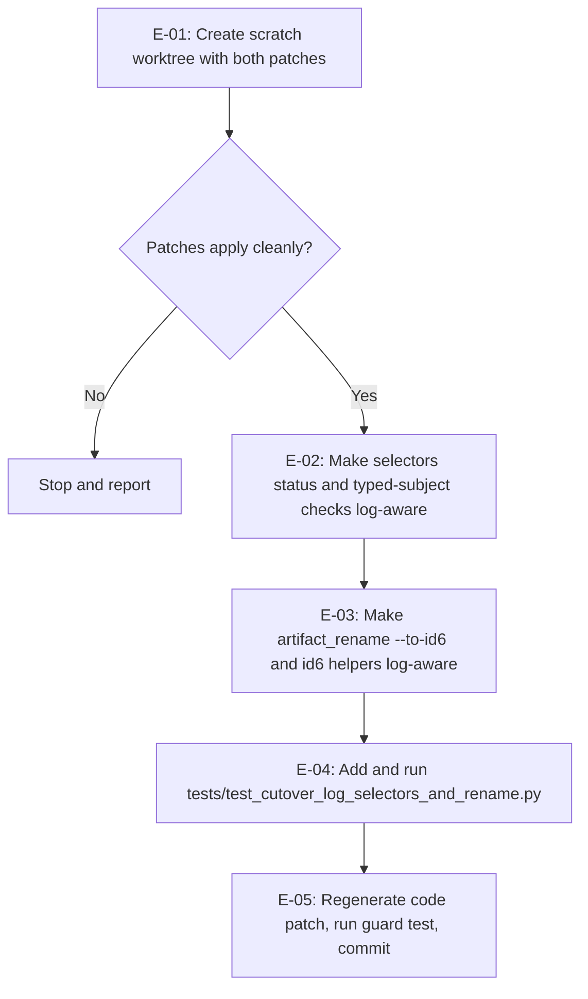

# IPD: Make selectors status matching, typed-subject ownership, and artifact_rename to-id6 log-aware in the cutover code patch

- Date: 2026-11-26
- Kind: child
- Concern: Backlog `ldfefd` (metastore cutover test conversion; recorded in batch E plan `qi0kl6` F-05 and OQ-01, split per maintainer answer to `run-20261126T055808Z-863961` question `05-qi0kl6-a1-batch-e-production-log-aware-gaps` as the first of two prerequisite plans ahead of `qi0kl6`): inside `.aw/system/cutover/metastore-code.cutover.patch`, two selector and rename paths still rely on pre-cutover inline fields and break on post-cutover log-format records: (1) `agent_workflows/selectors.py::_state_matches_status` reads only `getattr(st, "legacy_raw_status", None)` (returning `False` on every log-format record whose status lives in `st.status` with `legacy_raw_status is None`), so `selectors.resolve(..., <status>)` and `aw find <type> <status>` never match status on log-format plans, specs, backlog items, research docs, or releases; and `selectors.py::_declares_typed_subject` reads inline bullets via `read_text(metadata_region(text))` only, missing spec `4sd62s` Section 4.1a `.review.md` YAML mirrors (`subject: <id6>`) and log-stored typed references (`from_backlog`, `from_spec`, `target_id`, `references`, `reviewed_id`), causing `id6_ownership` to misclassify post-cutover `.review.md` files as `slot-only` collisions; and (2) `agent_workflows/artifact_rename.py::run_rename_generic` (`--to-id6 --apply` on unlogged legacy or dated files where `log_id6 is None`) calls `artifact_meta.append` with an `op: "checkpoint"` event on a nonexistent `meta/<id6>.jsonl` (where `append` defaults `art_type` to `"ipd"` and lacks a `create` event) and omits `.aw/records/meta/<id6>.jsonl` from `touched`, while `_read_existing_id6`, `_existing_type_id6s`, and `_id6_write_message` inspect legacy `- Id:` / `- Status:` / `- Date:` bullets only instead of post-cutover YAML mirrors.
- Scope: In an isolated scratch worktree `.aw/state/j1f454/scratch` with both cutover patches applied (including prerequisite plans `hdwqex`, `89mtbl`, `nv3upa`, `fljn9b`, `cugg3w`, `szykgd`, `psm9ac`, `otin36`, `x8id25`, `p109wy`, `q6fiws`, and `e0g2gt`), make `agent_workflows/selectors.py` (`_state_matches_status`, `_declares_typed_subject`) and `agent_workflows/artifact_rename.py` (`run_rename_generic` `--to-id6` path, `_read_existing_id6`, `_existing_type_id6s`, `_id6_write_message`) log-aware while keeping legacy parity intact. Add and pass core behavioral test module `tests/test_cutover_log_selectors_and_rename.py` in the scratch worktree, and regenerate `.aw/system/cutover/metastore-code.cutover.patch`. Make no live code changes outside `- Scope-Paths:`.
- Scope-Paths: .aw/records/plans/pending/20261126-metastore-319-j1f454-make-selectors-status-matching-typed-subject-ownership-and-a.ipd.md, .aw/system/cutover/metastore-code.cutover.patch
- Item-Dependencies: executed:e0g2gt
- Status: to-review
- From-Spec: 4sd62s
- Work-Kind: bug
- Priority: high
- From-Backlog: ldfefd
- Blocks-Release: next
- Set: metastore
- Order: 319
- Highest E allocated: 05
- Author: antigravity/gemini
- Id: j1f454

> Write and proofread this plan per the technical writing standard, `.aw/system/workflows/technical-writing/technical-writing.md` (`.agents/workflows/technical-writing/technical-writing.md` in a legacy-layout install), including requirement 12 (diagrams).

## Workflow history

- 2026-11-26 to-review (aw set): authored as Order 319 (part 1 of 2) ahead of qi0kl6 per maintainer answer to run-20261126T055808Z-863961 question 05-qi0kl6-a1-batch-e-production-log-aware-gaps
- 2026-11-26 draft (antigravity/gemini): created.

## Goal

Make `selectors.py` status matching and typed-subject ownership checks and `artifact_rename.py` `--to-id6` conversion and id6 helpers log-aware inside `.aw/system/cutover/metastore-code.cutover.patch`, serving as the first of two prerequisite production-fix plans ahead of Order 320 (`lec341`) and batch E (`qi0kl6`).

## Detailed Implementation Checklist (TODO)

Execution-state rule: mark an `E-*` item complete only after performing the action. That mark is not validation. Right-sizing rule: write for a modest executor that cannot hold much in its head. Each E-item is one step (one concern, about one file, executable in one focused pass) and its V-item names each unit it covers with its own check; a plan stays at about 5 E-items and 8 work Scope-Paths, else split it into more child plans (guidance, `IPD-Z603`). Accepted execution states: blocked, failed, pending, performed; terminal gate demands 'performed'.

### Task group 1: scratch worktree

- [ ] E-01 Create the scratch worktree following the SCRATCH PROCEDURE of executed plan `2k5t16` (Step 0): run `git worktree add --detach .aw/state/j1f454/scratch HEAD`; inside `.aw/state/j1f454/scratch`, run `git apply --index .aw/system/cutover/metastore-docs.cutover.patch`, record `BASE=$(git write-tree)` in F-01, and then run `git apply --index .aw/system/cutover/metastore-code.cutover.patch`. If either patch rejects, stop and report.
  - Depends on: none
  - Expected outcome: `.aw/state/j1f454/scratch` holds HEAD plus both patches staged, and F-01 records the base tree id.
  - Execution state: pending

### Task group 2: log-aware selectors and artifact_rename (scratch worktree only)

- [ ] E-02 Make `agent_workflows/selectors.py` status matching and typed-subject ownership log-aware in `.aw/state/j1f454/scratch` while preserving legacy parity:
  1. In `agent_workflows/selectors.py::_state_matches_status`, read `getattr(st, "status", None)` before falling back to `getattr(st, "legacy_raw_status", None)` so log-format `State` rows (where `legacy_raw_status is None` and `status` holds the canonical status) match `MATCH_STATUS` across `plans`, `specs`, `backlog`, `research`, `releases`, and `prompts` (keeping `plans.normalize_status` normalization for legacy multi-word plan statuses).
  2. In `agent_workflows/selectors.py::_declares_typed_subject`, check spec `4sd62s` Section 4.1a `.review.md` YAML mirrors via `artifact_meta.read_review_subject_id(text)` (matching `subject: <id6>`), and when a companion log `.aw/records/meta/<own_id6>.jsonl` exists for `path` (resolved via `artifact_meta.read_mirror_id6(text)` and `artifact_meta.read`), check log-stored typed reference fields (`subject_id`, `target_id`, `references`, `from_backlog`, `from_spec`, `reviewed_id`) before falling back to `artifact_meta.read_text(metadata_region(text))`, so `selectors.id6_ownership` classifies post-cutover `.review.md` files and log-format referencing records as `OWNERSHIP_REFERENCE` rather than false `OWNERSHIP_SLOT_ONLY` collisions.
  - Depends on: E-01
  - Expected outcome: `selectors.resolve(repo, <type>, <status>)` and `aw find <type> <status>` return `MATCH_STATUS` for log-format records across all status-bearing types, and `selectors.id6_ownership` classifies spec `4sd62s` Section 4.1a `.review.md` files as `OWNERSHIP_REFERENCE`.
  - Execution state: pending

- [ ] E-03 Make `agent_workflows/artifact_rename.py` (`--to-id6` conversion and id6 helpers) log-aware in `.aw/state/j1f454/scratch` while preserving legacy parity:
  1. In `agent_workflows/artifact_rename.py::_read_existing_id6` and `_existing_type_id6s`, check `artifact_meta.read_mirror_id6(text)` before falling back to legacy `_bullet_id6(text)` (and `has_prompt_metadata_comment` for prompts, already updated by `p109wy`) so post-cutover YAML-mirror specs, plans, walkthroughs, and prompts are recognized as already carrying their id6 (idempotent `--to-id6`, zero re-minting, and accurate collision sets).
  2. In `agent_workflows/artifact_rename.py::run_rename_generic` (`--to-id6 --apply` when `log_id6 is None` and `inject_id6` is minted), distinguish records with metadata from bulletless/commentless filename-only records: for a file with metadata bullets or a prompt metadata comment (specs, walkthroughs with bullets, plans, prompts with comments), initialize its log-backed record through `artifact_meta.create(inject_id6, meta_type, fields, body, destination=m_rel, dry_run=False, overwrite=True, project_context=m_ctx, actor={"tool": "aw rename"})` (carrying the proper `meta_type` such as `"spec"` or `"walkthrough"`, parsed status/fields, and clean body) instead of calling `artifact_meta.append` with `op: "checkpoint"` on a missing `meta/<id6>.jsonl`, and include the new `.aw/records/meta/<inject_id6>.jsonl` path in `touched`; for a bulletless file (such as a bulletless walkthrough) or a commentless prompt, keep filename-only renaming without inserting metadata into the body or calling `append` on a missing log.
  3. Update `agent_workflows/artifact_rename.py::_id6_write_message` to recognize post-cutover YAML mirrors and report honest preview/apply messages for log-backed records, bulleted legacy records, and bulletless filename-only records. Record the verified caller audit across `selectors.py` and `artifact_rename.py` in F-02.
  - Depends on: E-02
  - Expected outcome: `aw rename specs <legacy> --to-id6 --apply` and `aw rename walkthroughs <dated> --to-id6 --apply` create conforming log-backed records with `meta/<id6>.jsonl` in `touched`, bulletless files rename filename-only without body mutation, already-clustered log-format records are idempotent (`no re-mint`), and F-02 records the caller audit.
  - Execution state: pending

- [ ] E-04 Add and run core behavioral test module `tests/test_cutover_log_selectors_and_rename.py` (`pytestmark = pytest.mark.core`) in `.aw/state/j1f454/scratch` (asserting real outputs, exit codes, and side effects; no code-pinning tests):
  1. Cover `selectors.resolve` (`MATCH_STATUS`, `MATCH_ID6`, `MATCH_SETID`) and `aw find <type> <status>` across log-format `plans`, `specs`, `backlog`, `research`, and `releases`, plus `selectors.id6_ownership` returning `OWNERSHIP_REFERENCE` for a spec `4sd62s` Section 4.1a `.review.md` mirror carrying `subject: <id6>` and `OWNERSHIP_DECLARED` / `OWNERSHIP_FOREIGN_ID` for log-format records.
  2. Cover `artifact_rename` `--to-id6` (preview and `--apply --no-commit`): legacy spec with bullets initializes `meta/<id6>.jsonl` with `type == "spec"`, writes YAML mirror `id: <id6>`, and includes the log path in `touched`; dated walkthrough with bullets initializes `meta/<id6>.jsonl` with `type == "walkthrough"`; bulletless walkthrough renames filename-only without modifying body text; already-clustered log-format spec reports `no re-mint` and leaves files unchanged; `_existing_type_id6s` collects YAML mirror id6 values.
  3. Run `python3 -m pytest -o addopts="" -m '' -v tests/test_cutover_log_selectors_and_rename.py` in `.aw/state/j1f454/scratch` and confirm every test passes.
  - Depends on: E-03
  - Expected outcome: `tests/test_cutover_log_selectors_and_rename.py` passes every test in `.aw/state/j1f454/scratch`.
  - Execution state: pending

### Task group 3: package

- [ ] E-05 In `.aw/state/j1f454/scratch`, run `git add -A` and write `git diff --cached --binary $BASE` over `.aw/system/cutover/metastore-code.cutover.patch` in the executing checkout; remove the scratch worktree (`git worktree remove --force .aw/state/j1f454/scratch`); run `python3 -m pytest -o addopts="" tests/test_metastore_cutover_code_patch.py` in the executing checkout; verify `git status --short` shows only `- Scope-Paths:` modified; and commit through `aw commit j1f454 -- .aw/records/plans/pending/20261126-metastore-319-j1f454-make-selectors-status-matching-typed-subject-ownership-and-a.ipd.md .aw/system/cutover/metastore-code.cutover.patch`; never push.
  - Depends on: E-04
  - Expected outcome: `.aw/system/cutover/metastore-code.cutover.patch` contains all prior code-patch hunks plus this plan's changes; `tests/test_metastore_cutover_code_patch.py` passes; scratch worktree is removed; no live files outside `- Scope-Paths:` are modified; one path-scoped commit is created.
  - Execution state: pending

## Project conventions discovered (Step 0)

- The scratch procedure and cumulative code patch are defined in executed plan `2k5t16` (Step 0, OQ-01); siblings `g45vyv`, `hdwqex`, `fljn9b`, `szykgd`, `otin36`, `p109wy`, and `q6fiws` follow the same procedure.
- `agent_workflows/artifact_meta.py` provides `read_mirror_id6`, `read_review_subject_id` (updated for spec `4sd62s` Section 4.1a mirrors by `p109wy`), `has_prompt_metadata_comment` (updated for `<!-- aw-managed-prompt: ... -->` by `p109wy`), and `create` / `append`.
- Tests exercise real behavior and assert on observable outcomes (AGENTS.md "TEST OUTCOMES, NOT CODE STRUCTURE"); no `inspect`, `ast`, regex, or substring code-pinning tests.
- Cite code by symbol (`path::Symbol`) or by a quoted content string, with a line number only appended as a hint and never alone (advisory `IPD-C801`).

## Findings

| Id | Evidence | Finding |
|---|---|---|
| F-01 | (written by E-01) | Base tree id after applying `.aw/system/cutover/metastore-docs.cutover.patch`. |
| F-02 | (written by E-03) | Caller and behavior audit across `selectors.py` and `artifact_rename.py`. |
| F-03 | `qi0kl6` F-05 and static audit of `.aw/system/cutover/metastore-code.cutover.patch`: `selectors.py::_state_matches_status`, `_declares_typed_subject`; `artifact_rename.py::run_rename_generic`, `_read_existing_id6`, `_existing_type_id6s`, `_id6_write_message` | Two verified production cutover gaps (items 1 and 4 of `qi0kl6` F-05) block `tests/test_readers_selectors_find.py`, `tests/test_spec_id6_filenames.py`, and post-cutover `aw find <type> <status>` / `aw rename --to-id6` workflows; split into Order 319 (`j1f454`) ahead of Order 320 (`lec341`) and `qi0kl6` per maintainer decision on `run-20261126T055808Z-863961` question `05-qi0kl6-a1-batch-e-production-log-aware-gaps`. |

## Proposed changes (ordered, validatable)

1. E-01: Create scratch worktree `.aw/state/j1f454/scratch` with both cutover patches staged.
2. E-02: Make `selectors.py::_state_matches_status` and `_declares_typed_subject` log-aware while keeping legacy parity.
3. E-03: Make `artifact_rename.py::run_rename_generic` (`--to-id6`), `_read_existing_id6`, `_existing_type_id6s`, and `_id6_write_message` log-aware; record F-02.
4. E-04: Add and pass core behavioral test module `tests/test_cutover_log_selectors_and_rename.py` in `.aw/state/j1f454/scratch`.
5. E-05: Regenerate `.aw/system/cutover/metastore-code.cutover.patch`, remove the scratch worktree, pass `tests/test_metastore_cutover_code_patch.py`, verify a clean live tree outside `- Scope-Paths:`, and commit path-scoped.

## Deferred / out of scope (with reason)

- Making `research_cmd._write_planned_research_file`, `research_refs._apply_renames`, and `research_archive.apply_moves` log-aware: second prerequisite production-fix plan split per maintainer decision.
  - Carrier: lec341
- Converting batch E's 14 test modules (`tests/test_readers_selectors_find.py` through `tests/test_spec_id6_filenames.py`): runs after `j1f454` and `lec341` execute.
  - Carrier: qi0kl6
- Prior prerequisite production fixes (`hdwqex`, `fljn9b`, `szykgd`, `otin36`, `p109wy`, `q6fiws`): already owned by Orders 305 and 314-318.
  - Carrier: q6fiws
- Applying the cutover patches on the real tree: attended cutover commit.
  - Carrier: cxxmyv

## Scope check

- Over-scope: none. No live code or test files are modified outside `.aw/system/cutover/metastore-code.cutover.patch`.
- Under-scope: none. Both selector and rename cutover gaps (items 1 and 4 of `qi0kl6` F-05) map to E-02 through E-04; the research cutover gaps (items 2 and 3) map to Order 320 (`lec341`).

## Required tests / validation

- Throwaway-repository checks on `.aw/state/j1f454/scratch` for `selectors.resolve` / `id6_ownership` and `artifact_rename --to-id6` (V-02, V-03).
- Core behavioral test module `python3 -m pytest -o addopts="" -m '' -v tests/test_cutover_log_selectors_and_rename.py` in `.aw/state/j1f454/scratch` (V-04).
- Cumulative patch guard test `python3 -m pytest -o addopts="" tests/test_metastore_cutover_code_patch.py` in the executing checkout (V-05).

## Spec / documentation sync

No spec or documentation change is needed in this plan. Spec `4sd62s` Sections 4.1, 4.1a, and 4.3 already define log-backed status, review mirrors, and rename events, and `.aw/system/cutover/metastore-docs.cutover.patch` already documents them. This plan brings `selectors.py` and `artifact_rename.py` inside `.aw/system/cutover/metastore-code.cutover.patch` into agreement with them.

## Open questions

None open.

## Validation and cross-check (verify before reporting done)

Validation-state rule: inspect evidence in a separate pass. Do not mark a `V-*` item complete from memory or from the matching execution checkmark. Accepted validation results: blocked, failed, pass, pending; terminal gate demands 'pass'. Runtime-demonstration reachability rule: for each `V-*` item demanding the software be observed acting (such as a run, a dispatch, or a transition) - as distinct from items demanding a diff, a file's content, or a test result, which are reachable by construction - name the code path that produces the observation or the sibling `E-*` that creates it, else the demand is UNDER-SCOPE.

- [ ] V-01 validates E-01
  - Required evidence: paste the `git worktree add --detach .aw/state/j1f454/scratch HEAD` command, both `git apply --index` commands (for `.aw/system/cutover/metastore-docs.cutover.patch` and `.aw/system/cutover/metastore-code.cutover.patch`) with exit status 0, and the base tree id recorded in F-01.
  - Observed evidence:
  - Result: pending
- [ ] V-02 validates E-02
  - Required evidence: paste observed outputs on `.aw/state/j1f454/scratch` (code paths updated by E-02) showing `selectors.resolve` matching `MATCH_STATUS` on log-format `plans`, `specs`, `backlog`, `research`, and `releases` records, and `selectors.id6_ownership` returning `OWNERSHIP_REFERENCE` on a spec `4sd62s` Section 4.1a `.review.md` mirror carrying `subject: <id6>`.
  - Observed evidence:
  - Result: pending
- [ ] V-03 validates E-03
  - Required evidence: paste F-02 (verified caller audit) and observed outputs on `.aw/state/j1f454/scratch` (code paths updated by E-03) showing `aw rename specs <legacy> --to-id6 --apply --no-commit` creating `.aw/records/meta/<id6>.jsonl` with `type == "spec"` and YAML mirror `id: <id6>`, a bulletless walkthrough renaming filename-only without body edits, and an already-clustered log-format spec reporting `no re-mint`.
  - Observed evidence:
  - Result: pending
- [ ] V-04 validates E-04
  - Required evidence: paste the full `python3 -m pytest -o addopts="" -m '' -v tests/test_cutover_log_selectors_and_rename.py` output in `.aw/state/j1f454/scratch` showing every test PASSED across `selectors` and `artifact_rename`.
  - Observed evidence:
  - Result: pending
- [ ] V-05 validates E-05
  - Required evidence: paste `git apply --stat .aw/system/cutover/metastore-code.cutover.patch`, the `python3 -m pytest -o addopts="" tests/test_metastore_cutover_code_patch.py` run showing every guard test PASSED, `git worktree list` showing `.aw/state/j1f454/scratch` removed, `git status --short` confirming no live edits outside `- Scope-Paths:`, and the `aw commit j1f454` output naming the commit hash.
  - Observed evidence:
  - Result: pending

## Approval and execution gate

- Size assessment: standard
- Cohesion rationale: not required

Execute only after human approval (`Status: approved`) and after every plan in `- Item-Dependencies:` (`e0g2gt`) is executed; open questions: none open. Code and tests are edited ONLY inside `.aw/state/j1f454/scratch` and packaged into `.aw/system/cutover/metastore-code.cutover.patch`. Scope fence: `- Scope-Paths:` is a declaration; any needed edit outside it must be justified at finalize (`--scope-reason`), and any declared path left unmodified must be acknowledged (`--scope-ack`). Safety stop conditions: stop and report rather than editing live production code outside the scratch worktree or weakening test assertions if a patch hunk rejects, an unexpected failure occurs on unmodified code, or an unresolvable concurrent-edit conflict occurs. Honesty rule: you MUST paste the ACTUAL runner output of every command named in V-01 through V-05; never claim a result you did not run. Commits: commit only through `aw commit j1f454 -- <paths>`; never push. Lifecycle transition: after `aw ipd lint --phase pre-transition` conforms and every `V-*` reads `pass` with pasted evidence, in a managed runner lane stop after committing the updated plan and let the runner run `aw ipd finalize`; in a hand-run session run `aw ipd finalize` to move the plan to `.aw/records/plans/executed/` (never use a raw `git mv` to `executed/`).
