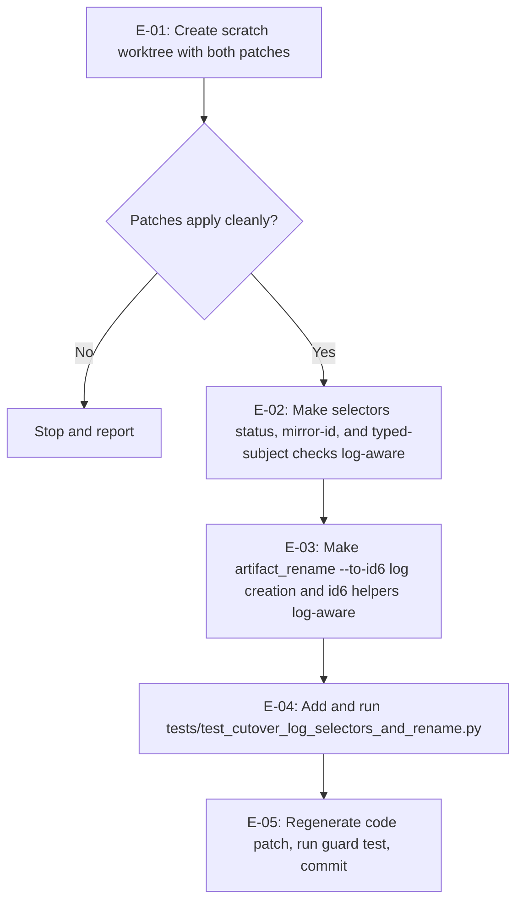

# IPD: Make selectors status matching, typed-subject ownership, and artifact_rename to-id6 log-aware in the cutover code patch

- Date: 2026-11-26
- Kind: child
- Concern: Backlog `ldfefd` (metastore cutover test conversion) and batch E test-conversion plan `qi0kl6` (F-05 and resolved OQ-01, split per maintainer answer to `run-20261126T055808Z-863961` question `05-qi0kl6-a1-batch-e-production-log-aware-gaps` into two prerequisite production-fix plans ahead of `qi0kl6`): inside `.aw/system/cutover/metastore-code.cutover.patch`, two selector and rename paths still rely on pre-cutover inline fields and break on post-cutover log-format records. First, `agent_workflows/selectors.py::_state_matches_status` and `_read_status` read only `legacy_raw_status` (returning `False` or `None` on log-format records whose status lives in `st.status` with `legacy_raw_status is None`), so `selectors.resolve(..., <status>)` and `aw find <type> <status>` never match status on log-format records; `selectors.py::_read_id` (driving `declared_id6`, `declares_id6`, and `id6_ownership`) and `resolve`'s `_states()` fallback omit prompt-mirror and BOM handling, causing `id6_ownership` to misclassify post-cutover staged prompts as `slot-only`; and `selectors.py::_declares_typed_subject` reads inline bullets only, missing spec `4sd62s` Section 4.1a `.review.md` YAML mirrors (`subject: <id6>`) and log-stored typed references (`subject_id`, `target_id`, `references`, `from_backlog`, `from_spec`, `reviewed_id`). Second, `agent_workflows/artifact_rename.py::run_rename_generic` (`--to-id6 --apply` on unlogged legacy or dated files where `log_id6 is None`) calls `artifact_meta.append` with an `op: "checkpoint"` event on a nonexistent `meta/<id6>.jsonl` (defaulting `art_type` to `"ipd"` and lacking a `create` event) and omits `.aw/records/meta/<id6>.jsonl` from `touched`, while `_read_existing_id6`, `_existing_type_id6s`, and `_id6_write_message` inspect legacy bullets only instead of post-cutover YAML and prompt mirrors.
- Scope: In an isolated scratch worktree `.aw/state/j1f454/scratch` with both cutover patches applied (including earlier prerequisite and test-batch plans `hdwqex`, `89mtbl`, `nv3upa`, `fljn9b`, `cugg3w`, `szykgd`, `psm9ac`, `otin36`, `x8id25`, `p109wy`, `q6fiws`, and `e0g2gt`), make `agent_workflows/selectors.py` (`_state_matches_status`, `_read_status`, `_read_id`, `resolve._states` fallback, `_declares_typed_subject`) and `agent_workflows/artifact_rename.py` (`run_rename_generic` `--to-id6` path, `_read_existing_id6`, `_existing_type_id6s`, `_id6_write_message`) log-aware while keeping legacy parity intact. Add and pass core behavioral test module `tests/test_cutover_log_selectors_and_rename.py` in the scratch worktree, and regenerate `.aw/system/cutover/metastore-code.cutover.patch`. Make no live code changes outside `- Scope-Paths:`.
- Scope-Paths: .aw/records/plans/pending/20261126-metastore-319-j1f454-make-selectors-status-matching-typed-subject-ownership-and-a.ipd.md, .aw/system/cutover/metastore-code.cutover.patch
- Item-Dependencies: executed:q6fiws
- Status: approved
- Review-Depth: standard
- Readiness: go-pending-approval
- From-Spec: 4sd62s
- Work-Kind: bug
- Priority: high
- From-Backlog: ldfefd
- Blocks-Release: next
- Set: metastore
- Order: 319
- Highest E allocated: 05
- Author: antigravity/gemini
- Id: j1f454
- Approval: 2026-11-26, recorded via aw ipd set: status set to approved

> Write and proofread this plan per the technical writing standard, `.aw/system/workflows/technical-writing/technical-writing.md` (`.agents/workflows/technical-writing/technical-writing.md` in a legacy-layout install), including requirement 12 (diagrams).

## Workflow history

- 2026-11-26 same-status (aw set): OQ-02 Option 1: re-chain production-fix plans otin36..3e0vfy ahead of test batches psm9ac..x3mig6
- 2026-11-26 approved (aw set): status set to approved
- 2026-11-26 reviewed (aw set): APPROVE WITH REVISIONS APPLIED; PR-001..PR-004 FIXED
- 2026-11-26 /plan-review (antigravity/gemini): APPROVE WITH REVISIONS APPLIED; PR-001, PR-002, PR-003, PR-004 (all FIXED); review record .aw/records/reviews/20261126-metastore-319-j1f454-make-selectors-status-matching-typed-subject-ownership-and-a.review.md
- 2026-11-26 to-review (aw set): authored as Order 319 (part 1 of 2) ahead of qi0kl6 per maintainer answer to run-20261126T055808Z-863961 question 05-qi0kl6-a1-batch-e-production-log-aware-gaps
- 2026-11-26 draft (antigravity/gemini): created.

## Goal

Make `selectors.py` status matching, mirror identity reading, and typed-subject ownership checks and `artifact_rename.py` `--to-id6` log initialization and id6 helpers log-aware inside `.aw/system/cutover/metastore-code.cutover.patch`. This plan is the first of two prerequisite production-fix plans ahead of Order 320 (`lec341`, research writer fixes) and batch E (`qi0kl6`).

## Detailed Implementation Checklist (TODO)

Execution-state rule: mark an `E-*` item complete only after performing the action. That mark is not validation. Right-sizing rule: write for a modest executor that cannot hold much in its head. Each E-item is one step (one concern, about one file, executable in one focused pass) and its V-item names each unit it covers with its own check; a plan stays at about 5 E-items and 8 work Scope-Paths, else split it into more child plans (guidance, `IPD-Z603`). Accepted execution states: blocked, failed, pending, performed; terminal gate demands 'performed'.

### Task group 1: scratch worktree

- [ ] E-01 Create the scratch worktree following the SCRATCH PROCEDURE of executed plan `2k5t16` (Step 0): run `git worktree add --detach .aw/state/j1f454/scratch HEAD`; inside `.aw/state/j1f454/scratch`, run `git apply --index .aw/system/cutover/metastore-docs.cutover.patch`, record `BASE=$(git write-tree)` in F-01, and then run `git apply --index .aw/system/cutover/metastore-code.cutover.patch`. If either patch rejects, stop and report.
  - Depends on: none
  - Expected outcome: `.aw/state/j1f454/scratch` holds HEAD plus both patches staged, and F-01 records the base tree id.
  - Execution state: pending

### Task group 2: log-aware selectors and artifact_rename (scratch worktree only)

- [ ] E-02 Make `agent_workflows/selectors.py` status matching, mirror identity reading, and typed-subject ownership log-aware in `.aw/state/j1f454/scratch` while preserving legacy parity:
  1. In `agent_workflows/selectors.py::_state_matches_status` and `_read_status`, read `getattr(st, "status", None)` before falling back to `getattr(st, "legacy_raw_status", None)` so log-format `State` rows (where `legacy_raw_status is None` and `status` holds the canonical status) match `MATCH_STATUS` across `plans`, `specs`, `backlog`, `research`, `releases`, and `prompts` while preserving `plans.normalize_status` normalization for legacy multi-word plan statuses (`"EXECUTED (...)"`). Also pass `record_type=_META_TYPE_FOR_RECORD.get(record_type)` into `_meta.read_text(_meta.metadata_region(hdr), record_type=...)` inside `resolve`'s `_states()` fallback so uncached staged prompts expose `id` and `status` mirrors.
  2. In `agent_workflows/selectors.py::_read_id(text)` (used by `declared_id6`, `declares_id6`, and `id6_ownership`), check `artifact_meta.read_mirror_id6(text)` first so post-cutover staged prompts (`<!-- aw-managed-prompt: id: <id6> ... -->`) and BOM-prefixed YAML mirrors are recognized as declaring their own `id6` (`OWNERSHIP_DECLARED` rather than false `OWNERSHIP_SLOT_ONLY`), falling back to the existing `metadata_region` + `read_text` check for legacy bullet/YAML files.
  3. In `agent_workflows/selectors.py::_declares_typed_subject(path, id6)`, check spec `4sd62s` Section 4.1a `.review.md` YAML mirrors via `artifact_meta.read_review_subject_id(text)` (matching `subject: <id6>`). When `own_id6 = artifact_meta.read_mirror_id6(text)` exists, resolve the file's owning repository via `project_context.record_owner_root(path)` and read the companion log via `artifact_meta.read(own_id6, project_context=artifact_meta.legacy_context(owner))` inside `artifact_meta.ephemeral_if_uninitialized()` (never defaulting to the process CWD's repo) to check log-stored typed reference fields (`subject_id`, `target_id`, `references`, `from_backlog`, `from_spec`, `reviewed_id`, handling scalar id6 tokens and list/link values safely) before falling back to `artifact_meta.read_text(metadata_region(text))`.
  - Depends on: E-01
  - Expected outcome: `selectors.resolve(repo, <type>, <status>)` and `aw find <type> <status>` return `MATCH_STATUS` for log-format records across all status-bearing types, `selectors.declared_id6` and `id6_ownership` classify post-cutover staged prompts as `OWNERSHIP_DECLARED`, and `selectors.id6_ownership` classifies spec `4sd62s` Section 4.1a `.review.md` files and log-backed typed references as `OWNERSHIP_REFERENCE`.
  - Execution state: pending

- [ ] E-03 Make `agent_workflows/artifact_rename.py` (`--to-id6` conversion and id6 helpers) log-aware in `.aw/state/j1f454/scratch` while preserving legacy parity:
  1. In `agent_workflows/artifact_rename.py::_read_existing_id6` and `_existing_type_id6s`, check `artifact_meta.read_mirror_id6(text)` before falling back to legacy `_bullet_id6(text)` (and `has_prompt_metadata_comment` + `read_text(..., record_type="prompt")` for prompts, already updated by `p109wy`) so post-cutover YAML-mirror specs, plans, walkthroughs, and managed prompts are recognized as already carrying their id6 (idempotent `--to-id6`, zero re-minting, and accurate mint collision sets).
  2. In `agent_workflows/artifact_rename.py::run_rename_generic` (`--to-id6 --apply` when `log_id6 is None` and `inject_id6` is minted), distinguish records with metadata from bulletless or commentless filename-only records:
     - For a file carrying metadata bullets (`_metadata_bullets` containing `Status` or `Date`) or a prompt metadata comment (`has_prompt_metadata_comment`), resolve the singular registry type `registry_type, plural = artifact_meta._normalize_legacy_types(artifact_type, dst, m_rroot)` (e.g. `"spec"`, `"walkthrough"`, `"ipd"`, `"prompt"`, NOT plural `"specs"`/`"walkthroughs"`), map parsed metadata into fields allowed by `artifact_meta.REGISTRY[registry_type]` (omitting `status` for `"walkthrough"`, which has no status per spec `4sd62s` Section 4.1, and applying any `new_set`/`new_order` registered for `registry_type`), strip the legacy bullet block (or leading `<!-- aw-prompt: ... -->` comment for prompts) so `body` holds clean prose only, and call `artifact_meta.create(inject_id6, registry_type, fields, body, destination=m_rel, dry_run=False, overwrite=True, project_context=m_ctx, actor={"tool": "aw rename"})`. If `create` raises or returns `committed=False`, roll back any `git_mv` (matching `move_with_log_event`) and return a structured exit-2 refusal; when `create` commits, append `_rel_to_repo(m_rroot / "meta" / f"{inject_id6}.jsonl", repo_root)` to `touched`.
     - For a bulletless file (such as a bulletless walkthrough) or a commentless prompt, keep filename-only renaming without mutating body bytes and without calling `artifact_meta.create` or `artifact_meta.append` on a missing log.
  3. Update `agent_workflows/artifact_rename.py::_id6_write_message` to check `artifact_meta.read_mirror_id6(_src_text)` before checking legacy `_metadata_bullets(_src_text)` so post-write `--apply` output reports the real YAML mirror and log write rather than falsely claiming `FILENAME ONLY`, while preserving `"would inject"` on preview for bulleted legacy files and `"FILENAME ONLY"` for bulletless/commentless files. Record the verified caller audit across `selectors.py` and `artifact_rename.py` in F-02.
  - Depends on: E-02
  - Expected outcome: `aw rename specs <legacy> --to-id6 --apply` and `aw rename walkthroughs <dated> --to-id6 --apply` create conforming log-backed records with singular `registry_type`, clean bodies, and `meta/<id6>.jsonl` in `touched` (rolling back `git_mv` if `create` fails); bulletless files rename filename-only without body mutation; already-clustered log-format records are idempotent (`no re-mint`); and F-02 records the caller audit.
  - Execution state: pending

- [ ] E-04 Add and run core behavioral test module `tests/test_cutover_log_selectors_and_rename.py` (`pytestmark = pytest.mark.core`) in `.aw/state/j1f454/scratch` (asserting real outputs, exit codes, and side effects; no code-pinning tests):
  1. Cover `selectors.resolve` (`MATCH_STATUS`, `MATCH_ID6`, `MATCH_SETID`), `selectors._read_status`, and `aw find <type> <status>` across log-format `plans`, `specs`, `backlog`, `research`, `releases`, and `prompts` (including BOM-prefixed YAML mirrors and legacy multi-word plan status fallback), plus `selectors.declared_id6` and `selectors.id6_ownership` returning `OWNERSHIP_DECLARED` for post-cutover staged prompts (`<!-- aw-managed-prompt: ... -->`) and YAML-mirror plans, `OWNERSHIP_FOREIGN_ID` for foreign mirrors, and `OWNERSHIP_REFERENCE` for spec `4sd62s` Section 4.1a `.review.md` mirrors (`subject: <id6>`) and log-stored typed references (`_declares_typed_subject` resolving `path`'s owning repo under `tmp_path`).
  2. Cover `artifact_rename` `--to-id6` (preview and `--apply --no-commit`): legacy spec with bullets prints `"would inject"` on preview, initializes `meta/<id6>.jsonl` with `type == "spec"`, writes YAML mirror `id: <id6>` with legacy bullets stripped from body, does not print `FILENAME ONLY` on apply, and includes the log path in `touched`; dated walkthrough with bullets initializes `meta/<id6>.jsonl` with `type == "walkthrough"` (and no `status` field); bulletless walkthrough prints `FILENAME ONLY` and renames filename-only without modifying body text or creating a log; already-clustered log-format spec reports `no re-mint` and leaves files unchanged; `_existing_type_id6s` collects YAML-mirror and managed-prompt id6 values.
  3. Run `python3 -m pytest -o addopts="" -m '' -v tests/test_cutover_log_selectors_and_rename.py` in `.aw/state/j1f454/scratch` and confirm every test passes.
  - Depends on: E-03
  - Expected outcome: `tests/test_cutover_log_selectors_and_rename.py` passes every test in `.aw/state/j1f454/scratch`.
  - Execution state: pending

### Task group 3: package

- [ ] E-05 In `.aw/state/j1f454/scratch`, run `git add -A` and write `git diff --cached --binary $BASE` over `.aw/system/cutover/metastore-code.cutover.patch` in the executing checkout; remove the scratch worktree (`git worktree remove --force .aw/state/j1f454/scratch`); run `python3 -m pytest -o addopts="" tests/test_metastore_cutover_code_patch.py` in the executing checkout; verify `git status --short` shows only `- Scope-Paths:` modified; and commit through `aw commit j1f454 -- .aw/records/plans/pending/20261126-metastore-319-j1f454-make-selectors-status-matching-typed-subject-ownership-and-a.ipd.md .aw/system/cutover/metastore-code.cutover.patch`; never push.
  - Depends on: E-04
  - Expected outcome: `.aw/system/cutover/metastore-code.cutover.patch` contains all prior code-patch hunks plus this plan's changes; `tests/test_metastore_cutover_code_patch.py` passes; scratch worktree is removed; no live files outside `- Scope-Paths:` are modified; one path-scoped commit is created.
  - Execution state: pending

## Project conventions discovered (Step 0)

- The scratch procedure and cumulative code patch are defined in executed plan `2k5t16` (Step 0, OQ-01); executed log-writer plan `g45vyv` and prerequisite plans `hdwqex`, `fljn9b`, `szykgd`, `otin36`, `p109wy`, and `q6fiws` follow the same procedure.
- `agent_workflows/artifact_meta.py` provides `read_mirror_id6`, `read_review_subject_id` (updated for spec `4sd62s` Section 4.1a mirrors by `p109wy`), `has_prompt_metadata_comment` (updated for `<!-- aw-managed-prompt: ... -->` by `p109wy`), `_normalize_legacy_types` (returning `(registry_type, plural_dir)`), `REGISTRY`, and `create(..., overwrite=...)` / `append`.
- Tests exercise real behavior and assert on observable outcomes (AGENTS.md "TEST OUTCOMES, NOT CODE STRUCTURE"); no `inspect`, `ast`, regex, or substring code-pinning tests.
- Cite code by symbol (`path::Symbol`) or by a quoted content string, with a line number only appended as a hint and never alone (advisory `IPD-C801`).

## Findings

| Id | Evidence | Finding |
|---|---|---|
| F-01 | (written by E-01) | Base tree id after applying `.aw/system/cutover/metastore-docs.cutover.patch`. |
| F-02 | (written by E-03) | Caller and behavior audit across `selectors.py` and `artifact_rename.py`. |
| F-03 | `qi0kl6` F-05 and static audit of `.aw/system/cutover/metastore-code.cutover.patch`: `selectors.py::_state_matches_status`, `_declares_typed_subject`; `artifact_rename.py::run_rename_generic`, `_read_existing_id6`, `_existing_type_id6s`, `_id6_write_message` | Two verified production cutover gaps (items 1 and 4 of `qi0kl6` F-05) block `tests/test_readers_selectors_find.py`, `tests/test_spec_id6_filenames.py`, and post-cutover `aw find <type> <status>` / `aw rename --to-id6` workflows; split into Order 319 (`j1f454`) ahead of Order 320 (`lec341`) and `qi0kl6` per maintainer decision on `run-20261126T055808Z-863961` question `05-qi0kl6-a1-batch-e-production-log-aware-gaps`. |
| F-04 | Plan-review static audit of post-patch `agent_workflows/selectors.py` (`_read_id`, `_read_status`, `_state_matches_status`, `resolve._states`, `declared_id6`, `id6_ownership`, `_declares_typed_subject`), `agent_workflows/artifact_rename.py` (`_meta_target_for_file`, `_id6_write_message`, `_existing_type_id6s`, `move_with_log_event`, `run_rename_generic`), and `agent_workflows/artifact_meta.py` (`_normalize_legacy_types`, `create`) | Verified four additional cutover constraints folded into E-02 through E-04: (1) `selectors._read_id` calls `read_text(region)` without `record_type="prompt"` or BOM handling, misclassifying post-cutover staged prompts as `OWNERSHIP_SLOT_ONLY` instead of `OWNERSHIP_DECLARED`, and `resolve._states` omits `record_type` on its fallback `read_text` call; (2) `selectors._declares_typed_subject(path, id6)` takes no `repo_root`, so companion log reads must resolve `owner = project_context.record_owner_root(path)` and pass `project_context=artifact_meta.legacy_context(owner)` inside `ephemeral_if_uninitialized()`; (3) `artifact_rename._meta_target_for_file` returns plural `m_type` whereas `artifact_meta.create` requires singular `registry_type`, registry-filtered `fields` (no `status` on `"walkthrough"`), legacy bullets/comments stripped from `body`, and `git_mv` rollback if `create` fails; (4) `_id6_write_message(..., preview=False, src=dst)` reads `dst` after `create` strips legacy bullets, so it must check `read_mirror_id6` first to avoid falsely printing `FILENAME ONLY` while preserving `"would inject"` on preview. |

## Proposed changes (ordered, validatable)

1. E-01: Create scratch worktree `.aw/state/j1f454/scratch` with both cutover patches staged.
2. E-02: Make `selectors.py` (`_state_matches_status`, `_read_status`, `_read_id`, `resolve._states` fallback, `_declares_typed_subject`) log-aware while keeping legacy parity.
3. E-03: Make `artifact_rename.py` (`run_rename_generic` `--to-id6` via `artifact_meta.create` with singular `registry_type`, clean body, and rollback; `_read_existing_id6`, `_existing_type_id6s`, and `_id6_write_message`) log-aware; record F-02.
4. E-04: Add and pass core behavioral test module `tests/test_cutover_log_selectors_and_rename.py` in `.aw/state/j1f454/scratch`.
5. E-05: Regenerate `.aw/system/cutover/metastore-code.cutover.patch`, remove the scratch worktree, pass `tests/test_metastore_cutover_code_patch.py`, verify a clean live tree outside `- Scope-Paths:`, and commit path-scoped.

## Deferred / out of scope (with reason)

- Making `research_cmd._write_planned_research_file`, `research_refs._apply_renames`, and `research_archive.apply_moves` log-aware: second prerequisite production-fix plan split per maintainer decision.
  - Carrier: lec341
- Converting batch E's 14 test modules (`tests/test_readers_selectors_find.py` through `tests/test_spec_id6_filenames.py`): runs after `j1f454` and `lec341` execute.
  - Carrier: qi0kl6
- Prior prerequisite production fixes (`hdwqex`, `fljn9b`, `szykgd`, `otin36`, `p109wy`, `q6fiws`): already owned by Orders 305 and 314-318.
  - Carrier: q6fiws
  - Carrier-Evidence: .aw/records/plans/executed/20261126-metastore-318-q6fiws-make-coverage-record-readiness-runner-and-review-sequence-ev.ipd.md
- Applying the cutover patches on the real tree: attended cutover commit.
  - Carrier: cxxmyv

## Scope check

- Over-scope: none. No live code or test files are modified outside `.aw/system/cutover/metastore-code.cutover.patch`.
- Under-scope: none. Both selector and rename cutover gaps (items 1 and 4 of `qi0kl6` F-05) plus the co-located `selectors._read_id`/`_read_status`/`resolve._states` and `artifact_rename` create-rollback/mirror-message constraints (`F-04`) map to E-02 through E-04; the research cutover gaps (items 2 and 3) map to Order 320 (`lec341`).

## Required tests / validation

- Throwaway-repository checks on `.aw/state/j1f454/scratch` for `selectors.resolve` / `declared_id6` / `id6_ownership` / `_declares_typed_subject` and `artifact_rename --to-id6` (V-02, V-03).
- Core behavioral test module `python3 -m pytest -o addopts="" -m '' -v tests/test_cutover_log_selectors_and_rename.py` in `.aw/state/j1f454/scratch` (V-04).
- Cumulative patch guard test `python3 -m pytest -o addopts="" tests/test_metastore_cutover_code_patch.py` in the executing checkout (V-05).

## Spec / documentation sync

No spec or documentation change is needed in this plan. Spec `4sd62s` Sections 4.1, 4.1a, and 4.3 already define log-backed status, review mirrors, staged-prompt mirrors, statusless walkthroughs, and rename events, and `.aw/system/cutover/metastore-docs.cutover.patch` already documents them. This plan brings `selectors.py` and `artifact_rename.py` inside `.aw/system/cutover/metastore-code.cutover.patch` into agreement with them.

## Open questions

None open.

## Validation and cross-check (verify before reporting done)

Validation-state rule: inspect evidence in a separate pass. Do not mark a `V-*` item complete from memory or from the matching execution checkmark. Accepted validation results: blocked, failed, pass, pending; terminal gate demands 'pass'. Runtime-demonstration reachability rule: for each `V-*` item demanding the software be observed acting (such as a run, a dispatch, or a transition) - as distinct from items demanding a diff, a file's content, or a test result, which are reachable by construction - name the code path that produces the observation or the sibling `E-*` that creates it, else the demand is UNDER-SCOPE.

- [ ] V-01 validates E-01
  - Required evidence: paste the `git worktree add --detach .aw/state/j1f454/scratch HEAD` command, both `git apply --index` commands (for `.aw/system/cutover/metastore-docs.cutover.patch` and `.aw/system/cutover/metastore-code.cutover.patch`) with exit status 0, and the base tree id recorded in F-01.
  - Observed evidence:
  - Result: pending
- [ ] V-02 validates E-02
  - Required evidence: paste observed outputs on `.aw/state/j1f454/scratch` (code paths updated by E-02) showing `selectors.resolve` matching `MATCH_STATUS` on log-format `plans`, `specs`, `backlog`, `research`, `releases`, and `prompts` records, `selectors.declared_id6` and `selectors.id6_ownership` returning `OWNERSHIP_DECLARED` on a post-cutover staged prompt (`<!-- aw-managed-prompt: ... -->`) and BOM-prefixed YAML mirror, and `selectors.id6_ownership` returning `OWNERSHIP_REFERENCE` on a spec `4sd62s` Section 4.1a `.review.md` mirror (`subject: <id6>`) and on a log-stored typed reference under `tmp_path`.
  - Observed evidence:
  - Result: pending
- [ ] V-03 validates E-03
  - Required evidence: paste F-02 (verified caller audit) and observed outputs on `.aw/state/j1f454/scratch` (code paths updated by E-03) showing `aw rename specs <legacy> --to-id6` printing `"would inject"` on preview and `--apply --no-commit` creating `.aw/records/meta/<id6>.jsonl` with `type == "spec"`, YAML mirror `id: <id6>`, legacy bullets stripped from body, log path in `touched`, and no false `FILENAME ONLY` message; a dated bulleted walkthrough creating `type == "walkthrough"` with no `status` field; a bulletless walkthrough renaming filename-only without body edits or log creation; and an already-clustered log-format spec reporting `no re-mint`.
  - Observed evidence:
  - Result: pending
- [ ] V-04 validates E-04
  - Required evidence: paste the full `python3 -m pytest -o addopts="" -m '' -v tests/test_cutover_log_selectors_and_rename.py` output in `.aw/state/j1f454/scratch` showing every test PASSED across `selectors` and `artifact_rename`.
  - Observed evidence:
  - Result: pending
- [ ] V-05 validates E-05
  - Required evidence: paste `git apply --stat .aw/system/cutover/metastore-code.cutover.patch`, the `python3 -m pytest -o addopts="" tests/test_metastore_cutover_code_patch.py` run showing every guard behavior (docs+code patch apply check, non-empty numstat, bad-patch refusal) PASSED, `git worktree list` showing `.aw/state/j1f454/scratch` removed, `git status --short` confirming no live edits outside `- Scope-Paths:`, and the `aw commit j1f454` output naming the commit hash.
  - Observed evidence:
  - Result: pending

## Approval and execution gate

- Size assessment: standard
- Cohesion rationale: not required

Execute only after human approval (`Status: approved`) and after every plan in `- Item-Dependencies:` (`e0g2gt`) is executed; open questions: none open. Code and tests are edited ONLY inside `.aw/state/j1f454/scratch` and packaged into `.aw/system/cutover/metastore-code.cutover.patch`. Scope fence: `- Scope-Paths:` is a declaration; any needed edit outside it must be justified at finalize (`--scope-reason`), and any declared path left unmodified must be acknowledged (`--scope-ack`). Safety stop conditions: stop and report rather than editing live production code outside the scratch worktree or weakening test assertions if a patch hunk rejects, an unexpected failure occurs on unmodified code, or an unresolvable concurrent-edit conflict occurs. Honesty rule: you MUST paste the ACTUAL runner output of every command named in V-01 through V-05; never claim a result you did not run. Commits: commit only through `aw commit j1f454 -- <paths>`; never push. Lifecycle transition: after `aw ipd lint --phase pre-transition` conforms and every `V-*` reads `pass` with pasted evidence, in a managed runner lane stop after committing the updated plan and let the runner run `aw ipd finalize`; in a hand-run session run `aw ipd finalize` to move the plan to `.aw/records/plans/executed/` (never use a raw `git mv` to `executed/`).
