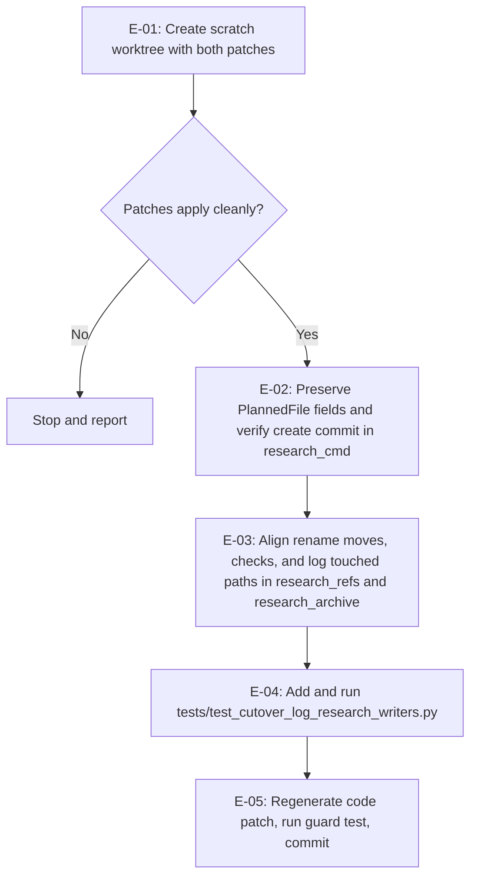

# IPD: Make research_cmd create, research_refs renames, and research_archive moves log-aware in the cutover code patch

- Date: 2026-11-26
- Kind: child
- Concern: Backlog `ldfefd` (metastore cutover test conversion) and batch E test-conversion plan `qi0kl6` (F-05 and resolved OQ-01, split per maintainer answer to `run-20261126T055808Z-863961` question `05-qi0kl6-a1-batch-e-production-log-aware-gaps` into two prerequisite production-fix plans ahead of `qi0kl6`, chained after Order 319 `j1f454`): inside `.aw/system/cutover/metastore-code.cutover.patch`, three research write paths drop metadata, fail to update companion log paths, or omit `.aw/records/meta/<id6>.jsonl` from `touched`. First, `agent_workflows/research_cmd.py::_render_research_create` calls `artifact_meta.create(..., dry_run=True)` and stores only the post-cutover 1- or 2-key YAML mirror (`id` and optional `status`) in `PlannedFile.content`, yet `_write_planned_research_file` reconstructs the log `fields` dictionary by parsing `PlannedFile.content` (dropping `created`, `set`, `order`, `topic`, `model`, `research_kind`, `outcome`, `summary`, `consumed_by`, `priority`, `short_description`, and `ace` on every `aw research new --apply` and `aw research new-comparison --apply`), leaves leading BOM/banner handling incomplete, and ignores `_meta.create`'s `committed` result. Second, `agent_workflows/research_refs.py::_apply_renames` runs `_git_mv` before calling `artifact_meta.append` with `op: "set"` only (never emitting `op: "rename"` to update `state.path`, skipping slug-only or date-only renames when `event_fields` is empty, swallowing append errors as frontmatter warnings, and omitting the companion log path from `touched`). Third, `agent_workflows/research_archive.py::apply_moves` appends `op: "transition"` with `path` via `artifact_meta.append` but ignores `res.get("warning")` on Step-3 move failures, lacks a same-path companion guard, and omits the repo-relative companion log path from `touched` so callers such as `aw archive research --apply --commit` drop the log transition from self-commits.
- Scope: In an isolated scratch worktree `.aw/state/lec341/scratch` with both cutover patches applied (including earlier prerequisite and test-batch plans `hdwqex`, `89mtbl`, `nv3upa`, `fljn9b`, `cugg3w`, `szykgd`, `psm9ac`, `otin36`, `x8id25`, `p109wy`, `q6fiws`, `e0g2gt`, and `j1f454`), fix `agent_workflows/research_cmd.py` (`PlannedFile`, `plan_new`, `plan_new_comparison`, `_render_research_create`, `_write_planned_research_file`), `agent_workflows/research_refs.py` (`_apply_renames`), and `agent_workflows/research_archive.py` (`apply_moves`) inside `.aw/system/cutover/metastore-code.cutover.patch`. Add and pass core behavioral test module `tests/test_cutover_log_research_writers.py` in the scratch worktree, and regenerate `.aw/system/cutover/metastore-code.cutover.patch`. Make no live code or test changes outside `- Scope-Paths:`.
- Scope-Paths: .aw/records/plans/pending/20261126-metastore-320-lec341-make-research-cmd-create-research-refs-renames-and-research.ipd.md, .aw/system/cutover/metastore-code.cutover.patch
- Item-Dependencies: executed:j1f454
- Status: approved
- Review-Depth: standard
- Readiness: go-pending-approval
- From-Spec: 4sd62s
- Work-Kind: bug
- Priority: high
- From-Backlog: ldfefd
- Blocks-Release: next
- Set: metastore
- Order: 320
- Highest E allocated: 05
- Author: antigravity/gemini
- Id: lec341
- Approval: 2026-11-26, recorded via aw ipd set: status set to approved

> Write and proofread this plan per the technical writing standard, `.aw/system/workflows/technical-writing/technical-writing.md` (`.agents/workflows/technical-writing/technical-writing.md` in a legacy-layout install), including requirement 12 (diagrams).

## Workflow history

- 2026-11-26 approved (aw set): status set to approved
- 2026-11-26 reviewed (aw set): APPROVE WITH REVISIONS APPLIED; PR-001..PR-004 FIXED
- 2026-11-26 /plan-review (antigravity/gemini): APPROVE WITH REVISIONS APPLIED; PR-001, PR-002, PR-003, PR-004 (all FIXED); review record .aw/records/reviews/20261126-metastore-320-lec341-make-research-cmd-create-research-refs-renames-and-research.review.md
- 2026-11-26 to-review (aw set): authored as Order 320 (part 2 of 2) ahead of qi0kl6 per maintainer answer to run-20261126T055808Z-863961 question 05-qi0kl6-a1-batch-e-production-log-aware-gaps
- 2026-11-26 draft (antigravity/gemini): created.

## Goal

Make `aw research new`, `aw research new-comparison`, `aw research mv`, `aw research set-assign`, `aw archive research`, and `aw research promote` preserve complete log-stored metadata, update log paths and perform tracked moves atomically through `op: "rename"` / `op: "transition"` in `artifact_meta.append`, and return repo-relative companion log paths (`records_root / "meta" / f"{id6}.jsonl"`) in `touched` inside `.aw/system/cutover/metastore-code.cutover.patch`. This plan is the second of two prerequisite production-fix plans ahead of batch E (`qi0kl6`, chained after Order 319 `j1f454`) and also supplies `PlannedFile.fields` for downstream Order 321 (`3e0vfy`, inbox adoption).

## Detailed Implementation Checklist (TODO)

Execution-state rule: mark an `E-*` item complete only after performing the action. That mark is not validation. Right-sizing rule: write for a modest executor that cannot hold much in its head. Each E-item is one step (one concern, about one file, executable in one focused pass) and its V-item names each unit it covers with its own check; a plan stays at about 5 E-items and 8 work Scope-Paths, else split it into more child plans (guidance, `IPD-Z603`). Accepted execution states: blocked, failed, pending, performed; terminal gate demands 'performed'.

### Task group 1: scratch worktree

- [ ] E-01 Create the scratch worktree following the SCRATCH PROCEDURE of executed plan `2k5t16` (Step 0): run `git worktree add --detach .aw/state/lec341/scratch HEAD`; inside `.aw/state/lec341/scratch`, run `git apply --index .aw/system/cutover/metastore-docs.cutover.patch`, record `BASE=$(git write-tree)` in F-01, and then run `git apply --index .aw/system/cutover/metastore-code.cutover.patch`. If either patch rejects, stop and report.
  - Depends on: none
  - Expected outcome: `.aw/state/lec341/scratch` holds HEAD plus both patches staged, and F-01 records the base tree id.
  - Execution state: pending

### Task group 2: log-aware research_cmd, research_refs, and research_archive (scratch worktree only)

- [ ] E-02 Fix `agent_workflows/research_cmd.py` creation flow in `.aw/state/lec341/scratch` so `aw research new --apply` and `aw research new-comparison --apply` persist every planned metadata field to `meta/<id6>.jsonl`:
  1. Extend `PlannedFile(NamedTuple)` by appending optional `fields: Optional[Dict[str, Any]] = None` and `id6: Optional[str] = None` at the end (preserving backward compatibility for 2-argument `PlannedFile(path, content)` callers and supplying the `planned.fields` contract consumed by downstream Order 321 `3e0vfy`). Populate both attributes in `plan_new` and `plan_new_comparison` from the same validated field dict built for `_render_research_create` (`created`, `set`, `order`, `topic`, `model`, `research_kind`, `outcome`, `summary`, `consumed_by`, optional `status` omitted for `research-prompt`, optional `priority`, optional `short_description`).
  2. Update `_write_planned_research_file` to copy `dict(planned.fields)` when `planned.fields is not None` (dropping any `"status": None` entry so statusless `research-prompt` records keep a 1-key `id`-only YAML mirror per spec `4sd62s` Section 4.1), resolve `id6` via `planned.id6 or _meta.read_mirror_id6(planned.content)` before falling back to `front_matter_mapping` / `R.parse_name`, strip any optional UTF-8 BOM plus leading YAML mirror and `aw-managed` banner via `_meta._strip_leading_yaml_mirror(planned.content.lstrip("\ufeff"))` to obtain clean `body`, and keep the `front_matter_mapping` fallback when a caller constructs `PlannedFile(path, content)` without `fields`. Call `res = _meta.create(id6, "research", fields, body, destination=rel_dest, dry_run=False, overwrite=overwrite, project_context=ctx, actor={"tool": "aw research"})` and raise `RuntimeError` if `not res.get("committed")` so a failed write never reports exit 0.
  - Depends on: E-01
  - Expected outcome: `aw research new --apply` and `aw research new-comparison --apply` create research files with valid 1- or 2-key YAML mirrors, clean bodies with no duplicate banner, complete `meta/<id6>.jsonl` logs passing `research_index._scan_docs` and `research_index.check_drift` with zero `frontmatter-invalid` errors, and non-zero failure if `_meta.create` does not commit.
  - Execution state: pending

- [ ] E-03 Fix `agent_workflows/research_refs.py::_apply_renames` and `agent_workflows/research_archive.py::apply_moves` in `.aw/state/lec341/scratch`:
  1. In `agent_workflows/research_refs.py::_apply_renames`, align the post-cutover rename sequence with `plans_refs.py::_apply_renames` and `artifact_meta.py::append` (spec `4sd62s` Sections 4.2 and 4.3):
     - Resolve `meta_ctx = artifact_meta.legacy_context(repo_root)` and `meta_records = Path(meta_ctx.logical_roots["records"])`. For each plan `p`, resolve `meta_id6 = artifact_meta.file_id6(p.old_path, target_id6 or None)` while `p.old_path` still exists on disk.
     - Build `events`: when `p.old_path != p.new_path`, append `{"op": "rename", "verb": verb, "path": artifact_meta.stored_path(p.new_path, meta_records, repo_root)}` (including slug-only or date-only renames where `event_fields` is empty; omit `op: "rename"` when `p.old_path == p.new_path`); when `parsed is not None`, compute changed `event_fields` (`set`, `order`, `model`, `research_kind`) against `artifact_meta.read(meta_id6, project_context=meta_ctx).fields or {}` and append `{"op": "set", "fields": event_fields}` if non-empty.
     - Pre-validate every plan in a first pass via `artifact_meta.append(meta_id6, events, dry_run=True, project_context=meta_ctx, actor={"tool": f"aw {verb}"})` (whenever `events` is non-empty) before mutating any file, log, or companion directory, so a multi-id `set-assign` batch never half-applies.
     - Execute each plan's `events` in ONE atomic `res = artifact_meta.append(meta_id6, events, project_context=meta_ctx, actor={"tool": f"aw {verb}"})` call. Let `append` Step 2/Step 3 update the in-file mirror at `old_path` and perform the tracked `git_mv` to `p.new_path` (do NOT call a duplicate `_git_mv(repo_root, src_rel, dst_rel)` after `append` moves the file). If `not res.get("committed")` or `res.get("warning")`, raise `RuntimeError` rather than swallowing the failure into `"warning: could not update frontmatter"`. Move the companion directory via `_git_mv(repo_root, src_comp_rel, dst_comp_rel)` only when `has_comp and p.old_path != p.new_path` after `append` succeeds.
     - Whenever `events` committed, compute `log_path = meta_records / "meta" / f"{meta_id6}.jsonl"` and append its `repo_root`-relative POSIX path to `touched` when `log_path` lies inside `repo_root` (alongside `src_rel`, `dst_rel`, and companion files).
  2. In `agent_workflows/research_archive.py::apply_moves`, capture `meta_id6 = artifact_meta.file_id6(m.old_path, m.id6 or None)` before `artifact_meta.append`, check `if not res.get("committed") or res.get("warning"): raise RuntimeError(...)` so a Step-3 move failure never moves a companion directory without moving the `.md` file, guard companion-directory `_git_mv` with `m.old_path != m.new_path`, and compute `log_path = Path(meta_ctx.logical_roots["records"]) / "meta" / f"{meta_id6}.jsonl"` to append its `repo_root`-relative POSIX path to `touched` when `log_path` lies inside `repo_root` (so `aw archive research --apply --commit` commits the companion log via `_offer_archive_commit`, and direct callers of `apply_moves` receive the companion log path).
  3. Record the verified caller audit across `research_cmd.py`, `research_refs.py`, and `research_archive.py` in F-02.
  - Depends on: E-02
  - Expected outcome: `aw research mv`, `aw research set-assign`, `aw archive research`, and `aw research promote` keep `state.path` and `state.fields` in `meta/<id6>.jsonl` synchronized with the moved `.md` file without duplicate `git_mv` or swallowed errors, pass `research_index._scan_docs` cleanly, and return in-repo companion log paths in `touched` (`aw archive research --apply --commit` and `aw research mv/set-assign --apply --commit` commit the companion log); F-02 records the caller audit.
  - Execution state: pending

- [ ] E-04 Add and run core behavioral test module `tests/test_cutover_log_research_writers.py` (`pytestmark = pytest.mark.core`) in `.aw/state/lec341/scratch` (asserting real outputs, exit codes, and side effects; no code-pinning tests):
  1. Cover `aw research new --apply` (with `--priority`, `--topic`, `--summary`, `--set`, `--order`, `--kind`, both status-bearing `findings` and statusless `research-prompt`), `aw research new-comparison --apply`, and `PlannedFile.fields` / 2-arg `PlannedFile(path, content)` compatibility: verify `meta/<id6>.jsonl` records all fields, `research-prompt` keeps a 1-key `id`-only mirror with no duplicate `aw-managed` banner, `research_index._scan_docs` returns complete `DocEntry` rows with zero drift, `research_index.check_drift` exits clean, and `_write_planned_research_file` raises on uncommitted `create`.
  2. Cover `aw research mv --apply` (including slug-only rename with empty `event_fields`, `--model`, `--kind`, `--order`, and no-op same-path rename) and `aw research set-assign --apply` (`--set`, `--order`, `--date`, including companion-directory move and `--commit` committing `meta/<id6>.jsonl`): verify `artifact_meta.read(id6)` reflects the new `path`, `set_id`, `order_nn`, `model`, and `research_kind`, `artifact_meta.history(id6)` contains an `op == "rename"` event on path changes (and none on same-path no-ops), `research_index._scan_docs` passes with zero `name-frontmatter-mismatch` drift, and `touched_paths` includes the repo-relative `meta/<id6>.jsonl`.
  3. Cover `aw archive research --apply --commit` and `aw research promote --to reference --apply` (plus hot-to-hot `todo` -> `active` promote with companion directory): verify `artifact_meta.read(id6)` reflects the new `status` and destination `path`, the YAML mirror carries `status: archive`/`reference`/`active`, `research_index._scan_docs` passes with zero drift, `apply_moves` returns the repo-relative `meta/<id6>.jsonl` in `touched`, and `git log -1 --name-only` after `aw archive research --apply --commit` includes `meta/<id6>.jsonl`.
  4. Run `python3 -m pytest -o addopts="" -m '' -v tests/test_cutover_log_research_writers.py` in `.aw/state/lec341/scratch` and confirm every test passes.
  - Depends on: E-03
  - Expected outcome: `tests/test_cutover_log_research_writers.py` passes every test in `.aw/state/lec341/scratch`.
  - Execution state: pending

### Task group 3: package

- [ ] E-05 In `.aw/state/lec341/scratch`, run `git add -A` and write `git diff --cached --binary $BASE` over `.aw/system/cutover/metastore-code.cutover.patch` in the executing checkout; remove the scratch worktree (`git worktree remove --force .aw/state/lec341/scratch`); run `python3 -m pytest -o addopts="" tests/test_metastore_cutover_code_patch.py` in the executing checkout; verify `git status --short` shows only `- Scope-Paths:` modified; and commit through `aw commit lec341 -- .aw/records/plans/pending/20261126-metastore-320-lec341-make-research-cmd-create-research-refs-renames-and-research.ipd.md .aw/system/cutover/metastore-code.cutover.patch`; never push.
  - Depends on: E-04
  - Expected outcome: `.aw/system/cutover/metastore-code.cutover.patch` contains all prior code-patch hunks plus this plan's changes; `tests/test_metastore_cutover_code_patch.py` passes; scratch worktree is removed; no live files outside `- Scope-Paths:` are modified; one path-scoped commit is created.
  - Execution state: pending

## Project conventions discovered (Step 0)

- The scratch procedure and cumulative code patch are defined in executed plan `2k5t16` (Step 0, OQ-01); executed log-writer plan `g45vyv` and prerequisite plans `hdwqex`, `fljn9b`, `szykgd`, `otin36`, `p109wy`, `q6fiws`, and `j1f454` follow the same procedure.
- `agent_workflows/research_index.py::_state_to_frontmatter` reads log-backed research `State` rows (`created`, `set`, `order`, `topic`, `model`, `research_kind`, `status`, `outcome`, `summary`, `consumed_by`, `priority`) when `st.created_at is not None`.
- `agent_workflows/artifact_meta.py::append` handles `path`-carrying `rename` and `transition` events by updating the in-file mirror at `old_path` (Step 2) and executing `_core.git_mv` to `state.path` (Step 3) as a tracked rename (spec `4sd62s` Sections 4.2 and 4.3), matching `plans_refs.py::_apply_renames` and `research_archive.py::apply_moves`.
- Downstream Order 321 (`3e0vfy`, `artifact_adopt.py`) depends on `PlannedFile.fields` returned by `research_cmd.plan_new`.
- Tests exercise real behavior and assert on observable outcomes (AGENTS.md "TEST OUTCOMES, NOT CODE STRUCTURE"); no `inspect`, `ast`, regex, or substring code-pinning tests.
- Cite code by symbol (`path::Symbol`) or by a quoted content string, with a line number only appended as a hint and never alone (advisory `IPD-C801`).

## Findings

| Id | Evidence | Finding |
|---|---|---|
| F-01 | (written by E-01) | Base tree id after applying `.aw/system/cutover/metastore-docs.cutover.patch`. |
| F-02 | (written by E-03) | Caller and behavior audit across `research_cmd.py`, `research_refs.py`, and `research_archive.py`. |
| F-03 | `qi0kl6` F-05 and static audit of `.aw/system/cutover/metastore-code.cutover.patch`: `research_cmd.py::_render_research_create`, `_write_planned_research_file`, `plan_new`, `plan_new_comparison`; `research_refs.py::_apply_renames`; `research_archive.py::apply_moves` | Two verified production cutover gaps (items 2 and 3 of `qi0kl6` F-05) block `tests/test_research_descriptive_safety.py`, `tests/test_research_index.py`, `tests/test_research_meta_writer_characterization.py`, and `tests/test_research_priority.py`; split into Order 320 (`lec341`) after Order 319 (`j1f454`) and ahead of `qi0kl6` per maintainer decision on `run-20261126T055808Z-863961` question `05-qi0kl6-a1-batch-e-production-log-aware-gaps`. |
| F-04 | Plan-review static audit of post-patch `agent_workflows/research_refs.py::_apply_renames`, `agent_workflows/plans_refs.py::_apply_renames`, `agent_workflows/artifact_meta.py` (`append`, `create`, `_strip_leading_yaml_mirror`), `agent_workflows/research_cmd.py::_write_planned_research_file`, and `agent_workflows/research_archive.py` (`apply_moves`, `run_archive`, `run_promote`) | Verified three additional cutover constraints folded into E-02 through E-04: (1) `artifact_meta.append` Step 3 performs `_core.git_mv` itself when `op: "rename"` changes `state.path`, so `research_refs._apply_renames` must resolve `meta_id6` from `p.old_path`, pre-validate via `dry_run=True`, let `append` execute the tracked move without a duplicate `_git_mv`, emit `op: "rename"` on slug-only/date-only renames (omitting it on `p.old_path == p.new_path`), and raise on `not committed` or `warning` instead of swallowing into a frontmatter warning; (2) `research_cmd._write_planned_research_file` must copy `dict(planned.fields)`, omit `"status": None` for statusless `research-prompt` records, strip optional UTF-8 BOM before `_strip_leading_yaml_mirror`, and raise if `_meta.create` returns `committed=False`; (3) `research_archive.apply_moves` and `research_refs._apply_renames` must resolve companion log paths via `Path(meta_ctx.logical_roots["records"]) / "meta" / f"{meta_id6}.jsonl"` (appending repo-relative paths only when inside `repo_root`), fail on `res.get("warning")`, guard companion-dir `_git_mv` on `old_path != new_path`, and note that `run_archive` (not `run_promote`) drives `_offer_archive_commit`. |

## Proposed changes (ordered, validatable)

1. E-01: Create scratch worktree `.aw/state/lec341/scratch` with both cutover patches staged.
2. E-02: Preserve structured metadata fields on `PlannedFile` in `research_cmd.py` (`plan_new`, `plan_new_comparison`, `_render_research_create`, `_write_planned_research_file`), strip BOM + mirror/banner cleanly, and verify `_meta.create` `committed`.
3. E-03: Align `research_refs.py::_apply_renames` with `artifact_meta.append` Step-3 tracked `op: "rename"` moves (with `dry_run=True` pre-validation, no duplicate `_git_mv`, no swallowed errors, and repo-relative `records_root` log paths in `touched`) and update `research_archive.py::apply_moves` (`warning` check, same-path companion guard, and repo-relative `records_root` log paths in `touched`); record F-02.
4. E-04: Add and pass core behavioral test module `tests/test_cutover_log_research_writers.py` in `.aw/state/lec341/scratch`.
5. E-05: Regenerate `.aw/system/cutover/metastore-code.cutover.patch`, remove the scratch worktree, pass `tests/test_metastore_cutover_code_patch.py`, verify a clean live tree outside `- Scope-Paths:`, and commit path-scoped.

## Deferred / out of scope (with reason)

- Making `selectors.py` and `artifact_rename.py` (`--to-id6`) log-aware: prerequisite Order 319 plan that executes immediately before this plan.
  - Carrier: j1f454
- Converting batch E's 14 test modules (`tests/test_readers_selectors_find.py` through `tests/test_spec_id6_filenames.py`): runs immediately after this plan executes.
  - Carrier: qi0kl6
- Updating `artifact_adopt.py` (`AdoptionPlan`, `plan_adoption`, `apply_adoption`) to consume `PlannedFile.fields` alongside `plan_readiness`, `status_set`, and `artifact_refs`: owned by Order 321 after `qi0kl6`.
  - Carrier: 3e0vfy
- Prior prerequisite production fixes (`hdwqex`, `fljn9b`, `szykgd`, `otin36`, `p109wy`, `q6fiws`): already owned by Orders 305 and 314-318.
  - Carrier: q6fiws
  - Carrier-Evidence: .aw/records/plans/executed/20261126-metastore-318-q6fiws-make-coverage-record-readiness-runner-and-review-sequence-ev.ipd.md
- Applying the cutover patches on the real tree: attended cutover commit.
  - Carrier: cxxmyv

## Scope check

- Over-scope: none. No live code or test files are modified outside `.aw/system/cutover/metastore-code.cutover.patch`.
- Under-scope: none. Both research cutover gaps (items 2 and 3 of `qi0kl6` F-05) plus the co-located `research_refs` Step-3 rename move / pre-validation / error-handling, `research_cmd` `committed` / BOM / `None`-status, and `research_archive` `records_root` / `warning` / companion-guard constraints (`F-04`) map directly to E-02 through E-04; items 1 and 4 map to prerequisite Order 319 (`j1f454`), and `artifact_adopt.py` consumption of `PlannedFile.fields` maps to Order 321 (`3e0vfy`).

## Required tests / validation

- Throwaway-repository checks on `.aw/state/lec341/scratch` for `aw research new`, `new-comparison`, `mv`, `set-assign`, `archive`, and `promote` (V-02, V-03).
- Core behavioral test module `python3 -m pytest -o addopts="" -m '' -v tests/test_cutover_log_research_writers.py` in `.aw/state/lec341/scratch` (V-04).
- Cumulative patch guard test `python3 -m pytest -o addopts="" tests/test_metastore_cutover_code_patch.py` in the executing checkout (V-05).

## Spec / documentation sync

No spec or documentation change is needed in this plan. Spec `4sd62s` Sections 4.1 through 4.3 already define log-backed research metadata, statusless 1-key `research-prompt` mirrors, `rename` events, and `transition` path moves, and `.aw/system/cutover/metastore-docs.cutover.patch` already documents them. This plan brings `research_cmd.py`, `research_refs.py`, and `research_archive.py` inside `.aw/system/cutover/metastore-code.cutover.patch` into agreement with them.

## Open questions

None open.

## Validation and cross-check (verify before reporting done)

Validation-state rule: inspect evidence in a separate pass. Do not mark a `V-*` item complete from memory or from the matching execution checkmark. Accepted validation results: blocked, failed, pass, pending; terminal gate demands 'pass'. Runtime-demonstration reachability rule: for each `V-*` item demanding the software be observed acting (such as a run, a dispatch, or a transition) - as distinct from items demanding a diff, a file's content, or a test result, which are reachable by construction - name the code path that produces the observation or the sibling `E-*` that creates it, else the demand is UNDER-SCOPE.

- [ ] V-01 validates E-01
  - Required evidence: paste the `git worktree add --detach .aw/state/lec341/scratch HEAD` command, both `git apply --index` commands (for `.aw/system/cutover/metastore-docs.cutover.patch` and `.aw/system/cutover/metastore-code.cutover.patch`) with exit status 0, and the base tree id recorded in F-01.
  - Observed evidence:
  - Result: pending
- [ ] V-02 validates E-02
  - Required evidence: paste observed outputs on `.aw/state/lec341/scratch` (code paths updated by E-02) showing `aw research new --apply` (with `--priority`, `--topic`, `--summary`, `--set`, `--order`, for both status-bearing `findings` and statusless `research-prompt`) and `aw research new-comparison --apply` writing complete `meta/<id6>.jsonl` logs with clean mirrors (1-key `id`-only for `research-prompt`, no duplicate `aw-managed` banner), passing `research_index._scan_docs` and `research_index.check_drift` with zero drift, and raising on uncommitted `_meta.create`.
  - Observed evidence:
  - Result: pending
- [ ] V-03 validates E-03
  - Required evidence: paste F-02 (verified caller audit) and observed outputs on `.aw/state/lec341/scratch` (code paths updated by E-03) showing `aw research mv --apply` (including a slug-only rename and a same-path no-op), `aw research set-assign --apply --commit` (including companion directory), `aw archive research --apply --commit`, and `aw research promote --apply` updating `state.path` and metadata in `meta/<id6>.jsonl`, recording `op == "rename"` on path changes, returning the repo-relative `meta/<id6>.jsonl` in `touched` (and committing it on `--commit`), and passing `research_index._scan_docs` with zero drift.
  - Observed evidence:
  - Result: pending
- [ ] V-04 validates E-04
  - Required evidence: paste the full `python3 -m pytest -o addopts="" -m '' -v tests/test_cutover_log_research_writers.py` output in `.aw/state/lec341/scratch` showing every test PASSED across `research_cmd`, `research_refs`, and `research_archive`.
  - Observed evidence:
  - Result: pending
- [ ] V-05 validates E-05
  - Required evidence: paste `git apply --stat .aw/system/cutover/metastore-code.cutover.patch`, the `python3 -m pytest -o addopts="" tests/test_metastore_cutover_code_patch.py` run showing every guard behavior (docs+code patch apply check, non-empty numstat, bad-patch refusal) PASSED, `git worktree list` showing `.aw/state/lec341/scratch` removed, `git status --short` confirming no live edits outside `- Scope-Paths:`, and the `aw commit lec341` output naming the commit hash.
  - Observed evidence:
  - Result: pending

## Approval and execution gate

- Size assessment: standard
- Cohesion rationale: not required

Execute only after human approval (`Status: approved`) and after every plan in `- Item-Dependencies:` (`j1f454`, chained after `e0g2gt`) is executed; open questions: none open. Code and tests are edited ONLY inside `.aw/state/lec341/scratch` and packaged into `.aw/system/cutover/metastore-code.cutover.patch`. Scope fence: `- Scope-Paths:` is a declaration; any needed edit outside it must be justified at finalize (`--scope-reason`), and any declared path left unmodified must be acknowledged (`--scope-ack`). Safety stop conditions: stop and report rather than editing live production code outside the scratch worktree or weakening test assertions if a patch hunk rejects, an unexpected failure occurs on unmodified code, or an unresolvable concurrent-edit conflict occurs. Honesty rule: you MUST paste the ACTUAL runner output of every command named in V-01 through V-05; never claim a result you did not run. Commits: commit only through `aw commit lec341 -- <paths>`; never push. Lifecycle transition: after `aw ipd lint --phase pre-transition` conforms and every `V-*` reads `pass` with pasted evidence, in a managed runner lane stop after committing the updated plan and let the runner run `aw ipd finalize`; in a hand-run session run `aw ipd finalize` to move the plan to `.aw/records/plans/executed/` (never use a raw `git mv` to `executed/`).
