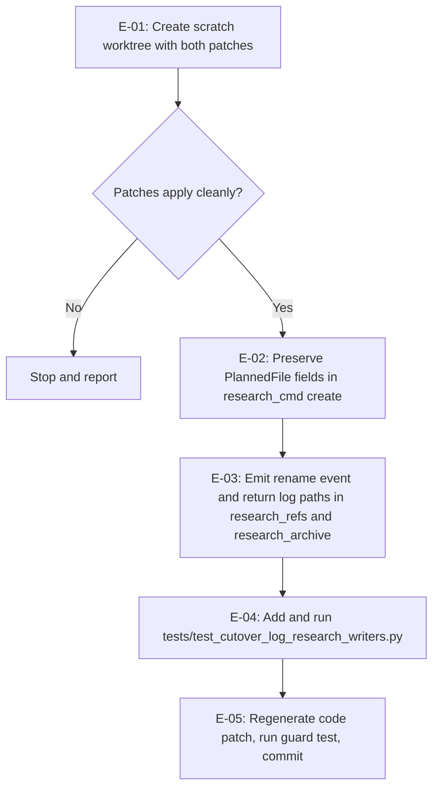

# IPD: Make research_cmd create, research_refs renames, and research_archive moves log-aware in the cutover code patch

- Date: 2026-11-26
- Kind: child
- Concern: Backlog `ldfefd` (metastore cutover test conversion; recorded in batch E plan `qi0kl6` F-05 and OQ-01, split per maintainer answer to `run-20261126T055808Z-863961` question `05-qi0kl6-a1-batch-e-production-log-aware-gaps` as the second of two prerequisite plans ahead of `qi0kl6`, chained after Order 319 `j1f454`): inside `.aw/system/cutover/metastore-code.cutover.patch`, three research write paths drop metadata or leave companion `.aw/records/meta/<id6>.jsonl` logs out of sync or uncommitted: (1) `agent_workflows/research_cmd.py::_render_research_create` calls `artifact_meta.create(..., dry_run=True)` and stores only the post-cutover 1- or 2-key YAML mirror (`id` and optional `status`) in `PlannedFile.content`, yet `research_cmd.py::_write_planned_research_file` still attempts to reconstruct the log `fields` dictionary by parsing keys out of `PlannedFile.content`, dropping `created`, `set`, `order`, `topic`, `model`, `research_kind`, `outcome`, `summary`, `consumed_by`, `priority`, `short_description`, and `ace` on every `aw research new --apply` and `aw research new-comparison --apply`; (2) `agent_workflows/research_refs.py::_apply_renames` moves files via `_git_mv` and calls `artifact_meta.append` with `op: "set"` only (never emitting an `op: "rename"` event to update `state.path` in `.aw/records/meta/<id6>.jsonl`, leaving `append` reading a stale path after `_git_mv`, and omitting `.aw/records/meta/<id6>.jsonl` from `touched`); and (3) `agent_workflows/research_archive.py::apply_moves` appends `op: "transition"` with `path` to `.aw/records/meta/<id6>.jsonl` but omits `.aw/records/meta/<id6>.jsonl` from the returned `touched` paths so callers committing `touched` drop the log transition.
- Scope: In an isolated scratch worktree `.aw/state/lec341/scratch` with both cutover patches applied (including prerequisite plans `hdwqex`, `89mtbl`, `nv3upa`, `fljn9b`, `cugg3w`, `szykgd`, `psm9ac`, `otin36`, `x8id25`, `p109wy`, `q6fiws`, `e0g2gt`, and `j1f454`), fix `agent_workflows/research_cmd.py` (`PlannedFile`, `plan_new`, `plan_new_comparison`, `_write_planned_research_file`), `agent_workflows/research_refs.py` (`_apply_renames`), and `agent_workflows/research_archive.py` (`apply_moves`) inside `.aw/system/cutover/metastore-code.cutover.patch`. Add and pass core behavioral test module `tests/test_cutover_log_research_writers.py` in the scratch worktree, and regenerate `.aw/system/cutover/metastore-code.cutover.patch`. Make no live code changes outside `- Scope-Paths:`.
- Scope-Paths: .aw/records/plans/pending/20261126-metastore-320-lec341-make-research-cmd-create-research-refs-renames-and-research.ipd.md, .aw/system/cutover/metastore-code.cutover.patch
- Item-Dependencies: executed:j1f454
- Status: to-review
- From-Spec: 4sd62s
- Work-Kind: bug
- Priority: high
- From-Backlog: ldfefd
- Blocks-Release: next
- Set: metastore
- Order: 320
- Highest E allocated: 05
- Author: antigravity/gemini
- Id: lec341

> Write and proofread this plan per the technical writing standard, `.aw/system/workflows/technical-writing/technical-writing.md` (`.agents/workflows/technical-writing/technical-writing.md` in a legacy-layout install), including requirement 12 (diagrams).

## Workflow history

- 2026-11-26 to-review (aw set): authored as Order 320 (part 2 of 2) ahead of qi0kl6 per maintainer answer to run-20261126T055808Z-863961 question 05-qi0kl6-a1-batch-e-production-log-aware-gaps
- 2026-11-26 draft (antigravity/gemini): created.

## Goal

Make `aw research new`, `aw research new-comparison`, `aw research mv`, `aw research set-assign`, `aw archive research`, and `aw research promote` preserve complete log-stored metadata, update log paths via `op: "rename"`, and return companion `.aw/records/meta/<id6>.jsonl` paths in `touched` inside `.aw/system/cutover/metastore-code.cutover.patch`, completing the two-plan prerequisite chain ahead of batch E (`qi0kl6`).

## Detailed Implementation Checklist (TODO)

Execution-state rule: mark an `E-*` item complete only after performing the action. That mark is not validation. Right-sizing rule: write for a modest executor that cannot hold much in its head. Each E-item is one step (one concern, about one file, executable in one focused pass) and its V-item names each unit it covers with its own check; a plan stays at about 5 E-items and 8 work Scope-Paths, else split it into more child plans (guidance, `IPD-Z603`). Accepted execution states: blocked, failed, pending, performed; terminal gate demands 'performed'.

### Task group 1: scratch worktree

- [ ] E-01 Create the scratch worktree following the SCRATCH PROCEDURE of executed plan `2k5t16` (Step 0): run `git worktree add --detach .aw/state/lec341/scratch HEAD`; inside `.aw/state/lec341/scratch`, run `git apply --index .aw/system/cutover/metastore-docs.cutover.patch`, record `BASE=$(git write-tree)` in F-01, and then run `git apply --index .aw/system/cutover/metastore-code.cutover.patch`. If either patch rejects, stop and report.
  - Depends on: none
  - Expected outcome: `.aw/state/lec341/scratch` holds HEAD plus both patches staged, and F-01 records the base tree id.
  - Execution state: pending

### Task group 2: log-aware research_cmd, research_refs, and research_archive (scratch worktree only)

- [ ] E-02 Fix `agent_workflows/research_cmd.py` creation flow in `.aw/state/lec341/scratch` so `aw research new --apply` and `aw research new-comparison --apply` persist every planned metadata field to `.aw/records/meta/<id6>.jsonl`:
  1. Extend `PlannedFile` with an optional structured `fields: Optional[Dict[str, Any]] = None` (and optional `id6: Optional[str] = None`) attribute, populated by `plan_new` and `plan_new_comparison` from the same validated field dict passed to `_render_research_create` (`created`, `set`, `order`, `topic`, `model`, `research_kind`, `outcome`, `summary`, `consumed_by`, optional `status`, optional `priority`, optional `short_description`, optional `ace`).
  2. Update `_write_planned_research_file` to use `planned.fields` (and `planned.id6` / `artifact_meta.read_mirror_id6(planned.content)` / parsed filename id6) when `planned.fields` is provided, stripping any leading YAML mirror + `aw-managed` banner (`artifact_meta._strip_leading_yaml_mirror`) to obtain `body` cleanly before calling `artifact_meta.create(id6, "research", fields, body, destination=rel_dest, dry_run=False, overwrite=overwrite, project_context=ctx, actor={"tool": "aw research"})`, while keeping the `front_matter_mapping` fallback when a caller constructs a `PlannedFile(path, content)` without `fields`.
  - Depends on: E-01
  - Expected outcome: `aw research new --apply` and `aw research new-comparison --apply` create research files with valid 1- or 2-key YAML mirrors AND complete `.aw/records/meta/<id6>.jsonl` logs that pass `research_index._scan_docs` and `research_index.check_drift` with zero `frontmatter-invalid` errors.
  - Execution state: pending

- [ ] E-03 Fix `agent_workflows/research_refs.py::_apply_renames` and `agent_workflows/research_archive.py::apply_moves` in `.aw/state/lec341/scratch`:
  1. In `agent_workflows/research_refs.py::_apply_renames`, update the post-cutover rename sequence for log-backed research documents so the `op: "rename"` event (`{"op": "rename", "verb": verb, "path": dst_records_rel}`) and any changed `op: "set"` fields (`set`, `order`, `model`, `research_kind`) are appended to `.aw/records/meta/<meta_id6>.jsonl` in ONE atomic `artifact_meta.append` call BEFORE or atomically with moving the file (avoiding stale `old_path` mirror writes after `_git_mv`), and append the repo-relative `.aw/records/meta/<meta_id6>.jsonl` path to `touched` alongside `src_rel` and `dst_rel` (keeping companion-directory moves intact).
  2. In `agent_workflows/research_archive.py::apply_moves`, append the repo-relative `.aw/records/meta/<id6>.jsonl` path to `touched` alongside `src_rel` and `dst_rel` after `artifact_meta.append` commits the `op: "transition"` + `path` event, so `aw archive research --apply` and `aw research promote --apply` return and commit the companion log alongside the moved research file.
  3. Record the verified caller audit across `research_cmd.py`, `research_refs.py`, and `research_archive.py` in F-02.
  - Depends on: E-02
  - Expected outcome: `aw research mv`, `aw research set-assign`, `aw archive research`, and `aw research promote` keep `state.path` and `state.fields` in `.aw/records/meta/<id6>.jsonl` synchronized with the moved `.md` file, pass `research_index._scan_docs` cleanly, and include `.aw/records/meta/<id6>.jsonl` in `touched`; F-02 records the caller audit.
  - Execution state: pending

- [ ] E-04 Add and run core behavioral test module `tests/test_cutover_log_research_writers.py` (`pytestmark = pytest.mark.core`) in `.aw/state/lec341/scratch` (asserting real outputs, exit codes, and side effects; no code-pinning tests):
  1. Cover `aw research new --apply` (with `--priority`, `--topic`, `--summary`, `--set`, `--order`, `--kind`, both status-bearing `findings` and statusless `research-prompt`) and `aw research new-comparison --apply`: verify `.aw/records/meta/<id6>.jsonl` records all fields, `research_index._scan_docs` returns complete `DocEntry` rows with zero drift, and `research_index.check_drift` exits clean.
  2. Cover `aw research mv --apply` (`--slug`, `--model`, `--kind`, `--order`) and `aw research set-assign --apply` (`--set`, `--order`, `--date`): verify `artifact_meta.read(id6)` reflects the new `path`, `set_id`, `order_nn`, `model`, and `research_kind`, `artifact_meta.history(id6)` contains an `op == "rename"` event, `research_index._scan_docs` passes with zero `name-frontmatter-mismatch` drift, and `touched` includes `.aw/records/meta/<id6>.jsonl`.
  3. Cover `aw archive research --apply` and `aw research promote --to reference --apply`: verify `artifact_meta.read(id6)` reflects the new `status` and destination `path`, the YAML mirror carries `status: archive`/`reference`, `research_index._scan_docs` passes with zero drift, and `apply_moves` returns `.aw/records/meta/<id6>.jsonl` in `touched`.
  4. Run `python3 -m pytest -o addopts="" -m '' -v tests/test_cutover_log_research_writers.py` in `.aw/state/lec341/scratch` and confirm every test passes.
  - Depends on: E-03
  - Expected outcome: `tests/test_cutover_log_research_writers.py` passes every test in `.aw/state/lec341/scratch`.
  - Execution state: pending

### Task group 3: package

- [ ] E-05 In `.aw/state/lec341/scratch`, run `git add -A` and write `git diff --cached --binary $BASE` over `.aw/system/cutover/metastore-code.cutover.patch` in the executing checkout; remove the scratch worktree (`git worktree remove --force .aw/state/lec341/scratch`); run `python3 -m pytest -o addopts="" tests/test_metastore_cutover_code_patch.py` in the executing checkout; verify `git status --short` shows only `- Scope-Paths:` modified; and commit through `aw commit lec341 -- .aw/records/plans/pending/20261126-metastore-320-lec341-make-research-cmd-create-research-refs-renames-and-research.ipd.md .aw/system/cutover/metastore-code.cutover.patch`; never push.
  - Depends on: E-04
  - Expected outcome: `.aw/system/cutover/metastore-code.cutover.patch` contains all prior code-patch hunks plus this plan's changes; `tests/test_metastore_cutover_code_patch.py` passes; scratch worktree is removed; no live files outside `- Scope-Paths:` are modified; one path-scoped commit is created.
  - Execution state: pending

## Project conventions discovered (Step 0)

- The scratch procedure and cumulative code patch are defined in executed plan `2k5t16` (Step 0, OQ-01); siblings `g45vyv`, `hdwqex`, `fljn9b`, `szykgd`, `otin36`, `p109wy`, `q6fiws`, and `j1f454` follow the same procedure.
- `agent_workflows/research_index.py::_state_to_frontmatter` already reads log-backed research `State` rows (`created`, `set`, `order`, `topic`, `model`, `research_kind`, `status`, `outcome`, `summary`, `consumed_by`, `priority`) when `st.created_at is not None`.
- `agent_workflows/artifact_meta.py::append` handles `path`-carrying `rename` and `transition` events by updating the in-file mirror at `old_path` and moving the file to `state.path` as a tracked rename (spec `4sd62s` Sections 4.2 and 4.3).
- Tests exercise real behavior and assert on observable outcomes (AGENTS.md "TEST OUTCOMES, NOT CODE STRUCTURE"); no `inspect`, `ast`, regex, or substring code-pinning tests.
- Cite code by symbol (`path::Symbol`) or by a quoted content string, with a line number only appended as a hint and never alone (advisory `IPD-C801`).

## Findings

| Id | Evidence | Finding |
|---|---|---|
| F-01 | (written by E-01) | Base tree id after applying `.aw/system/cutover/metastore-docs.cutover.patch`. |
| F-02 | (written by E-03) | Caller and behavior audit across `research_cmd.py`, `research_refs.py`, and `research_archive.py`. |
| F-03 | `qi0kl6` F-05 and static audit of `.aw/system/cutover/metastore-code.cutover.patch`: `research_cmd.py::_render_research_create`, `_write_planned_research_file`, `plan_new`, `plan_new_comparison`; `research_refs.py::_apply_renames`; `research_archive.py::apply_moves` | Two verified production cutover gaps (items 2 and 3 of `qi0kl6` F-05) block `tests/test_research_descriptive_safety.py`, `tests/test_research_index.py`, `tests/test_research_meta_writer_characterization.py`, and `tests/test_research_priority.py`; split into Order 320 (`lec341`) after Order 319 (`j1f454`) and ahead of `qi0kl6` per maintainer decision on `run-20261126T055808Z-863961` question `05-qi0kl6-a1-batch-e-production-log-aware-gaps`. |

## Proposed changes (ordered, validatable)

1. E-01: Create scratch worktree `.aw/state/lec341/scratch` with both cutover patches staged.
2. E-02: Preserve structured metadata fields on `PlannedFile` in `research_cmd.py` (`plan_new`, `plan_new_comparison`, `_write_planned_research_file`) so `artifact_meta.create` writes complete research logs.
3. E-03: Emit `op: "rename"` in `research_refs.py::_apply_renames` and include `.aw/records/meta/<id6>.jsonl` in `touched` in both `research_refs.py::_apply_renames` and `research_archive.py::apply_moves`; record F-02.
4. E-04: Add and pass core behavioral test module `tests/test_cutover_log_research_writers.py` in `.aw/state/lec341/scratch`.
5. E-05: Regenerate `.aw/system/cutover/metastore-code.cutover.patch`, remove the scratch worktree, pass `tests/test_metastore_cutover_code_patch.py`, verify a clean live tree outside `- Scope-Paths:`, and commit path-scoped.

## Deferred / out of scope (with reason)

- Making `selectors.py` and `artifact_rename.py` (`--to-id6`) log-aware: prerequisite Order 319 plan that executes immediately before this plan.
  - Carrier: j1f454
- Converting batch E's 14 test modules (`tests/test_readers_selectors_find.py` through `tests/test_spec_id6_filenames.py`): runs immediately after this plan executes.
  - Carrier: qi0kl6
- Prior prerequisite production fixes (`hdwqex`, `fljn9b`, `szykgd`, `otin36`, `p109wy`, `q6fiws`): already owned by Orders 305 and 314-318.
  - Carrier: q6fiws
- Applying the cutover patches on the real tree: attended cutover commit.
  - Carrier: cxxmyv

## Scope check

- Over-scope: none. No live code or test files are modified outside `.aw/system/cutover/metastore-code.cutover.patch`.
- Under-scope: none. Both research cutover gaps (items 2 and 3 of `qi0kl6` F-05) map to E-02 through E-04; items 1 and 4 map to prerequisite Order 319 (`j1f454`).

## Required tests / validation

- Throwaway-repository checks on `.aw/state/lec341/scratch` for `aw research new`, `new-comparison`, `mv`, `set-assign`, `archive`, and `promote` (V-02, V-03).
- Core behavioral test module `python3 -m pytest -o addopts="" -m '' -v tests/test_cutover_log_research_writers.py` in `.aw/state/lec341/scratch` (V-04).
- Cumulative patch guard test `python3 -m pytest -o addopts="" tests/test_metastore_cutover_code_patch.py` in the executing checkout (V-05).

## Spec / documentation sync

No spec or documentation change is needed in this plan. Spec `4sd62s` Sections 4.1 through 4.3 already define log-backed research metadata, `rename` events, and `transition` path moves, and `.aw/system/cutover/metastore-docs.cutover.patch` already documents them. This plan brings `research_cmd.py`, `research_refs.py`, and `research_archive.py` inside `.aw/system/cutover/metastore-code.cutover.patch` into agreement with them.

## Open questions

None open.

## Validation and cross-check (verify before reporting done)

Validation-state rule: inspect evidence in a separate pass. Do not mark a `V-*` item complete from memory or from the matching execution checkmark. Accepted validation results: blocked, failed, pass, pending; terminal gate demands 'pass'. Runtime-demonstration reachability rule: for each `V-*` item demanding the software be observed acting (such as a run, a dispatch, or a transition) - as distinct from items demanding a diff, a file's content, or a test result, which are reachable by construction - name the code path that produces the observation or the sibling `E-*` that creates it, else the demand is UNDER-SCOPE.

- [ ] V-01 validates E-01
  - Required evidence: paste the `git worktree add --detach .aw/state/lec341/scratch HEAD` command, both `git apply --index` commands (for `.aw/system/cutover/metastore-docs.cutover.patch` and `.aw/system/cutover/metastore-code.cutover.patch`) with exit status 0, and the base tree id recorded in F-01.
  - Observed evidence:
  - Result: pending
- [ ] V-02 validates E-02
  - Required evidence: paste observed outputs on `.aw/state/lec341/scratch` (code paths updated by E-02) showing `aw research new --apply` (with `--priority`, `--topic`, `--summary`, `--set`, `--order`) and `aw research new-comparison --apply` writing complete `.aw/records/meta/<id6>.jsonl` logs and passing `research_index._scan_docs` and `research_index.check_drift` with zero drift.
  - Observed evidence:
  - Result: pending
- [ ] V-03 validates E-03
  - Required evidence: paste F-02 (verified caller audit) and observed outputs on `.aw/state/lec341/scratch` (code paths updated by E-03) showing `aw research mv --apply`, `aw research set-assign --apply`, `aw archive research --apply`, and `aw research promote --apply` updating `state.path` and metadata in `.aw/records/meta/<id6>.jsonl`, recording `op == "rename"` on renames, returning `.aw/records/meta/<id6>.jsonl` in `touched`, and passing `research_index._scan_docs` with zero drift.
  - Observed evidence:
  - Result: pending
- [ ] V-04 validates E-04
  - Required evidence: paste the full `python3 -m pytest -o addopts="" -m '' -v tests/test_cutover_log_research_writers.py` output in `.aw/state/lec341/scratch` showing every test PASSED across `research_cmd`, `research_refs`, and `research_archive`.
  - Observed evidence:
  - Result: pending
- [ ] V-05 validates E-05
  - Required evidence: paste `git apply --stat .aw/system/cutover/metastore-code.cutover.patch`, the `python3 -m pytest -o addopts="" tests/test_metastore_cutover_code_patch.py` run showing every guard test PASSED, `git worktree list` showing `.aw/state/lec341/scratch` removed, `git status --short` confirming no live edits outside `- Scope-Paths:`, and the `aw commit lec341` output naming the commit hash.
  - Observed evidence:
  - Result: pending

## Approval and execution gate

- Size assessment: standard
- Cohesion rationale: not required

Execute only after human approval (`Status: approved`) and after every plan in `- Item-Dependencies:` (`j1f454`, chained after `e0g2gt`) is executed; open questions: none open. Code and tests are edited ONLY inside `.aw/state/lec341/scratch` and packaged into `.aw/system/cutover/metastore-code.cutover.patch`. Scope fence: `- Scope-Paths:` is a declaration; any needed edit outside it must be justified at finalize (`--scope-reason`), and any declared path left unmodified must be acknowledged (`--scope-ack`). Safety stop conditions: stop and report rather than editing live production code outside the scratch worktree or weakening test assertions if a patch hunk rejects, an unexpected failure occurs on unmodified code, or an unresolvable concurrent-edit conflict occurs. Honesty rule: you MUST paste the ACTUAL runner output of every command named in V-01 through V-05; never claim a result you did not run. Commits: commit only through `aw commit lec341 -- <paths>`; never push. Lifecycle transition: after `aw ipd lint --phase pre-transition` conforms and every `V-*` reads `pass` with pasted evidence, in a managed runner lane stop after committing the updated plan and let the runner run `aw ipd finalize`; in a hand-run session run `aw ipd finalize` to move the plan to `.aw/records/plans/executed/` (never use a raw `git mv` to `executed/`).
