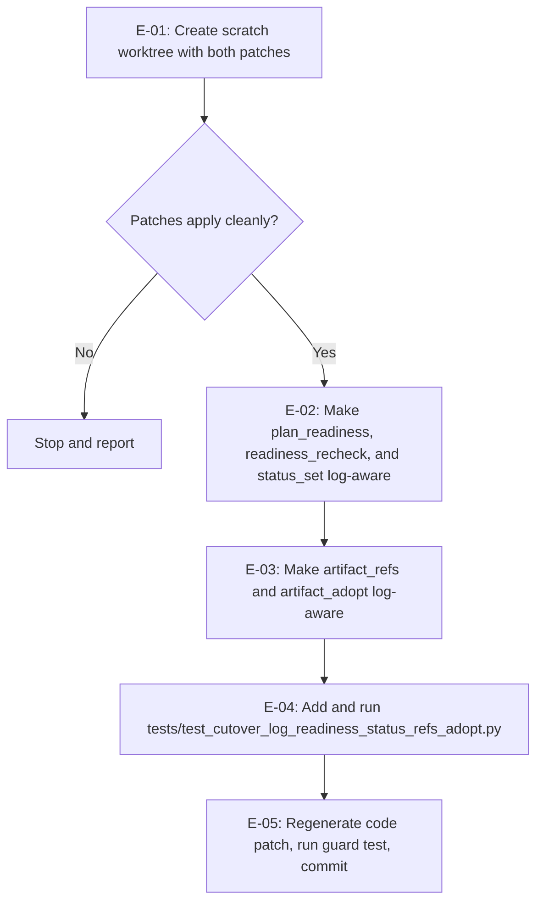

# IPD: Make plan_readiness, status_set, artifact_refs, and artifact_adopt log-aware in the cutover code patch

- Date: 2026-11-26
- Kind: child
- Concern: Backlog `ldfefd` (metastore cutover test conversion) and batch F test-conversion plan `x3mig6` (F-05 and resolved OQ-01, split per maintainer answer to `run-20261126T055808Z-863961` question `06-x3mig6-a1-batch-f-production-log-aware-gaps` into one prerequisite production-fix plan ahead of `x3mig6`, chained after Order 312 `qi0kl6`): inside `.aw/system/cutover/metastore-code.cutover.patch`, four production subsystems still read inline markdown metadata or drop companion log paths instead of using `.aw/records/meta/<id6>.jsonl`. First, `agent_workflows/plan_readiness.py` (`_declared_id6`, `approval_refusals`, `recheck_conditions`, `recheck_readiness`) and `agent_workflows/readiness_recheck.py::_run_stale_findings` read inline `- Id:`, `- Readiness:`, and `## Workflow history` only, disabling the approval gate on log-format plans and specs and making `aw ipd recheck-readiness` (including `--stale-findings`) refuse or emit verdictless gate events on every log-format plan. Second, `agent_workflows/status_set.py` calls bare `_ipd_lint.parse(raw_text)` without `state=` in the orchestrator review-readiness gate (for both `orch_rec` and sibling `other_rec`) and write-ordering sort `_plan_is_orchestrator`, ignores `_am.append` commit results and omits the orchestrator's companion log from dirtiness checks and `touched_paths` on child retirement, and checks only filename suffix and inline text for `research-prompt` hot-status refusals. Third, `agent_workflows/artifact_refs.py` (`classify_citing_plans_for_rewrite`, `plan_scope_path_reference_rewrites`, `apply_scope_path_reference_rewrites`, `post_relocation_citation_rewrite`) uses bullet-only `read_loose_id` (misclassifying log-format pending plans as `"missing - Id:"`, refusing citation rewrites and bypassing the in-flight begin-receipt guard in `filter_in_flight_plan_edits`), short-circuits when `.md` text scan finds no edits (missing log-stored `scope_paths`), and omits mutated companion log paths from the returned relocation commit list. Fourth, `agent_workflows/artifact_adopt.py` (`AdoptionPlan`, `plan_adoption`, `apply_adoption`) re-parses the 2-key YAML mirror (`plan.frontmatter`) instead of carrying structured `planned.fields` from `research_cmd.plan_new`, dropping `created`, `set`, `order`, `topic`, `model`, `research_kind`, `outcome`, `summary`, `consumed_by`, and `priority` (and leaving an orphan companion log on `refresh_index` rollback).
- Scope: In an isolated scratch worktree `.aw/state/3e0vfy/scratch` with both cutover patches applied (including earlier prerequisite and test-batch plans `hdwqex`, `89mtbl`, `nv3upa`, `fljn9b`, `cugg3w`, `szykgd`, `psm9ac`, `otin36`, `x8id25`, `p109wy`, `q6fiws`, `e0g2gt`, `j1f454`, `lec341`, and `qi0kl6`), make `agent_workflows/plan_readiness.py`, `agent_workflows/readiness_recheck.py`, `agent_workflows/status_set.py`, `agent_workflows/artifact_refs.py`, and `agent_workflows/artifact_adopt.py` log-aware inside `.aw/system/cutover/metastore-code.cutover.patch` while preserving legacy fallback parity. Add and pass core behavioral test module `tests/test_cutover_log_readiness_status_refs_adopt.py` in the scratch worktree, and regenerate `.aw/system/cutover/metastore-code.cutover.patch`. Make no live code or test changes outside `- Scope-Paths:`.
- Scope-Paths: .aw/records/plans/pending/20261126-metastore-321-3e0vfy-make-plan-readiness-status-set-artifact-refs-and-artifact-ad.ipd.md, .aw/system/cutover/metastore-code.cutover.patch
- Item-Dependencies: executed:qi0kl6
- Status: reviewed
- Review-Depth: standard
- Readiness: go-pending-approval
- From-Spec: 4sd62s
- Work-Kind: bug
- Priority: high
- From-Backlog: ldfefd
- Blocks-Release: next
- Set: metastore
- Order: 321
- Highest E allocated: 05
- Author: antigravity/gemini
- Id: 3e0vfy

> Write and proofread this plan per the technical writing standard, `.aw/system/workflows/technical-writing/technical-writing.md` (`.agents/workflows/technical-writing/technical-writing.md` in a legacy-layout install), including requirement 12 (diagrams).

## Workflow history

- 2026-11-26 reviewed (aw set): APPROVE WITH REVISIONS APPLIED; PR-001..PR-005 FIXED
- 2026-11-26 /plan-review (antigravity/gemini): APPROVE WITH REVISIONS APPLIED; PR-001, PR-002, PR-003, PR-004, PR-005 (all FIXED); review record .aw/records/reviews/20261126-metastore-321-3e0vfy-make-plan-readiness-status-set-artifact-refs-and-artifact-ad.review.md
- 2026-11-26 to-review (aw set): authored as Order 321 ahead of x3mig6 per maintainer answer to run-20261126T055808Z-863961 question 06-x3mig6-a1-batch-f-production-log-aware-gaps
- 2026-11-26 draft (antigravity/gemini): created.

## Goal

Make approval-gate and readiness re-check readers (`plan_readiness.py`, `readiness_recheck.py`), status-setter orchestrator and research-prompt guards (`status_set.py`), post-relocation `Scope-Paths` citation rewriting and in-flight plan guards (`artifact_refs.py`), and inbox adoption (`artifact_adopt.py`) log-aware inside `.aw/system/cutover/metastore-code.cutover.patch`, unblocking batch F (`x3mig6`).

## Detailed Implementation Checklist (TODO)

Execution-state rule: mark an `E-*` item complete only after performing the action. That mark is not validation. Right-sizing rule: write for a modest executor that cannot hold much in its head. Each E-item is one step (one concern, about one file, executable in one focused pass) and its V-item names each unit it covers with its own check; a plan stays at about 5 E-items and 8 work Scope-Paths, else split it into more child plans (guidance, `IPD-Z603`). Accepted execution states: blocked, failed, pending, performed; terminal gate demands 'performed'.

### Task group 1: scratch worktree

- [ ] E-01 Create the scratch worktree following the SCRATCH PROCEDURE of executed plan `2k5t16` (Step 0): run `git worktree add --detach .aw/state/3e0vfy/scratch HEAD`; inside `.aw/state/3e0vfy/scratch`, run `git apply --index .aw/system/cutover/metastore-docs.cutover.patch`, record `BASE=$(git write-tree)` in F-01, and then run `git apply --index .aw/system/cutover/metastore-code.cutover.patch`. If either patch rejects, stop and report.
  - Depends on: none
  - Expected outcome: `.aw/state/3e0vfy/scratch` holds HEAD plus both patches staged, and F-01 records the base tree id.
  - Execution state: pending

### Task group 2: log-aware plan_readiness, status_set, artifact_refs, and artifact_adopt (scratch worktree only)

- [ ] E-02 Make `agent_workflows/plan_readiness.py`, `agent_workflows/readiness_recheck.py`, and `agent_workflows/status_set.py` log-aware in `.aw/state/3e0vfy/scratch` while preserving legacy fallback parity:
  1. In `agent_workflows/plan_readiness.py`:
     - Update `_declared_id6(text)` to return `_meta.read_mirror_id6(text or "") or _meta.read_loose_id(text or "")` so log-format plans and specs carrying YAML mirrors resolve their `id6`.
     - Add one shared log-aware review/readiness reader helper (used by `approval_refusals`, `recheck_conditions`, and `recheck_readiness`) that loads companion log `State` and `history` (`artifact_meta.read` and `artifact_meta.history` via `artifact_meta.legacy_context(repo_root)` inside `ephemeral_if_uninitialized()`) when a companion log exists for `declared_id6`, falling back to inline text parsing for unlogged legacy files:
       - Preserve the exact three-way `readiness` rule: present and in `_schema.READINESS_VALUES` -> authoritative (`readiness`, `present=True`); present and non-empty but outside `_schema.READINESS_VALUES` -> corrupt (`readiness=None`, `present=True`, fail closed with no fallback); absent -> `readiness=None`, `present=False`.
       - Resolve the newest genuine review record (`polarity`, `verdict_token`, and citation entry string) from log `history` (newest `op == "review"` gate event excluding non-verdict `aw ipd recheck-readiness` entries, or newest review-tagged history entry), falling back to `newest_verdict(plan_text)` when unlogged.
     - Update `approval_refusals(repo_root, plan_path, plan_text=None, *, allow_open_questions=False)` to use the shared log-aware helper for `readiness` and fallback newest review verdict, run `review_findings.subject_gating_blocks(repo_root, declared_id6)` with the mirror-aware `declared_id6`, and keep `has_unresolved_blocking_question(plan_text)` on the markdown body.
     - Update `recheck_conditions(repo_root, plan_path, plan_text=None)` and `recheck_readiness(repo_root, plan_path, ...)` to use the same shared helper so `recheck_conditions` reads log-backed `readiness` and newest review `verdict_token` (`spec 4sd62s` 4.1a K2) and `recheck_readiness` populates `reviewed_entry` and `verdict_token` from the log rather than inline `newest_verdict(text)` (keeping the `classify_verdict`/`is_review_history_entry` non-verdict guards, checking `write_res.get("committed")` on `apply=True`, and keeping the `written == target_readiness` check intact).
  2. In `agent_workflows/readiness_recheck.py::_run_stale_findings`, resolve `declared_id6` via `PR._declared_id6(text)` (mirror-first, bullet fallback) instead of bullet-only `_meta.read_loose_id(text)` so `aw ipd recheck-readiness --stale-findings` finds and closes stale escalated findings on log-format plans.
  3. In `agent_workflows/status_set.py`:
     - In the orchestrator review-readiness gate (`run_set_command` step `(f)` for BOTH `orch_rec` and sibling `other_rec`) and the child-before-orchestrator write-ordering sort (`_plan_is_orchestrator`), pass `state=_state_for_record(rec, repo_root)` into `_ipd_lint.parse(rec.raw_text, state=...)` so log-format orchestrators and children expose `Kind`, `Set`, and `Id` cleanly.
     - In the child-retirement orchestrator-note path (`run_set_command` E-03), resolve the orchestrator's companion log via `records_root = Path(_am.legacy_context(repo_root).logical_roots["records"])` (`orch_log = records_root / "meta" / f"{orch.id6}.jsonl"`), check `git status --porcelain` on both `orch.path` and `orch_log` (when `orch_log` exists and lies inside `repo_root` and has not already been modified by this command), verify `res = _am.append(...)` reports `res.get("committed")` (surfacing an error if not), and append the repo-relative `orch_log` path (when inside `repo_root`) to `touched_paths` (without requiring `orch.path` to change) so `--commit` commits the orchestrator's `note` event.
     - In the research hot-status validation guard, check log-stored `research_kind` (from `_state_for_record(rec, eff_root).fields.get("research_kind") == "research-prompt"`) in addition to the `.research-prompt.md` suffix and inline text fallback so log-format `research-prompt` records still refuse hot statuses.
  - Depends on: E-01
  - Expected outcome: approval gates (`aw ipd set approved`, `aw specs set approved`), `aw ipd recheck-readiness` (with and without `--stale-findings`), orchestrator readiness checks and write ordering, child-retirement orchestrator log commits, and `research-prompt` hot-status refusals all work on log-format records while preserving legacy parity.
  - Execution state: pending

- [ ] E-03 Make `agent_workflows/artifact_refs.py` and `agent_workflows/artifact_adopt.py` log-aware in `.aw/state/3e0vfy/scratch` while preserving legacy fallback parity:
  1. In `agent_workflows/artifact_refs.py`:
     - Update `classify_citing_plans_for_rewrite(repo_root, candidate_files)` to read `plan_id = _meta.read_mirror_id6(text) or _meta.read_loose_id(text)` so log-format pending plans carrying YAML mirrors are checked against `ipd_lifecycle.receipt_path_for(repo_root, plan_id)` instead of being misclassified as `"missing - Id:"` (fixing both `rewrite_scope_path_citations(..., guard_in_flight=True)` and `filter_in_flight_plan_edits`).
     - Update `plan_scope_path_reference_rewrites(repo_root, path_map)` to remove the early `if not raw_edits: return [], []` short-circuit and discover candidate pending plans from BOTH `plan_reference_rewrites(repo_root, path_map)` AND each plans directory returned by `selectors.record_dirs(repo_root, "plans")` (passing each `plans_dir` to `plans_index.plan_files(plans_dir)` and filtering by `_is_pending_plan_file(p, repo_root)`; never passing `repo_root` directly to `plans_index.plan_files`), reading `scope_paths` from `_meta.read(plan_id6, project_context=meta_ctx).fields.get("scope_paths")` (with `_meta.read_text` fallback when unlogged) and keeping the existing `is_grandfathered` and `"destination already declared in Scope-Paths"` skip rules.
     - Keep `apply_scope_path_reference_rewrites` and `rewrite_scope_path_citations` reporting each rewritten citing plan's `plan_file` (preserving `Change(path=str(plan_file), detail=f"rewrote Scope-Paths citation: {old_desc} -> {new_desc}")` and human output), and update `post_relocation_citation_rewrite` so for each rewritten log-format plan it resolves `records_root = Path(_meta.legacy_context(repo_root).logical_roots["records"])` and includes the repo-relative companion log path `records_root / "meta" / f"{plan_id6}.jsonl"` (when it exists and lies inside `repo_root`) in the returned list consumed by `status_set`'s `touched_paths` for `--commit` (omitting an unchanged `plan_file` when only the log changed, or including `plan_file` when `plan_file` itself was modified).
  2. In `agent_workflows/artifact_adopt.py`:
     - Extend `AdoptionPlan` with an optional `fields: Optional[Dict[str, Any]] = None` attribute (defaulting to `None` at the end of the `NamedTuple` for backward compatibility) populated in `plan_adoption` from `planned.fields` returned by `research_cmd.plan_new` (populated by prerequisite Order 320 `lec341`), preserving `created`, `set`, `order`, `topic`, `model`, `research_kind`, `status`, `outcome`, `summary`, `consumed_by`, optional `priority`, and `short_description`.
     - Update `apply_adoption` to copy `dict(plan.fields)` when `plan.fields` is provided (omitting any `None` `status` key for statusless `research-prompt` records per spec `4sd62s` Section 4.1, and setting `short_description` from `plan.short_description` if not already present; falling back to `front_matter_mapping(plan.frontmatter)` / `plan.suggestion` when a caller constructs an `AdoptionPlan` without `fields`). Before calling `_meta.create`, record `log_path = records_root / "meta" / f"{plan.id6}.jsonl"` and `log_existed_before = log_path.exists()`; on `refresh_index` failure rollback, unlink `log_path` alongside `plan.destination` ONLY when `not log_existed_before` so no orphan log remains and no pre-existing log is deleted on `--overwrite`.
  3. Record the verified caller audit across `plan_readiness.py`, `readiness_recheck.py`, `status_set.py`, `artifact_refs.py`, and `artifact_adopt.py` in F-02.
  - Depends on: E-02
  - Expected outcome: in-flight receipt guards and post-relocation `Scope-Paths` citation rewrites discover, guard, update, report, and commit log-format pending plans cleanly; `aw adopt --apply` persists complete research metadata to `records_root / "meta" / f"{id6}.jsonl"` and rolls back newly created logs cleanly on index-refresh failure; F-02 records the caller audit.
  - Execution state: pending

- [ ] E-04 Add and run core behavioral test module `tests/test_cutover_log_readiness_status_refs_adopt.py` (`pytestmark = pytest.mark.core`) in `.aw/state/3e0vfy/scratch` (asserting real outputs, exit codes, and side effects; no code-pinning tests):
  1. Cover `plan_readiness.approval_refusals`, `recheck_conditions`, `recheck_readiness`, and `readiness_recheck.run_recheck_readiness` (`--apply` and `--stale-findings`) on log-format plans and specs: verify `no-go`, out-of-vocab readiness, negative verdict, and unresolved gating finding refuse approval without override; verify `aw ipd recheck-readiness --apply` upgrades a cleared log-format `no-go` plan to `go-pending-approval` in `meta/<id6>.jsonl` with a valid gate `verdict` (`spec 4sd62s` 4.1a K2) and refuses when a blocking question, gating finding, or negative/absent verdict remains; verify `--stale-findings` closes a resolved escalated finding on a log-format plan.
  2. Cover `status_set` on log-format records: verify `aw ipd set approved` enforces the orchestrator review-readiness gate (including sibling `status_overrides`) and sorts children before orchestrators; verify retiring a child plan with `--commit` updates and commits `.aw/records/meta/<orch.id6>.jsonl` (and skips when the orchestrator log is dirty); verify setting a hot status on a log-format `research-prompt` is refused.
  3. Cover `artifact_refs` (`classify_citing_plans_for_rewrite`, `filter_in_flight_plan_edits`, `plan_scope_path_reference_rewrites`, `rewrite_scope_path_citations`, `post_relocation_citation_rewrite`) via `aw backlog set graduated --rewrite-citations --commit` and direct calls on log-format pending plans: verify in-flight begin receipts skip rewrites instead of misclassifying as `"missing - Id:"`, verify log-stored `scope_paths` are discovered even when `.md` text has zero path mentions, verify `--json` reports `Change` on the citing plan, and verify `git log -1 --name-only` includes `.aw/records/meta/<plan_id6>.jsonl`.
  4. Cover `artifact_adopt.plan_adoption` and `apply_adoption` (`aw adopt --apply`): verify `.aw/records/meta/<id6>.jsonl` records `created`, `set`, `order`, `topic`, `model`, `research_kind`, `status`, `outcome`, `summary`, `consumed_by`, and `short_description`, passes `research_index._scan_docs` with zero drift, and removes both `plan.destination` and the newly created `meta/<id6>.jsonl` on `refresh_index` rollback.
  5. Run `python3 -m pytest -o addopts="" -m '' -v tests/test_cutover_log_readiness_status_refs_adopt.py` in `.aw/state/3e0vfy/scratch` and confirm every test passes.
  - Depends on: E-03
  - Expected outcome: `tests/test_cutover_log_readiness_status_refs_adopt.py` passes every test in `.aw/state/3e0vfy/scratch`.
  - Execution state: pending

### Task group 3: package

- [ ] E-05 In `.aw/state/3e0vfy/scratch`, run `git add -A` and write `git diff --cached --binary $BASE` over `.aw/system/cutover/metastore-code.cutover.patch` in the executing checkout; remove the scratch worktree (`git worktree remove --force .aw/state/3e0vfy/scratch`); run `python3 -m pytest -o addopts="" tests/test_metastore_cutover_code_patch.py` in the executing checkout; verify `git status --short` shows only `- Scope-Paths:` modified; and commit through `aw commit 3e0vfy -- .aw/records/plans/pending/20261126-metastore-321-3e0vfy-make-plan-readiness-status-set-artifact-refs-and-artifact-ad.ipd.md .aw/system/cutover/metastore-code.cutover.patch`; never push.
  - Depends on: E-04
  - Expected outcome: `.aw/system/cutover/metastore-code.cutover.patch` contains all prior code-patch hunks plus this plan's changes; `tests/test_metastore_cutover_code_patch.py` passes; scratch worktree is removed; no live files outside `- Scope-Paths:` are modified; one path-scoped commit is created.
  - Execution state: pending

## Project conventions discovered (Step 0)

- The scratch procedure and cumulative code patch are defined in executed plan `2k5t16` (Step 0, OQ-01); executed log-writer plan `g45vyv` and prerequisite plans `hdwqex`, `fljn9b`, `szykgd`, `otin36`, `p109wy`, `q6fiws`, `j1f454`, and `lec341` follow the same procedure.
- Prerequisite Order 305 (`hdwqex`) adds the optional `state=` parameter on `ipd_lint.parse(...)`; prerequisite Order 318 (`q6fiws`) updates `plan_readiness.is_plan_review_approved` and `review_staleness_index` (not `_declared_id6`, `approval_refusals`, `recheck_conditions`, or `recheck_readiness`); prerequisite Order 320 (`lec341`) adds structured `PlannedFile.fields` on `research_cmd.plan_new`. Because this plan chains after `executed:qi0kl6` (transitively after `hdwqex`, `q6fiws`, and `lec341`), all three interfaces are present in `.aw/system/cutover/metastore-code.cutover.patch` when this plan executes.
- Tests exercise real behavior and assert on observable outcomes (AGENTS.md "TEST OUTCOMES, NOT CODE STRUCTURE"); no `inspect`, `ast`, regex, or substring code-pinning tests.
- Cite code by symbol (`path::Symbol`) or by a quoted content string, with a line number only appended as a hint and never alone (advisory `IPD-C801`).

## Findings

| Id | Evidence | Finding |
|---|---|---|
| F-01 | (written by E-01) | Base tree id after applying `.aw/system/cutover/metastore-docs.cutover.patch`. |
| F-02 | (written by E-03) | Caller and behavior audit across `plan_readiness.py`, `readiness_recheck.py`, `status_set.py`, `artifact_refs.py`, and `artifact_adopt.py`. |
| F-03 | `x3mig6` F-05 and static audit of `.aw/system/cutover/metastore-code.cutover.patch`: `plan_readiness.py::_declared_id6`, `approval_refusals`, `recheck_conditions`, `recheck_readiness`; `readiness_recheck.py::_run_stale_findings`; `status_set.py::run_set_command`, `_plan_is_orchestrator`; `artifact_refs.py::classify_citing_plans_for_rewrite`, `plan_scope_path_reference_rewrites`, `apply_scope_path_reference_rewrites`, `post_relocation_citation_rewrite`; `artifact_adopt.py::AdoptionPlan`, `plan_adoption`, `apply_adoption` | Four verified production cutover gaps (`x3mig6` F-05) block 4 batch F test modules (`test_status_set.py`, `test_writers_create_summary.py`, `test_writers_merge_independence.py`, `test_writers_obligations.py`) and post-cutover approval, readiness re-check, citation-rewrite, and adoption workflows; split into Order 321 (`3e0vfy`) after Order 312 (`qi0kl6`) and ahead of Order 313 (`x3mig6`) per maintainer decision on `run-20261126T055808Z-863961` question `06-x3mig6-a1-batch-f-production-log-aware-gaps`. |
| F-04 | Plan-review static audit of post-patch `agent_workflows/plans_index.py::plan_files`, `agent_workflows/artifact_refs.py` (`plan_scope_path_reference_rewrites`, `post_relocation_citation_rewrite`), `agent_workflows/plan_readiness.py` (`approval_refusals`, `recheck_conditions`, `recheck_readiness`), `agent_workflows/status_set.py` (`run_set_command` steps `(f)` and E-03), and `agent_workflows/artifact_adopt.py::apply_adoption` | Verified four additional cutover constraints folded into E-02 through E-04: (1) `plans_index.plan_files(plans_dir)` takes a plans directory (from `selectors.record_dirs(repo_root, "plans")`), not `repo_root`, and `plan_scope_path_reference_rewrites` must remove its early `if not raw_edits: return [], []` short-circuit so log-only `scope_paths` are discovered; (2) `recheck_readiness` calls inline `newest_verdict(text)` for `verdict_token` and `reviewed_entry`, which must share one log-aware newest-review helper with `approval_refusals` and `recheck_conditions` while preserving three-way corrupt-readiness refusal and checking `write_res.get("committed")`; (3) `status_set` step `(f)` calls bare `_ipd_lint.parse` on both `orch_rec` and sibling `other_rec`, and E-03 must resolve `orch_log` via `records_root` and check `_am.append` `committed`; (4) `artifact_adopt.apply_adoption` must resolve `log_path` via `records_root` and unlink it on `refresh_index` rollback only if newly created (`not log_existed_before`). |

## Proposed changes (ordered, validatable)

1. E-01: Create scratch worktree `.aw/state/3e0vfy/scratch` with both cutover patches staged.
2. E-02: Make `plan_readiness.py` (shared log-aware readiness/review helper across `approval_refusals`, `recheck_conditions`, and `recheck_readiness`), `readiness_recheck.py`, and `status_set.py` log-aware while keeping legacy parity intact.
3. E-03: Make `artifact_refs.py` (mirror-aware in-flight guard, log-backed `Scope-Paths` discovery via `selectors.record_dirs` + `plans_index.plan_files`, and companion log commit paths) and `artifact_adopt.py` (structured `AdoptionPlan.fields` and safe `records_root`-based rollback) log-aware; record F-02.
4. E-04: Add and pass core behavioral test module `tests/test_cutover_log_readiness_status_refs_adopt.py` in `.aw/state/3e0vfy/scratch`.
5. E-05: Regenerate `.aw/system/cutover/metastore-code.cutover.patch`, remove the scratch worktree, pass `tests/test_metastore_cutover_code_patch.py`, verify a clean live tree outside `- Scope-Paths:`, and commit path-scoped.

## Deferred / out of scope (with reason)

- Prior prerequisite production fixes (`hdwqex`, `fljn9b`, `szykgd`, `otin36`, `p109wy`, `q6fiws`, `j1f454`, `lec341`): already owned by Orders 305 and 314-320.
  - Carrier: lec341
- Converting batch F's 8 test modules (`tests/test_spec_review_gate_kind.py` through `tests/test_writers_scope_fields.py`): runs immediately after this plan executes.
  - Carrier: x3mig6
- Final refusal list and full-suite runs across all converted batches: owned by the narrowed capstone plan.
  - Carrier: x1mmdp
- Applying the cutover patches on the real tree: attended cutover commit.
  - Carrier: cxxmyv

## Scope check

- Over-scope: none. No live code or test files are modified outside `.aw/system/cutover/metastore-code.cutover.patch`.
- Under-scope: none. All four production cutover gaps from `x3mig6` F-05 plus the co-located `recheck_readiness`, `status_set` `other_rec`/commit-check, `plans_index.plan_files(plans_dir)` discovery, and `apply_adoption` safe-rollback constraints (`F-04`) map directly to E-02 through E-04.

## Required tests / validation

- Throwaway-repository behavioral checks in `.aw/state/3e0vfy/scratch` for `plan_readiness`/`readiness_recheck`, `status_set`, `artifact_refs`, and `artifact_adopt` (V-02, V-03).
- Core behavioral test module `python3 -m pytest -o addopts="" -m '' -v tests/test_cutover_log_readiness_status_refs_adopt.py` in `.aw/state/3e0vfy/scratch` (V-04).
- Cumulative patch guard test `python3 -m pytest -o addopts="" tests/test_metastore_cutover_code_patch.py` and `git status --short` clean-tree check in the executing checkout (V-05).

## Spec / documentation sync

No spec or documentation change is needed in this plan. Spec `4sd62s` Sections 4.1 through 4.4 and 7 already define log-backed metadata, review events, in-file mirrors, and cutover behavior, and `.aw/system/cutover/metastore-docs.cutover.patch` already documents them. This plan brings `plan_readiness.py`, `readiness_recheck.py`, `status_set.py`, `artifact_refs.py`, and `artifact_adopt.py` inside `.aw/system/cutover/metastore-code.cutover.patch` into agreement with them.

## Open questions

None open.

## Validation and cross-check (verify before reporting done)

Validation-state rule: inspect evidence in a separate pass. Do not mark a `V-*` item complete from memory or from the matching execution checkmark. Accepted validation results: blocked, failed, pass, pending; terminal gate demands 'pass'. Runtime-demonstration reachability rule: for each `V-*` item demanding the software be observed acting (such as a run, a dispatch, or a transition) - as distinct from items demanding a diff, a file's content, or a test result, which are reachable by construction - name the code path that produces the observation or the sibling `E-*` that creates it, else the demand is UNDER-SCOPE.

- [ ] V-01 validates E-01
  - Required evidence: paste the `git worktree add --detach .aw/state/3e0vfy/scratch HEAD` command, both `git apply --index` commands (for `.aw/system/cutover/metastore-docs.cutover.patch` and `.aw/system/cutover/metastore-code.cutover.patch`) with exit status 0, and the base tree id recorded in F-01.
  - Observed evidence:
  - Result: pending
- [ ] V-02 validates E-02
  - Required evidence: paste observed outputs on `.aw/state/3e0vfy/scratch` (code paths updated by E-02) showing `plan_readiness.approval_refusals` refusing a log-format `no-go` / corrupt-readiness / negative-verdict / gating-finding plan, `aw ipd recheck-readiness --apply` (and `--stale-findings`) updating a cleared log-format `no-go` plan to `go-pending-approval` in `meta/<id6>.jsonl` with a valid gate `verdict`, `status_set` enforcing orchestrator readiness (including sibling `status_overrides`) and child-first ordering on log-format plans, child retirement with `--commit` committing `.aw/records/meta/<orch.id6>.jsonl` (and skipping when dirty), and `status_set` refusing a hot status on a log-format `research-prompt`.
  - Observed evidence:
  - Result: pending
- [ ] V-03 validates E-03
  - Required evidence: paste F-02 (verified caller audit) and observed outputs on `.aw/state/3e0vfy/scratch` (code paths updated by E-03) showing `classify_citing_plans_for_rewrite` and `filter_in_flight_plan_edits` guarding a log-format plan with a live begin receipt, `aw backlog set graduated --rewrite-citations --commit` discovering and updating log-stored `scope_paths` (even with zero `.md` text mentions) and committing `.aw/records/meta/<plan_id6>.jsonl` (`git log -1 --name-only`), and `aw adopt --apply` writing complete research metadata to `records_root / "meta" / f"{id6}.jsonl"` passing `research_index._scan_docs` with zero drift (plus clean rollback removing newly created log on `refresh_index` error).
  - Observed evidence:
  - Result: pending
- [ ] V-04 validates E-04
  - Required evidence: paste the full `python3 -m pytest -o addopts="" -m '' -v tests/test_cutover_log_readiness_status_refs_adopt.py` output in `.aw/state/3e0vfy/scratch` showing every test PASSED across `plan_readiness`/`readiness_recheck`, `status_set`, `artifact_refs`, and `artifact_adopt`.
  - Observed evidence:
  - Result: pending
- [ ] V-05 validates E-05
  - Required evidence: paste `git apply --stat .aw/system/cutover/metastore-code.cutover.patch`, the `python3 -m pytest -o addopts="" tests/test_metastore_cutover_code_patch.py` run showing every guard behavior (docs+code patch apply check, non-empty numstat, bad-patch refusal) PASSED, `git worktree list` showing `.aw/state/3e0vfy/scratch` removed, `git status --short` confirming no live edits outside `- Scope-Paths:`, and the `aw commit 3e0vfy` output naming the commit hash.
  - Observed evidence:
  - Result: pending

## Approval and execution gate

- Size assessment: standard
- Cohesion rationale: not required

Execute only after human approval (`Status: approved`) and after every plan in `- Item-Dependencies:` (`qi0kl6`, chained after `lec341`) is executed; open questions: none open. Code and tests are edited ONLY inside `.aw/state/3e0vfy/scratch` and packaged into `.aw/system/cutover/metastore-code.cutover.patch`. Scope fence: `- Scope-Paths:` is a declaration; any needed edit outside it must be justified at finalize (`--scope-reason`), and any declared path left unmodified must be acknowledged (`--scope-ack`). Safety stop conditions: stop and report rather than editing live production code outside the scratch worktree or weakening test assertions if a patch hunk rejects, an unexpected failure occurs on unmodified code, or an unresolvable concurrent-edit conflict occurs. Honesty rule: you MUST paste the ACTUAL runner output of every command named in V-01 through V-05; never claim a result you did not run. Commits: commit only through `aw commit 3e0vfy -- <paths>`; never push. Lifecycle transition: after `aw ipd lint --phase pre-transition` conforms and every `V-*` reads `pass` with pasted evidence, in a managed runner lane stop after committing the updated plan and let the runner run `aw ipd finalize`; in a hand-run session run `aw ipd finalize` to move the plan to `.aw/records/plans/executed/` (never use a raw `git mv` to `executed/`).
