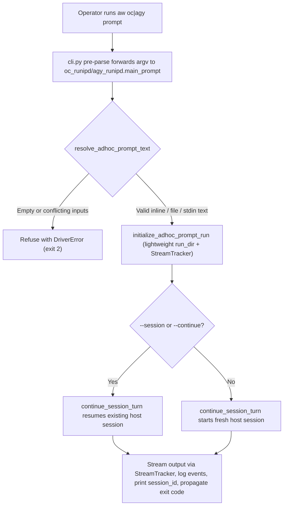

# IPD: Add aw agy|oc prompt for ad-hoc streaming turns and shared session continuation

- Date: 2026-11-27
- Kind: child
- Concern: Operators currently have no host-symmetric way to execute an ad-hoc prompt through the `aw` runners with the live streaming statusline UI (`render_stream.StreamTracker`), token/quota telemetry, launch profiles (`--as`, `--model`, `--variant`, `--effort`), and `aw runs` visibility. `aw agy exec` (`agent_workflows/agy_run.py`) is Antigravity-only, hardcodes a two-turn skeptical audit loop, and uses a separate output renderer; `oc_runipd.run_opencode` and `agy_runipd.run_agy_turn` currently expect a full queue run directory and IPD item. Building a shared ad-hoc prompt turn and session-continuation seam in `agent_workflows/runner_shared.py` solves ad-hoc prompt execution across both hosts (`aw oc prompt` and `aw agy prompt`) and provides the exact session-continuation primitive needed by backlog `9ici96` (Ctrl-C mid-run prompt injection).
- Scope: Add a shared ad-hoc prompt execution and session-continuation engine in `agent_workflows/runner_shared.py`, wire `prompt` subcommand entrypoints on both host drivers (`agent_workflows/oc_runipd.py` and `agent_workflows/agy_runipd.py`), expose `aw oc prompt` (`aw opencode prompt`) and `aw agy prompt` (`aw antigravity prompt`) in `agent_workflows/cli.py`, register both verbs in `agent_workflows/command_surface.py`, and add behavioral parity tests in `tests/test_adhoc_prompt_runner.py`. Keep `aw agy exec` (`agent_workflows/agy_run.py`) unchanged and do not modify Ctrl-C interrupt handling (tracked in backlog `9ici96`).
- Scope-Paths: .aw/records/plans/pending/20261127-adhocprompt-01-z4kwzd-add-aw-agy-oc-prompt-for-ad-hoc-streaming-turns-and-shared-s.ipd.md, agent_workflows/runner_shared.py, agent_workflows/oc_runipd.py, agent_workflows/agy_runipd.py, agent_workflows/cli.py, agent_workflows/command_surface.py, tests/test_adhoc_prompt_runner.py
- Item-Dependencies: none
- Status: to-review
- Short-Description: Add aw agy prompt and aw oc prompt using shared streaming runner and session-continuation plumbing
- From-Spec: none
- Work-Kind: feature
- Priority: medium
- Set: adhocprompt
- Order: 1
- Highest E allocated: 05
- Author: antigravity/gemini
- Id: z4kwzd

> Write and proofread this plan per the technical writing standard, `.aw/system/workflows/technical-writing/technical-writing.md` (`.agents/workflows/technical-writing/technical-writing.md` in a legacy-layout install), including requirement 12 (diagrams).

## Workflow history

- 2026-11-27 to-review (antigravity/gemini): authored review-ready plan for aw agy|oc prompt and shared session-continuation plumbing.
- 2026-11-27 draft (antigravity/gemini): created.

## Goal

Let operators run any inline, file-backed, or stdin prompt through `aw oc prompt` or `aw agy prompt` with full live streaming output (`render_stream.StreamTracker`), launch-profile support, optional session continuation (`--session` / `--continue`), and lightweight run logging, while exposing one shared session-continuation helper that both hosts and future mid-run prompt injection (`9ici96`) reuse.

## Detailed Implementation Checklist (TODO)

Execution-state rule: mark an `E-*` item complete only after performing the action. That mark is not validation. Right-sizing rule: write for a modest executor that cannot hold much in its head. Each E-item is one step (one concern, about one file, executable in one focused pass) and its V-item names each unit it covers with its own check; a plan stays at about 5 E-items and 8 work Scope-Paths, else split it into more child plans (guidance, `IPD-Z603`). Accepted execution states: blocked, failed, pending, performed; terminal gate demands 'performed'.

### Task group 1: shared ad-hoc prompt and session-continuation engine

- [ ] E-01 Add the shared ad-hoc prompt and session-continuation engine to `agent_workflows/runner_shared.py`:
  1. Add `resolve_adhoc_prompt_text(prompt_arg: str | None, file_arg: str | None, stdin_stream: TextIO | None = None) -> str` that resolves exactly one input source: inline positional string, `-f`/`--file <path>` (stripping optional leading `<!-- aw-prompt: ... -->` HTML comment metadata if present), or stdin when `-` is passed (or stdin is piped with no positional/file argument). Refuse cleanly with `DriverError` when multiple sources conflict or the resolved prompt is empty.
  2. Add `initialize_adhoc_prompt_run(repo: Path, *, host_labels: HostLabels, options: dict[str, Any], prompt_text: str) -> tuple[Path, dict[str, Any], dict[str, Any], Path]` that creates a lightweight run directory under the resolved runs root (`run_kind: "adhoc-prompt"`), writes `state.json`, `events.jsonl`, and `prompts/01-adhoc-attempt-1.md`, and builds a single synthetic queue item (`artifact_type: "adhoc-prompt"`, `action: "prompt"`) without running IPD lint, dependency preflight, or verifier checks.
  3. Add `continue_session_turn(*, run_dir: Path, state: dict[str, Any], item: dict[str, Any], prompt_text: str, session_id: str | None, use_continue: bool, work_dir: str | None, tracker: Any, spawn_turn_fn: Callable[..., tuple[int, str | None, Path, list[str]]], suffix: str = "") -> tuple[int, str | None, Path, list[str]]` as the reusable host-neutral continuation seam (persisting the prompt file, appending a `prompt-turn-started` / `prompt-turn-finished` event pair to `events.jsonl`, forwarding `session_id` and `use_continue` to `spawn_turn_fn`, and updating `item["attempts"]` and `state["session_id"]`).
  4. Add `run_adhoc_prompt_turn(...) -> int` that orchestrates `initialize_adhoc_prompt_run`, installs `runner_stop` signal handlers, runs directly in the active checkout by default (or an isolated worktree when `--isolate-worktree` is requested), starts `render_stream.StreamTracker`, invokes `continue_session_turn`, prints the captured `session_id` and run directory path on completion, and propagates the child exit code cleanly.
  - Depends on: none
  - Expected outcome: `agent_workflows/runner_shared.py` provides one host-neutral ad-hoc prompt and session-continuation seam with zero IPD-lifecycle assumptions and zero `signal` imports outside `runner_stop`.
  - Execution state: pending

### Task group 2: host driver entrypoints

- [ ] E-02 Add `prompt` parser and execution entrypoints to both `agent_workflows/oc_runipd.py` (`build_prompt_parser`, `main_prompt`) and `agent_workflows/agy_runipd.py` (`build_prompt_parser`, `main_prompt`):
  1. Support identical core flags on both hosts: optional positional `prompt` (or `-` for stdin), `-f`/`--file PATH`, `--session SESSION_ID`, `-c`/`--continue`, `--isolate-worktree` (default `False` for ad-hoc prompts), `--repo PATH`, `--as PROFILE`, `--model MODEL`, `--timeout SECONDS`, `--stall-timeout SECONDS`, plus shared output flags via `runner_shared.add_output_flags` (`--quiet`, `--raw`, `-v`/`--verbose`, `--title-style`) and host-specific launch options (`--variant` on OpenCode; `--effort` on Antigravity).
  2. Resolve launch profiles and model defaults through the existing host profile resolvers, then delegate execution to `runner_shared.run_adhoc_prompt_turn` backed by `oc_runipd.run_opencode` (using `explicit_session_id` / `use_continue`) and `agy_runipd.run_agy_turn` (using `session_id` / `use_continue`).
  3. Ensure `oc_runipd.run_opencode` handles a synthetic `adhoc-prompt` item cleanly (handling `plan_path=None` or synthetic prompt path without requiring a `.ipd.md` file) and streams all output through `render_stream.StreamTracker`.
  - Depends on: E-01
  - Expected outcome: Both `oc_runipd.main_prompt` and `agy_runipd.main_prompt` execute ad-hoc prompts and `--session` continuations through the shared streaming engine with identical CLI semantics.
  - Execution state: pending

### Task group 3: CLI wiring and command-surface registration

- [ ] E-03 Expose `aw oc prompt` (`aw opencode prompt`) and `aw agy prompt` (`aw antigravity prompt`) in `agent_workflows/cli.py` and declare both in `agent_workflows/command_surface.py`:
  1. In `agent_workflows/cli.py`, add pre-`parse_args` verbatim tail forwarding for `("oc", "opencode") + "prompt"` -> `oc_runipd.main_prompt(argv_list[2:])` and `("agy", "antigravity") + "prompt"` -> `agy_runipd.main_prompt(argv_list[2:])` (matching the existing `runipd` / `sessions` / `view` / `exec` forwarding pattern so leading flags and `--help` never get intercepted by the top-level parser), and register `prompt` subparsers under `oc_sub` and `agy_sub` with `add_help=False` and `argparse.REMAINDER` so `aw oc --help` and `aw agy --help` document them.
  2. In `agent_workflows/command_surface.py`, register `oc prompt` and `agy prompt` with accurate descriptions, action classes, and parity metadata so `tests/test_command_surface_declarations.py`, `tests/test_exit_contract_conformance.py`, and `tests/test_agent_surface_conformance.py` pass without exemptions.
  3. Keep `aw agy exec` (`agent_workflows/agy_run.py`) untouched and distinct in help text.
  - Depends on: E-02
  - Expected outcome: `aw oc prompt --help` and `aw agy prompt --help` route to their driver parsers, and all command-surface contract suites pass.
  - Execution state: pending

### Task group 4: behavioral tests and validation

- [ ] E-04 Add behavioral test module `tests/test_adhoc_prompt_runner.py` exercising observable outcomes across both hosts (no `inspect`, `ast`, regex, or source-reading code-pinning tests):
  1. Test `resolve_adhoc_prompt_text` for inline text, `-f`/`--file` (including stripping a leading `<!-- aw-prompt: ... -->` comment), stdin `-`, conflicting-source refusal, and empty-prompt refusal.
  2. Test `aw oc prompt` and `aw agy prompt` through `cli.main` with mocked host turn launchers (`run_opencode` / `run_agy_turn`): verify inline prompt, `--file`, `--session <id>` continuation via `continue_session_turn`, `-c`/`--continue`, `--raw`/`--quiet`/`-v` flag forwarding, lightweight `state.json` (`run_kind == "adhoc-prompt"`) + `events.jsonl` + `prompts/` creation, printed `session_id` in output, and child exit-code propagation (both `0` and non-zero).
  3. Run `python3 -m pytest tests/test_adhoc_prompt_runner.py tests/test_command_surface_declarations.py tests/test_exit_contract_conformance.py tests/test_agent_surface_conformance.py`.
  - Depends on: E-03
  - Expected outcome: All new and contract conformance tests pass on both hosts.
  - Execution state: pending

- [ ] E-05 Run type checks (`python3 -m mypy agent_workflows/runner_shared.py agent_workflows/oc_runipd.py agent_workflows/agy_runipd.py agent_workflows/cli.py agent_workflows/command_surface.py`), bare core suite (`python3 -m pytest`), and `aw sanitize --agent`; verify `git status --short` lists only `- Scope-Paths:` files; commit path-scoped via `aw commit z4kwzd -- <changed paths>` (never push).
  - Depends on: E-04
  - Expected outcome: Type check, core test suite, and leak sanitizer pass cleanly and one or more path-scoped commits land in the executing worktree.
  - Execution state: pending

## Project conventions discovered (Step 0)

- `agent_workflows/cli.py` forwards host runner verbs (`oc runipd`, `agy runipd`, `agy sessions`, `agy view`, `agy exec`) verbatim BEFORE `parser.parse_args(argv)` so leading flags and `--help` are owned by the driver's own parser rather than intercepted by `argparse.REMAINDER`.
- `agent_workflows/runner_shared.py` must not import `signal` directly; `agent_workflows/runner_stop.py` owns POSIX signal handler installation (`install_stop_signal_handlers`).
- `agent_workflows/runner_shared.py` keeps module-level first-party imports restricted to `render_stream` and `runner_profiles`; additional first-party modules are imported function-locally.
- Both hosts already expose explicit session-resumption parameters on their turn launchers (`oc_runipd.run_opencode` accepts `explicit_session_id` and `agy_runipd.run_agy_turn` accepts `session_id` and `use_continue`).
- New CLI leaves must be declared in `agent_workflows/command_surface.py` to pass `tests/test_command_surface_declarations.py`, `tests/test_exit_contract_conformance.py`, and `tests/test_agent_surface_conformance.py`.
- Tests assert observable behavior, outputs, exit codes, and files on disk (AGENTS.md "TEST OUTCOMES, NOT CODE STRUCTURE").

## Findings

| Id | Evidence | Finding |
|---|---|---|
| F-01 | `agent_workflows/agy_run.py` (`build_parser`) and `agent_workflows/cli.py` (`p_agy_exec`) | `aw agy exec` already supports single-prompt execution for Antigravity, but it is Antigravity-only, hardcodes a two-turn skeptical audit protocol, and does not use `render_stream.StreamTracker`. |
| F-02 | `agent_workflows/oc_runipd.py::run_opencode` and `agent_workflows/agy_runipd.py::run_agy_turn` | Both host turn launchers already stream through `render_stream.StreamTracker` and accept explicit session IDs for resumption, making a shared `continue_session_turn` seam straightforward without duplicating process/stream plumbing. |
| F-03 | `agent_workflows/cli.py` pre-parse forwarding block (`oc`/`opencode` and `agy`/`antigravity`) | Pre-parse forwarding guarantees leading options like `aw agy prompt --model X "hi"` and `aw oc prompt --help` work regardless of flag order. |

## Proposed changes (ordered, validatable)

1. E-01: Build `resolve_adhoc_prompt_text`, `initialize_adhoc_prompt_run`, `continue_session_turn`, and `run_adhoc_prompt_turn` in `agent_workflows/runner_shared.py`.
2. E-02: Wire `build_prompt_parser` and `main_prompt` in `agent_workflows/oc_runipd.py` and `agent_workflows/agy_runipd.py`.
3. E-03: Add `aw oc prompt` and `aw agy prompt` forwarding/subparsers in `agent_workflows/cli.py` and declarations in `agent_workflows/command_surface.py`.
4. E-04: Add and run behavioral tests in `tests/test_adhoc_prompt_runner.py` plus command-surface conformance suites.
5. E-05: Run mypy, core pytest suite, and `aw sanitize --agent`, then commit path-scoped.

## Deferred / out of scope (with reason)

- Ctrl-C interrupt menu option to inject a prompt mid-run into a live `aw agy|oc run` session (reuses `continue_session_turn` shipped by this plan): tracked separately because of POSIX signal-handler unwinding, pre-session-ID races, and spec `c4gd2h` invariants.
  - Carrier: 9ici96
- Retiring or merging legacy `aw agy exec` (`agent_workflows/agy_run.py`): kept intact so existing two-turn skeptical audit workflows are unaffected.

## Scope check

- Over-scope: none. Only the shared runner seam, the two host drivers, CLI/command-surface registration, and one new behavioral test module are touched.
- Under-scope: none. All input modes (inline, file, stdin), session continuation (`--session`, `--continue`), streaming output, and both-host CLI/contract tests are covered.

## Required tests / validation

- `python3 -m pytest tests/test_adhoc_prompt_runner.py tests/test_command_surface_declarations.py tests/test_exit_contract_conformance.py tests/test_agent_surface_conformance.py` (V-04).
- `python3 -m mypy agent_workflows/runner_shared.py agent_workflows/oc_runipd.py agent_workflows/agy_runipd.py agent_workflows/cli.py agent_workflows/command_surface.py`, bare `python3 -m pytest`, and `aw sanitize --agent` (V-05).

## Spec / documentation sync

No existing spec defines `aw agy|oc prompt` (`- From-Spec: none`). Subcommand help text in `cli.py`, `oc_runipd.py`, `agy_runipd.py`, and `command_surface.py` documents the new verb surface directly.

## Open questions

None open.

## Validation and cross-check (verify before reporting done)

Validation-state rule: inspect evidence in a separate pass. Do not mark a `V-*` item complete from memory or from the matching execution checkmark. Accepted validation results: blocked, failed, pass, pending; terminal gate demands 'pass'. Runtime-demonstration reachability rule: for each `V-*` item demanding the software be observed acting (such as a run, a dispatch, or a transition) - as distinct from items demanding a diff, a file's content, or a test result, which are reachable by construction - name the code path that produces the observation or the sibling `E-*` that creates it, else the demand is UNDER-SCOPE.

- [ ] V-01 validates E-01
  - Required evidence: paste behavioral test output from `tests/test_adhoc_prompt_runner.py` exercising `runner_shared.resolve_adhoc_prompt_text`, `initialize_adhoc_prompt_run`, `continue_session_turn`, and `run_adhoc_prompt_turn` (confirming inline/file/stdin resolution, refusal on empty/conflicting input, lightweight `state.json`/`events.jsonl` creation, and session-ID forwarding).
  - Observed evidence:
  - Result: pending
- [ ] V-02 validates E-02
  - Required evidence: paste behavioral test output from `tests/test_adhoc_prompt_runner.py` exercising both `oc_runipd.main_prompt` and `agy_runipd.main_prompt` with mocked turn launchers (confirming launch-profile/flag parity, `StreamTracker` output wiring, `--session`/`--continue` forwarding, and exit-code propagation on both hosts).
  - Observed evidence:
  - Result: pending
- [ ] V-03 validates E-03
  - Required evidence: paste actual CLI outputs of `aw oc prompt --help` and `aw agy prompt --help` (exiting 0 and showing their driver parsers) plus passing pytest output for `tests/test_command_surface_declarations.py`, `tests/test_exit_contract_conformance.py`, and `tests/test_agent_surface_conformance.py`.
  - Observed evidence:
  - Result: pending
- [ ] V-04 validates E-04
  - Required evidence: paste the full `python3 -m pytest tests/test_adhoc_prompt_runner.py tests/test_command_surface_declarations.py tests/test_exit_contract_conformance.py tests/test_agent_surface_conformance.py` output showing every test PASSED with 0 failures.
  - Observed evidence:
  - Result: pending
- [ ] V-05 validates E-05
  - Required evidence: paste actual outputs of `python3 -m mypy agent_workflows/runner_shared.py agent_workflows/oc_runipd.py agent_workflows/agy_runipd.py agent_workflows/cli.py agent_workflows/command_surface.py` (0 issues), bare `python3 -m pytest` (pass summary), `aw sanitize --agent` (`outcome: clean`, `findings: 0`), `git status --short`, and the `aw commit z4kwzd` commit hash.
  - Observed evidence:
  - Result: pending

## Approval and execution gate

- Size assessment: standard
- Cohesion rationale: not required

Execute only after human approval (`Status: approved`); open questions: none open. Work in an isolated git worktree, never directly on `main`. Scope fence: `- Scope-Paths:` is a declaration; any needed edit outside it must be justified at finalize (`--scope-reason`), and any declared path left unmodified must be acknowledged (`--scope-ack`). Honesty rule: paste the ACTUAL runner output of every command named in V-01 through V-05; never claim a result you did not run. Commits: commit only through `aw commit z4kwzd -- <paths>`; never push. Lifecycle transition: after `aw ipd lint --phase pre-transition` conforms and every `V-*` reads `pass` with pasted evidence, in a managed runner lane stop after committing the updated plan and let the runner run `aw ipd finalize`; in a hand-run session run `aw ipd finalize z4kwzd` to move the plan to `.aw/records/plans/executed/` (never use a raw `git mv` to `executed/`).
