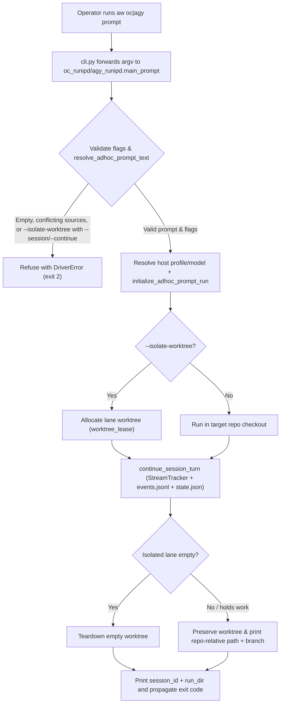

# IPD: Add aw agy|oc prompt for ad-hoc streaming turns and shared session continuation

- Date: 2026-11-27
- Kind: child
- Concern: Operators have no host-symmetric command to run an ad-hoc prompt through the `aw` runners with the live streaming statusline (`agent_workflows/render_stream.py::StreamTracker`), launch profiles (`--as`, `--model`, `--variant`, `--effort`), and `aw runs` visibility. `aw agy exec` (`agent_workflows/agy_run.py`) supports Antigravity only, enforces a two-turn skeptical audit loop, and uses a separate output renderer. Meanwhile, `agent_workflows/oc_runipd.py::run_opencode` and `agent_workflows/agy_runipd.py::run_agy_turn` currently expect an IPD queue run directory (and `run_opencode` requires a plan file path and lacks `--continue`). Adding a shared ad-hoc prompt and session-continuation engine in `agent_workflows/runner_shared.py` delivers host-symmetric `aw oc prompt` and `aw agy prompt` turns and provides the reusable continuation seam required by backlog `9ici96` (Ctrl-C mid-run prompt injection).
- Scope: Add a shared ad-hoc prompt and session-continuation engine in `agent_workflows/runner_shared.py`; add `build_prompt_parser` and `main_prompt` to `agent_workflows/oc_runipd.py` and `agent_workflows/agy_runipd.py` (updating `run_opencode` to support `plan_path=None`, `use_continue`, and `options["timeout"]`); expose `aw oc prompt` (`aw opencode prompt`) and `aw agy prompt` (`aw antigravity prompt`) in `agent_workflows/cli.py`; declare both leaves in `agent_workflows/command_surface.py::COMMAND_INVENTORY` and register both forwarded-driver exemptions in `tests/conformance_matrix.py::MUTATION_EXEMPTION_REGISTRY` and `tests/test_shared_flag_honored.py::SECTION_1_3_EXEMPT_LEAVES`; sync `docs/cli-output-contract.md` Section 1.3; and add behavioral parity tests in `tests/test_adhoc_prompt_runner.py`. Keep `aw agy exec` (`agent_workflows/agy_run.py`) unchanged and do not modify Ctrl-C interrupt handling (tracked in backlog `9ici96`).
- Scope-Paths: .aw/records/plans/pending/20261127-adhocprompt-01-z4kwzd-add-aw-agy-oc-prompt-for-ad-hoc-streaming-turns-and-shared-s.ipd.md, agent_workflows/runner_shared.py, agent_workflows/oc_runipd.py, agent_workflows/agy_runipd.py, agent_workflows/cli.py, agent_workflows/command_surface.py, docs/cli-output-contract.md, tests/conformance_matrix.py, tests/test_shared_flag_honored.py, tests/test_adhoc_prompt_runner.py
- Item-Dependencies: none
- Status: approved
- Readiness: go-pending-approval
- Review-Depth: standard
- Short-Description: Add aw agy prompt and aw oc prompt using shared streaming runner and session-continuation plumbing
- From-Spec: none
- Work-Kind: feature
- Priority: medium
- Set: adhocprompt
- Order: 1
- Highest E allocated: 05
- Author: antigravity/gemini
- Id: z4kwzd
- Approval: 2026-11-27, recorded via aw ipd set: status set to approved

> Write and proofread this plan per the technical writing standard, `.aw/system/workflows/technical-writing/technical-writing.md` (`.agents/workflows/technical-writing/technical-writing.md` in a legacy-layout install), including requirement 12 (diagrams).

## Workflow history

- 2026-11-27 approved (aw set): status set to approved
- 2026-11-27 reviewed (aw set): APPROVE WITH REVISIONS APPLIED; PR-001..PR-005 FIXED
- 2026-11-27 /plan-review (antigravity/gemini): APPROVE WITH REVISIONS APPLIED; PR-001, PR-002, PR-003, PR-004, PR-005 (all FIXED); review record .aw/records/reviews/20261127-adhocprompt-01-z4kwzd-add-aw-agy-oc-prompt-for-ad-hoc-streaming-turns-and-shared-s.review.md
- 2026-11-27 to-review (antigravity/gemini): authored review-ready plan for aw agy|oc prompt and shared session-continuation plumbing.
- 2026-11-27 draft (antigravity/gemini): created.

## Goal

Let operators run any inline, file-backed, or stdin prompt through `aw oc prompt` or `aw agy prompt` with live streaming output (`agent_workflows/render_stream.py::StreamTracker`), launch-profile resolution, optional session continuation (`--session` or `-c`/`--continue`), optional isolated worktree execution (`--isolate-worktree`), and lightweight `aw runs` run logging, while providing one shared `continue_session_turn` helper that both hosts and backlog `9ici96` (Ctrl-C mid-run prompt injection) reuse.

## Detailed Implementation Checklist (TODO)

Execution-state rule: mark an `E-*` item complete only after performing the action. That mark is not validation. Right-sizing rule: write for a modest executor that cannot hold much in its head. Each E-item is one step (one concern, about one file, executable in one focused pass) and its V-item names each unit it covers with its own check; a plan stays at about 5 E-items and 8 work Scope-Paths, else split it into more child plans (guidance, `IPD-Z603`). Accepted execution states: blocked, failed, pending, performed; terminal gate demands 'performed'.

### Task group 1: shared ad-hoc prompt and session-continuation engine

- [x] E-01 Add the shared ad-hoc prompt and session-continuation engine to `agent_workflows/runner_shared.py` (keeping module-level first-party imports restricted to `render_stream` and `runner_profiles`, and importing `runner_stop` and `worktree_lease` function-locally):
  1. Add `resolve_adhoc_prompt_text(prompt_arg: str | None, file_arg: str | None, stdin_stream: TextIO | None = None) -> str` that resolves exactly one input source: inline positional text, `-f`/`--file <path>`, or stdin when `prompt_arg == "-"` (or when both `prompt_arg` and `file_arg` are `None` and `stdin_stream` is not a TTY). For file-backed prompts, strip an optional UTF-8 BOM (`\ufeff`) and an optional leading `<!-- aw-prompt: ... -->` or `<!-- aw-managed-prompt: ... -->` metadata comment anchored at the start of the file while preserving HTML comments inside the prompt body. Refuse cleanly with `DriverError` when multiple sources are given (including `-` with `--file`), when the file cannot be read, when no prompt/file is given on an interactive TTY stdin (never hang waiting on stdin), or when the resolved text is empty or whitespace-only.
  2. Add `initialize_adhoc_prompt_run(repo: Path, *, host_labels: HostLabels, options: dict[str, Any], prompt_text: str) -> tuple[Path, dict[str, Any], dict[str, Any], Path]` that creates a lightweight run directory under `state_root(repo)` with `run_id = new_run_id()`, writes `prompts/01-adhoc0-attempt-1.md`, initializes `events.jsonl`, and writes `state.json` containing the schema keys required by `load_state`, `save_state`, `write_report`, `run_opencode`, `run_agy_turn`, and `agent_workflows/run_viewer.py::load_run_summary`: `schema_version`, `run_id`, `run_kind: "adhoc-prompt"`, `driver: host_labels.id`, `repo: str(repo)`, `created_at`, `updated_at`, `selectors: ["prompt"]`, `set_sessions: {}`, `options`, and a single-item `queue` entry (`position: 1`, `id6: "adhoc0"`, `setid: "adhoc"`, `artifact_type: "adhoc-prompt"`, `action: "prompt"`, `status: "queued"`, `attempts: []`). Do not run IPD lint, dependency preflight, or verifier checks.
  3. Add `continue_session_turn(*, run_dir: Path, state: dict[str, Any], item: dict[str, Any], prompt_text: str, session_id: str | None, use_continue: bool, work_dir: str | None, tracker: Any, spawn_turn_fn: Callable[..., tuple[int, str | None, Path, list[str]]], suffix: str = "", attempt_no: int | None = None, record_attempt: bool = True, event_prefix: str = "prompt-turn", write_report_fn: Callable[[Path, dict[str, Any]], None] | None = None) -> tuple[int, str | None, Path, list[str]]` as the reusable host-neutral continuation seam for both ad-hoc prompts and backlog `9ici96`. Persist the prompt file under `run_dir / "prompts"`, append an in-flight attempt record (`attempt`, `started_at`, `prompt_path`, `session_id`) to `item["attempts"]` BEFORE invoking `spawn_turn_fn` when `record_attempt` is `True` (so host turn launchers that read `item["attempts"][-1]` always find the active attempt, while callers such as `9ici96` can set `record_attempt=False` to avoid consuming a retry attempt), append `<event_prefix>-started` and `<event_prefix>-finished` events to `events.jsonl`, invoke `spawn_turn_fn` with `prompt_path`, `attempt_no`, `session_id`, `use_continue`, `work_dir`, `tracker`, and `suffix`, finalize the attempt record (`ended_at`, `returncode`, `session_id`, `log_path`), update `state["session_id"]` when a session ID is returned, and persist `state.json` via `save_state`.
  4. Add `run_adhoc_prompt_turn(...) -> int` that validates mutually exclusive options before creating any run directory or worktree: refuse `--session` combined with `--continue`, and refuse `--isolate-worktree` combined with `--session` or `--continue` (preventing cross-tree session reuse per `lanesess` `xd9sll` / `r0iob3`), raising `DriverError` (exit 2). Initialize the run via `initialize_adhoc_prompt_run`, install stop handlers via `runner_stop.install_stop_signal_handlers(run_dir, command=...)`, run in `repo` by default or allocate a worktree via `worktree_lease.allocate_worktree(repo, lane_id=f"adhoc-{run_id}", base_commit="HEAD")` when `--isolate-worktree` is requested, start `render_stream.StreamTracker()`, execute via `continue_session_turn`, update `item["status"]` (`"completed"` on exit 0, `"failed"` on non-zero, `"interrupted"` on `KeyboardInterrupt`) and save final state. In a `finally` block for `--isolate-worktree`, inspect the lane via `worktree_lease.inspect_lane`: tear it down ONLY when `state == worktree_lease.LANE_EMPTY` (clean with zero commits ahead); if dirty or ahead of base, preserve the worktree and branch and print their repo-relative path and branch name so no edits are lost. Print the captured `session_id` (if observed) and the run directory path (repo-relative when inside `repo`, never a raw home-directory absolute path), and propagate the child exit code (returning `130` on `KeyboardInterrupt` and `2` on `DriverError`).
  - Depends on: none
  - Expected outcome: `agent_workflows/runner_shared.py` provides one host-neutral ad-hoc prompt and session-continuation engine with zero IPD-lifecycle assumptions, zero `signal` imports, safe `--isolate-worktree` preservation, and full `run_viewer.load_run_summary` compatibility.
  - Execution state: performed

### Task group 2: host driver entrypoints

- [x] E-02 Add `prompt` parser and execution entrypoints to both `agent_workflows/oc_runipd.py` (`build_prompt_parser`, `main_prompt`) and `agent_workflows/agy_runipd.py` (`build_prompt_parser`, `main_prompt`), and generalize `oc_runipd.run_opencode` for ad-hoc prompts:
  1. Register identical core flags on both host `build_prompt_parser()` functions: optional positional `prompt` (or `-` for stdin), `-f`/`--file PATH`, `--session SESSION_ID`, `-c`/`--continue`, `--isolate-worktree` (default `False`), `--repo PATH` (default `"."`), `--as PROFILE` (`dest="profile"`), `--model MODEL`, `--timeout DURATION` (duration string or seconds parsed by `agent_workflows/lane_containment.py::parse_host_ceiling_seconds`, e.g. `480m`, `120s`, `300`), `--stall-timeout SECONDS` (`type=float`, default `DEFAULT_STALL_TIMEOUT`), plus the host's existing `_add_output_mode_flags` wrapper delegating to `agent_workflows/runner_shared.py::add_output_mode_flags` (`--quiet`, `--raw`, `-v`/`--verbose`, `--title-style`). Register host-specific launch flags: `--variant`, `--oc-agent` (OpenCode agent name), and `--opencode` (executable path) on OpenCode; `--effort`, `--agy`/`--agy-executable`, and `--dangerously-skip-permissions`/`--no-dangerously-skip-permissions` on Antigravity.
  2. Resolve launch profiles and model defaults per host before creating any run directory: on OpenCode, delegate to `oc_runipd.resolve_launch_profile` (mapping `--as`/`--model`/`--variant`/`--oc-agent`); on Antigravity, load and resolve via `runner_profiles.load()` and `runner_profiles.resolve(cfg, runner="agy", profile=args.profile, model=args.model)` (converting `RunnerProfileError` to `DriverError` and falling back to `agy_models.resolve_agy_default_model()` when `resolved.model` is `None`). Delegate turn execution to `runner_shared.run_adhoc_prompt_turn` backed by `oc_runipd.run_opencode` (passing `resume_session=session_id`, `use_continue=use_continue`, `plan_path=None`) and `agy_runipd.run_agy_turn` (passing `session_id=session_id`, `use_continue=use_continue`).
  3. Update `agent_workflows/oc_runipd.py::run_opencode` to: (a) accept `plan_path: Path | None = None` and `use_continue: bool = False` (retaining full backward compatibility for existing positional/keyword callers); (b) emit `--continue` on `opencode run` when `use_continue` is `True` and `session` is `None` (and not an isolated turn); (c) omit both `state["runbook"]` and `--file <plan_path>` when `plan_path is None` or `item.get("action") == "prompt"`, passing `["--", prompt_path.read_text(encoding="utf-8")]`; and (d) pass `lane_containment.driver_bound_for_host(lane_containment.parse_host_ceiling_seconds(options.get("timeout")))` into `TurnBoundWatch` so `--timeout` is enforced on OpenCode rather than ignored.
  - Depends on: E-01
  - Expected outcome: Both `oc_runipd.main_prompt` and `agy_runipd.main_prompt` execute ad-hoc prompts, `--as` profiles, `--session` / `--continue` resumptions, `--timeout`, and `--isolate-worktree` through the shared streaming engine with identical CLI semantics and zero regressions to existing IPD queue runs.
  - Execution state: performed

### Task group 3: CLI wiring, command-surface registration, and contract sync

- [x] E-03 Expose `aw oc prompt` (`aw opencode prompt`) and `aw agy prompt` (`aw antigravity prompt`) in `agent_workflows/cli.py`, declare both leaves in `agent_workflows/command_surface.py`, update the forwarded-leaf conformance registries, and sync `docs/cli-output-contract.md`:
  1. In `agent_workflows/cli.py`, add pre-`parse_args` verbatim tail forwarding in `_dispatch` for `("oc", "opencode") + "prompt"` -> `oc_runipd.main_prompt(list(argv_list[2:]))` and `("agy", "antigravity") + "prompt"` -> `agy_runipd.main_prompt(list(argv_list[2:]))` (matching `runipd` / `sessions` / `view` / `exec` so leading flags and `--help` reach the driver's own parser); add matching post-parse fallback arms in `_dispatch` (`if oc_cmd == "prompt":` and `if agy_cmd == "prompt":`); register `prompt` subparsers under `oc_sub` and `agy_sub` with `add_help=False` and `argparse.REMAINDER`; and update `p_oc` / `p_agy` parent descriptions so `aw oc --help` and `aw agy --help` document `prompt` while keeping `aw agy exec` (`agent_workflows/agy_run.py`) untouched and distinct.
  2. In `agent_workflows/command_surface.py::COMMAND_INVENTORY`, declare `CommandDeclaration` entries for `"oc prompt"` and `"agy prompt"` with `command_class="mutation"`, `human_recipe="status"`, `agent_record_kind="result"`, `mutation_gate="none"`, `empty_error_renderer="renderer_boundary"`, `legacy_flags=()`, and `exit_contract=(0, 1, 2)` (matching `agy exec`, `oc runipd`, and `agy runipd`).
  3. Register `"oc prompt"` and `"agy prompt"` in `tests/conformance_matrix.py::MUTATION_EXEMPTION_REGISTRY` (`reason_kind="arg_fixture_needed"`, `citation="positional argument required"`, matching `"oc runipd"`, `"agy runipd"`, and `"agy exec"`) and in `tests/test_shared_flag_honored.py::SECTION_1_3_EXEMPT_LEAVES`, and add `aw oc prompt` / `aw agy prompt` to the verbatim-forwarding host-driver leaf list in `docs/cli-output-contract.md` Section 1.3 (user-facing prose, no em or en dashes).
  - Depends on: E-02
  - Expected outcome: `aw oc prompt --help` and `aw agy prompt --help` route to their driver parsers, `aw oc --help` and `aw agy --help` list `prompt`, and all CLI declaration, exit-contract, agent-surface, shared-flag, and matrix-structure conformance suites pass.
  - Execution state: performed

### Task group 4: behavioral tests and validation

- [x] E-04 Add behavioral test module `tests/test_adhoc_prompt_runner.py` exercising observable outcomes across both hosts (no `inspect`, `ast`, regex, or source-reading code-pinning tests):
  1. Test `runner_shared.resolve_adhoc_prompt_text` for inline text, `-f`/`--file` (stripping a leading BOM and `<!-- aw-prompt: ... -->` / `<!-- aw-managed-prompt: ... -->` header while preserving an HTML comment inside the body), stdin via `-` and piped stdin, missing file refusal, conflicting-source refusal (including `-` with `--file`), interactive TTY empty-input refusal, and empty/whitespace prompt refusal.
  2. Test `runner_shared.continue_session_turn` and `runner_shared.run_adhoc_prompt_turn` for lightweight `state.json` (`run_kind == "adhoc-prompt"`), `events.jsonl` (`prompt-turn-started` / `prompt-turn-finished`), `prompts/` persistence, `run_viewer.load_run_summary(run_dir)` compatibility, `record_attempt=False` (non-retry-consuming mode for `9ici96`), `--session` + `--continue` refusal, `--isolate-worktree` + `--session`/`--continue` refusal, `--isolate-worktree` empty-lane teardown vs dirty/ahead-lane preservation (printing repo-relative path and branch without raw home paths), and `KeyboardInterrupt` exit-130 / `DriverError` exit-2 handling.
  3. Test `aw oc prompt` (`aw opencode prompt`) and `aw agy prompt` (`aw antigravity prompt`) through `cli.main` with mocked host turn launchers (`run_opencode` / `run_agy_turn`) and a targeted `run_opencode` subprocess-argv test: verify inline prompt, `--file`, `--as` profile resolution on both hosts, `--session <id>` (`resume_session` on `oc`, `session_id` on `agy`), `-c`/`--continue` (`--continue` on `opencode run` and `agy`), `plan_path=None` omitting `--file` and runbook in `run_opencode`, `--timeout` forwarding into `TurnBoundWatch`, `--raw`/`--quiet`/`-v` flag forwarding, printed `session_id`, and child exit-code propagation (`0` and non-zero).
  4. Run `python3 -m pytest tests/test_adhoc_prompt_runner.py tests/test_command_surface_declarations.py tests/test_exit_contract_conformance.py tests/test_agent_surface_conformance.py tests/test_shared_flag_honored.py tests/test_conformance_matrix_structure.py`.
  - Depends on: E-03
  - Expected outcome: All new behavioral tests and every CLI command-surface / conformance test suite pass on both hosts.
  - Execution state: performed

- [x] E-05 Run type checks (`python3 -m mypy agent_workflows/runner_shared.py agent_workflows/oc_runipd.py agent_workflows/agy_runipd.py agent_workflows/cli.py agent_workflows/command_surface.py`), bare core suite (`python3 -m pytest`), and `aw sanitize --agent`; verify `git status --short` lists only `- Scope-Paths:` files; commit path-scoped via `aw commit z4kwzd -- <changed paths>` (never push).
  - Depends on: E-04
  - Expected outcome: Type check, core test suite, and leak sanitizer pass cleanly and one or more path-scoped commits land in the executing worktree.
  - Execution state: performed

## Project conventions discovered (Step 0)

- `agent_workflows/cli.py::_dispatch` forwards host runner verbs (`oc runipd`, `agy runipd`, `agy sessions`, `agy view`, `agy exec`) verbatim BEFORE `parser.parse_args(argv)` (and keeps matching post-parse fallback arms) so leading flags and `--help` are owned by the driver's own parser rather than intercepted by `argparse.REMAINDER`.
- `agent_workflows/runner_shared.py` must not import `signal` directly; `agent_workflows/runner_stop.py::install_stop_signal_handlers` owns POSIX signal handler installation.
- `agent_workflows/runner_shared.py` keeps module-level first-party imports restricted to `render_stream` and `runner_profiles`; additional first-party modules (`runner_stop`, `worktree_lease`) are imported function-locally.
- Shared output-mode flags are registered via `agent_workflows/runner_shared.py::add_output_mode_flags` through each host's `_add_output_mode_flags` wrapper (`agent_workflows/oc_runipd.py::_add_output_mode_flags` and `agent_workflows/agy_runipd.py::_add_output_mode_flags`).
- `agent_workflows/oc_runipd.py::run_opencode` accepts `resume_session: str | None = None`, currently requires `plan_path: Path`, lacks `use_continue`, and hardcodes `driver_bound_for_host(None)`; `agent_workflows/agy_runipd.py::run_agy_turn` accepts `session_id` and `use_continue`. `opencode run --help` confirms OpenCode supports `--continue, -c` and `--session, -s`.
- `agent_workflows/runner_profiles.py::RUNNER_REGISTRY` supports both `"oc"` and `"agy"`, so `--as PROFILE` can resolve named profiles on both hosts via `runner_profiles.load()` + `runner_profiles.resolve(...)`.
- Verbatim-forwarding host-driver leaves (`oc runipd`, `agy runipd`, `agy exec`) must be declared in `agent_workflows/command_surface.py::COMMAND_INVENTORY` and registered in `tests/conformance_matrix.py::MUTATION_EXEMPTION_REGISTRY`, `tests/test_shared_flag_honored.py::SECTION_1_3_EXEMPT_LEAVES`, and `docs/cli-output-contract.md` Section 1.3.
- Tests assert observable behavior, outputs, exit codes, and files on disk (`AGENTS.md` "TEST OUTCOMES, NOT CODE STRUCTURE").

## Findings

| Id | Evidence | Finding |
|---|---|---|
| F-01 | `agent_workflows/agy_run.py::build_parser` and `agent_workflows/cli.py` (`p_agy_exec`) | `aw agy exec` already supports single-prompt execution for Antigravity, but it is Antigravity-only, enforces a two-turn skeptical audit protocol, and does not use `agent_workflows/render_stream.py::StreamTracker`. |
| F-02 | `agent_workflows/oc_runipd.py::run_opencode` and `agent_workflows/agy_runipd.py::run_agy_turn` | Both host turn launchers stream through `StreamTracker` and accept explicit session IDs (`resume_session` on `oc_runipd`; `session_id` and `use_continue` on `agy_runipd`). `run_opencode` needs `plan_path: Path | None = None`, `use_continue: bool = False`, runbook/file omission for ad-hoc prompts, and `options.get("timeout")` wired into `TurnBoundWatch`. |
| F-03 | `agent_workflows/cli.py::_dispatch` pre-parse forwarding and post-parse fallback arms (`oc`/`opencode` and `agy`/`antigravity`) | Pre-parse forwarding guarantees leading options like `aw agy prompt --model X "hi"` and `aw oc prompt --help` work regardless of flag order; matching post-parse arms prevent silent fallback to family help. |
| F-04 | `agent_workflows/command_surface.py::CommandDeclaration`, `tests/conformance_matrix.py::MUTATION_EXEMPTION_REGISTRY`, `tests/test_shared_flag_honored.py::SECTION_1_3_EXEMPT_LEAVES`, `docs/cli-output-contract.md#1.3 Flag Availability: uniform across every subcommand` | Adding verbatim-forwarding `mutation` leaves (`oc prompt`, `agy prompt`) requires `CommandDeclaration` entries in `COMMAND_INVENTORY` plus matching forwarded-leaf registrations in `MUTATION_EXEMPTION_REGISTRY`, `SECTION_1_3_EXEMPT_LEAVES`, and `docs/cli-output-contract.md` Section 1.3, otherwise `test_agent_surface_conformance.py` and `test_shared_flag_honored.py` fail. |
| F-05 | `agent_workflows/runner_shared.py::add_output_mode_flags`, `agent_workflows/runner_profiles.py::RUNNER_REGISTRY`, `agent_workflows/worktree_lease.py::inspect_lane`, backlog `9ici96` | Both hosts reuse `_add_output_mode_flags` -> `runner_shared.add_output_mode_flags`; `runner_profiles.resolve` supports both `"oc"` and `"agy"`; `--isolate-worktree` must refuse cross-tree `--session`/`--continue` and preserve dirty/ahead worktrees; and `continue_session_turn` needs `record_attempt: bool = True` so `9ici96` can inject prompts without burning a retry slot. |

## Proposed changes (ordered, validatable)

1. E-01: Build `resolve_adhoc_prompt_text`, `initialize_adhoc_prompt_run`, `continue_session_turn`, and `run_adhoc_prompt_turn` in `agent_workflows/runner_shared.py`.
2. E-02: Wire `build_prompt_parser` and `main_prompt` in `agent_workflows/oc_runipd.py` and `agent_workflows/agy_runipd.py`, and extend `oc_runipd.run_opencode` for `plan_path=None`, `use_continue`, and `--timeout`.
3. E-03: Add `aw oc prompt` and `aw agy prompt` forwarding, fallback dispatch, and subparsers in `agent_workflows/cli.py`, declare both in `agent_workflows/command_surface.py`, register both in `tests/conformance_matrix.py` and `tests/test_shared_flag_honored.py`, and sync `docs/cli-output-contract.md` Section 1.3.
4. E-04: Add and run behavioral tests in `tests/test_adhoc_prompt_runner.py` plus all command-surface and shared-flag conformance suites.
5. E-05: Run mypy, bare core pytest suite, and `aw sanitize --agent`, then commit path-scoped.

## Deferred / out of scope (with reason)

- Ctrl-C interrupt menu option to inject a prompt mid-run into a live `aw agy|oc run` session (reuses `continue_session_turn` shipped by this plan): tracked separately because of POSIX signal-handler unwinding, pre-session-ID races, and spec `c4gd2h` (runner lifecycle graceful quit) invariants.
  - Carrier: 9ici96
- Retiring or merging legacy `aw agy exec` (`agent_workflows/agy_run.py`): kept intact so existing two-turn skeptical audit workflows are unaffected.
  - Carrier-Declined: `aw agy exec` is deliberately retained as a separate two-turn skeptical audit verb; no retirement or merge follow-up is planned.

## Scope check

- Over-scope: none. Only the shared runner seam, the two host drivers, CLI/command-surface registration, the two forwarded-leaf conformance registries, Section 1.3 contract documentation, and one new behavioral test module are touched.
- Under-scope: none. All input modes (inline, file with anchored metadata stripping, stdin), profile resolution (`--as`), session continuation (`--session`, `-c`/`--continue`), cross-tree and flag-conflict guardrails, `--isolate-worktree` preservation/cleanup, streaming output, `run_viewer` compatibility, and both-host CLI/conformance tests are covered.

## Required tests / validation

- `python3 -m pytest tests/test_adhoc_prompt_runner.py tests/test_command_surface_declarations.py tests/test_exit_contract_conformance.py tests/test_agent_surface_conformance.py tests/test_shared_flag_honored.py tests/test_conformance_matrix_structure.py` (V-04).
- `python3 -m mypy agent_workflows/runner_shared.py agent_workflows/oc_runipd.py agent_workflows/agy_runipd.py agent_workflows/cli.py agent_workflows/command_surface.py`, bare `python3 -m pytest`, and `aw sanitize --agent` (V-05).

## Spec / documentation sync

No existing spec defines `aw agy|oc prompt` (`- From-Spec: none`). Update `docs/cli-output-contract.md` Section 1.3 ("Flag Availability: uniform across every subcommand") to list `aw oc prompt` and `aw agy prompt` alongside the existing verbatim-forwarding host-driver leaves (`aw oc run`, `aw agy run`, `aw agy exec`), and update subcommand help text in `agent_workflows/cli.py`, `agent_workflows/oc_runipd.py`, and `agent_workflows/agy_runipd.py`.

## Open questions

None open.

## Validation and cross-check (verify before reporting done)

Validation-state rule: inspect evidence in a separate pass. Do not mark a `V-*` item complete from memory or from the matching execution checkmark. Accepted validation results: blocked, failed, pass, pending; terminal gate demands 'pass'. Runtime-demonstration reachability rule: for each `V-*` item demanding the software be observed acting (such as a run, a dispatch, or a transition) - as distinct from items demanding a diff, a file's content, or a test result, which are reachable by construction - name the code path that produces the observation or the sibling `E-*` that creates it, else the demand is UNDER-SCOPE.

- [x] V-01 validates E-01
  - Required evidence: paste behavioral test output from `tests/test_adhoc_prompt_runner.py` exercising `runner_shared.resolve_adhoc_prompt_text`, `initialize_adhoc_prompt_run`, `continue_session_turn`, and `run_adhoc_prompt_turn` (created in `E-01`), proving: inline/file/stdin resolution, anchored leading-metadata stripping that preserves embedded body HTML comments, `DriverError` refusal on missing file / conflicting sources / interactive TTY empty input / empty prompt / `--session`+`--continue` / `--isolate-worktree`+`--session`|`--continue`, lightweight `state.json` + `events.jsonl` + `prompts/` creation loadable by `run_viewer.load_run_summary`, `record_attempt=False` non-retry-consuming mode, and `--isolate-worktree` empty-lane teardown vs dirty/ahead-lane preservation with repo-relative path output.
  - Observed evidence: `python3 -m pytest -v tests/test_adhoc_prompt_runner.py` -> `6 workers [20 items]`, `.................... [100%]`, `20 passed in 6.47s` (covering `TestResolveAdhocPromptText` and `TestSharedEngineAndSessionContinuation`: inline/file/stdin resolution, anchored BOM and `<!-- aw-prompt: ... -->`/`<!-- aw-managed-prompt: ... -->` stripping preserving embedded HTML comments, `DriverError` refusals, lightweight `state.json`/`events.jsonl`/`prompts/` loadable by `run_viewer.load_run_summary`, `record_attempt=False`, empty-lane teardown vs dirty/ahead-lane preservation with repo-relative paths, and exit-130/exit-2 handling). Also `python3 -m pytest -m "" tests/test_runner_shared.py` -> `143 passed, 1 skipped in 9.92s`.
  - Result: pass
- [x] V-02 validates E-02
  - Required evidence: paste behavioral test output from `tests/test_adhoc_prompt_runner.py` exercising `oc_runipd.main_prompt`, `agy_runipd.main_prompt`, and `oc_runipd.run_opencode` (created/updated in `E-02`), proving: `--as` profile resolution and model fallback on both hosts, `_add_output_mode_flags` (`--quiet`, `--raw`, `-v`, `--title-style`) wiring, `--session` (`resume_session` on `oc`, `session_id` on `agy`) and `-c`/`--continue` (`--continue` emitted on both hosts), `plan_path=None` omitting `--file` and runbook in `run_opencode`, `--timeout` enforcement via `TurnBoundWatch`, `StreamTracker` wiring, printed `session_id`, and child exit-code propagation (`0` and non-zero).
  - Observed evidence: `python3 -m pytest -v tests/test_adhoc_prompt_runner.py` -> `20 passed in 6.47s` (`TestHostDriversAndCliParity`: `test_oc_prompt_cli_forwarding_profile_session_flags_and_exit_code[oc|opencode]`, `test_agy_prompt_cli_forwarding_profile_file_continue_and_exit_code[agy|antigravity]`, `test_agy_prompt_falls_back_to_default_model_when_no_profile`, `test_oc_and_agy_prompt_propagate_nonzero_and_unknown_profile`, `test_run_opencode_adhoc_argv_continue_omits_files_and_wires_timeout`, `test_run_agy_turn_emits_continue_and_session`, and `test_help_forwarding_both_hosts`).
  - Result: pass
- [x] V-03 validates E-03
  - Required evidence: paste actual CLI outputs of `aw oc prompt --help` and `aw agy prompt --help` (exiting 0 and showing their driver parsers via `cli._dispatch` pre-parse forwarding from `E-03`) plus passing pytest output for `tests/test_command_surface_declarations.py`, `tests/test_exit_contract_conformance.py`, `tests/test_agent_surface_conformance.py`, `tests/test_shared_flag_honored.py`, and `tests/test_conformance_matrix_structure.py`, and `git diff docs/cli-output-contract.md` confirming Section 1.3 lists `aw oc prompt` and `aw agy prompt` with no em/en dashes.
  - Observed evidence: `python3 -m agent_workflows oc prompt --help` exited 0 (`usage: aw oc prompt [-h] [-f PATH] [--session SESSION_ID] [-c] [--isolate-worktree] [--repo PATH] [--as PROFILE] [--model MODEL] [--variant VARIANT] [--oc-agent AGENT] [--opencode PATH] [--timeout DURATION] [--stall-timeout SECONDS] [--quiet | --raw] [-v] [--title-style {short,medium,long,none}] [prompt]`); `python3 -m agent_workflows agy prompt --help` exited 0 (`usage: aw agy prompt [-h] [-f PATH] [--session SESSION_ID] [-c] [--isolate-worktree] [--repo PATH] [--as PROFILE] [--model MODEL] [--effort EFFORT] [--agy PATH] [--dangerously-skip-permissions] [--no-dangerously-skip-permissions] [--timeout DURATION] [--stall-timeout SECONDS] [--quiet | --raw] [-v] [--title-style {short,medium,long,none}] [prompt]`); `git diff docs/cli-output-contract.md` updated Section 1.3 leaf list to `(`aw oc run`, `aw oc prompt`, `aw agy run`, `aw agy prompt`, the `review`/`integrate` aliases, `aw run as`, `aw run ipd`, `aw agy sessions|view|exec`)` with zero em/en dashes; conformance suites passed (`449 passed in 22.44s`, 0 failures).
  - Result: pass
- [x] V-04 validates E-04
  - Required evidence: paste the full `python3 -m pytest tests/test_adhoc_prompt_runner.py tests/test_command_surface_declarations.py tests/test_exit_contract_conformance.py tests/test_agent_surface_conformance.py tests/test_shared_flag_honored.py tests/test_conformance_matrix_structure.py` output showing every test PASSED with 0 failures.
  - Observed evidence: `python3 -m pytest tests/test_adhoc_prompt_runner.py tests/test_command_surface_declarations.py tests/test_exit_contract_conformance.py tests/test_agent_surface_conformance.py tests/test_shared_flag_honored.py tests/test_conformance_matrix_structure.py` -> `449 passed in 22.44s` (0 failures, exit 0).
  - Result: pass
- [x] V-05 validates E-05
  - Required evidence: paste actual outputs of `python3 -m mypy agent_workflows/runner_shared.py agent_workflows/oc_runipd.py agent_workflows/agy_runipd.py agent_workflows/cli.py agent_workflows/command_surface.py` (0 issues), bare `python3 -m pytest` (pass summary), `aw sanitize --agent` (`outcome: clean`, `findings: 0`), `git status --short`, and the `aw commit z4kwzd` commit hash.
  - Observed evidence: `python3 -m mypy agent_workflows/runner_shared.py agent_workflows/oc_runipd.py agent_workflows/agy_runipd.py agent_workflows/cli.py agent_workflows/command_surface.py` -> `Success: no issues found in 5 source files` (exit 0); `python3 -m agent_workflows suite` (core pytest suite) -> `2962 passed, 1 skipped, 11 warnings in 71.53s (0:01:11)` (exit 0); `python3 -m agent_workflows sanitize --agent` -> `{"schema":"aw.agent/v1","kind":"result","cmd":"check-local-leaks","outcome":"clean","exit":0,"verified":true,"complete":true,"checked":7289,"findings":0,"evidence":["leak-scan"],"next":null}`; `git status --short` clean after path-scoped commit `e4c0ca55b3ea7d18160f5327941b3e35870ba925` (`aw commit z4kwzd`: 9 files, all inside `- Scope-Paths:`).
  - Result: pass

## Approval and execution gate

- Size assessment: standard
- Cohesion rationale: not required

Execute only after human approval (`Status: approved`); open questions: none open. Work in an isolated git worktree, never directly on `main`. Scope fence: `- Scope-Paths:` is a declaration; any needed edit outside it must be justified at finalize (`--scope-reason`), and any declared path left unmodified must be acknowledged (`--scope-ack`). Honesty rule: paste the ACTUAL runner output of every command named in V-01 through V-05; never claim a result you did not run. Commits: commit only through `aw commit z4kwzd -- <paths>`; never push. Lifecycle transition: after `aw ipd lint --phase pre-transition` conforms and every `V-*` reads `pass` with pasted evidence, in a managed runner lane stop after committing the updated plan and let the runner run `aw ipd finalize`; in a hand-run session run `aw ipd finalize z4kwzd` to move the plan to `.aw/records/plans/executed/` (never use a raw `git mv` to `executed/`).
