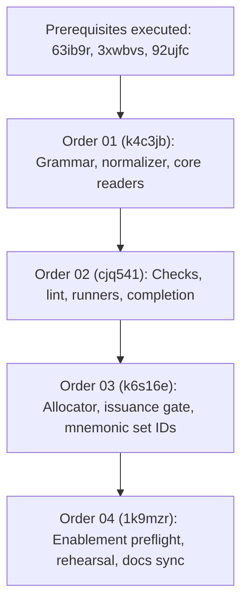

# IPD: Coordinate human-scannable artifact IDs and mnemonic set IDs

- Date: 2026-11-27
- Kind: orchestrator
- Concern: Coordinate the phased transition from six-character base36 artifact IDs and ID-shaped set IDs to human-scannable `MNCuVCu-CuVCuMN` artifact IDs and letter-first mnemonic set IDs without breaking any existing artifact, history log, or concurrent infrastructure cutover.
- Scope: Orchestrate four sequential child plans (`k4c3jb`, `cjq541`, `k6s16e`, `1k9mzr`) implementing spec `2aqq1c` after `metastore` (`63ib9r`), `selectors` (`3xwbvs`), and `comphome` (`92ujfc`) have executed. Performs zero direct code or documentation edits itself.
- Scope-Paths: .aw/records/plans/pending/20261127-artifact-ids-00-021qqd-coordinate-human-scannable-artifact-ids-and-mnemonic-set-ids.ipd.md
- Item-Dependencies: executed:63ib9r, executed:3xwbvs, executed:92ujfc
- From-Spec: 2aqq1c
- Status: to-review
- Coverage: pass
- Coverage-Fingerprint: 29e3fb99b6429d85cce616168bdf0d389933d8124280aaea9a7e2c53e1595c4d
- Coverage-Checked: 2026-11-28 by uri/its_direct/pt3-claude-opus-5.5-1m-us
- Short-Description: Orchestrate dual-format MNCuVCu-CuVCuMN artifact IDs, mnemonic set IDs, and opt-in repository rollout
- Work-Kind: feature
- Priority: medium
- Set: artifact-ids
- Order: 0
- Highest E allocated: 04
- Author: antigravity
- Id: 021qqd

> Write and proofread this plan per the technical writing standard, `.aw/system/workflows/technical-writing/technical-writing.md` (`.agents/workflows/technical-writing/technical-writing.md` in a legacy-layout install), including requirement 12 (diagrams).

## Workflow history

- 2026-11-28 to-review (aw set): status set to to-review
- 2026-11-28 coverage pass (aw oc run): fingerprint 29e3fb99b642, model uri/its_direct/pt3-claude-opus-5.5-1m-us
- 2026-11-28 draft (antigravity): created and populated child coordination table for spec `2aqq1c`.

## Goal

Deliver spec `2aqq1c` across four focused child plans in strict reader-before-writer order: dual-format core readers (`k4c3jb`), dual-format checks and runners (`cjq541`), current-format allocator and mnemonic set ID enforcement (`k6s16e`), and opt-in rollout preflight, rehearsal, and spec sync (`1k9mzr`).

## Detailed Implementation Checklist (TODO)

Execution-state rule: mark an `E-*` item complete only after performing the action. That mark is not validation. Right-sizing rule: write for a modest executor that cannot hold much in its head. Each E-item is one step (one concern, about one file, executable in one focused pass) and its V-item names each unit it covers with its own check; a plan stays at about 5 E-items and 8 work Scope-Paths, else split it into more child plans (guidance, `IPD-Z603`). Accepted execution states: blocked, failed, pending, performed; terminal gate demands 'performed'.

### Task group 1: Child plan execution confirmation

- [ ] E-01 CONFIRM k4c3jb REACHED executed
  - Depends on: none
  - Expected outcome: Child plan `k4c3jb` (Order 01: dual-format artifact ID grammar, normalizer, filename parsing, and core readers) is in `.aw/records/plans/executed/` with `Status: executed`.
  - Execution state: pending

- [ ] E-02 CONFIRM cjq541 REACHED executed
  - Depends on: E-01
  - Expected outcome: Child plan `cjq541` (Order 02: dual-format checks, lint, runners, commit helper, and completion) is in `.aw/records/plans/executed/` with `Status: executed`.
  - Execution state: pending

- [ ] E-03 CONFIRM k6s16e REACHED executed
  - Depends on: E-02
  - Expected outcome: Child plan `k6s16e` (Order 03: `MNCuVCu-CuVCuMN` allocator, issuance gate, and mnemonic set ID enforcement) is in `.aw/records/plans/executed/` with `Status: executed`.
  - Execution state: pending

- [ ] E-04 CONFIRM 1k9mzr REACHED executed
  - Depends on: E-03
  - Expected outcome: Child plan `1k9mzr` (Order 04: opt-in enablement preflight, mixed-format rehearsal, and docs/spec sync) is in `.aw/records/plans/executed/` with `Status: executed`.
  - Execution state: pending

## Child IPDs, sequence, and dependencies

| Order | Id | File | What it does | Depends on |
|---|---|---|---|---|
| 01 | `k4c3jb` | `20261127-artifact-ids-01-k4c3jb-add-dual-format-artifact-id-grammar-normalizer-and-core-read.ipd.md` | Add authoritative `MNCuVCu-CuVCuMN` and legacy `id6` validators, normalizer, free-text extractor, clustered filename parsing, and core metadata/ref/selector readers. | `executed:63ib9r`, `executed:3xwbvs`, `executed:92ujfc` |
| 02 | `cjq541` | `20261127-artifact-ids-02-cjq541-add-dual-format-artifact-id-support-to-checks-lint-runners-a.ipd.md` | Update `check_engine`, `research_contract`, `ipd_schema`, `ipd_lint`, `runner_shared`, `git_commit_helper`, and `completion` to accept both canonical ID forms. | `executed:k4c3jb` |
| 03 | `k6s16e` | `20261127-artifact-ids-03-k6s16e-add-mncuvcu-cuvcumn-id-allocator-issuance-gate-and-mnemonic.ipd.md` | Implement uniform CSPRNG `MNCuVCu-CuVCuMN` allocation with lock-guarded uniqueness/retry, per-repo issuance gate, and mnemonic `<setid>` enforcement on new specs, plans, and backlog graduations. | `executed:cjq541` |
| 04 | `1k9mzr` | `20261127-artifact-ids-04-1k9mzr-add-opt-in-artifact-id-enablement-preflight-mixed-format-reh.ipd.md` | Add opt-in enablement/pause preflight in migration and config flows, run end-to-end mixed-format repository rehearsal, and sync naming/organization/metadata specs and CLI help. | `executed:k6s16e` |

## Completion criteria (the whole Set is done only when)

- Dual-format validators, explicit lookup normalization, free-text extraction, filename parsing, and core metadata/selector readers accept both `MNCuVCu-CuVCuMN` and legacy six-character IDs without regressions on existing records. Owner: `k4c3jb`.
- Check engine, IPD schema/lint, research contract, runners, commit helper, and shell completion accept both canonical ID forms. Owner: `cjq541`.
- Lock-guarded `MNCuVCu-CuVCuMN` allocation, per-repository issuance gating, and letter-first mnemonic `<setid>` enforcement (forbidding artifact IDs in new `<setid>` slots) are implemented and tested. Owner: `k6s16e`.
- Opt-in enablement preflight, pause-issuance compatibility, isolated mixed-format repository rehearsal, and specification/help synchronization pass validation. Owner: `1k9mzr`.

## Cross-IPD validation

- End-to-end mixed-format repository rehearsal exercising creation, lookup, `aw find`, `aw check`, `aw attention`, index rebuild, rollback before issuance, and pausing issuance after a current-format ID exists is performed by `1k9mzr`.
- Full repository `python3 -m mypy agent_workflows`, `ruff`, `aw check-local-leaks`, and bare `python3 -m pytest` verification across the completed Set is performed by `1k9mzr`.

## Deferred / out of scope (with reason)

- Bulk rekeying of existing six-character artifact IDs or rewriting historical filenames and append-only logs: excluded by design in spec `2aqq1c` to preserve permanent citations and history bytes.
  - Carrier-Declined: intentional exclusion by spec `2aqq1c` (existing six-character IDs remain permanent and valid on read)
- Changing non-artifact identifiers (run IDs, attempt IDs, session IDs, Git hashes, `E-01`/`V-01`/`OQ-01`): excluded by spec `2aqq1c` Scope.
  - Carrier-Declined: intentional exclusion by spec `2aqq1c` (unrelated identifier classes retain their own contracts)

## Scope check

- Over-scope: none. This orchestrator performs no direct edits and delegates every deliverable to Orders 01 through 04.
- Under-scope: none. Every requirement R1 through R6 and acceptance criterion AC-1 through AC-6 of spec `2aqq1c` is assigned to a child plan in the table above.

## Required tests / validation

This orchestrator runs no tests directly. Whole-Set mixed-format rehearsal and full test/type/lint validation are performed by child `1k9mzr` (Order 04).

## Open questions

None blocking.

## Validation and cross-check (verify before reporting the Set complete)

Validation-state rule: inspect evidence in a separate pass. Do not mark a `V-*` item complete from memory or from the matching execution checkmark. Accepted validation results: blocked, failed, pass, pending; terminal gate demands 'pass'. Runtime-demonstration reachability rule: for each `V-*` item demanding the software be observed acting (such as a run, a dispatch, or a transition)—as distinct from items demanding a diff, a file's content, or a test result, which are reachable by construction—name the code path that produces the observation or the sibling `E-*` that creates it, else the demand is UNDER-SCOPE.

- [ ] V-01 validates E-01
  - Required evidence: paste `aw find plans k4c3jb` showing `k4c3jb` under `.aw/records/plans/executed/` with `Status: executed`.
  - Observed evidence:
  - Result: pending

- [ ] V-02 validates E-02
  - Required evidence: paste `aw find plans cjq541` showing `cjq541` under `.aw/records/plans/executed/` with `Status: executed`.
  - Observed evidence:
  - Result: pending

- [ ] V-03 validates E-03
  - Required evidence: paste `aw find plans k6s16e` showing `k6s16e` under `.aw/records/plans/executed/` with `Status: executed`.
  - Observed evidence:
  - Result: pending

- [ ] V-04 validates E-04
  - Required evidence: paste `aw find plans 1k9mzr` showing `1k9mzr` under `.aw/records/plans/executed/` with `Status: executed`.
  - Observed evidence:
  - Result: pending

## Approval and execution gate

- Size assessment: standard
- Cohesion rationale: not required

Execution contract:
- **Prerequisites**: This Set is gated on `executed:63ib9r` (`metastore`), `executed:3xwbvs` (`selectors`), and `executed:92ujfc` (`comphome`) so every child edits post-cutover code once without dual-patching legacy cutover diffs.
- **Orchestrator retirement**: The runner retires `021qqd` to `executed` automatically once every child in `## Child IPDs, sequence, and dependencies` reaches `executed` on disk.
- **Commit and push**: Never use `git add -A`, `git commit -a`, or `--no-verify`, and never push without an explicit human directive.
