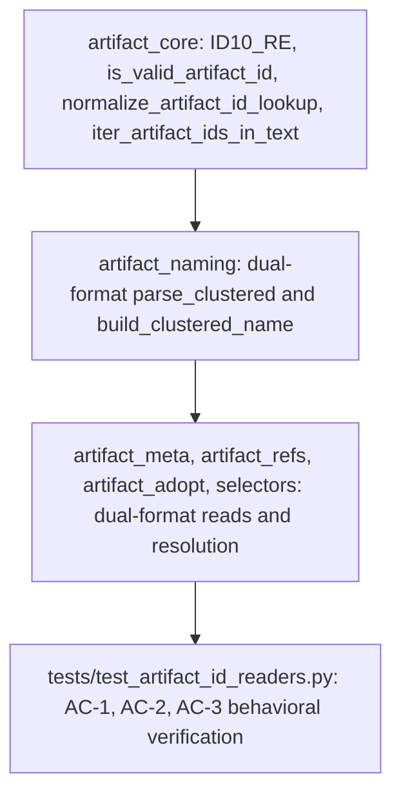

# IPD: Add dual-format artifact ID grammar, normalizer, and core readers

- Date: 2026-11-27
- Kind: child
- Concern: Core ID validators, filename parsers, metadata stores, reference extractors, and selectors currently assume every artifact ID is an unbroken six-character base36 string, rejecting `MNCuVCu-CuVCuMN` IDs such as `43bim-tox82`.
- Scope: Implement the authoritative `MNCuVCu-CuVCuMN` and legacy `id6` validators, explicit-lookup normalizer, hyphen-requiring free-text extractor, clustered filename parser update, and core metadata/adoption/reference/selector readers in `agent_workflows/artifact_core.py`, `agent_workflows/artifact_naming.py`, `agent_workflows/artifact_adopt.py`, `agent_workflows/artifact_meta.py`, `agent_workflows/artifact_refs.py`, and `agent_workflows/selectors.py`, with unit tests in `tests/test_artifact_id_readers.py`. EXCLUDES check engine, lint, and runner updates (`cjq541`), new-format ID allocation and mnemonic set ID enforcement (`k6s16e`), and migration/docs rollout (`1k9mzr`).
- Scope-Paths: agent_workflows/artifact_core.py, agent_workflows/artifact_naming.py, agent_workflows/artifact_adopt.py, agent_workflows/artifact_meta.py, agent_workflows/artifact_refs.py, agent_workflows/selectors.py, tests/test_artifact_id_readers.py, .aw/records/plans/pending/20261127-artifact-ids-01-k4c3jb-add-dual-format-artifact-id-grammar-normalizer-and-core-read.ipd.md
- Item-Dependencies: executed:63ib9r, executed:3xwbvs, executed:92ujfc
- From-Spec: 2aqq1c
- Status: to-review
- Short-Description: Add MNCuVCu-CuVCuMN and legacy id6 validators, normalizer, filename parsing, and core metadata/selector readers
- Work-Kind: feature
- Priority: medium
- Set: artifact-ids
- Order: 1
- Highest E allocated: 05
- Author: antigravity
- Id: k4c3jb

> Write and proofread this plan per the technical writing standard, `.aw/system/workflows/technical-writing/technical-writing.md` (`.agents/workflows/technical-writing/technical-writing.md` in a legacy-layout install), including requirement 12 (diagrams).

## Workflow history

- 2026-11-28 to-review (aw set): status set to to-review
- 2026-11-28 draft (antigravity): created as Order 01 of Set `artifact-ids` for spec `2aqq1c`.

## Goal

Upgrade the single artifact ID authority and all core read/parse paths to recognize both `MNCuVCu-CuVCuMN` (`43bim-tox82`) and legacy six-character (`[0-9a-z]{6}`) artifact IDs before any writer can emit the new format.

## Detailed Implementation Checklist (TODO)

Execution-state rule: mark an `E-*` item complete only after performing the action. That mark is not validation. Right-sizing rule: write for a modest executor that cannot hold much in its head. Each E-item is one step (one concern, about one file, executable in one focused pass) and its V-item names each unit it covers with its own check; a plan stays at about 5 E-items and 8 work Scope-Paths, else split it into more child plans (guidance, `IPD-Z603`). Accepted execution states: blocked, failed, pending, performed; terminal gate demands 'performed'.

### Task group 1: Authoritative grammar, filename parsing, and core readers

- [ ] E-01 Define the single authoritative dual-format artifact ID primitives in `agent_workflows/artifact_core.py`:
  - Add canonical `ID10_RE` (`\A[1-9][0-9][b-df-hj-kmnp-tv-z][aeiou][b-df-hj-kmnp-tv-z]-[b-df-hj-kmnp-tv-z][aeiou][b-df-hj-kmnp-tv-z][1-9][0-9]\Z`, ASCII-only, case-sensitive) alongside `ID6_RE`.
  - Add `is_valid_id10(token: str) -> bool`, `is_valid_artifact_id(token: str) -> bool` (accepts either `ID10_RE` or `ID6_RE`), and `normalize_artifact_id_lookup(raw: str) -> str | None` (trims ASCII spaces/tabs, verifies pure ASCII, folds ASCII uppercase to lowercase, inserts `-` after index 5 for 10-character compact spellings such as `43BIMTOX82` -> `43bim-tox82`, and validates against `is_valid_artifact_id`; rejects misplaced/extra hyphens, non-ASCII digits/hyphens, internal whitespace, and trailing punctuation).
  - Add `iter_artifact_ids_in_text(text: str) -> list[str]` requiring the literal hyphen for `MNCuVCu-CuVCuMN` matches (so unbroken 10-char hex `43badcab82` is skipped) and using token-boundary scanning that does not consume shared separators (extracting both IDs from `43bim-tox82, 10pev-diw99`), while continuing to extract legacy `id6` tokens.
  - Update `global_id6s` (and alias/export `global_artifact_ids`) so the repository-wide inventory collects both canonical forms across live, terminal, and archived records.
  - Depends on: none
  - Expected outcome: `agent_workflows/artifact_core.py` exports one authoritative validator, explicit-lookup normalizer, free-text extractor, and inventory collector covering both canonical ID formats.
  - Execution state: pending

- [ ] E-02 Update `agent_workflows/artifact_naming.py` (`_CLUSTERED_RE`, `parse_clustered`, `parse_clustered_prefix`, `build_clustered_name`, and review filename parsing) to capture the full hyphenated `MNCuVCu-CuVCuMN` ID as one identity field alongside hyphenated `<setid>` values (for example `20261127-artifact-ids-01-43bim-tox82-sample-slug.ipd.md` -> `set_id="artifact-ids"`, `order="01"`, `id="43bim-tox82"`, `slug="sample-slug"`, `facet="ipd"`), while preserving identical parsed fields on every existing repository filename.
  - Depends on: E-01
  - Expected outcome: `artifact_naming.parse_clustered` and `build_clustered_name` round-trip both `MNCuVCu-CuVCuMN` and legacy six-character IDs cleanly, including hyphenated set IDs and review filenames embedding a subject ID.
  - Execution state: pending

- [ ] E-03 Update `agent_workflows/artifact_adopt.py`, `agent_workflows/artifact_meta.py`, `agent_workflows/artifact_refs.py`, and `agent_workflows/selectors.py` to read, store, rebuild, extract, and resolve both canonical ID forms:
  - `artifact_meta`: accept either canonical ID in metadata logs (`meta/<id>.jsonl`), index rebuilds, and metadata readers without changing existing log bytes.
  - `artifact_refs` and `artifact_adopt`: use `artifact_core.is_valid_artifact_id` and `iter_artifact_ids_in_text` for citation extraction, dependency target parsing (`executed:43bim-tox82`), and identity scanning.
  - `selectors`: accept both canonical forms and compact explicit lookup (`43bimtox82` / `43BIMTOX82` -> `43bim-tox82`) in explicit ID selector resolution while keeping set/path/substring resolution intact.
  - Depends on: E-02
  - Expected outcome: Metadata logs, reference scanners, adoption helpers, and selectors resolve both `43bim-tox82` (and explicit compact `43BIMTOX82`) and legacy six-character IDs cleanly.
  - Execution state: pending

- [ ] E-04 Add behavioral core tests in `tests/test_artifact_id_readers.py` (`pytestmark = pytest.mark.core`, fast in-process, zero `inspect`/`ast` source-pinning checks) covering spec `2aqq1c` AC-1, AC-2, and AC-3:
  - Canonical validation accept/reject matrix (`43bim-tox82`, `10pev-diw99`, `99mu2h`, `000000`, `abcdef` accepted; `03bim-tox82`, `43lim-tox82`, `43bim-tox02`, `43BIM-TOX82`, `43bimtox82`, Unicode digits/dashes, trailing newline rejected).
  - Explicit lookup normalization (`43BIMTOX82`, ` 43bim-tox82 `) vs. free-text extraction (comma-separated pair `43bim-tox82, 10pev-diw99` extracted; compact hex `43badcab82` ignored).
  - Clustered filename round-trip with hyphenated set ID + hyphenated `MNCuVCu-CuVCuMN` ID, review subject ID extraction, and corpus-wide backwards-compatibility check over legacy filenames.
  - Dual-format metadata log read/rebuild, dependency reference parsing (`executed:43bim-tox82`), and selector resolution (canonical and compact).
  - Depends on: E-03
  - Expected outcome: All tests in `tests/test_artifact_id_readers.py` pass deterministically in the `core` tier well under 2 seconds.
  - Execution state: pending

- [ ] E-05 Run `ruff check`, `ruff format --check`, `python3 -m mypy agent_workflows`, `aw check-local-leaks`, `python3 -m pytest -v tests/test_artifact_id_readers.py tests/test_artifact_naming_round_trip.py tests/test_selectors.py`, and bare `python3 -m pytest`.
  - Depends on: E-04
  - Expected outcome: All static checks, leak checks, targeted reader tests, and the core pytest suite pass cleanly.
  - Execution state: pending

## Project conventions discovered (Step 0)

- `agent_workflows/artifact_core.py` owns `ID6_RE`, `ID6_WORD_RE`, `is_valid_id6`, `iter_id6_in_text`, and `global_id6s` with zero third-party dependencies (`requires-python >= 3.9`).
- `agent_workflows/artifact_naming.py` is the single filename-grammar authority (`_CLUSTERED_RE`, `parse_clustered`, `build_clustered_name`) and imports only `artifact_core` (import direction flows toward core).
- `tests/test_artifact_naming_round_trip.py` validates round-trip behavior of `artifact_naming`.
- Bare `python3 -m pytest` runs `@pytest.mark.core` tests within a 30s budget; no source-reading `inspect`/`ast` tests are permitted (`GUIDING_PRINCIPLES.md` P16).

## Findings

| Finding | Evidence | Impact on this plan |
| --- | --- | --- |
| Current filename parser splits on single-token 6-char IDs | `artifact_naming._CLUSTERED_RE` matches `[0-9a-z]{6}` in the identity slot | Must match `(?:<id10>|<id6>)` as one capture group so the hyphen inside `43bim-tox82` stays inside `id` rather than splitting `slug` or `set_id` |
| Free-text word boundaries treat `-` as a boundary | `artifact_core.ID6_WORD_RE` uses `\b[0-9a-z]{6}\b` | Current-format extraction must tokenize/validate with ASCII non-token boundaries that preserve the internal hyphen and never consume shared delimiters like `,` |
| `metastore`, `selectors`, and `comphome` edit these same modules | Pending orchestrators `63ib9r`, `3xwbvs`, `92ujfc` | Gating Order 01 on `executed:63ib9r, executed:3xwbvs, executed:92ujfc` avoids dual-patching cutover files |

## Proposed changes (ordered, validatable)

1. Extend `agent_workflows/artifact_core.py` with authoritative `MNCuVCu-CuVCuMN` + `id6` validators, explicit-lookup normalizer, free-text extractor, and dual-format inventory collector.
2. Extend `agent_workflows/artifact_naming.py` to parse and build filenames with either ID format without altering any legacy parse result.
3. Wire `artifact_adopt.py`, `artifact_meta.py`, `artifact_refs.py`, and `selectors.py` onto the shared helpers.
4. Add `tests/test_artifact_id_readers.py` and run static, leak, and core test verification.

## Deferred / out of scope (with reason)

- Check engine, IPD schema/lint, research contract, runner, commit helper, and shell completion dual-format updates: owned by Order 02 (`cjq541`).
  - Carrier: cjq541
- `MNCuVCu-CuVCuMN` allocator, per-repo issuance gate, and mnemonic `<setid>` enforcement: owned by Order 03 (`k6s16e`).
  - Carrier: k6s16e
- Opt-in enablement preflight, mixed-format repository rehearsal, and spec/doc sync: owned by Order 04 (`1k9mzr`).
  - Carrier: 1k9mzr

## Scope check

- Over-scope: none. Writers still emit legacy `id6` until Order 03 (`k6s16e`).
- Under-scope: none. Covers all core grammar, filename, metadata, reference, and selector read paths.

## Required tests / validation

- `python3 -m pytest -v tests/test_artifact_id_readers.py tests/test_artifact_naming_round_trip.py tests/test_selectors.py`
- `ruff check` and `ruff format --check` on all modified and new files
- `python3 -m mypy agent_workflows`
- `aw check-local-leaks`
- Bare `python3 -m pytest`

## Spec / documentation sync

- Spec and CLI help sync is deferred to Order 04 (`1k9mzr`) once all readers, writers, and enablement controls are implemented.

## Open questions

None blocking.

## Validation and cross-check (verify before reporting done)

Validation-state rule: inspect evidence in a separate pass. Do not mark a `V-*` item complete from memory or from the matching execution checkmark. Accepted validation results: blocked, failed, pass, pending; terminal gate demands 'pass'. Runtime-demonstration reachability rule: for each `V-*` item demanding the software be observed acting (such as a run, a dispatch, or a transition)—as distinct from items demanding a diff, a file's content, or a test result, which are reachable by construction—name the code path that produces the observation or the sibling `E-*` that creates it, else the demand is UNDER-SCOPE.

- [ ] V-01 validates E-01
  - Required evidence: paste `python3 -c` output exercising `artifact_core.is_valid_artifact_id`, `artifact_core.normalize_artifact_id_lookup`, and `artifact_core.iter_artifact_ids_in_text` against `43bim-tox82`, `43BIMTOX82`, `03bim-tox82`, `43lim-tox82`, `99mu2h`, `43bim-tox82, 10pev-diw99`, and `43badcab82`.
  - Observed evidence:
  - Result: pending

- [ ] V-02 validates E-02
  - Required evidence: paste `python3 -c` output showing `artifact_naming.parse_clustered("20261127-artifact-ids-01-43bim-tox82-scan.ipd.md")` returning `set_id="artifact-ids"`, `order="01"`, `id="43bim-tox82"`, `slug="scan"`, `facet="ipd"`, plus `python3 -m pytest -v tests/test_artifact_naming_round_trip.py` passing.
  - Observed evidence:
  - Result: pending

- [ ] V-03 validates E-03
  - Required evidence: paste `python3 -m pytest -v tests/test_selectors.py` and focused dual-format tests from `tests/test_artifact_id_readers.py` proving metadata log read/rebuild, dependency target parsing (`executed:43bim-tox82`), and canonical/compact selector resolution.
  - Observed evidence:
  - Result: pending

- [ ] V-04 validates E-04
  - Required evidence: paste `python3 -m pytest -v tests/test_artifact_id_readers.py` showing every test node PASSED (0 failed) and `rg -n "^(import|from) (inspect|ast)\b" tests/test_artifact_id_readers.py` returning exit 1.
  - Observed evidence:
  - Result: pending

- [ ] V-05 validates E-05
  - Required evidence: paste `ruff check`, `ruff format --check`, `python3 -m mypy agent_workflows`, `aw check-local-leaks`, and the summary line of bare `python3 -m pytest` passing cleanly.
  - Observed evidence:
  - Result: pending

## Approval and execution gate

- Size assessment: standard
- Cohesion rationale: not required

Execution contract:
- **Scope fence**: Limit edits to declared `Scope-Paths`; justify any necessary extra path via `--scope-reason` at finalize.
- **Evidence honesty**: Paste actual runner output after the final edit for every `V-*` item.
- **Commit and finalize**: Commit via `aw commit k4c3jb -- <paths>` and finalize via `aw ipd finalize k4c3jb --apply` (never raw `git mv`).
