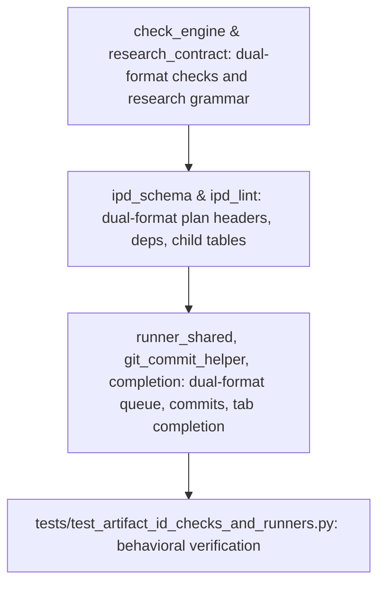

# IPD: Add dual-format artifact ID support to checks, lint, runners, and CLI

- Date: 2026-11-27
- Kind: child
- Concern: Checking, linting, research naming, runner orchestration, commit scoping, and shell completion still contain six-character ID regexes and length assumptions that reject `MNCuVCu-CuVCuMN` artifacts.
- Scope: Audit and update `agent_workflows/check_engine.py`, `agent_workflows/research_contract.py`, `agent_workflows/ipd_schema.py`, `agent_workflows/ipd_lint.py`, `agent_workflows/runner_shared.py`, `agent_workflows/git_commit_helper.py`, and `agent_workflows/completion.py` to consume the shared dual-format ID helpers from `k4c3jb`, with behavioral tests in `tests/test_artifact_id_checks_and_runners.py`. EXCLUDES core grammar/readers (`k4c3jb`), new-format ID allocation and mnemonic set ID enforcement (`k6s16e`), and migration/docs sync (`1k9mzr`).
- Scope-Paths: agent_workflows/check_engine.py, agent_workflows/research_contract.py, agent_workflows/ipd_schema.py, agent_workflows/ipd_lint.py, agent_workflows/runner_shared.py, agent_workflows/git_commit_helper.py, agent_workflows/completion.py, tests/test_artifact_id_checks_and_runners.py, .aw/records/plans/pending/20261127-artifact-ids-02-cjq541-add-dual-format-artifact-id-support-to-checks-lint-runners-a.ipd.md
- Item-Dependencies: executed:k4c3jb
- From-Spec: 2aqq1c
- Status: to-review
- Short-Description: Update check_engine, ipd_schema, ipd_lint, research_contract, runner_shared, git_commit_helper, and completion for dual-format IDs
- Work-Kind: feature
- Priority: medium
- Set: artifact-ids
- Order: 2
- Highest E allocated: 05
- Author: antigravity
- Id: cjq541

> Write and proofread this plan per the technical writing standard, `.aw/system/workflows/technical-writing/technical-writing.md` (`.agents/workflows/technical-writing/technical-writing.md` in a legacy-layout install), including requirement 12 (diagrams).

## Workflow history

- 2026-11-28 to-review (aw set): status set to to-review
- 2026-11-28 draft (antigravity): created as Order 02 of Set `artifact-ids` for spec `2aqq1c`.

## Goal

Ensure every check gate, IPD schema/linter, research contract parser, runner queue/lane helper, commit helper, and shell completion provider accepts both `MNCuVCu-CuVCuMN` and legacy six-character artifact IDs via `artifact_core` helpers.

## Detailed Implementation Checklist (TODO)

Execution-state rule: mark an `E-*` item complete only after performing the action. That mark is not validation. Right-sizing rule: write for a modest executor that cannot hold much in its head. Each E-item is one step (one concern, about one file, executable in one focused pass) and its V-item names each unit it covers with its own check; a plan stays at about 5 E-items and 8 work Scope-Paths, else split it into more child plans (guidance, `IPD-Z603`). Accepted execution states: blocked, failed, pending, performed; terminal gate demands 'performed'.

### Task group 1: Dual-format checks, lint, runners, commit helper, and completion

- [ ] E-01 Update `agent_workflows/check_engine.py` and `agent_workflows/research_contract.py` to validate and parse both `MNCuVCu-CuVCuMN` and legacy six-character IDs across `- Id:`, `From-Spec:`, `From-Backlog:`, `Item-Dependencies:`, `Carrier:`, review subject IDs, and research filenames (`YYYYMMDD-<setid>-<NN>-<id>-<slug>[.<model>].<kind>.md`), preserving existing compatibility field names and rejecting malformed IDs.
  - Depends on: none
  - Expected outcome: `aw check` and research contract checks pass on mixed-format repositories containing both `43bim-tox82` and legacy six-character records, while rejecting invalid IDs such as `03bim-tox82` or `43lim-tox82`.
  - Execution state: pending

- [ ] E-02 Update `agent_workflows/ipd_schema.py` and `agent_workflows/ipd_lint.py` so `- Id:`, `Item-Dependencies:`, `From-Spec:`, `From-Backlog:`, `## Child IPDs` tables, and `CONFIRM <id> REACHED executed` clauses recognize both canonical ID forms via `artifact_core.is_valid_artifact_id`.
  - Depends on: E-01
  - Expected outcome: `aw ipd lint` reports conforming on child and orchestrator plans carrying `43bim-tox82` IDs and cross-format dependencies (`executed:43bim-tox82` alongside `executed:99mu2h`).
  - Execution state: pending

- [ ] E-03 Update `agent_workflows/runner_shared.py`, `agent_workflows/git_commit_helper.py`, and `agent_workflows/completion.py` so lane branch naming, receipt lookup, dependency graph sorting, commit trailer/plan ID matching, and shell tab completion accept and emit both canonical ID forms without breaking six-character compatibility keys (such as `target_id6`).
  - Depends on: E-02
  - Expected outcome: Runner queue sorting, receipt/lane helpers, path-scoped commits, and tab completion resolve and complete `43bim-tox82` and legacy six-character IDs identically.
  - Execution state: pending

- [ ] E-04 Add behavioral core tests in `tests/test_artifact_id_checks_and_runners.py` (`pytestmark = pytest.mark.core`, fast in-process, zero `inspect`/`ast` source-pinning checks) exercising:
  - `check_engine` checks on mixed-format specs, plans, backlog items, reviews, and research reports (valid `43bim-tox82` passes; invalid `03bim-tox82` and `43lim-tox82` fail).
  - `ipd_lint` on mixed-format child and orchestrator plans (including `CONFIRM 43bim-tox82 REACHED executed` and `executed:43bim-tox82` dependencies).
  - `runner_shared` queue dependency resolution, `git_commit_helper` plan ID validation, and `completion` query results for `43bim-tox82` and legacy `id6` targets.
  - Depends on: E-03
  - Expected outcome: All tests in `tests/test_artifact_id_checks_and_runners.py` pass deterministically under the `core` tier.
  - Execution state: pending

- [ ] E-05 Run `ruff check`, `ruff format --check`, `python3 -m mypy agent_workflows`, `aw check-local-leaks`, `python3 -m pytest -v tests/test_artifact_id_checks_and_runners.py tests/test_ipd_lint.py tests/test_completion.py`, and bare `python3 -m pytest`.
  - Depends on: E-04
  - Expected outcome: Static checks, leak checks, targeted tests, and the core pytest suite pass cleanly.
  - Execution state: pending

## Project conventions discovered (Step 0)

- `agent_workflows/research_contract.py` owns the research filename grammar (`_CORE_RE`), separate from `artifact_naming._CLUSTERED_RE`, because research names carry optional model and kind facets.
- `agent_workflows/ipd_lint.py` and `agent_workflows/ipd_schema.py` enforce strict structural checks on plan headers, child tables, and `CONFIRM <id> REACHED executed` leaves.
- Compatibility wire/state keys (such as `target_id6` in runner records) remain named as-is for backwards compatibility and carry either canonical ID form once dual-format readers ship (spec `2aqq1c` R1).

## Findings

| Finding | Evidence | Impact on this plan |
| --- | --- | --- |
| Six-character assumptions recur outside `artifact_core` | `check_engine.py`, `research_contract.py`, `ipd_schema.py`, `ipd_lint.py`, `runner_shared.py`, `git_commit_helper.py`, and `completion.py` each validate or match ID tokens | Audit and classify every `[0-9a-z]{6}` regex or `len == 6` check in these modules before replacing artifact-ID sites with `artifact_core` helpers; leave non-artifact six-character formats untouched |
| Research files have their own filename regex | `research_contract._CORE_RE` | Update `research_contract` explicitly so research artifacts carrying `43bim-tox82` parse and check cleanly |

## Proposed changes (ordered, validatable)

1. Replace artifact-ID six-character regexes in `check_engine.py` and `research_contract.py` with `artifact_core` dual-format matchers.
2. Update `ipd_schema.py` and `ipd_lint.py` for dual-format IDs in headers, dependencies, and orchestrator child tables.
3. Update `runner_shared.py`, `git_commit_helper.py`, and `completion.py` for dual-format queue, commit, and tab-completion handling.
4. Add `tests/test_artifact_id_checks_and_runners.py` and validate across static checks and core tests.

## Deferred / out of scope (with reason)

- Core grammar, normalizer, filename parsing, and metadata/selector readers: owned by Order 01 (`k4c3jb`).
  - Carrier: k4c3jb
- `MNCuVCu-CuVCuMN` allocator, per-repo issuance gate, and mnemonic `<setid>` rules: owned by Order 03 (`k6s16e`).
  - Carrier: k6s16e
- Opt-in enablement preflight, mixed-format rehearsal, and docs/spec sync: owned by Order 04 (`1k9mzr`).
  - Carrier: 1k9mzr

## Scope check

- Over-scope: none. No writer switches to issuing `MNCuVCu-CuVCuMN` IDs in this plan.
- Under-scope: none. Covers every validation, linting, research, runner, commit, and completion consumer.

## Required tests / validation

- `python3 -m pytest -v tests/test_artifact_id_checks_and_runners.py tests/test_ipd_lint.py tests/test_completion.py`
- `ruff check` and `ruff format --check` on modified and new files
- `python3 -m mypy agent_workflows`
- `aw check-local-leaks`
- Bare `python3 -m pytest`

## Spec / documentation sync

- Spec and CLI help updates are owned by Order 04 (`1k9mzr`).

## Open questions

None blocking.

## Validation and cross-check (verify before reporting done)

Validation-state rule: inspect evidence in a separate pass. Do not mark a `V-*` item complete from memory or from the matching execution checkmark. Accepted validation results: blocked, failed, pass, pending; terminal gate demands 'pass'. Runtime-demonstration reachability rule: for each `V-*` item demanding the software be observed acting (such as a run, a dispatch, or a transition)—as distinct from items demanding a diff, a file's content, or a test result, which are reachable by construction—name the code path that produces the observation or the sibling `E-*` that creates it, else the demand is UNDER-SCOPE.

- [ ] V-01 validates E-01
  - Required evidence: paste test output from `tests/test_artifact_id_checks_and_runners.py` showing `check_engine` and `research_contract` accepting valid `43bim-tox82` + legacy `id6` records and rejecting `03bim-tox82` and `43lim-tox82`.
  - Observed evidence:
  - Result: pending

- [ ] V-02 validates E-02
  - Required evidence: paste `python3 -m pytest -v tests/test_ipd_lint.py` plus mixed-format `ipd_lint` test nodes in `tests/test_artifact_id_checks_and_runners.py` showing child and orchestrator plans with `43bim-tox82` IDs lint cleanly.
  - Observed evidence:
  - Result: pending

- [ ] V-03 validates E-03
  - Required evidence: paste `python3 -m pytest -v tests/test_completion.py` plus runner/commit/completion test nodes in `tests/test_artifact_id_checks_and_runners.py` passing for both `43bim-tox82` and legacy six-character IDs.
  - Observed evidence:
  - Result: pending

- [ ] V-04 validates E-04
  - Required evidence: paste `python3 -m pytest -v tests/test_artifact_id_checks_and_runners.py` showing every test node PASSED (0 failed) and `rg -n "^(import|from) (inspect|ast)\b" tests/test_artifact_id_checks_and_runners.py` returning exit 1.
  - Observed evidence:
  - Result: pending

- [ ] V-05 validates E-05
  - Required evidence: paste `ruff check`, `ruff format --check`, `python3 -m mypy agent_workflows`, `aw check-local-leaks`, and the summary line of bare `python3 -m pytest` passing cleanly.
  - Observed evidence:
  - Result: pending

## Approval and execution gate

- Size assessment: standard
- Cohesion rationale: not required

Execution contract:
- **Scope fence**: Limit edits to declared `Scope-Paths`; justify any necessary extra path via `--scope-reason` at finalize.
- **Evidence honesty**: Paste actual runner output after the final edit for every `V-*` item.
- **Commit and finalize**: Commit via `aw commit cjq541 -- <paths>` and finalize via `aw ipd finalize cjq541 --apply`.
