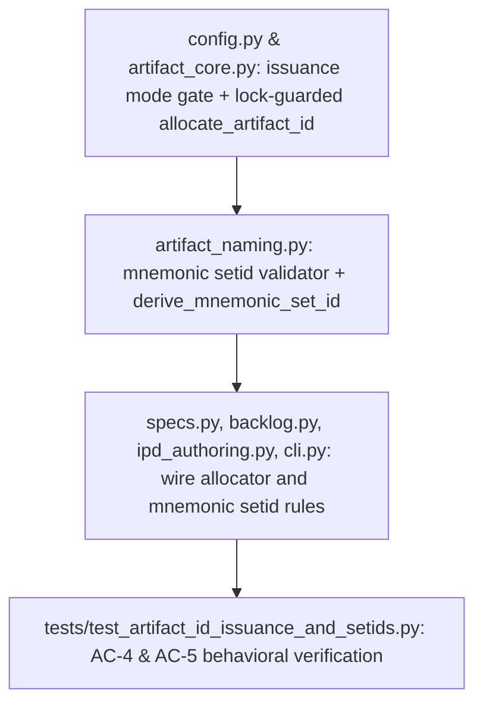

# IPD: Add MNCuVCu-CuVCuMN ID allocator, issuance gate, and mnemonic set ID enforcement

- Date: 2026-11-27
- Kind: child
- Concern: New artifacts still mint six-character base36 IDs without lock-guarded reservation, and `aw specs new` and backlog graduations still repeat random artifact IDs inside the `<setid>` filename slot.
- Scope: Implement uniform CSPRNG `MNCuVCu-CuVCuMN` generation and lock-guarded uniqueness/retry in `agent_workflows/artifact_core.py`, add the per-repository issuance mode setting (`id6` vs `id10`) in `agent_workflows/config.py`, and enforce the letter-first mnemonic `<setid>` rule across `agent_workflows/artifact_naming.py`, `agent_workflows/specs.py`, `agent_workflows/backlog.py`, `agent_workflows/ipd_authoring.py`, and `agent_workflows/cli.py`, with tests in `tests/test_artifact_id_issuance_and_setids.py`. EXCLUDES reader upgrades (`k4c3jb`, `cjq541`) and migration enablement/rehearsal/docs sync (`1k9mzr`).
- Scope-Paths: agent_workflows/artifact_core.py, agent_workflows/artifact_naming.py, agent_workflows/specs.py, agent_workflows/backlog.py, agent_workflows/ipd_authoring.py, agent_workflows/config.py, agent_workflows/cli.py, tests/test_artifact_id_issuance_and_setids.py, .aw/records/plans/pending/20261127-artifact-ids-03-k6s16e-add-mncuvcu-cuvcumn-id-allocator-issuance-gate-and-mnemonic.ipd.md
- Item-Dependencies: executed:cjq541
- From-Spec: 2aqq1c
- Status: to-review
- Short-Description: Implement lock-guarded MNCuVCu-CuVCuMN allocation, per-repo issuance gate, and mnemonic set ID rules for new artifacts
- Work-Kind: feature
- Priority: medium
- Set: artifact-ids
- Order: 3
- Highest E allocated: 05
- Author: antigravity
- Id: k6s16e

> Write and proofread this plan per the technical writing standard, `.aw/system/workflows/technical-writing/technical-writing.md` (`.agents/workflows/technical-writing/technical-writing.md` in a legacy-layout install), including requirement 12 (diagrams).

## Workflow history

- 2026-11-28 to-review (aw set): status set to to-review
- 2026-11-28 draft (antigravity): created as Order 03 of Set `artifact-ids` for spec `2aqq1c`.

## Goal

Add cryptographically random, lock-guarded `MNCuVCu-CuVCuMN` ID allocation behind a per-repository issuance toggle, and enforce human-readable mnemonic `<setid>` naming on all newly created specs, plans, and graduated backlog items while grandfathering legacy records.

## Detailed Implementation Checklist (TODO)

Execution-state rule: mark an `E-*` item complete only after performing the action. That mark is not validation. Right-sizing rule: write for a modest executor that cannot hold much in its head. Each E-item is one step (one concern, about one file, executable in one focused pass) and its V-item names each unit it covers with its own check; a plan stays at about 5 E-items and 8 work Scope-Paths, else split it into more child plans (guidance, `IPD-Z603`). Accepted execution states: blocked, failed, pending, performed; terminal gate demands 'performed'.

### Task group 1: Allocator, issuance gate, and mnemonic set IDs

- [ ] E-01 Add per-repository issuance mode configuration (`id6` default, `id10` opt-in) and mnemonic-setid cutover resolution in `agent_workflows/config.py`, and implement `generate_id10(existing, _rng=None)` plus lock-guarded `allocate_artifact_id(repo_root, *, mode=None, _rng=None)` in `agent_workflows/artifact_core.py`:
  - Draw uniformly across `M` (`1-9`), `N` (`0-9`), `Cu` (`bcdfghjkmnpqrstvwxyz`), `V` (`aeiou`) using `secrets.choice` with injectable `_rng`.
  - Check candidates against `global_artifact_ids(repo_root)` (including live, terminal, superseded, parked, and archived records) inside the repository's write/integration lock (`platform_lock`) so concurrent worktrees cannot publish the same candidate.
  - Retry on collision up to the retry budget; raise an explicit allocation error without mutating existing records if exhausted; leave no orphaned reservation if creation fails before commit.
  - Depends on: none
  - Expected outcome: Enabled repositories allocate unique `MNCuVCu-CuVCuMN` IDs under the repository lock while repositories with issuance disabled keep emitting legacy `id6`.
  - Execution state: pending

- [ ] E-02 Add mnemonic `<setid>` validation and derivation helpers in `agent_workflows/artifact_naming.py`:
  - Enforce letter-first mnemonic syntax (`\A[a-z](?:[a-z0-9]|-(?=[a-z0-9]))*\Z`), existing length rules (`<= 14` preferred, `15-24` warn, `> 24` refuse), and refuse any new `<setid>` that matches `is_valid_id10`, equals the artifact's own ID, or matches an existing artifact ID in the repository inventory.
  - Provide `derive_mnemonic_set_id(slug_or_title: str, *, max_len: int = 14) -> str` producing a clean, letter-first kebab slug (for example `"human-scannable-artifact-ids"` -> `"artifact-ids"` or a concise leading slug).
  - Preserve grandfathering for pre-cutover artifacts whose legacy `<setid>` is a six-character ID.
  - Depends on: E-01
  - Expected outcome: New `<setid>` values are guaranteed letter-first mnemonics syntactically disjoint from `MNCuVCu-CuVCuMN` IDs and never copy an artifact ID.
  - Execution state: pending

- [ ] E-03 Update `agent_workflows/specs.py`, `agent_workflows/backlog.py`, `agent_workflows/ipd_authoring.py`, and `agent_workflows/cli.py`:
  - Route artifact ID minting through `artifact_core.allocate_artifact_id(repo_root)` so all creators honor the repository's issuance gate.
  - Update `aw specs new` (`specs.py` and `cli.py`) to accept `--set <mnemonic>` (or derive a mnemonic `<setid>` from `--slug`/`--title` via `artifact_naming.derive_mnemonic_set_id`) instead of repeating the spec's minted ID in the filename `<setid>` slot (`YYYYMMDD-<mnemonic>-01-<id>-<slug>.spec.md`).
  - Update `ipd_authoring.py` and `backlog.py` graduation flows to validate new `<setid>` values with the mnemonic contract and refuse using a backlog item's artifact ID as a new plan's `<setid>`.
  - Depends on: E-02
  - Expected outcome: Standalone specs, scaffolded plans, and backlog graduations mint IDs according to the repo issuance gate and always write a letter-first mnemonic `<setid>` instead of an artifact ID.
  - Execution state: pending

- [ ] E-04 Add behavioral core tests in `tests/test_artifact_id_issuance_and_setids.py` (`pytestmark = pytest.mark.core`, fast in-process, zero `inspect`/`ast` source-pinning checks) covering spec `2aqq1c` AC-4 and AC-5:
  - Uniform format validation of generated `MNCuVCu-CuVCuMN` IDs and forced collision retry against a terminal/archived artifact ID.
  - Two concurrent writers (two worktrees/threads sharing one repo lock) seeded with the same initial candidate cannot both publish it.
  - Interrupted creation after candidate selection and retry leaves at most one committed artifact and no orphaned claim.
  - Issuance disabled (`id6`) vs. enabled (`id10`) per repository.
  - `aw specs new` and `aw ipd scaffold` produce letter-first mnemonic `<setid>` values (never repeating the spec ID or backlog ID) and refuse ID-shaped new `<setid>` arguments, while legacy pre-cutover ID-shaped `<setid>` files remain valid.
  - Depends on: E-03
  - Expected outcome: All tests in `tests/test_artifact_id_issuance_and_setids.py` pass deterministically under the `core` tier.
  - Execution state: pending

- [ ] E-05 Run `ruff check`, `ruff format --check`, `python3 -m mypy agent_workflows`, `aw check-local-leaks`, `python3 -m pytest -v tests/test_artifact_id_issuance_and_setids.py tests/test_specs.py tests/test_backlog.py`, and bare `python3 -m pytest`.
  - Depends on: E-04
  - Expected outcome: Static checks, leak checks, targeted authoring tests, and the core pytest suite pass cleanly.
  - Execution state: pending

## Project conventions discovered (Step 0)

- `agent_workflows/specs.py` currently writes `YYYYMMDD-<id6>-01-<id6>-<slug>.spec.md` by passing the freshly minted `id6` into both the `<setid>` and `<id6>` arguments of `artifact_naming.build_clustered_name`.
- `agent_workflows/artifact_core.py` (`generate_id6`) already takes an injectable `_rng` parameter and collision set specifically so forced-collision tests remain pure and deterministic.
- `agent_workflows/platform_lock.py` provides the cross-platform `FileLock` wrapper used to serialize repository-scoped writes across worktrees.

## Findings

| Finding | Evidence | Impact on this plan |
| --- | --- | --- |
| `aw specs new` repeats `<id6>` as `<setid>` | `aw specs new --help` explicitly documents `YYYYMMDD-<id6>-01-<id6>-<slug>.spec.md` | Add `--set` option and mnemonic derivation in `specs.py`/`cli.py` so new specs use `YYYYMMDD-<mnemonic>-01-<id>-<slug>.spec.md` |
| Current `mint_id6` scan and file write are separate operations | `artifact_core.global_id6s` scans before file creation without holding a write lock | Wrap reservation and creation in the repository lock so concurrent worktrees cannot claim the same candidate |
| Letter-first mnemonic `<setid>` is syntactically disjoint from `MNCuVCu-CuVCuMN` | Current IDs always begin with `[1-9][0-9]` while mnemonic set IDs begin with `[a-z]` | Eliminates new ID vs. set ID collisions in filenames, selectors, and `aw attention` permanently |

## Proposed changes (ordered, validatable)

1. Add per-repository issuance config in `config.py` and lock-guarded `generate_id10` / `allocate_artifact_id` in `artifact_core.py`.
2. Add mnemonic `<setid>` validation and derivation in `artifact_naming.py`.
3. Update `specs.py`, `backlog.py`, `ipd_authoring.py`, and `cli.py` to allocate IDs via the gate and require/derive mnemonic `<setid>` values.
4. Add `tests/test_artifact_id_issuance_and_setids.py` and run full verification.

## Deferred / out of scope (with reason)

- Core and check/runner dual-format readers: owned by Orders 01 and 02 (`k4c3jb`, `cjq541`).
  - Carrier: k4c3jb
- Opt-in enablement preflight, pause flow, mixed-format repo rehearsal, and spec/help sync: owned by Order 04 (`1k9mzr`).
  - Carrier: 1k9mzr

## Scope check

- Over-scope: none. This plan keeps the default issuance mode at legacy `id6` until explicitly enabled via Order 04 (`1k9mzr`) or repository configuration.
- Under-scope: none. Covers allocator, concurrency lock, issuance gate, and mnemonic `<setid>` enforcement across all primary creators.

## Required tests / validation

- `python3 -m pytest -v tests/test_artifact_id_issuance_and_setids.py tests/test_specs.py tests/test_backlog.py`
- `ruff check` and `ruff format --check` on modified and new files
- `python3 -m mypy agent_workflows`
- `aw check-local-leaks`
- Bare `python3 -m pytest`

## Spec / documentation sync

- Updating existing naming, organization, and metadata specs and migration workflow docs is owned by Order 04 (`1k9mzr`).

## Open questions

None blocking.

## Validation and cross-check (verify before reporting done)

Validation-state rule: inspect evidence in a separate pass. Do not mark a `V-*` item complete from memory or from the matching execution checkmark. Accepted validation results: blocked, failed, pass, pending; terminal gate demands 'pass'. Runtime-demonstration reachability rule: for each `V-*` item demanding the software be observed acting (such as a run, a dispatch, or a transition)—as distinct from items demanding a diff, a file's content, or a test result, which are reachable by construction—name the code path that produces the observation or the sibling `E-*` that creates it, else the demand is UNDER-SCOPE.

- [ ] V-01 validates E-01
  - Required evidence: paste test output from `tests/test_artifact_id_issuance_and_setids.py` covering forced collision with a terminal ID, two concurrent writers choosing the same candidate under the repo lock, interrupted creation retry, and issuance disabled vs. enabled.
  - Observed evidence:
  - Result: pending

- [ ] V-02 validates E-02
  - Required evidence: paste `python3 -c` and test output showing mnemonic `<setid>` acceptance (`artifact-ids`, `metastore`), rejection of ID-shaped `<setid>` (`43bim-tox82`, own ID), and grandfathering of pre-cutover legacy ID set IDs.
  - Observed evidence:
  - Result: pending

- [ ] V-03 validates E-03
  - Required evidence: paste `aw specs new --help` showing `--set`, plus test output verifying `aw specs new` and `aw ipd scaffold` write `YYYYMMDD-<mnemonic>-01-<id>-<slug>` filenames under both `id6` and `id10` issuance modes.
  - Observed evidence:
  - Result: pending

- [ ] V-04 validates E-04
  - Required evidence: paste `python3 -m pytest -v tests/test_artifact_id_issuance_and_setids.py` showing every test node PASSED (0 failed) and `rg -n "^(import|from) (inspect|ast)\b" tests/test_artifact_id_issuance_and_setids.py` returning exit 1.
  - Observed evidence:
  - Result: pending

- [ ] V-05 validates E-05
  - Required evidence: paste `ruff check`, `ruff format --check`, `python3 -m mypy agent_workflows`, `aw check-local-leaks`, and the summary line of bare `python3 -m pytest` passing cleanly.
  - Observed evidence:
  - Result: pending

## Approval and execution gate

- Size assessment: standard
- Cohesion rationale: not required

Execution contract:
- **Scope fence**: Limit edits to declared `Scope-Paths`; justify any necessary extra path via `--scope-reason` at finalize.
- **Evidence honesty**: Paste actual runner output after the final edit for every `V-*` item.
- **Commit and finalize**: Commit via `aw commit k6s16e -- <paths>` and finalize via `aw ipd finalize k6s16e --apply`.
