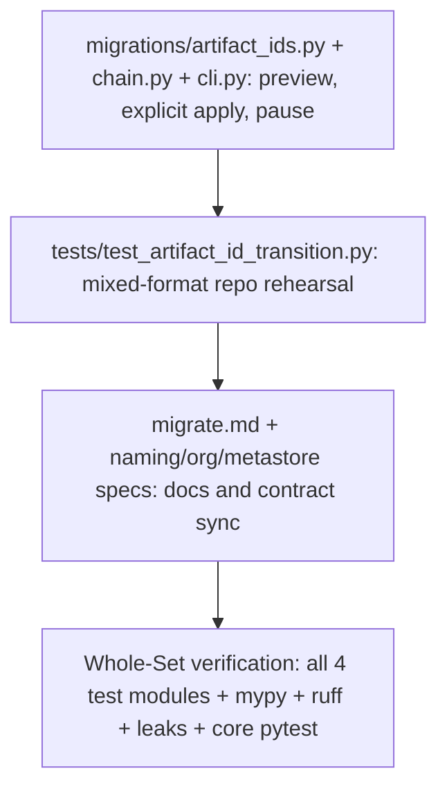

# IPD: Add opt-in artifact ID enablement preflight, mixed-format rehearsal, and docs sync

- Date: 2026-11-27
- Kind: child
- Concern: Enabling `MNCuVCu-CuVCuMN` issuance on an existing repository needs an explicit, fail-closed preflight and pause flow, an end-to-end mixed-format rehearsal proving zero damage to legacy records, and synchronized naming/metadata specs and CLI help.
- Scope: Implement the opt-in enablement preflight, explicit apply, stale-preview refusal, and pause-issuance path in `agent_workflows/migrations/artifact_ids.py`, `agent_workflows/migrations/chain.py`, and `agent_workflows/cli.py`; rehearse the full mixed-format transition in an isolated repository fixture in `tests/test_artifact_id_transition.py`; and synchronize `.aw/system/workflows/migrate/migrate.md`, `.aw/records/specs/implemented/20260817-2147-01-uniform-artifact-naming-grammar.spec.md`, `.aw/records/specs/approved/20260925-metastore-01-4sd62s-artifact-metadata-store.spec.md`, and `.aw/records/specs/implemented/20260730-2152-01-agents-artifact-organization.spec.md` with spec `2aqq1c`. EXCLUDES core readers (`k4c3jb`), check/runner updates (`cjq541`), and allocator/setid enforcement (`k6s16e`).
- Scope-Paths: agent_workflows/migrations/artifact_ids.py, agent_workflows/migrations/chain.py, agent_workflows/cli.py, .aw/system/workflows/migrate/migrate.md, .aw/records/specs/implemented/20260817-2147-01-uniform-artifact-naming-grammar.spec.md, .aw/records/specs/approved/20260925-metastore-01-4sd62s-artifact-metadata-store.spec.md, .aw/records/specs/implemented/20260730-2152-01-agents-artifact-organization.spec.md, tests/test_artifact_id_transition.py, .aw/records/plans/pending/20261127-artifact-ids-04-1k9mzr-add-opt-in-artifact-id-enablement-preflight-mixed-format-reh.ipd.md
- Item-Dependencies: executed:k6s16e
- From-Spec: 2aqq1c
- Status: to-review
- Short-Description: Add opt-in enablement and pause flow, end-to-end mixed-format rehearsal, and naming/metadata spec sync
- Work-Kind: feature
- Priority: medium
- Set: artifact-ids
- Order: 4
- Highest E allocated: 05
- Author: antigravity
- Id: 1k9mzr

> Write and proofread this plan per the technical writing standard, `.aw/system/workflows/technical-writing/technical-writing.md` (`.agents/workflows/technical-writing/technical-writing.md` in a legacy-layout install), including requirement 12 (diagrams).

## Workflow history

- 2026-11-28 to-review (aw set): status set to to-review
- 2026-11-28 draft (antigravity): created as Order 04 of Set `artifact-ids` for spec `2aqq1c`.

## Goal

Provide an explicit, fail-closed opt-in enablement and pause flow for `MNCuVCu-CuVCuMN` issuance, prove mixed-format compatibility end-to-end in an isolated repository rehearsal, and align all affected `agent-workflows` specifications and migration docs with spec `2aqq1c`.

## Detailed Implementation Checklist (TODO)

Execution-state rule: mark an `E-*` item complete only after performing the action. That mark is not validation. Right-sizing rule: write for a modest executor that cannot hold much in its head. Each E-item is one step (one concern, about one file, executable in one focused pass) and its V-item names each unit it covers with its own check; a plan stays at about 5 E-items and 8 work Scope-Paths, else split it into more child plans (guidance, `IPD-Z603`). Accepted execution states: blocked, failed, pending, performed; terminal gate demands 'performed'.

### Task group 1: Opt-in enablement, mixed-format rehearsal, and docs sync

- [ ] E-01 Implement `agent_workflows/migrations/artifact_ids.py` and wire opt-in reporting/enablement into `agent_workflows/migrations/chain.py` and `agent_workflows/cli.py`:
  - Keep bare `aw migrate` non-destructive: bare `aw migrate` must never silently flip a repository's issuance mode to `id10`; it may report opt-in availability only.
  - Provide an explicit preview/apply/pause flow (for example `aw migrate artifact-ids --preview`, `--apply`, `--pause`) that checks prerequisites (dual-format reader readiness, completed layout/metadata migrations, clean config target), reports exact planned changes, refuses stale previews or unsupported readers, reuses repository locking and idempotent retry recovery, and supports pausing issuance back to `id6` without breaking reads of already-issued `MNCuVCu-CuVCuMN` artifacts.
  - If configuration alone suffices with no file-format migration required, report clearly in preflight that zero legacy records will be rewritten.
  - Depends on: none
  - Expected outcome: Repositories can preview, explicitly enable, idempotently re-run, and safely pause `MNCuVCu-CuVCuMN` issuance with zero unintended changes to existing records.
  - Execution state: pending

- [ ] E-02 Add end-to-end mixed-format rehearsal tests in `tests/test_artifact_id_transition.py` (`pytestmark = pytest.mark.core`, fast in-process, zero `inspect`/`ast` source-pinning checks) covering spec `2aqq1c` AC-6 and the whole-Set cross-IPD verification:
  - Seed an isolated repository containing legacy six-character plans, specs, backlog items, reviews, dependencies, and append-only history logs.
  - Verify preflight refuses enablement when prerequisites are missing, then succeeds on a ready repository and reports exact planned changes.
  - Verify rollback before any `id10` issuance leaves the repository byte-identical.
  - Enable `id10` issuance, create new specs (with mnemonic `<setid>`), plans, and backlog items using `MNCuVCu-CuVCuMN` IDs, and verify `aw find`, `aw check`, `aw attention`, and `aw index rebuild` all succeed while legacy filenames, typed references, and history bytes remain unchanged.
  - Pause issuance back to `id6`, create another artifact (minting `id6`), and confirm every already-issued `MNCuVCu-CuVCuMN` artifact remains readable, checkable, and resolvable.
  - Depends on: E-01
  - Expected outcome: Full mixed-format transition, rollback, rebuild, and pause behavior is proven deterministically in `tests/test_artifact_id_transition.py`.
  - Execution state: pending

- [ ] E-03 Synchronize documentation and specifications with spec `2aqq1c` (keeping user-facing docs free of em/en dashes per `AGENTS.md`):
  - Update `.aw/system/workflows/migrate/migrate.md` and `cli.py` help text to explain opt-in `MNCuVCu-CuVCuMN` enablement, prerequisite checks, and pausing issuance.
  - Update `.aw/records/specs/implemented/20260817-2147-01-uniform-artifact-naming-grammar.spec.md`, `.aw/records/specs/approved/20260925-metastore-01-4sd62s-artifact-metadata-store.spec.md`, and `.aw/records/specs/implemented/20260730-2152-01-agents-artifact-organization.spec.md` with cross-references to spec `2aqq1c` for dual-format artifact IDs and mnemonic `<setid>` rules.
  - Depends on: E-02
  - Expected outcome: Command help, migration workflow instructions, and naming/organization/metadata specs accurately match the implemented behavior.
  - Execution state: pending

- [ ] E-04 Run the full Set verification across all four children (`tests/test_artifact_id_readers.py`, `tests/test_artifact_id_checks_and_runners.py`, `tests/test_artifact_id_issuance_and_setids.py`, `tests/test_artifact_id_transition.py`) plus `aw check`, confirming zero drift on the live repository.
  - Depends on: E-03
  - Expected outcome: Every artifact-ID test module and repository check passes cleanly.
  - Execution state: pending

- [ ] E-05 Run `ruff check`, `ruff format --check`, `python3 -m mypy agent_workflows`, `aw check-local-leaks`, `pre-commit run --files ...`, and bare `python3 -m pytest`.
  - Depends on: E-04
  - Expected outcome: All static checks, leak checks, pre-commit hooks, and the core pytest suite pass cleanly within budget.
  - Execution state: pending

## Project conventions discovered (Step 0)

- Bare `aw migrate` executes pending layout and metadata upgrades automatically; any opt-in issuance format switch must require explicit opt-in so bare `aw migrate` never surprises users.
- `agent_workflows/migrations/chain.py` coordinates ordered repository migrations with preflight, dry-run preview, locking, and recovery patterns that `artifact_ids.py` can reuse directly.
- User-facing prose and CLI help must contain zero em or en dashes (`AGENTS.md`).

## Findings

| Finding | Evidence | Impact on this plan |
| --- | --- | --- |
| Bare `aw migrate` auto-applies pending migrations | `cli.py` migration entrypoints apply pending upgrades by default unless `--dry-run` is passed | Keep `artifact-ids` enablement explicitly opt-in (never auto-applied by bare `aw migrate`) |
| Three standing specs define the legacy `id6` grammar and metadata paths | `20260817-2147-01-uniform-artifact-naming-grammar.spec.md`, `20260925-metastore-01-4sd62s-artifact-metadata-store.spec.md`, `20260730-2152-01-agents-artifact-organization.spec.md` | Add aligned cross-references to spec `2aqq1c` so the repository's naming and metadata contracts stay consistent |

## Proposed changes (ordered, validatable)

1. Implement `migrations/artifact_ids.py` and wire opt-in preview/apply/pause controls into `migrations/chain.py` and `cli.py`.
2. Add end-to-end mixed-format rehearsal tests in `tests/test_artifact_id_transition.py`.
3. Synchronize `migrate.md`, CLI help, and the three naming/organization/metadata specs with spec `2aqq1c`.
4. Run whole-Set validation across all four test suites, `aw check`, `mypy`, `ruff`, `aw check-local-leaks`, and bare `python3 -m pytest`.

## Deferred / out of scope (with reason)

- Core readers, check/runner updates, and allocator/setid enforcement: owned by Orders 01 through 03 (`k4c3jb`, `cjq541`, `k6s16e`).
  - Carrier: k6s16e
- Enabling `id10` issuance on this repository itself: an explicit operator decision after Order 04 lands, not performed automatically during execution.
  - Carrier-Declined: intentional operator opt-in decision per spec `2aqq1c` R6

## Scope check

- Over-scope: none. Does not flip issuance on this repository automatically and does not rekey any legacy artifact.
- Under-scope: none. Covers opt-in enablement, pause safety, mixed-format rehearsal, docs/spec sync, and whole-Set validation.

## Required tests / validation

- `python3 -m pytest -v tests/test_artifact_id_readers.py tests/test_artifact_id_checks_and_runners.py tests/test_artifact_id_issuance_and_setids.py tests/test_artifact_id_transition.py`
- `ruff check` and `ruff format --check` on modified and new files
- `python3 -m mypy agent_workflows`
- `aw check-local-leaks`
- `aw check`
- Bare `python3 -m pytest`

## Spec / documentation sync

- Updates `.aw/system/workflows/migrate/migrate.md`, `agent_workflows/cli.py` help text, and the three naming/organization/metadata specs listed in `Scope-Paths`.

## Open questions

None blocking.

## Validation and cross-check (verify before reporting done)

Validation-state rule: inspect evidence in a separate pass. Do not mark a `V-*` item complete from memory or from the matching execution checkmark. Accepted validation results: blocked, failed, pass, pending; terminal gate demands 'pass'. Runtime-demonstration reachability rule: for each `V-*` item demanding the software be observed acting (such as a run, a dispatch, or a transition)—as distinct from items demanding a diff, a file's content, or a test result, which are reachable by construction—name the code path that produces the observation or the sibling `E-*` that creates it, else the demand is UNDER-SCOPE.

- [ ] V-01 validates E-01
  - Required evidence: paste CLI/test output showing preview, prerequisite refusal, explicit apply, idempotent repeat-apply, and pause-issuance behavior, plus confirmation that bare `aw migrate` does not silently enable `id10` issuance.
  - Observed evidence:
  - Result: pending

- [ ] V-02 validates E-02
  - Required evidence: paste `python3 -m pytest -v tests/test_artifact_id_transition.py` showing every test node PASSED (0 failed), including creation, `aw find`, `aw check`, `aw attention`, index rebuild, byte-unchanged legacy records, rollback before issuance, and reads surviving after pausing issuance, plus `rg -n "^(import|from) (inspect|ast)\b" tests/test_artifact_id_transition.py` returning exit 1.
  - Observed evidence:
  - Result: pending

- [ ] V-03 validates E-03
  - Required evidence: paste `git diff --stat` covering `migrate.md`, `cli.py`, and the three updated specs, plus confirmation of zero em/en dashes (`U+2013`/`U+2014`) in added user-facing prose/help lines.
  - Observed evidence:
  - Result: pending

- [ ] V-04 validates E-04
  - Required evidence: paste `python3 -m pytest -v tests/test_artifact_id_readers.py tests/test_artifact_id_checks_and_runners.py tests/test_artifact_id_issuance_and_setids.py tests/test_artifact_id_transition.py` and `aw check` passing with 0 failures.
  - Observed evidence:
  - Result: pending

- [ ] V-05 validates E-05
  - Required evidence: paste `ruff check`, `ruff format --check`, `python3 -m mypy agent_workflows`, `aw check-local-leaks`, `pre-commit run --files ...`, and the summary line of bare `python3 -m pytest` passing cleanly.
  - Observed evidence:
  - Result: pending

## Approval and execution gate

- Size assessment: standard
- Cohesion rationale: not required

Execution contract:
- **Scope fence**: Limit edits to declared `Scope-Paths`; justify any necessary extra path via `--scope-reason` at finalize.
- **Evidence honesty**: Paste actual runner output after the final edit for every `V-*` item.
- **Commit and finalize**: Commit via `aw commit 1k9mzr -- <paths>` and finalize via `aw ipd finalize 1k9mzr --apply`.
