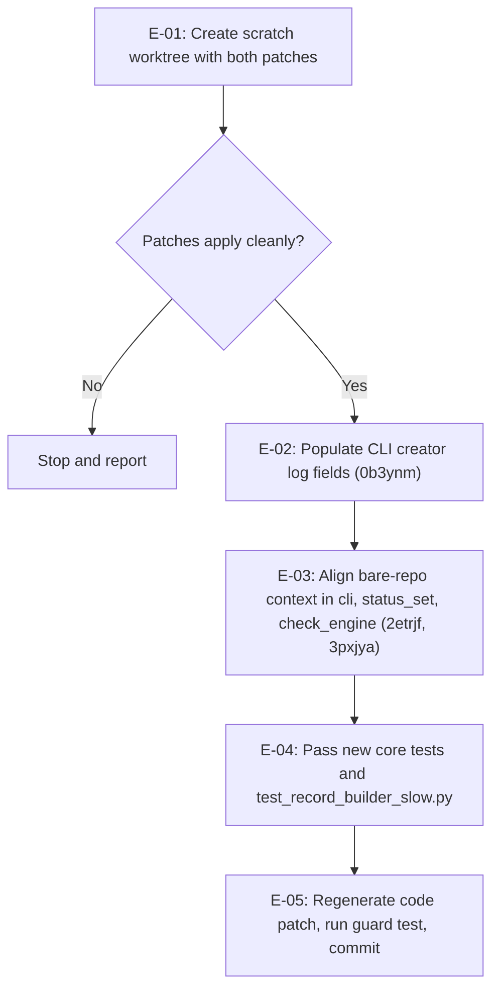

# IPD: Populate CLI creator log fields and align aw find bare-repo context in the cutover code patch

- Date: 2026-11-27
- Kind: child
- Concern: Backlog items `0b3ynm` (CLI creators omitting log fields), `2etrjf` (`aw find` bare-repo research drop), and `3pxjya` (`status_set` and `check_engine` bare-repo context reads) track three coupled production defects inside `.aw/system/cutover/metastore-code.cutover.patch`. Items `0b3ynm` and `2etrjf` were discovered during executed builder-switch plan `89mtbl` E-04 on `tests/test_record_builder_slow.py`; item `3pxjya` was discovered during batch A test-conversion plan `cugg3w` and consolidated here ahead of test batches A through F per the maintainer Option 2 decision on `run-20261127T045218Z-1963184` question `g-b366f2ff84656927` (proposal `igbr4f`). First (`0b3ynm`), four CLI creation commands omit registry metadata fields that legacy mode used to infer from the H1 heading or filename when calling `artifact_meta.create`: `agent_workflows/ipd_authoring.py::run_scaffold` omits `title`; `agent_workflows/specs.py::run_new` omits `set` and `order`; `agent_workflows/releases.py::_create_release_via_meta` omits `title`, `set`, and `order`; and `agent_workflows/prompts.py::run_new` omits `order`. Because post-cutover `artifact_meta.read` reads only `meta/<id6>.jsonl`, those fields read back as `None` and fail `tests/test_record_builder_slow.py::RecordBuilderParityTests` (`test_parity_plan`, `test_parity_spec`, `test_parity_release`, `test_parity_prompt`). Second (`2etrjf`, sibling of bare-repo resolver backlog `ggp2pf`), `agent_workflows/cli.py::_find_type_records` calls `project_context.resolve_project_context(target_repo=str(repo_root))` instead of `artifact_meta.legacy_context(repo_root)`. On bare temporary repositories without `.aw/config/`, `resolve_project_context` places `logical_roots["records"]` under `AW_HOME` instead of `<repo>/.aw/records`, so `artifact_meta.query` marks in-repo records as orphans (`st.id_derived=True`) and the research branch (`if st is None or st.id_derived: continue`) drops research records from `aw find -p`, breaking `tests/test_record_builder_slow.py::RecordBuilderVisibilityTests::test_visibility_find_attention_check`. Third (`3pxjya`, sibling of `ggp2pf` and `2etrjf`), metadata readers in `agent_workflows/status_set.py` (`_cached_states_by_path`, both `resolve_project_context` call sites in `_cached_state_for_path`, and `_state_for_record`) and `agent_workflows/check_engine.py` (`_git_read_at_context`, `_meta_records_with_fields`, `_meta_state_for_path`, `build_graduation_reverse_index`, `_item_close_date`, `_item_graduated_date`, and `_spec_implementing_date`) call `project_context.resolve_project_context(target_repo=str(repo_root))` without the bare-repo in-tree `artifact_meta.legacy_context(repo_root)` fallback already added to `check_engine._meta_state_map` and `ipd_lint._meta_context_and_state_map` by executed plan `hdwqex` (and strengthened for empty `AW_HOME` records directories in `runner_shared._meta_context_for_repo`). On bare temporary repositories without `.aw/config/` under `AW_HOME`, these readers miss companion JSONL logs under `<repo>/.aw/records/meta/`, fall back to the two-key YAML mirror, and return `None` for non-mirror fields (`set_id`, `blocks_release`, `from_backlog`, `gate_summary`), blocking `tests/test_artifact_meta_loader_parity.py` and `tests/test_backlog.py` in batch A (`cugg3w`) and sibling tests in batches B through F.
- Scope: In an isolated scratch worktree `.aw/state/6cltab/scratch` with both cutover patches applied (after executed plans `hdwqex`, `89mtbl`, `nv3upa`, `fljn9b`, and prerequisite production-fix plans `szykgd` through `3e0vfy`, and ahead of test-conversion batches `cugg3w` through `x3mig6`), populate the missing `artifact_meta.create` fields in `agent_workflows/ipd_authoring.py::run_scaffold`, `agent_workflows/specs.py::run_new`, `agent_workflows/releases.py::_create_release_via_meta`, and `agent_workflows/prompts.py::run_new` (`0b3ynm`); switch `agent_workflows/cli.py::_find_type_records` to `artifact_meta.legacy_context(repo_root)` (`2etrjf`); add the bare-repo in-tree `artifact_meta.legacy_context(repo_root)` fallback helper across all `resolve_project_context` metadata reader sites in `agent_workflows/status_set.py` and `agent_workflows/check_engine.py` while leaving non-reader `records_backend` checks in `status_set` on `resolve_project_context` and wrapping `check_engine` history reads in `artifact_meta.ephemeral_if_uninitialized()` (`3pxjya`); add and pass core behavioral tests in `tests/test_cutover_log_cli_creators_and_find.py`; pass every visibility and parity test in `tests/test_record_builder_slow.py`; and regenerate `.aw/system/cutover/metastore-code.cutover.patch`. Make no live code or test changes outside `- Scope-Paths:`.
- Scope-Paths: .aw/records/plans/pending/20261127-metastore-322-6cltab-populate-cli-creator-log-fields-and-align-aw-find-bare-repo.ipd.md, .aw/system/cutover/metastore-code.cutover.patch
- Item-Dependencies: executed:3e0vfy
- Status: approved
- Review-Depth: standard
- Readiness: go-pending-approval
- From-Spec: 4sd62s
- Work-Kind: bug
- Priority: high
- From-Backlog: 0b3ynm
- Blocks-Release: next
- Set: metastore
- Order: 322
- Highest E allocated: 05
- Author: antigravity/gemini
- Id: 6cltab
- Approval: 2026-11-27, recorded via aw ipd set: status set to approved

> Write and proofread this plan per the technical writing standard, `.aw/system/workflows/technical-writing/technical-writing.md` (`.agents/workflows/technical-writing/technical-writing.md` in a legacy-layout install), including requirement 12 (diagrams).

## Workflow history

- 2026-11-27 approved (aw set): status set to approved
- 2026-11-27 reviewed (aw set): APPROVE WITH REVISIONS APPLIED; PR-001..PR-005 FIXED
- 2026-11-27 /plan-review (antigravity/gemini): APPROVE WITH REVISIONS APPLIED; PR-001, PR-002, PR-003, PR-004, PR-005 (all FIXED); review record .aw/records/reviews/20261127-metastore-322-6cltab-populate-cli-creator-log-fields-and-align-aw-find-bare-repo.review.md
- 2026-11-27 note (antigravity/gemini): expanded scope to include backlog 3pxjya (status_set.py and check_engine.py bare-repo resolve_project_context fallbacks) and re-chained after 3e0vfy ahead of test batches cugg3w through x3mig6 per maintainer Option 2 decision on run-20261127T045218Z-1963184 question g-b366f2ff84656927 (proposal igbr4f).
- 2026-11-27 to-review (aw set): authored as Order 322 ahead of x1mmdp for backlog items 0b3ynm and 2etrjf per maintainer answer to 219-89mtbl-a1-89mtbl-slow-tests-circular-dep
- 2026-11-27 draft (antigravity/gemini): created.

## Goal

Populate the missing log metadata fields in the four CLI artifact creators (backlog `0b3ynm`) and align bare-repo context resolution across `aw find` (backlog `2etrjf`), `status_set.py`, and `check_engine.py` (backlog `3pxjya`) with `artifact_meta.legacy_context` inside `.aw/system/cutover/metastore-code.cutover.patch`. This unblocks test batches A through F (plans `cugg3w` through `x3mig6`) and the `tests/test_record_builder_slow.py` integration gate in rollup plan `x1mmdp`.

## Detailed Implementation Checklist (TODO)

Execution-state rule: mark an `E-*` item complete only after performing the action. That mark is not validation. Right-sizing rule: write for a modest executor that cannot hold much in its head. Each E-item is one step (one concern, about one file, executable in one focused pass) and its V-item names each unit it covers with its own check; a plan stays at about 5 E-items and 8 work Scope-Paths, else split it into more child plans (guidance, `IPD-Z603`). Accepted execution states: blocked, failed, pending, performed; terminal gate demands 'performed'.

### Task group 1: scratch worktree

- [ ] E-01 Create the scratch worktree following the SCRATCH PROCEDURE of executed plan `2k5t16` (Step 0): run `git worktree add --detach .aw/state/6cltab/scratch HEAD`; inside `.aw/state/6cltab/scratch`, run `git apply --index .aw/system/cutover/metastore-docs.cutover.patch`, record `BASE=$(git write-tree)` in F-01, and then run `git apply --index .aw/system/cutover/metastore-code.cutover.patch`. If either patch rejects, stop and report.
  - Depends on: none
  - Expected outcome: `.aw/state/6cltab/scratch` holds HEAD plus both cutover patches staged, and F-01 records the base tree id.
  - Execution state: pending

### Task group 2: CLI creator fields and bare-repo context alignment (scratch worktree only)

- [ ] E-02 Populate the missing registry fields passed to `artifact_meta.create` across the four CLI creation commands (`0b3ynm`) in `.aw/state/6cltab/scratch`:
  1. In `agent_workflows/ipd_authoring.py::run_scaffold`: include `"title": title` in the `fields` dictionary passed to `_meta.create(plan_id, "ipd", fields, ...)` so `artifact_meta.read(plan_id).title` returns `title`.
  2. In `agent_workflows/specs.py::run_new`: include `"set": id6` and `"order": 1` in `spec_fields` passed to `_meta.create(id6, "spec", spec_fields, ...)` (matching the `set_id=id6, order=1` filename already built by `build_clustered_name`) so `artifact_meta.read(id6).set_id` returns `id6` and `order_nn` returns `1`.
  3. In `agent_workflows/releases.py::_create_release_via_meta`: include `"title": f"Release: {version}"`, `"set": id6`, and `"order": 1` in `release_fields` passed to `_meta.create(id6, "release", release_fields, ...)` (matching the `# Release: {version}` H1 and `{today}-{id6}-01-{id6}-{slug}.release.md` filename) so `artifact_meta.read(id6)` returns `title`, `set_id`, and `order_nn`.
  4. In `agent_workflows/prompts.py::run_new`: include `"order": order` in `fields` passed to `_meta.create(id6, "prompt", fields, ...)` (using the `order = next_order_for_set(root, set_id)` already computed for `build_prompt_name`) so `artifact_meta.read(id6).order_nn` returns `order`.
  5. Record the verified creator-field audit in F-02.
  - Depends on: E-01
  - Expected outcome: all four CLI creators persist complete log fields matching `tests/record_builder.py::RecordBuilder`, `artifact_meta.read` returns non-`None` values for `title`, `set_id`, and `order_nn`, and F-02 records the audit.
  - Execution state: pending

- [ ] E-03 Align bare-repo context resolution across `agent_workflows/cli.py::_find_type_records` (`2etrjf`), `agent_workflows/status_set.py`, and `agent_workflows/check_engine.py` (`3pxjya`) in `.aw/state/6cltab/scratch`:
  1. In `agent_workflows/cli.py::_find_type_records`, replace `ctx = _proj_ctx.resolve_project_context(target_repo=str(repo_root))` with `ctx = _meta.legacy_context(repo_root)` (which uses `project_context.project_records_dir(root)` and preserves configured tracked, companion, and home roots when `.aw/config/` exists while resolving `<repo>/.aw/records` on bare repositories without `.aw/config/`, per `ggp2pf`).
  2. In `agent_workflows/status_set.py`, add a shared local helper `_meta_context_for_repo(repo_root)` and route every metadata-reader `resolve_project_context(target_repo=...)` call through it: `_cached_states_by_path`, BOTH `resolve_project_context` call sites in `_cached_state_for_path` (the `scan_cache` `load_fields` branch and the uncached branch), and `_state_for_record`. The helper resolves `ctx = _proj_ctx.resolve_project_context(target_repo=str(repo_root))` and falls back to `_meta.legacy_context(repo_root)` when `in_tree_records = Path(repo_root) / ".aw" / "records"` exists on disk and either (a) `not Path(ctx.logical_roots["records"]).is_dir()`, or (b) `in_tree_records.resolve() != Path(ctx.logical_roots["records"]).resolve()` and `not (Path(ctx.logical_roots["records"]) / "meta").is_dir()` and `(in_tree_records / "meta").is_dir()` (handling both uncreated and empty `AW_HOME` directories, matching `hdwqex` and `runner_shared._meta_context_for_repo`, while preserving configured `.aw/config/` tracked, companion, and home layouts because `legacy_context` delegates to `project_records_dir`). Keep `_prepare_status_change` and `_offer_self_commit` on `project_context.resolve_project_context(target_repo=str(owner))`: they inspect `ctx.records_backend` (not `logical_roots["records"]`), which `LegacyContext` does not carry.
  3. In `agent_workflows/check_engine.py`, extract the same shared bare-repo fallback helper `_meta_context_for_repo(repo_root)` and use it across `_meta_state_map`, `_meta_records_with_fields`, `_meta_state_for_path` (also called by `validate_prompt_content`), `build_graduation_reverse_index`, `_item_close_date`, `_item_graduated_date`, and `_spec_implementing_date`. Wrap the `_meta.history(...)` calls inside `_item_close_date`, `_item_graduated_date`, and `_spec_implementing_date` with `with _meta.ephemeral_if_uninitialized():` so read-only date checks never create stray `.aw/state/index.db` files in uninitialized bare repositories. In `_git_read_at_context`, keep its `target_repo` attribute and `.agents` fallback intact, and check for an absent `records_root` with an existing in-tree `(root / ".aw" / "records")` (when `(root / ".git").exists()`) before returning `ctx` via `record_git_root(records_root)` so a bare repository under an `AW_HOME` inside another git tree still resolves its own in-tree records root.
  4. Verify on a bare temporary repository without `.aw/config/` (with `AW_HOME` pointed to a separate empty temp dir, and again when `<AW_HOME>/projects/<pid>/records` exists as an empty directory without `meta/`) that: (a) `aw find -p` returns all 8 governed record types including `research` without dropping research or marking in-repo records as orphans; (b) `status_set` (`_cached_states_by_path`, `_cached_state_for_path`, `_state_for_record`) and `check_engine` (`_meta_state_for_path`, `_meta_records_with_fields`, `build_graduation_reverse_index`, `_item_close_date`) read non-mirror log fields (`set_id`, `blocks_release`, `from_backlog`, `gate_summary`) and history dates from `<repo>/.aw/records/meta/` instead of returning `None`, without creating `.aw/state/index.db` in an uninitialized repo; and (c) configured-repository behavior with `.aw/config/` remains unchanged.
  5. Record the verified behavior check in F-03.
  - Depends on: E-02
  - Expected outcome: `aw find -p`, `status_set`, and `check_engine` resolve `<repo>/.aw/records` and read full JSONL metadata logs on bare temporary repositories without creating stray caches or regressing configured or companion-repo layouts; F-03 records the verification.
  - Execution state: pending

- [ ] E-04 Add and run core behavioral test module `tests/test_cutover_log_cli_creators_and_find.py` (`pytestmark = pytest.mark.core`) and verify `tests/test_record_builder_slow.py` in `.aw/state/6cltab/scratch` (asserting real outputs, exit codes, and side effects; no code-pinning tests):
  1. Cover each of the four CLI creators (`aw ipd scaffold --apply`, `aw specs new --apply`, `aw releases new --apply`, `aw prompts new --apply`) on an isolated temp repository: assert `artifact_meta.read(id6, project_context=...)` returns the expected `title`, `set_id`, and `order_nn`.
  2. Cover `aw find -p` on a bare temp repository without `.aw/config/` containing log-format records of all governed types including `research`: assert exit 0 and that the `research` record appears in the output paths.
  3. Cover `status_set` and `check_engine` on a bare temp repository without `.aw/config/` while `AW_HOME` points to a separate empty directory (including a case where the resolved `AW_HOME` records directory exists empty without `meta/`): materialize log-backed backlog and plan records carrying `set_id`, `blocks_release`, `from_backlog`, and `gate_summary`, and assert `status_set._state_for_record` / `_cached_states_by_path` / `_cached_state_for_path(..., load_fields=True)` and `check_engine._meta_state_for_path` / `_meta_records_with_fields` / `build_graduation_reverse_index` / `_item_close_date` read those log fields and history dates instead of returning `None`, and that read-only date checks do not create `.aw/state/index.db` on an uninitialized bare repo. Also verify configured companion/home layout behavior is preserved.
  4. Run `python3 -m pytest -o addopts="" -m '' -v tests/test_cutover_log_cli_creators_and_find.py tests/test_record_builder_slow.py` in `.aw/state/6cltab/scratch`; every collected test in both modules must exit 0 with every test PASSED.
  - Depends on: E-03
  - Expected outcome: every collected test in `tests/test_cutover_log_cli_creators_and_find.py` and `tests/test_record_builder_slow.py` (visibility and per-type CLI-vs-builder parity) passes with exit 0.
  - Execution state: pending

### Task group 3: package

- [ ] E-05 In `.aw/state/6cltab/scratch`, run `git add -A` and write `git diff --cached --binary $BASE` over `.aw/system/cutover/metastore-code.cutover.patch` in the executing checkout; remove the scratch worktree (`git worktree remove --force .aw/state/6cltab/scratch`); run `python3 -m pytest -o addopts="" tests/test_metastore_cutover_code_patch.py` in the executing checkout; verify `git status --short` shows only `- Scope-Paths:` modified; and commit through `aw commit 6cltab -- .aw/records/plans/pending/20261127-metastore-322-6cltab-populate-cli-creator-log-fields-and-align-aw-find-bare-repo.ipd.md .aw/system/cutover/metastore-code.cutover.patch`; never push.
  - Depends on: E-04
  - Expected outcome: `.aw/system/cutover/metastore-code.cutover.patch` holds all prior code-patch hunks plus this plan's changes; `tests/test_metastore_cutover_code_patch.py` passes; scratch worktree is removed; no live files outside `- Scope-Paths:` are modified; one path-scoped commit is created.
  - Execution state: pending

## Project conventions discovered (Step 0)

- The scratch procedure and cumulative code patch are defined in executed plan `2k5t16` (Step 0, OQ-01); executed log-writer plan `g45vyv`, executed plans `hdwqex`, `89mtbl`, `nv3upa`, `fljn9b`, and prerequisite plans `szykgd` through `3e0vfy` follow the same procedure.
- `agent_workflows/artifact_meta.py::legacy_context` resolves configured tracked, companion, and home roots when `.aw/config/` is present (via `project_context.project_records_dir(root)`) while falling back to `<repo>/.aw/records` on bare repositories (backlog `ggp2pf`). `LegacyContext` carries `logical_roots` and `repo_root` only (not `records_backend`).
- `agent_workflows/runner_shared.py::_meta_context_for_repo` and `agent_workflows/check_engine.py::_meta_state_map` establish the bare-repo fallback pattern to `artifact_meta.legacy_context(repo_root)` when `resolve_project_context` points to a missing or empty `AW_HOME` records directory while `<repo>/.aw/records` (or `<repo>/.aw/records/meta`) exists.
- `tests/record_builder.py` (switched to log format in `89mtbl`) already emits `title`, `set`, and `order` for `plan`, `spec`, `release`, and `prompt` (`order` is omitted for `backlog` because `REGISTRY["backlog"]` has no `order` field; `test_parity_backlog` already passes; `test_parity_research` is fixed ahead of this plan by prerequisite Order 320 `lec341`).
- Tests exercise real behavior and assert on observable outcomes (AGENTS.md "TEST OUTCOMES, NOT CODE STRUCTURE"); no `inspect`, `ast`, regex, or substring code-pinning tests.
- Cite code by symbol (`path::Symbol`) or by a quoted content string, with a line number only appended as a hint and never alone (advisory `IPD-C801`).

## Findings

| Id | Evidence | Finding |
|---|---|---|
| F-01 | (written by E-01) | Base tree id after applying `.aw/system/cutover/metastore-docs.cutover.patch`. |
| F-02 | (written by E-02) | Verified audit of `fields` passed to `artifact_meta.create` in `ipd_authoring.py::run_scaffold`, `specs.py::run_new`, `releases.py::_create_release_via_meta`, and `prompts.py::run_new`. |
| F-03 | (written by E-03) | Verified bare-repo (`AW_HOME` isolated with missing and empty `AW_HOME` records dir, no `.aw/config/`) and configured-repo behavior for `cli._find_type_records`, `status_set` (`_cached_states_by_path`, `_cached_state_for_path`, `_state_for_record`), and `check_engine` (`_git_read_at_context`, `_meta_state_map`, `_meta_records_with_fields`, `_meta_state_for_path`, `build_graduation_reverse_index`, `_item_close_date`, `_item_graduated_date`, `_spec_implementing_date`). |
| F-04 | `89mtbl` attempt-1 `tests/test_record_builder_slow.py` run (6 failed, 1 passed), `cugg3w` batch A run (5 bare-repo failures across `tests/test_artifact_meta_loader_parity.py` and `tests/test_backlog.py`, backlog `3pxjya`), and static inspection of `agent_workflows/ipd_authoring.py::run_scaffold`, `agent_workflows/specs.py::run_new`, `agent_workflows/releases.py::_create_release_via_meta`, `agent_workflows/prompts.py::run_new`, `agent_workflows/cli.py::_find_type_records`, `agent_workflows/status_set.py`, and `agent_workflows/check_engine.py` | Measured exact parity diffs: `plan` omitted `title` (`None` vs `'Parity Plan'`); `spec` omitted `set` and `order` (`None` vs `<id6>`/`1`); `release` omitted `title`, `set`, and `order` (`None` vs `'Release: 1.2.3'`/`<id6>`/`1`); `prompt` omitted `order` (`None` vs `1`); `aw find -p` dropped `research` on bare temp repos (`2etrjf`); and `status_set`/`check_engine` missed companion JSONL logs on bare temp repos under `AW_HOME`, reading `None` for `set_id`, `blocks_release`, `from_backlog`, and `gate_summary` (`3pxjya`). |
| F-05 | Plan-review static audit of post-patch `agent_workflows/status_set.py` (`_cached_states_by_path`, `_cached_state_for_path`, `_state_for_record`, `_prepare_status_change`, `_offer_self_commit`), `agent_workflows/check_engine.py` (`validate_prompt_content`, `_git_read_at_context`, `_meta_records_with_fields`, `_meta_state_for_path`, `_meta_state_map`, `build_graduation_reverse_index`, `_item_close_date`, `_item_graduated_date`, `_spec_implementing_date`), `agent_workflows/artifact_meta.py::legacy_context`, and `agent_workflows/runner_shared.py::_meta_context_for_repo` | Verified four implementation constraints folded into E-03 through E-04: (1) `status_set._prepare_status_change` and `_offer_self_commit` inspect `ctx.records_backend` only (not `logical_roots["records"]`), which `LegacyContext` lacks, so they must stay on `project_context.resolve_project_context`, whereas `_cached_state_for_path` has two metadata-reader calls that must both use the fallback helper; (2) `check_engine.validate_prompt_content` has no `resolve_project_context` call and already delegates to `_meta_state_for_path`; (3) `_item_close_date`, `_item_graduated_date`, and `_spec_implementing_date` call `_meta.history` without `ephemeral_if_uninitialized()`, which would create stray `.aw/state/index.db` files on uninitialized bare repos unless wrapped; and (4) the bare-repo fallback helper should cover both absent `records_root` and an empty `AW_HOME` `records_root` lacking `meta/` when `<repo>/.aw/records/meta/` exists (preserving `_git_read_at_context`'s `target_repo` and `.agents` contract). |

## Proposed changes (ordered, validatable)

1. E-01: Create scratch worktree `.aw/state/6cltab/scratch` with both cutover patches staged and record `$BASE` in F-01.
2. E-02: Populate `title`, `set`, and `order` in `ipd_authoring.py::run_scaffold`, `specs.py::run_new`, `releases.py::_create_release_via_meta`, and `prompts.py::run_new` (`0b3ynm`); record F-02.
3. E-03: Switch `cli.py::_find_type_records` to `artifact_meta.legacy_context(repo_root)` (`2etrjf`) and add the bare-repo `artifact_meta.legacy_context` fallback across metadata readers in `status_set.py` (keeping `_prepare_status_change` and `_offer_self_commit` on `resolve_project_context`) and `check_engine.py` (wrapping history readers in `ephemeral_if_uninitialized()` and preserving `_git_read_at_context`'s contract) (`3pxjya`); record F-03.
4. E-04: Add and pass `tests/test_cutover_log_cli_creators_and_find.py` (covering the four CLI creators, bare-repo `aw find -p`, and bare-repo/configured `status_set` and `check_engine`) and pass every visibility and parity test in `tests/test_record_builder_slow.py` in `.aw/state/6cltab/scratch`.
5. E-05: Regenerate `.aw/system/cutover/metastore-code.cutover.patch`, remove the scratch worktree, pass `tests/test_metastore_cutover_code_patch.py`, verify clean live tree outside `- Scope-Paths:`, and commit path-scoped.

## Deferred / out of scope (with reason)

- Broader `project_context.resolve_project_context` bare-repo policy and sibling bare-repo readers outside `cli._find_type_records`, `status_set.py`, and `check_engine.py` (such as `cli._run_search`, `plans._cached_states_by_path`, `selectors._cached_states_by_path`, and `partition._cluster_backlog_sets`): tracked under pre-existing backlog `ggp2pf`.
  - Carrier: ggp2pf
- Test-conversion batches A through F (`cugg3w` through `x3mig6`) and final both-tier verification plus authoritative F-03 live-repo refusal list (`x1mmdp`): run after this plan executes.
  - Carrier: x1mmdp
- Applying the cutover patches on the real tree: attended cutover commit.
  - Carrier: cxxmyv

## Scope check

- Over-scope: none. No live code or test files are modified outside `.aw/system/cutover/metastore-code.cutover.patch`.
- Under-scope: none. All three production defects (`0b3ynm` four CLI creators, `2etrjf` `cli._find_type_records` bare-repo research drop, and `3pxjya` `status_set`/`check_engine` bare-repo log reads) plus the co-located `F-05` constraints map directly to E-02 through E-04 and unblock test batches A through F (`cugg3w` through `x3mig6`) and `tests/test_record_builder_slow.py` ahead of `x1mmdp`.

## Required tests / validation

- New core behavioral test module `tests/test_cutover_log_cli_creators_and_find.py` and full slow integration suite `tests/test_record_builder_slow.py` (`python3 -m pytest -o addopts="" -m '' -v tests/test_cutover_log_cli_creators_and_find.py tests/test_record_builder_slow.py`) in `.aw/state/6cltab/scratch` (V-04).
- Cumulative patch guard test `python3 -m pytest -o addopts="" tests/test_metastore_cutover_code_patch.py` and `git status --short` clean-tree check in the executing checkout (V-05).

## Spec / documentation sync

No spec or documentation change is needed in this plan. Spec `4sd62s` Sections 4.1 through 4.3 already define log-backed metadata fields (`title`, `set`, `order`) and repository-context resolution, and `.aw/system/cutover/metastore-docs.cutover.patch` already documents them. This plan brings the four CLI creators, `cli._find_type_records`, `status_set.py`, and `check_engine.py` inside `.aw/system/cutover/metastore-code.cutover.patch` into agreement with them.

## Open questions

None open.

## Validation and cross-check (verify before reporting done)

Validation-state rule: inspect evidence in a separate pass. Do not mark a `V-*` item complete from memory or from the matching execution checkmark. Accepted validation results: blocked, failed, pass, pending; terminal gate demands 'pass'. Runtime-demonstration reachability rule: for each `V-*` item demanding the software be observed acting (such as a run, a dispatch, or a transition) - as distinct from items demanding a diff, a file's content, or a test result, which are reachable by construction - name the code path that produces the observation or the sibling `E-*` that creates it, else the demand is UNDER-SCOPE.

- [ ] V-01 validates E-01
  - Required evidence: paste the `git worktree add --detach .aw/state/6cltab/scratch HEAD` command, both `git apply --index` commands (for `.aw/system/cutover/metastore-docs.cutover.patch` and `.aw/system/cutover/metastore-code.cutover.patch`) with exit status 0, and the base tree id recorded in F-01.
  - Observed evidence:
  - Result: pending
- [ ] V-02 validates E-02
  - Required evidence: paste F-02 and the diff hunks in `agent_workflows/ipd_authoring.py`, `agent_workflows/specs.py`, `agent_workflows/releases.py`, and `agent_workflows/prompts.py` showing `title`, `set`, and `order` populated in `artifact_meta.create` `fields`.
  - Observed evidence:
  - Result: pending
- [ ] V-03 validates E-03
  - Required evidence: paste F-03, the diff hunks in `agent_workflows/cli.py::_find_type_records`, `agent_workflows/status_set.py` (`_cached_states_by_path`, `_cached_state_for_path`, `_state_for_record`), and `agent_workflows/check_engine.py` (`_git_read_at_context`, `_meta_state_map`, `_meta_records_with_fields`, `_meta_state_for_path`, `build_graduation_reverse_index`, `_item_close_date`, `_item_graduated_date`, `_spec_implementing_date`) adding the bare-repo `legacy_context` fallback and `ephemeral_if_uninitialized()` guards, and observed output on a bare temporary repository under an isolated `AW_HOME` (both missing and empty `AW_HOME` records dir, code paths updated by E-03) showing `aw find -p` returning `research` with exit 0 and `status_set`/`check_engine` reading non-`None` `set_id`, `blocks_release`, `from_backlog`, `gate_summary`, and history dates without creating `.aw/state/index.db` on an uninitialized repo, plus preserved configured `.aw/config/` behavior.
  - Observed evidence:
  - Result: pending
- [ ] V-04 validates E-04
  - Required evidence: paste the full `python3 -m pytest -o addopts="" -m '' -v tests/test_cutover_log_cli_creators_and_find.py tests/test_record_builder_slow.py` output in `.aw/state/6cltab/scratch` showing every collected test in both modules PASSED with exit 0 (covering all four CLI creators, bare-repo `aw find -p`, bare-repo and configured `status_set`/`check_engine` reads without stray `.aw/state/index.db`, and every visibility and CLI-vs-builder parity test in `tests/test_record_builder_slow.py`, re-derived at execution time).
  - Observed evidence:
  - Result: pending
- [ ] V-05 validates E-05
  - Required evidence: paste `git apply --stat .aw/system/cutover/metastore-code.cutover.patch`, the `python3 -m pytest -o addopts="" tests/test_metastore_cutover_code_patch.py` run showing every guard behavior (docs+code patch apply check, non-empty numstat, bad-patch refusal) PASSED with exit 0, `git worktree list` showing `.aw/state/6cltab/scratch` removed, `git status --short` confirming no live edits outside `- Scope-Paths:`, and the `aw commit 6cltab` output naming the commit hash.
  - Observed evidence:
  - Result: pending

## Approval and execution gate

- Size assessment: standard
- Cohesion rationale: not required

Execute only after human approval (`Status: approved`) and after `executed:3e0vfy` is satisfied; open questions: none open. Code and tests are edited ONLY inside `.aw/state/6cltab/scratch` and packaged into `.aw/system/cutover/metastore-code.cutover.patch`. Scope fence: `- Scope-Paths:` is a declaration; any needed edit outside it must be justified at finalize (`--scope-reason`), and any declared path left unmodified must be acknowledged (`--scope-ack`). Safety stop conditions: stop and report rather than editing live production code outside the scratch worktree or weakening test assertions if a patch hunk rejects, an unexpected failure occurs on unmodified code, or an unresolvable concurrent-edit conflict occurs. Honesty rule: you MUST paste the ACTUAL runner output of every command named in V-01 through V-05; never claim a result you did not run. Commits: commit only through `aw commit 6cltab -- <paths>`; never push. Lifecycle transition: after `aw ipd lint --phase pre-transition` conforms and every `V-*` reads `pass` with pasted evidence, in a managed runner lane stop after committing the updated plan and let the runner run `aw ipd finalize`; in a hand-run session run `aw ipd finalize` to move the plan to `.aw/records/plans/executed/` (never use a raw `git mv` to `executed/`).
