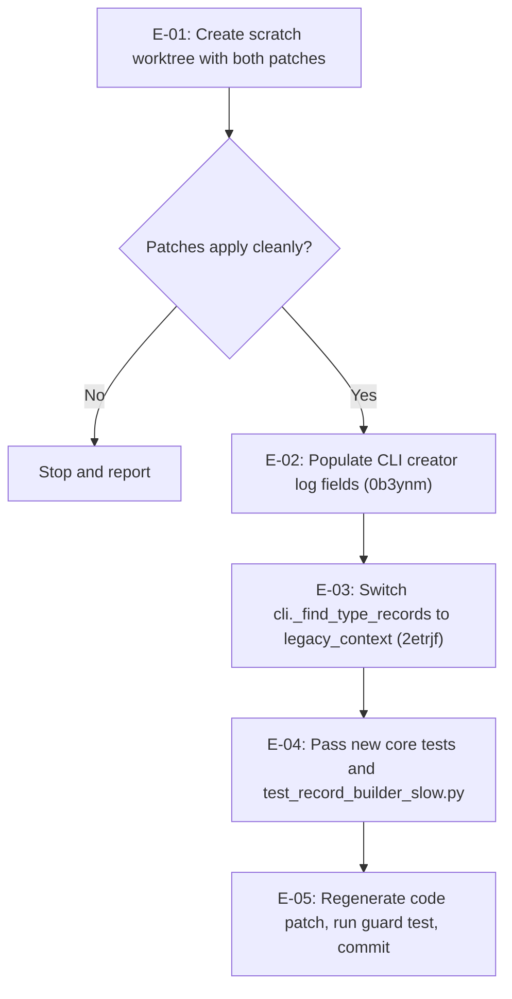

# IPD: Populate CLI creator log fields and align aw find bare-repo context in the cutover code patch

- Date: 2026-11-27
- Kind: child
- Concern: Backlog `0b3ynm` and `2etrjf` (discovered during `89mtbl` E-04 when running `tests/test_record_builder_slow.py` on the switched log-format tree, and split into this prerequisite child plan ahead of `x1mmdp` per maintainer answer to `run-20261127T045218Z-1963184` question `219-89mtbl-a1-89mtbl-slow-tests-circular-dep`): inside `.aw/system/cutover/metastore-code.cutover.patch`, two production defects break post-cutover CLI parity and bare-repo discovery. First (`0b3ynm`), four CLI creation commands omit registry metadata fields that legacy mode used to infer from the H1 heading or filename when calling `artifact_meta.create`: `agent_workflows/ipd_authoring.py::run_scaffold` omits `title`; `agent_workflows/specs.py::run_new` omits `set` and `order`; `agent_workflows/releases.py::_create_release_via_meta` omits `title`, `set`, and `order`; and `agent_workflows/prompts.py::run_new` omits `order`. Because post-cutover `artifact_meta.read` reads only `meta/<id6>.jsonl`, those fields read back as `None` and fail `tests/test_record_builder_slow.py::RecordBuilderParityTests` (`test_parity_plan`, `test_parity_spec`, `test_parity_release`, `test_parity_prompt`). Second (`2etrjf`, sibling of `ggp2pf`), `agent_workflows/cli.py::_find_type_records` resolves its context via `project_context.resolve_project_context(target_repo=str(repo_root))` instead of `artifact_meta.legacy_context(repo_root)`. On bare temporary repositories without `.aw/config/`, `resolve_project_context` places `logical_roots["records"]` under `AW_HOME` instead of `<repo>/.aw/records`, so `artifact_meta.query` marks in-repo records as orphans (`st.id_derived=True`) and the research branch (`if st is None or st.id_derived: continue`) drops research records from `aw find -p`, breaking `tests/test_record_builder_slow.py::RecordBuilderVisibilityTests::test_visibility_find_attention_check`.
- Scope: In an isolated scratch worktree `.aw/state/6cltab/scratch` with both cutover patches applied (after `hdwqex`, `89mtbl`, production-fix plans `fljn9b` through `3e0vfy`, and test-conversion batches `nv3upa` through `x3mig6`), populate the missing `artifact_meta.create` fields in `agent_workflows/ipd_authoring.py::run_scaffold`, `agent_workflows/specs.py::run_new`, `agent_workflows/releases.py::_create_release_via_meta`, and `agent_workflows/prompts.py::run_new`, switch `agent_workflows/cli.py::_find_type_records` to `artifact_meta.legacy_context(repo_root)`, add and pass core behavioral tests in `tests/test_cutover_log_cli_creators_and_find.py`, run `tests/test_record_builder_slow.py` to confirm all 7 visibility and parity tests pass, and regenerate `.aw/system/cutover/metastore-code.cutover.patch`. Make no live code or test changes outside `- Scope-Paths:`.
- Scope-Paths: .aw/records/plans/pending/20261127-metastore-322-6cltab-populate-cli-creator-log-fields-and-align-aw-find-bare-repo.ipd.md, .aw/system/cutover/metastore-code.cutover.patch
- Item-Dependencies: executed:x3mig6
- Status: to-review
- From-Spec: 4sd62s
- Work-Kind: bug
- Priority: high
- From-Backlog: 0b3ynm
- Blocks-Release: next
- Set: metastore
- Order: 322
- Highest E allocated: 05
- Author: antigravity/gemini
- Id: 6cltab

> Write and proofread this plan per the technical writing standard, `.aw/system/workflows/technical-writing/technical-writing.md` (`.agents/workflows/technical-writing/technical-writing.md` in a legacy-layout install), including requirement 12 (diagrams).

## Workflow history

- 2026-11-27 to-review (aw set): authored as Order 322 ahead of x1mmdp for backlog items 0b3ynm and 2etrjf per maintainer answer to 219-89mtbl-a1-89mtbl-slow-tests-circular-dep
- 2026-11-27 draft (antigravity/gemini): created.

## Goal

Populate the missing log metadata fields in the four CLI artifact creators (`0b3ynm`) and align `aw find` context resolution on bare repositories with `artifact_meta.legacy_context` (`2etrjf`) inside `.aw/system/cutover/metastore-code.cutover.patch`, unblocking the deferred `tests/test_record_builder_slow.py` gate in `x1mmdp`.

## Detailed Implementation Checklist (TODO)

Execution-state rule: mark an `E-*` item complete only after performing the action. That mark is not validation. Right-sizing rule: write for a modest executor that cannot hold much in its head. Each E-item is one step (one concern, about one file, executable in one focused pass) and its V-item names each unit it covers with its own check; a plan stays at about 5 E-items and 8 work Scope-Paths, else split it into more child plans (guidance, `IPD-Z603`). Accepted execution states: blocked, failed, pending, performed; terminal gate demands 'performed'.

### Task group 1: scratch worktree

- [ ] E-01 Create the scratch worktree following the SCRATCH PROCEDURE of executed plan `2k5t16` (Step 0): run `git worktree add --detach .aw/state/6cltab/scratch HEAD`; inside `.aw/state/6cltab/scratch`, run `git apply --index .aw/system/cutover/metastore-docs.cutover.patch`, record `BASE=$(git write-tree)` in F-01, and then run `git apply --index .aw/system/cutover/metastore-code.cutover.patch`. If either patch rejects, stop and report.
  - Depends on: none
  - Expected outcome: `.aw/state/6cltab/scratch` holds HEAD plus both cutover patches staged, and F-01 records the base tree id.
  - Execution state: pending

### Task group 2: CLI creator fields and aw find context (scratch worktree only)

- [ ] E-02 Populate the missing registry fields passed to `artifact_meta.create` across the four CLI creation commands (`0b3ynm`) in `.aw/state/6cltab/scratch`:
  1. In `agent_workflows/ipd_authoring.py::run_scaffold`: include `"title": title` in the `fields` dictionary passed to `_meta.create(plan_id, "ipd", fields, ...)` so `artifact_meta.read(plan_id).title` returns `title`.
  2. In `agent_workflows/specs.py::run_new`: include `"set": id6` and `"order": 1` in `spec_fields` passed to `_meta.create(id6, "spec", spec_fields, ...)` (matching the `set_id=id6, order=1` filename already built by `build_clustered_name`) so `artifact_meta.read(id6).set_id` returns `id6` and `order_nn` returns `1`.
  3. In `agent_workflows/releases.py::_create_release_via_meta`: include `"title": f"Release: {version}"`, `"set": id6`, and `"order": 1` in `release_fields` passed to `_meta.create(id6, "release", release_fields, ...)` (matching the `# Release: {version}` H1 and `{today}-{id6}-01-{id6}-{slug}.release.md` filename) so `artifact_meta.read(id6)` returns `title`, `set_id`, and `order_nn`.
  4. In `agent_workflows/prompts.py::run_new`: include `"order": order` in `fields` passed to `_meta.create(id6, "prompt", fields, ...)` (using the `order = next_order_for_set(root, set_id)` already computed for `build_prompt_name`) so `artifact_meta.read(id6).order_nn` returns `order`.
  5. Record the verified creator-field audit in F-02.
  - Depends on: E-01
  - Expected outcome: all four CLI creators persist complete log fields matching `RecordBuilder` and `artifact_meta.read` returns non-`None` values for `title`, `set_id`, and `order_nn`; F-02 records the audit.
  - Execution state: pending

- [ ] E-03 Align `agent_workflows/cli.py::_find_type_records` context resolution (`2etrjf`) in `.aw/state/6cltab/scratch`:
  1. In `agent_workflows/cli.py::_find_type_records`, replace `ctx = _proj_ctx.resolve_project_context(target_repo=str(repo_root))` with `ctx = _meta.legacy_context(repo_root)` (which uses `project_context.project_records_dir(root)` and preserves configured/companion/home roots when `.aw/config/` exists while resolving `<repo>/.aw/records` on bare repositories without `.aw/config/`, per `ggp2pf`).
  2. Verify `aw find -p` on a bare temporary repository containing all 8 record types (including a `research` record) returns all records without dropping research or marking in-repo records as orphans, and verify configured-repository `aw find` behavior remains unchanged.
  3. Record the verified behavior check in F-03.
  - Depends on: E-02
  - Expected outcome: `aw find -p` discovers every governed record including `research` on bare temporary repositories without regressing configured or companion-repo layouts; F-03 records the verification.
  - Execution state: pending

- [ ] E-04 Add and run core behavioral test module `tests/test_cutover_log_cli_creators_and_find.py` (`pytestmark = pytest.mark.core`) and verify `tests/test_record_builder_slow.py` in `.aw/state/6cltab/scratch` (asserting real outputs, exit codes, and side effects; no code-pinning tests):
  1. Cover each of the four CLI creators (`aw ipd scaffold --apply`, `aw specs new --apply`, `aw releases new --apply`, `aw prompts new --apply`) on an isolated temp repository: assert `artifact_meta.read(id6, project_context=...)` returns the expected `title`, `set_id`, and `order_nn`.
  2. Cover `aw find -p` on a bare temp repository without `.aw/config/` containing log-format records of all governed types including `research`: assert exit 0 and that the `research` record appears in the output paths.
  3. Run `python3 -m pytest -o addopts="" -m '' -v tests/test_cutover_log_cli_creators_and_find.py tests/test_record_builder_slow.py` in `.aw/state/6cltab/scratch`; every test in both modules must exit 0 with every test PASSED.
  - Depends on: E-03
  - Expected outcome: both `tests/test_cutover_log_cli_creators_and_find.py` and `tests/test_record_builder_slow.py` pass every test (including all 7 tests in `tests/test_record_builder_slow.py`).
  - Execution state: pending

### Task group 3: package

- [ ] E-05 In `.aw/state/6cltab/scratch`, run `git add -A` and write `git diff --cached --binary $BASE` over `.aw/system/cutover/metastore-code.cutover.patch` in the executing checkout; remove the scratch worktree (`git worktree remove --force .aw/state/6cltab/scratch`); run `python3 -m pytest -o addopts="" tests/test_metastore_cutover_code_patch.py` in the executing checkout; verify `git status --short` shows only `- Scope-Paths:` modified; and commit through `aw commit 6cltab -- .aw/records/plans/pending/20261127-metastore-322-6cltab-populate-cli-creator-log-fields-and-align-aw-find-bare-repo.ipd.md .aw/system/cutover/metastore-code.cutover.patch`; never push.
  - Depends on: E-04
  - Expected outcome: `.aw/system/cutover/metastore-code.cutover.patch` holds all prior code-patch hunks plus this plan's changes; `tests/test_metastore_cutover_code_patch.py` passes; scratch worktree is removed; no live files outside `- Scope-Paths:` are modified; one path-scoped commit is created.
  - Execution state: pending

## Project conventions discovered (Step 0)

- The scratch procedure and cumulative code patch are defined in executed plan `2k5t16` (Step 0, OQ-01); executed log-writer plan `g45vyv` and prerequisite plans `hdwqex` through `3e0vfy` follow the same procedure.
- `agent_workflows/artifact_meta.py::legacy_context` already resolves configured/companion/home roots when `.aw/config/project.json` matches `project_context.project_records_dir(root)` while falling back to `<repo>/.aw/records` on bare repositories (citing `ggp2pf`).
- `tests/record_builder.py` (switched to log format in `89mtbl`) already emits `title`, `set`, and `order` for `plan`, `spec`, `release`, and `prompt` (`order` is omitted for `backlog` because `REGISTRY["backlog"]` has no `order` field; `test_parity_backlog` already passes).
- Tests exercise real behavior and assert on observable outcomes (AGENTS.md "TEST OUTCOMES, NOT CODE STRUCTURE"); no `inspect`, `ast`, regex, or substring code-pinning tests.
- Cite code by symbol (`path::Symbol`) or by a quoted content string, with a line number only appended as a hint and never alone (advisory `IPD-C801`).

## Findings

| Id | Evidence | Finding |
|---|---|---|
| F-01 | (written by E-01) | Base tree id after applying `.aw/system/cutover/metastore-docs.cutover.patch`. |
| F-02 | (written by E-02) | Verified audit of `fields` passed to `artifact_meta.create` in `ipd_authoring.py::run_scaffold`, `specs.py::run_new`, `releases.py::_create_release_via_meta`, and `prompts.py::run_new`. |
| F-03 | (written by E-03) | Verified `aw find -p` behavior on bare temporary repositories and configured repositories after switching `cli.py::_find_type_records` to `artifact_meta.legacy_context(repo_root)`. |
| F-04 | `89mtbl` attempt-1 `tests/test_record_builder_slow.py` run (6 failed, 1 passed) and static inspection of `agent_workflows/ipd_authoring.py::run_scaffold`, `agent_workflows/specs.py::run_new`, `agent_workflows/releases.py::_create_release_via_meta`, `agent_workflows/prompts.py::run_new`, and `agent_workflows/cli.py::_find_type_records` | Measured exact parity diffs: `plan` omitted `title` (`None` vs `'Parity Plan'`); `spec` omitted `set` and `order` (`None` vs `<id6>`/`1`); `release` omitted `title`, `set`, and `order` (`None` vs `'Release: 1.2.3'`/`<id6>`/`1`); `prompt` omitted `order` (`None` vs `1`); `aw find -p` dropped `research` on bare temp repos because `_find_type_records` used `resolve_project_context` instead of `artifact_meta.legacy_context` (backlog `0b3ynm`, `2etrjf`). |

## Proposed changes (ordered, validatable)

1. E-01: Create scratch worktree `.aw/state/6cltab/scratch` with both cutover patches staged and record `$BASE` in F-01.
2. E-02: Populate `title`, `set`, and `order` in `ipd_authoring.py::run_scaffold`, `specs.py::run_new`, `releases.py::_create_release_via_meta`, and `prompts.py::run_new` (`0b3ynm`); record F-02.
3. E-03: Switch `cli.py::_find_type_records` to `artifact_meta.legacy_context(repo_root)` (`2etrjf`); record F-03.
4. E-04: Add and pass `tests/test_cutover_log_cli_creators_and_find.py` and pass all 7 tests in `tests/test_record_builder_slow.py` in `.aw/state/6cltab/scratch`.
5. E-05: Regenerate `.aw/system/cutover/metastore-code.cutover.patch`, remove the scratch worktree, pass `tests/test_metastore_cutover_code_patch.py`, verify clean live tree outside `- Scope-Paths:`, and commit path-scoped.

## Deferred / out of scope (with reason)

- Broader `project_context.resolve_project_context` bare-repo policy outside `cli._find_type_records` (pre-existing backlog `ggp2pf`).
  - Carrier: ggp2pf
- Final both-tier test verification and authoritative F-03 live-repo refusal list: runs immediately after this plan executes.
  - Carrier: x1mmdp
- Applying the cutover patches on the real tree: attended cutover commit.
  - Carrier: cxxmyv

## Scope check

- Over-scope: none. No live code or test files are modified outside `.aw/system/cutover/metastore-code.cutover.patch`.
- Under-scope: none. Both newly discovered production defects from `89mtbl` attempt 1 (`0b3ynm` four CLI creators and `2etrjf` `cli._find_type_records` bare-repo research drop) map directly to E-02 through E-04 and unblock `tests/test_record_builder_slow.py` ahead of `x1mmdp`.

## Required tests / validation

- New core behavioral test module `tests/test_cutover_log_cli_creators_and_find.py` and full slow integration suite `tests/test_record_builder_slow.py` (`python3 -m pytest -o addopts="" -m '' -v tests/test_cutover_log_cli_creators_and_find.py tests/test_record_builder_slow.py`) in `.aw/state/6cltab/scratch` (V-04).
- Cumulative patch guard test `python3 -m pytest -o addopts="" tests/test_metastore_cutover_code_patch.py` and `git status --short` clean-tree check in the executing checkout (V-05).

## Spec / documentation sync

No spec or documentation change is needed in this plan. Spec `4sd62s` Sections 4.1 through 4.3 already define log-backed metadata fields (`title`, `set`, `order`) and repository-context resolution, and `.aw/system/cutover/metastore-docs.cutover.patch` already documents them. This plan brings the four CLI creators and `cli._find_type_records` inside `.aw/system/cutover/metastore-code.cutover.patch` into agreement with them.

## Open questions

None open.

## Validation and cross-check (verify before reporting done)

Validation-state rule: inspect evidence in a separate pass. Do not mark a `V-*` item complete from memory or from the matching execution checkmark. Accepted validation results: blocked, failed, pass, pending; terminal gate demands 'pass'. Runtime-demonstration reachability rule: for each `V-*` item demanding the software be observed acting (such as a run, a dispatch, or a transition) - as distinct from items demanding a diff, a file's content, or a test result, which are reachable by construction - name the code path that produces the observation or the sibling `E-*` that creates it, else the demand is UNDER-SCOPE.

- [ ] V-01 validates E-01
  - Required evidence: paste the `git worktree add --detach .aw/state/6cltab/scratch HEAD` command, both `git apply --index` commands (for `.aw/system/cutover/metastore-docs.cutover.patch` and `.aw/system/cutover/metastore-code.cutover.patch`) with exit status 0, and the base tree id recorded in F-01.
  - Observed evidence:
  - Result: pending
- [ ] V-02 validates E-02
  - Required evidence: paste F-02 and the diff hunks in `agent_workflows/ipd_authoring.py`, `agent_workflows/specs.py`, `agent_workflows/releases.py`, and `agent_workflows/prompts.py` showing `title`, `set`, and `order` populated in `artifact_meta.create` `fields`.
  - Observed evidence:
  - Result: pending
- [ ] V-03 validates E-03
  - Required evidence: paste F-03, the diff hunk in `agent_workflows/cli.py::_find_type_records` switching to `_meta.legacy_context(repo_root)`, and observed `aw find -p` output on a bare temporary repository showing the `research` record returned with exit 0.
  - Observed evidence:
  - Result: pending
- [ ] V-04 validates E-04
  - Required evidence: paste the full `python3 -m pytest -o addopts="" -m '' -v tests/test_cutover_log_cli_creators_and_find.py tests/test_record_builder_slow.py` output in `.aw/state/6cltab/scratch` showing every test in both modules PASSED with exit 0 (including all 7 tests in `tests/test_record_builder_slow.py`).
  - Observed evidence:
  - Result: pending
- [ ] V-05 validates E-05
  - Required evidence: paste `git apply --stat .aw/system/cutover/metastore-code.cutover.patch`, the `python3 -m pytest -o addopts="" tests/test_metastore_cutover_code_patch.py` run with all 3 tests PASSED, `git worktree list` showing `.aw/state/6cltab/scratch` removed, `git status --short` confirming no live edits outside `- Scope-Paths:`, and the `aw commit 6cltab` output naming the commit hash.
  - Observed evidence:
  - Result: pending

## Approval and execution gate

- Size assessment: standard
- Cohesion rationale: not required

Execute only after human approval (`Status: approved`) and after `executed:x3mig6` is satisfied; open questions: none open. Code and tests are edited ONLY inside `.aw/state/6cltab/scratch` and packaged into `.aw/system/cutover/metastore-code.cutover.patch`. Scope fence: `- Scope-Paths:` is a declaration; any needed edit outside it must be justified at finalize (`--scope-reason`), and any declared path left unmodified must be acknowledged (`--scope-ack`). Safety stop conditions: stop and report rather than editing live production code outside the scratch worktree or weakening test assertions if a patch hunk rejects, an unexpected failure occurs on unmodified code, or an unresolvable concurrent-edit conflict occurs. Honesty rule: you MUST paste the ACTUAL runner output of every command named in V-01 through V-05; never claim a result you did not run. Commits: commit only through `aw commit 6cltab -- <paths>`; never push. Lifecycle transition: after `aw ipd lint --phase pre-transition` conforms and every `V-*` reads `pass` with pasted evidence, in a managed runner lane stop after committing the updated plan and let the runner run `aw ipd finalize`; in a hand-run session run `aw ipd finalize` to move the plan to `.aw/records/plans/executed/` (never use a raw `git mv` to `executed/`).
