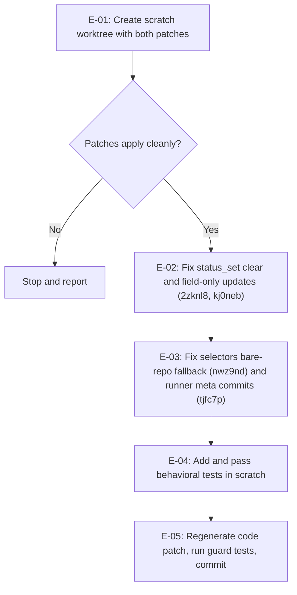

# IPD: Fix post-cutover status_set, selectors, and runner commit log handling in the cutover code patch

- Date: 2026-11-27
- Kind: child
- Concern: Four backlog items track verified post-cutover production defects inside `.aw/system/cutover/metastore-code.cutover.patch`: `2zknl8` (clearing `Blocks-Release` with `-` in `status_set.py`), `kj0neb` (same-status field-only updates skipped as unchanged in `status_set.py`), `nwz9nd` (missing bare-repository fallback in `selectors.py`), and `tjfc7p` (driver graduation and spec-planning commit helpers omitting companion metadata logs in `runner_shared.py`). These defects surfaced during test batch B conversion (plan `psm9ac`) and were independently reproduced by the verifier in run `run-20261127T195325Z-3081649`.
- Scope: Work inside an isolated scratch worktree `.aw/state/ztvubn/scratch` with both cutover patches applied, sequenced after executed plans `6cltab` (Order 322) and `cugg3w` (Order 308) and ahead of Order 324 (`639g02`) and test batch B (`psm9ac`). Fix all four defects inside `.aw/system/cutover/metastore-code.cutover.patch`: (1) unset cleared keys instead of writing literal `"-"` in `agent_workflows/status_set.py::run_set_command._render_gate_fields` (`2zknl8`); (2) compare full pre-mutation and post-mutation metadata fields in `agent_workflows/status_set.py::_prepare_status_change` and include metadata-log byte changes in `agent_workflows/status_set.py::run_set_command`'s `changed` flag so same-status field-only updates append and report `changed=True` while true no-ops remain unchanged (`kj0neb`); (3) add the bare-repository in-tree `artifact_meta.legacy_context` fallback (handling both nonexistent `records_root` and an empty `AW_HOME` `records/` directory without `meta/`, recomputing `records_root`, `scan_repo`, and `state_root`) in `agent_workflows/selectors.py::_cached_states_by_path` (`nwz9nd`); and (4) include companion `.aw/records/meta/<id6>.jsonl` logs in `agent_workflows/runner_shared.py::commit_spec_production_output`, `commit_spec_transition_output`, `commit_backlog_production_output`, and `commit_backlog_transition_output` while keeping unrelated paths, unrelated meta logs, and `.aw/state/` paths out of scope or uncommitted (`tjfc7p`). Add and pass core behavioral tests in `tests/test_cutover_log_setter_selectors_runner_commits.py`, and regenerate `.aw/system/cutover/metastore-code.cutover.patch`. Make no live code or test changes outside `- Scope-Paths:`.
- Scope-Paths: .aw/records/plans/pending/20261127-metastore-323-ztvubn-fix-post-cutover-status-set-selectors-and-runner-commit-log.ipd.md, .aw/system/cutover/metastore-code.cutover.patch
- Item-Dependencies: executed:cugg3w
- Status: approved
- Review-Depth: complex
- Readiness: go-pending-approval
- From-Spec: 4sd62s
- Work-Kind: bug
- Priority: high
- From-Backlog: 2zknl8
- Blocks-Release: next
- Set: metastore
- Order: 323
- Highest E allocated: 05
- Author: antigravity/gemini
- Id: ztvubn
- Approval: 2026-11-27, recorded via aw ipd set: status set to approved

> Write and proofread this plan per the technical writing standard, `.aw/system/workflows/technical-writing/technical-writing.md` (`.agents/workflows/technical-writing/technical-writing.md` in a legacy-layout install), including requirement 12 (diagrams).

## Workflow history

- 2026-11-27 approved (aw set): status set to approved
- 2026-11-27 reviewed (aw set): APPROVE WITH REVISIONS APPLIED; PR-001..PR-005 FIXED
- 2026-11-27 /plan-review (antigravity/gemini): APPROVE WITH REVISIONS APPLIED; PR-001, PR-002, PR-003, PR-004, PR-005; review record .aw/records/reviews/20261127-metastore-323-ztvubn-fix-post-cutover-status-set-selectors-and-runner-commit-log.review.md
- 2026-11-27 to-review (antigravity/gemini): authored as Order 323 ahead of Order 324 (639g02) and psm9ac for verified batch B production defects 2zknl8, kj0neb, nwz9nd, and tjfc7p from run-20261127T195325Z-3081649.
- 2026-11-27 draft (antigravity/gemini): created.

## Goal

Fix the four verified post-cutover production defects in `agent_workflows/status_set.py` (backlog items `2zknl8` and `kj0neb`), `agent_workflows/selectors.py` (`nwz9nd`), and `agent_workflows/runner_shared.py` (`tjfc7p`) inside `.aw/system/cutover/metastore-code.cutover.patch`, so test batch B (plan `psm9ac`) and downstream batches pass on the switched tree without workarounds.

## Detailed Implementation Checklist (TODO)

Execution-state rule: mark an `E-*` item complete only after performing the action. That mark is not validation. Right-sizing rule: write for a modest executor that cannot hold much in its head. Each E-item is one step (one concern, about one file, executable in one focused pass) and its V-item names each unit it covers with its own check; a plan stays at about 5 E-items and 8 work Scope-Paths, else split it into more child plans (guidance, `IPD-Z603`). Accepted execution states: blocked, failed, pending, performed; terminal gate demands 'performed'.

### Task group 1: scratch worktree

- [ ] E-01 Create the scratch worktree following the SCRATCH PROCEDURE of executed plan `2k5t16` (Step 0): run `git worktree add --detach .aw/state/ztvubn/scratch HEAD`; inside `.aw/state/ztvubn/scratch`, run `git apply --index .aw/system/cutover/metastore-docs.cutover.patch`, record `BASE=$(git write-tree)` in F-01, and then run `git apply --index .aw/system/cutover/metastore-code.cutover.patch`. If either patch rejects, stop and report.
  - Depends on: none
  - Expected outcome: `.aw/state/ztvubn/scratch` holds HEAD plus both cutover patches staged, and F-01 records the base tree id.
  - Execution state: pending

### Task group 2: status_set, selectors, and runner_shared fixes (scratch worktree only)

- [ ] E-02 Fix both `agent_workflows/status_set.py` log-format bugs (`2zknl8` and `kj0neb`) in `.aw/state/ztvubn/scratch`:
  1. In `agent_workflows/status_set.py::run_set_command._render_gate_fields` (`2zknl8`): for each `(k, v)` in `fields.items()`, when `v is None` or `isinstance(v, str) and v.strip() in ("", "-")`, remove `k` from `merged` (`merged.pop(k, None)`) instead of storing literal `"-"`, and otherwise assign `merged[k] = v`. This ensures `check_engine.evaluate_blocking_close` sees `blocks_release` (and any other cleared gate field) as absent on `aw backlog set <id6> --status done --blocks-release -`.
  2. In `agent_workflows/status_set.py::_prepare_status_change` and `agent_workflows/status_set.py::run_set_command` (`kj0neb`):
     - In `_prepare_status_change`, capture the full pre-mutation field map `before_fields = dict(getattr(_state_for_record(rec, repo_root), "fields", None) or {})` (not the partial `_record_state` dict, which omits `from_spec`, `from_backlog`, `item_dependencies`, `graduated_to`, and plan `priority`/`work_kind`), and compute `fields_changed` by comparing `dict(getattr(preview.state, "fields", None) or {}) != before_fields` (plus `bool(extra_events)`). Include `fields_changed` in `content_changed` so same-status field-only mutations (such as `--from-spec <spec>`, `--from-spec -`, `--priority`, `--blocks-release`, or other log-stored field changes) append their events to `.aw/records/meta/<id6>.jsonl`, while true no-ops (re-setting an already-matching field value or clearing an already-absent field) still evaluate `content_changed = False` and remain idempotent.
     - In `run_set_command`, compute `log_changed = (log_p is not None and log_p.is_file() and log_p.read_bytes() != old_log)` and `text_or_path_changed = (old_text != new_text) or (dest_path.resolve() != rec.path.resolve())`. Set `changed = text_or_path_changed or log_changed` so `--json`/`--agent` reports `changed=True` and `kind="update"` (not `"noop"` / `"(unchanged)"`) on log-only writes, while adding `src_rel`/`dest_rel` to `touched_paths` only when `text_or_path_changed` is True (and `log_rel` when `log_changed` is True) so unchanged `.md` files are not spuriously staged. Preserve `_format_status_transition_line`'s existing same-status human display contract.
  3. Record the verified diff audit in F-02.
  - Depends on: E-01
  - Expected outcome: `--blocks-release -` clears `blocks_release` cleanly for `evaluate_blocking_close`; same-status field-only `aw set` mutations append to `.aw/records/meta/<id6>.jsonl` and report `changed=True` (`kind="update"`) in `--json`/`--agent` without staging unchanged `.md` files, while true no-op calls remain unchanged and append nothing; F-02 records the audit.
  - Execution state: pending

- [ ] E-03 Fix `agent_workflows/selectors.py::_cached_states_by_path` (`nwz9nd`) and the four commit helpers in `agent_workflows/runner_shared.py` (`tjfc7p`) in `.aw/state/ztvubn/scratch`:
  1. In `agent_workflows/selectors.py::_cached_states_by_path` (`nwz9nd`): match the bare-repository fallback pattern in `check_engine._meta_context_for_repo` before deriving `records_root`, `scan_repo`, and `state_root`. Specifically, after `ctx = _proj_ctx.resolve_project_context(target_repo=str(repo_root))`, if `in_tree_records = Path(repo_root) / ".aw" / "records"` exists and either `not records_root.is_dir()` or (`in_tree_records.resolve() != records_root.resolve()` and `not (records_root / "meta").is_dir()` and `(in_tree_records / "meta").is_dir()`), switch `ctx = _meta.legacy_context(Path(repo_root))` and recompute `records_root`, `scan_repo`, and `state_root` from the fallback `ctx` before the `has_tree`/`meta/` checks and before querying under `with _meta.ephemeral_if_uninitialized():`. Preserve configured `.aw/config/` and companion repository layouts unchanged.
  2. In `agent_workflows/runner_shared.py` (`tjfc7p`): update all four graduation and spec-planning commit helpers to include companion metadata logs without weakening containment:
     - `commit_spec_production_output` and `commit_backlog_production_output` (3-tuple return `(sha, committed_paths, out_of_scope_paths)`): preserve `is_companion` suppression (`_is_target_records_path`) and runtime-path skips (`.aw/records/runs/`, `.agents/runs/`, `.aw/state/`, `.agents/state/`, `/runs/`, `/lane-submissions/`). Because `status_paths` is sorted alphabetically (`meta/` sorts before `plans/`), classify in two passes: first admit produced or allowed continued `.ipd.md` files under `/plans/pending/` and collect their `allowed_plan_ids`; second admit a remaining path only if it is a companion metadata log matching `.aw/records/meta/<id6>.jsonl` or `.agents/meta/<id6>.jsonl` whose `<id6>` is in `allowed_plan_ids` (and not deleted/renamed when in `continued_plan_ids`). Classify any other file, including unrelated `meta/<other_id6>.jsonl` logs, as `out_of_scope`.
     - `commit_spec_transition_output` and `commit_backlog_transition_output` (2-tuple return `(sha, committed_paths)`): match the artifact's own `.spec.md` or `.backlog.md` path AND its own companion metadata log (`norm_p.endswith(f"/meta/{spec_id6}.jsonl")` or `norm_p.endswith(f"/meta/{item_id6}.jsonl")`), excluding `.aw/state/`, `.agents/state/`, `.aw/records/runs/`, `/runs/`, and `/lane-submissions/` on both `.md` and `.jsonl` paths in both helpers. Leave unrelated files and unrelated `meta/<other_id6>.jsonl` logs uncommitted (excluded from `committed_paths`).
  3. Record the verified behavior audit in F-03.
  - Depends on: E-02
  - Expected outcome: `selectors.resolve` resolves Set IDs from JSONL logs on bare unregistered repositories without writing `.aw/state/index.db`; the two production commit helpers commit companion `meta/<id6>.jsonl` logs for produced/continued plans while flagging unrelated files and unrelated meta logs as `out_of_scope`; the two transition commit helpers commit companion `meta/<id6>.jsonl` logs alongside `.spec.md`/`.backlog.md` while excluding `.aw/state/` and unrelated files/meta logs; F-03 records the audit.
  - Execution state: pending

- [ ] E-04 Add and run core behavioral test module `tests/test_cutover_log_setter_selectors_runner_commits.py` (`pytestmark = pytest.mark.core`, exercising real CLI and function outputs, exit codes, and git commits; no code-pinning tests) in `.aw/state/ztvubn/scratch`:
  1. Cover `2zknl8`: create a log-format blocking backlog item, run `aw backlog set done <id6> --blocks-release - --yes --no-commit --message ...`, assert exit 0, `blocks_release` absent in `artifact_meta.read`, and `check_engine.evaluate_blocking_close` accepts the de-gated close.
  2. Cover `kj0neb`: on a log-format plan in `to-review`, run `aw ipd set to-review <id6> --from-spec <spec_id6> --yes --no-commit --json` and then `--from-spec - --yes --no-commit --json`; assert both exit 0, report `changed=True` (`kind="update"`), grow `.aw/records/meta/<id6>.jsonl`, and update `artifact_meta.read(id6).fields.get("from_spec")` to `<spec_id6>` and then `None`; then repeat `--from-spec - --yes --no-commit --json` (and repeat `--from-spec <spec_id6>` after setting it) and assert the identical no-op calls report `changed=False` (`kind="noop"`, `"(unchanged)"`) and append no new log line.
  3. Cover `nwz9nd`: on a bare temporary repository without `.aw/config/` while `AW_HOME` points to a separate directory (covering both absent `records/` and pre-existing empty `records/` lacking `meta/`), materialize a log-format Set and assert `selectors.resolve` matches by `MATCH_SETID` and `runner_shared.read_set_membership` discovers all Set members without creating untracked `.aw/state/index.db`; also verify a configured `.aw/config/` repository continues resolving its configured records root.
  4. Cover `tjfc7p`: exercise `commit_spec_production_output`, `commit_backlog_production_output`, `commit_spec_transition_output`, and `commit_backlog_transition_output` on temporary git repositories with companion `.aw/records/meta/<id6>.jsonl` logs:
     - For `commit_spec_production_output` and `commit_backlog_production_output`: assert the produced plan's `.ipd.md` and companion `meta/<plan_id6>.jsonl` are returned in `committed_paths` and present in `HEAD`, while both an unrelated file and an unrelated `meta/<other_id6>.jsonl` are returned in `out_of_scope` and absent from `HEAD`.
     - For `commit_spec_transition_output` and `commit_backlog_transition_output`: assert the transitioned `.spec.md` / `.backlog.md` (including a `git mv` disposition move) and its companion `meta/<id6>.jsonl` are returned in `committed_paths` and present in `HEAD`, while an unrelated file, an unrelated `meta/<other_id6>.jsonl`, and a `.aw/state/lane-inputs/...` copy are excluded from `committed_paths` and absent from `HEAD`.
  5. Run `python3 -m pytest -o addopts="" -m '' -v tests/test_cutover_log_setter_selectors_runner_commits.py tests/test_cutover_log_cli_creators_and_find.py tests/test_cutover_log_readiness_status_refs_adopt.py` in `.aw/state/ztvubn/scratch`; every test must exit 0 with every test PASSED.
  - Depends on: E-03
  - Expected outcome: all behavioral tests for `2zknl8`, `kj0neb`, `nwz9nd`, and `tjfc7p` and sibling regression suites pass with exit 0 in `.aw/state/ztvubn/scratch`.
  - Execution state: pending

### Task group 3: package

- [ ] E-05 In `.aw/state/ztvubn/scratch`, run `git add -A` and write `git diff --cached --binary $BASE` over `.aw/system/cutover/metastore-code.cutover.patch` in the executing checkout; remove the scratch worktree (`git worktree remove --force .aw/state/ztvubn/scratch`); run `python3 -m pytest -o addopts="" -v tests/test_metastore_cutover_code_patch.py` in the executing checkout; verify `git status --short` shows only `- Scope-Paths:` modified; and commit through `aw commit ztvubn -- .aw/records/plans/pending/20261127-metastore-323-ztvubn-fix-post-cutover-status-set-selectors-and-runner-commit-log.ipd.md .aw/system/cutover/metastore-code.cutover.patch`; never push.
  - Depends on: E-04
  - Expected outcome: `.aw/system/cutover/metastore-code.cutover.patch` holds all prior code-patch hunks plus this plan's fixes; `tests/test_metastore_cutover_code_patch.py` passes; scratch worktree is removed; no live files outside `- Scope-Paths:` are modified; one path-scoped commit is created.
  - Execution state: pending

## Project conventions discovered (Step 0)

- The scratch procedure and cumulative code patch are defined in executed plan `2k5t16` (Step 0, OQ-01) and followed by executed plans `hdwqex`, `89mtbl`, `nv3upa`, `fljn9b`, `szykgd` through `3e0vfy`, `6cltab`, and `cugg3w`.
- Executed plan `6cltab` established the bare-repository fallback rule in `check_engine._meta_context_for_repo` handling both nonexistent `records_root` and empty pre-existing `AW_HOME` `records/` directories lacking `meta/`, wrapped in `with _meta.ephemeral_if_uninitialized():` for read-only callers.
- Post-cutover `status_set._prepare_status_change` calls `artifact_meta.append(..., dry_run=True)`, which returns the full replayed post-mutation `State` dataclass in `preview.state`; `status_set._format_status_transition_line` intentionally renders `"unchanged"` for same-status lines in human output (pinned by `tests/test_status_set.py::test_status_set_unchanged_idempotent_no_rewrite`), whereas `--json`/`--agent` reads `run_set_command`'s `changed` boolean.
- Backlog items `kj0neb`, `nwz9nd`, and `tjfc7p` are gated on `ztvubn` (`Gate-Kind: artifact`, `Gate-Ref: ztvubn`) while single-valued `- From-Backlog:` carries `2zknl8` (matching the `6cltab` / `0b3ynm` / `2etrjf` / `3pxjya` pattern).
- Tests exercise observable behavior and assert on real outputs, exit codes, and side effects (`AGENTS.md` "TEST OUTCOMES, NOT CODE STRUCTURE"); no `inspect`, `ast`, regex, or source-inspection tests.

## Findings

| Id | Evidence | Finding |
|---|---|---|
| F-01 | (written by E-01) | Base tree id after applying `.aw/system/cutover/metastore-docs.cutover.patch`. |
| F-02 | (written by E-02) | Verified diff audit for `status_set.py::run_set_command._render_gate_fields` (`2zknl8`), `status_set.py::_prepare_status_change`, and `status_set.py::run_set_command` (`kj0neb`). |
| F-03 | (written by E-03) | Verified diff audit for `selectors.py::_cached_states_by_path` (`nwz9nd`) and the four `runner_shared.py` commit helpers (`tjfc7p`). |
| F-04 | `run-20261127T195325Z-3081649` `psm9ac` attempt-1 outcome and independent verifier reproduction (`03-psm9ac-verification.json`) | Confirmed all four defects on the switched tree: `2zknl8` blocked 3 tests in `tests/test_backlog_handoff_close.py`; `kj0neb` blocked 2 tests in `tests/test_check_engine_from_spec_missing.py`; `nwz9nd` and `tjfc7p` blocked `tests/test_gradcover_end_to_end.py`. |
| F-05 | Plan-review static audit of post-patch `.aw/system/cutover/metastore-code.cutover.patch` (`agent_workflows/status_set.py::_format_status_transition_line`, `_record_state`, `_prepare_status_change`, `run_set_command._render_gate_fields`, `run_set_command`; `agent_workflows/selectors.py::_cached_states_by_path`; `agent_workflows/runner_shared.py::commit_spec_production_output`, `commit_spec_transition_output`, `commit_backlog_production_output`, `commit_backlog_transition_output`; `agent_workflows/artifact_meta.py::append`; `agent_workflows/check_engine.py::_meta_context_for_repo`) | Verified post-patch implementation constraints: (1) `status_set.run_set_command` drops `log_changed` from its `changed` boolean while `_record_state` omits `from_spec`/`from_backlog`/`item_dependencies`/`graduated_to`, so `kj0neb` requires comparing full `before_fields` vs `preview.state.fields` and including `log_changed` in `changed` without staging unchanged `.md` files; (2) `selectors._cached_states_by_path` must recompute `records_root`, `scan_repo`, and `state_root` after switching to `legacy_context`; (3) `commit_spec_production_output` and `commit_backlog_production_output` sort `status_paths` alphabetically (`meta/` before `plans/`), requiring two-pass `allowed_plan_ids` classification, while the two transition helpers return 2-tuples and both must exclude `.aw/state/` and unrelated `meta/*.jsonl` logs. |

## Proposed changes (ordered, validatable)

1. E-01: Create scratch worktree `.aw/state/ztvubn/scratch` with both cutover patches staged and record `$BASE` in F-01.
2. E-02: Fix `status_set.py::run_set_command._render_gate_fields` (`2zknl8`), `status_set.py::_prepare_status_change`, and `status_set.py::run_set_command` (`kj0neb`); record F-02.
3. E-03: Fix `selectors.py::_cached_states_by_path` (`nwz9nd`) and the four `runner_shared.py` spec/backlog commit helpers (`tjfc7p`); record F-03.
4. E-04: Add and pass `tests/test_cutover_log_setter_selectors_runner_commits.py` and sibling regression suites in `.aw/state/ztvubn/scratch`.
5. E-05: Regenerate `.aw/system/cutover/metastore-code.cutover.patch`, remove the scratch worktree, pass `tests/test_metastore_cutover_code_patch.py`, verify clean live tree outside `- Scope-Paths:`, and commit path-scoped.

## Deferred / out of scope (with reason)

- Remaining four batch B production defects in `check_engine.py` (`0wilvu`, `ay07de`, `1fmcdk`) and `hooks/ipd_dependency_statement_gate.py` (`197ak8`): owned by Order 324.
  - Carrier: 639g02
- Converting batch B test modules (`tests/test_backlog_handoff_close.py` through `tests/test_ipd_dependency_statement_gate.py`): owned by Order 309 (`psm9ac`), which runs after `639g02`.
  - Carrier: psm9ac
- Broader `project_context.resolve_project_context` bare-repository policy outside these callers: pre-existing backlog `ggp2pf`.
  - Carrier: ggp2pf
- Applying the cutover patches on the real tree: attended cutover commit.
  - Carrier: cxxmyv

## Scope check

- Over-scope: none. No live code or test files are modified outside `.aw/system/cutover/metastore-code.cutover.patch`. Non-isolated `runner_shared.commit_backlog_close` (`--no-isolate-worktree` escape hatch) is outside `tjfc7p`'s four helpers and is not modified here.
- Under-scope: none. All four production defects (`2zknl8`, `kj0neb`, `nwz9nd`, `tjfc7p`) map directly to E-02 through E-04, while the remaining four `check_engine`/dependency-gate defects are owned by sibling Order 324 (`639g02`).

## Required tests / validation

- New core behavioral test module `tests/test_cutover_log_setter_selectors_runner_commits.py` and sibling regression suites (`tests/test_cutover_log_cli_creators_and_find.py`, `tests/test_cutover_log_readiness_status_refs_adopt.py`) in `.aw/state/ztvubn/scratch` (V-04).
- Cumulative patch guard test `python3 -m pytest -o addopts="" -v tests/test_metastore_cutover_code_patch.py` and `git status --short` clean-tree check in the executing checkout (V-05).

## Spec / documentation sync

No spec or documentation change is required: spec `4sd62s` Sections 4.1 through 4.5 and 4.8 already define log-backed metadata writes, SQLite cache reads through `artifact_meta`, and tooled commits of `.aw/records/meta/<id6>.jsonl`, and `.aw/system/cutover/metastore-docs.cutover.patch` already documents them. This plan brings `status_set.py`, `selectors.py`, and `runner_shared.py` inside `.aw/system/cutover/metastore-code.cutover.patch` into conformance.

## Open questions

None open.

## Validation and cross-check (verify before reporting done)

Validation-state rule: inspect evidence in a separate pass. Do not mark a `V-*` item complete from memory or from the matching execution checkmark. Accepted validation results: blocked, failed, pass, pending; terminal gate demands 'pass'. Runtime-demonstration reachability rule: for each `V-*` item demanding the software be observed acting (such as a run, a dispatch, or a transition; as distinct from items demanding a diff, a file's content, or a test result, which are reachable by construction), name the code path that produces the observation or the sibling `E-*` that creates it, else the demand is UNDER-SCOPE.

- [ ] V-01 validates E-01
  - Required evidence: paste the `git worktree add --detach .aw/state/ztvubn/scratch HEAD` command, both `git apply --index` commands with exit status 0, and the base tree id recorded in F-01.
  - Observed evidence:
  - Result: pending
- [ ] V-02 validates E-02
  - Required evidence: paste F-02 and the diff hunks in `agent_workflows/status_set.py` for `run_set_command._render_gate_fields` (`2zknl8`), `_prepare_status_change`, and `run_set_command`'s `changed`/`touched_paths` log-change handling (`kj0neb`).
  - Observed evidence:
  - Result: pending
- [ ] V-03 validates E-03
  - Required evidence: paste F-03 and the diff hunks in `agent_workflows/selectors.py::_cached_states_by_path` (`nwz9nd`, showing fallback and `records_root`/`scan_repo`/`state_root` recomputation) and `agent_workflows/runner_shared.py` (`commit_spec_production_output`, `commit_spec_transition_output`, `commit_backlog_production_output`, `commit_backlog_transition_output`, `tjfc7p`, showing two-pass `allowed_plan_ids` and `.aw/state/` exclusion).
  - Observed evidence:
  - Result: pending
- [ ] V-04 validates E-04
  - Required evidence: paste the full `python3 -m pytest -o addopts="" -m '' -v tests/test_cutover_log_setter_selectors_runner_commits.py tests/test_cutover_log_cli_creators_and_find.py tests/test_cutover_log_readiness_status_refs_adopt.py` output in `.aw/state/ztvubn/scratch` showing every test PASSED with exit 0 (covering `2zknl8` de-gated close, `kj0neb` `--json` `changed=True`/`False` and idempotent log appends, `nwz9nd` bare-repo absent/empty `AW_HOME` and configured-repo parity without `.aw/state/index.db`, and `tjfc7p` 3-tuple production `out_of_scope` and 2-tuple transition exclusion for unrelated files/meta logs/`.aw/state/`).
  - Observed evidence:
  - Result: pending
- [ ] V-05 validates E-05
  - Required evidence: paste `git apply --stat .aw/system/cutover/metastore-code.cutover.patch`, the `python3 -m pytest -o addopts="" -v tests/test_metastore_cutover_code_patch.py` run showing every guard check PASSED, `git worktree list` showing `.aw/state/ztvubn/scratch` removed, `git status --short` confirming no live edits outside `- Scope-Paths:`, and the `aw commit ztvubn` output naming the commit hash.
  - Observed evidence:
  - Result: pending

## Approval and execution gate

- Size assessment: standard
- Cohesion rationale: not required

Execute only after `/plan-review`, human approval (`Status: approved`), and `executed:cugg3w` is satisfied. Open questions: none open. Scope fence: code and tests are edited ONLY inside `.aw/state/ztvubn/scratch` and packaged into `.aw/system/cutover/metastore-code.cutover.patch`, and `- Scope-Paths:` declares the two tracked files this plan modifies (any unavoidable out-of-scope edit or unmodified declared path requires `--scope-reason` or `--scope-ack` at finalize). Evidence honesty: you MUST paste the actual runner output for every command and test claimed in `V-01` through `V-05`; never claim success for tests or commands you did not run. Commits: commit only through `aw commit ztvubn -- <paths>`; never push. Lifecycle transition: in a managed runner lane stop after committing the updated plan with all evidence recorded and let the runner run `aw ipd finalize`; in a hand-run session run `aw ipd finalize ztvubn --actor <actor>`.
