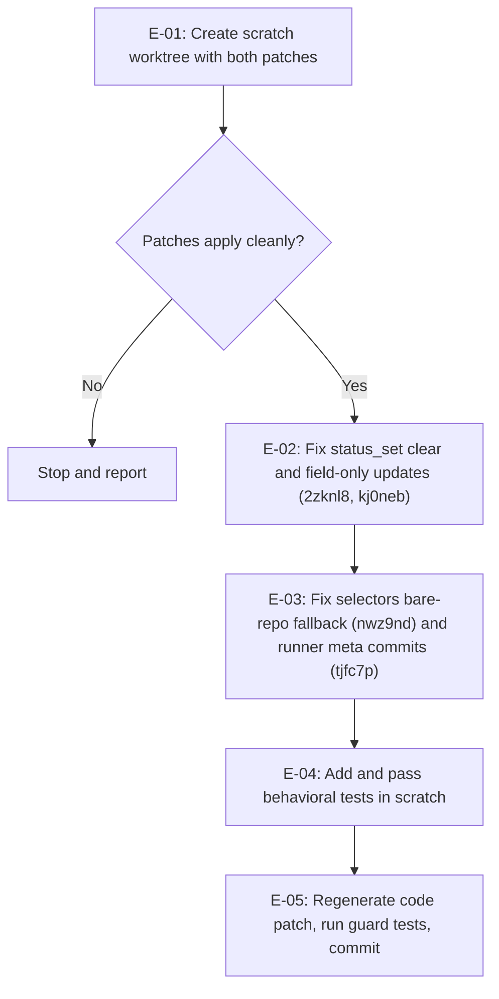

# IPD: Fix post-cutover status_set, selectors, and runner commit log handling in the cutover code patch

- Date: 2026-11-27
- Kind: child
- Concern: Backlog items `2zknl8` (`status_set._render_gate_fields` clearing `blocks_release`), `kj0neb` (`status_set._prepare_status_change` field-only `unchanged` skip), `nwz9nd` (`selectors._cached_states_by_path` bare-repo fallback), and `tjfc7p` (`runner_shared` graduation/spec-planning commit helpers omitting companion meta logs) track four production defects inside `.aw/system/cutover/metastore-code.cutover.patch` discovered during batch B test conversion (`psm9ac`) and independently reproduced by the `run-20261127T195325Z-3081649` verifier.
- Scope: In an isolated scratch worktree `.aw/state/ztvubn/scratch` with both cutover patches applied (after executed `6cltab` and `cugg3w`, ahead of Order 324 `639g02` and batch B `psm9ac`), fix all four defects inside `.aw/system/cutover/metastore-code.cutover.patch`: (1) unset `blocks_release` instead of writing literal `"-"` in `agent_workflows/status_set.py::_render_gate_fields` (`2zknl8`); (2) detect metadata-log field deltas in `agent_workflows/status_set.py::_prepare_status_change` so same-status field-only mutations append their event instead of returning unchanged (`kj0neb`); (3) add the bare-repo in-tree `artifact_meta.legacy_context` fallback (including empty `AW_HOME` records dir without `meta/`) in `agent_workflows/selectors.py::_cached_states_by_path` (`nwz9nd`); and (4) include companion `.aw/records/meta/<id6>.jsonl` logs in `agent_workflows/runner_shared.py::commit_spec_production_output`, `commit_spec_transition_output`, `commit_backlog_production_output`, and `commit_backlog_transition_output` (`tjfc7p`). Add and pass core behavioral tests in `tests/test_cutover_log_setter_selectors_runner_commits.py`, and regenerate `.aw/system/cutover/metastore-code.cutover.patch`. Make no live code or test changes outside `- Scope-Paths:`.
- Scope-Paths: .aw/records/plans/pending/20261127-metastore-323-ztvubn-fix-post-cutover-status-set-selectors-and-runner-commit-log.ipd.md, .aw/system/cutover/metastore-code.cutover.patch
- Item-Dependencies: executed:cugg3w
- Status: to-review
- From-Spec: 4sd62s
- Work-Kind: bug
- Priority: high
- From-Backlog: 2zknl8
- Blocks-Release: next
- Set: metastore
- Order: 323
- Highest E allocated: 05
- Author: antigravity/gemini
- Id: ztvubn

> Write and proofread this plan per the technical writing standard, `.aw/system/workflows/technical-writing/technical-writing.md` (`.agents/workflows/technical-writing/technical-writing.md` in a legacy-layout install), including requirement 12 (diagrams).

## Workflow history

- 2026-11-27 to-review (antigravity/gemini): authored as Order 323 ahead of Order 324 (639g02) and psm9ac for verified batch B production defects 2zknl8, kj0neb, nwz9nd, and tjfc7p from run-20261127T195325Z-3081649.
- 2026-11-27 draft (antigravity/gemini): created.

## Goal

Fix the four post-cutover production defects in `status_set.py` (`2zknl8`, `kj0neb`), `selectors.py` (`nwz9nd`), and `runner_shared.py` (`tjfc7p`) inside `.aw/system/cutover/metastore-code.cutover.patch` so batch B (`psm9ac`) and downstream test batches pass on the switched tree without production workarounds.

## Detailed Implementation Checklist (TODO)

Execution-state rule: mark an `E-*` item complete only after performing the action. That mark is not validation. Right-sizing rule: write for a modest executor that cannot hold much in its head. Each E-item is one step (one concern, about one file, executable in one focused pass) and its V-item names each unit it covers with its own check; a plan stays at about 5 E-items and 8 work Scope-Paths, else split it into more child plans (guidance, `IPD-Z603`). Accepted execution states: blocked, failed, pending, performed; terminal gate demands 'performed'.

### Task group 1: scratch worktree

- [ ] E-01 Create the scratch worktree following the SCRATCH PROCEDURE of executed plan `2k5t16` (Step 0): run `git worktree add --detach .aw/state/ztvubn/scratch HEAD`; inside `.aw/state/ztvubn/scratch`, run `git apply --index .aw/system/cutover/metastore-docs.cutover.patch`, record `BASE=$(git write-tree)` in F-01, and then run `git apply --index .aw/system/cutover/metastore-code.cutover.patch`. If either patch rejects, stop and report.
  - Depends on: none
  - Expected outcome: `.aw/state/ztvubn/scratch` holds HEAD plus both cutover patches staged, and F-01 records the base tree id.
  - Execution state: pending

### Task group 2: status_set, selectors, and runner_shared fixes (scratch worktree only)

- [ ] E-02 Fix both `agent_workflows/status_set.py` log-format bugs (`2zknl8` and `kj0neb`) in `.aw/state/ztvubn/scratch`:
  1. In `agent_workflows/status_set.py::_render_gate_fields` (`2zknl8`): when a gate-field update specifies `"-"` (or empty/sentinel clear value for `blocks_release`, `gate_kind`, `gate_ref`, `gate_summary`, `release_exempt_kind`, or `release_exempt_ref`), remove/unset that key from the rendered/in-memory metadata state instead of storing literal `"-"` so `check_engine.evaluate_blocking_close` sees `blocks_release` as absent on `aw backlog set <id6> --status done --blocks-release -`.
  2. In `agent_workflows/status_set.py::_prepare_status_change` (`kj0neb`): on post-cutover log-format records, do not determine `content_changed` solely by comparing the two-field YAML mirror Markdown text before and after rendering; also treat any non-empty pending metadata-log field set/unset event (such as `--from-spec <spec>`, `--from-spec -`, `--priority`, `--blocks-release`, or other log-stored field mutations on a same-status transition) as a real change so the command appends the event to `.aw/records/meta/<id6>.jsonl` instead of exiting 0 with `"unchanged"` and dropping the write. Preserve idempotent `"unchanged"` behavior when neither status, path, nor any effective log field actually changes.
  3. Record the verified diff audit in F-02.
  - Depends on: E-01
  - Expected outcome: `--blocks-release -` clears `blocks_release` cleanly for `evaluate_blocking_close`, and same-status field-only `aw set` mutations (including `--from-spec <id>` and `--from-spec -`) append to `.aw/records/meta/<id6>.jsonl` while true no-op calls remain unchanged; F-02 records the audit.
  - Execution state: pending

- [ ] E-03 Fix `agent_workflows/selectors.py::_cached_states_by_path` (`nwz9nd`) and the four commit helpers in `agent_workflows/runner_shared.py` (`tjfc7p`) in `.aw/state/ztvubn/scratch`:
  1. In `agent_workflows/selectors.py::_cached_states_by_path` (`nwz9nd`): match the bare-repo in-tree context fallback pattern in `check_engine._meta_context_for_repo` and `runner_shared._meta_context_for_repo` (when `repo_root/.aw/records/meta/` exists and the resolved `records_root` does not exist or lacks `meta/`, fall back to `artifact_meta.legacy_context(repo_root)` under `with _meta.ephemeral_if_uninitialized():`). Verify `selectors.resolve` resolves `MATCH_SETID` cleanly on unregistered/newly cloned bare log-format repos while keeping configured/companion repo layouts unchanged.
  2. In `agent_workflows/runner_shared.py` (`tjfc7p`): update `commit_spec_production_output`, `commit_spec_transition_output`, `commit_backlog_production_output`, and `commit_backlog_transition_output` so companion `.aw/records/meta/<id6>.jsonl` event logs for the produced or transitioned artifacts are classified as in-scope and staged/committed alongside their `.ipd.md`, `.spec.md`, or `.backlog.md` files rather than rejected as `out_of_scope` or silently omitted on lane branches. Keep unrelated paths outside those artifact/meta scopes rejected as `out_of_scope`.
  3. Record the verified behavior audit in F-03.
  - Depends on: E-02
  - Expected outcome: `selectors.resolve` resolves Set IDs from JSONL logs on bare unregistered repos, and all four graduation/spec-planning commit helpers include companion `meta/<id6>.jsonl` logs in scope and in their commits while still rejecting unrelated paths; F-03 records the audit.
  - Execution state: pending

- [ ] E-04 Add and run core behavioral test module `tests/test_cutover_log_setter_selectors_runner_commits.py` (`pytestmark = pytest.mark.core`, exercising real CLI and function outputs, exit codes, and git commits; no code-pinning tests) in `.aw/state/ztvubn/scratch`:
  1. Cover `2zknl8`: create a log-format blocking backlog item, run `aw backlog set done <id6> --blocks-release - --yes --message ...`, assert exit 0, `blocks_release` absent in `artifact_meta.read`, and `evaluate_blocking_close` accepts the de-gated close.
  2. Cover `kj0neb`: on a log-format plan in `to-review`, run `aw ipd set to-review <id6> --from-spec <spec_id6> --yes` and then `--from-spec - --yes`; assert neither reports unchanged, `artifact_meta.read(id6).fields["from_spec"]` updates to `<spec_id6>` and then clears to `None`, and repeating the identical no-op call still reports unchanged.
  3. Cover `nwz9nd`: on a bare temp repository without `.aw/config/` while `AW_HOME` points to a separate empty directory (both absent `records/` and empty `records/` without `meta/`), materialize a log-format Set and assert `selectors.resolve` matches by `MATCH_SETID` and `runner_shared.read_set_membership` discovers all Set members without creating untracked `.aw/state/index.db`.
  4. Cover `tjfc7p`: exercise `commit_spec_production_output`, `commit_spec_transition_output`, `commit_backlog_production_output`, and `commit_backlog_transition_output` on temp git repos with companion `.aw/records/meta/<id6>.jsonl` logs; assert the companion logs are accepted in scope and committed in `HEAD`, while an unrelated untracked or modified file is still flagged `out_of_scope`.
  5. Run `python3 -m pytest -o addopts="" -m '' -v tests/test_cutover_log_setter_selectors_runner_commits.py` plus existing regression checks (`tests/test_cutover_log_cli_creators_and_find.py`, `tests/test_cutover_log_readiness_status_refs_adopt.py`) in `.aw/state/ztvubn/scratch`; every test must exit 0 with every test PASSED.
  - Depends on: E-03
  - Expected outcome: all behavioral tests for `2zknl8`, `kj0neb`, `nwz9nd`, and `tjfc7p` and sibling regression suites pass with exit 0 in `.aw/state/ztvubn/scratch`.
  - Execution state: pending

### Task group 3: package

- [ ] E-05 In `.aw/state/ztvubn/scratch`, run `git add -A` and write `git diff --cached --binary $BASE` over `.aw/system/cutover/metastore-code.cutover.patch` in the executing checkout; remove the scratch worktree (`git worktree remove --force .aw/state/ztvubn/scratch`); run `python3 -m pytest -o addopts="" tests/test_metastore_cutover_code_patch.py` in the executing checkout; verify `git status --short` shows only `- Scope-Paths:` modified; and commit through `aw commit ztvubn -- .aw/records/plans/pending/20261127-metastore-323-ztvubn-fix-post-cutover-status-set-selectors-and-runner-commit-log.ipd.md .aw/system/cutover/metastore-code.cutover.patch`; never push.
  - Depends on: E-04
  - Expected outcome: `.aw/system/cutover/metastore-code.cutover.patch` holds all prior code-patch hunks plus this plan's fixes; `tests/test_metastore_cutover_code_patch.py` passes; scratch worktree is removed; no live files outside `- Scope-Paths:` are modified; one path-scoped commit is created.
  - Execution state: pending

## Project conventions discovered (Step 0)

- The scratch procedure and cumulative code patch are defined in executed plan `2k5t16` (Step 0, OQ-01) and followed by executed plans `hdwqex`, `89mtbl`, `nv3upa`, `fljn9b`, `szykgd` through `3e0vfy`, `6cltab`, and `cugg3w`.
- Executed plan `6cltab` established the bare-repo fallback rule handling both nonexistent `records_root` and empty pre-existing `AW_HOME` `records/` directories lacking `meta/`, wrapped in `with _meta.ephemeral_if_uninitialized():` for read-only callers.
- Backlog items `kj0neb`, `nwz9nd`, and `tjfc7p` are gated on `ztvubn` (`Gate-Kind: artifact`, `Gate-Ref: ztvubn`) while single-valued `- From-Backlog:` carries `2zknl8` (matching the `6cltab` / `0b3ynm` / `2etrjf` / `3pxjya` pattern).
- Tests exercise observable behavior and assert on real outputs, exit codes, and side effects (`AGENTS.md` "TEST OUTCOMES, NOT CODE STRUCTURE"); no `inspect`, `ast`, regex, or source-inspection tests.

## Findings

| Id | Evidence | Finding |
|---|---|---|
| F-01 | (written by E-01) | Base tree id after applying `.aw/system/cutover/metastore-docs.cutover.patch`. |
| F-02 | (written by E-02) | Verified diff audit for `status_set._render_gate_fields` (`2zknl8`) and `status_set._prepare_status_change` (`kj0neb`). |
| F-03 | (written by E-03) | Verified diff audit for `selectors._cached_states_by_path` (`nwz9nd`) and `runner_shared` commit helpers (`tjfc7p`). |
| F-04 | `run-20261127T195325Z-3081649` `psm9ac` attempt-1 outcome and independent verifier reproduction (`03-psm9ac-verification.json`) | Confirmed all four defects on the switched tree: `2zknl8` blocked 3 tests in `tests/test_backlog_handoff_close.py`; `kj0neb` blocked 2 tests in `tests/test_check_engine_from_spec_missing.py`; `nwz9nd` and `tjfc7p` blocked `tests/test_gradcover_end_to_end.py`. |

## Proposed changes (ordered, validatable)

1. E-01: Create scratch worktree `.aw/state/ztvubn/scratch` with both cutover patches staged and record `$BASE` in F-01.
2. E-02: Fix `status_set._render_gate_fields` (`2zknl8`) and `status_set._prepare_status_change` (`kj0neb`); record F-02.
3. E-03: Fix `selectors._cached_states_by_path` (`nwz9nd`) and the four `runner_shared` spec/backlog commit helpers (`tjfc7p`); record F-03.
4. E-04: Add and pass `tests/test_cutover_log_setter_selectors_runner_commits.py` and sibling regression suites in `.aw/state/ztvubn/scratch`.
5. E-05: Regenerate `.aw/system/cutover/metastore-code.cutover.patch`, remove the scratch worktree, pass `tests/test_metastore_cutover_code_patch.py`, verify clean live tree outside `- Scope-Paths:`, and commit path-scoped.

## Deferred / out of scope (with reason)

- Remaining four batch B production defects in `check_engine.py` (`0wilvu`, `ay07de`, `1fmcdk`) and `hooks/ipd_dependency_statement_gate.py` (`197ak8`): owned by Order 324.
  - Carrier: 639g02
- Converting batch B test modules (`tests/test_backlog_handoff_close.py` through `tests/test_ipd_dependency_statement_gate.py`): owned by Order 309 (`psm9ac`), which runs after `639g02`.
  - Carrier: psm9ac
- Broader `project_context.resolve_project_context` bare-repo policy outside these callers: pre-existing backlog `ggp2pf`.
  - Carrier: ggp2pf

## Scope check

- Over-scope: none. No live code or test files are modified outside `.aw/system/cutover/metastore-code.cutover.patch`.
- Under-scope: none. All four production defects (`2zknl8`, `kj0neb`, `nwz9nd`, `tjfc7p`) map directly to E-02 through E-04, while the remaining four `check_engine`/`dep-gate` defects are owned by sibling Order 324 (`639g02`).

## Required tests / validation

- New core behavioral test module `tests/test_cutover_log_setter_selectors_runner_commits.py` and sibling regression suites (`tests/test_cutover_log_cli_creators_and_find.py`, `tests/test_cutover_log_readiness_status_refs_adopt.py`) in `.aw/state/ztvubn/scratch` (V-04).
- Cumulative patch guard test `python3 -m pytest -o addopts="" tests/test_metastore_cutover_code_patch.py` and `git status --short` clean-tree check in the executing checkout (V-05).

## Spec / documentation sync

No spec or documentation change is required: spec `4sd62s` Sections 4.1 through 4.3 already define log-backed metadata writes, bare-repo discovery, and companion `meta/<id6>.jsonl` commits, and this plan brings `status_set.py`, `selectors.py`, and `runner_shared.py` inside `.aw/system/cutover/metastore-code.cutover.patch` into conformance.

## Open questions

None open.

## Validation and cross-check (verify before reporting done)

Validation-state rule: inspect evidence in a separate pass. Do not mark a `V-*` item complete from memory or from the matching execution checkmark. Accepted validation results: blocked, failed, pass, pending; terminal gate demands 'pass'. Runtime-demonstration reachability rule: for each `V-*` item demanding the software be observed acting (such as a run, a dispatch, or a transition; as distinct from items demanding a diff, a file's content, or a test result, which are reachable by construction), name the code path that produces the observation or the sibling `E-*` that creates it, else the demand is UNDER-SCOPE.

- [ ] V-01 validates E-01
  - Required evidence: paste the `git worktree add --detach .aw/state/ztvubn/scratch HEAD` command, both `git apply --index` commands with exit status 0, and the base tree id recorded in F-01.
  - Observed evidence:
  - Result: pending
- [ ] V-02 validates E-02
  - Required evidence: paste F-02 and the diff hunks in `agent_workflows/status_set.py` for `_render_gate_fields` (`2zknl8`) and `_prepare_status_change` (`kj0neb`).
  - Observed evidence:
  - Result: pending
- [ ] V-03 validates E-03
  - Required evidence: paste F-03 and the diff hunks in `agent_workflows/selectors.py::_cached_states_by_path` (`nwz9nd`) and `agent_workflows/runner_shared.py` (`commit_spec_production_output`, `commit_spec_transition_output`, `commit_backlog_production_output`, `commit_backlog_transition_output`, `tjfc7p`).
  - Observed evidence:
  - Result: pending
- [ ] V-04 validates E-04
  - Required evidence: paste the full `python3 -m pytest -o addopts="" -m '' -v tests/test_cutover_log_setter_selectors_runner_commits.py tests/test_cutover_log_cli_creators_and_find.py tests/test_cutover_log_readiness_status_refs_adopt.py` output in `.aw/state/ztvubn/scratch` showing every test PASSED with exit 0.
  - Observed evidence:
  - Result: pending
- [ ] V-05 validates E-05
  - Required evidence: paste `git apply --stat .aw/system/cutover/metastore-code.cutover.patch`, the `python3 -m pytest -o addopts="" -v tests/test_metastore_cutover_code_patch.py` run showing every guard check PASSED, `git worktree list` showing `.aw/state/ztvubn/scratch` removed, `git status --short` confirming no live edits outside `- Scope-Paths:`, and the `aw commit ztvubn` output naming the commit hash.
  - Observed evidence:
  - Result: pending

## Approval and execution gate

- Size assessment: standard
- Cohesion rationale: not required

Execute only after `/plan-review`, human approval (`Status: approved`), and `executed:cugg3w` is satisfied. Code and tests are edited ONLY inside `.aw/state/ztvubn/scratch` and packaged into `.aw/system/cutover/metastore-code.cutover.patch`. Commits: commit only through `aw commit ztvubn -- <paths>`; never push. Lifecycle transition: in a managed runner lane stop after committing the updated plan with all evidence recorded and let the runner run `aw ipd finalize`; in a hand-run session run `aw ipd finalize ztvubn --actor <actor>`.
