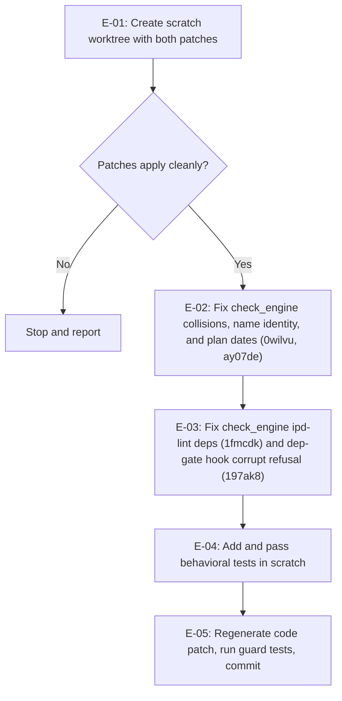

# IPD: Fix post-cutover check_engine log readers and dependency hook corrupt-log refusal in the cutover code patch

- Date: 2026-11-27
- Kind: child
- Concern: Backlog items `0wilvu` (`check_collisions` and `check_name_identity` ignoring meta JSONL logs and suppressing YAML-mirror ids), `ay07de` (`_plan_date_compact` and `check_ipd_lint_reach` reading absent legacy `date` field), `1fmcdk` (`_evaluate_ipd_dependencies_impl` bypassing `state_map` when `plans` is passed), and `197ak8` (`hooks/ipd_dependency_statement_gate.py::_staged_ipd_overlay` failing open on corrupt staged meta logs) track four production defects inside `.aw/system/cutover/metastore-code.cutover.patch` discovered during batch B test conversion (`psm9ac`) and independently reproduced by the `run-20261127T195325Z-3081649` verifier.
- Scope: In an isolated scratch worktree `.aw/state/639g02/scratch` with both cutover patches applied (after Order 323 `ztvubn` and ahead of batch B `psm9ac`), fix all four defects inside `.aw/system/cutover/metastore-code.cutover.patch`: (1) make `agent_workflows/check_engine.py::check_collisions` and `check_name_identity` read `id` and `set` from metadata logs and YAML mirrors (`0wilvu`); (2) make `agent_workflows/check_engine.py::_plan_date_compact` and `check_ipd_lint_reach` resolve log-format `filename_date` / `created_day` (`ay07de`); (3) make `agent_workflows/check_engine.py::_evaluate_ipd_dependencies_impl` consult `state_map` / `dep_value` on log-format plans even when `plans=[(path, text)]` is passed (`1fmcdk`); and (4) make `agent_workflows/hooks/ipd_dependency_statement_gate.py::_staged_ipd_overlay` fail closed with `check.ipd-dependency-malformed` (exit non-zero) when `artifact_meta.read_at` returns `ReadAtResult(kind='corrupt')` for malformed `item_dependencies` (`197ak8`). Add and pass core behavioral tests in `tests/test_cutover_log_check_engine_and_dep_hook.py`, and regenerate `.aw/system/cutover/metastore-code.cutover.patch`. Make no live code or test changes outside `- Scope-Paths:`.
- Scope-Paths: .aw/records/plans/pending/20261127-metastore-324-639g02-fix-post-cutover-check-engine-log-readers-and-dependency-hoo.ipd.md, .aw/system/cutover/metastore-code.cutover.patch
- Item-Dependencies: executed:ztvubn
- Status: to-review
- From-Spec: 4sd62s
- Work-Kind: bug
- Priority: high
- From-Backlog: 0wilvu
- Blocks-Release: next
- Set: metastore
- Order: 324
- Highest E allocated: 05
- Author: antigravity/gemini
- Id: 639g02

> Write and proofread this plan per the technical writing standard, `.aw/system/workflows/technical-writing/technical-writing.md` (`.agents/workflows/technical-writing/technical-writing.md` in a legacy-layout install), including requirement 12 (diagrams).

## Workflow history

- 2026-11-27 to-review (antigravity/gemini): authored as Order 324 after Order 323 (ztvubn) and ahead of psm9ac for verified batch B production defects 0wilvu, ay07de, 1fmcdk, and 197ak8 from run-20261127T195325Z-3081649.
- 2026-11-27 draft (antigravity/gemini): created.

## Goal

Fix the three `check_engine.py` log-format reader bugs (`0wilvu`, `ay07de`, `1fmcdk`) and the fail-open corrupt-log bug in `hooks/ipd_dependency_statement_gate.py` (`197ak8`) inside `.aw/system/cutover/metastore-code.cutover.patch`, unblocking batch B (`psm9ac`) and downstream test batches.

## Detailed Implementation Checklist (TODO)

Execution-state rule: mark an `E-*` item complete only after performing the action. That mark is not validation. Right-sizing rule: write for a modest executor that cannot hold much in its head. Each E-item is one step (one concern, about one file, executable in one focused pass) and its V-item names each unit it covers with its own check; a plan stays at about 5 E-items and 8 work Scope-Paths, else split it into more child plans (guidance, `IPD-Z603`). Accepted execution states: blocked, failed, pending, performed; terminal gate demands 'performed'.

### Task group 1: scratch worktree

- [ ] E-01 Create the scratch worktree following the SCRATCH PROCEDURE of executed plan `2k5t16` (Step 0): run `git worktree add --detach .aw/state/639g02/scratch HEAD`; inside `.aw/state/639g02/scratch`, run `git apply --index .aw/system/cutover/metastore-docs.cutover.patch`, record `BASE=$(git write-tree)` in F-01, and then run `git apply --index .aw/system/cutover/metastore-code.cutover.patch`. If either patch rejects, stop and report.
  - Depends on: none
  - Expected outcome: `.aw/state/639g02/scratch` holds HEAD plus both cutover patches staged, and F-01 records the base tree id.
  - Execution state: pending

### Task group 2: check_engine and dependency hook fixes (scratch worktree only)

- [ ] E-02 Fix `agent_workflows/check_engine.py` identity and plan-date log readers (`0wilvu` and `ay07de`) in `.aw/state/639g02/scratch`:
  1. In `agent_workflows/check_engine.py::check_collisions` and `check_name_identity` (`0wilvu`): consult log-backed metadata states (via `_meta_state_map` / `_meta_state_for_path` under `with _meta.ephemeral_if_uninitialized():`) and `artifact_meta.read_mirror_id6` instead of relying only on `read_text` and suppressing YAML-mirror `id:` lines, so `declared_id` and `set` are read accurately on every log-format record and `check.identity-absent-from-name`, collision, and lifecycle-placement checks detect real mismatches.
  2. In `agent_workflows/check_engine.py::_plan_date_compact` and `check_ipd_lint_reach` (`ay07de`): fall back to log-format `filename_date` / `created_day` (from the log-backed `State` or filename date prefix) when legacy `fields.get("date")` is absent, so `carrier_severity_for_plan` preserves error severity for post-cutover plans and `check_ipd_lint_reach` enforces terminal-directory `IPD-M105` checks in agreement with `ipd_lint.lint_file`.
  3. Record the verified diff audit in F-02.
  - Depends on: E-01
  - Expected outcome: `check_collisions`, `check_name_identity`, `_plan_date_compact`, and `check_ipd_lint_reach` read id, set, and plan date from log-format records accurately without creating untracked cache files; F-02 records the audit.
  - Execution state: pending

- [ ] E-03 Fix `agent_workflows/check_engine.py::_evaluate_ipd_dependencies_impl` (`1fmcdk`) and `agent_workflows/hooks/ipd_dependency_statement_gate.py::_staged_ipd_overlay` (`197ak8`) in `.aw/state/639g02/scratch`:
  1. In `agent_workflows/check_engine.py::_evaluate_ipd_dependencies_impl` (`1fmcdk`): when `plans=[(path, text)]` is passed (the `ipd_lint.lint_file` call path) and `ps` is NOT a caller-supplied text overlay carrying legacy bullets, consult `state_map` / `dep_value` (log-backed `item_dependencies`) rather than falling through to `read_text` on the two-field YAML mirror, so `aw ipd lint` enforces `check.ipd-dependency-dangling`, `check.ipd-dependency-ambiguous`, `check.ipd-dependency-cycle`, and `check.ipd-dependency-malformed` on log-format plans (including companion-repo sibling dependencies).
  2. In `agent_workflows/hooks/ipd_dependency_statement_gate.py::_staged_ipd_overlay` (`197ak8`): when `artifact_meta.read_at` returns `ReadAtResult(kind="corrupt")` for a staged `.aw/records/meta/<id6>.jsonl` log (such as duplicate or malformed `item_dependencies`), do NOT silently skip it via `continue`; surface a fail-closed `check.ipd-dependency-malformed` diagnostic (and non-zero exit code from `check()`) naming the plan/log and corruption detail.
  3. Record the verified diff audit in F-03.
  - Depends on: E-02
  - Expected outcome: `aw ipd lint` evaluates log-backed `item_dependencies` even when `plans` is passed, and the staged dependency pre-commit hook fails closed on corrupt staged meta logs; F-03 records the audit.
  - Execution state: pending

- [ ] E-04 Add and run core behavioral test module `tests/test_cutover_log_check_engine_and_dep_hook.py` (`pytestmark = pytest.mark.core`, exercising real CLI, checker, and hook outputs and exit codes; no code-pinning tests) in `.aw/state/639g02/scratch`:
  1. Cover `0wilvu`: materialize log-format records with a duplicate declared id and with filename/setid drift, and assert `check_collisions` and `check_name_identity` report the expected diagnostics (`check.identity-absent-from-name`, collision) instead of returning clean.
  2. Cover `ay07de`: materialize a log-format post-cutover plan with an uncarried obligation and a terminal-directory plan with an `IPD-M105` defect; assert `_plan_date_compact` returns the compact date, `carrier_severity_for_plan` returns error severity (not downgraded to `info`), and `check_ipd_lint_reach` catches the terminal-directory `IPD-M105` finding.
  3. Cover `1fmcdk`: materialize a log-format plan with a dangling/malformed `item_dependencies` edge in its JSONL log and run `ipd_lint.lint_file` (which passes `plans=[(path, text)]`); assert the dependency finding is reported rather than silently skipped.
  4. Cover `197ak8`: stage a corrupt `.aw/records/meta/<id6>.jsonl` log containing malformed/duplicate `item_dependencies` in a temp git repo and run `ipd_dependency_statement_gate.check`; assert non-zero exit code and `check.ipd-dependency-malformed` output (fail closed).
  5. Run `python3 -m pytest -o addopts="" -m '' -v tests/test_cutover_log_check_engine_and_dep_hook.py tests/test_cutover_log_checkers.py tests/test_cutover_log_gates.py` in `.aw/state/639g02/scratch`; every test must exit 0 with every test PASSED.
  - Depends on: E-03
  - Expected outcome: all behavioral tests for `0wilvu`, `ay07de`, `1fmcdk`, and `197ak8` and sibling checker/gate suites pass with exit 0 in `.aw/state/639g02/scratch`.
  - Execution state: pending

### Task group 3: package

- [ ] E-05 In `.aw/state/639g02/scratch`, run `git add -A` and write `git diff --cached --binary $BASE` over `.aw/system/cutover/metastore-code.cutover.patch` in the executing checkout; remove the scratch worktree (`git worktree remove --force .aw/state/639g02/scratch`); run `python3 -m pytest -o addopts="" tests/test_metastore_cutover_code_patch.py` in the executing checkout; verify `git status --short` shows only `- Scope-Paths:` modified; and commit through `aw commit 639g02 -- .aw/records/plans/pending/20261127-metastore-324-639g02-fix-post-cutover-check-engine-log-readers-and-dependency-hoo.ipd.md .aw/system/cutover/metastore-code.cutover.patch`; never push.
  - Depends on: E-04
  - Expected outcome: `.aw/system/cutover/metastore-code.cutover.patch` holds all prior code-patch hunks plus this plan's fixes; `tests/test_metastore_cutover_code_patch.py` passes; scratch worktree is removed; no live files outside `- Scope-Paths:` are modified; one path-scoped commit is created.
  - Execution state: pending

## Project conventions discovered (Step 0)

- The scratch procedure and cumulative code patch are defined in executed plan `2k5t16` (Step 0, OQ-01) and followed by executed plans `hdwqex` through `cugg3w` and sibling Order 323 (`ztvubn`).
- Read-only `check_engine.py` readers must wrap metadata cache access in `with _meta.ephemeral_if_uninitialized():` so checks never write untracked `.aw/state/index.db` files on uninitialized repositories.
- Backlog items `ay07de`, `1fmcdk`, and `197ak8` are gated on `639g02` (`Gate-Kind: artifact`, `Gate-Ref: 639g02`) while single-valued `- From-Backlog:` carries `0wilvu`.
- Tests exercise observable behavior and assert on real outputs, exit codes, and side effects (`AGENTS.md` "TEST OUTCOMES, NOT CODE STRUCTURE"); no `inspect`, `ast`, regex, or source-inspection tests.

## Findings

| Id | Evidence | Finding |
|---|---|---|
| F-01 | (written by E-01) | Base tree id after applying `.aw/system/cutover/metastore-docs.cutover.patch`. |
| F-02 | (written by E-02) | Verified diff audit for `check_collisions`, `check_name_identity` (`0wilvu`), `_plan_date_compact`, and `check_ipd_lint_reach` (`ay07de`). |
| F-03 | (written by E-03) | Verified diff audit for `_evaluate_ipd_dependencies_impl` (`1fmcdk`) and `hooks/ipd_dependency_statement_gate.py::_staged_ipd_overlay` (`197ak8`). |
| F-04 | `run-20261127T195325Z-3081649` `psm9ac` attempt-1 outcome and independent verifier reproduction (`03-psm9ac-verification.json`) | Confirmed all four defects on the switched tree: `0wilvu` and `ay07de` blocked `tests/test_check_engine.py`; `1fmcdk` blocked `tests/test_companion_record_owner_root.py::test_ipd_lint_resolves_companion_sibling_dependency`; `197ak8` blocked `tests/test_ipd_dependency_statement_gate.py::HookRefusalTests::test_refuses_staged_malformed`. |

## Proposed changes (ordered, validatable)

1. E-01: Create scratch worktree `.aw/state/639g02/scratch` with both cutover patches staged and record `$BASE` in F-01.
2. E-02: Fix `check_collisions`, `check_name_identity` (`0wilvu`), `_plan_date_compact`, and `check_ipd_lint_reach` (`ay07de`) in `agent_workflows/check_engine.py`; record F-02.
3. E-03: Fix `_evaluate_ipd_dependencies_impl` (`1fmcdk`) in `agent_workflows/check_engine.py` and `_staged_ipd_overlay` (`197ak8`) in `agent_workflows/hooks/ipd_dependency_statement_gate.py`; record F-03.
4. E-04: Add and pass `tests/test_cutover_log_check_engine_and_dep_hook.py` and sibling checker/gate suites in `.aw/state/639g02/scratch`.
5. E-05: Regenerate `.aw/system/cutover/metastore-code.cutover.patch`, remove the scratch worktree, pass `tests/test_metastore_cutover_code_patch.py`, verify clean live tree outside `- Scope-Paths:`, and commit path-scoped.

## Deferred / out of scope (with reason)

- Sibling `status_set.py`, `selectors.py`, and `runner_shared.py` defects (`2zknl8`, `kj0neb`, `nwz9nd`, `tjfc7p`): owned by prerequisite Order 323.
  - Carrier: ztvubn
- Converting batch B test modules (`tests/test_backlog_handoff_close.py` through `tests/test_ipd_dependency_statement_gate.py`): owned by Order 309 (`psm9ac`), which runs immediately after this plan.
  - Carrier: psm9ac
- Applying the cutover patches on the real tree: attended cutover commit.
  - Carrier: cxxmyv

## Scope check

- Over-scope: none. No live code or test files are modified outside `.aw/system/cutover/metastore-code.cutover.patch`.
- Under-scope: none. All four production defects (`0wilvu`, `ay07de`, `1fmcdk`, `197ak8`) map directly to E-02 through E-04 and unblock `psm9ac` (batch B) and downstream batches.

## Required tests / validation

- New core behavioral test module `tests/test_cutover_log_check_engine_and_dep_hook.py` and sibling suites (`tests/test_cutover_log_checkers.py`, `tests/test_cutover_log_gates.py`) in `.aw/state/639g02/scratch` (V-04).
- Cumulative patch guard test `python3 -m pytest -o addopts="" tests/test_metastore_cutover_code_patch.py` and `git status --short` clean-tree check in the executing checkout (V-05).

## Spec / documentation sync

No spec or documentation change is required: spec `4sd62s` Sections 4.1 through 4.6 already govern log-backed identity, dates, dependencies, and fail-closed corruption handling, and this plan brings `check_engine.py` and `hooks/ipd_dependency_statement_gate.py` inside `.aw/system/cutover/metastore-code.cutover.patch` into conformance.

## Open questions

None open.

## Validation and cross-check (verify before reporting done)

Validation-state rule: inspect evidence in a separate pass. Do not mark a `V-*` item complete from memory or from the matching execution checkmark. Accepted validation results: blocked, failed, pass, pending; terminal gate demands 'pass'. Runtime-demonstration reachability rule: for each `V-*` item demanding the software be observed acting (such as a run, a dispatch, or a transition; as distinct from items demanding a diff, a file's content, or a test result, which are reachable by construction), name the code path that produces the observation or the sibling `E-*` that creates it, else the demand is UNDER-SCOPE.

- [ ] V-01 validates E-01
  - Required evidence: paste the `git worktree add --detach .aw/state/639g02/scratch HEAD` command, both `git apply --index` commands with exit status 0, and the base tree id recorded in F-01.
  - Observed evidence:
  - Result: pending
- [ ] V-02 validates E-02
  - Required evidence: paste F-02 and the diff hunks in `agent_workflows/check_engine.py` for `check_collisions`, `check_name_identity` (`0wilvu`), `_plan_date_compact`, and `check_ipd_lint_reach` (`ay07de`).
  - Observed evidence:
  - Result: pending
- [ ] V-03 validates E-03
  - Required evidence: paste F-03 and the diff hunks in `agent_workflows/check_engine.py::_evaluate_ipd_dependencies_impl` (`1fmcdk`) and `agent_workflows/hooks/ipd_dependency_statement_gate.py::_staged_ipd_overlay` (`197ak8`).
  - Observed evidence:
  - Result: pending
- [ ] V-04 validates E-04
  - Required evidence: paste the full `python3 -m pytest -o addopts="" -m '' -v tests/test_cutover_log_check_engine_and_dep_hook.py tests/test_cutover_log_checkers.py tests/test_cutover_log_gates.py` output in `.aw/state/639g02/scratch` showing every test PASSED with exit 0.
  - Observed evidence:
  - Result: pending
- [ ] V-05 validates E-05
  - Required evidence: paste `git apply --stat .aw/system/cutover/metastore-code.cutover.patch`, the `python3 -m pytest -o addopts="" -v tests/test_metastore_cutover_code_patch.py` run showing every guard check PASSED, `git worktree list` showing `.aw/state/639g02/scratch` removed, `git status --short` confirming no live edits outside `- Scope-Paths:`, and the `aw commit 639g02` output naming the commit hash.
  - Observed evidence:
  - Result: pending

## Approval and execution gate

- Size assessment: standard
- Cohesion rationale: not required

Execute only after `/plan-review`, human approval (`Status: approved`), and `executed:ztvubn` is satisfied. Code and tests are edited ONLY inside `.aw/state/639g02/scratch` and packaged into `.aw/system/cutover/metastore-code.cutover.patch`. Commits: commit only through `aw commit 639g02 -- <paths>`; never push. Lifecycle transition: in a managed runner lane stop after committing the updated plan with all evidence recorded and let the runner run `aw ipd finalize`; in a hand-run session run `aw ipd finalize 639g02 --actor <actor>`.
