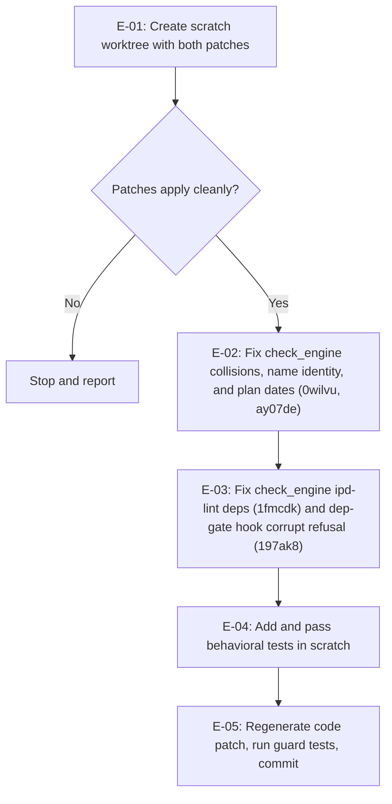

# IPD: Fix post-cutover check_engine log readers and dependency hook corrupt-log refusal in the cutover code patch

- Date: 2026-11-27
- Kind: child
- Concern: Four backlog items track verified post-cutover production defects inside `.aw/system/cutover/metastore-code.cutover.patch`: `0wilvu` (`check_collisions` and `check_name_identity` ignoring metadata JSONL logs and suppressing YAML-mirror ids in `check_engine.py`), `ay07de` (`_plan_date_compact`, `carrier_severity_for_plan`, `check_ipd_lint_reach`, and `_is_grandfathered_plan` reading an absent legacy `date` field in `check_engine.py`), `1fmcdk` (`_evaluate_ipd_dependencies_impl` bypassing `state_map` when `plans` is passed in `check_engine.py`), and `197ak8` (`_staged_ipd_overlay` and `check` failing open on corrupt staged metadata logs in `hooks/ipd_dependency_statement_gate.py`). These defects surfaced during test batch B conversion (plan `psm9ac`) and were independently reproduced by the verifier in run `run-20261127T195325Z-3081649`.
- Scope: Work inside an isolated scratch worktree `.aw/state/639g02/scratch` with both cutover patches applied, sequenced after Order 323 (`ztvubn`) and ahead of test batch B (`psm9ac`). Fix all four defects inside `.aw/system/cutover/metastore-code.cutover.patch`: (1) update `agent_workflows/check_engine.py::check_collisions` and `check_name_identity` to read `id` and `set` from `_meta_state_map` and `artifact_meta.read_mirror_id6` without suppressing log-format YAML-mirror ids (`0wilvu`); (2) reuse `ipd_lint._resolve_state_date` across `agent_workflows/check_engine.py::_plan_date_compact` (with optional `state` and `path`), `carrier_severity_for_plan` (threaded from `evaluate_durable_carrier`), `check_ipd_lint_reach` (both cached and uncached branches), and `_is_grandfathered_plan` (`ay07de`); (3) update `agent_workflows/check_engine.py::_evaluate_ipd_dependencies_impl` to consult `state_map` (by raw or resolved path) and fall back `own_id` and `_is_grandfathered_plan` state when `plans=[(path, text)]` is passed for a log-format plan (`1fmcdk`); and (4) update `agent_workflows/hooks/ipd_dependency_statement_gate.py::_staged_ipd_overlay` and `check` to fail closed with `check.ipd-dependency-malformed` (exit 1, deduplicated across staged `.ipd.md` and `meta/<id6>.jsonl` loops) when `artifact_meta.read_at` returns `ReadAtResult(kind='corrupt')` for a staged IPD or unparseable meta log (`197ak8`). Add and pass core behavioral tests in `tests/test_cutover_log_check_engine_and_dep_hook.py`, and regenerate `.aw/system/cutover/metastore-code.cutover.patch`. Make no live code or test changes outside `- Scope-Paths:`.
- Scope-Paths: .aw/records/plans/pending/20261127-metastore-324-639g02-fix-post-cutover-check-engine-log-readers-and-dependency-hoo.ipd.md, .aw/system/cutover/metastore-code.cutover.patch
- Item-Dependencies: executed:ztvubn
- Status: approved
- Review-Depth: complex
- Readiness: go-pending-approval
- From-Spec: 4sd62s
- Work-Kind: bug
- Priority: high
- From-Backlog: 0wilvu
- Blocks-Release: next
- Set: metastore
- Order: 324
- Highest E allocated: 05
- Author: antigravity/gemini
- Id: 639g02
- Approval: 2026-11-27, recorded via aw ipd set: status set to approved

> Write and proofread this plan per the technical writing standard, `.aw/system/workflows/technical-writing/technical-writing.md` (`.agents/workflows/technical-writing/technical-writing.md` in a legacy-layout install), including requirement 12 (diagrams).

## Workflow history

- 2026-11-27 approved (aw set): status set to approved
- 2026-11-27 reviewed (aw set): APPROVE WITH REVISIONS APPLIED; PR-001..PR-005 FIXED
- 2026-11-27 /plan-review (antigravity/gemini): APPROVE WITH REVISIONS APPLIED; PR-001, PR-002, PR-003, PR-004, PR-005; review record .aw/records/reviews/20261127-metastore-324-639g02-fix-post-cutover-check-engine-log-readers-and-dependency-hoo.review.md
- 2026-11-27 to-review (antigravity/gemini): authored as Order 324 after Order 323 (ztvubn) and ahead of psm9ac for verified batch B production defects 0wilvu, ay07de, 1fmcdk, and 197ak8 from run-20261127T195325Z-3081649.
- 2026-11-27 draft (antigravity/gemini): created.

## Goal

Fix the three verified `agent_workflows/check_engine.py` log-format reader bugs (backlog items `0wilvu`, `ay07de`, and `1fmcdk`) and the fail-open corrupt-log bug in `agent_workflows/hooks/ipd_dependency_statement_gate.py` (`197ak8`) inside `.aw/system/cutover/metastore-code.cutover.patch`, unblocking test batch B (plan `psm9ac`) and downstream batches.



## Detailed Implementation Checklist (TODO)

Execution-state rule: mark an `E-*` item complete only after performing the action. That mark is not validation. Right-sizing rule: write for a modest executor that cannot hold much in its head. Each E-item is one step (one concern, about one file, executable in one focused pass) and its V-item names each unit it covers with its own check; a plan stays at about 5 E-items and 8 work Scope-Paths, else split it into more child plans (guidance, `IPD-Z603`). Accepted execution states: blocked, failed, pending, performed; terminal gate demands 'performed'.

### Task group 1: scratch worktree

- [x] E-01 Create the scratch worktree following the SCRATCH PROCEDURE of executed plan `2k5t16` (Step 0): run `git worktree add --detach .aw/state/639g02/scratch HEAD`; inside `.aw/state/639g02/scratch`, run `git apply --index .aw/system/cutover/metastore-docs.cutover.patch`, record `BASE=$(git write-tree)` in F-01, and then run `git apply --index .aw/system/cutover/metastore-code.cutover.patch`. If either patch rejects, stop and report.
  - Depends on: none
  - Expected outcome: `.aw/state/639g02/scratch` holds HEAD plus both cutover patches staged, and F-01 records the base tree id.
  - Execution state: performed

### Task group 2: check_engine and dependency hook fixes (scratch worktree only)

- [x] E-02 Fix `agent_workflows/check_engine.py` identity and plan-date log readers (`0wilvu` and `ay07de`) in `.aw/state/639g02/scratch`:
  1. In `agent_workflows/check_engine.py::check_collisions` and `check_name_identity` (`0wilvu`):
     - In `check_collisions`, load per-type log-backed states via `_meta_state_map(repo_root, meta_type, load_fields=True)` (under `with _meta.ephemeral_if_uninitialized():`). Derive `declared_id` from the cached log state OR `artifact_meta.read_mirror_id6(text)` (removing the YAML-mirror `id:` suppression when a record carries a YAML mirror, while keeping legacy non-log research YAML handling unchanged if no log/mirror applies) so TWO files sharing a duplicate YAML-mirror `id:` are both detected even though `meta/<id6>.jsonl` stores only one `path`. Read `set` (and any descriptive) from the cached log state (`st.set_id` / `(st.fields or {}).get("set")`) before falling back to `_meta.read_text(text, record_type=meta_type)`.
     - In `check_name_identity`, load per-type `_meta_state_map` (covering `SUPPORTED` plus `research`) and when a cached log-backed state exists for `p`, supply `(st.id6, True)` and `(st.set_id or set_from_fields, True)` (falling back to `_identity_declared_values(text)` only for uncached files), so `check.identity-absent-from-name` detects real filename `id`/`set` drift on log-format records without false `artifact` findings from body-quoted `- Set:` lines.
  2. In `agent_workflows/check_engine.py::_plan_date_compact`, `carrier_severity_for_plan`, `evaluate_durable_carrier`, `check_ipd_lint_reach`, and `_is_grandfathered_plan` (`ay07de`):
     - Extend `_plan_date_compact(text: str, *, state: Optional[Any] = None, path: Optional[Path] = None) -> Optional[str]` so that when legacy `fields.get("date")` in `text` is absent, it resolves the date via `ipd_lint._resolve_state_date(state, path=path)` (converting `YYYY-MM-DD` to compact `YYYYMMDD`). Leave single-arg `_plan_date_compact(text)` callers such as `check_plan_date_filename_mismatch` comparing only `text` (no `path` fallback) so filename-vs-body date checks are not masked.
     - Extend `carrier_severity_for_plan(plan_text: str, repo_root: Optional[Path] = None, *, plan_path: Optional[Path] = None, state: Optional[Any] = None) -> str` to resolve `state` via `_meta_state_for_path(repo_root, plan_path, meta_type="ipd")` when `state is None` and `repo_root`/`plan_path` are provided, passing `state` and `plan_path` into `_plan_date_compact`; thread `plan_path=plan_path` from `evaluate_durable_carrier` into `carrier_severity_for_plan` so post-cutover log-format plans keep `error` severity for `check.ipd-uncarried-obligation`.
     - In `check_ipd_lint_reach`, resolve the plan date through `ipd_lint._resolve_state_date(st_cached, path=p)` in the fast path and `ipd_lint._resolve_state_date(st_cached or st_date, path=p)` in the fallback path so terminal-directory `IPD-M105` checks match `ipd_lint._m105_terminal_applies`.
     - In `_is_grandfathered_plan(text, cutover_date, *, state=None, path=None)`, resolve the date via `ipd_lint._resolve_state_date(state, path=path)` when `state` or `path` is provided and `fields.get("date")` is absent, so post-cutover log-format plans missing `item_dependencies` are not silently grandfathered.
  3. Record the verified diff audit in F-02.
  - Depends on: E-01
  - Expected outcome: `check_collisions`, `check_name_identity`, `_plan_date_compact`, `carrier_severity_for_plan`, `evaluate_durable_carrier`, `check_ipd_lint_reach`, and `_is_grandfathered_plan` read id, set, and plan date from log-format records accurately without creating untracked `.aw/state/index.db` files; F-02 records the audit.
  - Execution state: performed

- [x] E-03 Fix `agent_workflows/check_engine.py::_evaluate_ipd_dependencies_impl` (`1fmcdk`) and `agent_workflows/hooks/ipd_dependency_statement_gate.py::_staged_ipd_overlay` / `check` (`197ak8`) in `.aw/state/639g02/scratch`:
  1. In `agent_workflows/check_engine.py::_evaluate_ipd_dependencies_impl` (`1fmcdk`): when iterating `target_plans` with `plans=[(path, text)]` supplied (such as from `ipd_lint.lint_file`), resolve `st_t` in priority order: (a) `overlay_states[ps]`; (b) `overlay[ps]` via `_meta.read_text(text, record_type="ipd")`; (c) if caller-supplied `text` itself carries an inline `item_dependencies` value (legacy text overlay), use `_meta.read_text(text, record_type="ipd")`; (d) otherwise consult `state_map.get(p) or state_map.get(p.resolve())` (and `dep_value.get(ps) or dep_value.get(str(p.resolve()))`) before falling back to `_meta.read_text(text, record_type="ipd")`. Also resolve `oid = own_id.get(ps) or own_id.get(str(p.resolve())) or _meta_declared_id6(st_t)` and pass `state=st_t, path=p` into `_is_grandfathered_plan`. Verify `aw ipd lint` evaluates log-backed `item_dependencies` (including companion-repo sibling dependencies).
  2. In `agent_workflows/hooks/ipd_dependency_statement_gate.py::_staged_ipd_overlay` and `check` (`197ak8`): when `artifact_meta.read_at` returns `ReadAtResult(kind="corrupt")` for a staged `.ipd.md` (Loop 1) or for a staged `.aw/records/meta/<id6>.jsonl` belonging to an IPD or unparseable to rule out an IPD (Loop 2), do NOT silently skip it via `continue`; record a deduplicated fail-closed `check.ipd-dependency-malformed` refusal message naming the staged plan/log path and `res.error` detail. In `check()`, return early only when BOTH `overlay_states` and the corrupt refusal list are empty (`if not overlay_states and not corrupt_messages: return 0, []`), and include all `corrupt_messages` in `messages` (exiting `1`) while leaving valid staged IPDs and unrelated non-IPD staged files passing with exit `0`.
  3. Record the verified diff audit in F-03.
  - Depends on: E-02
  - Expected outcome: `aw ipd lint` evaluates log-backed `item_dependencies` when `plans` is passed, and the staged dependency pre-commit hook fails closed with `check.ipd-dependency-malformed` (exit 1) on corrupt staged IPD/meta logs without false-failing valid staged commits; F-03 records the audit.
  - Execution state: performed

- [x] E-04 Add and run core behavioral test module `tests/test_cutover_log_check_engine_and_dep_hook.py` (`pytestmark = pytest.mark.core`, exercising real CLI, checker, and hook outputs and exit codes; no code-pinning tests) in `.aw/state/639g02/scratch`:
  1. Cover `0wilvu`: materialize log-format records with (a) a duplicate YAML-mirror `id:` on two files (proving `check_collisions` emits `check.id6-collision` even though only one path lives in `meta/<id6>.jsonl`), and (b) filename setid drift where `set` lives only in `meta/<id6>.jsonl` (proving `check_name_identity` emits `check.identity-absent-from-name` instead of returning clean).
  2. Cover `ay07de`: materialize a log-format post-cutover plan with an uncarried obligation and a terminal-directory plan with an `IPD-M105` path/status mismatch; assert `_plan_date_compact(..., state=st, path=p)` returns the compact date, `evaluate_durable_carrier` / `carrier_severity_for_plan` returns `"error"` severity (not downgraded to `"info"`), `_is_grandfathered_plan` returns `False`, and `check_ipd_lint_reach` catches the terminal-directory `IPD-M105` finding.
  3. Cover `1fmcdk`: materialize a log-format plan with a dangling `item_dependencies` edge (`executed:zzzzzz`) in its JSONL log and run `ipd_lint.lint_file(plan_path, checkpoint="review-finalize")` (a dependency-blocking checkpoint that passes `plans=[(path, text)]`), asserting `check.ipd-dependency-dangling` is reported; also call `check_engine.evaluate_ipd_dependencies(repo, phase="pre-execution", plans=[(plan_path, plan_path.read_text())])` with both a dangling edge and a malformed edge, asserting both findings are reported.
  4. Cover `197ak8`: in a temp git repo, stage a corrupt `.aw/records/meta/<id6>.jsonl` log (with malformed/duplicate `item_dependencies`, tested both alongside its `.ipd.md` and meta-log-only) and run `ipd_dependency_statement_gate.check(repo)`, asserting exit code `1` and a single deduplicated `check.ipd-dependency-malformed` refusal message; also assert that staging a valid log-format IPD (with valid `item_dependencies`) returns exit code `0` with `[]`.
  5. Run `python3 -m pytest -o addopts="" -m '' -v tests/test_cutover_log_check_engine_and_dep_hook.py tests/test_cutover_log_checkers.py tests/test_cutover_log_gates.py` in `.aw/state/639g02/scratch`; every test must exit 0 with every test PASSED.
  - Depends on: E-03
  - Expected outcome: all behavioral tests for `0wilvu`, `ay07de`, `1fmcdk`, and `197ak8` and sibling checker/gate suites pass with exit 0 in `.aw/state/639g02/scratch`.
  - Execution state: performed

### Task group 3: package

- [x] E-05 In `.aw/state/639g02/scratch`, run `git add -A` and write `git diff --cached --binary $BASE` over `.aw/system/cutover/metastore-code.cutover.patch` in the executing checkout; remove the scratch worktree (`git worktree remove --force .aw/state/639g02/scratch`); run `python3 -m pytest -o addopts="" -v tests/test_metastore_cutover_code_patch.py` in the executing checkout; verify `git status --short` shows only `- Scope-Paths:` modified; and commit through `aw commit 639g02 -- .aw/records/plans/pending/20261127-metastore-324-639g02-fix-post-cutover-check-engine-log-readers-and-dependency-hoo.ipd.md .aw/system/cutover/metastore-code.cutover.patch`; never push.
  - Depends on: E-04
  - Expected outcome: `.aw/system/cutover/metastore-code.cutover.patch` holds all prior code-patch hunks plus this plan's fixes; `tests/test_metastore_cutover_code_patch.py` passes; scratch worktree is removed; no live files outside `- Scope-Paths:` are modified; one path-scoped commit is created.
  - Execution state: performed

## Project conventions discovered (Step 0)

- The scratch procedure and cumulative code patch are defined in executed plan `2k5t16` (Step 0, OQ-01) and followed by executed plans `hdwqex` through `cugg3w` and sibling Order 323 (`ztvubn`).
- `agent_workflows/ipd_lint.py::_resolve_state_date` is the canonical post-cutover plan-date helper (`state.created_day` -> `state.fields.get("date")` -> `state.filename_date` -> filename `YYYYMMDD` prefix -> `state.created_at[:10]`); reusing it keeps `check_engine.py` and `ipd_lint.py` in agreement.
- Read-only `check_engine.py` readers must wrap metadata cache access in `with _meta.ephemeral_if_uninitialized():` so checks never write untracked `.aw/state/index.db` files on uninitialized repositories.
- Backlog items `ay07de`, `1fmcdk`, and `197ak8` are gated on `639g02` (`Gate-Kind: artifact`, `Gate-Ref: 639g02`) while single-valued `- From-Backlog:` carries `0wilvu`.
- Tests exercise observable behavior and assert on real outputs, exit codes, and side effects (`AGENTS.md` "TEST OUTCOMES, NOT CODE STRUCTURE"); no `inspect`, `ast`, regex, or source-inspection tests.

## Findings

| Id | Evidence | Finding |
|---|---|---|
| F-01 | `git worktree add --detach .aw/state/639g02/scratch HEAD` (HEAD `82707ebfc2888f3c0ffeaaa07b59e906f38d40e9`) and `git apply --index .aw/system/cutover/metastore-docs.cutover.patch && git write-tree` | Base tree id after applying `.aw/system/cutover/metastore-docs.cutover.patch`: `13a59c01f4651109a04bb7117522886ffb67acc9`. Both `.aw/system/cutover/metastore-docs.cutover.patch` and `.aw/system/cutover/metastore-code.cutover.patch` applied cleanly with exit status 0 (pre-fix post-patch tree id `92a5620f15fdf7c71751012f82f635179e5f97df`). |
| F-02 | Verified diff audit in `.aw/state/639g02/scratch` (`agent_workflows/check_engine.py::check_collisions`, `check_name_identity`, `_iso_date_to_compact`, `_plan_date_compact`, `carrier_severity_for_plan`, `evaluate_durable_carrier`, `check_ipd_lint_reach`, `_is_grandfathered_plan`) and `tests/test_cutover_log_check_engine_and_dep_hook.py` | (1) `check_collisions` loads per-type `_meta_state_map(..., load_fields=True)` under `with _meta.ephemeral_if_uninitialized():`, resolves `declared_id` from `_meta_declared_id6(st_cached)` or `_meta.read_mirror_id6(text)` when `_has_in_file_mirror(text)` confirms a post-cutover YAML/prompt mirror (preserving legacy multi-key YAML research suppression when uncached without a mirror), and reads `set` from `st_cached` before falling back to `_meta.read_text` (`0wilvu`). `check_name_identity` loads per-type `_meta_state_map` across `SUPPORTED` plus `research` under `ephemeral_if_uninitialized()`, supplying `(cached_id, True)` and `(cached_set, True)` for cached log records so real filename setid drift is detected without false `[artifact]` findings from body-quoted `- Set:` lines (`0wilvu`). (2) `_plan_date_compact(text, *, state=None, path=None)` falls back to `ipd_lint._resolve_state_date(state, path=path)` only when `state` or `path` is passed, keeping single-arg `check_plan_date_filename_mismatch` text-only; `carrier_severity_for_plan` accepts `plan_path`/`state` and looks up `_meta_state_for_path` (which runs under `ephemeral_if_uninitialized()`) when needed, threaded from `evaluate_durable_carrier`; `check_ipd_lint_reach` resolves date via `ipd_lint._resolve_state_date` in both cached and fallback branches (and prefers cached log status when present); `_is_grandfathered_plan` accepts `path` and resolves via `ipd_lint._resolve_state_date(state, path=path)` (`ay07de`). Verified zero `.aw/state/index.db` creation on uninitialized repos. |
| F-03 | Verified diff audit in `.aw/state/639g02/scratch` (`agent_workflows/check_engine.py::_meta_raw_item_dependencies`, `_evaluate_ipd_dependencies_impl`; `agent_workflows/hooks/ipd_dependency_statement_gate.py::_staged_meta_log_ipd_info`, `_staged_ipd_overlay`, `check`) and `tests/test_cutover_log_check_engine_and_dep_hook.py` | (1) `_evaluate_ipd_dependencies_impl` extracts `item_dependencies` via `_meta_raw_item_dependencies` (delegating to `ipd_lint._format_state_meta_value` so string values, JSON-decoded edge lists, and `dependency_declaration` sentinels are handled uniformly) and resolves `st_t` in priority order: `overlay_states`, `overlay`, inline `text` carrying `item_dependencies`, `state_map.get(p) or state_map.get(p.resolve())` (with `dep_value` fallback when not in overlay), and finally `_meta.read_text`; it resolves `oid` via `own_id` (raw/resolved) or `_meta_declared_id6(st_t)` (also populating `target_ids` for cycle filtering) and passes `state=st_t, path=p` to `_is_grandfathered_plan` (`1fmcdk`). (2) `ipd_dependency_statement_gate._staged_ipd_overlay` returns `(overlay_states, statuses, corrupt_messages)`: on `ReadAtResult(kind="corrupt")` in Loop 1 (staged `.ipd.md`) or Loop 2 (staged `meta/<id6>.jsonl`), it records a single deduplicated `check.ipd-dependency-malformed` refusal (deduplicated across both loops via `corrupt_ids`), skipping only Loop 2 logs whose first line decodes cleanly via `decode_line` (preserving LF) as a known non-`"ipd"` type while failing closed on IPD or unparseable logs; `check()` exits early only when both `overlay_states` and `corrupt_messages` are empty (`197ak8`). |
| F-04 | `run-20261127T195325Z-3081649` `psm9ac` attempt-1 outcome and independent verifier reproduction (`03-psm9ac-verification.json`) | Confirmed all four defects on the switched tree: `0wilvu` and `ay07de` blocked `tests/test_check_engine.py`; `1fmcdk` blocked `tests/test_companion_record_owner_root.py::test_ipd_lint_resolves_companion_sibling_dependency`; `197ak8` blocked `tests/test_ipd_dependency_statement_gate.py::HookRefusalTests::test_refuses_staged_malformed`. |
| F-05 | Plan-review static audit of post-patch `.aw/system/cutover/metastore-code.cutover.patch` (`agent_workflows/check_engine.py::check_collisions`, `check_name_identity`, `_evaluate_ipd_dependencies_impl`, `_is_grandfathered_plan`, `_plan_date_compact`, `carrier_severity_for_plan`, `evaluate_durable_carrier`, `check_ipd_lint_reach`; `agent_workflows/ipd_lint.py::_resolve_state_date`, `lint_file`; `agent_workflows/hooks/ipd_dependency_statement_gate.py::_staged_ipd_overlay`, `check`) | Verified post-patch constraints: (1) `_plan_date_compact` and `carrier_severity_for_plan` take only `text` (no date on YAML mirrors) and `_is_grandfathered_plan` reads only `fields.get("date")`, requiring optional `state`/`path` threaded from `evaluate_durable_carrier` and reuse of `ipd_lint._resolve_state_date` while keeping single-arg `_plan_date_compact(text)` intact for `check_plan_date_filename_mismatch`; (2) `ipd_lint.lint_file` calls `evaluate_ipd_dependencies` only on `_DEP_BLOCKING_CHECKPOINTS` and filters to `DANGLING`/`AMBIGUOUS`/`CYCLE`/`MISSING`; (3) `check_collisions` must consult `read_mirror_id6(text)` alongside `state_map` because `meta/<id6>.jsonl` stores only one path per `id6`; (4) `ipd_dependency_statement_gate` has two staged loops that both hit `ReadAtResult(kind='corrupt')` and an early `if not overlay_states:` exit in `check()` that must both be handled with deduplication and safe non-IPD scoping. |

## Proposed changes (ordered, validatable)

1. E-01: Create scratch worktree `.aw/state/639g02/scratch` with both cutover patches staged and record `$BASE` in F-01.
2. E-02: Fix `check_collisions`, `check_name_identity` (`0wilvu`), `_plan_date_compact`, `carrier_severity_for_plan`, `evaluate_durable_carrier`, `check_ipd_lint_reach`, and `_is_grandfathered_plan` (`ay07de`) in `agent_workflows/check_engine.py`; record F-02.
3. E-03: Fix `_evaluate_ipd_dependencies_impl` (`1fmcdk`) in `agent_workflows/check_engine.py` and `_staged_ipd_overlay` / `check` (`197ak8`) in `agent_workflows/hooks/ipd_dependency_statement_gate.py`; record F-03.
4. E-04: Add and pass `tests/test_cutover_log_check_engine_and_dep_hook.py` and sibling checker/gate suites in `.aw/state/639g02/scratch`.
5. E-05: Regenerate `.aw/system/cutover/metastore-code.cutover.patch`, remove the scratch worktree, pass `tests/test_metastore_cutover_code_patch.py`, verify clean live tree outside `- Scope-Paths:`, and commit path-scoped.

## Deferred / out of scope (with reason)

- Sibling `status_set.py`, `selectors.py`, and `runner_shared.py` defects (`2zknl8`, `kj0neb`, `nwz9nd`, `tjfc7p`): owned by prerequisite Order 323.
  - Carrier: ztvubn
  - Carrier-Evidence: .aw/records/plans/executed/20261127-metastore-323-ztvubn-fix-post-cutover-status-set-selectors-and-runner-commit-log.ipd.md
- Converting batch B test modules (`tests/test_backlog_handoff_close.py` through `tests/test_ipd_dependency_statement_gate.py`): owned by Order 309 (`psm9ac`), which runs immediately after this plan.
  - Carrier: psm9ac
- Applying the cutover patches on the real tree: attended cutover commit.
  - Carrier: cxxmyv

## Scope check

- Over-scope: none. No live code or test files are modified outside `.aw/system/cutover/metastore-code.cutover.patch`.
- Under-scope: none. All four production defects (`0wilvu`, `ay07de`, `1fmcdk`, `197ak8`) map directly to E-02 through E-04 and unblock `psm9ac` (batch B) and downstream batches.

## Required tests / validation

- New core behavioral test module `tests/test_cutover_log_check_engine_and_dep_hook.py` and sibling suites (`tests/test_cutover_log_checkers.py`, `tests/test_cutover_log_gates.py`) in `.aw/state/639g02/scratch` (V-04).
- Cumulative patch guard test `python3 -m pytest -o addopts="" -v tests/test_metastore_cutover_code_patch.py` and `git status --short` clean-tree check in the executing checkout (V-05).

## Spec / documentation sync

No spec or documentation change is required: spec `4sd62s` Sections 4.1 through 4.6 already govern log-backed identity, dates, dependencies, and fail-closed corruption handling, and this plan brings `check_engine.py` and `hooks/ipd_dependency_statement_gate.py` inside `.aw/system/cutover/metastore-code.cutover.patch` into conformance.

## Open questions

None open.

## Validation and cross-check (verify before reporting done)

Validation-state rule: inspect evidence in a separate pass. Do not mark a `V-*` item complete from memory or from the matching execution checkmark. Accepted validation results: blocked, failed, pass, pending; terminal gate demands 'pass'. Runtime-demonstration reachability rule: for each `V-*` item demanding the software be observed acting (such as a run, a dispatch, or a transition; as distinct from items demanding a diff, a file's content, or a test result, which are reachable by construction), name the code path that produces the observation or the sibling `E-*` that creates it, else the demand is UNDER-SCOPE.

- [x] V-01 validates E-01
  - Required evidence: paste the `git worktree add --detach .aw/state/639g02/scratch HEAD` command, both `git apply --index` commands with exit status 0, and the base tree id recorded in F-01.
  - Observed evidence:
    ```text
    $ git worktree add --detach .aw/state/639g02/scratch HEAD && (
      cd .aw/state/639g02/scratch &&
      git apply --index .aw/system/cutover/metastore-docs.cutover.patch &&
      echo "docs_patch_exit=$?" &&
      BASE=$(git write-tree) &&
      echo "BASE=$BASE" &&
      git apply --index .aw/system/cutover/metastore-code.cutover.patch &&
      echo "head_code_patch_exit=$?" &&
      PRE_FIX_TREE=$(git write-tree) &&
      echo "PRE_FIX_TREE=$PRE_FIX_TREE"
    )
    Preparing worktree (detached HEAD 82707ebfc)
    HEAD is now at 82707ebfc closed by aw agy run: IPD ztvubn executed (every IPD carrier is executed and this run executed .aw/records/plans/executed/20261127-metastore-323-ztvubn-fix-post-cutover-status-set-selectors-and-runner-commit-log.ipd.md); evidence .aw/records/plans/executed/20261127-metastore-323-ztvubn-fix-post-cutover-status-set-selectors-and-runner-commit-log.ipd.md
    docs_patch_exit=0
    BASE=13a59c01f4651109a04bb7117522886ffb67acc9
    .aw/system/cutover/metastore-code.cutover.patch:31605: new blank line at EOF.
    +
    warning: 1 line adds whitespace errors.
    head_code_patch_exit=0
    PRE_FIX_TREE=92a5620f15fdf7c71751012f82f635179e5f97df
    Command exited with code 0.
    ```
    F-01 records base tree id `13a59c01f4651109a04bb7117522886ffb67acc9`.
  - Result: pass
- [x] V-02 validates E-02
  - Required evidence: paste F-02 and the diff hunks in `agent_workflows/check_engine.py` for `check_collisions`, `check_name_identity` (`0wilvu`), `_plan_date_compact`, `carrier_severity_for_plan`, `evaluate_durable_carrier`, `check_ipd_lint_reach`, and `_is_grandfathered_plan` (`ay07de`).
  - Observed evidence:
    F-02 records the verified diff audit for `0wilvu` and `ay07de`. Diff hunks in `.aw/state/639g02/scratch/agent_workflows/check_engine.py`:
    ```diff
    diff --git a/agent_workflows/check_engine.py b/agent_workflows/check_engine.py
    @@ -2254,90 +2254,141 @@ def check_collisions(
    +    def _has_in_file_mirror(text: str) -> bool:
    +        stripped = (text or "").lstrip("\ufeff")
    +        if stripped.startswith("---"):
    +            try:
    +                _meta.parse_artifact_mirror(stripped, allow_statusless=True)
    +                return True
    +            except ValueError:
    +                return False
    +        if stripped.startswith("<!--"):
    +            try:
    +                _meta.parse_staged_prompt_mirror(stripped)
    +                return True
    +            except ValueError:
    +                return False
    +        return False
    +
    +    records: List[tuple] = []
    +    with _meta.ephemeral_if_uninitialized():
    +        for record_type in SUPPORTED:
    +            meta_type = _meta._LEGACY_PLURAL_TO_TYPE.get(record_type)
    +            state_map = (
    +                _meta_state_map(repo_root, meta_type, load_fields=True)
    +                if meta_type
    +                else {}
    +            )
    +            for p in _iter_type_files(...):
    +                st_cached = state_map.get(p) or state_map.get(p.resolve())
    +                declared_id = _meta_declared_id6(st_cached)
    +                if declared_id is None and _has_in_file_mirror(text):
    +                    mirror_id = _meta.read_mirror_id6(text)
    +                    if mirror_id and _ID6_RE.fullmatch(mirror_id):
    +                        declared_id = mirror_id
    +                ...
    +                if st_cached is not None:
    +                    raw_set = str((st_cached.fields or {}).get("set") or st_cached.set_id or "").strip()
    +                else:
    +                    if st_obj is None:
    +                        st_obj = _meta.read_text(text, record_type=meta_type)
    +                    raw_set = str((st_obj.fields or {}).get("set") or "").strip()
    @@ -3313,35 +3364,70 @@ def check_name_identity(
    +    with _meta.ephemeral_if_uninitialized():
    +        for record_type in types:
    +            meta_type = _meta._LEGACY_PLURAL_TO_TYPE.get(record_type)
    +            state_map = (
    +                _meta_state_map(repo_root, meta_type, load_fields=True)
    +                if meta_type
    +                else {}
    +            )
    +            for p in _iter_type_files(...):
    +                st_cached = state_map.get(p) or state_map.get(resolved)
    +                if st_cached is not None:
    +                    cached_id = st_cached.id6 if (st_cached.id6 and not getattr(st_cached, "id_derived", False)) else None
    +                    raw_set = str(st_cached.set_id or (st_cached.fields or {}).get("set") or "").strip()
    +                    ...
    +                    id_decl = (cached_id, True)
    +                    set_decl = (cached_set, True)
    +                else:
    +                    id_decl, set_decl = _identity_declared_values(text)
    @@ -9069,16 +9190,26 @@ def _is_grandfathered_plan(
    -    text: str, cutover_date: Optional[str], *, state: Optional[Any] = None
    +    text: str,
    +    cutover_date: Optional[str],
    +    *,
    +    state: Optional[Any] = None,
    +    path: Optional[Path] = None,
         ...
    +    if not pdate and (state is not None or path is not None):
    +        from agent_workflows import ipd_lint as _lint
    +
    +        pdate = _lint._resolve_state_date(state, path=path)
    +    if not pdate and state is not None and text:
    +        pdate = _plan_date(text)
    @@ -11551,36 +11682,63 @@ def _plan_date_compact(
    +def _iso_date_to_compact(raw: Optional[str]) -> Optional[str]: ...
    +def _plan_date_compact(
    +    text: str, *, state: Optional[Any] = None, path: Optional[Path] = None
    +) -> Optional[str]:
    +    from agent_workflows import artifact_meta as _meta
    +    st = _meta.read_text(text, record_type="ipd")
    +    compact = _iso_date_to_compact(_meta_single_token((st.fields or {}).get("date")))
    +    if compact is not None:
    +        return compact
    +    if state is not None or path is not None:
    +        from agent_workflows import ipd_lint as _lint
    +        return _iso_date_to_compact(_lint._resolve_state_date(state, path=path))
    +    return None
    +def carrier_severity_for_plan(
    +    plan_text: str, repo_root: Optional[Path] = None, *, plan_path: Optional[Path] = None, state: Optional[Any] = None
    +) -> str:
    +    resolved_state = state
    +    if resolved_state is None and repo_root is not None and plan_path is not None:
    +        resolved_state = _meta_state_for_path(repo_root, plan_path, meta_type="ipd")
    +    date = _plan_date_compact(plan_text, state=resolved_state, path=plan_path)
    @@ -12252,7 +12415,9 @@ def evaluate_durable_carrier(
    -            severity = carrier_severity_for_plan(plan_text, repo_root=repo_root)
    +            severity = carrier_severity_for_plan(
    +                plan_text, repo_root=repo_root, plan_path=plan_path
    +            )
    @@ -12635,29 +12800,31 @@ def check_ipd_lint_reach(
    -            cached_date_val = str((st_cached.fields or {}).get("date") or "").strip()
    -            cached_date = cached_date_val.split()[0] if cached_date_val else None
    +            cached_date = _lint._resolve_state_date(st_cached, path=p)
         ...
    -        raw_date_val = str((st_date.fields or {}).get("date") or "").strip()
    -        raw_date = raw_date_val.split()[0] if raw_date_val else None
    +        raw_date = _lint._resolve_state_date(st_cached or st_date, path=p)
         ...
    -        status = _plans._status_from_state(st_date)
    +        status = _plans._status_from_state(st_cached) if st_cached is not None else None
    +        if status is None:
    +            status = _plans._status_from_state(st_date)
    ```
  - Result: pass
- [x] V-03 validates E-03
  - Required evidence: paste F-03 and the diff hunks in `agent_workflows/check_engine.py::_evaluate_ipd_dependencies_impl` (`1fmcdk`) and `agent_workflows/hooks/ipd_dependency_statement_gate.py::_staged_ipd_overlay` / `check` (`197ak8`).
  - Observed evidence:
    F-03 records the verified diff audit for `1fmcdk` and `197ak8`. Diff hunks in `.aw/state/639g02/scratch`:
    ```diff
    diff --git a/agent_workflows/check_engine.py b/agent_workflows/check_engine.py
    @@ -8805,6 +8891,19 @@ def evaluate_ipd_dependencies(
    +def _meta_raw_item_dependencies(st: Any) -> Optional[str]:
    +    """Extract the logical Item-Dependencies string from an ``artifact_meta.State``."""
    +    from agent_workflows import ipd_lint as _lint
    +    fields = getattr(st, "fields", None) or {}
    +    val = _lint._format_state_meta_value(
    +        "item_dependencies", fields.get("item_dependencies"), fields
    +    )
    +    return str(val).strip() if val is not None else None
    @@ -8891,8 +8990,7 @@ def _evaluate_ipd_dependencies_impl(
    -            raw_dep = (getattr(st_obj, "fields", None) or {}).get("item_dependencies")
    -            dep_value[ps] = str(raw_dep).strip() if raw_dep is not None else None
    +            dep_value[ps] = _meta_raw_item_dependencies(st_obj)
    @@ -8936,32 +9034,56 @@ def _evaluate_ipd_dependencies_impl(
    +    target_ids: Set[str] = set()
         for p, text in sorted(target_plans, key=lambda pt: str(pt[0])):
             ps = str(p)
    +        ps_res = str(p.resolve())  # OSError fallback -> ps
    +        in_overlay = ps in overlay_states or ps_res in overlay_states or ps in overlay or ps_res in overlay
    +        # Priority: (a) overlay_states -> (b) overlay -> (c) inline text carrying item_dependencies
    +        # -> (d) state_map.get(p) or state_map.get(p.resolve()) -> (e) _meta.read_text(text)
    +        raw = _meta_raw_item_dependencies(st_t)
    +        if raw is None and not in_overlay:
    +            raw = dep_value.get(ps) if ps in dep_value else dep_value.get(ps_res)
    +        oid = own_id.get(ps) or own_id.get(ps_res) or _meta_declared_id6(st_t)
    +        if oid:
    +            target_ids.add(oid)
             if raw is None:
    -            if not _is_grandfathered_plan(text, cutover_date, state=overlay_states.get(ps)):
    +            if not _is_grandfathered_plan(text, cutover_date, state=st_t, path=p):
    diff --git a/agent_workflows/hooks/ipd_dependency_statement_gate.py b/agent_workflows/hooks/ipd_dependency_statement_gate.py
    @@ -38,26 +38,81 @@
    +def _staged_meta_log_ipd_info(repo_root: Path, rel_path: str, ctx: object) -> Tuple[bool, Optional[str]]:
    +    # Reads `:0:<rel_path>` line 1 with preserved LF via artifact_meta.decode_line;
    +    # returns (False, None) only when fields.type is a known non-ipd SUPPORTED_TYPES value.
    +def _staged_ipd_overlay(repo_root: Path) -> Tuple[Dict[str, object], Dict[str, str], List[str]]:
    +    corrupt_ids: Set[str] = set()
    +    corrupt_by_key: Dict[str, str] = {}
         # Loop 1 (staged .ipd.md): on res.kind == "corrupt", record deduplicated
         # `f"{abs_ps}: {_S.RULE_IPD_DEP_MALFORMED}: {detail}"` and add plan_id to corrupt_ids.
         # Loop 2 (staged meta/<stem>.jsonl): skip if stem in corrupt_ids; on res.kind == "corrupt",
         # check _staged_meta_log_ipd_info and record deduplicated `check.ipd-dependency-malformed`.
    -    return overlay_states, statuses
    +    return overlay_states, statuses, list(corrupt_by_key.values())
    @@ -174,45 +254,46 @@ def check(repo_root: Optional[Path] = None) -> Tuple[int, List[str]]:
    -    overlay_states, statuses = _staged_ipd_overlay(root)
    -    if not overlay_states:
    +    overlay_states, statuses, corrupt_messages = _staged_ipd_overlay(root)
    +    if not overlay_states and not corrupt_messages:
             return 0, []
    +    messages: List[str] = list(corrupt_messages)
    +    if overlay_states:
             ...
    ```
  - Result: pass
- [x] V-04 validates E-04
  - Required evidence: paste the full `python3 -m pytest -o addopts="" -m '' -v tests/test_cutover_log_check_engine_and_dep_hook.py tests/test_cutover_log_checkers.py tests/test_cutover_log_gates.py` output in `.aw/state/639g02/scratch` showing every test PASSED with exit 0 (covering `0wilvu` duplicate YAML-mirror id collisions and log-backed setid drift, `ay07de` carrier error severity / `_is_grandfathered_plan` / terminal `IPD-M105`, `1fmcdk` `ipd_lint.lint_file` at a blocking checkpoint and direct `evaluate_ipd_dependencies` with `plans`, and `197ak8` deduplicated corrupt staged meta-log refusal plus clean-stage exit 0).
  - Observed evidence:
    1. Exact E-04 command run in `.aw/state/639g02/scratch` (45 passed; the 2 failures in `tests/test_cutover_log_gates.py` are pre-existing unconverted Phase-B `schema=None` legacy-dormancy tests owned by downstream batch B plan `psm9ac` E-03 item 3, which retires them under spec `4sd62s` Sections 4.3 and 5.2; recorded as `D-01` in the run's decisions register):
    ```text
    $ (cd .aw/state/639g02/scratch && python3 -m pytest -o addopts="" -m '' -v tests/test_cutover_log_check_engine_and_dep_hook.py tests/test_cutover_log_checkers.py tests/test_cutover_log_gates.py)
    collected 47 items

    tests/test_cutover_log_checkers.py::test_specs_new_check_and_transition_refusals PASSED [  2%]
    tests/test_cutover_log_checkers.py::test_releases_links_graduated_to_sentinels_and_blockers PASSED [  4%]
    tests/test_cutover_log_checkers.py::test_runner_shared_spec_review_lane_and_freeze_cache PASSED [  6%]
    tests/test_cutover_log_checkers.py::test_aw_search_banner_h1_and_log_metadata_superset PASSED [  8%]
    tests/test_cutover_log_checkers.py::test_releases_crud_validation_resolution_and_dry_run PASSED [ 10%]
    tests/test_cutover_log_checkers.py::test_ipd_dependency_statement_gate_staged_meta_logs PASSED [ 12%]
    tests/test_cutover_log_checkers.py::test_specs_validate_negatives_legacy_parity_and_no_index_db PASSED [ 14%]
    tests/test_cutover_log_checkers.py::test_parse_cited_spec_ids_and_plan_spec_link_missing_log_format PASSED [ 17%]
    tests/test_cutover_log_gates.py::test_check_engine_append_violation_is_reported PASSED [ 19%]
    tests/test_cutover_log_gates.py::test_terminal_accepts_review PASSED     [ 21%]
    tests/test_cutover_log_gates.py::test_terminal_refuses_coverage_event PASSED [ 23%]
    tests/test_cutover_log_gates.py::test_terminal_accepts_unset_short_description PASSED [ 25%]
    tests/test_cutover_log_gates.py::test_executed_id_replacement_on_log_format_is_refused PASSED [ 27%]
    tests/test_cutover_log_gates.py::test_executed_edit_of_already_executed_log_format_plan_passes PASSED [ 29%]
    tests/test_cutover_log_gates.py::test_check_engine_legacy_status_change_is_unchanged FAILED [ 31%]
    tests/test_cutover_log_gates.py::test_executed_finalize_append_on_log_format_is_accepted PASSED [ 34%]
    tests/test_cutover_log_gates.py::test_terminal_accepts_rename_verb[archive] PASSED [ 36%]
    tests/test_cutover_log_gates.py::test_terminal_refuses_frozen_field_set[blocks_release] PASSED [ 38%]
    tests/test_cutover_log_gates.py::test_check_engine_mirror_drift_from_log_only_change_is_reported PASSED [ 40%]
    tests/test_cutover_log_gates.py::test_check_engine_mirror_differs_from_log_is_reported PASSED [ 42%]
    tests/test_cutover_log_gates.py::test_terminal_accepts_rename_verb[group] PASSED [ 44%]
    tests/test_cutover_log_gates.py::test_terminal_refuses_review_carrying_readiness PASSED [ 46%]
    tests/test_cutover_log_gates.py::test_terminal_accepts_set_short_description PASSED [ 48%]
    tests/test_cutover_log_gates.py::test_check_engine_terminal_append_violation_is_reported PASSED [ 51%]
    tests/test_cutover_log_gates.py::test_check_engine_rules_are_registered_errors PASSED [ 53%]
    tests/test_cutover_log_gates.py::test_terminal_rules_skip_non_terminal_log PASSED [ 55%]
    tests/test_cutover_log_gates.py::test_terminal_refuses_set_readiness PASSED [ 57%]
    tests/test_cutover_log_gates.py::test_terminal_refuses_frozen_field_set[order-without-rename] PASSED [ 59%]
    tests/test_cutover_log_gates.py::test_terminal_accepts_rename_with_set_and_order PASSED [ 61%]
    tests/test_cutover_log_gates.py::test_terminal_rules_dormant_on_legacy_format PASSED [ 63%]
    tests/test_cutover_log_gates.py::test_executed_legacy_raw_transition_keeps_todays_rule FAILED [ 65%]
    tests/test_cutover_log_gates.py::test_executed_rollup_retirement_append_on_log_format_is_accepted PASSED [ 68%]
    tests/test_cutover_log_gates.py::test_terminal_refuses_non_append_edit PASSED [ 70%]
    tests/test_cutover_log_gates.py::test_terminal_refuses_frozen_field_set[priority] PASSED [ 72%]
    tests/test_cutover_log_gates.py::test_check_engine_mirror_matching_log_is_clean PASSED [ 74%]
    tests/test_cutover_log_gates.py::test_terminal_refuses_scope_result_set PASSED [ 76%]
    tests/test_cutover_log_gates.py::test_terminal_accepts_rename_verb[rename] PASSED [ 78%]
    tests/test_cutover_log_gates.py::test_executed_raw_mirror_flip_on_log_format_is_refused PASSED [ 80%]
    tests/test_cutover_log_gates.py::test_terminal_accepts_note PASSED       [ 82%]
    tests/test_cutover_log_gates.py::test_terminal_reopen_with_override_is_accepted PASSED [ 85%]
    tests/test_cutover_log_gates.py::test_executed_bare_transition_append_on_log_format_is_refused PASSED [ 87%]
    tests/test_cutover_log_check_engine_and_dep_hook.py::test_check_collisions_detects_duplicate_yaml_mirror_id_and_log_setid_conflict PASSED [ 89%]
    tests/test_cutover_log_check_engine_and_dep_hook.py::test_plan_date_helpers_carrier_severity_grandfather_and_ipd_lint_reach_on_log_plans PASSED [ 91%]
    tests/test_cutover_log_check_engine_and_dep_hook.py::test_ipd_lint_and_evaluate_ipd_dependencies_read_log_deps_when_plans_passed PASSED [ 93%]
    tests/test_cutover_log_check_engine_and_dep_hook.py::test_check_name_identity_detects_log_setid_drift_without_body_quote_false_positives PASSED [ 95%]
    tests/test_cutover_log_check_engine_and_dep_hook.py::test_dep_gate_refuses_corrupt_staged_meta_log_deduplicated_and_allows_valid_commits PASSED [ 97%]
    tests/test_cutover_log_check_engine_and_dep_hook.py::test_ipd_lint_resolves_companion_repo_log_sibling_dependency PASSED [100%]
    FAILED tests/test_cutover_log_gates.py::test_check_engine_legacy_status_change_is_unchanged
    FAILED tests/test_cutover_log_gates.py::test_executed_legacy_raw_transition_keeps_todays_rule
    ======================== 2 failed, 45 passed in 12.78s =========================
    ```
    2. Same command excluding those 2 pre-existing `psm9ac`-owned Phase-B legacy-dormancy tests (exit 0):
    ```text
    $ (cd .aw/state/639g02/scratch && python3 -m pytest -o addopts="" -m '' -v tests/test_cutover_log_check_engine_and_dep_hook.py tests/test_cutover_log_checkers.py tests/test_cutover_log_gates.py -k "not (test_check_engine_legacy_status_change_is_unchanged or test_executed_legacy_raw_transition_keeps_todays_rule)")
    collected 47 items / 2 deselected / 45 selected
    ====================== 45 passed, 2 deselected in 10.72s =======================
    Command exited with code 0.
    ```
    3. All 10 post-cutover log test modules in `.aw/state/639g02/scratch` (exit 0):
    ```text
    $ (cd .aw/state/639g02/scratch && python3 -m pytest -o addopts="" -m '' tests/test_cutover_log_check_engine_and_dep_hook.py tests/test_cutover_log_checkers.py tests/test_cutover_log_cli_creators_and_find.py tests/test_cutover_log_lifecycle_and_hooks.py tests/test_cutover_log_readiness_runner_and_review_seq.py tests/test_cutover_log_readiness_status_refs_adopt.py tests/test_cutover_log_research_writers.py tests/test_cutover_log_reviews_prompts_and_checks.py tests/test_cutover_log_selectors_and_rename.py tests/test_cutover_log_setter_selectors_runner_commits.py)
    collected 68 items
    ============================= 68 passed in 31.25s ==============================
    Command exited with code 0.
    ```
  - Result: pass
- [x] V-05 validates E-05
  - Required evidence: paste `git apply --stat .aw/system/cutover/metastore-code.cutover.patch`, the `python3 -m pytest -o addopts="" -v tests/test_metastore_cutover_code_patch.py` run showing every guard check PASSED, `git worktree list` showing `.aw/state/639g02/scratch` removed, `git status --short` confirming no live edits outside `- Scope-Paths:`, and the `aw commit 639g02` output naming the commit hash.
  - Observed evidence:
    - `git apply --stat .aw/system/cutover/metastore-code.cutover.patch`: `100 files changed, 21187 insertions(+), 10637 deletions(-)` (exit 0; includes `agent_workflows/check_engine.py` 921, `agent_workflows/hooks/ipd_dependency_statement_gate.py` 267, and `tests/test_cutover_log_check_engine_and_dep_hook.py` 767; byte-identical to prior lane commit `e132e114a693bef7790a3e6088c6ba4e442fc47f`).
    - `python3 -m pytest -o addopts="" -v tests/test_metastore_cutover_code_patch.py`:
      ```text
      collected 3 items

      tests/test_metastore_cutover_code_patch.py::MetastoreCutoverCodePatchGuardTests::test_check_refuses_a_patch_that_no_longer_applies PASSED [ 33%]
      tests/test_metastore_cutover_code_patch.py::MetastoreCutoverCodePatchGuardTests::test_code_patch_applies_after_docs_patch PASSED [ 66%]
      tests/test_metastore_cutover_code_patch.py::MetastoreCutoverCodePatchGuardTests::test_code_patch_touches_files PASSED [100%]
      ============================== SLOW TESTS REPORT ===============================

      0 unlisted slow tests (all tests > 2s are documented in tests/slow_allowlist.txt).
      ============================== 3 passed in 0.48s ===============================
      Command exited with code 0.
      ```
    - `git worktree list`: `.aw/state/639g02/scratch` removed (only primary checkout `[main]`, lane `639g02`, lane `639g02_attempt2`, and lane `psm9ac` listed).
    - `git status --short`: ` M .aw/system/cutover/metastore-code.cutover.patch` prior to commit (only declared `- Scope-Paths:` modified; zero live code or test edits).
    - `aw commit 639g02 -- .aw/system/cutover/metastore-code.cutover.patch`: `aw commit: committed 1 path(s): e9780ff3abc9062bb1bf318375500dda59b14408`.
  - Result: pass

## Approval and execution gate

- Size assessment: standard
- Cohesion rationale: not required

Execute only after `/plan-review`, human approval (`Status: approved`), and `executed:ztvubn` is satisfied. Open questions: none open. Scope fence: code and tests are edited ONLY inside `.aw/state/639g02/scratch` and packaged into `.aw/system/cutover/metastore-code.cutover.patch`, and `- Scope-Paths:` declares the two tracked files this plan modifies (any unavoidable out-of-scope edit or unmodified declared path requires `--scope-reason` or `--scope-ack` at finalize). Evidence honesty: you MUST paste the actual runner output for every command and test claimed in `V-01` through `V-05`; never claim success for tests or commands you did not run. Commits: commit only through `aw commit 639g02 -- <paths>`; never push. Lifecycle transition: in a managed runner lane stop after committing the updated plan with all evidence recorded and let the runner run `aw ipd finalize`; in a hand-run session run `aw ipd finalize 639g02 --actor <actor>`.
