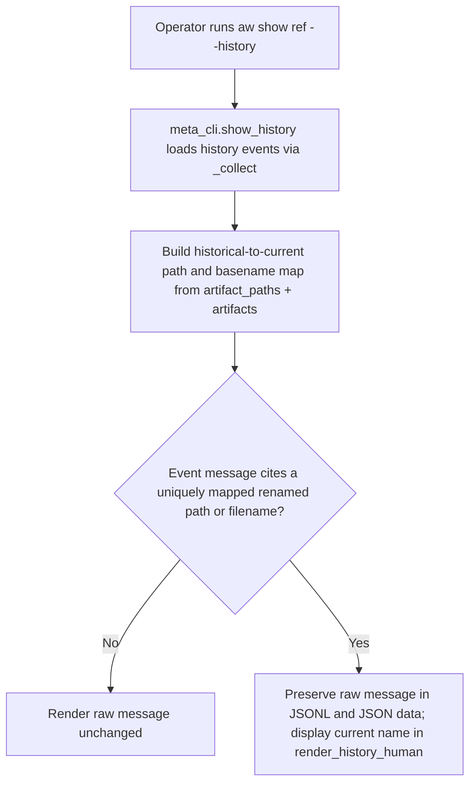

# IPD: Display current filenames for renamed legacy citations in aw show --history (AC-41 case 4)

- Date: 2026-11-27
- Kind: child
- Concern: Resolve renamed legacy artifact filenames cited in imported history lines to their current clustered names when rendering `aw show --history` (spec `4sd62s` AC-41 case 4 and OQ-28; backlog `o97nzp`)
- Scope: Build a read-only historical-to-current filename map from `artifact_paths` and `artifacts` in `agent_workflows/meta_cli.py`, display current filenames for renamed legacy citations in `aw show --history` human output while keeping stored JSONL history messages and structured JSON `message` fields byte-for-byte unchanged, add behavioral tests in `tests/test_show_history_renamed_citations.py`, and verify `tests/test_metastore_cutover_code_patch.py` remains green.
- Scope-Paths: .aw/records/plans/pending/20261127-o97nzp-01-i7wzcf-display-current-filenames-for-renamed-legacy-citations-in-aw.ipd.md, agent_workflows/meta_cli.py, tests/test_show_history_renamed_citations.py
- Item-Dependencies: executed:0zylig
- From-Spec: 4sd62s
- From-Backlog: o97nzp
- Blocks-Release: next
- Status: to-review
- Short-Description: Resolve renamed legacy artifact filenames to current clustered names in aw show --history (spec 4sd62s AC-41 case 4)
- Work-Kind: bug
- Priority: high
- Set: o97nzp
- Order: 1
- Highest E allocated: 04
- Author: antigravity/gemini
- Id: i7wzcf

> Write and proofread this plan per the technical writing standard, `.aw/system/workflows/technical-writing/technical-writing.md` (`.agents/workflows/technical-writing/technical-writing.md` in a legacy-layout install), including requirement 12 (diagrams).

## Workflow history

- 2026-11-27 to-review (antigravity/gemini): authored review-ready plan graduating backlog o97nzp for spec 4sd62s AC-41 case 4.
- 2026-11-27 draft (antigravity/gemini): created.

## Goal

Satisfy spec `4sd62s` AC-41 case 4 (OQ-28) so that every raw imported history line citing an old legacy-timestamp filename remains byte-for-byte intact in the metadata log while `aw show --history` displays the citation using the artifact's current clustered filename.

## Detailed Implementation Checklist (TODO)

Execution-state rule: mark an `E-*` item complete only after performing the action. That mark is not validation. Right-sizing rule: write for a modest executor that cannot hold much in its head. Each E-item is one step (one concern, about one file, executable in one focused pass) and its V-item names each unit it covers with its own check; a plan stays at about 5 E-items and 8 work Scope-Paths, else split it into more child plans (guidance, `IPD-Z603`). Accepted execution states: blocked, failed, pending, performed; terminal gate demands 'performed'.

### Task group 1: Historical-to-current filename resolution in `agent_workflows/meta_cli.py`

- [ ] E-01 Add a read-only rename-map helper `_historical_filename_map(ctx: MetaContext) -> Dict[str, str]` in `agent_workflows/meta_cli.py` that builds historical-to-current relative-path and basename mappings from `artifact_paths` and `artifacts`.
  - Depends on: none
  - Expected outcome: Under `with _meta.ephemeral_if_uninitialized():`, `_historical_filename_map` queries the SQLite cache (`artifact_paths` joined with current `artifacts.path`, ensuring cache freshness via existing `artifact_meta` readers) to collect every historical `path` where `historical_path != current_path` for the same `id6`. It maps: (a) each distinct historical relative path (and `.aw/records/<historical_path>` spelling) to its current path; and (b) each historical basename (`Path(historical_path).name`) to its current basename (`Path(current_path).name`) only when the historical basename maps uniquely to a single current basename (ambiguous basenames shared by multiple `id6`s are omitted so no wrong file is ever substituted). On an unmigrated or empty repository, it returns `{}` cleanly without raising or writing untracked files into `.aw/state/`.
  - Execution state: pending

- [ ] E-02 Wire rename-map display resolution into `agent_workflows/meta_cli.py::show_history`, `render_history_human`, and `_fmt_event_row` without altering stored or JSON raw messages.
  - Depends on: E-01
  - Expected outcome: `show_history` preserves every event's raw `message` byte for byte in `CommandResult.data["records"][*]["history"][*]["message"]` (satisfying AC-10 and AC-41 case 4 byte-for-byte recovery) while attaching the resolved rename map (or per-event `display_message` when different) so `render_history_human` / `_fmt_event_row` renders cited renamed legacy paths and filenames using their current clustered names. Replacement matches longest keys first on path/token boundaries so substrings of other filenames are not corrupted; citations that were never renamed or whose basenames are ambiguous remain verbatim.
  - Execution state: pending

### Task group 2: Behavioral tests and verification

- [ ] E-03 Create core behavioral test module `tests/test_show_history_renamed_citations.py` (`pytestmark = pytest.mark.core`, exercising real CLI and `meta_cli` functions; no source inspection).
  - Depends on: E-01, E-02
  - Expected outcome: `tests/test_show_history_renamed_citations.py` verifies: (a) on a temp log-format repository containing a renamed artifact (an `op: create` with a legacy-timestamp path like `specs/approved/20260727-1910-01-old-spec.spec.md` followed by an `op: rename` to `specs/approved/20260727-sp0001-01-sp0001-old-spec.spec.md`) and a second artifact whose imported history event cites either the old basename or the old relative path, `aw show <id6> --history` prints the current clustered filename in human output; (b) `artifact_meta.history(<id6>)` and `aw show <id6> --format json --history` still preserve the raw imported `message` byte for byte containing the original legacy filename; (c) citations to non-renamed filenames and ambiguous basenames remain unchanged; and (d) an unmigrated legacy fixture repository still runs `aw show <id6> --history` cleanly without error or creating untracked `.aw/state/index.db`.
  - Execution state: pending

- [ ] E-04 Run targeted tests, cutover-patch guard tests, mypy, bare `python3 -m pytest`, and `aw sanitize --agent`, then commit path-scoped through `aw commit i7wzcf -- <paths>`.
  - Depends on: E-03
  - Expected outcome: `python3 -m pytest tests/test_show_history.py tests/test_show_history_renamed_citations.py tests/test_metastore_cutover_code_patch.py`, `python3 -m mypy agent_workflows/meta_cli.py`, bare `python3 -m pytest`, and `aw sanitize --agent` all exit 0 with zero failures or findings, and only `- Scope-Paths:` files are committed via `aw commit i7wzcf -- <paths>` (never push).
  - Execution state: pending

## Project conventions discovered (Step 0)

- Spec `4sd62s` AC-41 case 4 (and OQ-28) requires: every raw history line that cited an old legacy-timestamp filename is recovered byte for byte (AC-10), and `aw show --history` displays it with the current clustered filename.
- `agent_workflows/artifact_meta.py` already populates the SQLite `artifact_paths` table with every historical `(id6, path, ...)` row across `op: create` and `op: rename` events, and `artifacts` stores each `id6`'s current `path`.
- `agent_workflows/meta_cli.py::show_history` calls `_collect(repo_root, ref, with_history=True, with_state=False)` and returns a `CommandResult`, which `render_history_human` and `_fmt_event_row` format for human output.
- `.aw/system/cutover/metastore-code.cutover.patch` only touches `meta_cli.py::meta_repair` (not `show_history` or `render_history_human`); placing new tests in `tests/test_show_history_renamed_citations.py` also avoids hunk overlap with `tests/test_show_history.py`, and running `tests/test_metastore_cutover_code_patch.py` confirms both cutover patches still apply cleanly.
- Read-only queries on uninitialized repositories must wrap cache access in `with _meta.ephemeral_if_uninitialized():` so read-only commands never create untracked `.aw/state/index.db` files.
- Tests must exercise observable behavior and outcomes (`AGENTS.md` "TEST OUTCOMES, NOT CODE STRUCTURE") and never inspect source code.

## Findings

| Id | Observation | Impact | Plan item |
| --- | --- | --- | --- |
| F-01 | `agent_workflows/meta_cli.py::_fmt_event_row` prints `ev.get("message")` verbatim without consulting `artifact_paths` rename mappings. | On a migrated repository where 34 legacy-timestamp files were renamed (`m0001`), imported history lines in `aw show --history` still print dead old filenames instead of current clustered filenames, failing spec `4sd62s` AC-41 case 4 (discovered by `33vxoi`, filed as backlog `o97nzp`). | E-01, E-02 |
| F-02 | `1ajqaa` deferred this display mapping to `dcerjg`, which deferred it to `cxxmyv`, leaving no active plan implementing it before `5qyba0` rehearsal and `cxxmyv` cutover. | Executing this plan after `0zylig` and before `5qyba0` / `cxxmyv` closes the spec `4sd62s` AC-41 case 4 gap ahead of the attended rehearsal and cutover. | E-01..E-04 |

## Proposed changes (ordered, validatable)

1. E-01: Add `_historical_filename_map(ctx)` in `agent_workflows/meta_cli.py` reading `artifact_paths` and `artifacts` under `ephemeral_if_uninitialized()`.
2. E-02: Wire historical filename resolution into `show_history` and `render_history_human` / `_fmt_event_row` in `agent_workflows/meta_cli.py`, preserving raw `message` byte for byte in JSONL logs and JSON output.
3. E-03: Add behavioral tests in `tests/test_show_history_renamed_citations.py`.
4. E-04: Run targeted pytest suites (including `tests/test_metastore_cutover_code_patch.py`), `mypy`, bare `python3 -m pytest`, and `aw sanitize --agent`, then commit via `aw commit i7wzcf -- <paths>`.

## Deferred / out of scope (with reason)

- Rewriting raw stored `message` strings inside `.aw/records/meta/<id6>.jsonl`: explicitly prohibited by spec `4sd62s` AC-10 and AC-41 case 4, which require byte-for-byte preservation of imported history lines in storage.
- Applying the `metastore` cutover rehearsal and commit: owned by `5qyba0` and `cxxmyv`.
  - Carrier: cxxmyv

## Scope check

- Over-scope: none. Changes stay strictly within `agent_workflows/meta_cli.py` and the new test module `tests/test_show_history_renamed_citations.py`.
- Under-scope: none. Directly implements spec `4sd62s` AC-41 case 4 (backlog `o97nzp`) across both relative-path and unique-basename citations while preserving byte-for-byte raw history and verifying cutover-patch compatibility.

## Required tests / validation

1. `python3 -m pytest tests/test_show_history.py tests/test_show_history_renamed_citations.py tests/test_metastore_cutover_code_patch.py`
2. `python3 -m mypy agent_workflows/meta_cli.py`
3. Bare core suite: `python3 -m pytest`
4. Leak sanitizer: `aw sanitize --agent`

## Spec / documentation sync

No spec or documentation edits are required: spec `4sd62s` AC-41 case 4 and OQ-28 already specify this display behavior, and this plan brings `agent_workflows/meta_cli.py` into conformance with it.

## Open questions

None open.

## Validation and cross-check (verify before reporting done)

Validation-state rule: inspect evidence in a separate pass. Do not mark a `V-*` item complete from memory or from the matching execution checkmark. Accepted validation results: blocked, failed, pass, pending; terminal gate demands 'pass'. Runtime-demonstration reachability rule: for each `V-*` item demanding the software be observed acting (such as a run, a dispatch, or a transition; as distinct from items demanding a diff, a file's content, or a test result, which are reachable by construction), name the code path that produces the observation or the sibling `E-*` that creates it, else the demand is UNDER-SCOPE.

- [ ] V-01 validates E-01
  - Required evidence: Paste `git diff -- agent_workflows/meta_cli.py` showing `_historical_filename_map` under `_meta.ephemeral_if_uninitialized()` and pasted pytest output from `tests/test_show_history_renamed_citations.py` proving unique historical paths and basenames map to current clustered names while ambiguous basenames and unmigrated repos return safely without creating untracked `.aw/state/index.db`.
  - Observed evidence:
  - Result: pending

- [ ] V-02 validates E-02
  - Required evidence: Paste `git diff -- agent_workflows/meta_cli.py` covering `show_history`, `render_history_human`, and `_fmt_event_row`, plus pasted CLI output from `tests/test_show_history_renamed_citations.py` demonstrating that `aw show <id6> --history` prints the current clustered filename while `artifact_meta.history(<id6>)` and `aw show <id6> --format json --history` preserve the raw legacy-filename message byte for byte.
  - Observed evidence:
  - Result: pending

- [ ] V-03 validates E-03
  - Required evidence: Paste full output from `python3 -m pytest -v tests/test_show_history.py tests/test_show_history_renamed_citations.py` showing all tests passing with exit 0 and zero code-pinning (`inspect`/`ast`/source-regex) assertions in the new test file.
  - Observed evidence:
  - Result: pending

- [ ] V-04 validates E-04
  - Required evidence: Paste actual command output from `python3 -m pytest tests/test_metastore_cutover_code_patch.py`, `python3 -m mypy agent_workflows/meta_cli.py`, bare `python3 -m pytest`, `aw sanitize --agent`, and `git show --stat HEAD` after committing via `aw commit i7wzcf -- <paths>`, confirming zero failures, zero sanitizer findings, and strictly path-scoped commit contents with no push.
  - Observed evidence:
  - Result: pending

## Approval and execution gate

- Size assessment: standard
- Cohesion rationale: not required

Execute only after `/plan-review`, human approval (`Status: approved`), and `executed:0zylig` is satisfied. Execution must take place in an isolated git worktree, commit only declared `- Scope-Paths:` files through `aw commit i7wzcf -- <paths>`, and never push or tag.

Post-gate lifecycle move (after all `E-*` items are `performed` and all `V-*` items are `pass`):
- In a managed runner lane (`aw agy run` / `aw oc run`), commit the updated plan in `pending/` with all evidence recorded and let the runner's merge-and-revalidate gate run `aw ipd finalize`.
- In a hand-run session, run `aw ipd finalize i7wzcf --actor <actor>` and integrate onto `main` under `aw integration-lock`.
