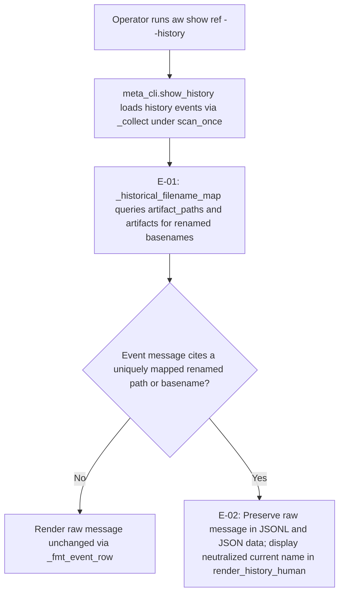

# IPD: Display current filenames for renamed legacy citations in aw show --history (AC-41 case 4)

- Date: 2026-11-27
- Kind: child
- Concern: Backlog item `o97nzp` tracks a missing display behavior required by artifact metadata store specification `4sd62s` (acceptance criterion AC-41 case 4, and resolved open questions OQ-27 and OQ-28). When `aw show --history` renders imported legacy history lines that cite an old legacy-timestamp filename renamed during migration, human output must display the artifact's current clustered filename while preserving the raw stored history line byte for byte.
- Scope: Build a read-only historical-to-current filename map from `artifact_paths` and `artifacts` in `agent_workflows/meta_cli.py` for genuine filename renames (ignoring pure disposition moves where the basename did not change). Attach the map to `show_history`'s `CommandResult` outside serialized `CommandResult.data` so `render_history_human` and `_fmt_event_row` display current filenames (neutralized via `_safe`) while JSONL logs and structured `--json` / `--format json` outputs stay byte-for-byte unchanged. Add core behavioral tests in `tests/test_show_history_renamed_citations.py` and verify `tests/test_metastore_cutover_code_patch.py` remains green after predecessor plan `0zylig` (final cutover code-patch updates) executes.
- Scope-Paths: .aw/records/plans/pending/20261127-o97nzp-01-i7wzcf-display-current-filenames-for-renamed-legacy-citations-in-aw.ipd.md, agent_workflows/meta_cli.py, tests/test_show_history_renamed_citations.py
- Item-Dependencies: executed:0zylig
- From-Spec: 4sd62s
- From-Backlog: o97nzp
- Blocks-Release: next
- Status: approved
- Review-Depth: standard
- Readiness: go-pending-approval
- Short-Description: Resolve renamed legacy artifact filenames to current clustered names in aw show --history (spec 4sd62s AC-41 case 4)
- Work-Kind: bug
- Priority: high
- Set: o97nzp
- Order: 1
- Highest E allocated: 04
- Author: antigravity/gemini
- Id: i7wzcf
- Approval: 2026-11-27, recorded via aw ipd set: status set to approved

> Write and proofread this plan per the technical writing standard, `.aw/system/workflows/technical-writing/technical-writing.md` (`.agents/workflows/technical-writing/technical-writing.md` in a legacy-layout install), including requirement 12 (diagrams).

## Workflow history

- 2026-11-27 approved (aw set): status set to approved
- 2026-11-27 reviewed (aw set): APPROVE WITH REVISIONS APPLIED; PR-001..PR-005 FIXED
- 2026-11-27 /plan-review (antigravity/gemini): APPROVE WITH REVISIONS APPLIED; PR-001, PR-002, PR-003, PR-004, PR-005; review record .aw/records/reviews/20261127-o97nzp-01-i7wzcf-display-current-filenames-for-renamed-legacy-citations-in-aw.review.md
- 2026-11-27 to-review (antigravity/gemini): authored review-ready plan graduating backlog o97nzp for spec 4sd62s AC-41 case 4.
- 2026-11-27 draft (antigravity/gemini): created.

## Goal

Satisfy specification `4sd62s` AC-41 case 4 (and resolved decisions OQ-27 and OQ-28) so that every raw imported history line citing an old legacy-timestamp filename remains byte-for-byte intact in the metadata log and structured JSON outputs, while `aw show --history` displays the citation using the artifact's current clustered filename.

## Detailed Implementation Checklist (TODO)

Execution-state rule: mark an `E-*` item complete only after performing the action. That mark is not validation. Right-sizing rule: write for a modest executor that cannot hold much in its head. Each E-item is one step (one concern, about one file, executable in one focused pass) and its V-item names each unit it covers with its own check; a plan stays at about 5 E-items and 8 work Scope-Paths, else split it into more child plans (guidance, `IPD-Z603`). Accepted execution states: blocked, failed, pending, performed; terminal gate demands 'performed'.

### Task group 1: Historical-to-current filename resolution in `agent_workflows/meta_cli.py`

- [ ] E-01 Add a read-only rename-map helper `_historical_filename_map(ctx: MetaContext) -> Dict[str, str]` in `agent_workflows/meta_cli.py` that builds historical-to-current relative-path and basename mappings from `artifact_paths` and `artifacts`.
  - Depends on: none
  - Expected outcome: Under `with _meta.ephemeral_if_uninitialized():`, `_historical_filename_map` opens the cache through `_meta._open_for_read(ctx.records_root, ctx.state_root)` (closing the connection only when `should_close` is True, never calling raw `_meta.open_cache`, which ignores `_EPHEMERAL_IF_ABSENT`), refreshes freshness via `_meta._maybe_check_freshness`, and queries `artifact_paths` joined with current `artifacts.path` for rows where the filename actually changed (`Path(historical_path).name != Path(current_path).name`, so pure disposition moves such as `plans/pending/<same>` to `plans/executed/<same>` are never rewritten). It maps: (a) each uniquely mapped historical records-relative path `<old_rel>` to `<cur_rel>` AND `.aw/records/<old_rel>` to `.aw/records/<cur_rel>` (preserving the `.aw/records/` prefix and omitting any historical path shared by multiple current targets); and (b) each historical basename (`Path(historical_path).name`) to its current basename (`Path(current_path).name`) only when that historical basename maps uniquely to a single current basename (ambiguous basenames shared by multiple `id6`s are omitted so no wrong file is substituted). On an uninitialized, unmigrated, or empty repository, calling `_historical_filename_map(ctx)` returns `{}` cleanly without raising or creating untracked `.aw/state/index.db`.
  - Execution state: pending

- [ ] E-02 Wire rename-map display resolution into `agent_workflows/meta_cli.py::show_history`, `render_history_human`, and `_fmt_event_row` without altering stored logs or structured JSON output.
  - Depends on: E-01
  - Expected outcome: `show_history` runs `_collect` and `_historical_filename_map(ctx)` inside one `with _meta.scan_once():` session (avoiding duplicate freshness scans) and preserves every event's raw `message` and `CommandResult.data` schema byte for byte (satisfying AC-10, AC-41 case 4, and unchanged `--json` / `--format json` output). `show_history` attaches the rename map to a non-serialized private attribute on `CommandResult` (for example `_historical_rename_map`, ignored by `CommandResult.to_dict()` / `JsonRenderer`), and `render_history_human(result, *, rename_map=None)` resolves it (defaulting to `getattr(result, "_historical_rename_map", None)` so existing zero-extra-arg callers such as `cli._run_show_meta` and `.aw/system/cutover/metastore-acceptance-demo.sh` work automatically) and passes it to `_fmt_event_row`. Replacement matches longest keys first on path/token boundaries, passes the resulting display string through `_safe` (`attention_contract.neutralize_control_characters`), and leaves non-renamed citations, pure disposition moves, and ambiguous basenames verbatim.
  - Execution state: pending

### Task group 2: Behavioral tests and verification

- [ ] E-03 Create core behavioral test module `tests/test_show_history_renamed_citations.py` (`pytestmark = pytest.mark.core`, exercising real CLI and `meta_cli` functions; no source inspection).
  - Depends on: E-01, E-02
  - Expected outcome: `tests/test_show_history_renamed_citations.py` verifies: (a) on a temporary log-format repository containing both a migrated renamed artifact (`op: checkpoint` at `seq: 0` with legacy-timestamp path such as `specs/approved/20260727-1910-01-old-spec.spec.md` followed by `op: rename` at `seq: 1`, `verb: "rename"`, `actor: {"tool": "aw migrate metadata"}` to `specs/approved/20260727-sp0001-01-sp0001-old-spec.spec.md`) and a second renamed artifact (`op: create` + `op: rename`), when another artifact has an `op: legacy` history event citing either the old basename, the old records-relative path, or `.aw/records/<old_rel>`, both `aw show <id6> --history` and `meta_cli.render_history_human(meta_cli.show_history(repo, id6))` print the current clustered filename (preserving `.aw/records/` when present); (b) `artifact_meta.history(<id6>)`, `aw show <id6> --format json --history`, and `aw show <id6> --json --history` preserve the raw imported `message` byte for byte containing the original legacy filename and add no extra rename-map keys to `CommandResult.data`; (c) citations to non-renamed filenames, pure disposition moves (`plans/pending/<same>` to `plans/executed/<same>`), substring lookalikes, and ambiguous basenames remain verbatim; and (d) calling `meta_cli._historical_filename_map(meta_cli.meta_context(repo))` on an uninitialized/empty or unmigrated legacy fixture repository returns `{}` without creating untracked `.aw/state/index.db`, and `aw show <id6> --history` on an unmigrated legacy fixture repository exits 0 and renders its legacy history lines verbatim.
  - Execution state: pending

- [ ] E-04 Run targeted tests, cutover-patch guard tests, mypy, bare `python3 -m pytest`, and `aw sanitize --agent`, then commit path-scoped through `aw commit i7wzcf -- <paths>`.
  - Depends on: E-03
  - Expected outcome: `python3 -m pytest -o addopts="" -v tests/test_show_history.py tests/test_show_history_renamed_citations.py tests/test_metastore_cutover_code_patch.py`, `python3 -m mypy agent_workflows/meta_cli.py`, bare `python3 -m pytest`, and `aw sanitize --agent` all exit 0 with zero failures or findings, and only `- Scope-Paths:` files are committed via `aw commit i7wzcf -- <paths>` (never push).
  - Execution state: pending

## Project conventions discovered (Step 0)

- Spec `4sd62s` AC-41 case 4, OQ-27, and OQ-28 require: every raw history line that cited an old legacy-timestamp filename is recovered byte for byte (AC-10), migrated renamed records carry a `checkpoint` at the old path followed by a `rename` event at the new path, and `aw show --history` displays the old citation with the current clustered filename.
- `agent_workflows/artifact_meta.py::replay` already populates the SQLite `artifact_paths` table for `create`, `checkpoint`, `rename`, and `transition` events, and `artifacts` stores each `id6`'s current `path`.
- `agent_workflows/meta_cli.py::show_history` calls `_collect(repo_root, ref, with_history=True, with_state=False)` and returns a `CommandResult`, which `cli._run_show_meta` passes to `JsonRenderer().render(res, ctx)` (calling `res.to_dict()`) under `--json` and to `render_history_human(res)` under human output; `.aw/system/cutover/metastore-acceptance-demo.sh` (authored by executed plan `33vxoi`) calls `meta_cli.render_history_human(meta_cli.show_history(Path("."), sample_id))` directly.
- `artifact_meta.open_cache` ignores `_EPHEMERAL_IF_ABSENT` and always creates `.aw/state/index.db` unless `in_memory=True`; `artifact_meta._open_for_read` honors `ephemeral_if_uninitialized()` and reuses `scan_once()` connections. `meta_cli._collect` intentionally warms `.aw/state/index.db` during `aw show` (pinned by `tests/test_show_history.py::test_f_missing_cache_gives_same_output_as_warm`), so `_historical_filename_map` uses `_open_for_read` under `ephemeral_if_uninitialized()` without changing `_collect`'s cache-warming contract.
- `.aw/system/cutover/metastore-code.cutover.patch` only touches `meta_cli.py::meta_repair` (not `show_history` or `render_history_human`); placing new tests in `tests/test_show_history_renamed_citations.py` also avoids hunk overlap with `tests/test_show_history.py`, and running `tests/test_metastore_cutover_code_patch.py` confirms both cutover patches still apply cleanly.
- Every string rendered from history events or metadata passes through `meta_cli._safe` (`attention_contract.neutralize_control_characters`, spec `4sd62s` Section 4.2, SR-903).
- Tests must exercise observable behavior and outcomes (`AGENTS.md` "TEST OUTCOMES, NOT CODE STRUCTURE") and never inspect source code.

## Findings

| Id | Observation | Impact | Plan item |
| --- | --- | --- | --- |
| F-01 | `agent_workflows/meta_cli.py::_fmt_event_row` prints `ev.get("message")` verbatim without consulting `artifact_paths` rename mappings. | On a migrated repository where 34 legacy-timestamp files were renamed (`m0001`), imported history lines in `aw show --history` still print dead old filenames instead of current clustered filenames, failing spec `4sd62s` AC-41 case 4 (discovered by executed acceptance-script plan `33vxoi`, filed as backlog `o97nzp`). | E-01, E-02 |
| F-02 | Earlier metastore plans `1ajqaa` (`aw show`) and `dcerjg` (migration engine) deferred this display mapping to attended cutover plan `cxxmyv`, leaving no active plan implementing it before attended rehearsal `5qyba0` and cutover `cxxmyv`. | Executing this plan after final cutover code-patch plan `0zylig` and before attended plans `5qyba0` and `cxxmyv` closes the spec `4sd62s` AC-41 case 4 gap cleanly. | E-01..E-04 |
| F-03 | Plan-review static audit of `agent_workflows/meta_cli.py`, `agent_workflows/artifact_meta.py`, `agent_workflows/cli.py`, `agent_workflows/renderers.py`, `tests/test_show_history.py`, and `.aw/system/cutover/metastore-acceptance-demo.sh`. | Verified constraints: (1) `artifact_meta.open_cache` ignores `ephemeral_if_uninitialized()` so `_historical_filename_map` must use `_meta._open_for_read` + `_meta._maybe_check_freshness`, while `meta_cli._collect` must keep warming `.aw/state/index.db` to satisfy `tests/test_show_history.py::test_f_missing_cache_gives_same_output_as_warm`; (2) filtering on `Path(historical_path).name != Path(current_path).name` avoids rewriting pure disposition moves and `.aw/records/<old>` must map to `.aw/records/<cur>`; (3) storing the rename map on a non-serialized private attribute of `CommandResult` keeps `--json` and `--format json` `data` unchanged while supporting zero-arg `render_history_human(show_history(...))` in `cli._run_show_meta` and `metastore-acceptance-demo.sh`. | E-01..E-03 |

## Proposed changes (ordered, validatable)

1. E-01: Add `_historical_filename_map(ctx)` in `agent_workflows/meta_cli.py` reading `artifact_paths` and `artifacts` via `_meta._open_for_read` + `_meta._maybe_check_freshness` under `ephemeral_if_uninitialized()`, mapping only genuine filename renames with uniqueness guards and `.aw/records/` prefix preservation.
2. E-02: Wire historical filename resolution into `show_history` (under `scan_once()`), `render_history_human`, and `_fmt_event_row` in `agent_workflows/meta_cli.py` via a non-serialized attribute on `CommandResult` and `_safe` neutralization, preserving raw `message` and `CommandResult.data` byte for byte in JSONL logs and JSON output.
3. E-03: Add behavioral tests in `tests/test_show_history_renamed_citations.py` covering `checkpoint`+`rename` (`m0001` shape), `create`+`rename`, `op: legacy` citations, `--format json`/`--json` purity, pure disposition moves, ambiguous basenames, and unmigrated/empty repos.
4. E-04: Run targeted pytest suites (including `tests/test_metastore_cutover_code_patch.py`), `mypy`, bare `python3 -m pytest`, and `aw sanitize --agent`, then commit via `aw commit i7wzcf -- <paths>`.

## Deferred / out of scope (with reason)

- Rewriting raw stored `message` strings inside `.aw/records/meta/<id6>.jsonl`: explicitly prohibited by spec `4sd62s` AC-10 and AC-41 case 4, which require byte-for-byte preservation of imported history lines in storage.
  - Carrier-Declined: prohibited by spec 4sd62s AC-10 and AC-41 case 4
- Applying the `metastore` cutover rehearsal (`5qyba0`) and attended cutover commit (`cxxmyv`), both attended plans that run after `i7wzcf` executes.
  - Carrier: cxxmyv

## Scope check

- Over-scope: none. Changes stay strictly within `agent_workflows/meta_cli.py` and the new test module `tests/test_show_history_renamed_citations.py`.
- Under-scope: none. Directly implements spec `4sd62s` AC-41 case 4 (backlog `o97nzp`) across both relative-path (bare and `.aw/records/`-prefixed) and unique-basename citations while preserving byte-for-byte raw history, structured JSON schema purity, display neutralization, and cutover-patch compatibility.

## Required tests / validation

1. `python3 -m pytest -o addopts="" -v tests/test_show_history.py tests/test_show_history_renamed_citations.py tests/test_metastore_cutover_code_patch.py`
2. `python3 -m mypy agent_workflows/meta_cli.py`
3. Bare core suite: `python3 -m pytest`
4. Leak sanitizer: `aw sanitize --agent`

## Spec / documentation sync

No spec or documentation edits are required: spec `4sd62s` AC-41 case 4, OQ-27, and OQ-28 already specify this display behavior, and this plan brings `agent_workflows/meta_cli.py` into conformance with it.

## Open questions

None open.

## Validation and cross-check (verify before reporting done)

Validation-state rule: inspect evidence in a separate pass. Do not mark a `V-*` item complete from memory or from the matching execution checkmark. Accepted validation results: blocked, failed, pass, pending; terminal gate demands 'pass'. Runtime-demonstration reachability rule: for each `V-*` item demanding the software be observed acting (such as a run, a dispatch, or a transition; as distinct from items demanding a diff, a file's content, or a test result, which are reachable by construction), name the code path that produces the observation or the sibling `E-*` that creates it, else the demand is UNDER-SCOPE.

- [ ] V-01 validates E-01
  - Required evidence: Paste `git diff -- agent_workflows/meta_cli.py` showing `_historical_filename_map` using `_meta._open_for_read` + `_meta._maybe_check_freshness` under `_meta.ephemeral_if_uninitialized()`, filtering on `Path(historical_path).name != Path(current_path).name`, preserving `.aw/records/` prefixes, and enforcing uniqueness on paths and basenames; plus pasted pytest output from `tests/test_show_history_renamed_citations.py` proving unique renamed paths/basenames map while pure disposition moves, ambiguous basenames, and direct `_historical_filename_map` calls on uninitialized/unmigrated repos return safely without creating untracked `.aw/state/index.db`.
  - Observed evidence:
  - Result: pending

- [ ] V-02 validates E-02
  - Required evidence: Paste `git diff -- agent_workflows/meta_cli.py` covering `show_history` (under `_meta.scan_once()`), `render_history_human`, and `_fmt_event_row` (including `_safe` neutralization and non-serialized rename-map attachment), plus pasted test output from `tests/test_show_history_renamed_citations.py` demonstrating that `aw show <id6> --history` and `meta_cli.render_history_human(meta_cli.show_history(...))` print the current clustered filename while `artifact_meta.history(<id6>)`, `aw show <id6> --format json --history`, and `aw show <id6> --json --history` preserve the raw legacy-filename message byte for byte without extra `CommandResult.data` keys.
  - Observed evidence:
  - Result: pending

- [ ] V-03 validates E-03
  - Required evidence: Paste full output from `python3 -m pytest -o addopts="" -v tests/test_show_history.py tests/test_show_history_renamed_citations.py` showing every test passing with exit 0 (covering `checkpoint`+`rename` migration logs, `create`+`rename`, `op: legacy`, pure disposition moves, ambiguous basenames, and unmigrated legacy repos) and zero code-pinning (`inspect`/`ast`/source-regex) assertions in the new test file.
  - Observed evidence:
  - Result: pending

- [ ] V-04 validates E-04
  - Required evidence: Paste actual command output from `python3 -m pytest -o addopts="" -v tests/test_metastore_cutover_code_patch.py`, `python3 -m mypy agent_workflows/meta_cli.py`, bare `python3 -m pytest`, `aw sanitize --agent`, and `git show --stat HEAD` after committing via `aw commit i7wzcf -- <paths>`, confirming zero failures, zero sanitizer findings, and strictly path-scoped commit contents with no push.
  - Observed evidence:
  - Result: pending

## Approval and execution gate

- Size assessment: standard
- Cohesion rationale: not required

Execute only after `/plan-review`, human approval (`Status: approved`), and `executed:0zylig` is satisfied. Open questions: none open. Scope fence: execution must take place in an isolated git worktree, and `- Scope-Paths:` declares the three tracked files this plan modifies or creates (any unavoidable out-of-scope edit or unmodified declared path requires `--scope-reason` or `--scope-ack` at finalize). Evidence honesty: you MUST paste the actual runner output for every command and test claimed in `V-01` through `V-04`; never claim success for tests or commands you did not run. Commits: commit only through `aw commit i7wzcf -- <paths>`; never push or tag.

Post-gate lifecycle move (after all `E-*` items are `performed` and all `V-*` items are `pass`):
- In a managed runner lane (`aw agy run` / `aw oc run`), commit the updated plan in `pending/` with all evidence recorded and let the runner's merge-and-revalidate gate run `aw ipd finalize`.
- In a hand-run session, run `aw ipd finalize i7wzcf --actor <actor>` and integrate onto `main` under `aw integration-lock`.
