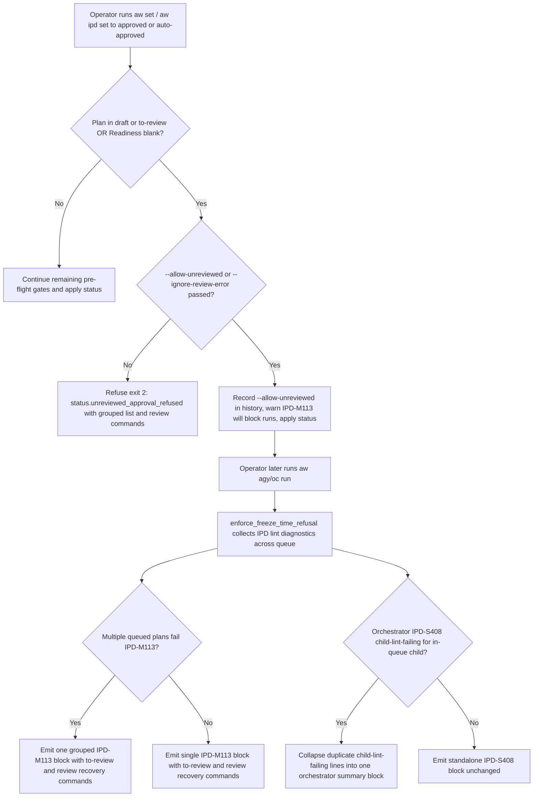

# IPD: Gate unreviewed plan approval in aw set and group actionable IPD-M113/IPD-S408 runner preflight diagnostics

- Date: 2026-11-27
- Kind: child
- Concern: Setter safety and runner preflight diagnostic clarity for unreviewed plans
- Scope: Refuse unreviewed plan approval in aw set unless --allow-unreviewed (alias --ignore-review-error) is passed, and group actionable IPD-M113/IPD-S408 runner freeze-time preflight diagnostics
- Scope-Paths: .aw/records/plans/pending/20261127-reviewgateux-01-55tt85-gate-unreviewed-plan-approval-in-aw-set-and-group-actionable.ipd.md, agent_workflows/status_set.py, agent_workflows/cli.py, agent_workflows/runner_shared.py, tests/test_plan_transition_gate.py, tests/test_freeze_time_refusal.py, tests/test_status_set.py, tests/test_*.py
- Item-Dependencies: none
- From-Spec: none
- Status: to-review
- Short-Description: Refuse approving unreviewed plans without --allow-unreviewed and group actionable IPD-M113/IPD-S408 preflight errors
- Work-Kind: feature
- Priority: high
- Set: reviewgateux
- Order: 1
- Highest E allocated: 05
- Author: antigravity/gemini
- Id: 55tt85

> Write and proofread this plan per the technical writing standard, `.aw/system/workflows/technical-writing/technical-writing.md` (`.agents/workflows/technical-writing/technical-writing.md` in a legacy-layout install), including requirement 12 (diagrams).

## Workflow history

- 2026-11-27 draft (antigravity/gemini): created.
- 2026-11-27 to-review (antigravity/gemini): authored review-ready plan for the unreviewed-approval gate and grouped IPD-M113/IPD-S408 runner preflight diagnostics.

## Goal

Prevent operators from accidentally moving unreviewed plans directly to `approved` or `auto-approved` without a `- Readiness:` review attestation, and replace repetitive per-plan `IPD-M113` and per-child `IPD-S408` runner preflight blocks with one grouped refusal that prints the exact recovery commands.



## Detailed Implementation Checklist (TODO)

Execution-state rule: mark an `E-*` item complete only after performing the action. That mark is not validation. Right-sizing rule: write for a modest executor that cannot hold much in its head. Each E-item is one step (one concern, about one file, executable in one focused pass) and its V-item names each unit it covers with its own check; a plan stays at about 5 E-items and 8 work Scope-Paths, else split it into more child plans (guidance, `IPD-Z603`). Accepted execution states: blocked, failed, pending, performed; terminal gate demands 'performed'.

### Task group 1: Gate unreviewed plan approval in `aw set`

- [ ] E-01 Add the `status.unreviewed_approval_refused` pre-flight gate, grouped refusal rendering, and `--allow-unreviewed` audit trail in `agent_workflows/status_set.py`.
  - Depends on: none
  - Expected outcome: `run_set_command` refuses moving any plan to `approved` or `auto-approved` (any status in `ipd_schema.READY_TO_EXECUTE`) when the plan is currently in `draft` or `to-review`, or when its `readiness` field from `_record_state(rec, repo_root)` is missing or blank, unless `args.allow_unreviewed` is true. Refusals exit with code `2`, leave all target files unchanged, and render one grouped human summary (and structured `CommandResult` in `--json`/`--agent` mode) listing all affected plans, explaining that `/plan-review` must write `- Readiness:` before runners will execute them, and printing exact next commands (`aw agy review <sel>`, `aw oc review <sel>`, `aw agy run --full-auto <sel>`, and the `_retry_command` override with `--allow-unreviewed`). Generic `--force` does not bypass this gate. When `args.allow_unreviewed` is true, `_prepare_status_change` appends `, --allow-unreviewed` to the workflow history actor and `"allow-unreviewed"` to `event_overrides`, `_RETRY_FLAG_ALLOWLIST` includes `("allow_unreviewed", "--allow-unreviewed", False)`, and `run_set_command` writes a visible warning stating that `- Readiness:` was not written and that `aw check plans` and `aw agy|oc run` will refuse execution with `IPD-M113` until `/plan-review` runs.
  - Execution state: pending

- [ ] E-02 Register `--allow-unreviewed` with alias `--ignore-review-error` on all four `set` parsers in `agent_workflows/cli.py`.
  - Depends on: E-01
  - Expected outcome: `p_ipd_set`, `p_set`, `p_backlog_set`, and `p_specs_set` in `agent_workflows/cli.py` each accept `--allow-unreviewed` and `--ignore-review-error` (`dest="allow_unreviewed"`, `action="store_true"`, default `False`), matching the uniform declaration of `--allow-terminal-reopen` and `--allow-open-questions`. Help text explains that the flag overrides the unreviewed-plan approval refusal, records the override in workflow history, does not write `- Readiness:`, and does not prevent `IPD-M113` at lint or run time. Non-plan record types (`specs`, `backlog`, `prompts`, `releases`, `research`) ignore the flag with no behavioral change.
  - Execution state: pending

### Task group 2: Group and improve runner freeze-time preflight diagnostics

- [ ] E-03 Group repeated IPD lint findings, collapse redundant in-queue orchestrator `IPD-S408` `child-lint-failing` lines, and emit actionable `IPD-M113` recovery commands in `agent_workflows/runner_shared.py::enforce_freeze_time_refusal`.
  - Depends on: none
  - Expected outcome: `enforce_freeze_time_refusal` collects IPD structural lint diagnostics across the frozen queue before assembling `findings` strings. It applies three transformations while preserving the `[RUN-STRUCTURE-PREFLIGHT]` marker, rule codes (`IPD-M113`, `IPD-S408`), and ANSI id6 highlighting: (1) for `IPD-M113` on plans in `approved` or `auto-approved`, `Next:` prints `aw set plan to-review <ids> -m "needs /plan-review before approval"` followed by `aw <host> review <ids>` instead of generic `fix the issue above`; (2) when two or more queued plans produce the same `(code, status, message)` diagnostic (including `IPD-M113` across N plans), they collapse into one grouped `[RUN-STRUCTURE-PREFLIGHT]` block listing all affected plan IDs once, one plain explanation, and one combined `Next:` command; and (3) when an orchestrator emits `IPD-S408` diagnostics with `child-lint-failing (<child_id6>)` for child IDs that already have structural lint diagnostics reported in the same queue, those duplicate per-child blocks collapse into one concise orchestrator summary block naming the already-reported child IDs, while non-duplicate `IPD-S408` findings (such as `coverage-record-stale`, `child-missing`, or out-of-queue failing children) continue to emit individually.
  - Execution state: pending

### Task group 3: Behavioral tests, fixture alignment, and full verification

- [ ] E-04 Add behavioral tests for the unreviewed-approval gate and grouped preflight diagnostics, and align existing orthogonal test fixtures that approve plans without `- Readiness:`.
  - Depends on: E-01, E-02, E-03
  - Expected outcome: `tests/test_plan_transition_gate.py` covers: (a) refusing `draft -> approved`, `to-review -> approved`, `to-review -> auto-approved`, and `reviewed` (without `- Readiness:`) `-> approved` with exit `2` and byte-identical files across both `aw set` and `aw ipd set`; (b) refusing a multi-plan Set in one grouped human block and in `--json` and `--agent` `CommandResult` output; (c) refusing when only `--force` is passed; (d) succeeding with `--allow-unreviewed` and with alias `--ignore-review-error`, recording `, --allow-unreviewed` in workflow history and emitting the `IPD-M113` warning; (e) accepting `reviewed` plans that carry `- Readiness:` without any override flag; and (f) leaving non-plan record types (`specs`, `backlog`) unaffected. `tests/test_freeze_time_refusal.py` covers: (a) grouping N `approved` plans lacking `- Readiness:` into one `IPD-M113` `[RUN-STRUCTURE-PREFLIGHT]` block listing all N IDs once; (b) emitting the actionable `aw set plan to-review ... -m ...` and `aw <host> review ...` recovery commands for both single-plan and multi-plan `IPD-M113` refusals across both `oc` and `agy` hosts; (c) collapsing duplicate orchestrator `IPD-S408` `child-lint-failing` lines when the failing children are in the same queue into one orchestrator summary block; and (d) preserving standalone `IPD-S408` diagnostics (such as `coverage-record-stale` or an out-of-queue failing child). Existing orthogonal tests in `tests/test_status_set.py` and any other `tests/test_*.py` that approve `draft`/`to-review`/Readiness-less plans to test unrelated flags are updated to use reviewed plans with `- Readiness: go-pending-approval` (or `--allow-unreviewed` where testing raw `draft -> approved`).
  - Execution state: pending

- [ ] E-05 Run type checks, the core test suite, and the leak sanitizer, then commit only the modified paths through `aw commit`.
  - Depends on: E-04
  - Expected outcome: `python3 -m mypy agent_workflows/status_set.py agent_workflows/cli.py agent_workflows/runner_shared.py`, bare `python3 -m pytest`, and `aw sanitize --agent` all pass with zero failures or findings, and all modified paths are committed cleanly via `aw commit 55tt85 -- <paths>` (no push).
  - Execution state: pending

## Project conventions discovered (Step 0)

- `agent_workflows/ipd_lint.py::check_readiness_required` enforces `C_READINESS_REQUIRED` (`IPD-M113`) on every plan whose status is in `_READINESS_GATED_STATUSES` (`reviewed`, `approved`, `auto-approved` via `ipd_schema.READY_TO_EXECUTE`) when `Readiness` (`ipd_schema.META_READINESS`) is missing or blank.
- `agent_workflows/status_set.py::_record_state` already reads `state["readiness"]` via `artifact_meta`, so checking readiness through `_record_state` works for both legacy markdown header records and metastore log-format records without separate markdown parsing.
- `agent_workflows/status_set.py::run_set_command` runs pre-flight gates in lettered stages before any file write or move, collects `_Refusal` entries into `refusals`, and delegates batch refusal output to `_render_refuse_batch` (supporting human, `--json`, and `--agent` modes, plus `--skip-refused` when some records pass).
- `agent_workflows/status_set.py::_prepare_status_change` records explicit override flags in both the human workflow history actor string (`f"{actor}, --allow-terminal-reopen"`) and `event_overrides` (`"allow-terminal-reopen"`), and `_RETRY_FLAG_ALLOWLIST` lists echo-safe flags for `_retry_command`.
- `agent_workflows/cli.py` registers explicit named override flags (`--allow-open-questions`, `--allow-terminal-reopen`) uniformly across all four `run_set_command` parsers (`p_ipd_set`, `p_set`, `p_backlog_set`, `p_specs_set`) and intentionally never overloads `--force`, which means "act on all of an ambiguous multi-match" on the `set` path.
- `agent_workflows/ipd_lifecycle.py::_LEGAL_BACKWARD_EDGES` permits `("approved", "to-review")` and `("auto-approved", "to-review")` when `--message` is supplied (enforced by `status.backward_plan_message_required`), so `aw set plan to-review <ids> -m "needs /plan-review before approval"` is a legal recovery command.
- `agent_workflows/runner_shared.py::enforce_freeze_time_refusal` checks every queued artifact before creating durable run state, prefixes structural refusals with `[RUN-STRUCTURE-PREFLIGHT]`, highlights IDs with `_highlight_id6_token`, and raises `DriverError` ending with `"No work started, and nothing durable was created."`.
- `agent_workflows/orchestrator_readiness.py` emits `CODE_CHILD_LINT` (`"child-lint-failing"`) findings inside `IPD-S408` with detail starting `"child-lint-failing (<child_id6>): ..."`.
- Existing test fixtures in `tests/test_status_set.py` (`StatusSetTestBase.create_plan` defaults to `status="draft"` with no `readiness`) and several sibling `tests/test_*.py` modules test orthogonal `aw set approved` behaviors (such as `--dry-run`, `--json`, `--allow-open-questions`, and option placement) and must be aligned with the new gate in E-04.

## Findings

| ID | Observation | Impact | Plan item |
| --- | --- | --- | --- |
| F-01 | `agent_workflows/status_set.py::run_set_command` validates specs in memory via `specs.validate_spec` before writing, but has no pre-flight review or readiness gate for plans advancing to `approved` or `auto-approved`. | Running `aw set plan approved <setid>` on six `to-review` plans succeeded without warning and committed six `IPD-M113`-invalid files. | E-01, E-02 |
| F-02 | In `agent_workflows/status_set.py::run_set_command`, orchestrator readiness step `(f)` passes `status_overrides` while linting child files on disk at their pre-write status (`to-review`), where `IPD-M113` does not trigger. | Even the orchestrator readiness gate missed that approving the Set would immediately break `IPD-M113` on every child. Placing the new unreviewed-approval gate ahead of step `(f)` catches all unreviewed plans in one grouped refusal, while still allowing `--allow-unreviewed` to proceed with a loud warning rather than a confusing secondary step `(f)` refusal. | E-01 |
| F-03 | `agent_workflows/runner_shared.py::enforce_freeze_time_refusal` formats one multi-line `[RUN-STRUCTURE-PREFLIGHT]` block per diagnostic per queued artifact, with generic `Next: fix the issue above, run aw check plans <id6>, then: aw <host> run <id6>`. | On a 6-plan Set approved without review, `aw agy run all` emitted 6 identical `IPD-M113` blocks plus 5 identical orchestrator `IPD-S408: child-lint-failing` copies (11 redundant blocks) without telling the user to return the plans to `to-review` and run `aw <host> review`. | E-03 |
| F-04 | Generic `--force` already has a distinct meaning on `aw set` ("act on all of an ambiguous multi-match"). | Reusing `--force` to bypass review gating would silently mix selector disambiguation with safety bypasses; a dedicated `--allow-unreviewed` flag (with `--ignore-review-error` alias) matches `--allow-terminal-reopen` and `--allow-open-questions`. | E-01, E-02 |

## Proposed changes (ordered, validatable)

1. **`agent_workflows/status_set.py` (E-01):**
   - Add a helper `_plan_missing_review_attestation(rec: ArtifactRecord, repo_root: Path) -> tuple[bool, str]` that checks normalized current status (`cur_status = normalize_target_status(rec.status or "draft", "plans").strip().lower()`) and readiness (`readiness = (_record_state(rec, repo_root).get("readiness") or "").strip()`). It returns `(True, reason)` when `cur_status in ("draft", "to-review")` (not yet reviewed; include whether `Readiness` is also missing) or when `not readiness` (missing or blank `- Readiness:` attestation). It returns `(False, "")` when the plan is at `reviewed` (or already in `READY_TO_EXECUTE`) with a non-empty `readiness`.
   - In `run_set_command`, immediately after step `(e)` (`status.backward_plan_message_required`) and before step `(f)` (`status.orchestrator_not_ready`), add step `(e2)`: when `norm_plans_target in _ipd_schema.READY_TO_EXECUTE` and `not getattr(args, "allow_unreviewed", False)`, iterate over non-refused `plans` records in `matched_records`; for each record where `_plan_missing_review_attestation` returns `(True, reason)`, append `_Refusal(record=rec, rule="status.unreviewed_approval_refused", exit_code=2, reason=reason, remedy=...)` and add `rec.path` to `refused_paths`.
   - In `_render_refuse_batch`:
     - In `--agent`/`--json` mode, when `all(r.rule == "status.unreviewed_approval_refused" for r in refusals)`, emit a `CommandResult(command="set", status="cannot-run", exit_code=2, ...)` with per-record `Diagnostic(rule="status.unreviewed_approval_refused", ...)` and `NextAction` items for `aw agy review <ids>`, `aw oc review <ids>`, and `_retry_command(..., extra=["--allow-unreviewed", "--yes"])`.
     - In human mode, suppress per-record generic loop lines for `status.unreviewed_approval_refused` (just like `status.terminal_reopen_refused` and `status.backward_plan_message_required`) and render ONE grouped `term.status("fail", ...)` block listing the count, each affected plan (`<id6>: <cur_status> -> <target> (<reason>)`), a short plain explanation that approving unreviewed plans skips `/plan-review` and leaves `- Readiness:` unset so runners will refuse them with `IPD-M113`, and three clear commands:
       - Review first: `aw agy review <sel>` (or `aw oc review <sel>`)
       - Review and execute end-to-end: `aw agy run --full-auto <sel>` (or `aw oc run --full-auto <sel>`)
       - Override anyway (records `--allow-unreviewed` in history; does not write `- Readiness:`): `<retry_cmd with --allow-unreviewed>`
   - Add `("allow_unreviewed", "--allow-unreviewed", False)` to `_RETRY_FLAG_ALLOWLIST`.
   - In `_prepare_status_change`, when `getattr(args, "allow_unreviewed", False)` is true on a plan moving to `READY_TO_EXECUTE` that fails `_plan_missing_review_attestation`, append `, --allow-unreviewed` to `actor` and `"allow-unreviewed"` to `event_overrides`.
   - When `--allow-unreviewed` overrides at least one plan in `run_set_command` (non-dry-run), emit one prominent warning (`term.status("warn", ...)` in human mode or stderr warning) naming the overridden plan IDs and stating that `- Readiness:` was not written, so `aw check plans` and `aw agy|oc run` will refuse them with `IPD-M113` until `/plan-review` runs.

2. **`agent_workflows/cli.py` (E-02):**
   - Register `--allow-unreviewed` and `--ignore-review-error` (`dest="allow_unreviewed"`, `action="store_true"`, `default=False`) on all four `set` parsers: `p_ipd_set`, `p_set`, `p_backlog_set`, and `p_specs_set`, directly beside `--allow-terminal-reopen`. Include a comment explaining why generic `--force` is not overloaded and why all four parsers declare it uniformly.

3. **`agent_workflows/runner_shared.py` (E-03):**
   - In `enforce_freeze_time_refusal`, collect structured IPD lint diagnostics across all queued IPD items before formatting them into `findings`: record `(id6, styled_id6, rel_path, status, code, message)`.
   - Compute `failing_ipd_ids = {rec.id6 for rec in ipd_diags if rec.code != "IPD-S408"}` (or all IDs with any non-orchestrator-wrapper lint diagnostic in this pass).
   - For each orchestrator's `IPD-S408` diagnostics, inspect whether `message` matches `child-lint-failing (<child_id6>)` where `<child_id6>` is in `failing_ipd_ids`. Separate those redundant child-lint findings from standalone `IPD-S408` findings (such as `coverage-record-stale`, `child-missing`, or an out-of-queue failing child). Emit standalone `IPD-S408` findings as individual `[RUN-STRUCTURE-PREFLIGHT]` blocks, and collapse all redundant in-queue `child-lint-failing` findings for that orchestrator into ONE concise block:
     ```text
     [RUN-STRUCTURE-PREFLIGHT] ipd <styled_orch_id6> (<rel_path>) in status <status> violates IPD-S408:
       Problem: child-lint-failing for <N> child plan(s) already reported above (<styled_child_1>, <styled_child_2>, ...).
       Next:    resolve the child plan findings above, then re-run: aw <host> run <styled_orch_id6>
     ```
   - For all remaining IPD diagnostics, group by `(code, status, message)` while preserving first-seen order:
     - When `code == "IPD-M113"` and `status in ("approved", "auto-approved")`:
       - Build plain space-separated `id_list = " ".join(r.id6 for r in group)` and styled `styled_id_list = ", ".join(r.styled_id6 for r in group)`.
       - Build actionable `Next:` lines:
         `aw set plan to-review <id_list> -m "needs /plan-review before approval"`
         `aw <host> review <id_list>`
       - If `len(group) == 1`: keep `[RUN-STRUCTURE-PREFLIGHT] ipd <styled_id6> (<rel_path>) in status <status> violates IPD-M113:` with a concise `Problem:` explaining that the plan was approved without `/plan-review` (missing `- Readiness:`) and the actionable `Next:` commands above.
       - If `len(group) >= 2`: emit ONE grouped block:
         ```text
         [RUN-STRUCTURE-PREFLIGHT] <N> ipd plan(s) in status <status> violate IPD-M113 (missing - Readiness: review attestation):
           Plans:   <styled_id_list>
           Problem: These plans were set to <status> without running /plan-review, so they have no '- Readiness:' attestation and cannot execute yet.
           Next:    return them to to-review, then run /plan-review:
                    aw set plan to-review <id_list> -m "needs /plan-review before approval"
                    aw <host> review <id_list>
         ```
     - For any other IPD code with `len(group) >= 2` and identical `(code, status, message)`: emit ONE grouped `[RUN-STRUCTURE-PREFLIGHT]` block listing `Plans: <styled_id_list>`, the single `Problem:`, and one `Next:` line (`fix the issue above, run aw check plans <id_list>, then: aw <host> run <id_list>`).
     - For any other IPD code with `len(group) == 1`: keep the existing single-plan `[RUN-STRUCTURE-PREFLIGHT]` format unchanged.

4. **Tests (`tests/test_plan_transition_gate.py`, `tests/test_freeze_time_refusal.py`, `tests/test_status_set.py`, and affected `tests/test_*.py`) (E-04):**
   - Add dedicated tests in `tests/test_plan_transition_gate.py` for the unreviewed-approval gate across human, `--json`, and `--agent` output, multi-plan Sets, `--force` non-bypass, `--allow-unreviewed` and `--ignore-review-error`, workflow history recording, stderr/terminal warning, reviewed-with-Readiness pass-through, and non-plan indifference.
   - Add dedicated tests in `tests/test_freeze_time_refusal.py` for multi-plan `IPD-M113` grouping, single-plan and multi-plan `IPD-M113` actionable `to-review` + `review` recovery commands across both `oc` and `agy`, collapsed in-queue orchestrator `IPD-S408` `child-lint-failing` summaries, and preserved standalone `IPD-S408` findings (`coverage-record-stale` and out-of-queue failing child).
   - Audit and update existing orthogonal test fixtures in `tests/test_status_set.py` (and any other `tests/test_*.py` flagged by `python3 -m pytest`) that approve unreviewed fixtures so they reflect reviewed plans with `- Readiness: go-pending-approval` (or explicitly pass `--allow-unreviewed` when testing raw `draft -> approved`).

## Deferred / out of scope (with reason)

- **Allowing `aw set plan approved --allow-unreviewed` to synthesize a fake `- Readiness:` value:** Out of scope and intentionally prohibited; `IPD-M113` forbids hand-written or fabricated readiness attestations because only `/plan-review` may attest review readiness.
- **Interactive prompt inside `aw set plan approved` offering to launch `/plan-review` automatically:** Out of scope; `aw set` is a synchronous metadata command and must not spawn an LLM host process. Printing the exact `aw agy review` / `aw oc review` command keeps the boundary clean and script-safe.
- **Grouping non-IPD preflight findings (specs, backlog, dependency-unsatisfiable):** Out of scope for this plan; dependency-unsatisfiable frontier UX is tracked separately in backlog `oxv48x`.

## Scope check

- Over-scope: none. Changes stay strictly within `agent_workflows/status_set.py`, `agent_workflows/cli.py`, `agent_workflows/runner_shared.py`, and test files under `tests/`.
- Under-scope: none. Both halves of the user-reported failure (permitting unreviewed approval in `aw set` without an explicit named override, and emitting N redundant `IPD-M113` + `IPD-S408` preflight blocks in `enforce_freeze_time_refusal`) are addressed together, and existing orthogonal test fixtures are explicitly accounted for in E-04.

## Required tests / validation

1. Targeted test suites:
   - `python3 -m pytest tests/test_plan_transition_gate.py tests/test_freeze_time_refusal.py tests/test_status_set.py`
2. Type checking on all modified production modules:
   - `python3 -m mypy agent_workflows/status_set.py agent_workflows/cli.py agent_workflows/runner_shared.py`
3. Full core test suite (bare, honoring `GEMINI.md` and `AGENTS.md` rules without `-n0`, extra `-q`, or `-p no:randomly`):
   - `python3 -m pytest`
4. Leak sanitizer:
   - `aw sanitize --agent`

## Spec / documentation sync

- CLI help strings on `aw set`, `aw ipd set`, `aw backlog set`, and `aw specs set` are updated directly in `agent_workflows/cli.py` (E-02) to document `--allow-unreviewed` and `--ignore-review-error`.
- No existing standalone spec file requires modification because `ipd-spec` (`rdyreq` `fhinri`) already mandates `- Readiness:` on `reviewed`, `approved`, and `auto-approved` plans, and this plan enforces that existing contract earlier at the setter boundary and formats existing `z7nbn1` freeze-time refusals without changing their exit semantics.

## Open questions

None open.

## Validation and cross-check (verify before reporting done)

Validation-state rule: inspect evidence in a separate pass. Do not mark a `V-*` item complete from memory or from the matching execution checkmark. Accepted validation results: blocked, failed, pass, pending; terminal gate demands 'pass'. Runtime-demonstration reachability rule: for each `V-*` item demanding the software be observed acting (such as a run, a dispatch, or a transition; as distinct from items demanding a diff, a file's content, or a test result, which are reachable by construction), name the code path that produces the observation or the sibling `E-*` that creates it, else the demand is UNDER-SCOPE.

- [ ] V-01 validates E-01
  - Required evidence: Paste `git diff -- agent_workflows/status_set.py` (or summary of added symbols) confirming `_plan_missing_review_attestation`, step `(e2)` refusal rule `status.unreviewed_approval_refused` (exit 2), grouped `_render_refuse_batch` human and `--json`/`--agent` output, `_RETRY_FLAG_ALLOWLIST` entry, `_prepare_status_change` actor/event override recording, and the `IPD-M113` warning on override; plus pasted test execution output from `python3 -m pytest tests/test_plan_transition_gate.py` exercising `run_set_command` via `cli.main` for refusal, multi-plan grouping, `--force` non-bypass, and `--allow-unreviewed` override.
  - Observed evidence:
  - Result: pending

- [ ] V-02 validates E-02
  - Required evidence: Paste `aw ipd set --help`, `aw set --help`, `aw backlog set --help`, and `aw specs set --help` excerpts (or `python3 -m pytest tests/test_plan_transition_gate.py` parser/CLI invocation output) proving `--allow-unreviewed` and `--ignore-review-error` are accepted across all four `set` parsers in `agent_workflows/cli.py` and ignored cleanly by non-plan record types.
  - Observed evidence:
  - Result: pending

- [ ] V-03 validates E-03
  - Required evidence: Paste `python3 -m pytest tests/test_freeze_time_refusal.py` output (and one pasted refusal message produced by `enforce_freeze_time_refusal` on a multi-plan unreviewed Set with an orchestrator) demonstrating: (1) one grouped `[RUN-STRUCTURE-PREFLIGHT]` `IPD-M113` block listing all affected plan IDs once; (2) actionable `aw set plan to-review <ids> -m "needs /plan-review before approval"` and `aw <host> review <ids>` lines for both `oc` and `agy`; (3) one collapsed orchestrator `IPD-S408` summary line for in-queue failing children; and (4) preserved standalone `IPD-S408` output for `coverage-record-stale` and out-of-queue failing children.
  - Observed evidence:
  - Result: pending

- [ ] V-04 validates E-04
  - Required evidence: Paste full pytest output from `python3 -m pytest tests/test_plan_transition_gate.py tests/test_freeze_time_refusal.py tests/test_status_set.py` showing all new behavioral tests and aligned fixtures passing with zero failures, zero skips introduced, and zero code-pinning (`inspect`/`ast`/source-regex) assertions in the added tests.
  - Observed evidence:
  - Result: pending

- [ ] V-05 validates E-05
  - Required evidence: Paste actual command output from `python3 -m mypy agent_workflows/status_set.py agent_workflows/cli.py agent_workflows/runner_shared.py`, bare `python3 -m pytest`, `aw sanitize --agent`, and `git show --stat HEAD` after committing via `aw commit 55tt85 -- <paths>`, confirming zero errors, zero sanitizer findings, and strictly path-scoped commit contents with no push.
  - Observed evidence:
  - Result: pending

## Approval and execution gate

- Size assessment: standard
- Cohesion rationale: not required

This plan must be reviewed (`/plan-review`) and explicitly approved by the human maintainer before execution. Execution must take place in an isolated git worktree (`GEMINI.md` rule 1), commit only the scoped files through `aw commit 55tt85 -- <paths>`, and never push or tag.

Post-gate lifecycle move (executed AFTER all `E-*` items are `performed` and all `V-*` items are `pass`):
- When executing inside a managed runner lane (`aw agy run` / `aw oc run`), leave finalization (`aw ipd finalize`) to the runner's merge-and-revalidate gate; commit the updated plan file in `pending/` with all `E-*` and `V-*` evidence recorded.
- When executing by hand outside a managed lane, run `aw ipd finalize 55tt85 --actor <actor>` after validation passes so the plan transitions cleanly to `executed/` in a path-scoped lifecycle commit, then integrate onto `main` under `aw integration-lock`.
