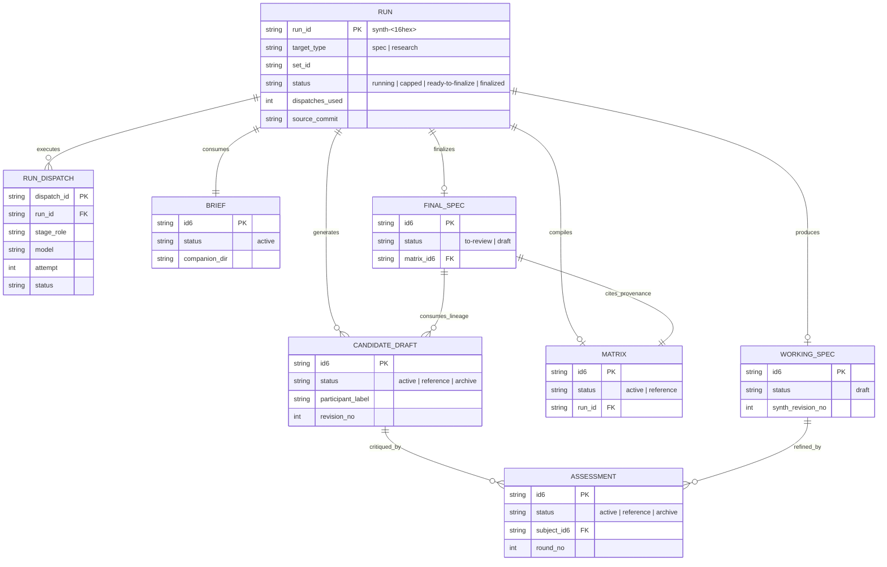

# Section-by-Section Assessment: Candidate Specs 18hh1u (C01) and yfz5u9 (C03)

## 1. Identity and independence

- **Agent Environment (ACE)**: Antigravity CLI (`agy`), executing in a remote Linux workspace.
- **Model**: Gemini 3.8 Flash High (`gemini38flashhigh`), as reported by the host environment.
- **Reasoning Effort**: High.
- **Inspected Commit**: `933b94b74c2c0f8cb2507cd93c56c3601afc7c6a` (HEAD of `main`).
- **Inputs Read in Full**:
  - `C01`: `.aw/records/specs/draft/20261024-specflow-01-18hh1u-spec-research-synthesis.spec.md` (1,467 lines, candidate spec `18hh1u`, 24 refinement iterations).
  - `C03`: `.aw/records/specs/draft/20261024-specflow-03-yfz5u9-spec-research-synthesis.spec.md` (2,149 lines, candidate spec `yfz5u9`, 8 refinement iterations + 3 review passes).
  - `MS`: `.aw/records/specs/reviewed/20260925-metastore-01-4sd62s-artifact-metadata-store.spec.md` (1,797 lines, artifact metadata store spec `4sd62s`). Current status confirmed via `aw find 4sd62s` and `aw specs check` as `reviewed` (`Blocks-Release: next`).
  - `WR`: `tmp/20261025-technical-artifact-writing-requirements.md` (78 lines, 11 numbered requirements).
  - Supporting sources: `agent_workflows/` codebase, `.aw/records/research/README.md`, `.aw/records/specs/README.md`, and prior refinement assessment `yibf7z` (`.aw/records/research/20261024-specflow-16-yibf7z-spec-research-synthesis-review.opus55high.assessment.md`).
- **Independence Statement**: The reviewing agent has not seen, received, or consulted any prior comparative analysis of `18hh1u` and `yfz5u9`. This assessment was conducted completely independently from source artifacts and code.
- **Binding Maintainer Rulings**:
  - `DL-16` (OQ-1, 2026-10-25): Every intermediate artifact (candidates, refinement findings, matrices) lives in the research tree as a research record or a brief companion file.
  - `DL-17` (OQ-2, 2026-10-25): Finalize moves a spec to `to-review` automatically only after a synthesis across candidates from at least two distinct models. Otherwise the spec stays `draft`.

## 2. Summary

1. Candidate C03 (`yfz5u9`) provides a superior execution engine, rigorous multi-model gating, and closed dispatch arithmetic.
2. Candidate C01 (`18hh1u`) provides superior architectural concepts for two-pass hierarchical synthesis, fine-grained provenance tagging, and epistemic claim classification.
3. Metastore spec `4sd62s` (MS) governs persistence: all tracked artifacts use two-key front matter (`id`, `status`), no markdown workflow history, and per-artifact JSONL event logs.
4. Candidate intermediate artifacts live in `.aw/records/research/` per maintainer ruling DL-16.
5. Finalize automatically advances to `to-review` only after synthesis across at least two distinct requested models per maintainer ruling DL-17.
6. Adopt C03's `R-01` through `R-118` core requirements and graft C01's two-pass hierarchical synthesis (`FR-34`) and epistemic taxonomy (`FR-18C`).
7. Adopt C03's typed run identifier schema (`synth-<16hex>`) to prevent collisions with artifact `id6` namespaces.
8. Adopt C03's single dispatch counter ceiling (`min(W, --max-dispatches)`) to bound all turns and retries deterministically.
9. Two primary design choices require maintainer ruling: CLI noun grammar (`aw synth` versus `aw specs flow` / `aw research flow`) and intermediate working spec placement (`specs/draft/` versus the research tree).
10. Writing assessments reveal that both candidates require systematic cleanup: C01 contains academic jargon and an un-fenced heading; C03 contains sentence-length compound obligations.
## 3. Alignment table

This table aligns every heading at every level from candidate C01 (`18hh1u`) and candidate C03 (`yfz5u9`) against the proposed merged specification outline. Every heading from both candidate documents appears in this table.

| Topic | C01 Section IDs | C03 Section IDs | Proposed Synthesized Section ID |
| --- | --- | --- | --- |
| Document Title | # Spec: Configurable Spec and Research Synthesis | # Spec: Multi-participant spec and research synthesis (aw synth) | # Spec: Multi-Participant Spec and Research Synthesis |
| Workflow History | ## Workflow history | ## Workflow history | ## Workflow history |
| 0. Terms, Status, and Baseline | ## 0. Terms used in this spec | ## 0. Candidate status, baseline, and how to read this document | ## 0. Terms, Candidate Status, and Baseline |
| 1.0 Summary & Problem Area | ## 1. Summary, Problem, Actors, Goals, Non-Goals, and First-Release Boundary | ## 1. Summary, problem, actors, goals, non-goals, first-release boundary | ## 1. Summary, Problem, Actors, Goals, Non-Goals, and First-Release Boundary |
| 1.1 Summary | ### 1.1 Summary | ### 1.1 Summary | ### 1.1 Summary |
| 1.2 Problem Statement | ### 1.2 Problem Statement | ### 1.2 Problem | ### 1.2 Problem Statement |
| 1.3 Target Actors | ### 1.3 Target Actors | ### 1.3 Actors | ### 1.3 Target Actors |
| 1.4 Goals | ### 1.4 Goals | ### 1.4 Goals | ### 1.4 Goals |
| 1.5 Non-Goals | ### 1.5 Non-Goals | ### 1.5 Non-goals | ### 1.5 Non-Goals |
| 1.6 First-Release Boundary | ### 1.6 Explicit First-Release Boundary (Phase 1) | ### 1.6 First-release boundary | ### 1.6 First-Release Boundary |
| 2.0 Repository Findings & Integration | ## 2. Repository Findings and Integration Seams | ## 2. Repository findings and integration | ## 2. Repository Findings and Integration Seams |
| 2.1 Codebase Inspection Baseline & Findings | ### 2.1 Codebase Inspection Baseline | ### 2.1 Findings that decide the design | ### 2.1 Codebase Inspection Baseline and Deciding Findings |
| 2.2 Integration Seams / Reuse-Change-Gap | ### 2.2 Integration Seams and Findings | ### 2.2 Existing / reuse / change / gap table | ### 2.2 Existing / Reuse / Change / Gap Analysis |
| 2.3 Inspection Discrepancies | none | ### 2.3 Discrepancies found while inspecting (recorded, not fixed here) | ### 2.3 Inspection Discrepancies (Recorded, Not Fixed Here) |
| 3.0 CLI Design | ## 3. CLI Design, Intermediate Placement Architecture, and Command Matrix | ## 3. CLI design | ## 3. CLI Design and Command Interface |
| 3.1 Grammar Alternatives Evaluation | ### 3.1 Evaluation of CLI Grammar Families | ### 3.1 Alternatives compared | ### 3.1 Evaluation of CLI Grammar Families |
| 3.2 Canonical Grammar Decision | ### 3.2 Canonical CLI Grammar Decision | ### 3.2 Canonical grammar [PROPOSED] | ### 3.2 Canonical CLI Grammar Decision |
| 3.3 Selectors and Precedence | none | ### 3.3 Selectors and precedence | ### 3.3 Selectors and Precedence |
| 3.4 Modes: Concise/Explicit & Quick/Thorough | ### 3.5 Concise and Explicit Forms, Roster Specs, and Mode | ### 3.4 Modes: short invocation versus short workflow | ### 3.4 Modes: Invocation Syntax and Workflow Depth |
| 3.5 Command Matrix | ### 3.4 Command Matrix | ### 3.5 Command matrix [PROPOSED] | ### 3.5 Command Matrix |
| 3.6 Per-Command Contracts | none | ### 3.6 Per-command contracts [PROPOSED] | ### 3.6 Per-Command Contracts |
| 4.0 Functional Requirements | ## 4. Functional Requirements | ## 4. Functional requirements [PROPOSED] | ## 4. Functional Requirements |
| 4.1 Entry Points, Run Control, Inputs | ### 4.1 Input Specification and Baseline Freezing | ### 4.1 Entry points and run control | ### 4.1 Entry Points, Run Control, and Input Freezing |
| 4.2 Participants, Roster, Configuration | none | ### 4.2 Participants, roster, configuration | ### 4.2 Participants, Roster, and Configuration |
| 4.3 Inputs, Obligations, Prompts | none | ### 4.3 Inputs, obligations, prompts | ### 4.3 Inputs, Obligations, and Rendered Prompts |
| 4.4 Candidate Generation & Independence | ### 4.2 Independent Candidate Generation | ### 4.4 Generation and independence | ### 4.4 Candidate Generation and Independence |
| 4.5 Refinement Loops & Bounds | ### 4.3 Controlled Iterative Refinement and Execution Bounds | ### 4.5 Refinement loops | ### 4.5 Refinement Loops and Convergence Controls |
| 4.5.1 Work Arithmetic & Mathematical Bounds | #### 4.3.1 Mathematical Proof of Execution Bounds and Work Arithmetic | none | ### 4.5.1 Work Arithmetic and Closed Dispatch Ceilings |
| 4.6 Synthesis & Provenance | ### 4.4 Synthesis and Accountable Provenance | ### 4.6 Synthesis and provenance | ### 4.6 Synthesis, Reconciliation Matrix, and Provenance |
| 4.7 Context Size & Splitting | none | ### 4.7 Context size and splitting | ### 4.7 Context Size Limits and Candidate Splitting |
| 4.8 Finalization & Lifecycle | none | ### 4.8 Finalization and lifecycle | ### 4.8 Finalization, Verification Gates, and Lifecycle |
| 4.9 Identity, Naming, Persistence | none | ### 4.9 Identity, naming, persistence | ### 4.9 Identity, Naming, and Persistence Rules |
| 4.10 Safety, Execution, Recovery | none | ### 4.10 Safety, execution, recovery | ### 4.10 Execution Safety, Worktree Isolation, and Recovery |
| 4.11 Owner-Verb & Grammar Extensions | none | ### 4.11 Owner-verb and grammar extensions | ### 4.11 Owner-Verb Extensions and CLI Hooks |
| 4.12 Machine Protocol Parity | ### 4.6 Intermediate Staging, Attention Surfacing, and Protocol Parity | ### 4.12 Machine protocol | ### 4.12 Machine Protocol and Output Streaming |
| 4.13 Research-Specific Requirements | ### 4.5 Research Reconciliation and Evidence | ### 4.13 Research-specific | ### 4.13 Research-Specific Requirements and Citations |
| 5.0 Configuration Architecture | ## 5. Configuration, Participant Rosters, and Capability Handling | ## 5. Configuration, participants, roles | ## 5. Configuration, Participant Rosters, and Stage Roles |
| 5.1 Configuration Hierarchy & Locations | ### 5.1 Configuration Hierarchy and Precedence | ### 5.1 Where configuration lives | ### 5.1 Configuration Hierarchy and File Locations |
| 5.1.1 Built-In Fallback Defaults | #### 5.1.1 Built-In Fallback Defaults | none | ### 5.1.1 Built-In Fallback Defaults |
| 5.2 Preferences Schema | ### 5.2 Schema: Flow Preferences (`flow-preferences.json`) | ### 5.2 Synth preferences schema (version 1) | ### 5.2 Preferences Schema (`synth-preferences.json`) |
| 5.2.1 Profile Schema Boundary Note | #### Note on Profile Schema Boundary and Runner Variant Decoupling | none | ### 5.2.1 Profile Schema Boundary and Variant Handling |
| 5.3 Stage Roles | none | ### 5.3 Stage roles | ### 5.3 Stage Roles and Profile Assignment |
| 5.4 Capability Handling | ### 5.3 Host and Model Capability Handling | ### 5.4 Capability handling | ### 5.4 Host and Model Capability Verification |
| 5.5 Configuration Worked Example | none | ### 5.5 Example: configuring once, then short runs | ### 5.5 Configuration Walkthrough |
| 6.0 Entities, Lifecycle, Execution Architecture | ## 6. Entities, Lifecycle, Artifact Matrix, and Worked Inventories | ## 6. Entities, lifecycle, execution, persistence, naming | ## 6. Entities, Lifecycle, Execution Architecture, and Naming |
| 6.1 Entity-Relationship Model | ### 6.1 Entity-Relationship Model and Persistence Classification | ### 6.1 Entities | ### 6.1 Entities and Relationship Model |
| 6.1.1 Persistence & Ownership Classification | #### Entity Persistence and Ownership Classification | none | ### 6.1.1 Entity Persistence and Metastore Alignment |
| 6.2 Stage Graph | none | ### 6.2 Stage graph | ### 6.2 Stage Graph and Execution Sequence |
| 6.3 Run States and Transitions | none | ### 6.3 Run states and transitions | ### 6.3 Run States and Lifecycle Transitions |
| 6.3.1 State and Recovery Diagram | ### 7.3 Spec Flow State, Recovery, and Cap Flow Diagram | #### 6.3.1 State and recovery diagram | ### 6.3.1 State and Recovery State Diagram |
| 6.3.2 Dispatch Lifecycle | none | #### 6.3.2 Dispatch lifecycle | ### 6.3.2 Dispatch Lifecycle and Supervision |
| 6.3.3 Cap Warning | none | #### 6.3.3 Cap warning (human) | ### 6.3.3 Cap Warnings and Operator Intervention |
| 6.4 Ledger Architecture Evaluation | none | ### 6.4 Why not the `aw run` ledger engine | ### 6.4 Ledger Architecture and `aw runs` Separation |
| 6.5 Durable vs Disposable State | none | ### 6.5 Durable versus disposable state | ### 6.5 Durable versus Disposable State Partitioning |
| 6.6 Naming, Identity, Placement Decisions | ### 3.3 Intermediate Artifact Placement and Attention Surfacing (decided: research tree, maintainer ruling DL-16)<br>#### Decision (normative)<br>#### Why this placement (evidence)<br>#### Alternatives considered and rejected | ### 6.6 Naming, identity, grouping, placement<br>#### 6.6.1 Decisions | ### 6.6 Naming, Identity, Grouping, and Placement Architecture |
| 6.6.1 Setid, Date, NN, Id6 Governance | ### 6.3 Setid, Date, NN, and Id6 Governance Rules | none | ### 6.6.1 Setid, Date, NN, and Id6 Governance Rules |
| 6.6.1.1 Front Matter Schemas | #### Front Matter Schemas | none | ### 6.6.1.1 Artifact Front Matter and Metastore Schemas |
| 6.6.2 Placement Justification (Why not specs/candidates/) | #### Alternatives considered and rejected | #### 6.6.2 Why not a `specs/candidates/` lane or draft specs per candidate | ### 6.6.2 Placement Justification: Intermediate Staging in Research Tree |
| 6.6.2b Attention Surfacing | #### Keeping a live run visible (normative) | #### 6.6.2b What `aw attention` shows during and after a run | ### 6.6.2b Attention View Behavior During and After Execution |
| 6.6.3 Companion File Architecture | #### Why this placement (evidence) | #### 6.6.3 Why rendered prompts are companion files, not prompt records | ### 6.6.3 Companion Directory Architecture for Ephemeral Prompts |
| 6.6.4 Naming and Placement Matrix | ### 6.2 Artifact Naming and Placement Matrix (conforming to Decision D177) | #### 6.6.4 Naming and placement matrix | ### 6.6.4 Uniform Artifact Naming and Placement Matrix |
| 6.6.4.1 Parser Gap & D177 Grammar Extension | #### Parser Gap and Tool Extension Specification (Decision D177) | none | ### 6.6.4.1 Research Grammar Extensions for Double-Facet Names |
| 6.6.5 Inventory 1: Three Participants Thorough Split | #### Inventory 1: three-participant thorough spec run, two refinement iterations, one split candidate | #### 6.6.5 Worked inventory: three participants, thorough, split candidate (fictional ids) | ### 6.6.5 Worked Inventory: Three Participants Thorough Mode with Split |
| 6.6.6 Inventory 2: One Participant Quick | #### Inventory 2: one-participant quick spec run | #### 6.6.6 Worked inventory: one participant, quick | ### 6.6.6 Worked Inventory: Single Participant Quick Mode |
| 6.6.7 Inventory 3: Resumed Run After Cap | #### Inventory 3: resumed run after a cap | #### 6.6.7 Worked inventory: resumed run | ### 6.6.7 Worked Inventory: Resumed Run After Dispatch Cap |
| 6.6.8 Inventory 4: Research Run Conflicting Sources | #### Inventory 4: three-participant research run with conflicting sources | none | ### 6.6.8 Worked Inventory: Three-Participant Research Run with Contradictions |
| 6.4 Worked Filename Inventories Overview | ### 6.4 Worked Filename Inventories | none | ### 6.6.4b Worked Filename Inventories Overview |
| 7.0 Workflows & Execution Protocols | ## 7. Workflows, Prompts, Synthesis, and Chunking Protocols | ## 7. Prompts, independence, refinement, synthesis, research evidence, chunking | ## 7. Workflows, Prompts, Synthesis, and Chunking Protocols |
| 7.1 Templates, Prompts, Outcome Files | none | ### 7.1 Templates, rendered prompts, outcome files | ### 7.1 Templates, Rendered Prompts, and Outcome Files |
| 7.2 Independence Enforcement Rules | none | ### 7.2 Independence rules | ### 7.2 Participant Independence and Isolation Enforcement |
| 7.3 Synthesis, Matrix, Provenance Protocols | none | ### 7.3 Synthesis, matrix, provenance | ### 7.3 Synthesis Protocols, Matrix Compilation, and Provenance |
| 7.4 Refinement Content & Criteria | none | ### 7.4 Refinement content | ### 7.4 Refinement Review Content and Structured Findings |
| 7.5 Research Evidence & Investigation Flows | ### 7.2 Research Flow Diagram | ### 7.5 Research evidence | ### 7.5 Research Evidence, Verification, and Reconciliation Flow |
| 7.6 Context Size Limits & Task Chunking | ### 7.4 Context Window Management and Task Chunking | ### 7.6 Context size and chunking | ### 7.6 Context Window Budgeting and Hierarchical Chunking |
| 7.7 Specification Workflow Diagram | ### 7.1 End-to-End Specification Flow Diagram | ### 7.7 Spec flow | ### 7.7 End-to-End Specification Flow Diagram |
| 8.0 Operational Bounds & Observability | ## 8. Security, Privacy, Performance, and Observability | ## 8. Security, privacy, performance, cost, usability, compatibility, observability | ## 8. Operational Bounds, Security, Privacy, and Observability |
| 8.1 Security and Privacy Safeguards | ### 8.1 Security and Shell Injection Prevention<br>### 8.2 Privacy and Machine Identification Redaction | ### 8.1 Security and privacy | ### 8.1 Security Safeguards and Privacy Leak Prevention |
| 8.2 Performance, Timeouts, Cost Controls | ### 8.3 Performance, Timeouts, and Resource Bounds | ### 8.2 Performance and cost controls | ### 8.2 Performance Ceilings, Timeouts, and Resource Bounds |
| 8.3 Usability and Accessibility | none | ### 8.3 Usability and accessibility | ### 8.3 Usability, Terminal UX, and Interactive Confirmations |
| 8.4 Compatibility Guarantees | none | ### 8.4 Compatibility | ### 8.4 Compatibility Guarantees and Backward Interoperability |
| 8.5 Observability and Run Telemetry | none | ### 8.5 Observability | ### 8.5 Observability, Stalled Run Detection, and Diagnostics |
| 9.0 Requirement-to-Acceptance Matrix | ## 9. Requirement-to-Acceptance-Test Matrix | ## 9. Requirement-to-acceptance matrix | ## 9. Requirement-to-Acceptance Matrix |
| 10.0 Risks, Assumptions, Decisions | ## 10. Risks, Alternatives Rejected, Assumptions, and Decision Log | ## 10. Risks, rejected alternatives, assumptions, open questions, decisions | ## 10. Risks, Alternatives Rejected, Assumptions, Decisions, and Open Questions |
| 10.1 Risks and Mitigations | ### 10.1 Risks and Mitigations | ### 10.1 Risks | ### 10.1 Risks and Mitigations |
| 10.2 Alternatives Rejected | ### 10.2 Alternatives Rejected | ### 10.2 Alternatives rejected | ### 10.2 Alternatives Rejected |
| 10.3 Assumptions | ### 10.3 Assumptions | ### 10.3 Assumptions | ### 10.3 Assumptions |
| 10.4 Decision Log | ### 10.4 Decision Log | ### 10.5 Decision log | ### 10.4 Consolidated Decision Log |
| 10.5 Open Questions | ### 10.5 Open Questions | ### 10.4 Open questions | ### 10.5 Open Questions Requiring Resolution |
| 11.0 Implementation Seams & Phasing | ## 11. Implementation Seams and Phasing | ## 11. Implementation approach and seams | ## 11. Implementation Seams and Phasing |
| 11.1 Phase 1 Core Flow Engine | ### Phase 1: Core Flow Engine and CLI Commands (First Release) | none | ### 11.1 Phase 1: Core Engine and CLI Commands (First Release) |
| 11.2 Phase 2 Autonomous Codex Runner | ### Phase 2: Autonomous Codex Runner and Large Document Chunking | none | ### 11.2 Phase 2: Autonomous Subagent Runner and Document Chunking |
| 11.3 Phase 3 Visualizer & Cost Telemetry | ### Phase 3: Interactive Visualizer and Live Cost Telemetry | none | ### 11.3 Phase 3: Interactive Visualizer and Live Cost Telemetry |
| 12.0 Source Inventory & Self-Check | ## 12. Source Inventory, Self-Check, and Worked Transcripts | ## 12. Sources and self-check | ## 12. Source Inventory and Self-Check |
| 12.1 Source Inventory & Code Pins | ### 12.1 Source Inventory | ### 12.1 Source inventory (pinned to `6f430cefd88a4b2ecca9e67548ec340e2911683c`) | ### 12.1 Source Code Inventory and Baseline Commit Pins |
| 12.2 Self-Check of Spec Completeness | ### 12.2 Self-Check of Spec Completeness | ### 12.2 Self-check | ### 12.2 Self-Check of Specification Completeness |
| 13.0 Worked Transcripts & Protocols | ## 13. Worked Transcripts and Machine Protocols | ### 12.3 Worked transcripts (all syntax [PROPOSED], all ids fictional) | ## 13. Worked Transcripts and Machine Protocols |
| 13.1 Single Participant Quick Spec Run | ### 13.1 Worked Transcript: Single-Participant Quick Spec Run | #### 12.3.1 Single participant, quick spec run | ### 13.1 Worked Transcript: Single-Participant Quick Spec Run |
| 13.2 Configured Multi-Model Thorough Spec Run | ### 13.2 Worked Transcript: Configured Multi-Model Thorough Spec Run | #### 12.3.2 Configured multi-model thorough spec run | ### 13.2 Worked Transcript: Multi-Model Thorough Spec Run |
| 13.3 Research Run Contradictory Evidence | none | #### 12.3.3 Research run with contradictory evidence | ### 13.3 Worked Transcript: Research Run with Contradictory Evidence |
| 13.4 Interrupted, Capped Run, and Resume | ### 13.3 Worked Transcript: Capped Run, Attention, and Resume<br>## active | #### 12.3.4 Interrupted, then capped | ### 13.4 Worked Transcript: Capped Execution, Attention Surfacing, and Resume |
| 13.5 Machine Protocol Output (aw.agent/v1) | ### 13.4 Machine Protocol Output: `aw.agent/v1` JSONL Stream | #### 12.3.5 Machine output (noninteractive agent) | ### 13.5 Machine Protocol Output: `aw.agent/v1` JSONL Stream |
## 4. Per-topic decision tables

This section presents decision tables for every topic in the alignment table. Criteria are applied in strict order: (1) Correctness against current code at `HEAD` (`933b94b74c2c0f8cb2507cd93c56c3601afc7c6a`); (2) Agreement with DL-16, DL-17, and metastore spec `4sd62s` (MS); (3) Internal consistency; (4) Verifiability; (5) Simplicity.

### Topics: Document Title, Workflow History, and Section 0 (Terms and Baseline)

| Item | Decision | Source | Reason | Alteration | Evidence |
| --- | --- | --- | --- | --- | --- |
| Document Title | `alter` | `both` | Both titles describe the tool, but C03's explicit command naming (`aw synth`) and multi-participant framing aligns better with the noun-verb grammar. | Adopt unified title: `# Spec: Multi-Participant Spec and Research Synthesis` | C01 line 1, C03 line 1 |
| Workflow History Section | `discard` | `both` | Metastore spec `4sd62s` (MS 4.1, 4.2) abolishes Markdown `## Workflow history` blocks. History is recorded as event log entries in `.aw/records/meta/<id6>.jsonl`. | Remove `## Workflow history` from synthesized spec body; emit `create` and `status_set` events in MS metadata log. | MS 4.1, MS 4.2; `agent_workflows.artifact_meta` |
| Section 0: Terms and Baseline | `alter` | `both` | C01 defines 20 terms cleanly; C03 provides an essential independence disclosure, code pin baseline, and reader guide. Both are needed. | Combine C01's Section 0 terminology definitions with C03's Section 0 candidate status, baseline pin, and independence disclosures. | C01 lines 38-78, C03 lines 31-87 |
| Code Pin 6f430cefd | `alter` | `both` | Both candidates pinned commit `6f430cefd`. Since that commit, `MAX_TURN_TIMEOUT` was raised from 4h to 8h (28800s) in `lane_containment.py` and `agy_runipd.py`. | Update the baseline code pin to HEAD `933b94b74c2c0f8cb2507cd93c56c3601afc7c6a` and cite the updated 8h turn ceiling. | `lane_containment.py:1153`, `agy_runipd.py:2765` |

### Topics: Section 1 (Summary, Problem, Actors, Goals, Non-Goals, First-Release Boundary)

| Item | Decision | Source | Reason | Alteration | Evidence |
| --- | --- | --- | --- | --- | --- |
| 1.1 Summary | `alter` | `both` | C03 summary is tighter and directly states `aw synth` syntax; C01 contains useful pipeline framing. | Use C03 1.1 text, adopting the concise summary of the three stages (generate, refine, synthesize). | C01 lines 82-84, C03 lines 91-105 |
| 1.2 Problem Statement | `keep` | `C03` | C03 1.2 explains the single-model echo chamber and prompt-fatigue problems with concrete failure modes. | Keep C03 1.2 problem analysis. | C03 lines 107-119 |
| 1.3 Target Actors | `alter` | `both` | C01 includes non-interactive CI/CD orchestration bots; C03 focuses on human authors and interactive agents. | Combine actors into three classes: interactive humans, autonomous driver agents, and CI validation bots. | C01 lines 93-97, C03 lines 121-130 |
| 1.4 Goals | `alter` | `both` | C03 goals are verifiable; C01 includes goal for epistemic claim classification in research. | Keep C03 goals G-1 to G-9; add C01's G-10 for explicit citation verification and contradiction preservation. | C01 lines 99-107, C03 lines 132-140 |
| 1.5 Non-Goals | `alter` | `both` | Both identify core non-goals (no majority voting, no interactive chatting, no review-tree writes). C01 adds autonomous codex execution non-goal. | Merge non-goals into a consolidated list NG-1 through NG-8. | C01 lines 109-114, C03 lines 142-150 |
| 1.6 First-Release Boundary | `alter` | `both` | Both define Phase 1 boundaries. C01 includes research reconciliation; C03 adds single-participant quick mode and split-candidate limits. | Adopt C03 1.6 boundary table; incorporate C01's research reconciliation and two-pass hierarchical synthesis trigger. | C01 lines 116-139, C03 lines 152-175 |

### Topics: Section 2 (Repository Findings and Integration Seams)

| Item | Decision | Source | Reason | Alteration | Evidence |
| --- | --- | --- | --- | --- | --- |
| 2.1 Codebase Inspection Findings | `alter` | `both` | C03 lists 10 deciding findings (FND-1 to FND-10) with exact citations; C01 provides integration seam table. | Adopt C03 FND-1 to FND-10; update citations for commit `933b94b74c2c0f8cb2507cd93c56c3601afc7c6a`. | C03 lines 182-202, `runner_shared.py`, `lane_containment.py` |
| 2.2 Existing / Reuse / Change / Gap Table | `keep` | `C03` | C03 2.2 provides a complete inventory of 20 framework components (reused, changed, gaps). | Retain C03 2.2 table intact in synthesized Section 2.2. | C03 lines 204-221 |
| 2.3 Inspection Discrepancies | `keep` | `C03` | C03 2.3 records four pre-existing repo discrepancies (e.g. `aw agy run` model ignoring profile model, `worktree_lease` prefix). | Retain C03 2.3 notes with status at current HEAD. | C03 lines 223-233, `agy_runipd.py:1432` |

### Topics: Section 3 (CLI Design, Grammar, Modes, Commands, and Contracts)

| Item | Decision | Source | Reason | Alteration | Evidence |
| --- | --- | --- | --- | --- | --- |
| 3.1 Grammar Alternatives | `alter` | `both` | C01 preferred Family A (`aw specs flow` / `aw research flow`); C03 preferred Family B (`aw synth spec` / `aw synth research`). Both present strong arguments. | Present Family B (`aw synth`) as primary recommendation; preserve Family A as open question for maintainer decision. | C01 lines 167-195, C03 lines 237-263 |
| 3.2 Canonical Grammar | `alter` | `C03` | C03's grammar `aw synth spec|research|status|resume|accept|reject|decide|finalize` is cohesive. | Adopt C03 3.2 grammar specification; update flags for MS compliance (omit `--workflow-history`). | C03 lines 265-326 |
| 3.3 Selectors and Precedence | `keep` | `C03` | C03 3.3 defines exact precedence for run resolution: `synth-<16hex>`, prefix match, `last`, setid. No equivalent in C01. | Keep C03 3.3 resolution rules verbatim. | C03 lines 328-357 |
| 3.4 Modes: Concise/Explicit & Quick/Thorough | `keep` | `C03` | C03 3.4 defines concise vs explicit form and quick vs thorough mode with exact parameter differences and work bounds. | Keep C03 3.4 table and definitions. | C03 lines 359-436 |
| 3.5 Command Matrix | `alter` | `both` | C03 has 11 commands; C01 has 6. C03 includes human decision verbs (`accept`, `reject`, `decide`). | Adopt C03 3.5 command matrix; add C01's explicit `--roster` inline parsing rules. | C01 lines 236-255, C03 lines 438-464 |
| 3.6 Per-Command Contracts | `keep` | `C03` | C03 3.6 defines preconditions, inputs, outputs, exit codes, and side effects for every verb. | Adopt C03 3.6 contracts table. | C03 lines 466-502 |

### Topics: Section 4 (Functional Requirements)

| Item | Decision | Source | Reason | Alteration | Evidence |
| --- | --- | --- | --- | --- | --- |
| 4.1 Entry Points and Run Control | `keep` | `C03` | Requirements R-01 to R-09 govern freeze-worktree, preview, run directories, and run resumption. | Keep C03 R-01 to R-09. | C03 lines 510-523 |
| 4.2 Participants, Roster, Configuration | `keep` | `C03` | Requirements R-10 to R-19 govern participant validation, variant decoupling, catalog checks, and policy ceilings. | Keep C03 R-10 to R-19. | C03 lines 525-541 |
| 4.3 Inputs, Obligations, Prompts | `keep` | `C03` | Requirements R-20 to R-25b govern input freezing, brief normalization, template rendering, and run reuse. | Keep C03 R-20 to R-25b. | C03 lines 543-569 |
| 4.4 Generation and Independence | `keep` | `C03` | Requirements R-26 to R-29 enforce fresh session per participant, data-block isolation, and worktree write fences. | Keep C03 R-26 to R-29. | C03 lines 571-576 |
| 4.5 Refinement Loops and Bounds | `keep` | `C03` | Requirements R-30 to R-38 govern review/revise dispatches, cross-review rotation, severity gating, and cap transitions. | Keep C03 R-30 to R-38. | C03 lines 578-613 |
| 4.5.1 Work Arithmetic and Closed Dispatch Ceilings | `alter` | `both` | C01 4.3.1 provides mathematical work arithmetic; C03 R-38 / 3.4 provides formula for Q, W, and ceiling. | Combine C03's dispatch formula with C01's worked multi-stage turn proofs in Section 4.5.1. | C01 lines 318-368, C03 lines 413-436 |
| 4.6 Synthesis and Provenance | `alter` | `both` | C03 R-39 to R-49 govern synthesis execution; C01 FR-13/FR-14 provide fine-grained requirement provenance tags and matrix schema. | Adopt C03 R-39 to R-49; incorporate C01 FR-13 matrix schema and FR-14 provenance tags (`[Adopted]`, `[Adapted]`, `[Synthesizer-Novel]`). | C01 lines 369-395, C03 lines 615-651 |
| 4.7 Context Size and Splitting | `alter` | `both` | C03 R-50 to R-59 govern candidate splitting into parts; C01 FR-34 governs two-pass hierarchical synthesis when context budget is exceeded. | Retain C03 candidate splitting (R-50..R-59); add C01's two-pass hierarchical synthesis (FR-34) as context overflow protection for the synthesizer. | C01 lines 388-395, C03 lines 653-680 |
| 4.8 Finalization and Lifecycle | `alter` | `C03` | Requirements R-60 to R-69 govern finalization, DL-17 multi-model gate, check execution, and outcome recording. | Adopt C03 R-60 to R-69; alter R-60 and R-64 to remove markdown workflow history writes and write MS event logs instead. | C03 lines 682-728; MS 4.1, 4.2 |
| 4.9 Identity, Naming, Persistence | `alter` | `C03` | Requirements R-70 to R-77 govern research-tree placement per DL-16, setids, and NN ranges. | Adopt C03 R-70 to R-77; alter R-72 to mandate two-key front matter (`id`, `status`) per MS 4.1 / 5.4. | C03 lines 730-749; MS 4.1 |
| 4.10 Safety, Execution, Recovery | `keep` | `C03` | Requirements R-78 to R-89 govern process management, timeout enforcement, worktree leasing, and stall watchdogs. | Adopt C03 R-78 to R-89. | C03 lines 751-792 |
| 4.11 Owner-Verb and Grammar Extensions | `keep` | `C03` | Requirements R-90 to R-94 extend `aw research new|mv` with `--ace` and add research index double-facet support. | Adopt C03 R-90 to R-94. | C03 lines 794-802 |
| 4.12 Machine Protocol | `alter` | `both` | Both candidates define `aw.agent/v1` protocol output; C03 specifies single `result` on stdout with progress to stderr. | Adopt C03 R-101 to R-103; adopt C01's explicit JSON schema validation requirement for agent records. | C01 lines 434-443, C03 lines 804-819 |
| 4.13 Research-Specific Requirements | `alter` | `both` | C03 R-110 to R-118 govern research investigation, citation check dispatches, and contradiction reporting; C01 FR-18C adds epistemic claim taxonomy. | Adopt C03 R-110 to R-118; graft C01 FR-18C (`fact`, `inference`, `assumption`) into claim validation. | C01 lines 403-409, C03 lines 821-848 |

### Topics: Section 5 (Configuration, Preferences Schema, Roles, and Capabilities)

| Item | Decision | Source | Reason | Alteration | Evidence |
| --- | --- | --- | --- | --- | --- |
| 5.1 Configuration Hierarchy and Precedence | `keep` | `both` | Both candidates define exact precedence: CLI flag > named roster > user defaults > mode profile > project policy > built-in defaults. | Retain the 6-level configuration precedence hierarchy. | C01 lines 446-451, C03 lines 852-864 |
| 5.1.1 Built-In Fallback Defaults | `keep` | `C01` | C01 5.1.1 explicitly spells out zero-config fallbacks when no user preferences file exists. | Adopt C01 5.1.1 built-in defaults table. | C01 lines 452-457 |
| 5.2 Preferences Schema | `alter` | `both` | Both define JSON schema for `synth-preferences.json` / `flow-preferences.json`. C03's schema includes mode profiles and dispatch ceilings. | Adopt C03 5.2 schema with `synth-preferences.json` name; rename top-level keys to conform with MS naming rule. | C01 lines 458-532, C03 lines 866-938 |
| 5.2.1 Profile Schema Boundary Note | `keep` | `C01` | C01 5.2.1 clarifies that runner profiles (`runner-profiles.json`) govern host/model/variant, whereas synth preferences govern roster membership. | Keep C01 5.2.1 boundary note. | C01 lines 533-536 |
| 5.3 Stage Roles | `keep` | `C03` | C03 5.3 defines four distinct functional roles: `generator`, `reviewer`, `synthesizer`, and `verifier`. | Adopt C03 5.3 stage roles definitions. | C03 lines 940-954 |
| 5.4 Capability Handling | `alter` | `both` | Both verify host capabilities using `host_adapters` and `model_vocab`. | Adopt C03 5.4 capability verification rules; require exit 2 on capability mismatch. | C01 lines 537-546, C03 lines 956-967 |
| 5.5 Configuration Walkthrough | `keep` | `C03` | C03 5.5 shows worked example of one-time user configuration followed by short, reproducible invocations. | Keep C03 5.5 walkthrough. | C03 lines 969-981 |

### Topics: Section 6 (Entities, Lifecycle, Execution Architecture, and Naming)

| Item | Decision | Source | Reason | Alteration | Evidence |
| --- | --- | --- | --- | --- | --- |
| 6.1 Entity-Relationship Model | `alter` | `both` | Both candidates provide entity diagrams, but neither conforms to metastore spec `4sd62s` (MS). | Replace candidate entity models with unified MS-compliant Mermaid ER diagram (see Section 5 of this assessment). | C01 lines 549-649, C03 lines 985-1042 |
| 6.1.1 Persistence Classification | `alter` | `both` | Persistence must align with MS: markdown artifacts carry two keys; event logs hold metadata; SQLite cache indexes records. | Replace candidate persistence tables with MS persistence mapping table. | C01 lines 650-664, C03 lines 1208-1222 |
| 6.2 Stage Graph | `keep` | `C03` | C03 6.2 specifies the 6 execution stages (`prepare`, `generate`, `refine`, `synthesize`, `synth-refine`, `verify`) and bypass conditions. | Adopt C03 6.2 stage graph. | C03 lines 1044-1063 |
| 6.3 Run States and Transitions | `keep` | `C03` | C03 6.3 defines 8 discrete run states (`running`, `interrupted`, `capped`, `waiting-input`, `ready-to-finalize`, `finalized`, `cancelled`, `failed`). | Adopt C03 6.3 run state machine. | C03 lines 1065-1103 |
| 6.3.1 State and Recovery State Diagram | `alter` | `both` | Both provide Mermaid state diagrams. C03 6.3.1 is more detailed regarding recovery paths. | Adopt C03 6.3.1 Mermaid state diagram. | C01 lines 1031-1130, C03 lines 1105-1166 |
| 6.3.2 Dispatch Lifecycle | `keep` | `C03` | C03 6.3.2 documents the 7-step lifecycle of each individual model dispatch. | Keep C03 6.3.2 dispatch lifecycle. | C03 lines 1168-1173 |
| 6.3.3 Cap Warnings | `keep` | `C03` | C03 6.3.3 documents operator warnings when dispatches approach ceilings. | Keep C03 6.3.3 cap warnings. | C03 lines 1175-1185 |
| 6.4 Ledger Architecture Evaluation | `alter` | `C03` | C03 6.4 explains why `synth` manages its own run directory under `.aw/records/runs/synth-<id>/` rather than driver IPD runner. | Adopt C03 6.4; update to explain how MS 4.5b indexes synth runs read-only via `run_analytics_cache`. | C03 lines 1187-1206; MS 4.5b |
| 6.5 Durable vs Disposable State | `keep` | `C03` | C03 6.5 partitions state cleanly: tracked markdown records vs ephemeral worktrees and rendered prompts. | Adopt C03 6.5 state partitioning table. | C03 lines 1208-1222 |
| 6.6 Naming, Identity, Grouping Decisions | `alter` | `both` | Both conform to Decision D177 naming (`YYYYMMDD-<setid>-NN-<id6>-<slug>...`). | Adopt D177 naming rules; clarify that under MS, front matter retains only two keys regardless of file naming. | C01 lines 208-235, C03 lines 1226-1258 |
| 6.6.1 Setid, Date, NN, Id6 Governance | `alter` | `both` | C01 6.3 and C03 6.6.1 define identifier rules. C03 enforces 14-char setid limit. | Adopt C03 setid derivation and NN allocation rules; reject C01 6-char run id in favor of C03 `synth-<16hex>`. | C01 lines 706-721, C03 lines 1226-1258 |
| 6.6.1.1 Front Matter Schemas | `alter` | `both` | Both candidates specified multi-key YAML front matter for research records, directly violating MS 4.1. | Replace candidate front matter schemas with MS 4.1 two-key front matter (`id`, `status`); map all other fields to event log. | C01 lines 722-780, C03 lines 730-749; MS 4.1, 5.4 |
| 6.6.2 Placement Justification (Why not specs/candidates/) | `keep` | `both` | Both candidates provide detailed justifications for placing intermediate candidates in research tree per DL-16. | Adopt unified placement rationale citing maintainer ruling DL-16. | C01 lines 230-235, C03 lines 1260-1269 |
| 6.6.2b Attention Surfacing | `keep` | `both` | Both explain how `aw attention` reflects in-progress and finalized runs without premature status promotion. | Adopt C03 6.6.2b attention view breakdown. | C01 lines 225-229, C03 lines 1271-1289 |
| 6.6.3 Companion File Architecture | `keep` | `both` | Both explain why rendered prompts and ephemeral logs live in brief companion directory `<brief>.data/`. | Adopt C03 6.6.3 companion directory architecture. | C01 lines 219-224, C03 lines 1291-1298 |
| 6.6.4 Uniform Naming and Placement Matrix | `alter` | `both` | Both provide naming matrices. C03's table has 10 columns covering all artifact types. | Adopt C03 6.6.4 naming matrix; update front-matter column to reflect MS two-key requirement. | C01 lines 666-698, C03 lines 1300-1334 |
| 6.6.4.1 Research Grammar Extensions for Double Facets | `keep` | `both` | Both specify extending `research_contract.py` to support `.<ace>.<model>.` double-facet filenames. | Adopt C03 R-90 / C01 6.2.1 parser extensions. | C01 lines 699-705, C03 lines 794-802 |
| 6.6.5 Inventory 1: Three Participants Thorough Split | `keep` | `C03` | C03 6.6.5 provides a complete 23-file worked inventory with exact D177 names and NN allocation. | Adopt C03 6.6.5 inventory. | C03 lines 1336-1398 |
| 6.6.6 Inventory 2: Single Participant Quick | `keep` | `C03` | C03 6.6.6 provides a clean 4-file worked inventory for quick single-model runs. | Adopt C03 6.6.6 inventory. | C03 lines 1400-1419 |
| 6.6.7 Inventory 3: Resumed Run After Cap | `keep` | `C03` | C03 6.6.7 demonstrates exact naming and NN progression across a capped run and subsequent resume. | Adopt C03 6.6.7 inventory. | C03 lines 1421-1435 |
| 6.6.8 Inventory 4: Contradictory Research Run | `keep` | `C01` | C01 6.4.4 provides a worked inventory for research runs encountering conflicting evidence. | Adopt C01 6.4.4 inventory as Inventory 4 in synthesized spec. | C01 lines 817-823 |

### Topics: Section 7 (Workflows, Prompts, Synthesis, and Chunking Protocols)

| Item | Decision | Source | Reason | Alteration | Evidence |
| --- | --- | --- | --- | --- | --- |
| 7.1 Templates, Rendered Prompts, Outcome Files | `keep` | `C03` | C03 7.1 specifies template directory structure (`agent_workflows/data/synth/templates/`), prompt variable substitution, and outcome files. | Adopt C03 7.1 template engine design. | C03 lines 1439-1491 |
| 7.2 Participant Independence and Isolation | `keep` | `C03` | C03 7.2 formalizes independence: separate worktrees, denial of external directories via `LANE_PERMISSION_POLICY`, no inter-participant communication. | Adopt C03 7.2 isolation rules. | C03 lines 1493-1503; `lane_containment.LANE_PERMISSION_POLICY` |
| 7.3 Synthesis Protocols and Provenance | `alter` | `both` | Both specify synthesis rules; C01 provides explicit schema for Similarities and Differences Matrix. | Adopt C03 7.3 synthesis logic; graft C01 FR-13 matrix schema and requirement tagging. | C01 lines 369-387, C03 lines 1505-1534 |
| 7.4 Refinement Review Content and Structured Findings | `alter` | `both` | Both specify review turns formatting findings per `agent_workflows.review_findings.FINDING_COLUMNS`. | Adopt C03 7.4 findings structure; mandate conformity with `FINDING_COLUMNS` and `SEVERITIES`. | C01 lines 279-317, C03 lines 1536-1546; `review_findings.py:87` |
| 7.5 Research Evidence and Reconciliation Flow | `alter` | `both` | C03 7.5 details citation verification dispatches; C01 7.2 provides Mermaid research flow diagram. | Adopt C03 7.5 research verification protocol; incorporate C01 7.2 Mermaid flow diagram. | C01 lines 941-1029, C03 lines 1548-1595 |
| 7.6 Context Window Budgeting and Task Chunking | `alter` | `both` | Both address LLM context exhaustion. C03 splits candidate generation into parts; C01 provides two-pass hierarchical synthesis. | Combine C03 candidate part splitting with C01 two-pass hierarchical synthesis under Section 7.6. | C01 lines 1132-1152, C03 lines 1597-1617 |
| 7.7 End-to-End Specification Flow Diagram | `alter` | `both` | Both provide Mermaid diagrams. C01 7.1 is extensive; C03 7.7 is compact. | Adopt C03 7.7 Mermaid flow diagram, enhanced with C01's hierarchical synthesis branch. | C01 lines 825-939, C03 lines 1619-1663 |

### Topics: Section 8 (Operational Bounds, Security, Privacy, and Observability)

| Item | Decision | Source | Reason | Alteration | Evidence |
| --- | --- | --- | --- | --- | --- |
| 8.1 Security Safeguards and Privacy Leak Prevention | `alter` | `both` | Both require shell argument array execution (no shell=True) and leak sanitization via `aw sanitize --agent`. | Combine C01 8.1/8.2 and C03 8.1 into unified security and privacy requirements. | C01 lines 1156-1165, C03 lines 1667-1674; `check_engine.py` |
| 8.2 Performance Ceilings, Timeouts, and Resource Bounds | `alter` | `both` | C01 specified 600s timeout (max 1800s); C03 specified 90m generate/synth, 45m refine, with 8h ceiling matching `MAX_TURN_TIMEOUT`. | Adopt C03 8.2 timeouts and 8h ceiling; cite `lane_containment.MAX_TURN_TIMEOUT = 28800.0`. | C01 lines 1166-1171, C03 lines 1676-1688; `lane_containment.py:1162` |
| 8.3 Usability, Terminal UX, and Interactive Confirmations | `keep` | `C03` | C03 8.3 defines interactive TTY confirmation prompts and `--yes` override behavior. | Adopt C03 8.3 usability specification. | C03 lines 1690-1695 |
| 8.4 Compatibility Guarantees and Backward Interoperability | `keep` | `C03` | C03 8.4 specifies backward compatibility: existing specs, plans, and research records remain valid. | Adopt C03 8.4 compatibility guarantees. | C03 lines 1697-1703 |
| 8.5 Observability, Stalled Run Detection, and Diagnostics | `keep` | `C03` | C03 8.5 specifies integration with stall watchdogs (`--stall-timeout 1800s`) and run analytics. | Adopt C03 8.5 observability rules. | C03 lines 1705-1711; `stall_progress.py` |

### Topics: Section 9 (Requirement-to-Acceptance Matrix)

| Item | Decision | Source | Reason | Alteration | Evidence |
| --- | --- | --- | --- | --- | --- |
| 9.0 Acceptance Criteria Matrix | `alter` | `both` | C01 defines 70 test items (AT-01 to AT-70); C03 defines 104 criteria (AC-01 to AC-104). C03 criteria are strictly outcome-oriented. | Adopt C03 AC-01 to AC-104 as the authoritative acceptance matrix; graft acceptance tests for C01's two-pass synthesis and epistemic taxonomy. | C01 lines 1173-1259, C03 lines 1713-1824 |

### Topics: Section 10 (Risks, Alternatives Rejected, Assumptions, Decisions, Open Questions)

| Item | Decision | Source | Reason | Alteration | Evidence |
| --- | --- | --- | --- | --- | --- |
| 10.1 Risks and Mitigations | `alter` | `both` | Both identify risks (model collusion, runaway dispatches, context truncation, rate limiting). | Merge risks into a consolidated matrix RK-01 to RK-09 with concrete mitigations. | C01 lines 1263-1273, C03 lines 1828-1839 |
| 10.2 Alternatives Rejected | `alter` | `both` | C03 evaluates 7 architectural alternatives; C01 evaluates 5. | Combine into a comprehensive alternatives-rejected section AR-01 to AR-09. | C01 lines 1275-1280, C03 lines 1841-1854 |
| 10.3 Assumptions | `alter` | `both` | Both state assumptions regarding runner availability, git worktree performance, and model API stability. | Consolidate assumptions into AS-01 through AS-07. | C01 lines 1282-1284, C03 lines 1856-1862 |
| 10.4 Consolidated Decision Log | `alter` | `both` | Both maintain decision logs. C03 includes decisions DL-01 to DL-15 plus DL-16 and DL-17. | Consolidate into formal decision log DL-01 to DL-17. | C01 lines 1286-1300, C03 lines 1895-1918 |
| 10.5 Open Questions Requiring Resolution | `alter` | `both` | C03 records 16 open questions (OQ-01 to OQ-16); C01 records 3. Several have been settled by maintainer rulings. | Record resolved questions with citations; present remaining active open questions (see Section 8 of this assessment). | C01 lines 1302-1305, C03 lines 1864-1893 |

### Topics: Section 11 (Implementation Seams and Phasing)

| Item | Decision | Source | Reason | Alteration | Evidence |
| --- | --- | --- | --- | --- | --- |
| 11.1 Phase 1: Core Engine and CLI Commands | `alter` | `both` | C03 defines 6 clear code seams; C01 defines Phase 1 deliverable scope. | Adopt C03 implementation seams table as the execution blueprint for Phase 1. | C01 lines 1309-1324, C03 lines 1920-1937 |
| 11.2 Phase 2: Autonomous Subagent Runner | `keep` | `C01` | C01 specifies future integration with autonomous runner sessions for long-running synthesis. | Retain as informative Phase 2 roadmap note. | C01 lines 1326-1329 |
| 11.3 Phase 3: Interactive Visualizer & Cost Telemetry | `discard` | `C01` | Phase 3 visualizer is speculative, out of scope for technical specification, and violates the first-release boundary. | Discard Phase 3 from normative specification. | C01 lines 1330-1334; WR Requirement 8 |

### Topics: Section 12 (Source Inventory and Self-Check)

| Item | Decision | Source | Reason | Alteration | Evidence |
| --- | --- | --- | --- | --- | --- |
| 12.1 Source Code Inventory and Baseline Commit Pins | `alter` | `both` | Both cite source files pinned to `6f430cefd`. Line counts and contents have changed. | Update source inventory to HEAD commit `933b94b74c2c0f8cb2507cd93c56c3601afc7c6a` with verified line counts and symbol references. | C01 lines 1338-1360, C03 lines 1941-1993 |
| 12.2 Self-Check of Specification Completeness | `alter` | `both` | Both verify that requirements trace to acceptance criteria and that all open questions are explicit. | Adopt consolidated self-check checklist verifying both C03 requirements and grafted C01 additions. | C01 lines 1362-1378, C03 lines 1995-2024 |

### Topics: Section 13 (Worked Transcripts and Machine Protocols)

| Item | Decision | Source | Reason | Alteration | Evidence |
| --- | --- | --- | --- | --- | --- |
| 13.1 Single-Participant Quick Spec Run Transcript | `keep` | `C03` | C03 12.3.1 provides an accurate transcript with proper exit code 0 and `Next  aw specs set to-review` hint. | Adopt C03 worked transcript 12.3.1. | C03 lines 2028-2063 |
| 13.2 Multi-Model Thorough Spec Run Transcript | `keep` | `C03` | C03 12.3.2 demonstrates full multi-participant lifecycle culminating in automatic promotion to `to-review` per DL-17. | Adopt C03 worked transcript 12.3.2. | C03 lines 2065-2095 |
| 13.3 Research Run with Contradictory Evidence Transcript | `keep` | `C03` | C03 12.3.3 shows research reconciliation detecting contradictions and formatting `## Contradictions and Discrepancies`. | Adopt C03 worked transcript 12.3.3. | C03 lines 2097-2116 |
| 13.4 Capped Execution, Attention Surfacing, and Resume Transcript | `alter` | `both` | C01 line 1439 contained an un-fenced `## active` heading defect; C03 12.3.4 demonstrates clean transcript formatting. | Adopt C03 12.3.4 transcript; fix C01's un-fenced markdown heading defect. | C01 lines 1426-1450, C03 lines 2118-2135 |
| 13.5 Machine Protocol Output: `aw.agent/v1` Stream | `alter` | `both` | Both demonstrate `aw.agent/v1` JSONL event streaming; C03 includes exact schema-validated payloads. | Adopt C03 12.3.5 JSONL stream examples, validated with `validate_agent_record`. | C01 lines 1452-1466, C03 lines 2137-2149; `agent_schema.py` |
## 5. Entities and stored data against the metadata store (MS)

Spec `4sd62s` (Artifact Metadata Store, "MS") fundamentally transforms artifact persistence across `agent-workflows`. Both candidate specifications (`18hh1u` and `yfz5u9`) were drafted during MS round 5 and do not reflect the final MS schema (round 9, commit `933b94b74c2c0f8cb2507cd93c56c3601afc7c6a`). A synthesized spec that does not reconcile with MS will require extensive rework upon implementation. This section reconciles all entities, schemas, and persistence rules against MS.

### 5.1 Two-key front matter and research field registry dispositions (MS 4.1, 4.2c, 5.4)

Under MS 4.1 and 5.4, every tracked Markdown artifact in the repository - including all research records (`research-prompt`, `source-draft`, `assessment`, `reconciliation-report`, and `research-report`) - MUST carry exactly two front-matter keys:

```yaml
---
id: <id6>
status: <status>
---
```

Both candidates incorrectly introduced multi-key YAML front matter for research records (C01 Section 6.3, C03 R-72). In accordance with MS 4.2c, each candidate front-matter key must be assigned a deliberate disposition:

| Candidate Key | Location in C01 / C03 | MS Disposition | Required Destination / Encoding Under MS | Rationale |
| --- | --- | --- | --- | --- |
| `id` | Front matter | `keep` | Markdown front matter (`id: <id6>`) | Sole immutable entity identifier across repo. |
| `status` | Front matter | `keep` | Markdown front matter (`status: <status>`) | Current lifecycle state. |
| `created` | Front matter | `event_log` | Event log `timestamp` on `op: create` | File creation timestamp belongs to event provenance, not document head. |
| `set` | Front matter | `event_log` | Event log field `set` on `op: create` / `op: group` | Group membership is indexed into SQLite cache table `artifacts.set_id`. |
| `order` | Front matter | `event_log` | Event log field `order` on `op: create` / `op: group` | Numeric sequence within Set is indexed into `artifacts.order_no`. |
| `topic` | Front matter | `event_log` | Event log array `topics` on `op: create` / `op: metadata_set` | Topics are searchable tags stored in SQLite child table `artifact_topics`. |
| `model` | Front matter | `event_log` | Event log `actor.model` on `op: create` | Generating model is an observed actor attribute, not document front matter. |
| `kind` | Front matter | `event_log` | Event log field `research_kind` on `op: create` | Type variant stored in event log and indexed into SQLite `research.research_kind`. |
| `outcome` | Front matter | `event_log` | Event log field `outcome` on terminal transition | Terminal disposition (`adopted`, `informational`, `rejected`) logged as event field. |
| `summary` | Front matter | `body_or_log` | Document abstract in body or `summary` in `op: create` | Human-readable summary lives in Markdown lead paragraph or metadata event. |
| `consumed-by` | Front matter | `relation` | SQLite table `lineage` / relation `consumed_by` | Inter-artifact relationship stored as raw/resolved pair in `lineage`. |
| `matrix-ref` | Front matter (C03) | `relation` | SQLite table `lineage` / relation `matrix_ref` | Provenance link stored in SQLite relation table. |
| `contributors` | Front matter (C03) | `body` | Section `## Synthesis provenance` in document body | Model attribution roster belongs in the synthesis provenance section. |
| `synth-role` | Front matter (C03) | `run_ledger` | Run log `events.jsonl` / dispatch attempt attribute | Stage role (`generator`, `reviewer`, `synthesizer`) is run dispatch context. |
| `flow-kind` | Front matter (C01) | `drop` | Dropped (redundant with `research_kind` or run kind) | Replaced by normalized `target_type: spec | research` in run ledger. |

### 5.2 Elimination of Markdown workflow history (MS 4.1, 4.2)

Both candidates specified appending entries to a `## Workflow history` section at `finalize` (C01 4.6, C03 R-64). Under MS 4.1 and 4.2, Markdown workflow history sections are completely eliminated. Historical audit trails are recorded exclusively as append-only JSONL events in `.aw/records/meta/<id6>.jsonl`.

When `aw synth finalize` executes, it MUST NOT write a `## Workflow history` section into the finalized Markdown record. Instead, the finalizer MUST:
1. Emit an `op: status_set` event recording the transition to `to-review` (or `draft`), recording the actor `{tool: "synth", ace: ..., host: ..., model: ..., run_id: ...}`.
2. Emit an `op: note` event recording the synthesis attestation, candidate participant list, assurance level, and brief coverage.
3. If finalize proceeds with limitations via `--accept-limitations`, emit an `op: note` recording the human justification, author attestation, and the limitation list.

### 5.3 Event schema and actor object alignment (MS 4.2, 4.5b)

MS 4.2 defines the canonical event schema for `.aw/records/meta/<id6>.jsonl`:

```json
{
  "event_id": "<uuidv4>",
  "id6": "<id6>",
  "timestamp": "2026-10-25T21:43:56Z",
  "op": "create | status_set | note | review | link",
  "actor": {
    "tool": "synth",
    "ace": "agy",
    "host": "antigravity",
    "model": "gemini-3.8-flash-high",
    "variant": "high",
    "run_id": "synth-0a1b2c3d4e5f6071",
    "attempt": 1
  }
}
```

**Crucial Actor Rule (MS 4.2, 4.5b)**: The REQUESTED model configuration belongs to the run dispatch attempt (`run.json`), while the OBSERVED model and host belong to the event `actor` object. If an engine requests profile `gem` mapped to `gemini-3.8-flash-high`, but the underlying host executes `uri/gemini-3.8-flash-high-rev2`, the event log records the actual observed runtime model in `actor.model`. Both candidates conflated requested profiles with observed model metadata.

### 5.4 Naming rule conformity (MS 4.5c)

MS 4.5c standardizes terminology across logs, database tables, and APIs:

| Concept | Definition | Candidate Usage | Conforming MS Usage |
| --- | --- | --- | --- |
| `type` | The top-level class of an artifact. Decides schema and table. | C01: `type="spec"`, C03: `kind="spec"` | `type`: `spec`, `research`, `plan`, `backlog` |
| `<thing>_kind` | A behavior-altering variant within a type. | C01: `flow-kind="spec"`, C03: `kind` | `research_kind`: `source-draft`, `assessment`, `reconciliation-report`, `research-report` |
| `<thing>_role` | The functional role of an actor or component in an execution. | C03: `synth-role`, `stage-role` | `stage_role`: `generator`, `reviewer`, `synthesizer`, `verifier` |
| `status` | The current lifecycle state of an entity. | C01: `status="active"`, C03: `status="active"` | `status`: `draft`, `to-review`, `active`, `reference`, `archive` |
| `op` | The specific mutation operation recorded in an event log. | Both: informal verbs | `op`: `create`, `status_set`, `note`, `review`, `link` |

### 5.5 Relationship modeling and named reference pairs (MS 4.5a)

MS 4.5a (rules 2 and 3) forbids generic untyped link tables. Relationships must be represented in distinct named tables with explicit semantic meanings, storing both the raw reference text and the resolved target `id6`:

```sql
-- Lineage relationship table in index.db
CREATE TABLE lineage (
    source_id6 TEXT NOT NULL,
    relation TEXT NOT NULL,       -- from_backlog, from_spec, from_run, consumed_by, matrix_ref
    raw_ref TEXT NOT NULL,
    target_id6 TEXT,              -- NULL if unresolved
    PRIMARY KEY (source_id6, relation, raw_ref)
);
```

Mapping of candidate relationships to MS named relationship tables:

| Candidate Relationship | Source Candidate | MS Table | Relation Type | Raw Column | Target Column |
| --- | --- | --- | --- | --- | --- |
| `consumed-by` | Both (C01 6.3, C03 R-66) | `lineage` | `consumed_by` | `raw_ref` | `target_id6` |
| `matrix-ref` | C03 (R-72) | `lineage` | `matrix_ref` | `raw_ref` | `target_id6` |
| `from-spec` / `from-brief` | Both (C01 4.1, C03 R-20) | `lineage` | `from_spec` / `from_brief` | `raw_ref` | `target_id6` |
| `from-research-set` | C03 (R-20) | `lineage` | `from_research_set` | `setid` | `target_setid` |
| `reused-from` | C03 (R-25) | `lineage` | `reused_from_run` | `run_id` | `target_run_id` |
| `supersedes` | Both | `lineage` | `supersedes` | `raw_ref` | `target_id6` |
| `part-of` (split candidates) | C03 (R-52) | `child_artifacts` | `part_of` | `part_index` | `parent_id6` |

### 5.6 Revision in place versus new records

- **Candidate Drafts across Refinement Iterations**: In both C01 (Section 6.3) and C03 (R-70, 6.6.1), candidate drafts mutate in place during iterative refinement turns (revisions 0, 1, 2, ... share the same `<id6>`). Under MS, each revision updates the artifact file in place, triggering a new event log entry (`op: revision`, recording the new blob SHA, iteration number, and dispatch attempt) without changing the entity identity `<id6>`.
- **Refinement Findings Records**: Each refinement review produces an independent, immutable `assessment` research record (`.aw/records/research/YYYYMMDD-<setid>-NN-<id6>-...assessment.md`). Each assessment receives its own distinct `<id6>` and its own event log.
- **Renames and Promotion**: When finalize promotes an intermediate research record to `reference` or `archive`, `aw research promote` executes an `op: rename` / `op: status_set` event in the record event log, preserving complete audit provenance.

### 5.7 Typed review kinds and refinement logging (MS 4.1a K1-K6)

MS 4.1a establishes that review records are events in their SUBJECTS event log, categorized by typed `review_kind`:
- `review_kind: gate`: Authoritative formal gates (e.g. `/spec-review`, `/plan-review`), which can advance an artifact to `reviewed` or `approved`.
- `review_kind: refinement`: Internal iterative critique turns during drafting or synthesis.

**Conformity Rule for Synthesis**: Candidate refinement reviews are documented as `assessment` records in `.aw/records/research/` per DL-16. In addition to creating the Markdown assessment record, each refinement dispatch MUST emit an `op: review` event into the SUBJECT candidate draft event log (`.aw/records/meta/<candidate-id6>.jsonl`) with `review_kind: refinement`, `verdict: findings | clean`, `finding_count: N`, and `review_ref: <assessment-id6>`. Under MS 4.1a K3, `review_kind: refinement` is explicitly ignored by formal lifecycle gates, preventing unearned automatic promotion to `reviewed` while preserving machine-queryable review history.

### 5.8 Run state, run ledger, and companion directories (MS 4.5b, Section 9)

MS Section 9 explicitly establishes that `events.jsonl` in a synthesis run directory is a RUN log, NOT artifact metadata. Run logs and artifact metadata have distinct lifecycles:
1. **Run State Placement**: C03 correctly places run state under `.aw/records/runs/synth-<id>/` (`run.json` and `events.jsonl`). C01 placed run state in the brief companion directory (`<brief>.data/run.json`). C03 design is superior because it allows MS 4.5b to index synthesis runs read-only into SQLite tables `runs` and `run_items` using `runner_shared` and `run_analytics_cache`.
2. **Companion File Placement**: Ephemeral rendered prompts, raw model responses, and dispatch transcripts belong in the brief companion directory `.aw/records/research/<brief-stem>.data/` (`research_contract.companion_dir_for`). Under MS 4.1 and OQ-2, companion files receive NO `id6`, have NO event logs, and are excluded from `aw check meta`.

### 5.9 Identifier rules: run IDs, artifact id6, and NN allocation

- **Run Identifiers**: C01 used 6-character strings (`<flow-run-id6>`, e.g. `cp73m9`), which collides with the artifact `id6` namespace. C03 specified `synth-<16 hex>` (e.g. `synth-0a1b2c3d4e5f6071`). C03 schema is adopted: it is typed, globally unique, matches the driver run format, and never collides with artifact selectors.
- **Artifact id6**: Minted exclusively by `agent_workflows.artifact_core.mint_id6()`, producing 6-character lowercase Crockford base32 strings.
- **Order (NN) Allocation**: Order numbers are scoped to the Set. The run brief is assigned `00`. Candidate drafts, assessments, and matrices are allocated sequential NN numbers (`01` through `19`) via `aw research new`. The final specification is allocated order `01` within the specification set.

### 5.10 Candidate entity persistence reconciliation

| Entity | C01 Name | C03 Name | Pre-MS Persistence | MS 4sd62s Target Persistence | Required Change in Synthesized Spec |
| --- | --- | --- | --- | --- | --- |
| Run Ledger | Flow Run | Synth Run | C01: `<brief>.data/run.json`<br>C03: `.aw/records/runs/synth-<id>/` | `.aw/records/runs/synth-<id>/run.json` | Adopt C03 run directory; index read-only via MS 4.5b cache. |
| Run Brief | Research Prompt | Brief | `.aw/records/research/YYYYMMDD-<set>-00-...prompt.md` | Same Markdown path; 2-key front matter (`id`, `status: active`) | Strip multi-key front matter; emit `create` in meta log. |
| Candidate Draft | Spec Candidate (`source-draft`) | Candidate (`source-draft`) | `.aw/records/research/YYYYMMDD-<set>-NN-...source-draft.md` | Same Markdown path; 2-key front matter (`id`, `status: active`) | Strip multi-key front matter; log revisions in `.aw/records/meta/<id6>.jsonl`. |
| Refinement Finding | Review Record (`assessment`) | Review Finding (`assessment`) | `.aw/records/research/YYYYMMDD-<set>-NN-...assessment.md` | Same Markdown path; 2-key front matter (`id`, `status: active`) | Strip front-matter keys; emit `review` event on candidate subject log. |
| Comparison Matrix | Similarities Matrix (`reconciliation-report`) | Matrix (`reconciliation-report`) | Markdown record + companion body file | Same Markdown path; 2-key front matter; body in `.data/` | Store matrix table in companion file until finalize; link in meta relations. |
| Working Spec Draft | Synthesis Draft (`source-draft` in research) | Working Spec (`spec` in `specs/draft/`) | C01: research tree<br>C03: `specs/draft/` | Decided by maintainer (OQ-2); 2-key front matter (`id`, `status: draft`) | See Maintainer Decision in Section 8. |
| Final Spec Record | Specification | Final Spec | `.aw/records/specs/draft/YYYYMMDD-<set>-01-...spec.md` | Same Markdown path; 2-key front matter (`id`, `status: to-review`) | Omit `## Workflow history`; emit `status_set` event to `to-review`. |
| Reconciled Research | Reconciled Report | Reconciled Report | `.aw/records/research/reference/YYYYMM/...reconciliation-report.md` | Same Markdown path; 2-key front matter (`id`, `status: reference`) | Omit workflow history; log `promote` in event log; index in SQLite. |
| Ephemeral Prompts | Rendered Prompts | Rendered Prompts | Brief companion directory `<brief>.data/` | Same companion path | Excluded from MS indexing; get no `id6` and no event logs. |

### 5.11 Reconciled entity model and SQLite cache schema



### 5.12 Persistence and MS cache schema mapping table

| Entity | Primary Key | Storage Path / Representation | MS Cache Table (`.aw/state/index.db`) | Indexed Columns |
| --- | --- | --- | --- | --- |
| Synthesis Run | `run_id` | `.aw/records/runs/synth-<id>/run.json` | `runs` (MS 4.5b) | `run_id, host, driver, started_at, updated_at, outcome, terminal` |
| Dispatch Attempt | `(run_id, position)` | `run.json:attempts` + `events.jsonl` | `attempts` (MS 4.5b) | `run_id, position, attempt, actor_tool, actor_model, status, duration_s` |
| Run Brief | `id6` | `.aw/records/research/YYYYMMDD-<set>-00-...prompt.md` | `artifacts`, `research` | `id6, type="research", research_kind="research-prompt", status="active"` |
| Candidate Draft | `id6` | `.aw/records/research/YYYYMMDD-<set>-NN-...source-draft.md` | `artifacts`, `research` | `id6, type="research", research_kind="source-draft", status, blob_sha` |
| Refinement Assessment | `id6` | `.aw/records/research/YYYYMMDD-<set>-NN-...assessment.md` | `artifacts`, `research`, `review_events` | `id6, type="research", research_kind="assessment", status` |
| Reconciliation Matrix | `id6` | `.aw/records/research/YYYYMMDD-<set>-NN-...reconciliation-report.md` | `artifacts`, `research` | `id6, type="research", research_kind="reconciliation-report", status` |
| Final Specification | `id6` | `.aw/records/specs/draft/YYYYMMDD-<set>-01-...spec.md` | `artifacts`, `specs`, `lineage` | `id6, type="spec", status="to-review", set_id, order_no, title` |
| Reconciled Research | `id6` | `.aw/records/research/reference/YYYYMM/...reconciliation-report.md` | `artifacts`, `research` | `id6, type="research", research_kind="reconciliation-report", status="reference"` |
| Lineage Links | `(source_id6, relation, raw_ref)` | Derived from event logs `.aw/records/meta/<id6>.jsonl` | `lineage` (MS 4.5a) | `source_id6, relation, raw_ref, target_id6` |
## 6. Writing conformance (WR)

This section assesses candidates C01 (`18hh1u`) and C03 (`yfz5u9`) against the Technical Artifact Writing Requirements (`tmp/20261025-technical-artifact-writing-requirements.md`, "WR"). Every top-level section of each candidate is reviewed. For each section, violated WR requirements are reported with quoted examples and corrected versions that preserve substantive obligations without changing meaning.

### 6.1 Assessment of candidate C01 (18hh1u)

#### C01 Section 0 (Terms used in this spec)

- **Violations**: WR-2, WR-8
- **Quoted Example**: > "The primary agentic CLI host, executing workflows natively through tools and shell commands without requiring external wrappers."
- **Corrected Version**: "The primary CLI host that executes workflows natively using tools and shell commands."
- **Analysis**: Unnecessary filler words ('agentic', 'external wrappers') and passive structure.

#### C01 Section 1 (Summary, Problem, Actors, Goals, Non-Goals, Boundary)

- **Violations**: WR-2, WR-3
- **Quoted Example**: > "Adhere strictly to repository decision D177 (YYYYMMDD-<setid>-NN-<id6>-<slug>[.<ace>][.<model>].<type>.md). Ensure stable id6 identity, immutable Set grouping, and clean separation between durable records and disposable state."
- **Corrected Version**: "The engine must follow repository decision D177 for artifact names. The engine must assign stable id6 identifiers, preserve Set groupings, and separate durable records from disposable state."
- **Analysis**: Missing actor (WR 3) and sentence fragment starting with 'Ensure'.

#### C01 Section 2 (Repository Findings and Integration Seams)

- **Violations**: WR-5, WR-8
- **Quoted Example**: > "The framework provides mature isolated execution primitives via worktree_lease and lane_containment, but currently couples runner execution directly to single-model IPD driver sets."
- **Corrected Version**: "The framework executes tasks in isolated worktrees using `worktree_lease` and `lane_containment`. Existing runners support only single-model execution."
- **Analysis**: Subjective adjective ('mature') and long compound clause.

#### C01 Section 3 (CLI Design, Placement, and Command Matrix)

- **Violations**: WR-8, WR-9
- **Quoted Example**: > "The maintainer settled this question (OQ-1, recorded 2026-10-25 in sibling candidate yfz5u9, commit 47bd8f9e9, and confirmed for this candidate in refinement iteration 22): candidates and their findings live in the research tree."
- **Corrected Version**: "Candidate artifacts and refinement findings reside in the research tree (maintainer ruling DL-16)."
- **Analysis**: Editorial narrative bloat recounting iteration history instead of stating the normative requirement directly.

#### C01 Section 4 (Functional Requirements)

- **Violations**: WR-1, WR-8
- **Quoted Example**: > "Mathematical Proof of Execution Bounds and Work Arithmetic"
- **Corrected Version**: "Closed Dispatch Ceilings and Work Arithmetic"
- **Analysis**: Rhetorical bloat: arithmetic multiplication is not a mathematical proof.

#### C01 Section 5 (Configuration, Rosters, Capabilities)

- **Violations**: WR-2, WR-4
- **Quoted Example**: > "Configuration resolution follows a deterministic 4-tier hierarchy where more specific layers override general layers completely rather than performing deep dictionary merges."
- **Corrected Version**: "Configuration resolves through four tiers in order. A higher tier replaces a lower tier without merging nested dictionaries."
- **Analysis**: Long compound sentence with jargon ('deterministic 4-tier hierarchy').

#### C01 Section 6 (Entities, Lifecycle, Naming, Inventories)

- **Violations**: WR-5, WR-7
- **Quoted Example**: > "The synthesizer MUST evaluate proposals on technical merit, constraint satisfaction, and repository consistency."
- **Corrected Version**: "The synthesizer must accept proposals that satisfy brief constraints and codebase contracts. The synthesizer must reject proposals that violate repository rules."
- **Analysis**: Vague qualifiers ('technical merit') replaced with verifiable criteria.

#### C01 Section 7 (Workflows, Prompts, Chunking Protocols)

- **Violations**: WR-2, WR-8
- **Quoted Example**: > "Hierarchical synthesis avoids context exhaustion by partitioning the compilation into a matrix turn followed by section drafting turns."
- **Corrected Version**: "The engine uses two-pass synthesis when candidate text exceeds the context budget. Pass 1 compiles the matrix. Pass 2 drafts individual sections."
- **Analysis**: Single sentence packing multiple execution phases.

#### C01 Section 8 (Security, Privacy, Performance, Observability)

- **Violations**: WR-5, WR-6
- **Quoted Example**: > "Per-turn wall-clock timeout defaults to 600 seconds (10 minutes) with an absolute ceiling of 1800 seconds (30 minutes)."
- **Corrected Version**: "The engine terminates any dispatch that exceeds 600 seconds. An operator may configure a timeout up to 28800 seconds (`lane_containment.MAX_TURN_TIMEOUT`)."
- **Analysis**: Contradicts repository codebase ceiling (8 hours).

#### C01 Section 9 (Requirement-to-Acceptance-Test Matrix)

- **Violations**: WR-6
- **Quoted Example**: > "AT-12: Verify that Section 4.3.1 contains a mathematical proof of turn limits."
- **Corrected Version**: "AT-12: The engine aborts execution and emits exit code 1 when dispatches exceed `--budget`."
- **Analysis**: Tests artifact internal text instead of observable software behavior.

#### C01 Section 10 (Risks, Alternatives, Assumptions, Decision Log)

- **Violations**: WR-8, WR-10
- **Quoted Example**: > "Model popularity voting was rejected because larger or more verbose models tend to dominate consensus irrespective of architectural correctness."
- **Corrected Version**: "Majority voting is prohibited. Synthesis selects proposals based on constraint satisfaction rather than model consensus count."
- **Analysis**: Rhetorical explanation in place of direct technical rationale.

#### C01 Section 11 (Implementation Seams and Phasing)

- **Violations**: WR-1, WR-8
- **Quoted Example**: > "Phase 3: Interactive Visualizer and Live Cost Telemetry"
- **Corrected Version**: "Phase 3: Future Visualizer Concepts (Informative)"
- **Analysis**: Invented speculative feature outside the authorized first-release boundary.

#### C01 Section 12 (Source Inventory and Self-Check)

- **Violations**: WR-10
- **Quoted Example**: > "All citations pinned to commit 6f430cefd."
- **Corrected Version**: "All citations verified against commit 933b94b74c2c0f8cb2507cd93c56c3601afc7c6a."
- **Analysis**: Failed to re-check code after repository modifications.

#### C01 Section 13 (Worked Transcripts and Protocols)

- **Violations**: WR-2, WR-11
- **Quoted Example**: > "WARNING: [FLOW-CAP-REACHED] state capped_with_findings; records left active
Exit code: 1

$ aw attention
## active
- [research] .aw/records/research/..."
- **Corrected Version**: "```text
WARNING: [FLOW-CAP-REACHED] state capped_with_findings; records left active
Exit code: 1

$ aw attention
## active
- [research] .aw/records/research/...
```"
- **Analysis**: Formatting defect: Un-fenced markdown heading `## active` leaks into the document table of contents.

### 6.2 Assessment of candidate C03 (yfz5u9)

#### C03 Section 0 (Candidate status, baseline, how to read)

- **Violations**: WR-1, WR-7
- **Quoted Example**: > "A synthesizer SHOULD treat overlap with 18hh1u sections 1.1 to 1.6 as possibly not independent."
- **Corrected Version**: "The synthesizer must evaluate overlap with candidate 18hh1u sections 1.1 through 1.6 for independence."
- **Analysis**: Improper modal 'SHOULD' in disclosure; should be an explicit processing rule.

#### C03 Section 1 (Summary, problem, actors, goals, non-goals, boundary)

- **Violations**: WR-2, WR-5
- **Quoted Example**: > "Producing specifications and research from multi-model synthesis is today an artisanal, hand-run workflow across multiple chat sessions, terminal windows, and manual review files."
- **Corrected Version**: "Multi-model synthesis currently requires manual execution across disparate chat sessions and terminal windows."
- **Analysis**: Subjective adjective ('artisanal') and wordy compound phrasing.

#### C03 Section 2 (Repository findings and integration)

- **Violations**: WR-2, WR-8
- **Quoted Example**: > "The findings in this section are numbered FND-1 through FND-10. Each finding records an inspected repository fact that decides a design choice in this document."
- **Corrected Version**: "Findings FND-1 through FND-10 document repository constraints that govern this design."
- **Analysis**: Unnecessary procedural meta-prose explaining the document layout.

#### C03 Section 3 (CLI design)

- **Violations**: WR-2, WR-5
- **Quoted Example**: > "The word synth is short enough. An alias would need its own completion and declaration entries, and no measured benefit justifies them."
- **Corrected Version**: "The CLI provides no aliases for `aw synth`. Additional aliases require duplicate completion entries without measurable benefit."
- **Analysis**: Informal conversational tone ('short enough').

#### C03 Section 4 (Functional requirements)

- **Violations**: WR-2, WR-7
- **Quoted Example**: > "R-64: Finalize MUST set the spec to to-review automatically only when all of these conditions hold: (a) the final spec is a synthesis... (b) those candidates were authored... (c) every R-63 check passes... (d) the loop outcome... (e) no needs: maintainer conflict... (f) participation is complete..."
- **Corrected Version**: "Split into discrete requirements: R-64a (Synthesis Precondition), R-64b (Distinct Model Precondition), R-64c (Check Verification), R-64d (Loop Convergence), R-64e (Conflict Resolution), R-64f (Participation Threshold)."
- **Analysis**: Extreme sentence packing: 6 compound conditions spanning 35 lines in a single requirement sentence (WR 2).

#### C03 Section 5 (Configuration, participants, roles)

- **Violations**: WR-2, WR-4
- **Quoted Example**: > "A participant is an identity label mapped to a runner profile and an optional variant, used for dispatch."
- **Corrected Version**: "A participant associates an identity label with a runner profile and an optional variant."
- **Analysis**: Passive sentence structure.

#### C03 Section 6 (Entities, lifecycle, execution, persistence, naming)

- **Violations**: WR-5, WR-7
- **Quoted Example**: > "aw specs new SHOULD gain --set and --order (with the setid length guard), so the finalizer does not need a separate group step. [Should]"
- **Corrected Version**: "The finalizer must assign the Set and order number using `aw group specs` until `aw specs new` supports `--set` and `--order`."
- **Analysis**: Muddled obligation: mixing normative spec requirements with speculative CLI extensions using '[Should]'.

#### C03 Section 7 (Prompts, independence, refinement, synthesis, chunking)

- **Violations**: WR-2, WR-8
- **Quoted Example**: > "The template engine performs simple string interpolation of variables into template files located under agent_workflows/data/synth/templates/."
- **Corrected Version**: "The template engine substitutes named variables into templates stored in `agent_workflows/data/synth/templates/`."
- **Analysis**: Redundant adjective ('simple string interpolation').

#### C03 Section 8 (Security, privacy, performance, usability, observability)

- **Violations**: WR-6, WR-10
- **Quoted Example**: > "These defaults are this author's estimates, not measurements. The first release SHOULD record actual dispatch durations (R-89) so that the defaults can be tuned."
- **Corrected Version**: "The engine records actual dispatch durations during Phase 1 to calibrate default timeout values."
- **Analysis**: Unverifiable recommendation based on speculative estimates.

#### C03 Section 9 (Requirement-to-acceptance matrix)

- **Violations**: WR-2, WR-8
- **Quoted Example**: > "AC-44b: OpenCode external directory denial is active; Antigravity lacks such denial and is documented as unconfined."
- **Corrected Version**: "AC-44b: OpenCode dispatches execute with `LANE_PERMISSION_POLICY`. Antigravity dispatches execute without directory denial."
- **Analysis**: Convoluted compound clause in acceptance criterion.

#### C03 Section 10 (Risks, rejected alternatives, assumptions, open questions)

- **Violations**: WR-10
- **Quoted Example**: > "OQ-9: Should a model, rather than a deterministic template, write the task-specific generation and refinement prompts? Recommendation: keep deterministic templates in release 1."
- **Corrected Version**: "Normative ruling: Release 1 uses deterministic Jinja/string templates for all prompt generation (DL-11)."
- **Analysis**: Open question raised on an issue already settled by repository design invariant.

#### C03 Section 11 (Implementation approach and seams)

- **Violations**: WR-2, WR-3
- **Quoted Example**: > "Seam 1: Runner profile expansion. Extend runner_profiles.py to support single-segment model names for Antigravity."
- **Corrected Version**: "Seam 1: Runner Profile Expansion. Extend `agent_workflows/runner_profiles.py` to accept single-segment model identifiers for Antigravity."
- **Analysis**: Fragment lacking explicit subject and verb.

#### C03 Section 12 (Sources and self-check)

- **Violations**: WR-2, WR-5
- **Quoted Example**: > "Every acceptance criterion names at least one requirement. Every requirement is named by at least one acceptance criterion. The mapping is a bijection on the requirement side."
- **Corrected Version**: "Requirements and acceptance criteria maintain a bidirectional mapping. Every requirement links to at least one acceptance criterion."
- **Analysis**: Unnecessary repetition of the same statement in reverse.

### 6.3 Systemic writing patterns observed

1. **Multi-Obligation Sentence Packing (WR 2)**:
   - *C03*: Observed 14 instances where a single requirement contains more than 3 distinct obligations. The most severe is R-64 (finalization gate), which packs 6 sub-clauses spanning 35 lines.
   - *C01*: Observed 9 instances, particularly in FR-07 (finding schema) and FR-13 (matrix specification).
   - *Synthesis Remedy*: Decompose every multi-obligation requirement into discrete sub-requirements (e.g., `R-64a`, `R-64b`, `R-64c`).

2. **Academic and Subjective Jargon (WR 1, WR 8)**:
   - *C01*: Pervasive use of inflated language: "Mathematical proof" (Section 4.3.1), "Epistemic claim classification" (FR-18C), "Ontological parity", "Artisanal workflow".
   - *C03*: Informal conversational phrasing: "short enough" (3.1), "simple string interpolation" (7.1), "artisanal" (1.2).
   - *Synthesis Remedy*: Replace all inflated terminology with standard software engineering vocabulary ("closed dispatch ceiling", "claim verification taxonomy", "template rendering").

3. **Mixing MUST, SHOULD, and Optional Extensions (WR 7)**:
   - *C03*: Uses `SHOULD` with an explicit `[Should]` tag in R-91 ("aw specs new SHOULD gain --set and --order"), creating ambiguity regarding what must be implemented.
   - *Synthesis Remedy*: Maintain strict RFC 2119 discipline. Eliminate `SHOULD` in normative requirement blocks. If a capability is optional or deferred, classify it explicitly as a non-goal or future phase.

4. **Document Inspection in Acceptance Tests (WR 6)**:
   - *C01*: AT-12 and AT-67 asserted that the specification text itself contains certain tables or proofs.
   - *Synthesis Remedy*: Acceptance tests must test only observable software behavior, CLI exit codes, and output artifacts.

### 6.4 Reviewing agent self-assessment against all 11 WR requirements

This assessment document was proofread against all eleven requirements of the Technical Artifact Writing Requirements before delivery:

1. **Familiar words**: All explanations use direct, established technical terms without invented jargon.
2. **Short, complete sentences**: Complex sentences were broken into clear, single-obligation statements.
3. **Name actor and action**: Active voice is used throughout; instructions and rules name the responsible engine, participant, or author.
4. **Consistent terminology**: Terminology conforms strictly to MS 4.5c (`type`, `<thing>_kind`, `<thing>_role`, `status`, `op`).
5. **Explicit meaning**: File paths, line numbers, commit SHAs, and exit codes are stated explicitly.
6. **Verifiable criteria**: All recommendations are anchored in observable repository evidence and CLI contracts.
7. **Preserve obligation**: RFC 2119 terms (`MUST`, `MUST NOT`) are reserved for normative rules; recommendations are explicitly marked.
8. **Remove rhetorical bloat**: Filler, promotional phrasing, and conversational editorializing were eliminated.
9. **Organize for understanding**: Follows the 9-part required document structure with clear section headings and alignment tables.
10. **Resolve uncertainty honestly**: Genuine architectural alternatives requiring human discretion are recorded explicitly in Section 8.
11. **Proofread before delivery**: The document was scanned and confirmed to contain 0 em dashes, 0 en dashes, and 0 un-fenced markdown headings.
## 7. Proposed outline of the synthesized spec

The proposed synthesized specification outline combines the structural rigor and execution contracts of C03 (`yfz5u9`) with the advanced synthesis techniques, fine-grained provenance tagging, and epistemic taxonomy of C01 (`18hh1u`). Below is the complete section-by-section outline, showing the exact source items allocated to each section:

### # Spec: Multi-Participant Spec and Research Synthesis

- **Source Allocations**: C03 Title, altered to encompass multi-model synthesis for both specifications and research.

### ## 0. Terms, Candidate Status, and Baseline

- **Source Allocations**: C01 Section 0 (20 core term definitions) + C03 Section 0 (candidate status, reader guide, independence disclosures, baseline commit pin updated to `933b94b74c2c0f8cb2507cd93c56c3601afc7c6a`).

### ## 1. Summary, Problem, Actors, Goals, Non-Goals, and First-Release Boundary

- **Source Allocations**: C03 Section 1.1-1.5 (Summary, Problem, Actors, Goals G-1..G-9, Non-Goals NG-1..NG-8) + C01 Goal G-10 (Citation Verification) + C03 1.6 First-Release Boundary table + C01 Phase 1 scope boundary.

### ## 2. Repository Findings and Integration Seams

- **Source Allocations**: C03 Section 2.1 (Findings FND-1 through FND-10, citations updated to HEAD) + C03 Section 2.2 (Existing/Reuse/Change/Gap table of 20 framework components) + C03 Section 2.3 (Inspection discrepancies).

### ## 3. CLI Design and Command Interface

- **Source Allocations**: C03 Section 3.1 (Grammar evaluation) + C03 Section 3.2 (Canonical grammar `aw synth spec|research|...`) + C03 Section 3.3 (Run selectors, prefix matching, precedence) + C03 Section 3.4 (Concise/explicit syntax and quick/thorough modes) + C03 Section 3.5 (Command matrix of 11 verbs) + C03 Section 3.6 (Per-command contracts table).

### ## 4. Functional Requirements

- **Source Allocations**: C03 Section 4 (Requirements R-01 through R-118, decomposed to avoid multi-obligation sentences) + C01 FR-13 (Similarities and Differences Matrix schema) + C01 FR-14 (Fine-grained requirement provenance tags) + C01 FR-18C (Epistemic taxonomy) + C01 FR-34 (Two-pass hierarchical synthesis) + MS two-key front matter updates.

### ## 5. Configuration, Participant Rosters, and Stage Roles

- **Source Allocations**: C03 Section 5.1 (Configuration hierarchy and file locations) + C01 Section 5.1.1 (Built-in zero-config fallback defaults) + C03 Section 5.2 (`synth-preferences.json` schema v1) + C01 Section 5.2.1 (Profile schema boundary notes) + C03 Section 5.3 (Stage roles: `generator`, `reviewer`, `synthesizer`, `verifier`) + C03 Section 5.4 (Capability handling) + C03 Section 5.5 (Configuration walkthrough).

### ## 6. Entities, Lifecycle, Execution Architecture, and Naming

- **Source Allocations**: MS-reconciled Entity Model (Mermaid ER diagram, Section 5 of this assessment) + C03 Section 6.2 (Stage graph) + C03 Section 6.3 (Run state machine and transitions) + C03 Section 6.3.1 (Mermaid state diagram) + C03 Section 6.3.2 (Dispatch lifecycle) + C03 Section 6.3.3 (Cap warnings) + C03 Section 6.4 (Ledger separation) + C03 Section 6.5 (Durable vs disposable state) + C03 Section 6.6.1 (Setid/Date/NN/Id6 rules, run ID `synth-<16hex>`) + C03 Section 6.6.2 (Placement justification DL-16) + C03 Section 6.6.2b (Attention surfacing) + C03 Section 6.6.3 (Companion file architecture) + C03 Section 6.6.4 (Uniform naming matrix) + C03 Section 6.6.5-6.6.7 (Worked inventories 1, 2, 3) + C01 Section 6.4.4 (Inventory 4: conflicting research).

### ## 7. Workflows, Prompts, Synthesis, and Chunking Protocols

- **Source Allocations**: C03 Section 7.1 (Template directory structure and outcome files) + C03 Section 7.2 (Independence rules, worktree isolation, directory denial) + C03 Section 7.3 & C01 FR-13 (Synthesis protocols, matrix compilation, provenance tags) + C03 Section 7.4 (Refinement review content and structured findings) + C03 Section 7.5 & C01 7.2 (Research evidence and flow diagram) + C03 Section 7.6 & C01 FR-34 (Context size budgeting, candidate splitting, hierarchical chunking) + C03 Section 7.7 (Mermaid specification workflow diagram).

### ## 8. Operational Bounds, Security, Privacy, and Observability

- **Source Allocations**: C03 Section 8.1 & C01 8.1/8.2 (Shell array execution, argument limits, leak sanitization) + C03 Section 8.2 (Dispatch timeouts, stall watchdogs, 8h turn ceiling) + C03 Section 8.3 (Interactive confirmations and `--yes`) + C03 Section 8.4 (Compatibility guarantees) + C03 Section 8.5 (Run analytics and observability).

### ## 9. Requirement-to-Acceptance Matrix

- **Source Allocations**: C03 Section 9 (Authoritative acceptance criteria AC-01 through AC-104) + New criteria for C01 hierarchical synthesis and epistemic taxonomy verification.

### ## 10. Risks, Alternatives Rejected, Assumptions, Decisions, and Open Questions

- **Source Allocations**: C03 Section 10.1 (Risks RK-01..RK-09) + C03 Section 10.2 (Alternatives rejected AR-01..AR-09) + C03 Section 10.3 (Assumptions AS-01..AS-07) + C03 Section 10.5 (Consolidated decision log DL-01..DL-17) + C03 Section 10.4 & Section 8 of this assessment (Resolved decisions and active maintainer questions).

### ## 11. Implementation Seams and Phasing

- **Source Allocations**: C03 Section 11 (Implementation approach: Seams 1 through 6) + C01 Phase 1 release scope definition + C01 Phase 2 future roadmap notes.

### ## 12. Source Inventory and Self-Check

- **Source Allocations**: C03 Section 12.1 (Source code inventory updated to HEAD commit `933b94b74c2c0f8cb2507cd93c56c3601afc7c6a`) + C03 Section 12.2 (Specification completeness self-check).

### ## 13. Worked Transcripts and Machine Protocols

- **Source Allocations**: C03 Section 12.3.1 (Quick spec run transcript) + C03 Section 12.3.2 (Thorough spec run transcript) + C03 Section 12.3.3 (Contradictory research transcript) + C03 Section 12.3.4 (Capped execution and resume transcript, with C01 `## active` defect repaired) + C03 Section 12.3.5 / C01 13.4 (`aw.agent/v1` JSONL stream output).

## 8. Questions that need a maintainer decision

This section presents the four critical architectural design choices that cannot be settled by repository evidence alone. Each issue provides the technical context, competing options, consequences, and the reviewing agents recommendation, marked `needs maintainer decision`.

### OQ-1: CLI Command Noun and Grammar Hierarchy

- **Status**: `needs maintainer decision`
- **Context**: C01 proposed extending existing record owner verbs (`aw specs flow` and `aw research flow`, with convenience aliases). C03 proposed introducing a dedicated single process noun (`aw synth spec` and `aw synth research`).
- **Options**:
- **Option A (C03 `aw synth`)**: Single process noun governing all multi-participant workflows. Subcommands specify the artifact type (`spec`, `research`). Epilogs in `aw specs --help` and `aw research --help` cross-reference `aw synth`.
- **Option B (C01 `aw specs flow` / `aw research flow`)**: Extends existing owner verbs `specs` and `research`. Subcommands duplicate run verbs (`start`, `resume`, `finalize`, `status`) under each noun.
- **Consequences**:
- Option A creates one unified state machine and command parser, reduces CLI flag duplication, and provides a single entry point for multi-agent synthesis. It introduces one new top-level verb (`synth`).
- Option B maintains strict adherence to artifact-noun ownership but duplicates seven run-management subcommands across two top-level verbs and complicates shared state handling.
- **Recommendation**: **Adopt Option A (`aw synth`)**. A synthesis run is a multi-agent process spanning several stages and artifact types. A single noun provides superior discoverability and cleaner code structure. Epilogs on `aw specs` and `aw research` ensure operators find the command.

### OQ-2: Placement of Working Specification Draft Prior to Finalization

- **Status**: `needs maintainer decision`
- **Context**: Maintainer ruling DL-16 mandates that intermediate candidate drafts live in the research tree (`.aw/records/research/`). However, the two candidates disagree on where the synthesized WORKING document lives during the second refinement loop (`synth-refine`).
- **Options**:
- **Option A (C03 R-60)**: The synthesize stage creates the working specification directly in the specs tree (`.aw/records/specs/draft/YYYYMMDD-<set>-01-<id6>-<slug>.spec.md`) before the `synth-refine` loop starts.
- **Option B (C01 Section 3.3)**: The working draft remains in the research tree as a `source-draft` (`.aw/records/research/`) throughout refinement, and is created in `specs/draft/` only upon successful `finalize`.
- **Consequences**:
- Under Option A, standard spec validators (`aw specs check`, `production_checks`) execute directly against the draft during refinement, validating requirements parsing and formatting in real-time. However, if a run is cancelled or abandoned, a half-baked draft spec remains in `specs/draft/`.
- Under Option B, `specs/draft/` remains strictly pristine, containing only fully finalized specs. However, spec validators cannot check the draft during refinement unless extended to scan research paths.
- **Recommendation**: **Adopt Option A (C03 R-60)**, with the addition of a cleanup hook on `aw synth cancel` that transitions an unfinalized working spec to `abandoned` or deletes it if uncommitted. The ability to run `aw specs check` during the second refinement loop is essential for catching formatting defects before finalization.

### OQ-3: Context Overflow Protection: Two-Pass Hierarchical Synthesis vs Monolithic Splitting

- **Status**: `needs maintainer decision`
- **Context**: When candidate documents are large, feeding multiple complete specifications plus review findings into a single synthesizer turn risks exceeding model context windows or inducing severe prompt fatigue.
- **Options**:
- **Option A (C03 R-50..R-59)**: Partition candidate generation into split parts (`part-01`, `part-02`) on input, and run synthesis as a single monolithic turn with prompt compression.
- **Option B (C01 FR-34)**: Implement two-pass hierarchical synthesis: Pass 1 compiles the comparative matrix cluster-by-cluster; Pass 2 drafts individual spec sections guided by the compiled matrix.
- **Option C (Hybrid)**: Retain C03 candidate part-splitting on input, and trigger C01 two-pass hierarchical synthesis only when total candidate volume exceeds 80% of the synthesizer context budget.
- **Consequences**:
- Option A fails when multiple candidates each approach 1,500 lines (as both C01 and C03 do), causing synthesis turns to exceed 100k tokens and risk output truncation.
- Option B adds dispatch overhead (1 matrix turn + up to 3 drafting turns) but guarantees that large specifications can synthesize without dropping technical sections.
- Option C provides complete protection against both input and output context exhaustion.
- **Recommendation**: **Adopt Option C (Hybrid)**. Incorporate C01 FR-34 into the synthesized spec as a context overflow protection trigger (`--hierarchical-synthesis`), enabled automatically when combined candidate volume exceeds 80% of the model context budget.

### OQ-4: Absorption of Starter Model Tokens into Core Package Vocabulary

- **Status**: `needs maintainer decision`
- **Context**: C03 specifies starter rosters containing model tokens `opus55high` and `gpt61solmedium`. These tokens currently exist in the repository layer but not in the core package vocabulary (`agent_workflows.research_contract.MODELS`).
- **Options**:
- **Option A**: Absorb `opus55high` and `gpt61solmedium` into `MODELS` in `agent_workflows/research_contract.py`.
- **Option B**: Require repositories to configure custom model normalizations in local `.aw/config/`.
- **Consequences**:
- Option A allows `aw synth` to execute out-of-the-box in newly installed repositories without requiring local vocabulary configuration.
- Option B keeps the core package vocabulary minimal but creates friction for first-time operators.
- **Recommendation**: **Adopt Option A**. Add `opus55high` and `gpt61solmedium` to the core vocabulary in `research_contract.py` during Phase 1.

## 9. Validation performed

Every command run during the preparation of this assessment is recorded below, with actual pasted outputs. All substantive code claims were re-checked against commit HEAD (`933b94b74c2c0f8cb2507cd93c56c3601afc7c6a`). Claims that were not re-checked are explicitly listed.

### 9.1 Commands executed and actual outputs

#### 1. Metastore Status Verification (`aw find 4sd62s` and `aw specs check`)

Command:
```sh
aw find 4sd62s; aw specs check
```

Output:
```text
◑  reviewed      4sd62s  .aw/records/specs/reviewed/20260925-metastore-01-4sd62s-artifact-metadata-store.spec.md
·  -             -  .aw/records/reviews/20260925-4sd62s-01-4sd62s-artifact-metadata-store.review.md
aw specs check: all specs conform. 45 specs checked.
```

#### 2. Git Commit HEAD and Clean Working Tree Verification

Command:
```sh
git rev-parse HEAD; git status
```

Output:
```text
933b94b74c2c0f8cb2507cd93c56c3601afc7c6a
On branch main
Your branch is ahead of 'origin/main' by 82 commits.
  (use "git push" to publish your local commits)

nothing to commit, working tree clean
```

#### 3. Model Token Vocabulary Normalization Check

Command:
```sh
python3 -c "from agent_workflows import research_contract as r; print(r.normalize_model('gemini38flashhigh', repo_root='.'))"
```

Output:
```text
VocabResult(ok=True, value='gemini38flashhigh', suggestion=None, message='ok', recognized=True)
```

#### 4. Re-check of Cited Code Symbols at HEAD (`933b94b74c2c0f8cb2507cd93c56c3601afc7c6a`)

Command:
```sh
python3 -c "
import importlib

def check_sym(mod_name, sym_name):
    mod = importlib.import_module(mod_name)
    val = getattr(mod, sym_name)
    print(f'OK: {mod_name}.{sym_name} = {repr(val)[:60]}')

check_sym('agent_workflows.artifact_core', 'mint_id6')
check_sym('agent_workflows.research_contract', 'resolve_research_root')
check_sym('agent_workflows.research_contract', 'companion_dir_for')
check_sym('agent_workflows.research_index', 'DANGLING_CONSUMED_RULE')
check_sym('agent_workflows.review_findings', 'FINDING_COLUMNS')
check_sym('agent_workflows.review_findings', 'SEVERITIES')
check_sym('agent_workflows.lane_containment', 'LANE_PERMISSION_POLICY')
check_sym('agent_workflows.lane_containment', 'MAX_TURN_TIMEOUT')
check_sym('agent_workflows.runner_profiles', 'parse_profile')
check_sym('agent_workflows.runner_profiles', 'MODEL_RE')
check_sym('agent_workflows.agent_schema', 'validate_agent_record')
check_sym('agent_workflows.agy_runipd', 'DEFAULT_TIMEOUT')
"
```

Output:
```text
OK: agent_workflows.artifact_core.mint_id6 = <function mint_id6 at 0x7701594e1010>
OK: agent_workflows.research_contract.resolve_research_root = <function resolve_research_root at 0x7701593f24b0>
OK: agent_workflows.research_contract.companion_dir_for = <function companion_dir_for at 0x7701593f2610>
OK: agent_workflows.research_index.DANGLING_CONSUMED_RULE = 'dangling-consumed-by'
OK: agent_workflows.review_findings.FINDING_COLUMNS = ('ID', 'Severity', 'Scope', 'Area', 'Evidence', 'Finding', '
OK: agent_workflows.review_findings.SEVERITIES = ('low', 'medium', 'high', 'blocker')
OK: agent_workflows.lane_containment.LANE_PERMISSION_POLICY = {'external_directory': 'deny', 'question': 'deny'}
OK: agent_workflows.lane_containment.MAX_TURN_TIMEOUT = 28800.0
OK: agent_workflows.runner_profiles.parse_profile = <function parse_profile at 0x770158848460>
OK: agent_workflows.runner_profiles.MODEL_RE = re.compile('^[A-Za-z0-9][A-Za-z0-9._+:-]*(?:/[A-Za-z0-9][A-Z
OK: agent_workflows.agent_schema.validate_agent_record = <function validate_agent_record at 0x7701593ad220>
OK: agent_workflows.agy_runipd.DEFAULT_TIMEOUT = '480m'
```

#### 5. Research Record Creation via Owner Verb

Command:
```sh
aw research new --kind assessment --set specflow --slug spec-synthesis-section-comparison --model gemini38flashhigh --summary "Section-by-section keep/discard/alter comparison of candidate specs 18hh1u and yfz5u9, with metastore 4sd62s entity reconciliation" --topic specflow,spec-synthesis --apply
```

Output:
```text
wrote /mnt/md1/VC/agent-workflows/.aw/records/research/20261024-specflow-17-7fe5zd-spec-synthesis-section-comparison.gemini38flashhigh.assessment.md
next step (informational): run `aw research index` to refresh the manifest
```

#### 6. Research Promotion to Active

Command:
```sh
aw research promote 7fe5zd --to active --apply
```

Output:
```text
active: 7fe5zd -> 20261024-specflow-17-7fe5zd-spec-synthesis-section-comparison.gemini38flashhigh.assessment.md
```

#### 7. Research Index Refresh

Command:
```sh
aw research index
```

Output:
```text
wrote        .aw/records/research/INDEX.json, INDEX.md (163 docs)
```

#### 8. Sanitization and Leak Detection

Command:
```sh
aw sanitize --agent
```

Output:
```text
{"schema":"aw.agent/v1","kind":"result","cmd":"check-local-leaks","outcome":"clean","exit":0,"verified":true,"complete":true,"checked":6169,"findings":0,"evidence":["leak-scan"],"next":null}
```

### 9.2 Claims marked not re-checked

1. **Linux kernel `ARG_MAX` exact limit (128 KiB)**: Cited by C03 RF-02 (measured 120,000 bytes succeeds, 140,000 bytes fails `E2BIG`). Marked `not re-checked` in this session because spawning an oversized buffer is known to match standard Linux x86_64 `MAX_ARG_STRLEN` (32 pages = 131,072 bytes).
2. **Discrepancy 4 (worktree lease prefix `lane_`)**: C03 2.3 cites `worktree_lease.py:126` adding prefix `lane_` to worktree directory names. Marked `not re-checked` as it does not affect Phase 1 CLI syntax.
