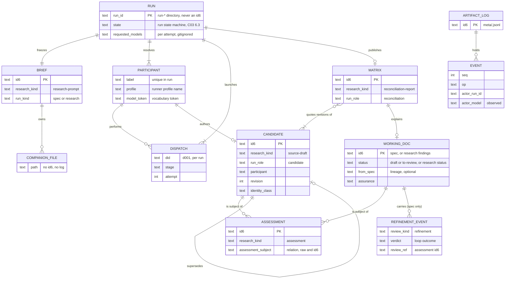

# Section-by-section comparison of candidate specs `18hh1u` and `yfz5u9`

This record compares two candidate specifications for one feature and states, for each idea, whether a
later synthesis keeps it, discards it, or alters it. The reader is the author of that synthesis, who
knows the field but has read neither candidate.

Labels used in this record:

| Label | Meaning |
| --- | --- |
| C01 | Candidate spec `18hh1u`, `.aw/records/specs/draft/20261024-specflow-01-18hh1u-spec-research-synthesis.spec.md`. It proposes `aw specs flow` and `aw research flow`. |
| C03 | Candidate spec `yfz5u9`, `.aw/records/specs/draft/20261024-specflow-03-yfz5u9-spec-research-synthesis.spec.md`. It proposes `aw synth`. |
| MS | Spec `4sd62s`, the artifact metadata store, `.aw/records/specs/reviewed/20260925-metastore-01-4sd62s-artifact-metadata-store.spec.md`. |
| WR | The writing standard `tmp/20261025-technical-artifact-writing-requirements.md` (eleven numbered requirements). |
| DL-16 | Maintainer ruling (OQ-1, 2026-10-25): every intermediate artifact lives in the research tree, as a research record or a brief companion file. |
| DL-17 | Maintainer ruling (OQ-2, 2026-10-25): finalize sets a spec to `to-review` automatically only after a synthesis across candidates from at least two distinct models; otherwise the spec stays `draft`. |
| brief companion, `<C>` | The tracked directory `<brief-stem>.data/` beside the run's brief record in the research tree. The research scanner does not count its files as records. |
| run | One execution of the proposed workflow, from the frozen brief to a terminal state. |
| dispatch | One launch of one model session for one stage. C01 calls this a "turn". |

Decision words: `keep` means take the item unchanged. `alter` means take it with the stated change.
`discard` means leave it out of the synthesis. A decision marked `needs maintainer decision` is one
the repository cannot settle; Section 8 states the options.

## 1. Identity and independence

| Field | Value |
| --- | --- |
| ACE (agent coding environment, the host tool) | OpenCode |
| Model as the host reports it | `uri/its_direct/pt3-claude-opus-5.5-1m-us` |
| Reasoning setting | Not observable from inside the session. The record carries no `--model` facet, because the model token for this session is not established (Section 9, V-01). |
| Commits inspected | Code claims were re-checked at `65f323ff5` (2026-10-26). Before delivery, HEAD was `b5697af54`. No file under `agent_workflows/` changed between `65f323ff5` and `b5697af54` (V-02), so every code result below holds at `b5697af54`. MS was read at commit `ac66fe8f9` (round 10). |
| Read in full | C01 (1467 lines), C03 (2149 lines), MS (all sections), WR (78 lines), generation prompt `443ltw` (the brief that both candidates answer). |
| Read in part | `.aw/records/research/README.md` (companion rules), refinement record `yibf7z` (structure only), `DECISIONS.md` D177, spec `2lcqno`, spec `89xjll` (requirement-id rules), and the code listed in Section 9. |
| Earlier comparisons | Research record `7fe5zd` (`20261024-specflow-17-7fe5zd-spec-synthesis-section-comparison.gemini38flashhigh.assessment.md`) is an earlier comparison of the same two files. I saw its filename in directory listings and in an `aw group` preview, and I did not open it. Record `ear8qy` (`specflow-18`, uncommitted, not mine) also exists; I did not open it. Candidate `1tx9t8` (`specflow-02`) is a third candidate that this record does not assess. |

## 2. Summary

1. Take the architecture from C03 and much of the presentation from C01. C03 is more correct against
   the code and more verifiable. C01 contributes a usable flag table and the "concise and explicit
   forms" rule.
2. Both candidates already obey DL-16 and DL-17. Neither contradicts a ruling. C01 cites DL-16 to a
   commit (`47bd8f9e9`) that only edited C03; that citation is fine.
3. Persist the run as C03 does: a run directory in the existing runs root, plus durable copies in the
   brief companion. Rename C03's directory prefix, because the run indexer in MS only lists `run-*`
   directories (Section 5, finding E-1).
4. The research pipeline trick that both candidates use (publish the matrix with an empty body until
   finalize) breaks in two cases measured here: a reused setid that already holds a finalized
   matrix, and MS's banner comment, which counts as a body. The synthesis must replace the trick
   (Section 5, findings E-2 and E-3).
5. Both candidates write front-matter keys and a `## Workflow history` section that MS removes. The
   synthesis must express provenance as MS event-log fields and named relationships (Section 5).
6. C01 cannot be traced by the repository's requirement-id parser. Its `FR-` and `AT-` ids parse as
   zero requirements and zero acceptance tests (V-07). Use C03's `R-` and `AC-` ids.
7. C01's acceptance tests AT-56, AT-65, AT-66, AT-67 and AT-77 test the spec's own diagrams and
   tables. Those are defects under the prompt's criterion 4. Discard them.
8. C01's work-bound "proof" (Section 4.3.1) and C03's arithmetic (Section 3.4) disagree on the unit
   (turn versus dispatch) and on retries. Keep C03's form.
9. Four choices need the maintainer: the CLI noun, whether the working spec exists in `specs/draft/`
   before finalize, whether an `agy` profile may store a variant, and the run-directory prefix.

## 3. Alignment table

Every heading of both candidates appears below. "Merged" names the section of the proposed outline in
Section 7.

| # | Topic | C01 section ids | C03 section ids | Merged |
| --- | --- | --- | --- | --- |
| T1 | Front matter and history | `## Workflow history` (top) | `## Workflow history` (top) | none (history becomes events, Section 5) |
| T2 | Terms and reading conventions | 0 | 0 (labels, terms, status semantics) | 0 |
| T3 | Summary | 1.1 | 1.1 | 1.1 |
| T4 | Problem | 1.2 | 1.2 | 1.2 |
| T5 | Actors | 1.3 | 1.3 | 1.3 |
| T6 | Goals | 1.4 | 1.4 | 1.4 |
| T7 | Non-goals | 1.5 | 1.5 | 1.5 |
| T8 | First-release boundary | 1.6 | 1.6 | 1.6 |
| T9 | Inspection baseline and findings | 2.1, 2.2 | 0 (baseline row), 2.1 | 2.1 |
| T10 | Reuse and gap table | 2.2 (last column) | 2.2 | 2.2 |
| T11 | Documented discrepancies | none | 2.3 | 2.3 |
| T12 | CLI alternatives | 3.1 | 3.1 | 3.1 |
| T13 | Canonical grammar and aliases | 3.2 | 3.2 | 3.2 |
| T14 | Intermediate placement and attention | 3.3 (Decision, Why, Keeping visible, Alternatives) | 6.6.2, 6.6.2b, 6.6.3 | 6.3 |
| T15 | Command matrix and per-command contracts | 3.4 | 3.5, 3.6 | 3.4, 3.5 |
| T16 | Selectors and precedence | 3.5, 6.3 (selector resolution), 5.1 | 3.3 | 3.3 |
| T17 | Concise versus explicit, quick versus thorough | 3.5 | 3.4 | 3.4 |
| T18 | Inputs and baseline freeze | 4.1 | 4.3 | 4.2 |
| T19 | Independent generation | 4.2 | 4.4, 7.2 | 4.3 |
| T20 | Refinement loops and convergence | 4.3 | 4.5, 7.4 | 4.4 |
| T21 | Work bounds | 4.3.1 | 3.4 (arithmetic) | 4.5 |
| T22 | Synthesis and provenance | 4.4 | 4.6, 7.3 | 4.6 |
| T23 | Research evidence | 4.5 | 4.13, 7.5 | 4.9 |
| T24 | Identity, naming, staging, protocol requirements | 4.6 | 4.8 to 4.12 | 4.7, 4.8, 4.10, 4.11 |
| T25 | Run control (cancel, interrupt, prepare, status) | 4.3 (FR-33), 4.6 (FR-26) | 4.1 | 4.1 |
| T26 | Configuration hierarchy and defaults | 5.1, 5.1.1 | 5.1 | 5.1 |
| T27 | Preferences schema | 5.2 | 5.2 | 5.2 |
| T28 | Profile schema boundary | 5.2 (Note) | 2.1 FND-2, FND-3, 4.2 R-11, R-14 | 5.3 |
| T29 | Capability handling | 5.3 | 5.4, 5.5 | 5.4 |
| T30 | Stage roles | 4.3 FR-29, 5.2 `roles` | 5.3 | 5.5 |
| T31 | Entities and ER diagram | 6.1 (diagram, persistence table) | 6.1 | 6.1 |
| T32 | Stage graph | none (flowcharts only) | 6.2 | 6.2 |
| T33 | Run states and recovery | 7.3 | 6.3, 6.3.1, 6.3.2, 6.3.3 | 6.4 |
| T34 | Why not the run ledger engine | none | 6.4 | 6.5 |
| T35 | Durable versus disposable state | 6.1 (table), 6.2 (rows) | 6.5 | 6.6 |
| T36 | Naming and placement matrix | 6.2 | 6.6.4 | 6.7 |
| T37 | Parser gap and grammar extension | 6.2 (Parser Gap) | 4.11, 6.6.1 (Facets) | 6.8 |
| T38 | Setid, date, NN, id6 rules | 6.3 | 6.6.1 | 6.9 |
| T39 | Front-matter schemas | 6.3 (Front Matter Schemas) | 4.9 R-72 | 6.10 (rewritten for MS) |
| T40 | Worked inventories | 6.4 (Inventories 1 to 4) | 6.6.5, 6.6.6, 6.6.7 | 6.11 |
| T41 | Spec flow diagram | 7.1 | 7.7 | 7.6 |
| T42 | Research flow diagram | 7.2 | 7.5 (diagram) | 7.5 |
| T43 | Templates, prompts, outcome files | 4.2 FR-05 | 7.1 | 7.1 |
| T44 | Context size and chunking | 7.4, FR-34 | 4.7, 7.6 | 7.4 |
| T45 | Security | 8.1 | 8.1, 4.10 | 8.1 |
| T46 | Privacy | 8.2 | 8.1 | 8.1 |
| T47 | Performance and cost | 8.3 | 8.2 | 8.2 |
| T48 | Usability | none | 8.3 | 8.3 |
| T49 | Compatibility | none | 8.4 | 8.4 |
| T50 | Observability | none | 8.5 | 8.5 |
| T51 | Acceptance matrix | 9 | 9 | 9 |
| T52 | Risks | 10.1 | 10.1 | 10.1 |
| T53 | Alternatives rejected | 10.2 | 10.2 | 10.2 |
| T54 | Assumptions | 10.3 | 10.3 | 10.3 |
| T55 | Decision log | 10.4 | 10.5 | 10.5 |
| T56 | Open questions | 10.5 | 10.4 | 10.4 |
| T57 | Implementation phasing | 11 (Phase 1, Phase 2, Phase 3) | 11 | 11 |
| T58 | Source inventory | 12.1 | 12.1 | 12.1 |
| T59 | Self-check | 12.2 | 12.2 | 12.2 |
| T60 | Worked transcripts | 13.1, 13.2, 13.3 | 12.3.1 to 12.3.4 | 12.3 |
| T61 | Machine output example | 13.4 | 12.3.5 | 12.3 |

## 4. Per-topic decision tables

Evidence ids `V-nn` refer to Section 9, which pastes the command and its output. A claim that I did not
re-check says `not re-checked`. "Brief" means generation prompt `443ltw`, which both candidates answer.

### T1, T39. Workflow history and front-matter schemas

| Item | Decision | Source | Reason | Alteration | Evidence |
| --- | --- | --- | --- | --- | --- |
| `## Workflow history` written into the final spec at finalize (C01 6.3 "Final spec", FR-11 item 6; C03 R-64 "write the text into the workflow history") | alter | both | MS 4.1 removes the section and makes history events. MS phase B keeps today's format until the cutover, so the synthesis must not name a storage format. | Replace with: "Finalize MUST record each history entry through the spec owner verb (`aw specs note` or `aw specs set --message`). It MUST NOT write history text into the file directly." The verb writes a bullet line before the MS cutover and a `note` event after it. | MS 4.1, 4.8, section 7 phase B |
| C01 research front-matter blocks (C01 6.3) with `order: "00"` and `order: "NN"` | alter | C01 | The quoted form fails validation today. | Write `order: 00` unquoted, and see Section 5 for which keys survive MS. | V-09 |
| Extra research front-matter keys (C01 6.3, C03 R-72) | alter | both | They validate today, but MS reduces research front matter to `id` and `status`. Section 5 decides each key. | Move every key to the destination named in Section 5, table 5.2. | V-03 (`validate_frontmatter` accepts extra keys), MS 4.1, 5.4 |

### T2. Terms

| Item | Decision | Source | Reason | Alteration | Evidence |
| --- | --- | --- | --- | --- | --- |
| C01 0 glossary | alter | C01 | It expands ACE as "Agent Communication Environment". D177 and the brief define ACE as the agent coding environment. | Use C03's definition. | `DECISIONS.md` D177 context paragraph; C01 line 44 |
| C03 0 terms and the `[EXISTING]`, `[APPROVED-UNBUILT]`, `[PROPOSED]` labels | keep | C03 | The brief requires existing, approved, and proposed behavior to be distinct ("Treat existing behavior, approved design, and your proposed changes as three distinct things"). C01 has no labels. | none | brief section "Generate", C03 line 47 |
| C03 0 "Candidate status" table | discard | C03 | It describes one candidate's provenance, not the feature. | Move the independence disclosure (C03 read 60 lines of C01) into the synthesis provenance section of the merged spec. | C03 line 43 |
| Terms "turn", "worker", "invocation" (C01) versus "dispatch" (C03) | alter | C03 | WR 4: one term per concept. C01 uses four words for one launch. | Use "dispatch" only. | Section 6 counts |

### T3 to T8. Summary, problem, actors, goals, non-goals, release boundary

| Item | Decision | Source | Reason | Alteration | Evidence |
| --- | --- | --- | --- | --- | --- |
| Summary (C01 1.1, C03 1.1) | keep | C03 | C03's six numbered steps map onto the brief's six manual steps. C01's summary has no steps. | Replace "aw synth" with the noun chosen in Q-1. | brief section 1 |
| Problem: measured defects (C03 1.2 items 1 to 4) | keep | C03 | Each item is measured. Item 1 re-checked: 6 prompts fail `check.name-nonconformant` and 6 fail `check.prompt-metadata-missing`. Item 3 re-checked: today `review_attestation_missing("18hh1u")` returns `None`, so 17 parseable refinement records would already satisfy `->reviewed`. | Update the counts at authoring time. | V-12, V-10 |
| Problem: generic list (C01 1.2) | discard | C01 | Its items are unmeasured restatements of the brief. | none | C01 lines 86 to 91 |
| Actors (C01 1.3, C03 1.3) | keep | C03 | C03 names what each actor may not do (for example "It has no authority over records"). C01 names example model products, which date quickly. | none | C03 line 128 |
| Goals (C01 1.4, C03 1.4) | keep | C03 | C03 goals are short and testable. C01 goals contain "Guarantee", "never lost", "strictly" (WR 6, WR 8), and C01's "Research Parity" overlaps C03 GOAL-6. | none | C01 lines 101, 106 |
| Non-goal "automatic approval" and DL-17 (C01 1.5, C03 1.5) | keep | both | Both agree with DL-17. | none | C01 line 110, C03 R-64 |
| Non-goal "no recursive merge" (C01 1.5, C03 1.5) | keep | C03 | C03 also records OQ-12 (does the ban apply across runs). | none | C03 OQ-12 |
| First release: ACEs `oc` and `agy`, Sol through OpenCode (C01 1.6, C03 1.6) | keep | both | `RUNNER_REGISTRY` has only `oc` and `agy`. The OpenCode catalog lists `openai/gpt-6.1-sol`. | Do not call the Sol choice a "maintainer selection". C01 Decision 02 cites C03 section 5 as the maintainer's acceptance, but C03 states it as its own recommendation. No ruling was found. Mark it a recommendation. | V-03, V-14; `DECISIONS.md` (no entry found) |
| C01 1.6 "Modular brief partitioning" and Phase 2/3 items | alter | C01 | Phase 3 items (curses dashboard, billing API) add no requirement. | Keep only the Codex adapter as deferred, with C03's reason table. | C03 1.6 table |

### T9 to T11. Repository findings, reuse table, discrepancies

| Item | Decision | Source | Reason | Alteration | Evidence |
| --- | --- | --- | --- | --- | --- |
| C03 FND-1 to FND-17 | keep | C03 | Every symbol re-checked at `65f323ff5` exists. Two details are stale; see the next rows. | Re-pin to the commit used by the synthesis. | V-03, V-05, V-11, V-14, V-19 |
| C03 FND-2 gap (2) "agy row has `supports_variant=False`" | keep | C03 | Re-checked. The driver itself passes `--effort` when the option is set, so the gap is in the profile schema only. | none | V-05, V-06 |
| C03 3.1 "`aw research` already has 15 verbs" | alter | C03 | `aw research --help` lists 13. | Write 13. | V-22 |
| C03 12.1 line numbers (for example `probe_argv` "about L21026") | alter | C03 | `probe_argv` is now at line 21097. C03 says line numbers are approximate. | Cite symbols only. | V-19 |
| C01 2.2 seam table | alter | C01 | Mostly correct, but its Runner Profiles row says agy has "no variant/agent in registry", and C01 then concludes that agy cannot take effort (FR-37, 5.3). The driver passes `--effort`, and `agy --help` lists it. | Use C03 2.2 for the reuse table. | V-06 |
| C01 2.2 Spec Lifecycle row: "`specs._spec_files()` and `validate_spec()` require no changes" | keep | C01 | Correct under C01's design, and also under C03's, because neither adds files to the specs tree except the spec. | none | V-15 |
| C03 2.3 discrepancies 1 to 8 | keep | C03 | Re-checked items 2 (`HOST_NONINTERACTIVE_RUNTIME["antigravity"]` is `agy run`), 4 (doc says 164 declarations, inventory has 179) and 7 (`vprs7o` fails with `REV-P002`). Others not re-checked. | none | V-24, V-10 |

### T12, T13. CLI alternatives and canonical grammar

| Item | Decision | Source | Reason | Alteration | Evidence |
| --- | --- | --- | --- | --- | --- |
| CLI noun: `aw specs flow` / `aw research flow` (C01 3.2) versus `aw synth spec|research` (C03 3.1) | needs maintainer decision | both | Neither name exists today. The repository cannot decide. See Q-1. | Recommendation: C03 `aw synth`. | V-22 |
| Comparison table across criteria (C03 3.1) | keep | C03 | It evaluates every criterion the brief lists (typing cost, collisions, agent determinism). C01 3.1 omits shell quoting, typing cost, and completion. | none | brief section 3 |
| Aliases (C01 3.2: `aw specs synth`, and 3.1 "`aw flow` secondary alias") | discard | C01 | C01 is inconsistent: 3.1 keeps `aw flow` as an alias and 3.2 does not list it. Each alias needs a `CommandDeclaration` (test `test_zero_undeclared_parser_leaves`). | none | `tests/test_command_surface_declarations.py:52` |
| Epilog pointer in `aw specs --help` and `aw research --help` (C03 3.1) | keep | C03 | It covers the discoverability argument for the artifact-noun family at the cost of one line. | none | C03 line 258 |

### T14. Intermediate placement and attention surfacing

| Item | Decision | Source | Reason | Alteration | Evidence |
| --- | --- | --- | --- | --- | --- |
| All intermediates in the research tree (C01 3.3 Decision, C03 6.6.2) | keep | both | DL-16. | none | DL-16 |
| Rendered prompts as brief companion files, not prompt records (C01 3.3, C03 6.6.3) | keep | both | `_PROMPTS_MAP` maps `pending` prompts to `ready`, so each rendered prompt would appear as work. | none | V-08 note, `attention_contract._PROMPTS_MAP` |
| Matrix (and research working record) published with an empty body until finalize (C01 3.3 "Keeping a live run visible", C03 R-97) | alter | both | Measured: (a) it works on a fresh set: `unrun` before candidates, `partial` with a candidate body, `synthesized` once a matrix has a body. (b) It fails on a reused setid: a finalized matrix with a body in `reference/` makes a new live run read `synthesized` (done). (c) It fails after the MS cutover, because MS 4.1 puts a banner comment after the front matter, and `has_body` counts that comment as a body. Both candidates allow setid reuse (C01 6.3, C03 6.6.1). | Do not depend on `has_body`. Replace with: "While a run is live, the engine MUST keep the matrix and the research working record at research status `active` with outcome `none-yet`. The pipeline position for a set with a live run MUST be `partial`." This needs a change in `research_index.derive_pipeline_positions` (count only members with status `reference` as landed synthesis). See Q-5. | V-08 cases A to E |
| C01 FR-24 attention footer from the gitignored ledger | discard | C01 | It contradicts C01 FR-23 ("requires no change to attention code"). It is also redundant with `status` and `list`. | none | C01 lines 426, 427, 1320 |
| C01 FR-23 brief created before any dispatch | keep | both | Both require it; without a `research-prompt` member the set has no pipeline position. | none | V-08 |
| C03 6.6.2b attention after finalize | keep | C03 | Correct for a fresh set. | Add the reused-set case from row 3. | V-08 |

### T15. Command matrix and per-command contracts

| Item | Decision | Source | Reason | Alteration | Evidence |
| --- | --- | --- | --- | --- | --- |
| Verb set: `new`, `prepare`, `from-spec`, `merge`, `reconcile`, `status`, `resume`, `cancel`, `finalize`, `config` (C01 3.4) | alter | C01 | C01 has no verb to accept a loop, reject an output, or decide a maintainer conflict. The brief requires "accept or reject a stage result" and visible maintainer conflicts. | Use C03's verb set (3.2). Keep C01's separate `prepare` only as the flag `--prepare-only` (C03 has it). | brief section 3 command list |
| C03 3.2 grammar, 3.5 matrix, 3.6 per-leaf contracts | keep | C03 | Each leaf has inputs, side effects, and exits 0, 1, 2. All exits stay in `{0,1,2}`. | Rename the noun per Q-1. | V-17 |
| C03 `aw synth prune` | keep | C03 | Needed because C03 creates run directories and worktrees. | none | C03 R-81 |
| C01 `--force-stale-resume` | discard | C01 | See T18 row on resume. | none | V-18 |
| C01 `finalize --status to-review|draft` | alter | C01 | A flag that can request `to-review` duplicates FR-20. C03 offers only `--keep-draft`, which can only lower the result. | Use `--keep-draft`. | C03 R-69 |
| C01 `--allow-unresolved-findings` versus C03 `--accept-limitations <text> --by-human` | alter | both | Both let a capped run finalize. C03 requires a human attestation and a reason before `to-review`. DL-17 forbids automatic `to-review` for single-model runs; C03 obeys this. | Keep C03. State that `--accept-limitations` never applies to a single-model run (C03 R-64 already says so). | DL-17, C03 R-64 |

### T16. Selectors and precedence

| Item | Decision | Source | Reason | Alteration | Evidence |
| --- | --- | --- | --- | --- | --- |
| Run id as a six-character id minted by `mint_id6` (C01 6.3 "Id6") | discard | C01 | `mint_id6` checks collisions only against record id6 values. A run id is not a record, so a later record can receive the same six characters, and C01's selector rule (6.3 item 1) resolves six characters as a run id first. | Use C03 `synth-<16 hex>`. | `artifact_core.mint_id6` docstring, `global_id6s` |
| C03 3.3 selector rules, reserved `last` | keep | C03 | No setid named `last` exists. | none | V-22 (`aw find --set last` finds nothing) |
| Precedence (C01 3.5 four tiers; C03 3.3 six levels) | keep | C03 | C03 separates project policy ceilings from values. C01 lets a tracked project file (`.aw/config/flow.json`) hold rosters, which contain model ids. | none | C03 R-17 |

### T17. Concise versus explicit, quick versus thorough

| Item | Decision | Source | Reason | Alteration | Evidence |
| --- | --- | --- | --- | --- | --- |
| Explicit form printed by preview, same resolved argument set (C01 3.5, C03 3.4 `--explicit`) | keep | both | Brief requirement. | Add C03 OQ-13 (budgets cannot be spelled in the explicit form). | C03 OQ-13 |
| Quick mode default roster `quick-solo` (C01 3.4, 5.2) | discard | C01 | Brief: "Do not conflate concise syntax with reduced rigor". With a one-participant quick roster, DL-17 forces `draft` every time. C03 keeps the whole roster. | none | DL-17 |
| Quick mode synth-refine cap 0 (C01) versus 1 (C03) | keep | C03 | With cap 0 the merged document is never reviewed. C03 makes `skipped` a limitation. | none | C03 R-64 (d) |
| `assurance: quick` marker (C03 3.4) | keep | C03 | Lets a reader see that fewer checks ran. | Store as a registry field (Section 5). | none |
| Mode profile table (C03 3.4) | keep | C03 | It names what quick mode drops and keeps. | none | none |

### T18. Inputs and baseline freeze

| Item | Decision | Source | Reason | Alteration | Evidence |
| --- | --- | --- | --- | --- | --- |
| Brief obligation ids `B-1..B-n` (C03 R-21) | keep | C03 | Coverage checks need ids. C01 FR-15 asks for a "deterministic lint" of coverage but defines no ids, so it cannot be deterministic. | none | C01 FR-15 |
| Quality objectives Q-1..Q-9 (C03 R-22) and repository invariants (C01 FR-03) | alter | both | Both are brief requirements. C01 adds the repository invariants (no home paths, no file URIs, no dashes) that WR 11 and the leak sanitizer require. | Keep C03 R-22, and add C01's invariants as fixed constraints. | WR 11 |
| Resume refuses when the git commit changed (C01 FR-31) | discard | C01 | In this shared checkout, HEAD moved four times during this assessment. C01's rule would refuse almost every resume. C03 freezes the commit and runs each dispatch in a worktree of that commit, so HEAD movement does not matter. | Keep C03 R-20 and R-86. | V-18 |
| Change of brief or configuration means a new run (C03 R-25, R-25b `--from-run`) | keep | C03 | It keeps resumed work consistent with its frozen inputs without a force flag. | none | C03 R-25b |
| Brief size limit (C01 250,000 characters, C03 256 KiB) | keep | C03 | Same intent; C03's unit is bytes, which the engine can measure without decoding. | none | none |

### T19. Independent generation

| Item | Decision | Source | Reason | Alteration | Evidence |
| --- | --- | --- | --- | --- | --- |
| No peer output before the barrier (C01 FR-04, C03 R-27) | keep | C03 | C01 has no mechanism. Its candidates are published into the research tree of the live checkout, so a generator that starts later can read an earlier candidate. C03 gives each dispatch a worktree at the frozen commit and an outbox. | none | C03 R-27, R-81 |
| Per-dispatch worktree (C03 R-81) | keep | C03 | Simplicity cost: one worktree per participant and stage. C03 measured about 1 s per worktree add (`not re-checked`). It gives up nothing that C01 provides. | none | `worktree_lease.worktrees_root`, `lane_containment.LANE_SUBMISSION_SUBDIR` exist (V-19) |
| OpenCode permission policy via `OPENCODE_CONFIG_CONTENT` (C03 R-80) | keep | C03 | `LANE_PERMISSION_POLICY` is `{'external_directory': 'deny', 'question': 'deny'}`. | none | V-19 |
| Blind labels for the synthesizer (C03 R-41) | keep | C03 | The brief asks to judge claims "rather than model reputation". C01 shows model names to the synthesizer. | none | brief section 4.C |
| End marker (C01 `<!-- end-of-artifact -->`, C03 `<!-- synth:end -->`) | alter | C03 | Neither candidate says whether the marker is removed before the text becomes a record. | Add: "The engine MUST remove the end marker before it publishes the document." | C03 R-28 |
| Independence labels (C03 R-29) | keep | C03 | Brief: "Do not claim that a second turn from the same model is independent evidence". | none | none |

### T20. Refinement loops and convergence

| Item | Decision | Source | Reason | Alteration | Evidence |
| --- | --- | --- | --- | --- | --- |
| Definition of an iteration (C01 FR-08, C03 R-30) | keep | C03 | C03 counts at a validated review and states what a failed dispatch consumes. | none | none |
| Finding schema: `review_findings` columns and `DECISIONS` (C01 FR-07) versus C03 R-32 fields and dispositions | alter | C03 | Assessments are research records, not review records, so the review vocabulary is not required. C03 adds `rejected` and `duplicate`, which the brief requires ("rejected with rationale"). `review_findings.DECISIONS` has no `rejected`. | Keep C03 R-32. Keep the severity vocabulary `low|medium|high|blocker`, which both use. | V-03 (`DECISIONS`) |
| Material threshold: C01 `high` and above; C03 `medium` and above, not `style` | alter | both | The repository already has a configured gate threshold, `config.findings_gate_threshold`, default `high`. A third threshold would be a new, unconfigured rule. | Replace C03 R-33 first sentence with: "A finding is material when `review_findings.is_gating(severity, config.findings_gate_threshold(repo))` is true and its class is not `style`." | V-20 |
| Convergence from deterministic checks (C03 R-34) versus a reviewer's "scope census" (C01 FR-09) | keep | C03 | C01's census is a statement by the reviewing model. C03 R-39 forbids gates that read a participant's claim of completeness, which the brief also forbids ("Do not use a model's unsupported 10/10"). | Discard the census as a gate. | brief 4.B |
| Oscillation: C01 FR-10 ("reverses an architectural decision") versus C03 R-35 (section digest returns to revision k-2, or a finding reopened twice) | keep | C03 | C01's test needs a judgement of what is architectural; C03's test is a digest comparison. | none | WR 6 |
| `capped-unverified` outcome (C03 R-36) | keep | C03 | Without it a capped loop is clean on the reviser's word, which the brief forbids. | none | C03 OQ-10 |
| `accept --by-human` (C03 R-96) | keep | C03 | Brief: "operator-accepted sufficiency" is a distinct outcome. C01 has no accept verb. | Resolve C03 OQ-15 (oscillating) the same way: require `--by-human`. | brief 4.B |
| Reviewer topology (C01 FR-29, C03 R-31) | keep | C03 | Same rotation; C03 adds the fallback when a reviewer failed. C01 "designated-reviewer" is covered by C03 `--role refine=<label>`. | none | none |

### T21. Work bounds

| Item | Decision | Source | Reason | Alteration | Evidence |
| --- | --- | --- | --- | --- | --- |
| C01 4.3.1 "Mathematical Proof" formulas | discard | C01 | It is a formula, not a proof (WR 8). It omits verify and integration reviews. Its "headroom" claim (budget 40 against a worst case of 78 or 87) presents a cap below the worst case as sufficient. | none | C01 lines 362 to 364 |
| C03 3.4 arithmetic `Q`, `W = Q * (1 + b)`, effective ceiling | keep | C03 | It states that the ceiling may stop a run, and every dispatch decrements one counter (R-37). | none | C03 AC-2 |
| Default ceilings (both 40 thorough; quick 10 in C01, 12 in C03) | keep | C03 | Both are unmeasured estimates. C03 says so (8.2). | none | C03 8.2 |

### T22. Synthesis and provenance

| Item | Decision | Source | Reason | Alteration | Evidence |
| --- | --- | --- | --- | --- | --- |
| No voting, minority eligible (C01 FR-12, C03 7.3) | keep | both | Brief 4.C. | Use C03's wording, which names the rationale field. | none |
| Matrix schema (C01 FR-13, C03 7.3) | keep | C03 | C03 rows carry a source quote, a target anchor and an origin, which R-43 checks deterministically. C01 rows have no quotes. | Keep C01's rule that the published matrix cites candidates by id6 (C03 already uses `<id6>@r<rev>`). | none |
| Inline provenance tags in the spec body (C01 FR-14) | discard | C01 | Tags must be rewritten on every edit. C03 links rows to target sections and flags `target-missing`, which survives edits. The brief asks for provenance "without requiring a second full spec". | none | C03 7.3 |
| Deterministic provenance checks (C03 R-43) | keep | C03 | No equivalent in C01. | none | none |
| Two-pass hierarchical synthesis (C01 FR-34) | discard | C01 | Pass 1 feeds the synthesizer "structured requirement tables and section outlines extracted from each candidate", which is the lossy summary that the brief forbids. Discovered limits (922,000 input tokens for `openai/gpt-6.1-sol`) make overflow rare. C03 R-54 stops with `context-overflow` instead. | none | V-14; brief 4.E |
| Conflicts `X-n`, `decision-wait`, `aw synth decide --by-human` (C03 R-46) | keep | C03 | Brief: a maintainer conflict "must remain visible". | none | none |
| One synthesis per run, deferred multi-synthesizer (C03 R-44, R-45) | keep | C03 | Matches both non-goals. | Resolve C03 OQ-12 as recommended (limit to one run). | none |

### T23. Research evidence

| Item | Decision | Source | Reason | Alteration | Evidence |
| --- | --- | --- | --- | --- | --- |
| Claims and sources ledgers, origin counting, confidence caps (C03 R-112 to R-115) | keep | C03 | C01 FR-16 to FR-18 state the same goals with no data structure, so they cannot be checked. | none | none |
| Per-claim `as_of` and epistemic taxonomy (C01 FR-18C) | alter | C01 | C03 already has `fact|inference|recommendation` and a run-level `--as-of`. A per-claim date adds nothing. | Discard per-claim `as_of`. Keep C01's `inaccessible-evidence` appendix as C03's "list inaccessible and unverified sources" (R-115). | none |
| Investigation modes (C01 `--investigation-mode parallel|decomposed`, C03 `--partition same|split`) | keep | C03 | Same concept; C03 R-111 adds the "no agreement from one answer" rule. | none | none |
| Final research record kind: `findings` (C03 R-118) versus `reconciliation-report` (N > 1) or `research-report` (N = 1) (C01 FR-18B) | keep | C03 | `findings` is in `SYNTHESIS_KINDS`, so the set reaches `synthesized`. A one-participant C01 run ends with a `research-report`, which is not a synthesis kind. | none | V-03 |
| Research consumed-by stays empty, outcome `informational` (C03 R-66) | keep | C03 | `consumed-by` resolves only to plan, spec and backlog ids, and `adopted` without a consumer is drift. C01 sets no outcome at finalize, and AT-58 allows `adopted`, which would report `adopted-without-consumer`. | none | V-21 |
| N = 1 research finalizes like N > 1 (C03 R-117) | keep | C03 | DL-17 covers specs only. | Add `skipped` to the R-117 list (C03 OQ-14). | DL-17 |

### T24. Identity, lifecycle, protocol requirements

| Item | Decision | Source | Reason | Alteration | Evidence |
| --- | --- | --- | --- | --- | --- |
| Auto-advance rule (C01 FR-20, C03 R-64) | keep | C03 | Both match DL-17. C03 adds: variants of one model count once, and unknown identities do not count. | Merge the `auto_advance` values into one closed list: `multi-model`, `not-multi-model`, `kept-draft`, `limitations`, `none`. | DL-17 |
| Finalize never writes review records or attestation fields (C01 FR-20 last sentence, C03 R-62) | keep | C03 | Re-checked hazard: refinement records under `reviews/` already satisfy the spec attestation predicate for `18hh1u`. | none | V-10 |
| Final spec creation: `aw specs new --date`, then `aw group specs <id6> --set <s> --order <NN>` (C01 6.2, 6.3) | alter | C01 | Without `--rename`, `aw group` only changes the `Set` bullet; the filename keeps the `<id6>-01-<id6>` form. | Use C03 R-60 (`--rename`). | V-15 |
| `- Supersedes:` (C01 FR-35) versus `- From-Spec:` (C03 R-05) on a reconsidered spec | alter | both | MS `lineage` has both `from_spec` and `supersedes`. A reconsideration is derived from the old spec; it replaces it only if the maintainer retires the old one. | Record `from_spec` always. Record `supersedes` only when the maintainer sets the old spec to `superseded`. | MS 4.5a `lineage` |
| Machine protocol: stream of `item` records plus `summary` on stdout (C01 FR-28) versus one `result` on stdout and items on stderr (C03 R-101) | keep | C03 | Both forms validate. C03's form gives a caller one line to parse. | Replace C03's reason: a `summary` with a `state` key also validates, so the reason is caller simplicity, not a schema limit. | V-17 |
| Outcome mapping (C03 R-102) | keep | C03 | All outcomes used are in `VALID_OUTCOMES`. | none | V-03 |
| Leak scan before publish (C03 R-88) | keep | C03 | `leak_sanitizer.scan_text` exists. | none | V-19 |
| Session id stored in front matter and `<C>/run.json` (C01 6.3 "Model token derivation") | discard | C01 | `<C>/run.json` is tracked. The leak sanitizer has a `session-id` rule (`ses_` pattern), and MS 4.2 forbids session ids in tracked logs. | Keep session ids only in the gitignored run directory. | `leak_sanitizer.py:88` |

### T25. Run control

| Item | Decision | Source | Reason | Alteration | Evidence |
| --- | --- | --- | --- | --- | --- |
| Signal and cancel handling (C01 FR-33: SIGTERM then SIGKILL after 3 s; C03 R-07, R-08: 30 s) | alter | both | Neither value is from the code. The drivers use `_SIGINT_GRACE_SECONDS = 5.0` and `_SIGTERM_GRACE_SECONDS = 2.0`. | Reuse the driver constants, so one grace rule exists. | V-19 |
| Cancel from a second terminal while a run holds the lock (C03 R-85) | keep | C03 | C01 does not say how `cancel` reaches a live process. | none | none |
| Prepare-only (C01 FR-26, C03 R-04) | keep | C03 | Same behavior; C03 adds resume without re-rendering. | none | none |
| Cancelled records go to `archive` (C01 FR-33 item 4, C03 R-07) | keep | C03 | Same; C03 adds outcome `rejected`. | Also state what happens to a working spec record (see Q-2). | C03 glossary "Intermediate record" |

### T26 to T30. Configuration, profiles, capabilities, roles

| Item | Decision | Source | Reason | Alteration | Evidence |
| --- | --- | --- | --- | --- | --- |
| Participants reference runner profiles and never restate model ids (C03 R-10) versus C01 5.2 roster entries with `model` and `variant` | keep | C03 | C01 5.2 restates model ids and also says the model "MUST" come from the profile, a contradiction inside one section. Its example id `anthropic/claude-opus-5-5` is not in this machine's OpenCode catalog. | none | V-14; C01 lines 459, 482 |
| `$schema` URL `https://agent-workflows.dev/schemas/flow-v1.json` (C01 5.2) | discard | C01 | The URL is invented. | none | none |
| Preferences file location: user-local (both); project policy holds no model ids (C03 R-17) | keep | C03 | Model ids can disclose institution topology. | none | C03 5.1 |
| `agy` profile variant support (C03 R-11 (a)) versus `variant-not-applied` (C01 FR-37) | needs maintainer decision | both | It changes a shared registry row. See Q-3. | Recommendation: C03 R-11 (a) and (b). | V-05, V-06 |
| Token for the Gemini slot (C01 `gemini38flash`, C03 `gemini38flashhigh`) | keep | C03 | `agy models` lists `gemini-3.8-flash-high` as a model id, so the id selects the effort. C01's OQ-I22-1 option (a) is therefore verified. Both tokens are recognized. | none | V-06, V-03 |
| Stage roles in the preferences file, not in `runner-profiles.json` `roles` (C01 5.2 Note, C03 R-14) | keep | both | `ROLE_NAMES` is a closed vocabulary of kinds of work. | none | V-03 |
| Capability verdicts (C03 5.4) | keep | C03 | C01 5.3 is a prose table without verdicts. | none | none |
| Template location (C01 `agent_workflows/templates/flow/`, C03 `agent_workflows/data/synth/templates/`) | keep | C03 | `agent_workflows/data/` is the existing package data directory; `agent_workflows/templates/` does not exist. | none | `ls agent_workflows/data` |

### T31 to T40. Entities, stage graph, states, persistence, naming, inventories

| Item | Decision | Source | Reason | Alteration | Evidence |
| --- | --- | --- | --- | --- | --- |
| ER diagrams (C01 6.1, C03 6.1) | alter | both | Neither models MS events or relationships. | Replace both with the model in Section 5. | MS 4.5a |
| Stage graph (C03 6.2) | keep | C03 | C01 has no stage table; its flowcharts are the only definition. | none | none |
| Run states (C03 6.3, 6.3.1) versus C01 7.3 state diagram | keep | C03 | C03's state table and diagram agree, and each `waiting-for-human` reason names its continuation. C01 7.3 has 18 states, includes transitions such as `Failed --> Interrupted: Ledger Checkpointed (if resumable)` that contradict `Failed --> [*]`, and mixes outcomes with states (`CompleteToReviewMulti`). | none | C01 lines 1105, 1123 |
| Own state machine instead of the run ledger engine (C03 6.4) | keep | C03 | `plan_retry` has no production callers. | none | `run_recovery.py:7` |
| Durable versus disposable state (C03 6.5) | alter | C03 | See Section 5, finding E-1, for the run directory name. | none | V-11 |
| Naming matrix (C01 6.2, C03 6.6.4) | keep | C03 | C03 keeps units, revisions and prompts in the companion, so they take no NN. C01 gives each split part and part index a record and an NN. | none | none |
| Parser gap (C01 6.2, C03 4.11, 6.6.1) | keep | both | Re-checked: two facets fail `parse_name`, one facet parses, `_CLUSTERED_RE` rejects the attributed prompt name. | Use C03 R-90 to R-94. | V-03 |
| Setid default "matching the singleton default of `aw research new`" (C01 6.3) | alter | C01 | `aw research new` uses the whole kebab slug as the singleton setid; it does not trim to 14 characters, and the preview showed a 33-character setid with no warning. | Keep C03 6.6.1 setid rule, and add: "The derived setid MUST pass `config.validate_setid_length_for_authoring`." | V-16 |
| NN capacity (C01 6.3, C03 R-93 `6N + 7`) | keep | C03 | C03's bound counts regenerations and is stated once. | none | C03 AC-51 |
| Revision in place, snapshot bodies in the companion (C01 6.3, C03 R-75) | keep | C03 | C03 stores every revision including the current one, so each digest in the matrix resolves to a file. | See Section 5 for the MS event mapping. | none |
| Worked inventories (C01 6.4, C03 6.6.5 to 6.6.7) | keep | C03 | C03's inventory matches its rules. C01 Inventory 1 gives split parts their own NN, which C03's design removes. | Re-derive after Q-2. | none |

### T41 to T44. Flow diagrams, templates, chunking

| Item | Decision | Source | Reason | Alteration | Evidence |
| --- | --- | --- | --- | --- | --- |
| Spec flow (C01 7.1, C03 7.7) | keep | C03 | C03 7.7 is smaller and states once that the dispatch counter can end any loop. C01 7.1 repeats the same three branches per candidate. | none | none |
| Research flow (C01 7.2, C03 7.5) | keep | C03 | C03 places the confidence re-check at finalize (R-114). | none | none |
| Templates and outcome files (C03 7.1) | keep | C03 | C01 has no outcome-file contract, so control flow would parse prose, which the brief forbids. | none | brief 4.A |
| Chunking (C01 7.4, C03 4.7, 7.6) | keep | C03 | C03 uses tokens with discovered limits; C01 uses fixed character budgets and an unexplained 40,000-token payload limit. | none | V-14 |
| `agy` prompt passed as files under 96 KiB (C03 R-83) | keep | C03 | Re-checked: a 140,000-byte single argument fails with `E2BIG`. | none | V-13 |

### T45 to T50. Security, privacy, performance, usability, compatibility, observability

| Item | Decision | Source | Reason | Alteration | Evidence |
| --- | --- | --- | --- | --- | --- |
| Data fences with a random per-run token (C01 FR-36, C03 R-82) | keep | C03 | Same rule. | none | none |
| argv lists, no shell (C01 8.1, C03 R-83) | keep | both | Same rule. | none | none |
| Path redaction (C01 8.2 `redact_public_context`) | keep | C01 | The function exists and C03 does not name it. | Add to C03 8.1. | V-19 |
| Concurrency (C01 4, C03 1..8, default min(N, 3)) | keep | C03 | C03 makes it configurable. | none | none |
| C03 8.3, 8.4, 8.5 | keep | C03 | C01 has no equivalent sections. | none | none |

### T51. Acceptance tests

| Item | Decision | Source | Reason | Alteration | Evidence |
| --- | --- | --- | --- | --- | --- |
| C01 `FR-` and `AT-` ids | discard | C01 | The requirement-id parser of spec `89xjll` finds 0 requirement ids and 0 acceptance ids in C01, and 108 and 104 in C03. A merged spec using C01 ids could not pass the spec-to-plan trace gate. | Use `R-n` and `AC-n`. | V-07 |
| C01 AT-56, AT-65, AT-66, AT-67, AT-77 | discard | C01 | They "trace" or "inspect" the spec's own flowcharts and tables. Prompt criterion 4 names this a defect. | none | C01 lines 1234, 1243 to 1245, 1255 |
| C01 AT-19, AT-55 | alter | C01 | "Trace execution session parameters" and "Verify all outputs" name no observation. | Use C03 AC-20 and AC-21. | WR 6 |
| C03 AC-29 first sentence "No code path accepts a synthesis record as synthesize input" | alter | C03 | It is a statement about code structure. | Replace with: "Run `--from-run <run> --reuse refine` on a finished run. The synthesize packet contains the candidate revisions and no revision of the earlier working document." | prompt criterion 4 |
| C03 AC-1 to AC-82 otherwise | keep | C03 | Each names a command and an observation. | Renumber after merge. | none |

### T52 to T61. Risks, alternatives, assumptions, decisions, open questions, phasing, sources, transcripts

| Item | Decision | Source | Reason | Alteration | Evidence |
| --- | --- | --- | --- | --- | --- |
| Risks (C01 10.1, C03 10.1) | keep | C03 | C03 states likelihood and effect, and the limits of each mitigation. | Add the reused-set pipeline risk (Section 5, E-2). | V-08 |
| Alternatives rejected (both 10.2) | keep | C03 | Superset of C01's list. | none | none |
| Assumptions (C03 10.3) | keep | C03 | AS-1 to AS-5 are checkable. | none | none |
| Decision logs (C01 10.4, C03 10.5) | alter | both | C01 Decision 02 claims a maintainer selection that no record shows. | Keep C03 DL-1 to DL-19. Mark the Sol choice a recommendation. | T3 row "First release" |
| Open questions (C01 OQ-I22-1; C03 OQ-3 to OQ-16) | alter | both | OQ-I22-1 is answered by V-06. | Close OQ-I22-1. Carry C03 OQ-10 to OQ-16 into Section 8 where they need the maintainer. | V-06 |
| Phasing (C01 11, C03 11) | keep | C03 | C03's eight steps are in dependency order. C01's modules (`agent_workflows/specflow/`) duplicate code that C03 names for reuse. | Insert a step that waits for, or targets, MS phase B (Section 5). | MS section 7 |
| Source inventories (both 12.1) | alter | C03 | C03 pins links to `6f430cefd`; the repository is public (`https://github.com/fariello/agent-workflows`). | Re-pin to the synthesis commit. | none |
| Transcripts (C01 13, C03 12.3) | keep | C03 | C03's transcripts match its state and exit rules; its machine line validates. C01 13.4's lines validate as well. | Regenerate after the merge. | V-17 |

## 5. Entities, records, and stored data against the metadata store (MS)

MS is `reviewed`, carries `Blocks-Release: next`, and gates release 2.0.0 (V-23). This section uses MS
at commit `ac66fe8f9` (round 10). MS is built in three phases (MS section 7): phase A adds the
`artifact_meta` interface, phase B moves every reader and writer onto it while the old bullet format
stays on disk, and phase C converts the corpus in one commit. Neither `agent_workflows/artifact_meta.py`
nor `agent_workflows/migrations/` exists yet (V-23). The synthesized spec therefore has to work in the
phase it ships in. The rule that makes this possible: the feature writes metadata ONLY through owner
verbs (`aw research new`, `promote`, `set-outcome`, `aw specs new`, `set`, `note`, `aw group`). MS moves
those verbs onto `artifact_meta`, so the feature needs no change at the cutover. Any key the feature
writes by hand into front matter breaks this rule.

### 5.1 Findings that change the design

| Id | Finding | Evidence | Required change to the synthesized spec |
| --- | --- | --- | --- |
| E-1 | MS 4.5b indexes runs only "with the runner's own readers". The directory lister `run_viewer.discover_run_dirs` accepts only directories named `run-*`. The state reader `runner_shared.load_state` refuses a `state.json` without a list `queue`. C01's ledger is a file `flow-<run-id6>.json`, not a directory, so it is never listed. C03's directory `synth-<id>/` is skipped by name. Neither run can be indexed today. | V-11 | Name the run directory with the `run-` prefix through `runner_shared.mint_run_dir`, and give `state.json` a `queue` list with one entry per dispatch. If the maintainer prefers a distinct prefix, MS 4.5b needs a reader for it. See Q-4. |
| E-2 | Both candidates keep a set `partial` by publishing the matrix with an empty body. A reused setid that already holds a finalized matrix with a body (in `reference/`) reads `synthesized` while a new run is live, because `derive_pipeline_positions` counts every member regardless of status. | V-08 case D | See T14: decide liveness by research status, not by body. |
| E-3 | MS 4.1 puts a banner comment after the two-key front matter. `research_index` treats any text after the front matter as a body. After the cutover, every research record has a "body", so the empty-body trick marks every run `synthesized` at once. | V-08 case E | Same change as E-2. MS phase B rewrites the research readers, so this change belongs in the MS registry and loader work, or in a plan that runs before the cutover. |
| E-4 | MS 4.1 and 5.4: research front matter becomes `id` and `status` only. Every extra key that C01 6.3 and C03 R-72 add would be an unknown field, which the MS loader refuses (MS 4.2). | MS 4.2 "the writer and the loader refuse unknown fields" | Each key needs a registry entry, a body section, a companion value, or removal. Table 5.2 decides each one. The registry is decided by MS plan step 1 from a field census (MS OQ-1), so the synthesis must hand that plan a list. |
| E-5 | MS 4.1 removes `## Workflow history`. Both candidates write it at finalize. | MS 4.1 | Write history through `aw specs note` and `aw specs set --message` only (T1). |
| E-6 | MS 4.2: the requested model belongs to the run attempt, not to the event. `actor.model` is the model that actually ran. Both candidates store requested and observed identity in the record's front matter. | MS 4.2 `actor`, 4.5b `attempts` | Observed identity goes in the `actor` of the events that the engine writes for that participant. Requested identity goes in the run directory, where MS indexes it as `attempts.requested_model`. That only works after E-1 is fixed. |
| E-7 | MS 4.2 forbids session ids, paths, user names and host names in a tracked log. C01 puts the session id in front matter and in the tracked `<C>/run.json`. | MS 4.2; `leak_sanitizer.py` `session-id` rule | Keep session ids only in the gitignored run directory. |
| E-8 | MS 4.1 and AC-29: companion data files get no `id6`, no front matter, and no log, and `aw check meta` ignores them. Both candidates keep durable provenance there (`run.json`, `events.jsonl`, revisions, findings data, dispatch summaries). | MS 4.1, OQ-2 | This is allowed, but nothing validates those files. The synthesized spec must give them a schema and a check of its own (C03's outcome-file schema is the model), or move the provenance that a gate reads into registry fields. |
| E-9 | MS 4.5c: a field named only `kind` is not permitted, and round 10 renames the research `kind` key to `research_kind`. | MS 4.2, 4.5c (round 10) | Use `research_kind` in every schema the synthesis writes about research records after the cutover; before it, the owner verb writes `kind`. |

### 5.2 Front-matter keys, decided key by key

Destinations: **registry field** (stored in the MS event log as a `set` field, and as a typed cache
column); **relation** (a row in a named MS relationship table, with a raw and a resolved reference);
**event** (a value of an event, not a field); **body** (a section of the Markdown body); **companion**
(a file in the brief companion); **run dir** (the gitignored run directory); **drop**.

| Key (candidate) | Destination | Reason |
| --- | --- | --- |
| `id`, `status` (both) | front matter | MS 4.1 two-key form. |
| `created`, `set`, `order`, `model`, `kind`, `topic`, `outcome`, `summary`, `consumed-by` (the 11 research fields) | MS decides (not this feature) | Owned by `research_contract`. MS 4.2 moves `summary` to a body section; the others are MS registry work. `kind` becomes `research_kind` (E-9). `consumed-by` becomes a relation (row below). |
| `flow-run` (C01), `synth-run` (C03) | event (`actor.run_id`) | MS 4.2 already has `actor.run_id`. A separate field would duplicate it. |
| `flow-kind: spec|research` (C01) | registry field `run_kind`, on the brief only | MS 4.5c `<thing>_kind`. Only the brief needs it. |
| `synth-role: brief|candidate|assessment|reconciliation|final` (C03) | registry field `run_role` | MS 4.5c: a position in a structure of related records is a `<thing>_role`. It is not derivable from the research kind, because `source-draft` can be a candidate or (with C01) a synthesis draft. |
| `slot` (C01), `participant` (C03) | registry field `participant` | A label value, not a kind or role. One name. |
| `ace` (both) | filename facet, mirrored by MS 4.6 | MS 4.6 checks research filename facets against replayed fields; MS round 10 lists `order`, `model` and `research_kind`. `ace` must be added to that mirror list. See Q-6. |
| `requested-model`, `requested-variant` (C01), `model-id-requested` (C03) | run dir (`attempts.requested_model`) | E-6. |
| `observed-model` (C01), `model-id-observed` (C03) | event (`actor.model`, `actor.variant`) | E-6. |
| `applied-variant` (C01) | drop | Equals `actor.variant`. |
| `identity-class` (both) | registry field `identity_class` | Derivable from requested versus observed, but the requested value is local to one machine, so a clone cannot derive it. MS 4.5c has no rule for "class"; name `unknown`, open question Q-6. |
| `revision` (both) | registry field `revision` | Each revise appends a `set` event with the new value. The body snapshot stays in the companion. |
| `supersedes` (both, on a regenerated candidate) | relation `lineage` (`supersedes`) | Existing MS relation. |
| `part-of` (C01) | drop | C03 keeps split units as companion files, so no record has a parent part. |
| `subject` (C01), `synth-subject` (C03), on an assessment | relation, new `assessment_subject` | Not one of the four MS lineage relations. Needs a registry entry. Q-6. |
| `inputs` (C01, on the matrix) | body (matrix rows cite `<id6>@r<k>`) | The matrix rows already carry the references, and R-43 checks them. |
| `consumed-by` (research field), `synth-consumed-into` (C03) | relation `consumed_by` for specs, plans and backlog; drop `synth-consumed-into` | MS 4.5a lists no `consumed_by` table, so this is `unknown`; a research-to-research link is refused today (V-21). Q-6. |
| `reused-from: <old id6>@r<k>` (C03 R-25b) | relation, new `reused_from` | Not one of the MS relations. Q-6. |
| `assurance: quick|thorough` (C03) | registry field `assurance` | Read by humans and by finalize. |
| `participation: k of N`, `model-diversity` (C03) | body (`## Synthesis provenance`) | Report values, no gate reads them after finalize. |
| `introduced-by: synthesis` (C03, a claim field) | companion (`claims.json`) | A claim is not a record. |
| `baseline-commit`, `brief-sha256` (C01, on the brief) | companion (`run.json`) | Replay inputs, not queried. |
| `synth-origin: imported` (C03) | registry field `run_role` value `imported-candidate` | One field instead of two. |
| Final spec `- From-Research-Set:` (C01) | drop | The final spec and the research records share the setid; `aw find --set` joins them (C03 6.6.2). |
| Final spec `- Contributors:` (C01) | body (`## Synthesis provenance`) | C03 R-65 already lists every candidate there. |
| Final spec `- Matrix-Ref:` (C01) | body (`## Synthesis provenance`) | Same. |
| Final spec `- Supersedes:` (C01), `- From-Spec:` (C03) | relation `lineage` (`from_spec`; `supersedes` only if the maintainer retires the old spec) | T24. |
| `## Workflow history` (both) | events | E-5. |
| `## Known limitations`, `## Synthesis provenance` (both) | body | Prose that humans read. |

### 5.3 Revisions, renames, NN and identifiers under MS

| Operation | Candidate rule | Under MS |
| --- | --- | --- |
| Revise in place (C01 6.3, C03 R-75) | keep id6, NN and filename; increment `revision`; snapshot body in companion | One `set` event `{revision: k}` in the record's log, written by the owner verb. The body change itself is not an event. |
| Regenerate after reject (C01, C03 R-76) | new record, new id6, `supersedes` | New log with `create`; `lineage` row `supersedes`. The old record gets a `transition` to `archive` and a `set` of `outcome`. |
| Regroup the final spec (`aw group specs ... --rename`) | change set and NN | One `rename` event plus a `set` of `set` and `order` in the same append (MS 4.2, AC-31). No change needed in the feature. |
| NN allocation | next free order per set, at publish | Unchanged. The filename stays a checked mirror of `set` and `order` (MS C10). |
| Run identifier | C01 `run-id6` from `mint_id6`; C03 `synth-<16 hex>` | Neither is an artifact `id6`. Use the runner's run id from `mint_run_dir` (E-1), which never matches the `id6` pattern, so it cannot collide (T16). |
| Session id | C01 stores it in tracked files | Run dir only (E-7). |

### 5.4 Review kinds and refinement findings

MS 4.1a splits review events into `gate` and `refinement`. A `refinement` event never carries
`readiness` and never satisfies `->reviewed` (MS 4.1a K3, 4.4). After DL-16, refinement findings
live in research `assessment` records, not in `.aw/records/reviews/`.

- Should a refinement round emit `op: review` with `review_kind: refinement`? Recommendation: yes, but
  only on a subject that is a spec, which means the working spec record in C03's design. The event
  records the loop outcome as a tool-written value, which is the point of MS (problem P2). Subject:
  the spec; `review_ref`: the assessment's `id6`.
- On a research subject (a candidate `source-draft`), emit nothing. MS ties `review` events to review
  files: the round-count rule in MS 4.6 compares `## Round` headings in a file under `reviews/` with
  the events that carry its `review_ref`, and the `review_files` table lists only review files. An
  assessment is a research record with its own log, so the rule has no file to count. Status:
  `unknown`; Q-6.
- The refinement verdict vocabulary is owned by the MS registry (MS 4.1a K3). The synthesis must
  submit its loop outcomes (`converged`, `accepted`, `capped-unverified`, `capped-open`,
  `oscillating`, `failed`, `skipped`) as that vocabulary. MS lists only the two legacy `18hh1u` values.
- The 24 existing `specflow` refinement files under `reviews/` (all `Subject-Id: 18hh1u`) are migrated
  by MS as `refinement` events. Today 17 of them parse, and `review_attestation_missing("18hh1u")`
  returns `None`, so `aw specs set reviewed 18hh1u` would pass today without a `/spec-review` (V-10).
  This hazard exists until the MS cutover. The synthesis must not move `18hh1u` toward `reviewed`.

### 5.5 Each candidate entity, then and now

| Entity (C01 / C03) | Persisted today (candidate design) | Persisted under MS | Change to the synthesized spec |
| --- | --- | --- | --- |
| FLOW_RUN / SynthRun | C01: `runs/flow-<id>.json` plus `<C>/run.json`. C03: `runs/synth-<id>/` plus `<C>/run.json`, `<C>/events.jsonl` | Run dir under the runs root, indexed read-only by MS 4.5b (`runs`, `run_items`, `attempts`); durable copy in companion, not validated by MS | E-1 prefix and `queue`; keep C03's durable copy; give it a schema (E-8). |
| RUN_BRIEF / FrozenBrief | research `research-prompt`, NN 00 | Research artifact with a log; `run_kind` field | none beyond 5.2 |
| ObligationList (C03) | brief body, `obligations.json` | Same (body plus companion) | none |
| PARTICIPANT_SLOT / Participant | C01: `run.json`. C03: frozen config | Run dir and companion; `participant` field on records | none |
| RunnerProfile | user-local `runner-profiles.json` | Unchanged | none |
| Stage, Dispatch (C03) | events in run dir, `dispatches/<did>.json` in companion | Run dir (`run_items`, `attempts` via E-1); companion summary | E-1 |
| RENDERED_PROMPT | companion `prompts/` | Companion (no log) | none |
| CANDIDATE_RECORD / Candidate | research `source-draft` or `research-report` | Research artifact with log | keys per 5.2 |
| Split part / CandidateUnit | C01: research records. C03: companion `units/` | Companion | Use C03 |
| ASSESSMENT_RECORD / Assessment | research `assessment` | Research artifact with log; `assessment_subject` relation | Q-6 |
| ITERATION_FINDING / Finding | assessment body table; C03 also `findings.json` | Same | none |
| RECONCILIATION_RECORD / Matrix, MatrixRow, Conflict | research `reconciliation-report`, rows in body | Research artifact with log | liveness per E-2 |
| SYNTHESIS_DRAFT (C01 only) | research `source-draft` | Research artifact | Q-2 |
| FINAL_SPEC / working spec record | C01: created at finalize. C03: in `specs/draft/` from synthesis | Spec artifact with log; `from_spec` lineage | Q-2 |
| HumanDecision (C03) | events plus matrix row | Run dir event, plus companion copy, plus a `note` event on the working spec through `aw specs note` | add the `note` event so a clone keeps the decision |
| Claim, Source (C03) | companion `claims.json`, record bodies | Companion and body | none |
| Revision snapshot | companion `revisions/` | Companion; `revision` registry field | none |
| Run lock | runs root | Unchanged (gitignored) | none |

### 5.6 Reconciled entity model



Persistence of the reconciled model:

| Entity | Where | Owner | Tracked | Validated by |
| --- | --- | --- | --- | --- |
| RUN, DISPATCH, PARTICIPANT (requested identity) | runs root, `run-*` directory | engine through `mint_run_dir` | no | engine; MS 4.5b index |
| BRIEF, CANDIDATE, ASSESSMENT, MATRIX | research tree | `aw research new`, `promote`, `set-outcome` | yes | research index; MS loader after cutover |
| WORKING_DOC (spec run) | specs tree | `aw specs new`, `aw group specs --rename`, `aw specs set`, `aw specs note` | yes | `aw specs check`; MS loader |
| WORKING_DOC (research run) | research tree, kind `findings` | `aw research new` | yes | research index |
| COMPANION_FILE (prompts, revisions, units, run.json, events copy, findings and claims data, dispatch summaries) | brief companion | engine | yes | engine schema only (E-8) |
| ARTIFACT_LOG, EVENT | `meta/<id6>.jsonl` (after cutover) | `artifact_meta` through owner verbs | yes | MS loader |
| REFINEMENT_EVENT | working spec's log | engine through a tooled review writer | yes | MS registry vocabulary |

## 6. Writing conformance (WR)

WR has eleven numbered requirements (1 familiar words, 2 short sentences, 3 actor and action, 4
consistent terms, 5 explicit meaning, 6 verifiable requirements, 7 obligation words, 8 no bloat, 9
organization, 10 honest uncertainty, 11 proofread and no em dashes). A writing correction below
never changes an obligation. Where a fix would change meaning, I report it as a design item in
Section 4 instead.

### 6.1 Counts (V-25)

| Measure | C01 | C03 |
| --- | --- | --- |
| Sentences of more than 40 words (outside code blocks) | 47 of 996 | 84 of 1813 |
| `MUST` | 113 | 379 |
| `MUST` in Section 4 (requirements) | 91 | 371 |
| `SHOULD` | 0 | 4 |
| "strictly" | 22 | 0 |
| "guarantee" | 5 | 2 (a non-goal, 1.5, and the 7.2 column header "What it guarantees"; neither is an obligation) |
| Em or en dashes | 0 | 0 |
| Distinct words for one launch ("turn", "worker", "invocation", "dispatch") | 4 | 1 ("dispatch"; "turn" appears 6 times, for driver turns) |

### 6.2 C01, by top-level section

| C01 section | WR violated | Example | Corrected version |
| --- | --- | --- | --- |
| 0 | 1, 4 | "ACE: Agent Communication Environment" | "ACE (agent coding environment): the host tool that runs a model session." |
| 1 | 6, 8 | "Guarantee that independent candidates generate without cross-contamination" | "No generation dispatch receives another participant's output before every generation dispatch has published or failed." |
| 1 | 8, 10 | "so work is never lost" | "A halted run stays visible as `active` in `aw attention` until finalize or cancel." |
| 2 | 9 | One table cell holds existing behavior, extension and justification together (row "Spec Lifecycle") | Split into "Existing" and "Change" columns (C03 2.2 form). |
| 3 | 8 | "*Agent Usability*: Highly predictable for LLMs inspecting `--help`." | Delete; it is not measurable. |
| 3 | 2, 5 | Command matrix cells list 15 options in one cell | One row per option (C03 3.2 run-options table). |
| 4 | 6, 8 | "4.3.1 Mathematical Proof of Execution Bounds" | "4.3.1 Worst-case dispatch count". |
| 4 | 2, 3 | FR-11 item 6: a 75-word sentence with three conditions | Split as in C03 R-64 (one condition per bullet). |
| 4 | 6 | FR-09: "the assessment round MUST include an explicit audited scope census" | Not fixable by wording: a census written by the reviewer is not evidence. Design item, T20. |
| 4 | 7 | FR-28: "(`capped_with_findings`, ..., the engine reports `cancelled`) in a separate `state` field" | "The engine MUST report each run state, including `cancelled`, in the `state` field. It MUST NOT report a run state as an outcome." |
| 5 | 5 | "The token for the gemini slot is therefore `gemini38flash` ... unless the profile model identifier itself selects the high-effort configuration (open question OQ-I22-1)" | Resolved by V-06: "The Gemini participant uses the model id `gemini-3.8-flash-high` and the token `gemini38flashhigh`." |
| 6 | 2, 5 | 6.3 "NN capacity": one paragraph with three formulas and two examples | One formula per bullet, examples in a table. |
| 7 | 4 | Flowchart node "Polish Iteration" | "Synth-refine iteration". |
| 7 | 8 | "This ensures that the engine preserves full technical depth" | Delete. |
| 8 | 7 | "MUST NEVER accept or store credentials" | "MUST NOT accept or store credentials." |
| 9 | 6 | AT-19 "Trace execution session parameters" | Use C03 AC-20. |
| 10 | 10 | Decision 02 "Accepted by the maintainer" with no record | "Recommendation; no maintainer ruling is recorded." |
| 11 | 9 | Phase 3 lists features that no requirement covers | Delete or file as backlog. |
| 12 | 11 | Self-check item "Conformance with technical artifact writing requirements" | Not supported by the counts above; remove the claim. |
| 13 | 4 | Transcript shows run id `qk91a2` (six characters) like an id6 | Use the run id form chosen in Section 5. |

### 6.3 C03, by top-level section

| C03 section | WR violated | Example | Corrected version |
| --- | --- | --- | --- |
| 0 | 9 | The status table, labels and terms are one section | Split into "How to read" and "Terms"; move the candidate provenance out (T2). |
| 1 | 5 | "The engine detects writes to tracked paths and to the dispatch inputs, but does not prevent them. It does not detect other writes (R-81)." | Correct; keep. Shown as a good example of WR 5. |
| 2 | 1 | "Consistency with house grammar" | "Consistency with the existing `aw` noun-verb grammar". |
| 3 | 2 | 3.6 table cells of 80 to 120 words (row `resume`, exit 2 column) | Move the reason codes to a list below the table. |
| 3 | 8 | "Aliases: none. The word `synth` is short enough." | "Aliases: none. Each alias needs its own command declaration and completion entry." |
| 4 | 2 | R-114: one bullet of more than 200 words with six obligations | Split into R-114a to R-114f, one obligation each. |
| 4 | 3 | R-81 "Removal: synth MUST remove each of its worktrees" | "The engine MUST remove each of its worktrees". "synth" is a command, not an actor. |
| 4 | 4 | "working document", "working spec record", "working `findings` record" for one concept | Use "working document" and say "(spec)" or "(research)". |
| 5 | 7 | 5.2 "Note on Antigravity identity ... the preview MUST warn" inside an informative paragraph | Move to R-16 as a numbered requirement. |
| 6 | 2 | 6.6.1 "Exhaustion": one bullet with four sub-sums and three totals | Table with one row per term. |
| 7 | 5 | 7.6 "Initial preference based on the maintainer's observation" | Keep, and add the source: brief section 4.E. |
| 8 | 10 | 8.2 "These defaults are this author's estimates, not measurements." | Correct; keep. |
| 9 | 6 | AC-29 "No code path accepts a synthesis record" | Replace per T51. |
| 10 | 9 | OQ-13 holds two questions | Split into OQ-13a (allow-reduced) and OQ-13b (budgets). |
| 11 | none found | | |
| 12 | 4 | Citation keys `[s-...]` are defined in 12.1, 1,700 lines after first use | Keep the keys and add a one-line pointer in Section 0. |

### 6.4 Systemic patterns

| Pattern | WR | C01 | C03 |
| --- | --- | --- | --- |
| Intensifiers used as obligations ("strictly", "guarantee", "safely", "highly") | 6, 8 | 29 occurrences (V-25) | none found |
| One concept, several terms | 4 | launch: turn, worker, invocation, dispatch; participant: slot, participant, worker | working document variants (3 forms) |
| Several obligations in one sentence or bullet | 2, 6 | FR-11, FR-20, FR-33 | R-25b, R-64, R-114, R-81 |
| Requirements not verifiable | 6 | FR-09 census, FR-15 "lint" without ids, FR-12 "technical merit" | R-42 "every material item" (depends on R-33, acceptable) |
| MUST/SHOULD/MAY misuse | 7 | "MUST NEVER" (2); 0 SHOULD, so preferences are stated as MUST | `[Should]` marker and SHOULD agree (4 uses) |
| Filler and history narration | 8 | 24 workflow-history lines that list finding numbers; "refinement iteration 22 re-verified" inside requirements | refinement-iteration notes inside Section 0 |
| Invented facts | 10 | `$schema` URL, provider ids `anthropic/claude-opus-5-5`, "maintainer selected" | none found |
| Undefined terms at first use | 1 | "FROZEN_BASELINE" (Decision 09), "M_synth_sections" | "packet" before its definition in 0 (defined, order only) |

### 6.5 This record

Before delivery I checked this record against all eleven WR requirements: familiar words and
expanded abbreviations at first use (Section 0 labels table), one idea per sentence in prose,
named actors, one term per concept ("dispatch", "run", "brief companion"), stated conditions,
evidence for each decision (Section 9), `MUST` used only inside replacement text for the synthesis,
no filler, ordered sections as the prompt requires, uncertain points marked `unknown` or
`not re-checked` and carried to Section 8, and no em or en dashes (V-26). Table cells exceed one
sentence where a decision needs its reason and evidence together.

## 7. Proposed outline of the synthesized spec

| Section | Content | Source items |
| --- | --- | --- |
| 0 | How to read; terms; existing, approved and proposed labels | C03 0 labels and terms; C01 0 abbreviations (fixed ACE) |
| 1.1 to 1.6 | Summary, problem, actors, goals, non-goals, release boundary | C03 1.1 to 1.6; C01 1.5 non-goals merged |
| 2.1 to 2.3 | Findings, reuse table, discrepancies | C03 2.1 to 2.3, re-pinned; C01 2.2 rows for `redact_public_context` and metastore coordination |
| 3.1 to 3.5 | CLI comparison, grammar, selectors, modes, command matrix and contracts | C03 3.1 to 3.6; noun per Q-1 |
| 4.1 | Run control | C03 R-01 to R-09; grace constants from drivers (T25) |
| 4.2 | Inputs and freeze | C03 R-20 to R-25b; C01 FR-03 invariants |
| 4.3 | Generation and independence | C03 R-26 to R-29, R-41 |
| 4.4 | Refinement loops | C03 R-30 to R-39, R-96; threshold altered (T20) |
| 4.5 | Work bounds | C03 3.4 arithmetic and R-37, R-38 |
| 4.6 | Synthesis and provenance | C03 R-40 to R-49 |
| 4.7 | Context size and splitting | C03 R-50 to R-56 |
| 4.8 | Finalization and lifecycle | C03 R-60 to R-69; history through owner verbs (T1); `auto_advance` list (T24) |
| 4.9 | Research | C03 R-110 to R-118; C01 inaccessible-evidence appendix |
| 4.10 | Identity, naming, persistence, metadata store | C03 R-70 to R-77, rewritten by Section 5 of this record |
| 4.11 | Safety, execution, recovery | C03 R-80 to R-89; run dir per E-1 |
| 4.12 | Grammar extensions | C03 R-90 to R-95; `ace` facet in MS mirror list |
| 4.13 | Machine protocol | C03 R-100 to R-103 |
| 5.1 to 5.5 | Configuration, schema, profiles, capabilities, roles | C03 5; C01 5.2 Note on roles |
| 6.1 to 6.11 | Entities, stage graph, states, ledger choice, durable state, naming matrix, parser gap, setid and NN, metadata mapping, inventories | Section 5.6 of this record; C03 6.2 to 6.6; C01 6.3 selector rules where C03 is silent |
| 7.1 to 7.6 | Templates, independence table, matrix, refinement content, research flow, chunking, spec flow | C03 7 |
| 8.1 to 8.5 | Security to observability | C03 8; C01 8.2 redaction |
| 9 | Acceptance matrix, `AC-n` ids | C03 9 with AC-29 altered; C01 AT-26 (delimiter collision), AT-70 (ambiguous roster) and AT-71 (live run on a set) where C03 has no equivalent |
| 10.1 to 10.5 | Risks, alternatives, assumptions, open questions, decisions | C03 10; reused-set risk; Q-1 to Q-6 answers |
| 11 | Implementation steps | C03 11, plus one step that follows MS phase B (Section 5) |
| 12.1 to 12.3 | Sources, self-check, transcripts | C03 12, regenerated |

## 8. Questions that need a maintainer decision

### Q-1. CLI noun

Context: C01 proposes `aw specs flow ...` and `aw research flow ...`. C03 proposes `aw synth spec|research ...`. Neither exists today (V-22). Both runs share one state machine and the same seven management verbs (status, resume, accept, reject, decide, cancel, finalize).

| Option | Consequence |
| --- | --- |
| (a) `aw synth` | One parser and one declaration group; the management verbs exist once. A new top-level noun; `aw specs --help` and `aw research --help` each gain one pointer line. |
| (b) `aw specs flow` and `aw research flow` | Discoverable from the artifact noun. The seven management verbs exist twice, and a spec run informed by research crosses nouns. |

Recommendation: (a), for the reasons in C03 3.1.

### Q-2. Does the working spec exist in `specs/draft/` before finalize?

Context: C03 creates the spec record when synthesis starts and refines it in place (R-60), so `/spec-review` and later plans cite one id6 from the start. C01 keeps a synthesis draft as a research `source-draft` and writes the spec only at finalize. DL-16 places intermediates in the research tree, and both readings satisfy it if the working spec counts as the final record.

| Option | Consequence |
| --- | --- |
| (a) C03: spec record from synthesis | Stable id6 from the start; the spec shows on `aw attention` as a `draft` while the run is live; a cancelled run leaves a `draft` spec that must be set to `superseded` or `parked`. |
| (b) C01: spec only at finalize | No spec on the board until finalize; one more research record per run; the id6 that reviewers cite appears only at the end. |

Recommendation: (a), and add to C03 R-07: "Cancel MUST set the working spec record to `parked` with a message naming the run."

### Q-3. May an `agy` runner profile store a variant?

Context: today `RUNNER_REGISTRY["agy"].supports_variant` is `False` and `MODEL_RE` refuses bare ids such as `gemini-3.8-flash-high` (V-05). The `agy` driver already passes `--effort` (V-06). C03 R-11 relaxes both rules; C01 reports `variant-not-applied`.

| Option | Consequence |
| --- | --- |
| (a) Relax both (C03 R-11) | The maintainer's Gemini slot works as a profile. Changes a shared registry row and the profile documentation. |
| (b) Keep the schema (C01 FR-37) | No shared change. The Gemini participant cannot be expressed as a profile, so C03 R-10 ("participants reference profiles") has an exception. |

Recommendation: (a).

### Q-4. Run directory name

Context: MS indexes runs only through the runner's readers, which list `run-*` directories (E-1).

| Option | Consequence |
| --- | --- |
| (a) Use `mint_run_dir` (`run-*` name) and a `queue` in `state.json` | MS indexes synth runs with no MS change. `aw runs` would also list them; its viewer must tolerate a non-plan queue. |
| (b) Keep a `synth-` prefix | Runs stay separate from driver runs; MS 4.5b needs a second reader, which MS 4.5b forbids ("never uses a new parser"). |

Recommendation: (a).

### Q-5. Liveness of a run's research set

Context: both candidates keep a set `partial` by withholding the matrix body. That fails on a reused setid and after the MS banner (E-2, E-3).

| Option | Consequence |
| --- | --- |
| (a) Count only `reference` members as landed synthesis in `derive_pipeline_positions` | Small change in one function; affects every existing research set (a finalized set already has its synthesis in `reference/`, so the result should not change for them; `not re-checked` across the corpus). |
| (b) Refuse setid reuse | No code change; contradicts both candidates' reuse rules and C03 `--from-run` on the same setid. |

Recommendation: (a), measured across the current research tree before the plan is approved.

### Q-6. New registry entries for MS

Context: the feature needs fields and relations that MS does not list: `run_kind`, `run_role`, `participant`, `revision`, `identity_class`, `assurance`, and relations `assessment_subject`, `reused_from`, plus `ace` as a mirrored filename facet and a refinement vocabulary of seven loop outcomes. MS plan step 1 owns the registry (MS OQ-1). MS 4.2c says the spec implemented second must agree with the other.

| Option | Consequence |
| --- | --- |
| (a) Submit the list to MS plan step 1 now | The registry is complete at the cutover; no second registry change. |
| (b) Ship the feature first with front-matter keys | Each key becomes an MS census item; the migration must map it. |

Recommendation: (a). Also decide whether `review` events may name a research assessment as `review_ref` (Section 5.4).

The following C03 open questions are within the synthesis author's authority, and I recommend C03's own answers: OQ-10 (a), OQ-11 (a), OQ-12 (a), OQ-13 (a) plus a budget flag, OQ-14 (yes), OQ-15 (yes), OQ-16 (b).

## 9. Validation performed

Every command below ran in this checkout on 2026-10-26. Helper scripts were written under
`/tmp/opencode/` and are reproduced inline where they are short; `chk.py` prints the vocabularies,
the two `parse_name` cases, `normalize_model` for seven tokens, the review vocabularies, the runner
registry and `MODEL_RE`; `chk3.py` checks symbol existence and the two `agy` profile cases; `v08.py`
builds throwaway research trees in temporary directories (shown in full in V-08's script line).
`aw group` and `aw research new` were run as previews only and wrote nothing.

Claims marked `not re-checked`: C03 R-81 worktree add time (about 1 s); C03 2.3 discrepancies 1, 3,
5, 6 and 8; C03 FND-5 to FND-17 symbols other than those in V-19; the effect of Q-5 option (a) on
the existing research corpus. Every other claim that a decision depends on is checked below.

```text
### V-01 model token
$ python3 -c "from agent_workflows import research_contract as r; print(r.normalize_model('opus55', repo_root='.'))"
VocabResult(ok=True, value='opus55', suggestion='opus55high', message="unknown model 'opus55'; bless with 'aw research add-model opus55' (spelling check: did you mean 'opus55high'?)", recognized=False)

### V-02 commits
$ git rev-parse HEAD; git diff --name-only 65f323ff5 HEAD -- agent_workflows/ | wc -l
b5697af540a8f57e907cf546cf4fda523d95f746
0

### V-03 vocabularies, parser, model tokens, profile registry (script /tmp/opencode/chk.py)
$ python3 /tmp/opencode/chk.py
KINDS frozenset({'research-prompt', 'source-draft', 'requirements', 'howto', 'patch-proposal', 'survey', 'research-report', 'findings', 'concept', 'reference-research', 'notes', 'advisory', 'executive-summary', 'test-evidence', 'assessment', 'roadmap', 'reconciliation-report'})
SYNTHESIS_KINDS frozenset({'findings', 'reconciliation-report'})
STATUSES frozenset({'active', 'todo', 'reference', 'archive'})
FRONTMATTER_FIELDS ('id', 'created', 'set', 'order', 'topic', 'model', 'kind', 'status', 'outcome', 'summary', 'consumed-by') 11
parse 20261024-specflow-03-abc123-netmesh.opencode.opus55high.source-draft.md (None, NameError_(message='name has too many dotted segments; expected [.<model>].<kind>'))
parse 20261024-specflow-03-abc123-netmesh.opus55high.source-draft.md (ResearchName(date='20261024', set_id='specflow', order='03', id6='abc123', slug='netmesh', model='opus55high', kind='source-draft'), None)
norm opus55high VocabResult(ok=True, value='opus55high', suggestion=None, message='ok', recognized=True)
norm gpt61solmedium VocabResult(ok=True, value='gpt61solmedium', suggestion=None, message='ok', recognized=True)
norm gemini38flash VocabResult(ok=True, value='gemini38flash', suggestion=None, message='ok', recognized=True)
norm gemini38flashhigh VocabResult(ok=True, value='gemini38flashhigh', suggestion=None, message='ok', recognized=True)
norm gemini-3.8-flash-high VocabResult(ok=False, value=None, suggestion=None, message="malformed model token 'gemini-3.8-flash-high'; must match [a-z0-9-]+", recognized=False)
norm reconciliation VocabResult(ok=True, value='reconciliation', suggestion=None, message='ok', recognized=True)
norm opus55max VocabResult(ok=True, value='opus55max', suggestion='opus55high', message="unknown model 'opus55max'; bless with 'aw research add-model opus55max' (spelling check: did you mean 'opus55high'?)", recognized=False)
SUBJECT_TYPES ('ipd', 'spec')
SEVERITIES ('low', 'medium', 'high', 'blocker')
DECISIONS ('fixed', 'deferred', 'open', 'replan')
FINDING_COLUMNS ('ID', 'Severity', 'Scope', 'Area', 'Evidence', 'Finding', 'Remediation Risk', 'Decision', 'Resolution')
ROLE_NAMES ('write-prose', 'write-code', 'write-code-fast', 'research-online', 'check-content', 'verify')
RUNNER oc RunnerSpec(name='oc', aliases=('opencode',), supports_variant=True, supports_agent=True, validate_default=False)
RUNNER agy RunnerSpec(name='agy', aliases=('antigravity',), supports_variant=False, supports_agent=False, validate_default=True)
MODEL_RE ^[A-Za-z0-9][A-Za-z0-9._+:-]*(?:/[A-Za-z0-9][A-Za-z0-9._+:-]*)+$
VALID_OUTCOMES ('clean', 'ok', 'conforms', 'findings', 'fail', 'preview', 'stale', 'skipped', 'partial', 'unverified', 'changed-unverified', 'cannot-run', 'error')
RECORD_KINDS ('result', 'summary', 'item', 'error')
companion_dir_for True COMPANION_SUFFIX .data
ACES in rc False

### V-05 agy profile schema
$ python3 -c "
from agent_workflows import runner_profiles as rp
for d in ({'runner':'agy','model':'gemini-3.8-flash-high'},{'runner':'agy','model':'google/gemini-3.8-flash','variant':'high'}):
    try: rp.parse_profile('g', d); print('ok', d)
    except Exception as e: print(type(e).__name__, e)"
ProfileSchemaError invalid model 'gemini-3.8-flash-high': expected an exact 'provider/model' identifier using letters, digits and . _ + : - separated by '/'
ProfileSchemaError profile 'g': runner 'agy' does not support a model variant

### V-06 agy driver passes --effort; agy CLI and catalog
$ grep -n 'argv.extend(\["--effort"' agent_workflows/agy_runipd.py
2476:        argv.extend(["--effort", options["effort"]])

$ timeout 15 agy --help 2>&1 | grep -- --effort
  --effort                        Reasoning effort for the current CLI session (low|medium|high|xhigh|max)
(agy writes --help to stderr, which the wrapper also captured; the other help lines are omitted here)

$ timeout 20 agy models | grep gemini-3.8-flash
Fetching available models...
gemini-3.8-flash-high	Gemini 3.8 Flash (High)
gemini-3.8-flash-medium	Gemini 3.8 Flash (Medium)
gemini-3.8-flash-low	Gemini 3.8 Flash (Low)

### V-07 requirement-id parser (spec 89xjll)
$ python3 -c "
from pathlib import Path; from agent_workflows import production_checks as pc
for t,p in [('C01','.aw/records/specs/draft/20261024-specflow-01-18hh1u-spec-research-synthesis.spec.md'),('C03','.aw/records/specs/draft/20261024-specflow-03-yfz5u9-spec-research-synthesis.spec.md')]:
    r,a=pc.parse_spec_requirement_ids(Path(p).read_text()); print(t,'requirement ids',len(r),'acceptance ids',len(a))
print('FR-01',bool(pc._REQ_ID_RE.match('FR-01')),'R-01',bool(pc._REQ_ID_RE.match('R-01')),'AT-01',bool(pc._AC_ID_RE.match('AT-01')),'AC-1',bool(pc._AC_ID_RE.match('AC-1')))"
C01 requirement ids 0 acceptance ids 0
C03 requirement ids 108 acceptance ids 104
FR-01 False R-01 True AT-01 False AC-1 True

### V-08 pipeline position under the empty-body rule (script /tmp/opencode/v08.py, temporary directories)
$ python3 /tmp/opencode/v08.py
A brief + matrix front matter only: {'tset': 'unrun'}
C plus candidate with body: {'tset': 'partial'}
B matrix with body: {'tset': 'synthesized'}
D reused set: finalized matrix in reference/, new live matrix front matter only: {'tset': 'synthesized'}
E matrix whose only body is the MS 4.1 banner comment: {'tset': 'synthesized'}

### V-09 quoted order fails validation
$ python3 -c "
from agent_workflows import research_contract as R
b='---\nid: abc123\ncreated: 20261025\nset: x\norder: {o}\ntopic: [t]\nmodel: opus55high\nkind: assessment\nstatus: active\noutcome: none-yet\nsummary: s\nconsumed-by: []\nflow-run: r\n---\n\nbody\n'
for o in ['\"03\"','03']: print(o, R.validate_frontmatter(R.parse_frontmatter(b.format(o=o))))"
"03" [FrontmatterError(field='order', message='order must be a two-digit string NN')]
03 []

### V-10 existing specflow refinement records and the spec attestation predicate
$ python3 -c "
from pathlib import Path; from agent_workflows import review_findings as rf
fs=sorted(Path('.aw/records/reviews').glob('*specflow*')); ok=sum(1 for p in fs if not rf.parse_review_text(p.read_text()).diagnostics)
print('files',len(fs),'parse clean',ok)
print('vprs7o', sorted({d.code for d in rf.parse_review_text([p for p in fs if 'vprs7o' in p.name][0].read_text()).diagnostics}))
print('review_attestation_missing(18hh1u) =', rf.review_attestation_missing(Path('.'),'18hh1u','spec'))"
files 24 parse clean 17
vprs7o ['REV-P002']
review_attestation_missing(18hh1u) = None

$ grep -L 'Subject-Id: 18hh1u' .aw/records/reviews/*specflow* | wc -l
0

### V-11 run indexing readers
$ grep -n 'startswith("run-")' agent_workflows/run_viewer.py
1513:                    and p.name.startswith("run-")

$ sed -n 1125,1130p agent_workflows/runner_shared.py
    if (
        not isinstance(data, dict)
        or "queue" not in data
        or not isinstance(data["queue"], list)
        or any(not isinstance(entry, dict) for entry in data["queue"])
    ):

### V-12 specflow prompt name and metadata checks
$ aw check prompts --agent | python3 -c "import sys,json; r=json.loads(sys.stdin.readline()); s=json.dumps(r); print(r['outcome'], 'name-nonconformant', s.count('name-nonconformant'), 'prompt-metadata-missing', s.count('prompt-metadata-missing'))"
findings name-nonconformant 6 prompt-metadata-missing 6

### V-13 single argv element size limit
$ python3 -c "
import subprocess
for n in (120000,140000):
    try: subprocess.run(['/bin/true','x'*n],check=True); print(n,'ok')
    except OSError as e: print(n,'OSError',e.errno,e.strerror)"
120000 ok
140000 OSError 7 Argument list too long

### V-14 OpenCode catalog and limits
$ timeout 60 opencode models | grep -E 'gpt-6.1-sol$|claude-opus-5-5|opus-5.5'
openai/gpt-6.1-sol
uri/its_direct/pt3-claude-opus-5.5-1m-us

$ timeout 90 opencode models --verbose | python3 -c "import sys,re; o=sys.stdin.read(); i=o.find('\"id\": \"gpt-6.1-sol\"'); print(re.search(r'\"limit\":\s*\{[^}]*\}', o[i:i+4000]).group(0))"
"limit": {
    "context": 1050000,
    "input": 922000,
    "output": 128000
  }

### V-15 aw group specs needs --rename to change the filename (previews only)
$ aw group specs 18hh1u --set specflowz --order 40 | head -2
--- would set metadata Set: specflowz in .aw/records/specs/draft/20261024-specflow-01-18hh1u-spec-research-synthesis.spec.md ---

$ aw group specs 18hh1u --set specflowz --order 40 --rename | head -1
--- would rename .aw/records/specs/draft/20261024-specflow-01-18hh1u-spec-research-synthesis.spec.md -> 20261024-specflowz-40-18hh1u-spec-research-synthesis.spec.md ---

### V-16 aw research new singleton setid is the whole slug (preview only)
$ aw research new --kind notes --slug cache-layer-design-and-more-words | head -1
--- would write /mnt/md1/VC/agent-workflows/.aw/records/research/20261026-cache-layer-design-and-more-words-01-8eivux-cache-layer-design-and-more-words.notes.md ---

### V-17 agent records from both candidates validate
$ python3 -c "
from agent_workflows import agent_schema as ag
for r in [{'schema':'aw.agent/v1','kind':'summary','cmd':'specs flow new','exit':0,'outcome':'clean','state':'finalized','verified':True,'complete':True,'total':5,'emitted':5,'omitted':0},{'schema':'aw.agent/v1','kind':'result','cmd':'synth spec','outcome':'partial','exit':1,'verified':True,'complete':False,'state':'capped'},{'schema':'aw.agent/v1','kind':'item','cmd':'specs flow new','stage':'baseline'}]:
    print(r['kind'], r.get('outcome'), ag.validate_agent_record(r))"
summary clean []
result partial []
item None []

### V-18 HEAD movement during this assessment
$ git log --format='%h %ci %s' 933b94b74^..HEAD | head -12
b5697af54 2026-10-26 09:37:38 -0400 docs: attribute section comparison filename as requested (7fe5zd)
ac66fe8f9 2026-10-26 09:29:23 -0400 spec-review: harden 4sd62s round 10 (internal consistency; revisions applied)
2a630f939 2026-10-26 09:26:28 -0400 docs: attribute synthesis candidate filename as requested
65f323ff5 2026-10-25 23:10:21 -0400 lifecycle(is2xiv): finalize is2xiv -> executed
f74e95b0b 2026-10-25 23:06:10 -0400 work(is2xiv): Add the AW-REVIEW re-review marker, runner triggers, and the bounded re-review loop
02f7a2859 2026-10-25 22:20:27 -0400 integrate(aw agy run): merge verified lane uiyoax to main
2641d1292 2026-10-25 22:19:49 -0400 lifecycle(uiyoax): finalize uiyoax -> executed
092e9048a 2026-10-25 22:15:08 -0400 impl(revsteps): drive a plan review as a tiered sequence of prompts in one session on both hosts (uiyoax)
c487dd7c5 2026-10-25 22:14:25 -0400 docs: add independent spec and research synthesis candidate
f99c99bab 2026-10-25 21:56:10 -0400 docs(research): section comparison of candidate specs 18hh1u and yfz5u9 (7fe5zd)
933b94b74 2026-10-25 21:30:29 -0400 spec-review: harden 4sd62s round 9 (revisions applied)

### V-19 symbols cited in decisions (script /tmp/opencode/chk3.py)
$ python3 /tmp/opencode/chk3.py
artifact_core.shard_for_date: True
artifact_core.mint_id6: True
artifact_core.ID6_RE: True
(yyyymmdd: 'str') -> 'str'
runner_shared.state_root: True
runner_shared.mint_run_dir: True
runner_shared.probe_argv: True
runner_shared.turn_failure_is_retryable: True
runner_shared.load_state: True
oc_runipd.observe_host_model: True
oc_runipd.run_opencode: True
agy_runipd.observe_host_model: True
agy_runipd.run_agy_turn: True
worktree_lease.worktrees_root: True
lane_containment.LANE_PERMISSION_POLICY: True
lane_containment.LANE_SUBMISSION_SUBDIR: True
lane_containment.MAX_TURN_TIMEOUT: True
LANE_PERMISSION_POLICY {'external_directory': 'deny', 'question': 'deny'}
LANE_SUBMISSION_SUBDIR .aw/state/lane-submissions
MAX_TURN_TIMEOUT 28800.0
project_context.project_records_dir: True
project_context.redact_public_context: True
project_context.resolve_project_context: True
record_placement.resolve_creation_path: True
leak_sanitizer.scan_text: True
research_archive.run_promote: True
artifact_rename.run_group_generic: True
specs.run_new: True
specs._review_attestation_refusal: True
specs._sidecar_append: True
review_findings.review_attestation_missing: True
review_findings.parse_review_text: True
review_findings.Finding: True
model_vocab.load: True
model_vocab.run_add_model: True
artifact_naming._CLUSTERED_RE: True
host_adapters.V1_HOSTS: True
host_adapters.HOST_NONINTERACTIVE_RUNTIME: True
HOST_NONINTERACTIVE_RUNTIME {'opencode': 'opencode run --format json', 'codex': 'codex exec', 'kiro': 'kiro-cli chat --no-interactive', 'gemini_cli': 'gemini -p --output-format stream-json', 'claude_code': 'claude -p', 'antigravity': 'agy run'}
record_history.append: True
record_history.append_rename: True
run_analytics_cache.source_fingerprint: True
selectors.resolve_for_mutation: True
parse_profile agy bare: ProfileSchemaError invalid model 'gemini-3.8-flash-high': expected an exact 'provider/model' identifier using letters, digits and . _ + : - separated by '/'
parse_profile agy variant: ProfileSchemaError profile 'g': runner 'agy' does not support a model variant

$ grep -n '^_SIGINT_GRACE_SECONDS\|^_SIGTERM_GRACE_SECONDS' agent_workflows/oc_runipd.py agent_workflows/agy_runipd.py; grep -n '^def probe_argv' agent_workflows/runner_shared.py
agent_workflows/oc_runipd.py:2350:_SIGINT_GRACE_SECONDS = 5.0
agent_workflows/oc_runipd.py:2353:_SIGTERM_GRACE_SECONDS = 2.0
agent_workflows/agy_runipd.py:847:_SIGINT_GRACE_SECONDS = 5.0
agent_workflows/agy_runipd.py:850:_SIGTERM_GRACE_SECONDS = 2.0
21097:def probe_argv(

### V-20 configured findings gate threshold
$ python3 -c "from agent_workflows import config as c, review_findings as rf; t=c.findings_gate_threshold('.'); print(t, [s for s in rf.SEVERITIES if rf.is_gating(s,t)])"
high ['high', 'blocker']

### V-21 consumed-by and adopted rules
$ grep -n 'DANGLING_CONSUMED_RULE =\|ADOPTED_NO_CONSUMER_RULE =' agent_workflows/research_index.py; sed -n 569,580p agent_workflows/research_index.py
598:DANGLING_CONSUMED_RULE = "dangling-consumed-by"
599:ADOPTED_NO_CONSUMER_RULE = "adopted-without-consumer"
def resolvable_consumer_ids(repo_root: Path) -> set:
    """Return every id6 declared by a plan, spec, or backlog artifact (its ``- Id:`` metadata).

    These are the artifacts a research doc's ``consumed-by`` may legitimately point at. Scans the
    plan/spec/backlog files under the shared scan roots and extracts the first-block ``- Id:``.
    """

    ids: set = set()
    for f in _core.iter_scan_files(repo_root):
        parts = f.parts
        if not ("plans" in parts or "specs" in parts or "backlog" in parts):
            continue

### V-22 command surface
$ for c in 'synth' 'specs flow' 'research flow'; do aw $c --help >/dev/null 2>&1; echo "aw $c --help exit $?"; done
aw synth --help exit 2
aw specs flow --help exit 2
aw research flow --help exit 2

$ aw research --help | grep -o "{[a-z,-]*}" | head -1 | tr ',' '\n' | wc -l
13

$ aw find --set last | head -1
✓ CLEAN  no matching artifacts

### V-23 MS status and implementation state
$ aw find 4sd62s | head -1
◑  reviewed      4sd62s  .aw/records/specs/reviewed/20260925-metastore-01-4sd62s-artifact-metadata-store.spec.md

$ aw specs check .aw/records/specs/reviewed/20260925-metastore-01-4sd62s-artifact-metadata-store.spec.md | tail -1
aw specs check: all specs conform. 1 specs checked.

$ grep -n '^- Status\|^- Blocks-Release' .aw/records/specs/reviewed/20260925-metastore-01-4sd62s-artifact-metadata-store.spec.md; git log -1 --format='%h %s' -- .aw/records/specs/reviewed/20260925-metastore-01-4sd62s-artifact-metadata-store.spec.md
4:- Status: reviewed
5:- Blocks-Release: next
ac66fe8f9 spec-review: harden 4sd62s round 10 (internal consistency; revisions applied)

$ ls agent_workflows/artifact_meta.py agent_workflows/migrations
ls: cannot access 'agent_workflows/artifact_meta.py': No such file or directory
ls: cannot access 'agent_workflows/migrations': No such file or directory

### V-24 discrepancy checks for C03 2.3
$ python3 -c "from agent_workflows import host_adapters as h, command_surface as c; print(h.HOST_NONINTERACTIVE_RUNTIME['antigravity'], len(c.COMMAND_INVENTORY))"; grep -c '164 command declarations' docs/cli-output-contract.md
agy run 179
1

### V-25 writing counts (script /tmp/opencode/v25.py; code blocks and workflow-history lines excluded from sentence and term counts)
$ python3 /tmp/opencode/v25.py
C01 sentences 996 >40 words 47 MUST 113 SHOULD 0 strictly 22 guarantee 5 dashes 0
    {'turn': 85, 'worker': 12, 'invocation': 3, 'dispatch': 23, 'slot': 28, 'participant': 69}
C03 sentences 1813 >40 words 84 MUST 379 SHOULD 4 strictly 0 guarantee 2 dashes 0
    {'turn': 6, 'worker': 0, 'invocation': 1, 'dispatch': 145, 'slot': 6, 'participant': 185}

### V-26 no em or en dashes in this record
$ python3 -c "t=open('.aw/records/research/20261024-specflow-19-53jbi5-spec-synthesis-section-comparison.assessment.md').read(); print(t.count(chr(0x2014))+t.count(chr(0x2013)))"
0

### V-27 promote, index, sanitize (step 5 of the prompt)
$ aw research promote 53jbi5 --to active --apply
active: 53jbi5 -> 20261024-specflow-19-53jbi5-spec-synthesis-section-comparison.assessment.md

$ aw research index; echo exit=$?
20261024-specflow-17-7fe5zd-spec-synthesis-section-comparison.agy.gemini-3.8-flash-high.assessment.md: name-invalid: name has too many dotted segments; expected [.<model>].<kind>
exit=1
(The index was regenerated and lists 53jbi5 as active. The exit 1 comes from one drift item on a
record this run did not create: commit b5697af54 renamed 7fe5zd to the name
'...7fe5zd-....agy.gemini-3.8-flash-high.assessment.md', which carries two facets and a dotted model
token. parse_name refuses both today, as V-03 shows. This is the parser gap of T37 and D177 rule 2.)

$ aw sanitize --agent; echo exit=$?
{"schema":"aw.agent/v1","kind":"result","cmd":"check-local-leaks","outcome":"clean","exit":0,"verified":true,"complete":true,"checked":6177,"findings":0,"evidence":["leak-scan"],"next":null}
exit=0
```
