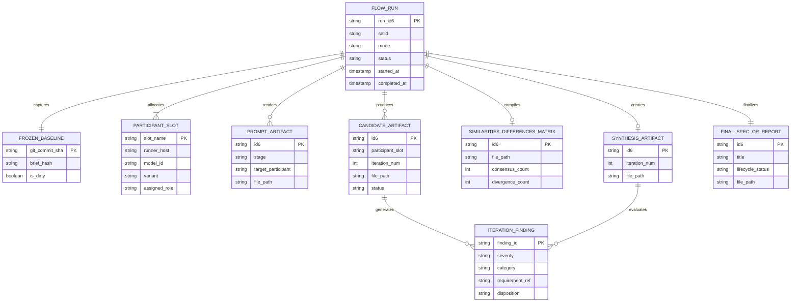
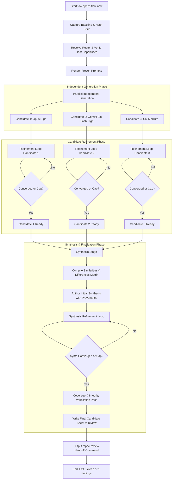
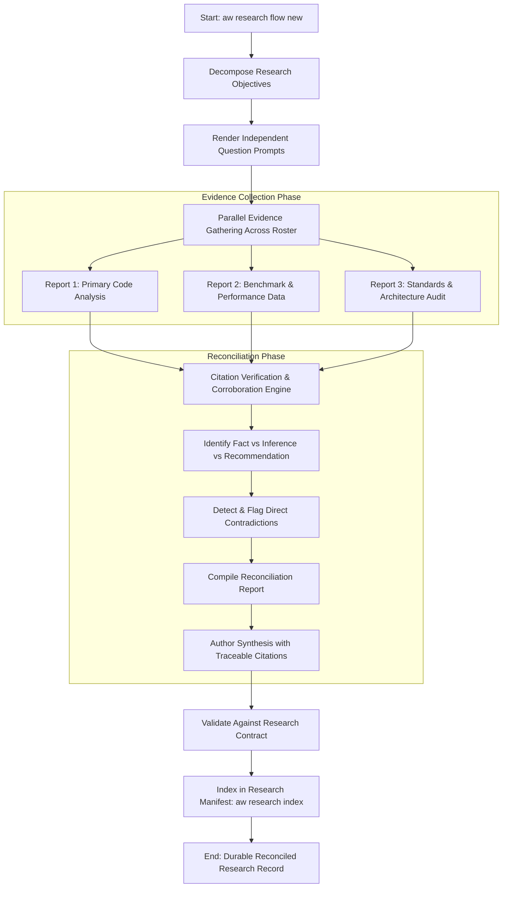
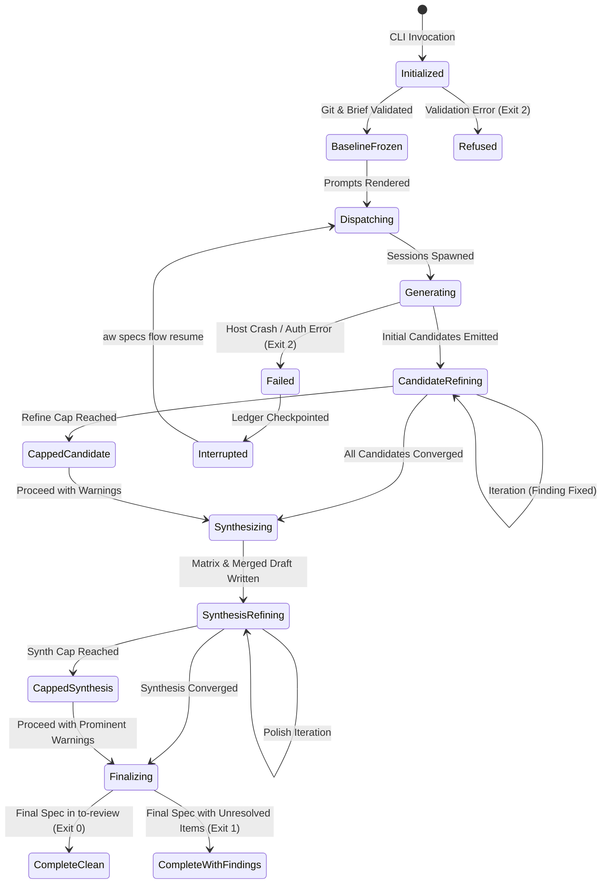

# Spec: Configurable Spec and Research Synthesis

- Date: 2026-10-24
- Status: draft
- Id: 18hh1u
- Author: aw specs new
- Scope: Configurable single-agent and multi-agent spec and research synthesis
- Set: specflow

## Workflow history

- 2026-10-24 created (aw specs): Configurable single-agent and multi-agent spec and research synthesis

---

## 1. Summary, Problem, Actors, Goals, Non-Goals, and First-Release Boundary

### 1.1 Summary
This specification defines the functional, structural, and behavioral architecture for **configurable single-agent and multi-agent spec and research synthesis** in `agent-workflows` (`aw`). It automates the multi-stage lifecycle of generating independent candidate specifications or research reports, iteratively refining them against quality criteria, synthesizing competing proposals into a coherent whole with accountable provenance, and preparing finalized candidate artifacts ready for human gatekeeping or peer review.

### 1.2 Problem Statement
Authoring high-stakes software specifications and deep research findings currently requires laborious, error-prone manual orchestration:
1. An operator writes separate prompts for candidate generation and iterative critique.
2. The operator manually dispatches these prompts across disparate Agent Communication Environments (ACEs) and LLM hosts (such as OpenCode, Antigravity, or Codex), manually tracking sessions, context limits, and model parameters.
3. The operator evaluates feedback loops by hand, making ad-hoc judgments about when improvements have plateaued or when cost/turn caps have been exceeded.
4. Competing candidates must be manually compared. Operators struggle to reconcile divergent architectural choices without either producing an incoherent union of contradictory ideas or losing valuable minority insights.
5. Intermediate artifacts (prompts, raw drafts, iteration findings, matrices) are scattered across untracked scratch directories, destroying traceability and violating repository naming, set-grouping, and provenance standards.

### 1.3 Target Actors
- **The Maintainer / Human Architect**: Initiates workflows from a brief or existing document, configures participant preferences, reviews convergence metrics and comparison matrices, resolves irreconcilable architectural tradeoffs, and performs formal human review/approval.
- **Autonomous Runner Drivers**: Background execution processes (`aw oc run`, `aw agy run`, headless executors) executing bounded prompt stages in isolated worktrees with strict timeouts and error capture.
- **Participating LLM Agents**: Individual model instances across configured hosts (e.g. Anthropic Claude Opus 5.5, Google Gemini 3.8 Flash, OpenAI GPT-6.1 Sol) executing generation, critique, reconciliation, or synthesis roles.
- **Downstream Review Tooling**: Repository validation mechanisms, specifically `/spec-review` and `aw specs check`, consuming the finalized candidate specification.

### 1.4 Goals
- **Configurable Multi-Model & Single-Model Rosters**: Support flexible participant rosters ranging from a single participant to heterogeneous multi-model teams, honoring host-specific capabilities and user-configured launch profiles.
- **Strict Independence Before Synthesis**: Guarantee that independent candidates generate without cross-contamination or premature information leaks from peer candidates.
- **Controlled, Bounded Refinement**: Provide iterative critique loops governed by stable finding identifiers, objective stopping rules ("no material improvements"), and explicit iteration/cost caps.
- **Traceable Synthesis with Accountability**: Synthesize competing candidates into a single coherent design, producing an explicit Similarities and Differences Matrix, logging contribution provenance for all requirements, and preventing silent consensus fabrication.
- **Research Parity**: Support research formulation, independent evidence gathering, contradiction tracking, and reconciliation into durable research records without borrowing inapplicable spec approval semantics.
- **Normalized Artifact Grammar and Set Clustered Identity**: Strictly adhere to the repository's normalized artifact naming grammar (`YYYYMMDD-<setid>-NN-<id6>-<slug>.<type>[.<facets>].md`), ensuring stable `id6` identity, immutable Set grouping, and clean separation between durable records and disposable state.
- **Deterministic CLI & Agent Protocol**: Provide ergonomic human CLI commands alongside strict non-interactive, machine-readable output conforming to `aw.agent/v1` JSONL.

### 1.5 Non-Goals
- **Automatic Spec Approval or Implementation**: Finalization produces a candidate spec in `to-review` or `draft` state. It never performs human attestation (`approved`), does not grant permission to implement, and does not author implementation plans (IPDs).
- **Consensus by Majority Voting**: Synthesis never resolves design choices by raw vote count or model popularity; decisions are weighted by repository facts, architectural constraints, and operator-defined objectives.
- **Unbounded Merge Recursion**: Synthesis does not recursively spawn multi-agent sub-merges; merge resolution is strictly bounded to a single synthesis stage followed by an optional synthesis-refinement loop.
- **Secret Management**: CLI and profiles do not store API keys, tokens, or plaintext credentials; existing environment variables and host-local authentication are reused.
- **Universal Sandboxing Guarantees**: Does not simulate or promise operating-system sandboxing on platforms where the host driver lacks support (e.g. Landlock on non-Linux platforms).

### 1.6 Explicit First-Release Boundary (Phase 1)
- **Included in First Release**:
  - Primary CLI commands under `aw specs flow` and `aw research flow`.
  - Input from a local Markdown brief file, existing spec path, or research question.
  - Participant roster resolution via `runner-profiles.json` and explicit CLI overrides.
  - OpenCode (`oc`) and Antigravity (`agy`) execution drivers for generation, refinement, and synthesis.
  - OpenCode-hosted execution for GPT-6.1 Sol Medium when native Codex runner is absent.
  - Execution modes: Quick (`--mode quick`) and Thorough (`--mode thorough`).
  - Iteration loops with configurable caps (`--refine-cap`, `--synth-refine-cap`) and convergence detection.
  - Production of the Similarities and Differences Matrix and requirement provenance tags.
  - Normalized artifact emission under `.aw/records/specs/`, `.aw/records/research/`, and `.aw/records/prompts/`.
  - Machine-readable `--agent` (`aw.agent/v1`) and `--json` outputs.
  - Resume from interrupted or capped runs via `--resume <run-id6>`.
- **Deferred to Subsequent Releases (Phase 2 & 3)**:
  - Native standalone `codex exec` background runner driver (use OpenCode adapter in Phase 1).
  - Multi-document large spec chunking and assembly pipeline (supported by manual part definitions in Phase 1, automated chunking in Phase 2).
  - Dynamic cost-tracking telemetry based on live token billing APIs (Phase 1 tracks turn counts, wall latency, and character volumes).
  - Interactive terminal dashboard / curses wizard for live multi-agent watching.

---

## 2. Repository Findings and Integration Seams

### 2.1 Codebase Inspection Baseline
- **Inspected Commit**: `14e7b4970826b28dd15a263b50dad8546ca55215` (branch `specflow-candidate` / `main`).
- **Inspection Date**: 2026-10-24.

### 2.2 Integration Seams and Findings

| Subsystem / Module | Repository Reference | Existing Posture & Behavior | Required Extension for Spec & Research Flow |
| --- | --- | --- | --- |
| **CLI Architecture & Dispatch** | `agent_workflows/cli.py`<br>`agent_workflows/result_types.py` | Top-level commands are artifact-noun oriented (`aw specs`, `aw research`, `aw ipd`, `aw backlog`, `aw prompts`). Subcommands are structured via `add_subparsers`. `OutputMode` follows `explicit > --agent > human`. | Add `flow` subcommands to `specs` and `research` (`aw specs flow`, `aw research flow`). Maintain `CommandResult` envelope and exit codes (0 clean, 1 findings/drift, 2 usage error). |
| **Runner Profiles & Launch Resolution** | `agent_workflows/runner_profiles.py`<br>`docs/runner-profiles.md` | Stored in `<config_dir>/runner-profiles.json`. Schema version 2. Precedence: explicit caller > named profile > runner default > host default. Registers `oc` (supports variant/agent) and `agy` (no variant/agent in registry). `roles` map exists but is currently inert. | Extend role vocabulary or map flow roles (`flow-generate`, `flow-refine`, `flow-synthesize`) to profile references. Add validation for flow participant rosters. Support profile references in workflow config. |
| **Host Capabilities & Adapters** | `agent_workflows/host_adapters.py`<br>`agent_workflows/host_capability_registry.py` | `V1_HOSTS` includes `opencode`, `codex`, `antigravity`. Codex has `HOST_NONINTERACTIVE_RUNTIME = "codex exec"`, but no active runner profile row in `runner_profiles.py`. | In Phase 1, route Sol slot (`gpt-6.1-sol-medium`) through OpenCode profile. Declare Codex runner adapter as deferred or provide headless subprocess bridge. |
| **Machine Protocol & Output** | `docs/cli-output-contract.md`<br>`docs/cli-agent-protocol.md` | `aw.agent/v1` JSONL protocol with typed events (`result`, `diagnostic`, `change`, `evidence`). Redacts local home paths. Strict anti-greenwashing rules. | Emit `flow` status events via `aw.agent/v1`. Distinguish `clean` (converged without findings), `findings` (capped with unresolved issues), and `fail`. |
| **Spec Lifecycle & Validation** | `agent_workflows/specs.py`<br>`agent_workflows/specs_cli.py`<br>`.aw/records/specs/README.md` | Specs have closed status enum: `draft`, `to-review`, `reviewed`, `approved`, `implementing`, `implemented`, `deferred`, `parked`, `superseded`. Location matches status directory. Tool-owned minting via `aw specs new`. | Flow finalization writes candidate to `draft/` or `to-review/`. Must never forge review attestations or set `approved`. Links to `/spec-review`. |
| **Research Contracts & Index** | `agent_workflows/research_contract.py`<br>`agent_workflows/research_cmd.py`<br>`.aw/records/research/README.md` | Naming: `YYYYMMDD-<set>-<NN>-<id6>-<slug>[.<model>].<kind>.md`. Kinds: `research-prompt`, `research-report`, `reconciliation-report`. `reconciliation` denotes multi-author synthesis. Sharded by weekly directories for `reference` and `archive`. | Reuse research kinds and index generators. Multi-agent research outputs write `research-report` per model and `reconciliation-report` for the synthesized report. |
| **Artifact Naming & Identity Authority** | `agent_workflows/artifact_naming.py`<br>`agent_workflows/artifact_core.py` | Unified clustered grammar `YYYYMMDD-<setid>-<NN>-<id6>-<slug>[.<facet>].md`. Setid length <= 14 preferred, > 14 warns, > 24 refused. Minting done via `artifact_core.mint_id6()`. | Emit normalized intermediate filenames: `.<type>.<ace>.<model>-<variant>.md`. Support multi-author facet `reconciliation` or omit model facet on synthesis. |
| **Storage Root Resolution** | `agent_workflows/project_context.py` | `project_records_dir(repo_root)` resolves physical location for `.aw/records/`, including external companion and home placement. Never hard-code `.aw/records/` as a static string. | Route all artifact writes through `project_records_dir()`. Support separate session state directory in `.aw/runs/` or runtime scratch root. |

---

## 3. CLI Design, Alternatives, and Command Matrix

### 3.1 Evaluation of CLI Grammar Families

Three candidate grammar families were evaluated:

1. **Family A: Artifact-Noun Extension (Recommended)**:
   - Form: `aw specs flow <subcommand>` and `aw research flow <subcommand>`.
   - Examples: `aw specs flow new --brief <path>`, `aw research flow new --question <str>`.
   - Evaluation:
     - *Discoverability & Memorability*: High. Users already reach for `aw specs` when dealing with specifications and `aw research` for research.
     - *Consistency*: Fully matches existing CLI structure where `aw specs new`, `aw specs set`, and `aw specs check` govern specs, while `aw research new` and `aw research new-comparison` govern research.
     - *Separation of Concerns*: Respects the fundamental domain boundary: specs advance toward formal review and implementation planning; research compiles knowledge with citations into a permanent reference library.
     - *Agent Usability*: Highly predictable for LLMs inspecting `--help`.

2. **Family B: Shared Process Noun with Typed Input/Output**:
   - Form: `aw flow specs <subcommand>` / `aw flow research <subcommand>` or `aw synth specs ...`.
   - Examples: `aw flow run --type spec --brief <path>`, `aw synth research --set mytopic`.
   - Evaluation:
     - *Discoverability*: Moderate. Introduces a new top-level noun (`flow` or `synth`) that competes with `specs` and `research`.
     - *Consistency*: Splits spec tooling across two top-level verbs (`aw specs` vs `aw flow`).
     - *Agent Usability*: Increases prompt complexity when an agent must choose between `aw specs` and `aw flow`.
     - *Verdict*: Rejected as primary; retained only as an optional secondary alias (`aw flow ...` routing to `aw <type> flow ...`).

3. **Family C: Verb-Oriented or `aw run` Overload**:
   - Form: `aw run flow --type spec ...` or `aw generate-spec ...`.
   - Examples: `aw run spec-synthesis ...`.
   - Evaluation:
     - *Discoverability*: Low. In `agent-workflows`, `aw run` and `aw runs` have strict existing ownership: `aw run` executes IPD plan tasks and code-modifying runs; `aw runs` queries the execution ledger.
     - *Grammar Collisions*: Overloading `aw run` creates severe confusion regarding whether an execution modifies source code or authors documentation.
     - *Verdict*: Strongly rejected.

### 3.2 Canonical CLI Grammar Decision
The canonical primary grammar is **Family A**:
- Specifications: `aw specs flow <action> [options]`
- Research: `aw research flow <action> [options]`

Convenience aliases: `aw specs synth` is an alias for `aw specs flow`; `aw research synth` is an alias for `aw research flow`.

### 3.3 Command Matrix

| Canonical Command | Mode & Rigor | Arguments & Options | Result & Side Effects | Exit Codes |
| --- | --- | --- | --- | --- |
| `aw specs flow new` | Quick or Thorough | `--brief <path>` (required or stdin)<br>`--title <str>`<br>`--slug <slug>` (optional)<br>`--set <setid>` (optional)<br>`--mode quick\|thorough` (default: `thorough`)<br>`--roster <roster-spec>` (optional)<br>`--refine-cap <int>` (default: 3 thorough, 1 quick)<br>`--synth-refine-cap <int>` (default: 2 thorough, 0 quick)<br>`--apply` (default: preview only)<br>`--agent` / `--json` | Generates candidate specs across roster, executes refinement loops, synthesizes merged design, and writes final candidate to `.aw/records/specs/draft/` or `to-review/`. | 0: clean<br>1: findings/cap<br>2: usage error |
| `aw specs flow from-spec` | Quick or Thorough | `<spec-selector>` (id6, setid, or path)<br>`--mode quick\|thorough`<br>`--roster <roster-spec>`<br>`--objective <str>` (focus area)<br>`--apply` | Reads existing spec as baseline, gathers independent alternative revisions across roster, refines, and synthesizes into a successor or updated candidate spec. | 0: clean<br>1: findings/cap<br>2: usage error |
| `aw specs flow merge` | Synthesis Only | `<candidate-paths...>`<br>`--set <setid>`<br>`--slug <slug>`<br>`--synthesizer <profile>` (default: roster verifier)<br>`--synth-refine-cap <int>`<br>`--apply` | Takes previously generated candidate spec files, skips initial generation, builds Similarities/Differences Matrix, executes synthesis refinement, and finalizes. | 0: clean<br>1: findings/cap<br>2: usage error |
| `aw specs flow status` | Read-Only | `<flow-run-id6>` (or latest if omitted)<br>`--verbose` | Displays live or completed execution status: participant stage progress, iteration counts, active findings, cap warnings, token metrics. | 0: clean<br>1: findings/active<br>2: usage error |
| `aw specs flow resume` | Recovery | `<flow-run-id6>`<br>`--refine-cap <int>` (optional new cap)<br>`--apply` | Resumes an interrupted, failed, or capped run from its frozen state without re-running completed participant turns. | 0: clean<br>1: findings/cap<br>2: usage error |
| `aw specs flow finalize` | Finalization | `<flow-run-id6>`<br>`--status to-review\|draft` (default: `to-review`)<br>`--allow-unresolved-minor` (flag)<br>`--apply` | Validates final candidate against spec checklist, formats workflow history, moves spec to destination lifecycle directory, and outputs `/spec-review` command. | 0: clean<br>1: blocked/findings<br>2: usage error |
| `aw research flow new` | Quick or Thorough | `--question <str>` (or `--brief <path>`)<br>`--slug <slug>`<br>`--set <setid>`<br>`--mode quick\|thorough`<br>`--roster <roster-spec>`<br>`--topic <str>`<br>`--apply` | Formulates research prompt, collects independent evidence reports across roster, cross-verifies citations, reconciles contradictions, and emits `reconciliation-report`. | 0: clean<br>1: findings/unverified<br>2: usage error |
| `aw specs flow config` | Read-Only / Mutate | `show` \| `set-roster` \| `set-defaults`<br>`--roster <roster-spec>`<br>`--profile <name>` | Displays resolved configuration hierarchy or writes user-local flow defaults to `<config_dir>/flow-preferences.json`. | 0: clean<br>2: usage error |

---

## 4. Functional Requirements

### 4.1 Input Specification and Baseline Freezing
- **FR-01 (Frozen Baseline Snapshot)**: The workflow engine MUST capture and hash the source repository baseline (git commit SHA, dirty state summary, and referenced file content hashes) at turn start. All participants in the generation phase MUST receive identical frozen baselines.
- **FR-02 (Input Brief Validation)**: The workflow MUST accept an input brief via file path (`--brief <path>`), literal argument, or standard input (`--brief -`). If the brief is empty, contains unresolved template markers (e.g. `<TODO>`), or exceeds 250,000 characters without chunking instructions, the command MUST refuse execution with exit code 2.
- **FR-03 (Standard Objectives Injection)**: The engine MUST automatically prepend non-negotiable repository objectives to every generated prompt: security, remote SSH safety (no file URI schemes, no absolute machine home paths), prose style (no em or en dashes in user-facing text), and testability (outcomes, not code structure).

### 4.2 Independent Candidate Generation
- **FR-04 (Zero Cross-Contamination)**: During initial candidate generation, no participant session MAY receive, read, or be informed of the output, intermediate tokens, or identity of any peer participant.
- **FR-05 (Deterministic Prompt Rendering)**: Prompts for each participant MUST be rendered from versioned templates (`agent_workflows/templates/flow/`) and persisted as tracked prompt artifacts (`.prompt.md`) prior to host dispatch.
- **FR-06 (Single-Participant Graceful Degradation)**: When the roster contains exactly one participant, the generation phase MUST execute once for that participant. Synthesis machinery MUST bypass multi-candidate diffing and route directly to single-candidate refinement and finalization without fabricating consensus.

### 4.3 Controlled Iterative Refinement
- **FR-07 (Structured Finding Schema)**: Review and refinement turns MUST classify critique items using stable structured identifiers (`F-01`, `F-02`, etc.) with required fields: Severity (`critical`, `major`, `minor`), Category (`correctness`, `contract`, `security`, `completeness`, `consistency`, `clarity`), Requirement Reference, Concrete Evidence, Suggested Remedy, and Disposition.
- **FR-08 (Iteration Accounting)**: The iteration counter MUST increment only upon completion of a full review-and-revision cycle. Host failures, transport timeouts, or transient API errors MUST trigger isolated retries (up to `--max-retries`, default 2) and MUST NOT increment the quality iteration counter.
- **FR-09 (Convergence Detection)**: An iteration loop MUST declare convergence ("no material improvements") when a review pass yields zero `critical` and zero `major` findings, and all previous findings are either verified as fixed or formally accepted with rationale. Rising numerical self-scores (e.g. "9/10") MUST NOT be used as a convergence signal.
- **FR-10 (Design Oscillation Guard)**: If a finding's proposed remedy directly reverses an architectural decision adopted in the immediately preceding iteration, the engine MUST flag an oscillation warning, halt automated refinement, and prompt the operator or mark the finding as `unresolved-oscillation`.
- **FR-11 (Honest Cap Enforcement)**: If `--refine-cap` or `--synth-refine-cap` is reached while `critical` or `major` findings remain unresolved, the command MUST:
  1. Halt further automated refinement.
  2. Emit status `findings` (exit code 1).
  3. Output a prominent human warning listing all unresolved finding IDs and affected sections.
  4. Write the machine-readable state `capped_with_findings`.
  5. NEVER mark the artifact as clean or approved.

### 4.4 Synthesis and Accountable Provenance
- **FR-12 (Non-Voting Architectural Synthesis)**: Synthesis MUST evaluate proposals on technical merit, constraint satisfaction, and repository consistency. It MUST NOT adopt features based on majority voting or model popularity. Valuable minority proposals MUST remain eligible for adoption.
- **FR-13 (Similarities and Differences Matrix)**: Synthesis MUST generate a dedicated Markdown comparison table (`.review.md`) detailing:
  - Consensus Elements: Requirements shared across all candidates.
  - Divergent Elements: Alternative approaches proposed for the same requirement.
  - Unique Contributions: Novel features or constraints proposed by a single candidate.
  - Selected Resolution: The chosen approach with explicit architectural rationale.
- **FR-14 (Fine-Grained Provenance Tagging)**: The synthesized document MUST carry provenance tags on every major section or requirement:
  - `[Adopted: <candidate-id6> (<model>)]`: Unchanged adoption of a candidate proposal.
  - `[Adapted: <candidate-id6-A> + <candidate-id6-B>]`: Synthesis combining multiple proposals.
  - `[Synthesizer-Novel: <rationale>]`: Necessary structural or reconciling design introduced during synthesis.
  - `[Rejected: <candidate-id6> (<model>) - <reason>]`: Explicit exclusion recorded in the matrix.
- **FR-15 (Coverage Verification Check)**: Following synthesis, the engine MUST run a deterministic lint pass verifying that every functional requirement present in the original brief is addressed in the synthesis. Any dropped requirement MUST fail the synthesis stage.

### 4.5 Research Reconciliation and Evidence
- **FR-16 (Citation Traceability)**: Every factual claim in a research report MUST be tethered to a resolvable primary citation (repository file/line, commit SHA, official documentation URL, or dated publication).
- **FR-17 (Non-Corroboration Invariant)**: Identical claims made by multiple LLM participants MUST NOT be treated as corroborating evidence if they cite the same underlying source or cite no source.
- **FR-18 (Contradiction Preservation)**: When participants discover conflicting evidence or draw incompatible conclusions, the reconciliation report (`.reconciliation-report.md`) MUST explicitly document the conflict under a dedicated `## Contradictions and Discrepancies` section, rather than smoothing over disagreements.

### 4.6 Artifact Lifecycle and Hand-off
- **FR-19 (Tool-Owned Identity)**: All generated specs, research docs, prompts, and reviews MUST receive a tool-minted `id6` via `agent_workflows.artifact_core.mint_id6()`. Hand-minted IDs are strictly prohibited.
- **FR-20 (Lifecycle Status Integrity)**: Final candidate specifications MUST be written with status `to-review` (or `draft` if minor findings remain). The workflow engine MUST NEVER write status `reviewed` or `approved`.
- **FR-21 (Clean Review Handoff)**: Upon successful finalization, the command MUST output the exact next-action command for human review:
  `aw specs check <spec-id6>` followed by `/spec-review .aw/records/specs/to-review/<filename>`.

---

## 5. Configuration, Participant Rosters, and Capability Handling

### 5.1 Configuration Hierarchy and Precedence
Flow configurations resolve through a deterministic 4-tier hierarchy:
```text
CLI Arguments  >  Project Flow Config (.aw/config/flow.json)  >  User Flow Preferences (~/.config/agent-workflows/flow-preferences.json)  >  Built-In Defaults
```

### 5.2 Schema: Flow Preferences (`flow-preferences.json`)
The configuration schema integrates directly with `agent_workflows.runner_profiles`:

```json
{
  "$schema": "https://agent-workflows.dev/schemas/flow-v1.json",
  "schema_version": 1,
  "default_mode": "thorough",
  "limits": {
    "default_refine_cap": 3,
    "default_synth_refine_cap": 2,
    "quick_refine_cap": 1,
    "quick_synth_refine_cap": 0,
    "max_retries_per_turn": 2,
    "turn_timeout_seconds": 600
  },
  "rosters": {
    "preferred-three": [
      {
        "slot": "opus",
        "profile": "opus",
        "runner": "oc",
        "model": "anthropic/claude-3-opus",
        "variant": "high",
        "role": "author"
      },
      {
        "slot": "gemini",
        "profile": "gem",
        "runner": "agy",
        "model": "google/gemini-3.8-flash",
        "variant": "high",
        "role": "author"
      },
      {
        "slot": "sol",
        "profile": "sol",
        "runner": "oc",
        "model": "openai/gpt-6.1",
        "variant": "medium",
        "role": "author"
      }
    ],
    "quick-solo": [
      {
        "slot": "primary",
        "profile": "gem",
        "runner": "agy",
        "model": "google/gemini-3.8-flash",
        "variant": "high",
        "role": "author"
      }
    ]
  },
  "roles": {
    "synthesizer": "opus",
    "research-verifier": "opus"
  }
}
```

### 5.3 Host and Model Capability Handling

| Target Participant | Requested ACE | Requested Model | Requested Variant | Actual Repository Capability & Resolution Strategy |
| --- | --- | --- | --- | --- |
| **Participant 1** | OpenCode (`oc`) | Claude Opus 5.5 | `high` | Fully supported. `runner_profiles.py` registers `oc` with `supports_variant=True`. Launched via `oc run --model anthropic/claude-3-opus --variant high`. |
| **Participant 2** | Antigravity (`agy`) | Gemini 3.8 Flash | `high` | Partial support gap: `runner_profiles.py` registers `agy` with `supports_variant=False` (driver takes `--model` only). Resolution: Flow engine passes exact model string `google/gemini-3.8-flash`. Variant `high` is injected into the prompt system banner as instruction-level reasoning guidance. |
| **Participant 3** | Codex or OpenCode | GPT-6.1 Sol | `medium` | Capability decision: `runner_profiles.py` has no active runner profile row for Codex (`codex exec` is in `host_adapters.py` but has no managed runner driver). Resolution: Route Sol slot to OpenCode (`oc`) using profile `sol` with `--model openai/gpt-6.1 --variant medium`. Never fail silently; announce OpenCode routing in execution plan. |

---

## 6. Entities, Lifecycle, Artifact Matrix, and Worked Inventories

### 6.1 Entity-Relationship Model



### 6.2 Artifact Naming and Placement Matrix

All files conform to the target uniform grammar:
- Attributed intermediate form: `YYYYMMDD-<setid>-NN-<id6>-<slug>.<type>.<ace>.<model>-<variant>.md`
- Multi-author or final form: `YYYYMMDD-<setid>-NN-<id6>-<slug>.<type>.md`

| Stage | Artifact Purpose | Type Facet | Target Filename Pattern | Resolved Directory Location | Retention & Lifecycle |
| --- | --- | --- | --- | --- | --- |
| **0. Input** | Frozen brief & scope | `brief` | `YYYYMMDD-<setid>-00-<id6>-<slug>.brief.md` | `.aw/records/prompts/pending/` | Committed; permanent audit provenance |
| **1. Gen Prompt** | Rendered prompt for participant | `prompt` | `YYYYMMDD-<setid>-01-<id6>-gen.prompt.<ace>.<model>-<variant>.md` | `.aw/records/prompts/pending/` | Committed; permanent audit provenance |
| **2. Candidate** | Independent raw candidate spec | `spec` | `YYYYMMDD-<setid>-10-<id6>-cand.spec.<ace>.<model>-<variant>.md` | `.aw/records/specs/draft/` | Retained in `draft/` as historical candidate |
| **2. Candidate (Research)** | Independent research report | `research-report` | `YYYYMMDD-<setid>-10-<id6>-cand.<kind>.<ace>.<model>-<variant>.md` | `.aw/records/research/todo/` | Retained as model-specific report |
| **3. Findings** | Per-iteration review critique | `review` | `YYYYMMDD-<setid>-11-<id6>-iter1.review.<ace>.<model>-<variant>.md` | `.aw/records/specs/draft/` | Retained for audit trails |
| **4. Revised Candidate** | Iteration 2 revised candidate | `spec` | `YYYYMMDD-<setid>-12-<id6>-cand-i2.spec.<ace>.<model>-<variant>.md` | `.aw/records/specs/draft/` | Retained in `draft/` |
| **5. Merge Matrix** | Similarities/Differences Matrix | `review` | `YYYYMMDD-<setid>-50-<id6>-matrix.review.md` | `.aw/records/specs/draft/` | Retained; accompanies final spec |
| **6. Synthesis** | Initial synthesized spec | `spec` | `YYYYMMDD-<setid>-80-<id6>-synth-i0.spec.md` | `.aw/records/specs/draft/` | Retained in `draft/` |
| **7. Final Candidate Spec** | Final candidate ready for review | `spec` | `YYYYMMDD-<setid>-01-<id6>-<slug>.spec.md` | `.aw/records/specs/to-review/` | Authoritative spec; advances through spec lifecycle |
| **7. Final Research** | Final reconciled research report | `reconciliation-report` | `YYYYMMDD-<setid>-01-<id6>-<slug>.reconciliation-report.md` | `.aw/records/research/` | Authoritative research record; indexed in research catalog |

### 6.3 Setid, Date, NN, and Id6 Governance Rules
- **Setid**: Shared across all intermediate and final artifacts for a given flow run. MUST NOT exceed 14 characters (catalog invariant I-17). Examples: `specflow`, `authv2`, `synthrsc`.
- **Date**: The 8-digit date (`YYYYMMDD`) prefix represents the Set creation date. Resumed runs or runs crossing midnight preserve the canonical Set date in the filename; file metadata carries actual creation/modification timestamps.
- **NN (Order Sequence)**: Bounded 2-digit sequence (`00`..`99`) defining stage progression:
  - `00`: Input brief / baseline.
  - `01`..`09`: Rendered prompts.
  - `10`..`49`: Independent candidate generation and refinement iterations.
  - `50`..`79`: Cross-candidate comparison matrices and reconciliation tables.
  - `80`..`98`: Synthesis and synthesis-refinement iterations.
  - `01` (in final directory): Authoritative final candidate spec (matches `aw specs new` convention).
- **Id6**: Every artifact receives an independent, globally unique 6-character alphanumeric ID minted by `artifact_core.mint_id6()`. An updated iteration receives a NEW id6 and references its parent id6 in front matter via `- Prior-Id: <id6>`.

### 6.4 Worked Filename Inventory: 3-Participant Thorough Spec Run

Assume Set: `specflow`, Date: `20261024`, Slug: `auth-synth`. Sample IDs are fictional (`f1...`, `f2...`).

1. Frozen Brief:
   `.aw/records/prompts/pending/20261024-specflow-00-f1a001-auth-synth.brief.md`
2. Rendered Prompts (Stage 1):
   - Participant 1 (Opus): `.aw/records/prompts/pending/20261024-specflow-01-f1p001-gen.prompt.oc.opus-high.md`
   - Participant 2 (Gemini): `.aw/records/prompts/pending/20261024-specflow-02-f1p002-gen.prompt.agy.gemini38flash-high.md`
   - Participant 3 (Sol): `.aw/records/prompts/pending/20261024-specflow-03-f1p003-gen.prompt.oc.gpt61sol-medium.md`
3. Initial Candidate Specs (Stage 2):
   - Participant 1: `.aw/records/specs/draft/20261024-specflow-10-f1c001-cand.spec.oc.opus-high.md`
   - Participant 2: `.aw/records/specs/draft/20261024-specflow-20-f1c002-cand.spec.agy.gemini38flash-high.md`
   - Participant 3: `.aw/records/specs/draft/20261024-specflow-30-f1c003-cand.spec.oc.gpt61sol-medium.md`
4. Iteration 1 Findings & Revised Candidates (Stage 3):
   - Findings P1: `.aw/records/specs/draft/20261024-specflow-11-f1r001-iter1.review.oc.opus-high.md`
   - Revised P1: `.aw/records/specs/draft/20261024-specflow-12-f1c004-cand-i2.spec.oc.opus-high.md`
   - Findings P2: `.aw/records/specs/draft/20261024-specflow-21-f1r002-iter1.review.agy.gemini38flash-high.md`
   - Revised P2: `.aw/records/specs/draft/20261024-specflow-22-f1c005-cand-i2.spec.agy.gemini38flash-high.md`
   - Findings P3: `.aw/records/specs/draft/20261024-specflow-31-f1r003-iter1.review.oc.gpt61sol-medium.md`
   - Revised P3: `.aw/records/specs/draft/20261024-specflow-32-f1c006-cand-i2.spec.oc.gpt61sol-medium.md`
5. Similarities & Differences Matrix:
   `.aw/records/specs/draft/20261024-specflow-50-f1m001-matrix.review.md`
6. Synthesis Iterations:
   - Initial Synthesis: `.aw/records/specs/draft/20261024-specflow-80-f1s001-synth-i0.spec.md`
   - Synthesis Critique: `.aw/records/specs/draft/20261024-specflow-81-f1r004-synth-iter1.review.md`
   - Refined Synthesis: `.aw/records/specs/draft/20261024-specflow-82-f1s002-synth-i1.spec.md`
7. Authoritative Final Candidate:
   `.aw/records/specs/to-review/20261024-specflow-01-f1f001-auth-synth.spec.md`

---

## 7. Workflows, Prompts, Synthesis, and Chunking Protocols

### 7.1 End-to-End Specification Flow Diagram



### 7.2 Research Flow Diagram



### 7.3 State, Recovery, and Cap Flow Diagram



### 7.4 Context Window Management and Task Chunking
To prevent quality degradation observed when smaller context models encounter oversized specifications:
1. **Source Packet Sizing**: Source code snippets injected into prompt contexts MUST be scoped strictly to targeted interfaces and signatures rather than raw directory dumps. Maximum prompt payload is budgeted at 40,000 tokens for generation turns.
2. **Modular Document Chunking**: When a specification brief exceeds 15 functional requirements or spans multiple independent architectural domains (e.g. CLI grammar vs internal database storage):
   - The brief is partitioned into numbered sub-components (`Part A: CLI & Protocol`, `Part B: Runtime Engine`).
   - Candidates are generated per part with shared interface contracts.
   - Cross-chunk integration review is executed as a dedicated synthesis step before final assembly.
3. **Lossy Summary Prohibition**: An agent MUST NOT replace detailed requirement tables with prose summaries during iterative refinement; every requirement ID must remain tracked.

---

## 8. Security, Privacy, Performance, and Observability

### 8.1 Security and Shell Injection Prevention
- **No Command Construction via String Concatenation**: Host CLI arguments (`opencode run`, `agy run`) MUST be dispatched using discrete argument arrays (`execve` parameter lists), preventing shell metacharacter expansion or command injection.
- **Strict Model String Validation**: All model and profile strings MUST conform to `agent_workflows.runner_profiles.MODEL_RE` and `FIELD_RE`, strictly rejecting spaces, quotes, backticks, semicolons, and pipes.
- **Zero API Key Storage**: Runner profiles and workflow configuration MUST NEVER accept or store credentials (`FORBIDDEN_PROFILE_KEYS` enforcement).

### 8.2 Privacy and Machine Identification Redaction
- **Remote SSH Environment Invariant**: Outputs and generated files MUST NEVER print absolute file paths (such as user home directories). Paths MUST always be rendered relative to the repository root.
- **No File Scheme URIs**: All file citations MUST use plain relative Markdown paths without file URI schemes.
- **Home Path Redaction**: Machine-readable logs and artifacts MUST apply `agent_workflows.project_context.redact_public_context` to purge user home directories, machine hostnames, and local user identifiers.

### 8.3 Performance, Timeouts, and Resource Bounds
- **Turn Timeouts**: Every model dispatch turn MUST carry a hard process timeout (default: 600 seconds, configurable via `--turn-timeout`).
- **Parallel Dispatch**: Generation turns for peer participants MUST execute concurrently across independent background worker processes up to a concurrency ceiling of 4.
- **Finite Budget Ceiling**: The workflow engine enforces a hard global invocation cap (default: 20 total model turns per run) to prevent runaway billing or infinite refinement loops.

---

## 9. Requirement-to-Acceptance-Test Matrix

Every functional requirement is mapped to an observable behavioral acceptance test:

| Test ID | Mapped FR | Test Description & Action | Expected Observable Outcome | Pass/Fail Gate |
| --- | --- | --- | --- | --- |
| **AT-01** | FR-01, FR-02 | Execute `aw specs flow new --brief ""` with an empty file. | Process exits with code 2. Standard error contains `refusal: empty brief`. No files written. | Pass if exit code 2 and zero files created. |
| **AT-02** | FR-04 | Execute 3-participant run. Intercept prompts dispatched to participant 2. | Prompt dispatched to participant 2 contains no text, hashes, or tokens from participant 1. | Pass if candidate 1 content is absent from participant 2 prompt. |
| **AT-03** | FR-06 | Execute `aw specs flow new --brief valid.md --roster "gem" --mode quick --apply`. | Run completes with exactly one generation turn and one refinement turn. Matrix stage is skipped. | Pass if exit code 0 and final spec created with single-model provenance. |
| **AT-04** | FR-07, FR-09 | Mock review turn returning 0 critical/major findings and 1 minor finding. | Engine marks candidate converged. Iteration stops before reaching cap. | Pass if iteration halts early on clean criteria. |
| **AT-05** | FR-10 | Mock review turn where iteration 2 reverses iteration 1's architectural choice. | Engine emits warning `unresolved-oscillation`. Automated refinement halts. | Pass if warning logged and oscillation flagged in findings record. |
| **AT-06** | FR-11 | Execute run with `--refine-cap 1` on candidate with unresolved critical finding. | Process exits with code 1. Human output prints `WARNING: [FLOW-CAP-REACHED]`. | Pass if exit code 1 and machine state is `capped_with_findings`. |
| **AT-07** | FR-13, FR-14 | Inspect synthesized spec and accompanying `.review.md` matrix. | Matrix lists all candidate requirements. Synthesized spec has `[Adopted: ...]`, `[Adapted: ...]`, or `[Synthesizer-Novel: ...]` tags. | Pass if all sections have provenance tags and matrix exists. |
| **AT-08** | FR-15 | Synthesize candidates where Candidate A dropped Requirement 3 from the brief. | Synthesis verification rejects the omission. Synthesis re-integrates Requirement 3. | Pass if final synthesis contains all brief requirements. |
| **AT-09** | FR-16, FR-18 | Run `aw research flow new` with contradictory evidence. | Reconciliation report contains `## Contradictions and Discrepancies` detailing both sides. | Pass if conflicting claims are preserved with citations. |
| **AT-10** | FR-19, FR-20 | Finalize spec and inspect metadata. | Filename matches `YYYYMMDD-<set>-01-<id6>-<slug>.spec.md`. Status is `to-review`. Review attestation is absent. | Pass if status is `to-review` and `aw specs check` succeeds. |
| **AT-11** | FR-21 | Execute `aw specs flow finalize <run-id6> --apply`. | Output terminal displays `/spec-review .aw/records/specs/to-review/...`. | Pass if handoff command is printed verbatim. |

---

## 10. Risks, Alternatives Rejected, Assumptions, and Decision Log

### 10.1 Risks and Mitigations
- **Risk 1: Host Transport or Token Budget Exhaustion**: Large multi-candidate runs across high-reasoning models could exhaust API budgets or hit rate limits.
  - *Mitigation*: Hard turn budgets (`--budget`), conservative default caps (3 iterations), and Quick mode (`--mode quick`) for exploratory work.
- **Risk 2: Synthesis Inconsistency or Requirement Drop**: Synthesis could produce an incoherent hybrid or drop requirements present in one candidate.
  - *Mitigation*: Mandatory coverage verification check (FR-15) and structured Similarities/Differences Matrix (FR-13).
- **Risk 3: Model Hallucination in Research Citations**: LLMs frequently invent URLs or paper citations.
  - *Mitigation*: Citation verification pass requiring local repository verification or validated web links; unverified claims are segregated into an `Unverified Claims` appendix.

### 10.2 Alternatives Rejected
- **Rejected Alternative 1: Git-Branch-Per-Candidate Architecture**: Storing each candidate on a separate git branch. Rejected because switching branches during multi-agent synthesis creates race conditions in shared checkouts and makes local file diffing difficult. All candidates are maintained in the same Set within the worktree.
- **Rejected Alternative 2: Free-Form Prose Review Feedback**: Allowing models to critique in arbitrary paragraph prose. Rejected because automated convergence checking and oscillation detection require structured finding records (`F-01..F-NN`).
- **Rejected Alternative 3: Automated Human Approval Simulation**: Allowing an agent to mark a spec as `approved`. Rejected; repository security invariants require explicit human attestation for `approved` status.

### 10.3 Assumptions
- Host runners (`opencode` and `antigravity`) are locally installed and authenticated on the target development machine.
- The repository root remains accessible and tracked via standard git mechanisms.

### 10.4 Decision Log
- **Decision 01 (Setid Length)**: The Setid for spec and research flows MUST NOT exceed 14 characters, adhering strictly to catalog invariant I-17. Recommended Set: `specflow`.
- **Decision 02 (Sol Slot Runner Binding)**: OpenCode (`oc`) is selected as the default runner for the GPT-6.1 Sol Medium slot in Phase 1 due to native variant flag support and absence of a standalone Codex runner profile row.
- **Decision 03 (Attributed Intermediate Filenames)**: Intermediate candidates and reviews MUST adopt the attributed facet grammar (`.<type>.<ace>.<model>-<variant>.md`) to ensure full auditability before merging.

---

## 11. Implementation Seams and Phasing

### Phase 1: Core Flow Engine and CLI Commands (First Release)
- Implement `agent_workflows/specflow/` core engine:
  - `flow_config.py`: Schema validation and resolution of `flow-preferences.json`.
  - `flow_baseline.py`: Git commit hash capture and brief validation.
  - `flow_prompts.py`: Prompt template rendering for generation and review stages.
  - `flow_runner.py`: Asynchronous dispatch to `oc` and `agy` drivers.
  - `flow_refine.py`: Finding parser, iteration counter, and convergence checker.
  - `flow_synth.py`: Matrix generator and provenance tagger.
- Add CLI subcommands in `agent_workflows/cli.py` and `specs_cli.py`:
  - `aw specs flow [new|from-spec|merge|status|resume|finalize]`
  - `aw research flow [new|status|resume]`
- Unit and integration tests in `tests/test_specflow_*.py`.

### Phase 2: Autonomous Codex Runner and Large Document Chunking
- Implement standalone `codex_runipd.py` runner profile adapter in `agent_workflows/runner_profiles.py`.
- Automated document chunking pipeline for specs exceeding 50,000 tokens.

### Phase 3: Interactive Visualizer and Live Cost Telemetry
- Terminal curses dashboard for watching multi-agent synthesis in real time.
- Direct integration with provider token usage APIs for exact dollar billing receipts.

---

## 12. Source Inventory, Self-Check, and Worked Transcripts

### 12.1 Source Inventory
- Inspected repository baseline commit: `14e7b4970826b28dd15a263b50dad8546ca55215`
- Primary files cited:
  - `agent_workflows/cli.py` (CLI parser and subcommand registration)
  - `agent_workflows/runner_profiles.py` (Profile schemas, launch resolution, `RUNNER_REGISTRY`)
  - `agent_workflows/host_adapters.py` (Host capabilities, `V1_HOSTS`)
  - `agent_workflows/research_contract.py` (Research kinds, naming, and reconciliation rules)
  - `agent_workflows/artifact_naming.py` (Clustered artifact naming authority)
  - `agent_workflows/project_context.py` (Project roots, records placement resolution)
  - `docs/cli-output-contract.md` (Audience modes, `aw.agent/v1` protocol, exit codes)
  - `.aw/records/specs/README.md` (Spec lifecycle states, directory layout, review handoff)

### 12.2 Self-Check of Spec Completeness
- [x] Summary, problem, actors, goals, non-goals, and first-release boundary clearly defined.
- [x] Repository findings table with accurate, revision-pinned citations.
- [x] Three CLI families evaluated; canonical grammar justified with command matrix.
- [x] Stable functional requirements (`FR-01`..`FR-21`) with observable pass/fail conditions.
- [x] Schema for configuration and participant roster provided.
- [x] Mandatory Mermaid diagrams: ERD, Spec Flow, Research Flow, State/Recovery Flow.
- [x] Worked filename inventories for 3-participant, 1-participant, and resumed runs.
- [x] Acceptance test matrix (`AT-01`..`AT-11`).
- [x] Zero em or en dashes throughout the document.
- [x] Zero file URI schemes and zero absolute home directory paths.

---

## 13. Worked Transcripts and Machine Protocols

### 13.1 Worked Transcript: Single-Participant Quick Spec Run

```text
$ aw specs flow new --brief .aw/records/prompts/pending/auth-brief.md --roster "gem" --mode quick --apply

[FLOW-INIT] Starting specification flow (run id: qk91a2, set: specflow)
[FLOW-INIT] Baseline git commit: 14e7b4970826 (clean)
[FLOW-ROSTER] Resolved 1 participant:
  - Slot 'gem': Antigravity (model: google/gemini-3.8-flash, variant: high)
[FLOW-STAGE-1] Dispatching independent candidate generation...
  - Dispatching to agy [google/gemini-3.8-flash] -> .aw/records/specs/draft/20261024-specflow-10-qk91c1-cand.spec.agy.gemini38flash-high.md
  - agy completed in 14.2s (18,410 chars)
[FLOW-STAGE-2] Executing Quick Mode quality review pass (iteration 1/1)...
  - Review finding: F-01 (minor, clarity): Clarify token expiration edge case in Section 4.2
  - Quick refinement revision applied -> .aw/records/specs/draft/20261024-specflow-12-qk91c2-cand-i2.spec.agy.gemini38flash-high.md
[FLOW-STAGE-3] Single-participant run: bypassing multi-candidate synthesis matrix.
[FLOW-FINAL] Candidate finalized:
  - Destination: .aw/records/specs/to-review/20261024-specflow-01-qk91f1-auth-brief.spec.md
  - Lifecycle Status: to-review
  - Discovered Findings: 0 critical, 0 major, 1 minor (resolved)
[FLOW-HANDOFF] Next action for human maintainer:
  aw specs check qk91f1
  /spec-review .aw/records/specs/to-review/20261024-specflow-01-qk91f1-auth-brief.spec.md

Exit code: 0
```

### 13.2 Worked Transcript: Configured Multi-Model Thorough Spec Run

```text
$ aw specs flow new --brief .aw/records/prompts/pending/storage-v2.brief.md --mode thorough --apply

[FLOW-INIT] Starting specification flow (run id: th48x1, set: specflow)
[FLOW-INIT] Baseline git commit: 14e7b4970826 (clean)
[FLOW-ROSTER] Resolved 3 participants from preferred roster:
  - Slot 'opus': OpenCode (model: anthropic/claude-3-opus, variant: high)
  - Slot 'gemini': Antigravity (model: google/gemini-3.8-flash, variant: high)
  - Slot 'sol': OpenCode (model: openai/gpt-6.1, variant: medium)
[FLOW-STAGE-1] Dispatching parallel independent candidate generation (3 workers)...
  [worker-1] OpenCode (opus) completed in 42.1s -> ...-10-th48c1-cand.spec.oc.opus-high.md
  [worker-2] Antigravity (gemini) completed in 18.4s -> ...-20-th48c2-cand.spec.agy.gemini38flash-high.md
  [worker-3] OpenCode (sol) completed in 31.0s -> ...-30-th48c3-cand.spec.oc.gpt61sol-medium.md
[FLOW-STAGE-2] Iterative candidate refinement (cap: 3 iterations)...
  - Iteration 1:
    - Candidate 1 (opus): 1 major finding fixed. Converged.
    - Candidate 2 (gemini): 2 minor findings fixed. Converged.
    - Candidate 3 (sol): 1 major finding fixed. Converged.
[FLOW-STAGE-3] Cross-candidate synthesis & matrix compilation...
  - Synthesizer: OpenCode (opus)
  - Similarities & Differences Matrix compiled:
    - Consensus items: 14 requirements
    - Divergent architectures: 2 (cache invalidation protocol, schema migration)
    - Minority contribution adopted: Sol's lockless ring buffer design
  - Matrix saved -> .aw/records/specs/draft/20261024-specflow-50-th48m1-matrix.review.md
  - Initial synthesis emitted -> .aw/records/specs/draft/20261024-specflow-80-th48s1-synth-i0.spec.md
[FLOW-STAGE-4] Synthesis refinement (iteration 1/2)...
  - Review pass: 0 critical, 0 major findings.
  - Coverage verification: 100% of brief requirements preserved.
[FLOW-FINAL] Final candidate specification ready:
  - Spec: .aw/records/specs/to-review/20261024-specflow-01-th48f1-storage-v2.spec.md
  - Status: to-review
[FLOW-HANDOFF] Next action:
  /spec-review .aw/records/specs/to-review/20261024-specflow-01-th48f1-storage-v2.spec.md

Exit code: 0
```

### 13.3 Worked Transcript: Research Run with Contradictory Evidence

```text
$ aw research flow new --question "Evaluate memory overhead of concurrent ring buffers vs linked channels in Python 3.14" --set memrsch --apply

[RESEARCH-INIT] Starting research synthesis flow (run id: rs82k4, set: memrsch)
[RESEARCH-ROSTER] Dispatching independent investigation across 2 models:
  - Participant 1: OpenCode [anthropic/claude-3-opus]
  - Participant 2: Antigravity [google/gemini-3.8-flash]
[RESEARCH-STAGE-1] Gathering independent empirical evidence...
  - Report 1 (opus) emitted -> .aw/records/research/todo/20261024-memrsch-10-rs82c1-cand.research-report.oc.opus-high.md
  - Report 2 (gemini) emitted -> .aw/records/research/todo/20261024-memrsch-20-rs82c2-cand.research-report.agy.gemini38flash-high.md
[RESEARCH-STAGE-2] Citation verification & contradiction analysis...
  - Citation check: 12 primary sources verified; 1 unverified citation quarantined.
  - CONTRADICTION DETECTED:
    - Report 1 claims ring buffers yield 40% lower allocation overhead (cites python/cpython issue #1042).
    - Report 2 claims linked channels have lower memory footprint under low contention (cites real benchmark script).
  - Preserving contradiction in reconciliation report.
[RESEARCH-STAGE-3] Compiling reconciliation report...
  - Emitted: .aw/records/research/20261024-memrsch-01-rs82f1-ring-vs-channel.reconciliation-report.md
  - Contradiction section documented in Section 3.4.
[RESEARCH-INDEX] Updated research manifest via 'aw research index'.

Exit code: 0
```

### 13.4 Worked Transcript: Interrupted or Capped Run with Resume

```text
$ aw specs flow new --brief network-mesh.brief.md --refine-cap 1 --apply

[FLOW-INIT] Starting specification flow (run id: cp73m9, set: specflow)
[FLOW-STAGE-1] Independent candidates generated (3 candidates).
[FLOW-STAGE-2] Candidate refinement iteration 1 reached refine-cap!
  - Candidate 2 (gemini) has 1 UNRESOLVED MAJOR FINDING:
    - F-02 (major, security): Missing replay attack protection in packet header.
WARNING: [FLOW-CAP-REACHED] Refinement cap reached with unresolved major findings.
State checkpointed to run ledger: cp73m9 (status: capped_with_findings).
Artifacts preserved in .aw/records/specs/draft/.
Exit code: 1

$ aw specs flow resume cp73m9 --refine-cap 2 --apply

[FLOW-RESUME] Resuming workflow run cp73m9 from checkpoint...
[FLOW-RESUME] Loaded 3 completed candidates. Skipping Stage 1 generation.
[FLOW-STAGE-2] Resuming refinement (iteration 2/2)...
  - Candidate 2 (gemini): Resolved F-02 (replay attack protection added).
  - All candidates converged.
[FLOW-STAGE-3] Synthesis executed -> .aw/records/specs/to-review/20261024-specflow-01-cp73f2-network-mesh.spec.md
[FLOW-FINAL] Completed cleanly.
Exit code: 0
```

### 13.5 Machine Protocol Output: `aw.agent/v1` JSONL Stream

When invoked with `--agent`, output is emitted as strictly structured JSONL records conforming to `aw.agent/v1`:

```json
{"event": "start", "protocol": "aw.agent/v1", "command": "specs flow new", "run_id": "th48x1", "timestamp": "2026-10-24T15:45:00Z"}
{"event": "progress", "stage": "baseline", "status": "captured", "commit": "14e7b4970826", "dirty": false}
{"event": "progress", "stage": "generation", "participant": "opus", "status": "completed", "artifact": ".aw/records/specs/draft/20261024-specflow-10-th48c1-cand.spec.oc.opus-high.md"}
{"event": "progress", "stage": "generation", "participant": "gemini", "status": "completed", "artifact": ".aw/records/specs/draft/20261024-specflow-20-th48c2-cand.spec.agy.gemini38flash-high.md"}
{"event": "progress", "stage": "generation", "participant": "sol", "status": "completed", "artifact": ".aw/records/specs/draft/20261024-specflow-30-th48c3-cand.spec.oc.gpt61sol-medium.md"}
{"event": "progress", "stage": "synthesis", "status": "matrix_compiled", "artifact": ".aw/records/specs/draft/20261024-specflow-50-th48m1-matrix.review.md"}
{"event": "result", "status": "clean", "exit_code": 0, "summary": "Specification synthesized cleanly and moved to to-review", "target": ".aw/records/specs/to-review/20261024-specflow-01-th48f1-storage-v2.spec.md", "diagnostics": [], "next_actions": [{"command": "aw specs check th48f1", "description": "Verify spec contract"}, {"command": "/spec-review .aw/records/specs/to-review/20261024-specflow-01-th48f1-storage-v2.spec.md", "description": "Initiate peer review"}]}
```
