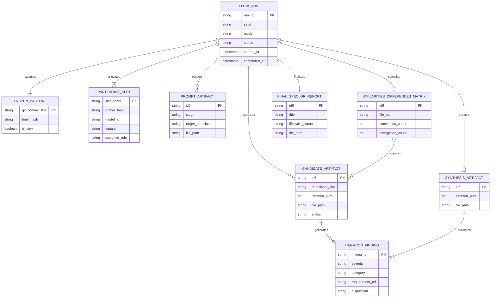
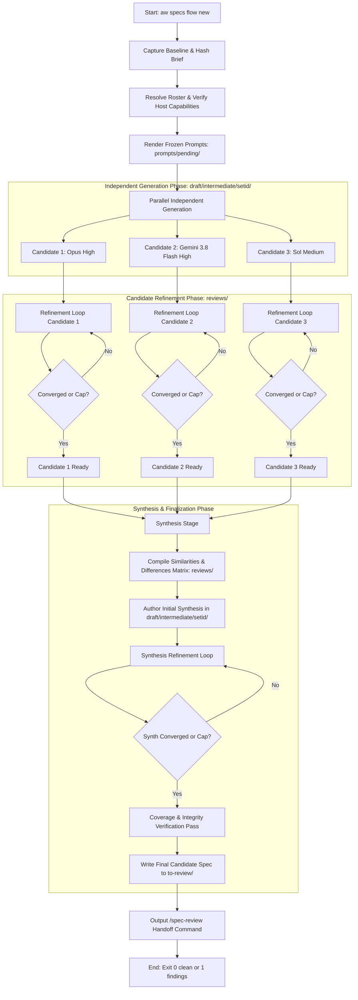
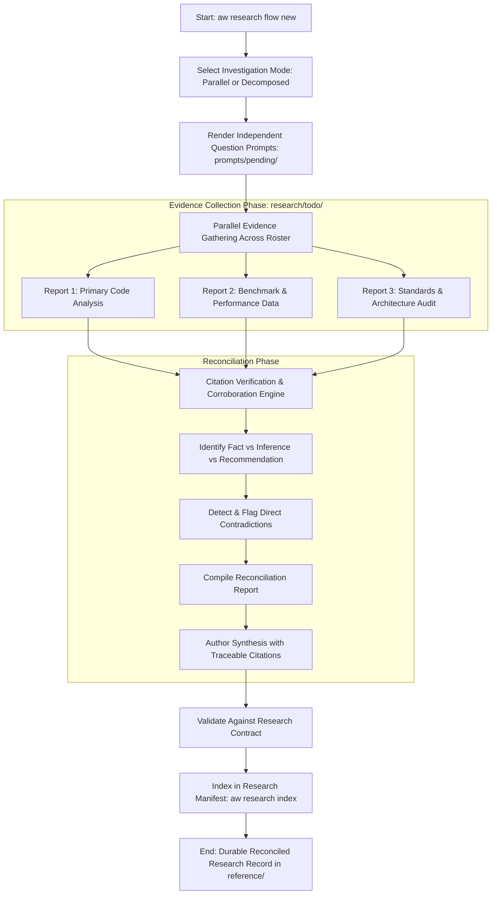
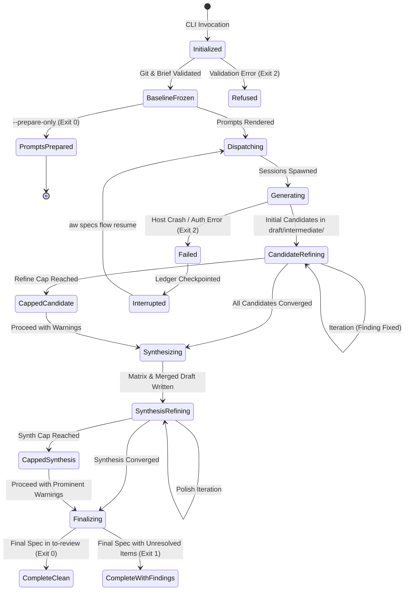

# Spec: Configurable Spec and Research Synthesis

- Date: 2026-10-24
- Status: draft
- Id: 18hh1u
- Author: aw specs new
- Scope: Configurable single-agent and multi-agent spec and research synthesis
- Set: specflow

## Workflow history

- 2026-10-24 created (aw specs): Configurable single-agent and multi-agent spec and research synthesis
- 2026-10-24 updated: incorporate decision D177 naming, intermediate candidate staging in draft/intermediate/<setid>/, and attention board pipeline rollup
- 2026-10-24 refined (vprs7o): address adversarial review findings F-01 through F-07 (review tree separation, work arithmetic bounds, prepare-only entry point, complete worked inventories, ERD persistence classification, research flow modes, and model-specific context budgets)
- 2026-10-24 refined (v5fjwb): address adversarial review findings F-08 through F-16 (aw.agent/v1 machine protocol envelope, run ledger path resolution, reviewer topology and session isolation, partial roster resilience, output truncation guard, matrix and disposition schemas, model token normalization algorithm, diagram branches, and epistemic research taxonomy)

---

## 1. Summary, Problem, Actors, Goals, Non-Goals, and First-Release Boundary

### 1.1 Summary
This specification defines the functional, structural, and behavioral architecture for **configurable single-agent and multi-agent spec and research synthesis** in `agent-workflows` (`aw`). It automates the multi-stage lifecycle of generating independent candidate specifications or research reports, iteratively refining them against quality criteria, synthesizing competing proposals into a coherent whole with accountable provenance, and preparing finalized candidate artifacts ready for human gatekeeping or peer review.

### 1.2 Problem Statement
Authoring high-stakes software specifications and deep research findings currently requires laborious, error-prone manual orchestration:
1. An operator writes separate prompts for candidate generation and iterative critique.
2. The operator manually dispatches these prompts across disparate Agent Communication Environments (ACEs) and LLM hosts (such as OpenCode, Antigravity, or Codex), manually tracking sessions, context limits, and model parameters.
3. The operator evaluates feedback loops by hand, making ad-hoc judgments about when improvements have plateaued or when cost/turn caps have been exceeded.
4. Competing candidates must be manually compared. Operators struggle to reconcile divergent architectural choices without either producing an incoherent union of contradictory ideas or losing valuable minority insights.
5. Intermediate artifacts (prompts, raw drafts, iteration findings, matrices) are scattered across untracked scratch directories, destroying traceability and violating repository naming, set-grouping, and provenance standards. If intermediate files are hidden in deep subdirectories without cross-tree tracking, work-in-progress drafts can easily be forgotten or lost to time.

### 1.3 Target Actors
- **The Maintainer / Human Architect**: Initiates workflows from a brief or existing document, configures participant preferences, reviews convergence metrics and comparison matrices, resolves irreconcilable architectural tradeoffs, and performs formal human review/approval.
- **Autonomous Runner Drivers**: Background execution processes (`aw oc run`, `aw agy run`, headless executors) executing bounded prompt stages in isolated worktrees with strict timeouts and error capture.
- **Participating LLM Agents**: Individual model instances across configured hosts (e.g. Anthropic Claude Opus 5.5, Google Gemini 3.8 Flash, OpenAI GPT-6.1 Sol) executing generation, critique, reconciliation, or synthesis roles.
- **Downstream Review Tooling**: Repository validation mechanisms, specifically `/spec-review` and `aw specs check`, consuming the finalized candidate specification.

### 1.4 Goals
- **Configurable Multi-Model & Single-Model Rosters**: Support flexible participant rosters ranging from a single participant to heterogeneous multi-model teams, honoring host-specific capabilities and user-configured launch profiles.
- **Strict Independence Before Synthesis**: Guarantee that independent candidates generate without cross-contamination or premature information leaks from peer candidates.
- **Controlled, Bounded Refinement**: Provide iterative critique loops governed by stable finding identifiers, objective stopping rules ("no material improvements"), and explicit iteration/cost caps.
- **Traceable Synthesis with Accountability**: Synthesize competing candidates into a single coherent design, producing an explicit Similarities and Differences Matrix, logging contribution provenance for all requirements, and preventing silent consensus fabrication.
- **Research Parity**: Support research formulation, independent evidence gathering, contradiction tracking, and reconciliation into durable research records without borrowing inapplicable spec approval semantics.
- **Normalized Artifact Grammar and Set Clustered Identity**: Strictly adhere to repository decision D177 (`YYYYMMDD-<setid>-NN-<id6>-<slug>[.<ace>][.<model>].<type>.md`), ensuring stable `id6` identity, immutable Set grouping, and clean separation between durable records and disposable state.
- **Zero-Lost-Work Attention Surfacing**: Ensure that intermediate candidates staging in `draft/intermediate/<setid>/` are permanently surfaced on the daily cross-tree attention view (`aw attention` and `aw todo`) via Set pipeline rollups and dedicated reminder banners so work is never hidden or lost to time.
- **Deterministic CLI & Agent Protocol**: Provide ergonomic human CLI commands alongside strict non-interactive, machine-readable output conforming to `aw.agent/v1` JSONL.

### 1.5 Non-Goals
- **Automatic Spec Approval or Implementation**: Finalization produces a candidate spec in `to-review` or `draft` state. It never performs human attestation (`approved`), does not grant permission to implement, and does not author implementation plans (IPDs).
- **Consensus by Majority Voting**: Synthesis never resolves design choices by raw vote count or model popularity; decisions are weighted by repository facts, architectural constraints, and operator-defined objectives.
- **Unbounded Merge Recursion**: Synthesis does not recursively spawn multi-agent sub-merges; merge resolution is strictly bounded to a single synthesis stage followed by an optional synthesis-refinement loop.
- **Secret Management**: CLI and profiles do not store API keys, tokens, or plaintext credentials; existing environment variables and host-local authentication are reused.
- **Universal Sandboxing Guarantees**: Does not simulate or promise operating-system sandboxing on platforms where the host driver lacks support (e.g. Landlock on non-Linux platforms).

### 1.6 Explicit First-Release Boundary (Phase 1)
- **Included in First Release**:
  - Primary CLI commands under `aw specs flow` and `aw research flow`.
  - Input from a local Markdown brief file, existing spec path, or research question.
  - Prepare-only entry point (`--prepare-only` / `aw specs flow prepare`) to freeze baselines and render prompt files without dispatching execution.
  - Participant roster resolution via `runner-profiles.json` and explicit CLI overrides.
  - OpenCode (`oc`) and Antigravity (`agy`) execution drivers for generation, refinement, and synthesis.
  - OpenCode-hosted execution for GPT-6.1 Sol Medium via profile `sol` (confirmed by operator ruling; standalone Codex runner deferred).
  - Intermediate candidate staging under `.aw/records/specs/draft/intermediate/<setid>/` for `.spec.md` files, and `.aw/records/reviews/` for `.review.md` critique records.
  - Set-level pipeline state rollup in `aw attention` (`aw todo`) and persistent footer reminder banner.
  - Execution modes: Quick (`--mode quick`) and Thorough (`--mode thorough`).
  - Iteration loops with configurable caps (`--refine-cap`, `--synth-refine-cap`) and convergence detection.
  - Production of the Similarities and Differences Matrix and requirement provenance tags.
  - Full adherence to Decision D177 type-last filename grammar.
  - Machine-readable `--agent` (`aw.agent/v1`) and `--json` outputs.
  - Resume from interrupted or capped runs via `aw specs flow resume <run-id6>`.
- **Deferred to Subsequent Releases (Phase 2 & 3)**:
  - Native standalone `codex exec` background runner profile row in `runner_profiles.py` (Phase 2).
  - Automated multi-document large spec chunking and assembly pipeline (Phase 2).
  - Live token billing API telemetry integration (Phase 3).
  - Interactive terminal curses dashboard for multi-agent watching (Phase 3).

---

## 2. Repository Findings and Integration Seams

### 2.1 Codebase Inspection Baseline
- **Inspected Commit**: `6f430cefd88a4b2ecca9e67548ec340e2911683c` (branch `specflow-refinement-1` / `main`).
- **Inspection Date**: 2026-10-24.

### 2.2 Integration Seams and Findings

| Subsystem / Module | Repository Reference | Existing Posture & Behavior | Required Extension for Spec & Research Flow |
| --- | --- | --- | --- |
| **CLI Architecture & Dispatch** | `agent_workflows/cli.py`<br>`agent_workflows/result_types.py` | Top-level commands are artifact-noun oriented (`aw specs`, `aw research`, `aw ipd`, `aw backlog`, `aw prompts`). Subcommands are structured via `add_subparsers`. `OutputMode` follows `explicit > --agent > human`. | Add `flow` subcommands to `specs` and `research` (`aw specs flow`, `aw research flow`). Maintain `CommandResult` envelope and exit codes (0 clean, 1 findings/drift, 2 usage error). |
| **Runner Profiles & Launch Resolution** | `agent_workflows/runner_profiles.py`<br>`docs/runner-profiles.md` | Stored in `<config_dir>/runner-profiles.json`. Schema version 2. Precedence: explicit caller > named profile > runner default > host default. Registers `oc` (supports variant/agent) and `agy` (no variant/agent in registry). `roles` map exists but is currently inert. | Extend role vocabulary or map flow roles (`flow-generate`, `flow-refine`, `flow-synthesize`) to profile references. Add validation for flow participant rosters. Support profile references in workflow config. |
| **Host Capabilities & Adapters** | `agent_workflows/host_adapters.py`<br>`agent_workflows/host_capability_registry.py` | `V1_HOSTS` includes `opencode`, `codex`, `antigravity`. Codex has `HOST_NONINTERACTIVE_RUNTIME = "codex exec"`, but no active runner profile row in `runner_profiles.py`. | Per maintainer instruction, route Sol slot (`gpt-6.1-sol-medium`) through OpenCode profile `sol` with OpenAI provider model and `variant=medium`. Standalone Codex runner deferred to Phase 2. |
| **Machine Protocol & Output** | `docs/cli-output-contract.md`<br>`docs/cli-agent-protocol.md` | `aw.agent/v1` JSONL protocol with typed events (`result`, `diagnostic`, `change`, `evidence`). Redacts local home paths. Strict anti-greenwashing rules. | Emit `flow` status events via `aw.agent/v1`. Distinguish `clean` (converged without findings), `findings` (capped with unresolved issues), and `fail`. |
| **Spec Lifecycle & Validation** | `agent_workflows/specs.py`<br>`agent_workflows/specs_cli.py`<br>`.aw/records/specs/README.md` | Specs have closed status enum: `draft`, `to-review`, `reviewed`, `approved`, `implementing`, `implemented`, `deferred`, `parked`, `superseded`. Location matches status directory. Tool-owned minting via `aw specs new`. Recursive walk `rglob("*.md")` validates every spec in tree. | Flow finalization writes candidate to `draft/` or `to-review/`. Must never forge review attestations or set `approved`. Links to `/spec-review`. Ensure non-spec records (`.review.md`) live outside `specs/` to preserve spec contract. |
| **Attention Board & Cross-Tree View** | `agent_workflows/attention.py`<br>`agent_workflows/attention_contract.py` | `aw attention` (and `aw todo`) maps tracked artifacts to 5 classes: `ready`, `active`, `blocked`, `done`, `parked`. Research prompts use `_PROMPT_PIPELINE_MAP` (`unrun` -> `ready`, `partial` -> `active`, `synthesized` -> `done`). | Add spec flow Set pipeline position mapping (`awaiting-synthesis` -> `ready`, `refining` -> `active`, `synthesized` -> `done`). Add footer reminder banner for unmerged intermediate candidate sets. |
| **Research Contracts & Index** | `agent_workflows/research_contract.py`<br>`agent_workflows/research_cmd.py`<br>`.aw/records/research/README.md` | Naming: `YYYYMMDD-<set>-<NN>-<id6>-<slug>[.<model>].<kind>.md`. Kinds: `research-prompt`, `research-report`, `reconciliation-report`. `reconciliation` denotes multi-author synthesis. Sharded by weekly directories for `reference` and `archive`. | Reuse research kinds and index generators. Multi-agent research outputs write `research-report` per model and `reconciliation-report` for the synthesized report. Completes to `reference` status without spec approval gates. |
| **Artifact Naming & Authority** | `agent_workflows/artifact_naming.py`<br>`DECISIONS.md` (Decision D177) | Clustered grammar: `YYYYMMDD-<setid>-NN-<id6>-<slug>[.<ace>][.<model>].<type>.md`. The type is ALWAYS the last facet before `.md`. Model tokens are dot-free model-plus-effort tokens (e.g. `opus55high`, `gemini38flashhigh`, `gpt61solmedium`). | Extend `artifact_naming` to parse and emit optional `[.<ace>][.<model>]` segments preceding the closed `<type>` facet. Document compatibility gap until plan executes. |
| **Storage Root Resolution** | `agent_workflows/project_context.py` | `project_records_dir(repo_root)` resolves physical location for `.aw/records/`, including external companion and home placement. Never hard-code `.aw/records/` as a static string. | Route all artifact writes through `project_records_dir()`. Stage intermediate candidates under `project_records_dir() / "specs" / "draft" / "intermediate" / setid`, and review records under `project_records_dir() / "reviews"`. |

---

## 3. CLI Design, Intermediate Placement Architecture, and Command Matrix

### 3.1 Evaluation of CLI Grammar Families

Three candidate grammar families were evaluated:

1. **Family A: Artifact-Noun Extension (Recommended)**:
   - Form: `aw specs flow <subcommand>` and `aw research flow <subcommand>`.
   - Examples: `aw specs flow new --brief <path>`, `aw research flow new --question <str>`.
   - Evaluation:
     - *Discoverability & Memorability*: High. Users already reach for `aw specs` when dealing with specifications and `aw research` for research.
     - *Consistency*: Fully matches existing CLI structure where `aw specs new`, `aw specs set`, and `aw specs check` govern specs, while `aw research new` and `aw research new-comparison` govern research.
     - *Separation of Concerns*: Respects the fundamental domain boundary: specs advance toward formal review and implementation planning; research compiles knowledge with citations into a permanent reference library.
     - *Agent Usability*: Highly predictable for LLMs inspecting `--help`.

2. **Family B: Shared Process Noun with Typed Input/Output**:
   - Form: `aw flow specs <subcommand>` / `aw flow research <subcommand>` or `aw synth specs ...`.
   - Examples: `aw flow run --type spec --brief <path>`, `aw synth research --set mytopic`.
   - Evaluation:
     - *Discoverability*: Moderate. Introduces a new top-level noun (`flow` or `synth`) that competes with `specs` and `research`.
     - *Consistency*: Splits spec tooling across two top-level verbs (`aw specs` vs `aw flow`).
     - *Agent Usability*: Increases prompt complexity when an agent must choose between `aw specs` and `aw flow`.
     - *Verdict*: Rejected as primary; retained only as an optional secondary alias (`aw flow ...` routing to `aw <type> flow ...`).

3. **Family C: Verb-Oriented or `aw run` Overload**:
   - Form: `aw run flow --type spec ...` or `aw generate-spec ...`.
   - Examples: `aw run spec-synthesis ...`.
   - Evaluation:
     - *Discoverability*: Low. In `agent-workflows`, `aw run` and `aw runs` have strict existing ownership: `aw run` executes IPD plan tasks and code-modifying runs; `aw runs` queries the execution ledger.
     - *Grammar Collisions*: Overloading `aw run` creates severe confusion regarding whether an execution modifies source code or authors documentation.
     - *Verdict*: Strongly rejected.

### 3.2 Canonical CLI Grammar Decision
The canonical primary grammar is **Family A**:
- Specifications: `aw specs flow <action> [options]`
- Research: `aw research flow <action> [options]`

Convenience aliases: `aw specs synth` is an alias for `aw specs flow`; `aw research synth` is an alias for `aw research flow`.

### 3.3 Evaluation of Intermediate Artifact Placement and Attention Surfacing

A critical architectural decision is where intermediate candidate specs, reviews, and matrices live, and how they surface on the daily attention view (`aw attention` and `aw todo`) so work is never lost to time. Three distinct solutions were analyzed:

#### Solution 1: Subdirectory Staging with Set Pipeline Rollup (Selected Best Solution)
- **Directory Path**: `.aw/records/specs/draft/intermediate/<setid>/` for candidate specifications (`.spec.md`), and `.aw/records/reviews/` for review critiques and matrices (`.review.md`).
- **Design**:
  - All intermediate candidate specifications for a given Set are grouped under `draft/intermediate/<setid>/`.
  - The path sits *inside* `draft/`, which preserves the `draft` lifecycle bucket in `agent_workflows/lifecycle_dirs.py` and passes `check.lifecycle-directory-drift` with zero schema violations.
  - Review records (`.review.md`) stage in `.aw/records/reviews/`, which preserves the strict repository invariant that `.aw/records/specs/` contains only `.spec.md` records, preventing `aw specs check` from failing on missing spec status headers.
  - Keeps top-level `.aw/records/specs/draft/` clean, holding only consolidated/authoritative drafts.
- **Attention Surfacing**:
  - `aw attention` maps the Set's pipeline position into a single consolidated row:
    - While refining: under `## active`: `- [specs] <setid>: N candidate(s) in draft/intermediate/ [active: candidate-refinement]`.
    - When paused, capped, or awaiting synthesis: under `## ready`: `- [specs] <setid>: N candidate(s) in draft/intermediate/ (awaiting synthesis) [next: aw specs flow merge <setid>]`.
    - When final spec is written to `to-review/` or `draft/`: transitions to `DONE` (hidden from default board).
  - Emits a persistent reminder banner in the `aw attention` footer:
    `TODO: Spec flow '<setid>' has N candidate(s) waiting in draft/intermediate/. Run 'aw specs flow merge <setid> --apply' to synthesize.`
- **Verdict**: Adopted. Combines directory cleanliness, tree-facet alignment, zero board clutter, and guaranteed visibility.

#### Solution 2: Flat Direct Placement in `draft/` (Evaluated & Rejected)
- **Design**: All candidate specs live directly in `.aw/records/specs/draft/`.
- **Evaluation**:
  - With 3 models over 2 iterations, 6-10 separate files appear in `draft/`.
  - The `aw attention` board is flooded with duplicate candidate rows for a single feature, creating operator confusion over which file is the authoritative draft.
  - When synthesis completes, old candidate drafts must be manually culled or moved to `superseded/`.
- **Verdict**: Rejected due to high noise and board pollution.

#### Solution 3: Dedicated Top-Level `candidates/` Lifecycle Tree (Evaluated & Rejected)
- **Design**: Create a new top-level tree `.aw/records/candidates/` with custom lifecycle states (`generated`, `refining`, `synthesized`).
- **Evaluation**:
  - Candidate specs are transient materials leading to a specification, not a permanent new documentation class.
  - Proliferating top-level lifecycle trees causes high churn across `layout.py`, `lifecycle_dirs.py`, `attention_contract.py`, and `check_engine.py`.
- **Verdict**: Rejected as unnecessary over-engineering.

### 3.4 Command Matrix

| Canonical Command | Mode & Rigor | Arguments & Options | Result & Side Effects | Exit Codes |
| --- | --- | --- | --- | --- |
| `aw specs flow new` | Quick or Thorough | `--brief <path>` (required or stdin)<br>`--title <str>`<br>`--slug <slug>` (optional)<br>`--set <setid>` (optional)<br>`--mode quick\|thorough` (default: `thorough`)<br>`--roster <roster-spec>` (optional)<br>`--refine-cap <int>` (default: 3 thorough, 1 quick)<br>`--synth-refine-cap <int>` (default: 2 thorough, 0 quick)<br>`--prepare-only` (flag: render prompts only)<br>`--apply` (default: preview only)<br>`--agent` / `--json` | Generates candidate specs in `draft/intermediate/<setid>/`, executes refinement, synthesizes merged design, and writes final candidate to `.aw/records/specs/to-review/` (or `draft/`). If `--prepare-only`, writes rendered prompts to `.aw/records/prompts/pending/` without dispatching execution. | 0: clean<br>1: findings/cap<br>2: usage error |
| `aw specs flow prepare` | Prompt Prep Only | `--brief <path>`<br>`--slug <slug>`<br>`--set <setid>`<br>`--roster <roster-spec>`<br>`--apply` | Freezes baseline commit, validates brief, renders all initial generation prompt artifacts to `.aw/records/prompts/pending/`, and displays the execution plan and turn bounds without dispatching execution. | 0: clean<br>2: usage error |
| `aw specs flow from-spec` | Quick or Thorough | `<spec-selector>` (id6, setid, or path)<br>`--mode quick\|thorough`<br>`--roster <roster-spec>`<br>`--objective <str>` (focus area)<br>`--prepare-only`<br>`--apply` | Reads existing spec as baseline, gathers independent alternative revisions across roster in `draft/intermediate/<setid>/`, refines, and synthesizes into a successor candidate spec. | 0: clean<br>1: findings/cap<br>2: usage error |
| `aw specs flow merge` | Synthesis Only | `<setid>` (or `<candidate-paths...>')<br>`--synthesizer <profile>` (default: roster verifier)<br>`--synth-refine-cap <int>`<br>`--apply` | Takes candidates from `draft/intermediate/<setid>/`, compiles Similarities/Differences Matrix in `.aw/records/reviews/`, executes synthesis refinement, and finalizes to `to-review/`. | 0: clean<br>1: findings/cap<br>2: usage error |
| `aw specs flow status` | Read-Only | `<flow-run-id6>` (or latest if omitted)<br>`--verbose` | Displays live or completed execution status: participant stage progress, iteration counts, active findings, cap warnings, token metrics. | 0: clean<br>1: findings/active<br>2: usage error |
| `aw specs flow resume` | Recovery | `<flow-run-id6>`<br>`--refine-cap <int>` (optional new cap)<br>`--apply` | Resumes an interrupted, failed, or capped run from its frozen state without re-running completed participant turns. | 0: clean<br>1: findings/cap<br>2: usage error |
| `aw specs flow finalize` | Finalization | `<flow-run-id6>`<br>`--status to-review\|draft` (default: `to-review`)<br>`--allow-unresolved-minor` (flag)<br>`--apply` | Validates final candidate against spec checklist, formats workflow history, moves spec to destination lifecycle directory, marks intermediates as `synthesized`, and outputs `/spec-review` command. | 0: clean<br>1: blocked/findings<br>2: usage error |
| `aw research flow new` | Quick or Thorough | `--question <str>` (or `--brief <path>`)<br>`--slug <slug>`<br>`--set <setid>`<br>`--mode quick\|thorough`<br>`--roster <roster-spec>`<br>`--topic <str>`<br>`--prepare-only`<br>`--apply` | Formulates research prompt, collects independent evidence reports across roster, cross-verifies citations, reconciles contradictions, and emits `reconciliation-report` to `.aw/records/research/`. | 0: clean<br>1: findings/unverified<br>2: usage error |
| `aw specs flow config` | Read-Only / Mutate | `show` \| `set-roster` \| `set-defaults`<br>`--roster <roster-spec>`<br>`--profile <name>` | Displays resolved configuration hierarchy or writes user-local flow defaults to `<config_dir>/flow-preferences.json`. | 0: clean<br>2: usage error |

---

## 4. Functional Requirements

### 4.1 Input Specification and Baseline Freezing
- **FR-01 (Frozen Baseline Snapshot)**: The workflow engine MUST capture and hash the source repository baseline (git commit SHA, dirty state summary, and referenced file content hashes) at turn start. All participants in the generation phase MUST receive identical frozen baselines.
- **FR-02 (Input Brief Validation)**: The workflow MUST accept an input brief via file path (`--brief <path>`), literal argument, or standard input (`--brief -`). If the brief is empty, contains unresolved template markers (e.g. `<TODO>`), or exceeds 250,000 characters without chunking instructions, the command MUST refuse execution with exit code 2.
- **FR-03 (Standard Objectives Injection)**: The engine MUST automatically prepend non-negotiable repository objectives to every generated prompt: security, remote SSH safety (no file URI schemes, no absolute machine home paths), prose style (no em or en dashes in user-facing text), and testability (outcomes, not code structure).

### 4.2 Independent Candidate Generation
- **FR-04 (Zero Cross-Contamination)**: During initial candidate generation, no participant session MAY receive, read, or be informed of the output, intermediate tokens, or identity of any peer participant.
- **FR-05 (Deterministic Prompt Rendering)**: Prompts for each participant MUST be rendered from versioned templates (`agent_workflows/templates/flow/`) and persisted as tracked prompt artifacts (`.prompt.md`) prior to host dispatch.
- **FR-06 (Single-Participant Graceful Degradation)**: When the roster contains exactly one participant, the generation phase MUST execute once for that participant. Synthesis machinery MUST bypass multi-candidate diffing and route directly to single-candidate refinement and finalization without fabricating consensus.

### 4.3 Controlled Iterative Refinement and Execution Bounds
- **FR-07 (Structured Finding Schema and Severity Decoupling)**: Review and refinement turns MUST classify critique items using stable structured identifiers (`F-01`, `F-02`, etc.) with required fields: Severity (`critical`, `major`, `minor`, `cosmetic`), Category (`correctness`, `contract`, `security`, `completeness`, `consistency`, `clarity`, `style`), Requirement Reference, Concrete Evidence, Suggested Remedy, and Disposition. Disposition values are restricted to a closed enum: `pending`, `fixed`, `rejected-with-rationale`, `reopened`, `duplicate`. Findings with Category `style` or Severity `cosmetic` are advisory-only: they MUST NOT block convergence, and MUST NOT advance iteration caps.
- **FR-08 (Iteration Accounting)**: The iteration counter MUST increment only upon completion of a full review-and-revision cycle. Host failures, transport timeouts, or transient API errors MUST trigger isolated retries (up to `--max-retries`, default 2) and MUST NOT increment the quality iteration counter.
- **FR-09 (Convergence Detection)**: An iteration loop MUST declare convergence ("no material improvements") when a review pass yields zero `critical` and zero `major` findings, and all previous findings are either verified as fixed or formally accepted with rationale. Rising numerical self-scores (e.g. "9/10") MUST NOT be used as a convergence signal.
- **FR-10 (Design Oscillation Guard)**: If a finding's proposed remedy directly reverses an architectural decision adopted in the immediately preceding iteration, the engine MUST flag an oscillation warning, halt automated refinement, and prompt the operator or mark the finding as `unresolved-oscillation`.
- **FR-11 (Honest Cap Enforcement)**: If `--refine-cap` or `--synth-refine-cap` is reached while `critical` or `major` findings remain unresolved, the command MUST:
  1. Halt further automated refinement.
  2. Emit status `findings` (exit code 1).
  3. Output a prominent human warning listing all unresolved finding IDs and affected sections.
  4. Write the machine-readable state `capped_with_findings`.
  5. NEVER mark the artifact as clean or approved.
- **FR-27 (Output Truncation & Completeness Guard)**: All generated candidate specs and synthesis drafts MUST terminate with an explicit completion marker comment `<!-- end-of-artifact -->`. The engine MUST inspect outputs for this terminal marker, verified balanced Markdown code fences, and clean driver exit codes. If an output is detected as truncated or incomplete, the engine MUST mark the attempt `truncated`, discard the partial output, trigger an isolated retry (up to `--max-retries`), and NEVER forward a truncated candidate to review or synthesis.
- **FR-29 (Reviewer Session Topology and Isolation)**: Review turns MUST execute in clean, isolated worker sessions with zero prior conversation memory, receiving only the frozen baseline brief and candidate file. Reviewer assignment modes:
  - `cross-peer` (default when participant count N > 1): participant `(i+1) % N` acts as the adversarial reviewer for candidate `i`.
  - `self-adversarial` (default when participant count N = 1): the single participant is launched in a fresh, isolated reviewer session with an adversarial critique brief.
  - `designated-reviewer`: a specific assigned profile from `roles.reviewer`.
- **FR-30 (Partial Participation and Fallback Policy)**: If a participant in a multi-model roster permanently fails after exhausting `--max-retries`:
  - If surviving valid candidates >= 1: in interactive mode, prompts operator; in non-interactive agent mode, requires `--allow-partial-roster` to proceed to synthesis with surviving candidates. If `--allow-partial-roster` is omitted, halts and checkpoints state in the run ledger with outcome `partial` (exit 1).
  - If surviving valid candidates == 0: halts immediately with outcome `fail` (exit 1).

#### 4.3.1 Mathematical Proof of Execution Bounds and Work Arithmetic
To guarantee that no nested retry or refinement loop escapes its bounds, the maximum possible dispatched turns across all roles is governed by a strict closed mathematical ceiling:

```text
Max_Turns = [ N_participants * (1 + Max_Retries) ]
          + [ N_participants * Refine_Cap * 2 * (1 + Max_Retries) ]
          + [ 1 * (1 + Max_Retries) ]
          + [ Synth_Refine_Cap * 2 * (1 + Max_Retries) ]
```

Where:
- `Stage 1 (Generation)`: `N * (1 + R)`
- `Stage 2 (Candidate Refinement)`: Each iteration comprises 1 critique turn + 1 revision turn per participant: `N * Refine_Cap * 2 * (1 + R)`
- `Stage 3 (Synthesis Merge)`: 1 multi-candidate synthesis turn: `1 * (1 + R)`
- `Stage 4 (Synthesis Refinement)`: Each iteration comprises 1 critique turn + 1 revision turn: `Synth_Refine_Cap * 2 * (1 + R)`

**Worked Example 1: Standard 3-Participant Thorough Mode (Happy Path)**
- Configuration: `N = 3`, `Refine_Cap = 3`, `Synth_Refine_Cap = 2`, `Max_Retries = 0` (no errors).
- Dispatched turns: `[3 * 1] + [3 * 3 * 2] + [1 * 1] + [2 * 2] = 3 + 18 + 1 + 4 = 26 turns`.
- If early convergence occurs at Iteration 1: `3 + [3 * 1 * 2] + 1 + [1 * 2] = 3 + 6 + 1 + 2 = 12 turns`.

**Worked Example 2: Standard 1-Participant Quick Mode (Happy Path)**
- Configuration: `N = 1`, `Refine_Cap = 1`, `Synth_Refine_Cap = 0`, `Max_Retries = 0`.
- Dispatched turns: `[1 * 1] + [1 * 1 * 2] + 0 (synthesis skipped) + 0 = 3 turns`.

**Global Budget Hard Enforcement**:
If `Total_Dispatched_Turns >= Budget_Ceiling` (default: 30 model turns, configurable via `--budget`), the engine unconditionally halts further dispatch, serializes active state to the run ledger, emits a `budget_exhausted` warning, and exits with code 1. No recursive loop can bypass this ceiling.

### 4.4 Synthesis and Accountable Provenance
- **FR-12 (Non-Voting Architectural Synthesis)**: Synthesis MUST evaluate proposals on technical merit, constraint satisfaction, and repository consistency. It MUST NOT adopt features based on majority voting or model popularity. Valuable minority proposals MUST remain eligible for adoption.
- **FR-13 (Similarities and Differences Matrix)**: Synthesis MUST generate a dedicated Markdown comparison table (`.review.md` in `.aw/records/reviews/`) detailing:
  - Consensus Elements: Requirements shared across all candidates.
  - Divergent Elements: Alternative approaches proposed for the same requirement.
  - Unique Contributions: Novel features or constraints proposed by a single candidate.
  - Selected Resolution: The chosen approach with explicit architectural rationale.

  The matrix MUST conform to this normative table schema:

  ```markdown
  | Requirement ID | Brief Requirement | Candidate Proposals (by slot) | Classification (Consensus / Divergent / Unique) | Resolution & Architectural Rationale | Provenance Tag |
  | --- | --- | --- | --- | --- | --- |
  | REQ-01 | Secure credential handling | P1: Keyring; P2: Env; P3: Keyring | Divergent | Adopt OS keyring with env fallback | [Adapted: P1 + P2] |
  ```
- **FR-14 (Fine-Grained Provenance Tagging)**: The synthesized document MUST carry provenance tags on every major section or requirement:
  - `[Adopted: <candidate-id6> (<model>)]`: Unchanged adoption of a candidate proposal.
  - `[Adapted: <candidate-id6-A> + <candidate-id6-B>]`: Synthesis combining multiple proposals.
  - `[Synthesizer-Novel: <rationale>]`: Necessary structural or reconciling design introduced during synthesis.
  - `[Rejected: <candidate-id6> (<model>) - <reason>]`: Explicit exclusion recorded in the matrix.
- **FR-15 (Coverage Verification Check)**: Following synthesis, the engine MUST run a deterministic lint pass verifying that every functional requirement present in the original brief is addressed in the synthesis. Any dropped requirement MUST fail the synthesis stage.

### 4.5 Research Reconciliation and Evidence
- **FR-16 (Citation Traceability)**: Every factual claim in a research report MUST be tethered to a resolvable primary citation (repository file/line, commit SHA, official documentation URL, or dated publication).
- **FR-17 (Non-Corroboration Invariant)**: Identical claims made by multiple LLM participants MUST NOT be treated as corroborating evidence if they cite the same underlying source or cite no source.
- **FR-18 (Contradiction Preservation)**: When participants discover conflicting evidence or draw incompatible conclusions, the reconciliation report (`.reconciliation-report.md`) MUST explicitly document the conflict under a dedicated `## Contradictions and Discrepancies` section, rather than smoothing over disagreements.
- **FR-18A (Research Investigation Modes)**:
  - *Mode A (Parallel Identical Investigation)*: All roster participants investigate the identical research prompt. Used to verify claim reproducibility, unearth blind spots, and detect contradictory evidence.
  - *Mode B (Complementary Sub-Question Decomposition)*: The prompt planner partitions a broad research objective into discrete, non-overlapping sub-topics (e.g. participant 1 benchmarks disk latency, participant 2 audits memory layout). The reconciliation report synthesizes these into a cohesive composite report while preserving individual model report links.
- **FR-18B (Research Completion & Cataloging)**: Finalized research reports are written to `.aw/records/research/` as `reconciliation-report` and indexed directly via `aw research index` with lifecycle status `reference` (or `active`). Research reports are durable reference documents and MUST NOT require `/spec-review` approval or IPD graduation.
- **FR-18C (Epistemic Claim Classification & Temporal Anchoring)**: Every factual statement in a research report MUST be classified under an explicit epistemic taxonomy:
  - `fact`: Verified statement supported by a direct, accessible primary source citation.
  - `inference`: Deductive conclusion logically derived from verified facts.
  - `hypothesis` / `conjecture`: Extrapolation or unverified proposition.
  Every factual claim MUST include a temporal anchor (`as_of: YYYY-MM-DD`). Inaccessible citations or broken URLs MUST be classified as `inaccessible-evidence` and quarantined to an appendix rather than cited as fact.

### 4.6 Intermediate Staging, Attention Surfacing, and Protocol Parity
- **FR-19 (Tool-Owned Identity)**: All generated specs, research docs, prompts, and reviews MUST receive a tool-minted `id6` via `agent_workflows.artifact_core.mint_id6()`. Hand-minted IDs are strictly prohibited.
- **FR-20 (Lifecycle Status Integrity)**: Final candidate specifications MUST be written with status `to-review` (or `draft` if minor findings remain). The workflow engine MUST NEVER write status `reviewed` or `approved`.
- **FR-21 (Clean Review Handoff)**: Upon successful finalization, the command MUST output the exact next-action command for human review:
  `aw specs check <spec-id6>` followed by `/spec-review .aw/records/specs/to-review/<filename>`.
- **FR-22 (Intermediate Staging Isolation)**: All intermediate candidate specifications (`.spec.md`) MUST stage in `.aw/records/specs/draft/intermediate/<setid>/`. Review critiques and matrices (`.review.md`) MUST stage in `.aw/records/reviews/`. Staging candidate files directly in the top-level `draft/` root is forbidden.
- **FR-23 (Set Pipeline Attention Rollup)**: The cross-tree attention view (`aw attention` and `aw todo`) MUST scan `.aw/records/specs/draft/intermediate/` and roll up active candidate sets into a single consolidated row:
  - If a runner session is active: classified as `ACTIVE` (surfaced under `## active`).
  - If paused, capped, or awaiting synthesis without a final spec: classified as `READY` (surfaced under `## ready`).
  - If a final spec exists in `to-review/` or `draft/`: classified as `DONE` (hidden from the default board).
- **FR-24 (Persistent Attention Footer Banner)**: Whenever any candidate set in `draft/intermediate/` is in an unmerged or capped state, `aw attention` MUST append a dedicated reminder banner in its footer:
  `TODO: Spec flow '<setid>' has N candidate(s) waiting in draft/intermediate/. Run 'aw specs flow merge <setid> --apply' to synthesize.`
- **FR-25 (Attributed Naming Conformance)**: Attributed intermediate filenames MUST strictly follow Decision D177 (`YYYYMMDD-<setid>-NN-<id6>-<slug>[.<ace>][.<model>].<type>.md`), with the type token as the final facet before `.md` and dot-free model tokens from `research-models.toml`.
- **FR-26 (Prepare-Only Prompt Staging)**: When `--prepare-only` is passed, the engine MUST freeze the baseline, validate inputs, write rendered prompt files to `.aw/records/prompts/pending/`, display the planned execution bounds and turn count, and terminate with exit code 0 without launching agent sessions.
- **FR-28 (Dual-Audience Machine Protocol Parity)**: Invocations with `--agent` MUST emit valid JSONL records strictly conforming to `SCHEMA_VERSION = "aw.agent/v1"`. Streaming stages emit `kind: "item"` records terminated by a single `kind: "summary"` record (or a single `kind: "result"` record for single-shot commands). Envelope fields (`schema`, `kind`, `cmd`, `exit`, `outcome`, `verified`, `complete`) MUST enforce strict exit code parity (exit 0 with `clean`/`ok`, exit 1 with `findings`/`fail`/`partial`, exit 2 with `error`/`cannot-run`). Machine-readable payloads MUST redact local home directories and user identifiers.

---

## 5. Configuration, Participant Rosters, and Capability Handling

### 5.1 Configuration Hierarchy and Precedence
Flow configurations resolve through a deterministic 4-tier hierarchy:
```text
CLI Arguments  >  Project Flow Config (.aw/config/flow.json)  >  User Flow Preferences (~/.config/agent-workflows/flow-preferences.json)  >  Built-In Defaults
```

### 5.2 Schema: Flow Preferences (`flow-preferences.json`)
The configuration schema integrates directly with `agent_workflows.runner_profiles`:

```json
{
  "$schema": "https://agent-workflows.dev/schemas/flow-v1.json",
  "schema_version": 1,
  "default_mode": "thorough",
  "limits": {
    "default_refine_cap": 3,
    "default_synth_refine_cap": 2,
    "quick_refine_cap": 1,
    "quick_synth_refine_cap": 0,
    "max_retries_per_turn": 2,
    "turn_timeout_seconds": 600,
    "global_turn_budget": 30
  },
  "rosters": {
    "preferred-three": [
      {
        "slot": "opus",
        "profile": "opus",
        "runner": "oc",
        "model": "anthropic/claude-3-opus",
        "variant": "high",
        "role": "author",
        "context_budget_chars": 80000,
        "chunk_preference": "single-pass"
      },
      {
        "slot": "gemini",
        "profile": "gem",
        "runner": "agy",
        "model": "google/gemini-3.8-flash",
        "variant": "high",
        "role": "author",
        "context_budget_chars": 25000,
        "chunk_preference": "modular-chunks"
      },
      {
        "slot": "sol",
        "profile": "sol",
        "runner": "oc",
        "model": "openai/gpt-6.1",
        "variant": "medium",
        "role": "author",
        "context_budget_chars": 80000,
        "chunk_preference": "single-pass"
      }
    ],
    "quick-solo": [
      {
        "slot": "primary",
        "profile": "gem",
        "runner": "agy",
        "model": "google/gemini-3.8-flash",
        "variant": "high",
        "role": "author",
        "context_budget_chars": 25000,
        "chunk_preference": "modular-chunks"
      }
    ]
  },
  "roles": {
    "synthesizer": "opus",
    "research-verifier": "opus"
  }
}
```

### 5.3 Host and Model Capability Handling

| Target Participant | Requested ACE | Requested Model | Requested Variant | Actual Repository Capability & Resolution Strategy |
| --- | --- | --- | --- | --- |
| **Participant 1** | OpenCode (`oc`) | Claude Opus 5.5 | `high` | Fully supported. `runner_profiles.py` registers `oc` with `supports_variant=True`. Launched via `oc run --model anthropic/claude-3-opus --variant high`. Context budget: 80,000 characters. |
| **Participant 2** | Antigravity (`agy`) | Gemini 3.8 Flash | `high` | Partial support gap: `runner_profiles.py` registers `agy` with `supports_variant=False` (driver takes `--model` only). Resolution: Flow engine passes exact model string `google/gemini-3.8-flash`. Variant `high` is injected into prompt instructions. Context budget: 25,000 characters with modular chunking preference. |
| **Participant 3** | Codex or OpenCode | GPT-6.1 Sol | `medium` | Operator confirmed ruling: OpenCode (`oc`) is sufficient for Phase 1. Route Sol slot to OpenCode profile `sol` with `--model openai/gpt-6.1 --variant medium`. Native standalone Codex runner driver is deferred to Phase 2. Context budget: 80,000 characters. |

---

## 6. Entities, Lifecycle, Artifact Matrix, and Worked Inventories

### 6.1 Entity-Relationship Model and Persistence Classification



#### Entity Persistence and Ownership Classification

| Entity | Persistence Classification | Storage Location & File Format | Lifecycle Owner |
| --- | --- | --- | --- |
| **FLOW_RUN** | Transient-Persisted | `.aw/records/runs/flow-<run-id6>.json` (JSON, resolved via `project_records_dir() / "runs"`) | Flow Engine (`agent_workflows.specflow`) |
| **FROZEN_BASELINE** | Derived-Runtime | Computed SHA-256 in memory; serialized in `FLOW_RUN` ledger | Baseline Capture Module |
| **PARTICIPANT_SLOT** | Derived-Runtime | Resolved in memory from `flow-preferences.json` and CLI flags | Profile Resolver |
| **PROMPT_ARTIFACT** | Durable-Persisted | `.aw/records/prompts/pending/*.prompt.md` (Markdown) | Prompt Manager (`aw prompts`) |
| **CANDIDATE_ARTIFACT** | Durable-Persisted | `.aw/records/specs/draft/intermediate/<setid>/*.spec.md` | Flow Engine / Participant Session |
| **ITERATION_FINDING** | Durable-Persisted | Stored inside `.aw/records/reviews/*.review.md` tables | Reviewer Agent |
| **SIMILARITIES_DIFFERENCES_MATRIX** | Durable-Persisted | `.aw/records/reviews/*matrix.reconciliation.review.md` | Synthesizer Agent |
| **SYNTHESIS_ARTIFACT** | Durable-Persisted | `.aw/records/specs/draft/intermediate/<setid>/*synth*.spec.md` | Synthesizer Agent |
| **FINAL_SPEC_OR_REPORT** | Durable-Persisted | `.aw/records/specs/to-review/*.spec.md` or `.aw/records/research/*` | Spec Owner (`aw specs`) / Research Owner |

### 6.2 Artifact Naming and Placement Matrix (conforming to Decision D177)

All files conform to the decided uniform grammar:
- Attributed form: `YYYYMMDD-<setid>-NN-<id6>-<slug>[.<ace>][.<model>].<type>.md`
- Multi-author synthesis: uses model facet `reconciliation` and no ACE: `YYYYMMDD-<setid>-NN-<id6>-<slug>.reconciliation.<type>.md`
- Finalized authoritative form: `YYYYMMDD-<setid>-NN-<id6>-<slug>.<type>.md`

| Stage | Artifact Purpose | Type Facet | Target Filename Pattern | Resolved Directory Location | Retention & Lifecycle |
| --- | --- | --- | --- | --- | --- |
| **0. Input** | Frozen brief & scope | `prompt` | `YYYYMMDD-<setid>-00-<id6>-<slug>.prompt.md` | `.aw/records/prompts/pending/` | Committed; permanent audit provenance |
| **1. Gen Prompt** | Rendered prompt for participant | `prompt` | `YYYYMMDD-<setid>-01-<id6>-gen.<ace>.<model>.prompt.md` | `.aw/records/prompts/pending/` | Committed; permanent audit provenance |
| **2. Candidate** | Independent raw candidate spec | `spec` | `YYYYMMDD-<setid>-10-<id6>-cand.<ace>.<model>.spec.md` | `.aw/records/specs/draft/intermediate/<setid>/` | Staged in `intermediate/<setid>/`; rolled up in `aw attention` |
| **2. Candidate (Research)** | Independent research report | `research-report` | `YYYYMMDD-<setid>-10-<id6>-cand.<model>.research-report.md` | `.aw/records/research/todo/` | Retained as model-specific report |
| **3. Findings** | Per-iteration review critique | `review` | `YYYYMMDD-<setid>-11-<id6>-iter1.<ace>.<model>.review.md` | `.aw/records/reviews/` | Permanent audit record in reviews tree |
| **4. Revised Candidate** | Iteration 2 revised candidate | `spec` | `YYYYMMDD-<setid>-12-<id6>-cand-i2.<ace>.<model>.spec.md` | `.aw/records/specs/draft/intermediate/<setid>/` | Staged in `intermediate/<setid>/` |
| **5. Merge Matrix** | Similarities/Differences Matrix | `review` | `YYYYMMDD-<setid>-50-<id6>-matrix.reconciliation.review.md` | `.aw/records/reviews/` | Permanent audit record in reviews tree |
| **6. Synthesis** | Initial synthesized spec | `spec` | `YYYYMMDD-<setid>-80-<id6>-synth-i0.reconciliation.spec.md` | `.aw/records/specs/draft/intermediate/<setid>/` | Staged in `intermediate/<setid>/` |
| **7. Final Candidate Spec** | Final candidate ready for review | `spec` | `YYYYMMDD-<setid>-01-<id6>-<slug>.spec.md` | `.aw/records/specs/to-review/` | Authoritative spec; advances through spec lifecycle |
| **7. Final Research** | Final reconciled research report | `reconciliation-report` | `YYYYMMDD-<setid>-01-<id6>-<slug>.reconciliation.reconciliation-report.md` | `.aw/records/research/` | Authoritative research record; indexed in research catalog |

#### Parser Gap and Tool Extension Specification (Decision D177)
Currently, `agent_workflows.artifact_naming._CLUSTERED_RE` accepts only a single closed `<type>` facet after the slug. D177 names with optional middle segments (`[.<ace>][.<model>]`) are accepted by the permissive rename regex but fail the canonical clustered validator. The planned extension to `artifact_naming.py`:
1. Update `_CLUSTERED_RE` to insert an optional positional attribution group preceding the closed type facet:
   ```python
   # Regex addition before the closed type facet:
   r"(?:\.(?P<ace>[a-z0-9-]+))?(?:\.(?P<model>[a-z0-9-]+))?\.(?P<type>" + _FACET_ALT + r")\.md\Z"
   ```
2. Update `artifact_naming.build_clustered_name` to accept optional `ace: Optional[str]` and `model: Optional[str]` parameters.
3. Until this plan executes, `check.name-nonconformant` will report warnings on D177 filenames outside research; these warnings are grandfathered by D177.

### 6.3 Setid, Date, NN, and Id6 Governance Rules
- **Setid**: Shared across all intermediate and final artifacts for a given flow run. MUST NOT exceed 14 characters (catalog invariant I-17). Examples: `specflow`, `authv2`, `synthrsc`.
- **Date**: The 8-digit date (`YYYYMMDD`) prefix represents the Set creation date. Resumed runs or runs crossing midnight preserve the canonical Set date in the filename; file metadata carries actual creation/modification timestamps.
- **NN (Order Sequence)**: Bounded 2-digit sequence (`00`..`99`) defining stage progression:
  - `00`: Input brief / baseline.
  - `01`..`09`: Rendered prompts.
  - `10`..`49`: Independent candidate generation and refinement iterations.
  - `50`..`79`: Cross-candidate comparison matrices and reconciliation tables.
  - `80`..`98`: Synthesis and synthesis-refinement iterations.
  - `01` (in final directory): Authoritative final candidate spec (matches `aw specs new` convention).
- **Id6**: Every artifact receives an independent, globally unique 6-character alphanumeric ID minted by `artifact_core.mint_id6()`. An updated iteration receives a NEW id6 and references its parent id6 in front matter via `- Prior-Id: <id6>`.
- **Model Token Normalization Algorithm**: Attributed filename middle segments require dot-free model tokens. The engine normalizes model identifiers deterministically:
  1. If the model is registered in `agent_workflows/data/research-models.toml`, its canonical table token (e.g. `opus55high`, `gemini38flashhigh`, `gpt61solmedium`) MUST be used.
  2. For unregistered or custom provider models, strip the provider prefix (`provider/model` -> `model`), strip all punctuation, dots, and hyphens, lowercase all letters, and concatenate with the sanitized variant (`re.sub(r'[^a-z0-9]', '', model) + re.sub(r'[^a-z0-9]', '', variant)`).
  3. If the resulting string is empty, fallback to `custom`.
  4. The raw, provider-qualified model string and variant are ALWAYS preserved intact in the artifact's front matter YAML (`- Model-Id:`, `- Model-Variant:`).

### 6.4 Worked Filename Inventories

#### Inventory 1: 3-Participant Thorough Spec Run with Modular Chunking
Assume Set: `specflow`, Date: `20261024`, Slug: `netmesh`. Split into Part A (CLI/Protocol) and Part B (Engine).
1. Frozen Brief:
   - `.aw/records/prompts/pending/20261024-specflow-00-f1a001-netmesh.prompt.md`
2. Rendered Prompts:
   - P1 (Opus): `.aw/records/prompts/pending/20261024-specflow-01-f1p001-gen.opencode.opus55high.prompt.md`
   - P2 (Gemini Chunk A): `.aw/records/prompts/pending/20261024-specflow-02-f1p002-gen-parta.agy.gemini38flashhigh.prompt.md`
   - P2 (Gemini Chunk B): `.aw/records/prompts/pending/20261024-specflow-03-f1p003-gen-partb.agy.gemini38flashhigh.prompt.md`
   - P3 (Sol): `.aw/records/prompts/pending/20261024-specflow-04-f1p004-gen.opencode.gpt61solmedium.prompt.md`
3. Candidates Staged in `draft/intermediate/specflow/`:
   - P1: `.aw/records/specs/draft/intermediate/specflow/20261024-specflow-10-f1c001-cand.opencode.opus55high.spec.md`
   - P2 (Part A): `.aw/records/specs/draft/intermediate/specflow/20261024-specflow-20-f1c002-cand-parta.agy.gemini38flashhigh.spec.md`
   - P2 (Part B): `.aw/records/specs/draft/intermediate/specflow/20261024-specflow-21-f1c003-cand-partb.agy.gemini38flashhigh.spec.md`
   - P3: `.aw/records/specs/draft/intermediate/specflow/20261024-specflow-30-f1c004-cand.opencode.gpt61solmedium.spec.md`
4. Iteration 1 Critiques in `reviews/`:
   - P1: `.aw/records/reviews/20261024-specflow-11-f1r001-iter1.opencode.opus55high.review.md`
   - P2: `.aw/records/reviews/20261024-specflow-22-f1r002-iter1.agy.gemini38flashhigh.review.md`
   - P3: `.aw/records/reviews/20261024-specflow-31-f1r003-iter1.opencode.gpt61solmedium.review.md`
5. Similarities & Differences Matrix in `reviews/`:
   - `.aw/records/reviews/20261024-specflow-50-f1m001-matrix.reconciliation.review.md`
6. Synthesis Iterations in `draft/intermediate/specflow/`:
   - `.aw/records/specs/draft/intermediate/specflow/20261024-specflow-80-f1s001-synth-i0.reconciliation.spec.md`
7. Final Candidate Spec (moved to `to-review/`):
   - `.aw/records/specs/to-review/20261024-specflow-01-f1f001-netmesh.spec.md`

#### Inventory 2: Single-Participant Quick Spec Run
Assume Set: `quickauth`, Date: `20261024`, Slug: `token-auth`, Participant: `gemini38flashhigh`.
1. Frozen Brief:
   - `.aw/records/prompts/pending/20261024-quickauth-00-q1a001-token-auth.prompt.md`
2. Rendered Prompt:
   - `.aw/records/prompts/pending/20261024-quickauth-01-q1p001-gen.agy.gemini38flashhigh.prompt.md`
3. Initial Candidate in `draft/intermediate/quickauth/`:
   - `.aw/records/specs/draft/intermediate/quickauth/20261024-quickauth-10-q1c001-cand.agy.gemini38flashhigh.spec.md`
4. Quick Review Pass in `reviews/`:
   - `.aw/records/reviews/20261024-quickauth-11-q1r001-iter1.agy.gemini38flashhigh.review.md`
5. Revised Candidate in `draft/intermediate/quickauth/`:
   - `.aw/records/specs/draft/intermediate/quickauth/20261024-quickauth-12-q1c002-cand-i2.agy.gemini38flashhigh.spec.md`
6. Authoritative Final Candidate (moved to `to-review/`):
   - `.aw/records/specs/to-review/20261024-quickauth-01-q1f001-token-auth.spec.md`

#### Inventory 3: Resumed Run After Refinement Cap
Assume Set: `storv2`, Date: `20261024`, Run Id: `cp73m9`.
1. Frozen Run Ledger:
   - `.aw/records/runs/flow-cp73m9.json` (checkpointed with state `capped_with_findings`, resolved via `project_records_dir() / "runs"`)
2. Existing Retained Candidates in `draft/intermediate/storv2/`:
   - `...-10-c1a001-cand.opencode.opus55high.spec.md`
   - `...-20-c1a002-cand.agy.gemini38flashhigh.spec.md` (carried unresolved finding `F-02`)
   - `...-30-c1a003-cand.opencode.gpt61solmedium.spec.md`
3. Resume Execution (`aw specs flow resume cp73m9 --refine-cap 2`):
   - Revised Candidate 2 emitted: `...-22-c1a004-cand-i2.agy.gemini38flashhigh.spec.md` (resolves `F-02`)
   - Synthesis executed: `...-80-c1s001-synth-i0.reconciliation.spec.md`
4. Final Candidate Finalized:
   - `.aw/records/specs/to-review/20261024-storv2-01-c1f001-storage-v2.spec.md`

---

## 7. Workflows, Prompts, Synthesis, and Chunking Protocols

### 7.1 End-to-End Specification Flow Diagram



### 7.2 Research Flow Diagram



### 7.3 State, Recovery, and Cap Flow Diagram



### 7.4 Context Window Management and Task Chunking
To prevent quality degradation observed when smaller context models encounter oversized specifications:
1. **Source Packet Sizing**: Source code snippets injected into prompt contexts MUST be scoped strictly to targeted interfaces and signatures rather than raw directory dumps. Maximum prompt payload is budgeted at 40,000 tokens for generation turns.
2. **Model Context Ceilings**:
   - `gemini38flashhigh`: Configured with `"context_budget_chars": 25000` and `"chunk_preference": "modular-chunks"`. If the brief exceeds 25,000 characters, the prompt planner automatically divides the requirements into modular parts (e.g. Part A: Protocol, Part B: Storage Engine).
   - `opus55high` and `gpt61solmedium`: Configured with `"context_budget_chars": 80000` and `"chunk_preference": "single-pass"`.
   - Conservative fallback when unknown: 30,000 characters.
3. **Modular Document Chunking Rules**:
   - The brief is partitioned into numbered sub-components.
   - Candidates are generated per part with shared interface contracts.
   - Cross-chunk integration review is executed as a dedicated synthesis step before final assembly.
4. **Lossy Summary Prohibition**: An agent MUST NOT replace detailed requirement tables with prose summaries during iterative refinement; every requirement ID must remain tracked.

---

## 8. Security, Privacy, Performance, and Observability

### 8.1 Security and Shell Injection Prevention
- **No Command Construction via String Concatenation**: Host CLI arguments (`opencode run`, `agy run`) MUST be dispatched using discrete argument arrays (`execve` parameter lists), preventing shell metacharacter expansion or command injection.
- **Strict Model String Validation**: All model and profile strings MUST conform to `agent_workflows.runner_profiles.MODEL_RE` and `FIELD_RE`, strictly rejecting spaces, quotes, backticks, semicolons, and pipes.
- **Zero API Key Storage**: Runner profiles and workflow configuration MUST NEVER accept or store credentials (`FORBIDDEN_PROFILE_KEYS` enforcement).

### 8.2 Privacy and Machine Identification Redaction
- **Remote SSH Environment Invariant**: Outputs and generated files MUST NEVER print absolute file paths (such as user home directories). Paths MUST always be rendered relative to the repository root.
- **No File Scheme URIs**: All file citations MUST use plain relative Markdown paths without file URI schemes.
- **Home Path Redaction**: Machine-readable logs and artifacts MUST apply `agent_workflows.project_context.redact_public_context` to purge user home directories, machine hostnames, and local user identifiers.

### 8.3 Performance, Timeouts, and Resource Bounds
- **Turn Timeouts**: Every model dispatch turn MUST carry a hard process timeout (default: 600 seconds, configurable via `--turn-timeout`).
- **Parallel Dispatch**: Generation turns for peer participants MUST execute concurrently across independent background worker processes up to a concurrency ceiling of 4.
- **Finite Budget Ceiling**: The workflow engine enforces a hard global invocation cap (default: 30 total model turns per run) to prevent runaway billing or infinite refinement loops.

---

## 9. Requirement-to-Acceptance-Test Matrix

Every functional requirement is mapped to an observable behavioral acceptance test:

| Test ID | Mapped FR | Test Description & Action | Expected Observable Outcome | Pass/Fail Gate |
| --- | --- | --- | --- | --- |
| **AT-01** | FR-01, FR-02 | Execute `aw specs flow new --brief ""` with an empty file. | Process exits with code 2. Standard error contains `refusal: empty brief`. No files written. | Pass if exit code 2 and zero files created. |
| **AT-02** | FR-04 | Execute 3-participant run. Intercept prompts dispatched to participant 2. | Prompt dispatched to participant 2 contains no text, hashes, or tokens from participant 1. | Pass if candidate 1 content is absent from participant 2 prompt. |
| **AT-03** | FR-06 | Execute `aw specs flow new --brief valid.md --roster "gem" --mode quick --apply`. | Run completes with exactly one generation turn and one refinement turn. Matrix stage is skipped. | Pass if exit code 0 and final spec created with single-model provenance. |
| **AT-04** | FR-07, FR-09 | Mock review turn returning 0 critical/major findings and 1 minor finding. | Engine marks candidate converged. Iteration stops before reaching cap. | Pass if iteration halts early on clean criteria. |
| **AT-05** | FR-10 | Mock review turn where iteration 2 reverses iteration 1's architectural choice. | Engine emits warning `unresolved-oscillation`. Automated refinement halts. | Pass if warning logged and oscillation flagged in findings record. |
| **AT-06** | FR-11 | Execute run with `--refine-cap 1` on candidate with unresolved critical finding. | Process exits with code 1. Human output prints `WARNING: [FLOW-CAP-REACHED]`. | Pass if exit code 1 and machine state is `capped_with_findings`. |
| **AT-07** | FR-13, FR-14 | Inspect synthesized spec and accompanying `.review.md` matrix. | Matrix lists all candidate requirements. Synthesized spec has `[Adopted: ...]`, `[Adapted: ...]`, or `[Synthesizer-Novel: ...]` tags. | Pass if all sections have provenance tags and matrix exists. |
| **AT-08** | FR-15 | Synthesize candidates where Candidate A dropped Requirement 3 from the brief. | Synthesis verification rejects the omission. Synthesis re-integrates Requirement 3. | Pass if final synthesis contains all brief requirements. |
| **AT-09** | FR-16, FR-18 | Run `aw research flow new` with contradictory evidence. | Reconciliation report contains `## Contradictions and Discrepancies` detailing both sides. | Pass if conflicting claims are preserved with citations. |
| **AT-10** | FR-19, FR-20 | Finalize spec and inspect metadata. | Filename matches `YYYYMMDD-<set>-01-<id6>-<slug>.spec.md`. Status is `to-review`. Review attestation is absent. | Pass if status is `to-review` and `aw specs check` succeeds. |
| **AT-11** | FR-21 | Execute `aw specs flow finalize <run-id6> --apply`. | Output terminal displays `/spec-review .aw/records/specs/to-review/...`. | Pass if handoff command is printed verbatim. |
| **AT-12** | FR-22 | Check location of generated candidates during flow run. | Files exist under `.aw/records/specs/draft/intermediate/<setid>/`. No candidates exist in top-level `draft/`. Review records exist under `.aw/records/reviews/`. | Pass if candidate specs are staged under `intermediate/<setid>/` and reviews under `reviews/`. |
| **AT-13** | FR-23, FR-24 | Run `aw attention` while a spec flow has unmerged candidates in `draft/intermediate/`. | Board displays Set under `## ready` (or `## active`), and footer prints `TODO: Spec flow '<setid>' has N candidate(s) waiting in draft/intermediate/`. | Pass if board and footer surface pending intermediate work. |
| **AT-14** | FR-26 | Execute `aw specs flow new --brief valid.md --prepare-only --apply`. | Renders prompt files under `.aw/records/prompts/pending/` and prints execution bounds. Exits 0 without launching agent sessions. | Pass if prompts are written and zero agent turns are dispatched. |
| **AT-15** | FR-11, Sec 4.3.1 | Simulate a workflow exceeding `--budget 10`. | Dispatches halt precisely when turn count reaches 10. Ledger is checkpointed with `budget_exhausted`. Exits 1. | Pass if turn count ceiling is strictly enforced. |

---

## 10. Risks, Alternatives Rejected, Assumptions, and Decision Log

### 10.1 Risks and Mitigations
- **Risk 1: Host Transport or Token Budget Exhaustion**: Large multi-candidate runs across high-reasoning models could exhaust API budgets or hit rate limits.
  - *Mitigation*: Hard turn budgets (`--budget`), conservative default caps (3 iterations), and Quick mode (`--mode quick`) for exploratory work.
- **Risk 2: Synthesis Inconsistency or Requirement Drop**: Synthesis could produce an incoherent hybrid or drop requirements present in one candidate.
  - *Mitigation*: Mandatory coverage verification check (FR-15) and structured Similarities/Differences Matrix (FR-13).
- **Risk 3: Model Hallucination in Research Citations**: LLMs frequently invent URLs or paper citations.
  - *Mitigation*: Citation verification pass requiring local repository verification or validated web links; unverified claims are segregated into an `Unverified Claims` appendix.
- **Risk 4: Work Lost to Time in Subdirectories**: Intermediate candidates staged in `draft/intermediate/<setid>/` could be overlooked if the workflow pauses.
  - *Mitigation*: Mandatory Set pipeline position rollup in `aw attention` (`aw todo`) and persistent footer reminder banner (FR-23, FR-24).

### 10.2 Alternatives Rejected
- **Rejected Alternative 1: Flat Direct Placement in `draft/`**: Placing all candidate files directly in `.aw/records/specs/draft/`. Rejected because 3 models x 2 iterations floods the directory with 6-10 files per feature, causing severe clutter and confusing which file is the active draft.
- **Rejected Alternative 2: Dedicated Top-Level `candidates/` Lifecycle Tree**: Creating `.aw/records/candidates/`. Rejected as unnecessary schema proliferation; candidate specs are transient stages leading to a spec and belong inside `draft/intermediate/<setid>/`.
- **Rejected Alternative 3: Placing `.review.md` Files in `specs/draft/intermediate/`**: Rejected because `aw specs check` scans all `*.md` files under `specs/` and fails with `attention.missing-status` when encountering review records lacking a `- Status:` bullet. Review files belong in `.aw/records/reviews/`.
- **Rejected Alternative 4: Free-Form Prose Review Feedback**: Allowing models to critique in arbitrary paragraph prose. Rejected because automated convergence checking and oscillation detection require structured finding records (`F-01..F-NN`).

### 10.3 Assumptions
- Host runners (`opencode` and `antigravity`) are locally installed and authenticated on the target development machine.
- The repository root remains accessible and tracked via standard git mechanisms.

### 10.4 Decision Log
- **Decision 01 (Setid Length)**: The Setid for spec and research flows MUST NOT exceed 14 characters, adhering strictly to catalog invariant I-17. Recommended Set: `specflow`.
- **Decision 02 (Sol Slot Runner Binding)**: OpenCode (`oc`) is selected as the default runner for the GPT-6.1 Sol Medium slot in Phase 1 due to native variant flag support and absence of a standalone Codex runner profile row. Confirmed by operator instruction.
- **Decision 03 (Decision D177 Naming Grammar)**: Attributed intermediate filenames strictly adhere to Decision D177 (`YYYYMMDD-<setid>-NN-<id6>-<slug>[.<ace>][.<model>].<type>.md`), with the type facet as the final component before `.md`.
- **Decision 04 (Subdirectory Staging with Set Rollup)**: Intermediate candidate specs stage in `.aw/records/specs/draft/intermediate/<setid>/`. The daily attention view (`aw attention` / `aw todo`) surfaces the Set as a single rollup row under `## ready` / `## active` and prints a persistent footer reminder banner until synthesis finalizes.
- **Decision 05 (Review Tree Placement for Matrices & Critiques)**: All `.review.md` artifacts stage in `.aw/records/reviews/` to preserve tree-facet alignment and prevent `aw specs check` from failing on review headers.
- **Decision 06 (Context Window Payload Ceilings)**: Gemini 3.8 Flash High is budgeted at 25,000 characters per prompt turn with modular chunking preference; Opus and Sol are budgeted at 80,000 characters with single-pass preference.

---

## 11. Implementation Seams and Phasing

### Phase 1: Core Flow Engine and CLI Commands (First Release)
- Implement `agent_workflows/specflow/` core engine:
  - `flow_config.py`: Schema validation and resolution of `flow-preferences.json`.
  - `flow_baseline.py`: Git commit hash capture and brief validation.
  - `flow_prompts.py`: Prompt template rendering for generation and review stages, including `--prepare-only` staging.
  - `flow_runner.py`: Asynchronous dispatch to `oc` and `agy` drivers.
  - `flow_refine.py`: Finding parser, iteration counter, and convergence checker.
  - `flow_synth.py`: Matrix generator and provenance tagger.
- Add CLI subcommands in `agent_workflows/cli.py` and `specs_cli.py`:
  - `aw specs flow [new|prepare|from-spec|merge|status|resume|finalize]`
  - `aw research flow [new|status|resume]`
- Extend `agent_workflows/attention.py` to support spec flow Set rollups and `TODO:` footer banners for `draft/intermediate/<setid>/`.
- Unit and integration tests in `tests/test_specflow_*.py`.

### Phase 2: Autonomous Codex Runner and Large Document Chunking
- Implement standalone `codex_runipd.py` runner profile adapter in `agent_workflows/runner_profiles.py`.
- Automated document chunking pipeline for specs exceeding 50,000 tokens.

### Phase 3: Interactive Visualizer and Live Cost Telemetry
- Terminal curses dashboard for watching multi-agent synthesis in real time.
- Direct integration with provider token usage APIs for exact dollar billing receipts.

---

## 12. Source Inventory, Self-Check, and Worked Transcripts

### 12.1 Source Inventory
- Inspected repository baseline commit: `6f430cefd88a4b2ecca9e67548ec340e2911683c`
- Primary files cited:
  - `DECISIONS.md` (Decision D177: Attributed artifact filenames)
  - `agent_workflows/cli.py` (CLI parser and subcommand registration)
  - `agent_workflows/runner_profiles.py` (Profile schemas, launch resolution, `RUNNER_REGISTRY`)
  - `agent_workflows/host_adapters.py` (Host capabilities, `V1_HOSTS`)
  - `agent_workflows/attention.py` (Cross-tree board, pipeline mapping, attention footer)
  - `agent_workflows/attention_contract.py` (Tree policies, class mappings)
  - `agent_workflows/research_contract.py` (Research kinds, naming, and reconciliation rules)
  - `agent_workflows/artifact_naming.py` (Clustered artifact naming authority)
  - `agent_workflows/project_context.py` (Project roots, records placement resolution)
  - `docs/cli-output-contract.md` (Audience modes, `aw.agent/v1` protocol, exit codes)
  - `.aw/records/specs/README.md` (Spec lifecycle states, directory layout, review handoff)
  - `.aw/records/reviews/README.md` (Review records structure and validation gates)

### 12.2 Self-Check of Spec Completeness
- [x] Summary, problem, actors, goals, non-goals, and first-release boundary clearly defined.
- [x] Repository findings table with accurate, revision-pinned citations.
- [x] Three CLI families evaluated; canonical grammar justified with command matrix.
- [x] Three intermediate placement architectures evaluated; recommended Solution 1 justified.
- [x] Stable functional requirements (`FR-01`..`FR-26`) with observable pass/fail conditions.
- [x] Closed mathematical formulas proving finite work bounds (Section 4.3.1).
- [x] Schema for configuration and participant roster provided with model context ceilings.
- [x] Mandatory Mermaid diagrams: ERD, Spec Flow, Research Flow, State/Recovery Flow.
- [x] Persistence classification table accompanying ERD.
- [x] Worked filename inventories for 3-participant chunked, 1-participant quick, and resumed runs adhering to D177.
- [x] Acceptance test matrix (`AT-01`..`AT-15`).
- [x] Zero em or en dashes throughout the document.
- [x] Zero file URI schemes and zero absolute home directory paths.

---

## 13. Worked Transcripts and Machine Protocols

### 13.1 Worked Transcript: Single-Participant Quick Spec Run

```text
$ aw specs flow new --brief .aw/records/prompts/pending/auth-brief.prompt.md --roster "gem" --mode quick --apply

[FLOW-INIT] Starting specification flow (run id: qk91a2, set: specflow)
[FLOW-INIT] Baseline git commit: 6f430cefd88a (clean)
[FLOW-ROSTER] Resolved 1 participant:
  - Slot 'gem': Antigravity (model: google/gemini-3.8-flash, variant: high)
[FLOW-STAGE-1] Dispatching independent candidate generation...
  - Dispatching to agy [google/gemini-3.8-flash] -> .aw/records/specs/draft/intermediate/specflow/20261024-specflow-10-qk91c1-cand.agy.gemini38flashhigh.spec.md
  - agy completed in 14.2s (18,410 chars)
[FLOW-STAGE-2] Executing Quick Mode quality review pass (iteration 1/1)...
  - Critique recorded -> .aw/records/reviews/20261024-specflow-11-qk91r1-iter1.agy.gemini38flashhigh.review.md
  - Review finding: F-01 (minor, clarity): Clarify token expiration edge case in Section 4.2
  - Quick refinement revision applied -> .aw/records/specs/draft/intermediate/specflow/20261024-specflow-12-qk91c2-cand-i2.agy.gemini38flashhigh.spec.md
[FLOW-STAGE-3] Single-participant run: bypassing multi-candidate synthesis matrix.
[FLOW-FINAL] Candidate finalized:
  - Destination: .aw/records/specs/to-review/20261024-specflow-01-qk91f1-auth-brief.spec.md
  - Lifecycle Status: to-review
  - Discovered Findings: 0 critical, 0 major, 1 minor (resolved)
  - Intermediate candidates in draft/intermediate/specflow/ transitioned to synthesized.
[FLOW-HANDOFF] Next action for human maintainer:
  aw specs check qk91f1
  /spec-review .aw/records/specs/to-review/20261024-specflow-01-qk91f1-auth-brief.spec.md

Exit code: 0
```

### 13.2 Worked Transcript: Configured Multi-Model Thorough Spec Run

```text
$ aw specs flow new --brief .aw/records/prompts/pending/storage-v2.prompt.md --mode thorough --apply

[FLOW-INIT] Starting specification flow (run id: th48x1, set: specflow)
[FLOW-INIT] Baseline git commit: 6f430cefd88a (clean)
[FLOW-ROSTER] Resolved 3 participants from preferred roster:
  - Slot 'opus': OpenCode (model: anthropic/claude-3-opus, variant: high)
  - Slot 'gemini': Antigravity (model: google/gemini-3.8-flash, variant: high)
  - Slot 'sol': OpenCode (model: openai/gpt-6.1, variant: medium)
[FLOW-STAGE-1] Dispatching parallel independent candidate generation (3 workers)...
  [worker-1] OpenCode (opus) completed in 42.1s -> .aw/records/specs/draft/intermediate/specflow/20261024-specflow-10-th48c1-cand.opencode.opus55high.spec.md
  [worker-2] Antigravity (gemini) completed in 18.4s -> .aw/records/specs/draft/intermediate/specflow/20261024-specflow-20-th48c2-cand.agy.gemini38flashhigh.spec.md
  [worker-3] OpenCode (sol) completed in 31.0s -> .aw/records/specs/draft/intermediate/specflow/20261024-specflow-30-th48c3-cand.opencode.gpt61solmedium.spec.md
[FLOW-STAGE-2] Iterative candidate refinement (cap: 3 iterations)...
  - Iteration 1:
    - Candidate 1 (opus): 1 major finding fixed. Converged.
    - Candidate 2 (gemini): 2 minor findings fixed. Converged.
    - Candidate 3 (sol): 1 major finding fixed. Converged.
  - Review records written to .aw/records/reviews/.
[FLOW-STAGE-3] Cross-candidate synthesis & matrix compilation...
  - Synthesizer: OpenCode (opus)
  - Similarities & Differences Matrix compiled:
    - Consensus items: 14 requirements
    - Divergent architectures: 2 (cache invalidation protocol, schema migration)
    - Minority contribution adopted: Sol's lockless ring buffer design
  - Matrix saved -> .aw/records/reviews/20261024-specflow-50-th48m1-matrix.reconciliation.review.md
  - Initial synthesis emitted -> .aw/records/specs/draft/intermediate/specflow/20261024-specflow-80-th48s1-synth-i0.reconciliation.spec.md
[FLOW-STAGE-4] Synthesis refinement (iteration 1/2)...
  - Review pass: 0 critical, 0 major findings.
  - Coverage verification: 100% of brief requirements preserved.
[FLOW-FINAL] Final candidate specification ready:
  - Spec: .aw/records/specs/to-review/20261024-specflow-01-th48f1-storage-v2.spec.md
  - Status: to-review
  - Intermediate candidates in draft/intermediate/specflow/ transitioned to synthesized.
[FLOW-HANDOFF] Next action:
  /spec-review .aw/records/specs/to-review/20261024-specflow-01-th48f1-storage-v2.spec.md

Exit code: 0
```

### 13.3 Worked Transcript: Interrupted or Capped Run with Attention Board Surfacing

```text
$ aw specs flow new --brief network-mesh.prompt.md --refine-cap 1 --apply

[FLOW-INIT] Starting specification flow (run id: cp73m9, set: specflow)
[FLOW-STAGE-1] Independent candidates generated (3 candidates in draft/intermediate/specflow/).
[FLOW-STAGE-2] Candidate refinement iteration 1 reached refine-cap!
  - Candidate 2 (gemini) has 1 UNRESOLVED MAJOR FINDING:
    - F-02 (major, security): Missing replay attack protection in packet header.
WARNING: [FLOW-CAP-REACHED] Refinement cap reached with unresolved major findings.
State checkpointed to run ledger: cp73m9 (status: capped_with_findings).
Artifacts preserved in .aw/records/specs/draft/intermediate/specflow/.
Exit code: 1

$ aw attention --tree specs

## ready (12)
- [specs] specflow: 3 candidate(s) in draft/intermediate/ (awaiting synthesis) [next: aw specs flow resume cp73m9]
- [specs] .aw/records/specs/approved/20260904-6m4kow-01-6m4kow-cross-type-review.spec.md (approved)
...
Checkup 2 commits ago: CI PASSING; spec pointers: 0 stale
TODO: Spec flow 'specflow' has 3 candidates waiting in draft/intermediate/. Run 'aw specs flow resume cp73m9 --apply' to proceed.

$ aw specs flow resume cp73m9 --refine-cap 2 --apply

[FLOW-RESUME] Resuming workflow run cp73m9 from checkpoint...
[FLOW-RESUME] Loaded 3 completed candidates from draft/intermediate/specflow/. Skipping Stage 1.
[FLOW-STAGE-2] Resuming refinement (iteration 2/2)...
  - Candidate 2 (gemini): Resolved F-02 (replay attack protection added).
  - All candidates converged.
[FLOW-STAGE-3] Synthesis executed -> .aw/records/specs/to-review/20261024-specflow-01-cp73f2-network-mesh.spec.md
[FLOW-FINAL] Completed cleanly.
Exit code: 0
```

### 13.4 Machine Protocol Output: `aw.agent/v1` JSONL Stream

When invoked with `--agent`, output is emitted as strictly structured JSONL records conforming to `SCHEMA_VERSION = "aw.agent/v1"` (streaming `item` records terminated by a single `summary` record, or a single `result` record):

```json
{"schema":"aw.agent/v1","kind":"item","cmd":"specs flow new","stage":"baseline","commit":"6f430cefd88a","dirty":false}
{"schema":"aw.agent/v1","kind":"item","cmd":"specs flow new","stage":"generation","slot":"opus","artifact":".aw/records/specs/draft/intermediate/specflow/20261024-specflow-10-th48c1-cand.opencode.opus55high.spec.md"}
{"schema":"aw.agent/v1","kind":"item","cmd":"specs flow new","stage":"generation","slot":"gemini","artifact":".aw/records/specs/draft/intermediate/specflow/20261024-specflow-20-th48c2-cand.agy.gemini38flashhigh.spec.md"}
{"schema":"aw.agent/v1","kind":"item","cmd":"specs flow new","stage":"generation","slot":"sol","artifact":".aw/records/specs/draft/intermediate/specflow/20261024-specflow-30-th48c3-cand.opencode.gpt61solmedium.spec.md"}
{"schema":"aw.agent/v1","kind":"item","cmd":"specs flow new","stage":"synthesis","artifact":".aw/records/reviews/20261024-specflow-50-th48m1-matrix.reconciliation.review.md"}
{"schema":"aw.agent/v1","kind":"summary","cmd":"specs flow new","exit":0,"outcome":"clean","verified":true,"complete":true,"total":5,"emitted":5,"omitted":0,"target":".aw/records/specs/to-review/20261024-specflow-01-th48f1-storage-v2.spec.md","findings":0,"evidence":["brief-coverage","matrix-reconciliation"],"next":"aw specs check th48f1"}
```
