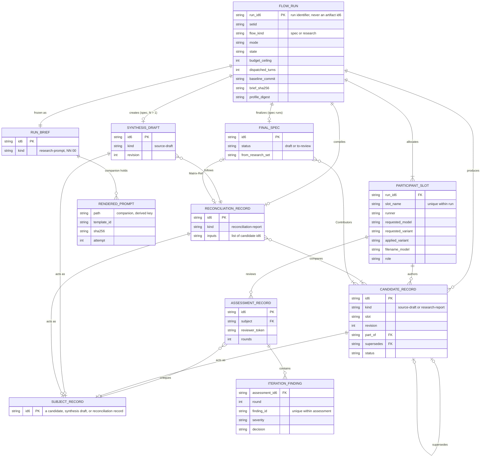
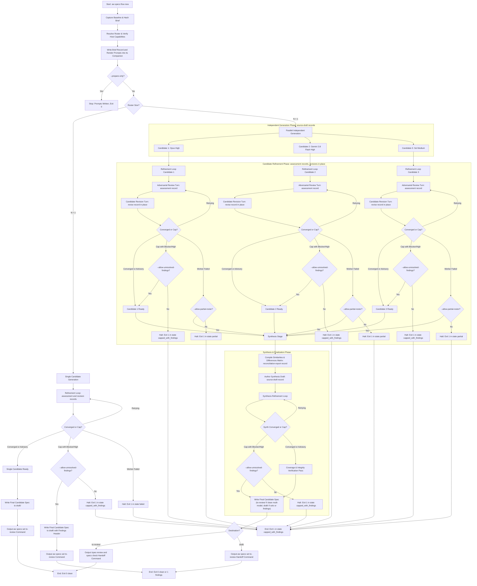
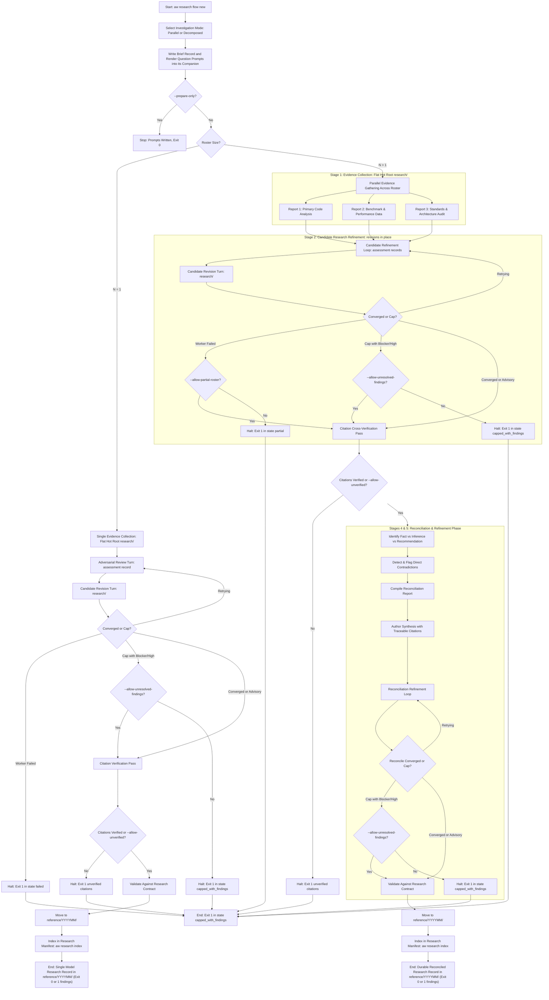

# Spec: Configurable Spec and Research Synthesis

- Date: 2026-10-24
- Status: draft
- Id: 18hh1u
- Author: aw specs new
- Scope: Configurable single-agent and multi-agent spec and research synthesis
- Set: specflow

## Workflow history

- 2026-10-25 refined (kwsffr): address adversarial review findings F-159 through F-169 (correct AT-30 generation prompt path to brief companion prompts/ with digests in run.json instead of prompt-tree record; re-sequence Flowchart 7.2 to place citation verification after candidate refinement and before reconciliation per Section 4.3.1; add Flowchart 7.1 single-participant worker failure branch to exit 1; align ERD 6.1 SUBJECT_RECORD polymorphic relationships, add SUBJECT_RECORD row to Table 6.1, and update AT-67 to cite ASSESSMENT_RECORD and 11-entity total bijection; add Cancelled transitions from CappedHalted, BudgetExhausted, and PartialRoster in State Diagram 7.3; update Table 3.4 research reconcile description to specify companion live draft body; define mutating vs read-only setid selector resolution rules in Section 6.3; update AT-37 pre-dispatch NN capacity refusal exit code to 2; clarify thorough mode reconciliation refinement assessment order in Worked Inventory 4; reorder Decisions 13 and 14 in Decision Log; and add archive/<YYYYMM>/ cancel destinations to Table 6.2)
- 2026-10-24 refined (2q7ppl): address adversarial review findings F-145 through F-158 (apply maintainer ruling DL-16 so every intermediate artifact is a research-tree record with existing kinds and owner verbs; replace Sections 3.3 and 6.2 to 6.4 with a research-tree placement matrix, set and NN allocation by owner verb, revision-in-place identity, and recomputed inventories; remove the shared default setid; correct shard naming to monthly YYYYMM; make model tokens validated rather than invented and drop unreachable dotted normalization keys; stop substituting an unsupported agy variant; mark provider model ids as unverified examples; align FR-20 and FR-28 machine outcomes with agent_schema.VALID_OUTCOMES; define roster-spec resolution and concise versus explicit equivalence; fix ERD cardinalities; update diagrams, transcripts, and acceptance tests)
- 2026-10-24 refined (49zxqu): address adversarial review findings F-137 through F-144 (add participant failure and partial roster decision diamonds to Flowcharts 7.1 and 7.2; add cap-with-findings --allow-unresolved-findings decision branches to Flowchart 7.2; disambiguate Flowchart 7.1 solo cap exit to code 1 findings; add REVIEW_RECORD document entity to ERD 6.1 and Table 6.1 persistence classification; add synthesis and reconciliation refinement critique and revision rows to Table 6.2; add BudgetExhausted to Finalizing and Interrupted to Synthesizing recovery transitions in State Diagram 7.3; synchronize Table 3.4 CLI options across prepare, merge, reconcile, and finalize; add - Author: bullets to Section 6.3 spec schemas; and expand acceptance tests AT-65..AT-68)
- 2026-10-24 refined (ablqqq): address adversarial review findings F-129 through F-136 (add explicit BudgetExhausted state to State Diagram 7.3 with transitions from active dispatch stages and resume paths; add --allow-unresolved-findings routing to draft and partial roster failure recovery to Flowchart 7.1; add explicit citation check decision diamonds to Flowchart 7.2; expand Worked Inventory 1 to include Iteration 2 candidates/critiques, synthesis refinement, P2 chunk index, and an Input-to-Final Artifact Traceability Matrix; add --allow-partial-roster to resume commands in Table 3.4; add Worked Inventory 4 for 3-participant research flow with sharded reference indexing; add reconcile and decomposed prompt rows to Table 6.2; connect final entities to synthesis/candidate/reconciliation in Section 6.1 ERD with operational ledger attributes; and expand acceptance tests AT-61..AT-64)
- 2026-10-24 refined (9bct5l): address adversarial review findings F-121 through F-128 (generalize Section 4.3.1 mathematical bounds formula to formally incorporate FR-34 two-pass hierarchical synthesis section drafting turns; eliminate Flowchart 7.1 and 7.2 dangling terminal graph sinks by connecting all cap-with-findings halt nodes to explicit End states; add explicit research report transition nodes to monthly reference shards in Flowchart 7.2; disambiguate State Diagram 7.3 cap transitions to specify advisory-only or forced continuation; harmonize Table 3.4 CLI options across prepare, from-spec, merge/reconcile, and finalize with explicit defaults and title/slug options; expand Table 6.2 research candidate matrix rows for single-participant final reports, decomposed mode sub-topics, and ACE attribution; specify finalized research report front matter status: reference in Section 6.3; register Gemini 3.8 Flash dotted model normalizations in Section 11; and expand acceptance tests AT-57..AT-60)
- 2026-10-24 refined (qx2rv2): address adversarial review findings F-113 through F-120 (harmonize non-normative severity vocabulary across Table 3.4, FR-20, State Diagram 7.3, acceptance tests, and Section 13 transcripts to review_findings.SEVERITIES blocker/high and low/medium; add Flowchart 7.1 and 7.2 cap-with-findings decision diamonds and halted states for FR-11 and Diagram 7.3 conformance; add --title to aw research flow new/prepare and --allow-unresolved-findings across new/from-spec/merge/reconcile; add --turn-timeout and --max-retries overrides to resume commands; add research reconciliation evaluation relationship to Section 6.1 ERD; add BlockedFindings recovery transitions to State Diagram 7.3; specify TOML quoted string keys for dotted model normalizations in Section 11; and expand acceptance tests AT-53..AT-56)
- 2026-10-24 refined (5fpnhm): address adversarial review findings F-105 through F-112 (align FR-07, Section 6.1 ERD, and Section 6.3 review critique schema with review_findings.py normative FINDING_COLUMNS, closed SEVERITIES, and DECISIONS vocabularies; add State Diagram 7.3 CappedHalted state and resumption branches for FR-11 and Section 13.3 transcript conformance; add --title/--slug to aw research flow reconcile and <setid> selector support to status in Table 3.4; harmonize Flowchart 7.1 destination lifecycle routing and Flowchart 7.2 candidate research refinement loops; correct Section 6.2 item 4 check.name-nonconformant error severity; register gpt61 in Section 11 models; update Section 6.3 review front matter schema with Round and Findings headers; and expand acceptance tests AT-49..AT-52)
- 2026-10-24 refined (aytuko): address adversarial review findings F-97 through F-104 (prompt artifact HTML metadata comment schema in Section 6.3 conforming to prompts_index._parse_metadata_comment and check.prompt-metadata-missing, research front matter YAML delimiter and closed enum outcome alignment in Section 6.3 conforming to research_contract.validate_frontmatter, State Diagram 7.3 single-participant bypass transition to Finalizing and PartialRoster resumability, Table 6.2 prompt NN dynamic range allocation, Table 3.4 CLI options synchronization for --mode on prepare and --title/--slug on merge/reconcile, Table 3.4 <setid> selector resolution parity on finalize and cancel, metastore spec 4sd62s event log coordination in Section 2.2 and Section 11, and AT-45..AT-48 acceptance test expansion)
- 2026-10-24 refined (bl50f6): address adversarial review findings F-89 through F-96 (research artifact YAML front matter schemas in Section 6.3 conforming to research_contract.FRONTMATTER_FIELDS, Similarities and Differences Matrix YAML schema and review_findings.py parser/header alignment, review_findings.SUBJECT_TYPES closed vocabulary extension for research critiques, single-participant research finalization kind clarification as research-report, State Diagram 7.3 synthesis crash and finalization refusal transitions, Table 6.2 intermediate research candidate and reconciliation rows with NN normalization, Table 3.4 CLI options synchronization across spec and research commands, and AT-41..AT-44 acceptance test expansion)
- 2026-10-24 refined (3ekww3): address adversarial review findings F-80 through F-88 (synthesized specification schema ## Workflow history block alignment for validate_spec compliance, State Diagram 7.3 Stage 1 worker failure transitions for FR-30 parity, research flow turn bounds mathematical formula and Flowchart 7.2 candidate refinement symmetry, Section 6.2 positional regex outer optionality preservation for bare .md dual-read, Table 3.4 CLI options synchronization for --max-retries and limits on from-spec and resume, Table 3.4 merge and reconcile premature to-review finalization guard, Table 6.2 NN collision resolution between input brief and context packets, Section 11 Phase 1 CLI subcommands config verb addition, and AT-37..AT-40 acceptance test expansion)
- 2026-10-24 refined (ei43pd): address adversarial review findings F-68 through F-79 (Decision D177 positional right-to-left middle segment parsing regex correction, CLI investigation mode flag disambiguation with --investigation-mode in Table 3.4 and AT-34, State Diagram 7.3 terminal transitions and partial roster failure handling, Flowchart 7.2 --prepare-only and single-participant routing, Table 6.2 generic synthesis prompt pattern, Table 3.4 missing CLI options --budget/--turn-timeout/--slug/--set/--allow-unresolved-findings, runner profiles variant schema boundary clarification for agy, built-in fallback defaults specification in Section 5.1, Table 3.4 quote syntax repairs, finalize contract on capped runs with unresolved findings, comprehensive research-models.toml normalization mappings, and AT-35/AT-36 acceptance test additions)
- 2026-10-24 refined (rzz6ik): address adversarial review findings F-57 through F-67 (Mermaid flowchart O node and subgraph syntax hardening, Mermaid research diagram flat hot root alignment, comprehensive AT-29..AT-34 acceptance test coverage for all functional requirements, Section 13.2 Claude Opus 5.5 model string correction, AT-23 cancellation exit parity, complete intermediate artifact placement matrix rows in Table 6.2, two-digit NN dynamic slot stride and 99 exhaustion handling, immutable id6 provenance linking in synthesis matrices, research-models.toml vocabulary registration in Section 11, resume setid selector and --agent option parity in CLI tables, state diagram terminal transitions, and FR-03B token metrics accounting)
- 2026-10-24 refined (ye6osz): address adversarial review findings F-47 through F-56 (intermediate candidate validator isolation in _spec_files, maintainer auto-advance ruling DL-17 leaving single-model runs in draft, FR-35 from-spec successor spec contract, canonical flat hot research root citation, FR-36 prompt injection defense data fencing, research flow bounds and verifier accounting, Claude Opus 5.5 model string correction, cancellation CLI exit code consistency, research CLI module placement in research_cmd.py, and prepare-only prompt staging phasing)
- 2026-10-24 refined (fy6rfp): address adversarial review findings F-37 through F-46 (specs_cli module citation correction, research sharding format YYYYMM, research flow finalize and refinement symmetry, lifecycle-placement-conflict rule citation, mathematical bounds formula conditioning for single-participant runs, state diagram cancellation transition from interrupted state, research ERD entities, role registry schema boundary, Section 8.3 turn budget consistency, and test/check counters)
- 2026-10-24 created (aw specs): Configurable single-agent and multi-agent spec and research synthesis
- 2026-10-24 updated: incorporate decision D177 naming, intermediate candidate staging in draft/intermediate/<setid>/, and attention board pipeline rollup
- 2026-10-24 refined (vprs7o): address adversarial review findings F-01 through F-07 (review tree separation, work arithmetic bounds, prepare-only entry point, complete worked inventories, ERD persistence classification, research flow modes, and model-specific context budgets)
- 2026-10-24 refined (v5fjwb): address adversarial review findings F-08 through F-16 (aw.agent/v1 machine protocol envelope, run ledger path resolution, reviewer topology and session isolation, partial roster resilience, output truncation guard, matrix and disposition schemas, model token normalization algorithm, diagram branches, and epistemic research taxonomy)
- 2026-10-24 refined (7h0wag): address adversarial review findings F-17 through F-22 (resume baseline verification guard, dangling profile validation, acceptance test traceability AT-16..AT-22, research CLI symmetry, visual refinement loop alignment, and auditability vs bit-for-bit determinism disclaimer)
- 2026-10-24 refined (rrk3l6): address adversarial review findings F-23 through F-25 (reviewer role in configuration schema, artifact placement matrix rows for ledger and split chunks, and decisions 07-09 in decision log)
- 2026-10-24 refined (l870sr): address adversarial review findings F-26 and F-27 (synchronize CLI table arguments for partial roster and stale resume flags, and update self-check requirement and test counters)
- 2026-10-24 refined (5rr01t): address adversarial review findings F-28 through F-36 (canonical specs check path handoff, cancellation and signal trapping contract FR-33, research CLI command symmetry, research_contract D177 parser gap documentation, global turn budget headroom, hierarchical synthesizer context overflow protection FR-34, review scope certification requirement in FR-09, chunking phasing clarification, NN slot-block formula, and front matter YAML schemas)

---

## 1. Summary, Problem, Actors, Goals, Non-Goals, and First-Release Boundary

### 1.1 Summary
This specification defines the functional, structural, and behavioral architecture for **configurable single-agent and multi-agent spec and research synthesis** in `agent-workflows` (`aw`). It automates the multi-stage lifecycle of generating independent candidate specifications or research reports, iteratively refining them against quality criteria, synthesizing competing proposals into a coherent whole with accountable provenance, and preparing finalized candidate artifacts ready for human gatekeeping or peer review.

### 1.2 Problem Statement
Authoring high-stakes software specifications and deep research findings currently requires laborious, error-prone manual orchestration:
1. An operator writes separate prompts for candidate generation and iterative critique.
2. The operator manually dispatches these prompts across disparate Agent Communication Environments (ACEs) and LLM hosts (such as OpenCode, Antigravity, or Codex), manually tracking sessions, context limits, and model parameters.
3. The operator evaluates feedback loops by hand, making ad-hoc judgments about when improvements have plateaued or when cost/turn caps have been exceeded.
4. Competing candidates must be manually compared. Operators struggle to reconcile divergent architectural choices without either producing an incoherent union of contradictory ideas or losing valuable minority insights.
5. Intermediate artifacts (prompts, raw drafts, iteration findings, matrices) are scattered across untracked scratch directories, destroying traceability and violating repository naming, set-grouping, and provenance standards. If intermediate files are hidden in deep subdirectories without cross-tree tracking, work-in-progress drafts can easily be forgotten or lost to time.

### 1.3 Target Actors
- **The Maintainer / Human Architect**: Initiates workflows from a brief or existing document, configures participant preferences, reviews convergence metrics and comparison matrices, resolves irreconcilable architectural tradeoffs, and performs formal human review/approval.
- **Autonomous Runner Drivers**: Background execution processes (`aw oc run`, `aw agy run`, headless executors) executing bounded prompt stages in isolated worktrees with strict timeouts and error capture.
- **Participating LLM Agents**: Individual model instances across configured hosts (e.g. Anthropic Claude Opus 5.5, Google Gemini 3.8 Flash, OpenAI GPT-6.1 Sol) executing generation, critique, reconciliation, or synthesis roles.
- **Downstream Review Tooling**: Repository validation mechanisms, specifically `/spec-review` and `aw specs check`, consuming the finalized candidate specification.

### 1.4 Goals
- **Configurable Multi-Model & Single-Model Rosters**: Support flexible participant rosters ranging from a single participant to heterogeneous multi-model teams, honoring host-specific capabilities and user-configured launch profiles.
- **Strict Independence Before Synthesis**: Guarantee that independent candidates generate without cross-contamination or premature information leaks from peer candidates.
- **Controlled, Bounded Refinement**: Provide iterative critique loops governed by stable finding identifiers, objective stopping rules ("no material improvements"), and explicit iteration/cost caps.
- **Traceable Synthesis with Accountability**: Synthesize competing candidates into a single coherent design, producing an explicit Similarities and Differences Matrix, logging contribution provenance for all requirements, and preventing silent consensus fabrication.
- **Research Parity**: Support research formulation, independent evidence gathering, contradiction tracking, and reconciliation into durable research records without borrowing inapplicable spec approval semantics.
- **Normalized Artifact Grammar and Set Clustered Identity**: Strictly adhere to repository decision D177 (`YYYYMMDD-<setid>-NN-<id6>-<slug>[.<ace>][.<model>].<type>.md`), ensuring stable `id6` identity, immutable Set grouping, and clean separation between durable records and disposable state.
- **Zero-Lost-Work Attention Surfacing**: Ensure that every live or halted run is visible on the daily cross-tree attention view (`aw attention` and `aw todo`) through the existing research pipeline position of its set, so work is never hidden or lost to time.
- **Deterministic CLI & Agent Protocol**: Provide ergonomic human CLI commands alongside strict non-interactive, machine-readable output conforming to `aw.agent/v1` JSONL.

### 1.5 Non-Goals
- **Automatic Spec Approval or Unearned Promotion**: Finalization produces a candidate spec in `to-review` automatically only following a multi-model synthesis (at least two distinct requested model identifiers). For single-participant or single-model runs, finalization leaves the spec in `draft` for human maintainer promotion via `aw specs set to-review <id6>`. Finalization never performs human attestation (`approved`), never grants permission to implement, and never authors implementation plans (IPDs).
- **Consensus by Majority Voting**: Synthesis never resolves design choices by raw vote count or model popularity; decisions are weighted by repository facts, architectural constraints, and operator-defined objectives.
- **Unbounded Merge Recursion**: Synthesis does not recursively spawn multi-agent sub-merges; merge resolution is strictly bounded to a single synthesis stage followed by an optional synthesis-refinement loop.
- **Secret Management**: CLI and profiles do not store API keys, tokens, or plaintext credentials; existing environment variables and host-local authentication are reused.
- **Universal Sandboxing Guarantees**: Does not simulate or promise operating-system sandboxing on platforms where the host driver lacks support (e.g. Landlock on non-Linux platforms).

### 1.6 Explicit First-Release Boundary (Phase 1)
- **Included in First Release**:
  - Primary CLI commands under `aw specs flow` and `aw research flow`.
  - Input from a local Markdown brief file, existing spec path, or research question.
  - Prepare-only entry point (`--prepare-only` / `aw specs flow prepare`) to freeze baselines and render prompt files without dispatching execution.
  - Participant roster resolution via `runner-profiles.json` and explicit CLI overrides.
  - OpenCode (`oc`) and Antigravity (`agy`) execution drivers for generation, refinement, and synthesis.
  - OpenCode-hosted execution for the GPT-6.1 Sol Medium slot via profile `sol` (the maintainer accepted OpenCode for this slot; standalone Codex runner deferred).
  - Intermediate artifacts (candidates, findings, matrix, synthesis draft) as research-tree records using existing kinds, created and moved by research owner verbs (Section 3.3, maintainer ruling DL-16).
  - Set-level visibility in `aw attention` (`aw todo`) through the existing research pipeline position, plus a local footer line for halted runs.
  - Execution modes: Quick (`--mode quick`) and Thorough (`--mode thorough`).
  - Iteration loops with configurable caps (`--refine-cap`, `--synth-refine-cap`) and convergence detection.
  - Production of the Similarities and Differences Matrix and requirement provenance tags.
  - Full adherence to Decision D177 type-last filename grammar.
  - Machine-readable `--agent` (`aw.agent/v1`) and `--json` outputs.
  - Resume from interrupted or capped runs via `aw specs flow resume <run-id6>`.
  - Modular brief partitioning and chunked generation for context-constrained models (e.g. Gemini 3.8 Flash High with `modular-chunks`).
- **Deferred to Subsequent Releases (Phase 2 & 3)**:
  - Native standalone `codex exec` background runner profile row in `runner_profiles.py` (Phase 2).
  - Automated arbitrary recursive multi-document large spec chunking and assembly pipeline for monolithic legacy specifications (Phase 2).
  - Live token billing API telemetry integration (Phase 3).
  - Interactive terminal curses dashboard for multi-agent watching (Phase 3).

---

## 2. Repository Findings and Integration Seams

### 2.1 Codebase Inspection Baseline
- **Inspected Commit**: `6f430cefd88a4b2ecca9e67548ec340e2911683c` (initial, branch `specflow-refinement-1` / `main`). Refinement iteration 22 re-verified against `main` at `41e6f96f7`, and refinement iteration 23 re-inspected and verified every claim it changed against `main` at `87f0de31e`.
- **Inspection Date**: 2026-10-24.

### 2.2 Integration Seams and Findings

| Subsystem / Module | Repository Reference | Existing Posture & Behavior | Required Extension for Spec & Research Flow |
| --- | --- | --- | --- |
| **CLI Architecture & Dispatch** | `agent_workflows/cli.py`<br>`agent_workflows/result_types.py` | Top-level commands are artifact-noun oriented (`aw specs`, `aw research`, `aw ipd`, `aw backlog`, `aw prompts`). Subcommands are structured via `add_subparsers`. `OutputMode` follows `explicit > --agent > human`. | Add `flow` subcommands to `specs` and `research` (`aw specs flow`, `aw research flow`). Maintain `CommandResult` envelope and exit codes (0 clean, 1 findings/drift, 2 usage error). |
| **Runner Profiles & Launch Resolution** | `agent_workflows/runner_profiles.py`<br>`docs/runner-profiles.md` | Stored in `<config_dir>/runner-profiles.json`. Schema version 2. Precedence: explicit caller > named profile > runner default > host default. Registers `oc` (supports variant/agent) and `agy` (no variant/agent in registry). `roles` map exists but is currently inert. | Define flow-specific roles (`synthesizer`, `research-verifier`, `reviewer`) in `flow-preferences.json` mapping to named profile references in `runner-profiles.json`, preserving the closed `ROLE_NAMES` vocabulary in `runner_profiles.py`. Add validation for flow participant rosters. Support profile references in workflow config. |
| **Host Capabilities & Adapters** | `agent_workflows/host_adapters.py`<br>`agent_workflows/host_capability_registry.py` | `V1_HOSTS` includes `opencode`, `codex`, `antigravity`. Codex has `HOST_NONINTERACTIVE_RUNTIME = "codex exec"`, but no active runner profile row in `runner_profiles.py`. | Per maintainer instruction, route Sol slot (`gpt-6.1-sol-medium`) through OpenCode profile `sol` with OpenAI provider model and `variant=medium`. Standalone Codex runner deferred to Phase 2. |
| **Machine Protocol & Output** | `docs/cli-output-contract.md`<br>`docs/cli-agent-protocol.md` | `aw.agent/v1` JSONL protocol with typed events (`result`, `diagnostic`, `change`, `evidence`). Redacts local home paths. Strict anti-greenwashing rules. | Emit `flow` status events via `aw.agent/v1`. Distinguish `clean` (converged without findings), `findings` (capped with unresolved issues), and `fail`. |
| **Spec Lifecycle & Validation** | `agent_workflows/specs.py`<br>`agent_workflows/cli.py`<br>`.aw/records/specs/README.md` | Specs have closed status enum: `draft`, `to-review`, `reviewed`, `approved`, `implementing`, `implemented`, `deferred`, `parked`, `superseded`. Location matches status directory. Tool-owned minting via `aw specs new`. Recursive walk `rglob("*.md")` validates every spec in tree. | Flow finalization writes multi-model synthesized candidates to `to-review/` and single-model/solo candidates to `draft/` (per maintainer ruling DL-17). Must never forge review attestations or set `approved`. Links to `/spec-review` for multi-model or `aw specs set to-review <id6>` for single-model. The final spec is the only record a run writes in the specs tree (DL-16), so `specs._spec_files()` and `validate_spec()` need no change. |
| **Attention Board & Cross-Tree View** | `agent_workflows/attention.py`<br>`agent_workflows/attention_contract.py` | `aw attention` (and `aw todo`) maps tracked artifacts to 5 classes: `ready`, `active`, `blocked`, `done`, `parked`. Research prompts use `_PROMPT_PIPELINE_MAP` (`unrun` -> `ready`, `partial` -> `active`, `synthesized` -> `done`). | No new mapping. The run brief is a statusless `research-prompt`, so `attention.py` classifies the set through `research_index.derive_pipeline_positions` and `_PROMPT_PIPELINE_MAP` (`unrun` ready, `partial` active, `synthesized` done). Add only a local footer line for halted runs read from the run ledger (FR-24). |
| **Review Records & Critique Storage** | `agent_workflows/review_findings.py`<br>`agent_workflows/check_engine.py` | `SUBJECT_TYPES` is strictly `("ipd", "spec")`. `_review_subject_id_sets` only resolves IPD and Spec IDs. Reviews require `## Round <N>` header and 5 metadata fields. | No change. A run writes no `.review.md` records (DL-16). Refinement findings are research `assessment` records whose body tables reuse the `review_findings.FINDING_COLUMNS` header and row parser. A `.review.md` with `- Subject-Type: research` would raise `REV-M102`, which is one reason this design avoids the reviews tree. |
| **Metastore & Event Log Coordination** | `.aw/records/specs/reviewed/20260925-metastore-01-4sd62s-artifact-metadata-store.spec.md` (Spec `4sd62s`) | Metastore spec Section 4.1a partitions review events into `kind: gate` and `kind: refinement`. Refinement reviews carry registry-owned convergence verdicts and store `review_ref: <own-id6>`. | Coordinate when `4sd62s` ships: each refinement round MAY emit `op: review` with `kind: refinement`, `review_ref: <assessment id6>`. Until then the assessment record is the only durable source. |
| **Research Contracts & Index** | `agent_workflows/research_contract.py`<br>`agent_workflows/research_cmd.py`<br>`.aw/records/research/README.md` | Naming: `YYYYMMDD-<set>-<NN>-<id6>-<slug>[.<model>].<kind>.md`. Kinds: `research-prompt`, `research-report`, `reconciliation-report`. `reconciliation` denotes multi-author synthesis. Cold statuses live in monthly `YYYYMM` shards (`artifact_core.shard_for_date`; legacy weekly names are still accepted on read). Hot root is flat. Kinds include `source-draft` and `assessment`. `parse_name` accepts zero or one facet today. | Reuse kinds, owner verbs (`aw research new`, `promote`), companions, and index. Spec and research intermediates are hot-root records during a run and move to `reference/<YYYYMM>/` at finalize or `archive/<YYYYMM>/` at cancel. Extend `parse_name` for the optional `<ace>` facet (Section 6.2). |
| **Artifact Naming & Authority** | `agent_workflows/artifact_naming.py`<br>`DECISIONS.md` (Decision D177) | Clustered grammar: `YYYYMMDD-<setid>-NN-<id6>-<slug>[.<ace>][.<model>].<type>.md`. The type is ALWAYS the last facet before `.md`. Model tokens are dot-free model-plus-effort tokens (e.g. `opus55high`, `gemini38flashhigh`, `gpt61solmedium`). | Extend `artifact_naming` to parse and emit optional `[.<ace>][.<model>]` segments preceding the closed `<type>` facet. Document compatibility gap until plan executes. |
| **Storage Root Resolution** | `agent_workflows/project_context.py` | `project_records_dir(repo_root)` resolves physical location for `.aw/records/`, including external companion and home placement. Never hard-code `.aw/records/` as a static string. | Route all writes through the owner verbs, which resolve roots themselves (`research_contract.resolve_research_root`, `project_records_dir`). The run ledger lives under `project_records_dir() / "runs"`. |

---

## 3. CLI Design, Intermediate Placement Architecture, and Command Matrix

### 3.1 Evaluation of CLI Grammar Families

Three candidate grammar families were evaluated:

1. **Family A: Artifact-Noun Extension (Recommended)**:
   - Form: `aw specs flow <subcommand>` and `aw research flow <subcommand>`.
   - Examples: `aw specs flow new --brief <path>`, `aw research flow new --question <str>`.
   - Evaluation:
     - *Discoverability & Memorability*: High. Users already reach for `aw specs` when dealing with specifications and `aw research` for research.
     - *Consistency*: Fully matches existing CLI structure where `aw specs new`, `aw specs set`, and `aw specs check` govern specs, while `aw research new` and `aw research new-comparison` govern research.
     - *Separation of Concerns*: Respects the fundamental domain boundary: specs advance toward formal review and implementation planning; research compiles knowledge with citations into a permanent reference library.
     - *Agent Usability*: Highly predictable for LLMs inspecting `--help`.

2. **Family B: Shared Process Noun with Typed Input/Output**:
   - Form: `aw flow specs <subcommand>` / `aw flow research <subcommand>` or `aw synth specs ...`.
   - Examples: `aw flow run --type spec --brief <path>`, `aw synth research --set mytopic`.
   - Evaluation:
     - *Discoverability*: Moderate. Introduces a new top-level noun (`flow` or `synth`) that competes with `specs` and `research`.
     - *Consistency*: Splits spec tooling across two top-level verbs (`aw specs` vs `aw flow`).
     - *Agent Usability*: Increases prompt complexity when an agent must choose between `aw specs` and `aw flow`.
     - *Verdict*: Rejected as primary; retained only as an optional secondary alias (`aw flow ...` routing to `aw <type> flow ...`).

3. **Family C: Verb-Oriented or `aw run` Overload**:
   - Form: `aw run flow --type spec ...` or `aw generate-spec ...`.
   - Examples: `aw run spec-synthesis ...`.
   - Evaluation:
     - *Discoverability*: Low. In `agent-workflows`, `aw run` and `aw runs` have strict existing ownership: `aw run` executes IPD plan tasks and code-modifying runs; `aw runs` queries the execution ledger.
     - *Grammar Collisions*: Overloading `aw run` creates severe confusion regarding whether an execution modifies source code or authors documentation.
     - *Verdict*: Strongly rejected.

### 3.2 Canonical CLI Grammar Decision
The canonical primary grammar is **Family A**:
- Specifications: `aw specs flow <action> [options]`
- Research: `aw research flow <action> [options]`

Convenience aliases: `aw specs synth` is an alias for `aw specs flow`; `aw research synth` is an alias for `aw research flow`.

### 3.3 Intermediate Artifact Placement and Attention Surfacing (decided: research tree, maintainer ruling DL-16)

Where intermediate candidates, refinement findings, and matrices live decides three things: which validator reads them, how `aw attention` shows a live run, and whether durable provenance has an owner verb. The maintainer settled this question (OQ-1, recorded 2026-10-25 in sibling candidate `yfz5u9`, commit `47bd8f9e9`, and confirmed for this candidate in refinement iteration 22): candidates and their findings live in the research tree.

#### Decision (normative)
- Every intermediate artifact of a spec run or a research run is a research-tree record. Records are created in the flat hot root returned by `research_contract.resolve_research_root(repo_root)` through the research owner verb (`aw research new`, which mints the id6 with `artifact_core.mint_id6` and allocates the order). They move to `reference/<YYYYMM>/` or `archive/<YYYYMM>/` only through `aw research promote <id6> --to reference|archive`.
- Kinds are drawn from the existing closed set `research_contract.KINDS`. No new kind is added:
  - Run brief: `research-prompt` (NN `00`, statusless, one per run).
  - Spec candidate, every spec candidate revision, every split part and part index, and the spec synthesis working draft: `source-draft`.
  - Research candidate and every research candidate revision: `research-report`.
  - Refinement findings for any subject (candidate, part set, synthesis draft, reconciliation): `assessment`.
  - Similarities and Differences Matrix (spec runs) and the reconciled report (research runs): `reconciliation-report`.
- Rendered prompts, the live matrix body, the run summary, and dispatch logs are companion files in the brief's tracked companion directory `<brief-stem>.data/` (`research_contract.companion_dir_for`). The research scanner skips companion contents (`research_index._scan_docs` calls `companion_owner_stem`), so companion files are never counted as records.
- The only record a spec run writes in the specs tree is the final spec. A run writes nothing in `.aw/records/reviews/` and nothing in `.aw/records/prompts/`.

#### Why this placement (evidence)
- `specs._spec_files()` walks the specs tree recursively (`rglob`), and `aw attention` lists every spec it finds. A candidate under `specs/draft/` must therefore pass `validate_spec()` and appears as its own spec on the board. Exempting a subtree would add a new scanner exception to `specs.py` and `attention.py`.
- `review_findings.SUBJECT_TYPES` is `("ipd", "spec")`. A review record whose `- Subject-Type:` is `research` produces diagnostic `REV-M102` (observed in iteration 22 by calling `review_findings.parse_review_text`). The metastore spec `4sd62s` also measured that `18hh1u` refinement records already distort review-record statistics (its Section 4.1a). Research `assessment` records need neither a new subject type nor a reviews-tree change.
- A prompt record in `.aw/records/prompts/pending/` is classified `ready` by `attention_contract._PROMPTS_MAP`, so each rendered prompt would appear on the board as a prompt for a human to run. A run renders 10 to 50 prompts.
- `research_index.derive_pipeline_positions` gives a set a position only when one member is a `research-prompt`. With the brief as that member, the set reads `unrun` (ready) before dispatch, `partial` (active) while any non-prompt member has a body, and `synthesized` (done) when a member of kind `reconciliation-report` or `findings` has a body. `attention.py` maps these through `attention_contract._PROMPT_PIPELINE_MAP`. No attention code change is needed for the board row.

#### Keeping a live run visible (normative)
- A `reconciliation-report` record MUST be created with front matter only (empty body) while its run is live. Its live body is kept in the brief companion (`<C>/matrix.md` for a spec run, `<C>/reconciliation.md` for a research run). Finalize and cancel copy the body into the record. Reason: a body on a `SYNTHESIS_KINDS` member would flip the set to `synthesized` (done) while synthesis refinement or a maintainer decision is still pending, which hides live work.
- A halted run (capped, budget exhausted, partial roster, blocked finalize, interrupted) stays `partial` (active) because its candidate records have bodies. The board therefore never drops a halted run.
- `aw attention` additionally prints one footer line per halted run found in the local run ledger (FR-24). The ledger directory `.aw/records/runs/` is gitignored, so this line is a local convenience. The durable signal is the pipeline position.

#### Alternatives considered and rejected
- **Spec subtree staging (`specs/draft/intermediate/<setid>/`, the previous Solution 1 of this candidate).** Rejected: it needs a validator and attention exception in `specs.py` and `attention.py`, a new review subject type, and a bespoke attention rollup, and it contradicts the maintainer ruling above.
- **Flat placement in `specs/draft/`.** Rejected: every candidate is validated and listed as a separate spec.
- **New top-level `candidates/` tree.** Rejected: a new lifecycle tree touches `layout.py`, `lifecycle_dirs.py`, `attention_contract.py`, and `check_engine.py` with no capability the research tree lacks.
- Cost of the decision: a spec's candidates live in a different tree from the spec. The shared setid (`aw find --set <setid>`) and the final spec's `- From-Research-Set:` and `## Synthesis provenance` section join them.

### 3.4 Command Matrix

| Canonical Command | Mode & Rigor | Arguments & Options | Result & Side Effects | Exit Codes |
| --- | --- | --- | --- | --- |
| `aw specs flow new` | Quick or Thorough | `--brief <path>` (required or stdin)<br>`--title <str>`<br>`--slug <slug>` (optional)<br>`--set <setid>` (optional, default: derived from the slug; Section 6.3)<br>`--mode quick\|thorough` (default: `thorough`)<br>`--roster <roster-spec>` (optional, default: `preferred-three` in thorough, `quick-solo` in quick)<br>`--refine-cap <int>` (default: 3 thorough, 1 quick)<br>`--synth-refine-cap <int>` (default: 2 thorough, 0 quick)<br>`--budget <int>` (default: 40 thorough, 10 quick)<br>`--turn-timeout <int>` (default: 600)<br>`--max-retries <int>` (default: 2)<br>`--allow-partial-roster` (flag: proceed to synthesis if a participant fails)<br>`--allow-unresolved-findings` (flag: force finalize capped run with findings into `draft/` with exit 1)<br>`--prepare-only` (flag: render prompts only)<br>`--apply` (default: preview only)<br>`--agent` / `--json` | Generates candidate records in the research tree (Section 3.3), executes refinement, synthesizes merged design, and writes final candidate: to `.aw/records/specs/to-review/` if multi-model synthesis, or to `.aw/records/specs/draft/` if single-participant/single-model (per maintainer ruling DL-17). If `--prepare-only`, writes the brief record and the rendered Stage 1 prompts in its companion without dispatching execution. | 0: clean<br>1: findings/cap<br>2: usage error |
| `aw specs flow prepare` | Prompt Prep Only | `--brief <path>` (or `--from-spec <spec-selector>`)<br>`--title <str>` (optional)<br>`--slug <slug>` (optional)<br>`--set <setid>` (optional, default: derived from the slug; Section 6.3)<br>`--mode quick\|thorough` (default: `thorough`)<br>`--roster <roster-spec>` (optional, default: `preferred-three` in thorough, `quick-solo` in quick)<br>`--refine-cap <int>` (optional override)<br>`--synth-refine-cap <int>` (optional override)<br>`--budget <int>` (optional override)<br>`--apply`<br>`--agent` / `--json` | Freezes baseline commit, validates brief or existing spec, writes the brief record, renders all Stage 1 prompts into its companion, and displays the execution plan and turn bounds without dispatching execution. | 0: clean<br>2: usage error |
| `aw specs flow from-spec` | Quick or Thorough | `<spec-selector>` (id6, setid, or path)<br>`--title <str>` (optional)<br>`--slug <slug>` (optional)<br>`--set <setid>` (optional, default: the source spec's set)<br>`--mode quick\|thorough`<br>`--roster <roster-spec>` (optional, default: `preferred-three` in thorough, `quick-solo` in quick)<br>`--objective <str>` (optional focus directive)<br>`--refine-cap <int>` (default: 3 thorough, 1 quick)<br>`--synth-refine-cap <int>` (default: 2 thorough, 0 quick)<br>`--budget <int>` (default: 40 thorough, 10 quick)<br>`--turn-timeout <int>` (default: 600)<br>`--max-retries <int>` (default: 2)<br>`--allow-partial-roster`<br>`--allow-unresolved-findings`<br>`--prepare-only`<br>`--apply`<br>`--agent` / `--json` | Reads existing spec as baseline, gathers independent alternative revisions across the roster as research-tree records, refines, and synthesizes into a successor candidate spec carrying `- Supersedes: <prior-id6>` (FR-35). | 0: clean<br>1: findings/cap<br>2: usage error |
| `aw specs flow merge` | Synthesis Only | `<setid>` (or `<candidate-paths...>`)<br>`--title <str>` (optional)<br>`--slug <slug>` (optional)<br>`--mode quick\|thorough` (default: `thorough`)<br>`--synthesizer <profile>` (default: `roles.synthesizer`)<br>`--synth-refine-cap <int>` (default: 2 thorough, 0 quick)<br>`--budget <int>` (default: 20)<br>`--turn-timeout <int>` (default: 600)<br>`--max-retries <int>` (default: 2)<br>`--allow-unresolved-findings` (flag: force finalize capped synthesis with findings into `draft/` with exit 1)<br>`--apply`<br>`--agent` / `--json` | Takes the set's candidate records, compiles the Similarities/Differences Matrix as a `reconciliation-report` record, and executes synthesis refinement. If clean multi-model synthesis, finalizes to `to-review/`; if single-model, finalizes to `draft/` (DL-17); if caps are reached with unresolved blocker/high findings, halts with exit 1 leaving every record in place. | 0: clean<br>1: findings/cap<br>2: usage error |
| `aw specs flow status` | Read-Only | `[selector]` (flow-run-id6, setid, or omitted for latest active/recent run in repo)<br>`--verbose`<br>`--agent` / `--json` | Displays live or completed execution status: participant stage progress, iteration counts, active findings, cap warnings, token metrics. | 0: clean<br>1: findings/active<br>2: usage error |
| `aw specs flow resume` | Recovery | `<flow-run-id6> \| <setid>` (id6 or latest run for set)<br>`--refine-cap <int>` (optional new cap)<br>`--synth-refine-cap <int>` (optional new cap)<br>`--budget <int>` (optional new turn budget)<br>`--turn-timeout <int>` (optional new timeout)<br>`--max-retries <int>` (optional new max retries)<br>`--allow-partial-roster` (flag: proceed to synthesis with surviving valid candidates)<br>`--force-stale-resume` (flag: bypass brief mutation check)<br>`--apply`<br>`--agent` / `--json` | Resumes an interrupted, failed, or capped run from its frozen state without re-running completed participant turns. | 0: clean<br>1: findings/cap<br>2: usage error |
| `aw specs flow cancel` | Abort & Cleanup | `<flow-run-id6> \| <setid>` (id6 or latest active run for set)<br>`--apply`<br>`--agent` / `--json` | Cancels an active or interrupted flow run, terminates all spawned child worker subprocesses to prevent runaway background execution and billing, marks the run ledger status as `cancelled`, and updates attention pipeline position. Exits 0 on clean cancellation, 1 if run is not active/cancellable. | 0: clean<br>1: not-active<br>2: usage error |
| `aw specs flow finalize` | Finalization | `<flow-run-id6> \| <setid>` (id6 or latest run for set)<br>`--title <str>` (optional)<br>`--slug <slug>` (optional)<br>`--status to-review\|draft` (default: computed by FR-20; `to-review` is refused with exit 2 unless FR-20 conditions (a) to (d) hold)<br>`--allow-unresolved-findings` (flag: force finalize capped run with findings into `draft/`)<br>`--apply`<br>`--agent` / `--json` | Validates final candidate against spec checklist, formats workflow history, moves spec to destination lifecycle directory (`to-review/` if clean multi-model synthesis; `draft/` if single-model/solo per DL-17 or capped with unresolved findings via `--allow-unresolved-findings`), promotes the run's research records to `reference/<YYYYMM>/` and writes the matrix body, and outputs `/spec-review` (multi-model) or `aw specs set to-review <id6>` (single-model/draft). Refuses to advance to `to-review/` if unresolved blocker or high findings remain. | 0: clean<br>1: blocked/findings<br>2: usage error |
| `aw research flow new` | Quick or Thorough | `--question <str>` (or `--brief <path>`)<br>`--title <str>` (optional)<br>`--slug <slug>` (optional)<br>`--set <setid>` (optional, default: derived from the slug; Section 6.3)<br>`--mode quick\|thorough`<br>`--investigation-mode parallel\|decomposed` (default: `parallel`)<br>`--roster <roster-spec>` (optional, default: `preferred-three` in thorough, `quick-solo` in quick)<br>`--topic <str>` (optional, default: derived from question or brief)<br>`--refine-cap <int>` (default: 3 thorough, 1 quick)<br>`--reconcile-refine-cap <int>` (default: 2 thorough, 0 quick)<br>`--budget <int>` (default: 40 thorough, 10 quick)<br>`--turn-timeout <int>` (default: 600)<br>`--max-retries <int>` (default: 2)<br>`--allow-partial-roster` (flag: proceed to reconciliation if a participant fails)<br>`--allow-unverified` (flag: allow unverified citations)<br>`--allow-unresolved-findings` (flag: finalize a capped research run with a `## Known limitations` section, exit 1)<br>`--prepare-only`<br>`--apply`<br>`--agent` / `--json` | Formulates research prompt, collects independent evidence reports across roster in flat hot root `.aw/records/research/`, cross-verifies citations, reconciles contradictions, and emits `reconciliation-report` to `.aw/records/research/`. If `--prepare-only`, writes the brief record and the rendered Stage 1 prompts in its companion without dispatching execution. | 0: clean<br>1: findings/unverified<br>2: usage error |
| `aw research flow prepare` | Prompt Prep Only | `--question <str>` (or `--brief <path>`)<br>`--title <str>` (optional)<br>`--slug <slug>` (optional)<br>`--set <setid>` (optional, default: derived from the slug; Section 6.3)<br>`--mode quick\|thorough` (default: `thorough`)<br>`--investigation-mode parallel\|decomposed` (default: `parallel`)<br>`--topic <str>` (optional, default: derived from question or brief)<br>`--roster <roster-spec>` (optional, default: `preferred-three` in thorough, `quick-solo` in quick)<br>`--refine-cap <int>` (optional override)<br>`--reconcile-refine-cap <int>` (optional override)<br>`--budget <int>` (optional override)<br>`--apply`<br>`--agent` / `--json` | Freezes baseline commit, validates research brief, writes the brief record, renders all Stage 1 prompts into its companion, and displays the execution plan and turn bounds without dispatching execution. | 0: clean<br>2: usage error |
| `aw research flow reconcile` | Synthesis Only | `<setid>` (or `<report-paths...>`)<br>`--title <str>` (optional)<br>`--slug <slug>` (optional)<br>`--mode quick\|thorough` (default: `thorough`)<br>`--reconciler <profile>` (default: `roles.synthesizer`)<br>`--reconcile-refine-cap <int>` (default: 2 thorough, 0 quick)<br>`--allow-unverified` (flag: allow unverified citations)<br>`--allow-unresolved-findings` (flag: force finalize capped reconciliation with findings with exit 1)<br>`--budget <int>` (default: 20)<br>`--turn-timeout <int>` (default: 600)<br>`--max-retries <int>` (default: 2)<br>`--apply`<br>`--agent` / `--json` | Takes candidate research reports from flat hot root `.aw/records/research/`, cross-verifies citations, identifies direct contradictions, creates a `reconciliation-report` record with front matter only and live body in `<C>/reconciliation.md` (to prevent prematurely flipping attention status to done), and finalizes to `.aw/records/research/reference/<YYYYMM>/` with body once clean; exits 1 if unverified claims or findings remain without `--allow-unverified`. Alias: `aw research flow merge`. | 0: clean<br>1: findings/unverified<br>2: usage error |
| `aw research flow finalize` | Finalization | `<flow-run-id6> \| <setid>` (id6 or latest run for set)<br>`--title <str>` (optional)<br>`--slug <slug>` (optional)<br>`--allow-unverified` (flag)<br>`--allow-unresolved-findings` (flag: force finalize capped research run with findings)<br>`--apply`<br>`--agent` / `--json` | Validates reconciled research report against research contract, moves report from flat hot root `.aw/records/research/` to `.aw/records/research/reference/<YYYYMM>/` , runs `aw research index`, and outputs durable reference path. | 0: clean<br>1: blocked/unverified<br>2: usage error |
| `aw research flow status` | Read-Only | `[selector]` (flow-run-id6, setid, or omitted for latest active/recent run in repo)<br>`--verbose`<br>`--agent` / `--json` | Displays live or completed research execution status: participant progress, citation verification count, contradiction count, and report paths. | 0: clean<br>1: findings/active<br>2: usage error |
| `aw research flow resume` | Recovery | `<flow-run-id6> \| <setid>` (id6 or latest run for set)<br>`--refine-cap <int>` (optional new cap)<br>`--reconcile-refine-cap <int>` (optional new cap)<br>`--budget <int>` (optional new turn budget)<br>`--turn-timeout <int>` (optional new timeout)<br>`--max-retries <int>` (optional new max retries)<br>`--allow-partial-roster` (flag: proceed to reconciliation with surviving valid candidates)<br>`--force-stale-resume` (flag: bypass brief mutation check)<br>`--apply`<br>`--agent` / `--json` | Resumes an interrupted, failed, or capped research run from its frozen state without re-running completed participant investigation turns. | 0: clean<br>1: findings/unverified<br>2: usage error |
| `aw research flow cancel` | Abort & Cleanup | `<flow-run-id6> \| <setid>` (id6 or latest active run for set)<br>`--apply`<br>`--agent` / `--json` | Cancels an active or interrupted research flow run, terminates all spawned child worker subprocesses, marks the run ledger status as `cancelled`, and updates research catalog tracking. | 0: clean<br>1: not-active<br>2: usage error |
| `aw specs flow config` | Read-Only / Mutate | `show` \| `set-roster` \| `set-defaults`<br>`--roster <roster-spec>`<br>`--profile <name>`<br>`--agent` / `--json` | Displays resolved configuration hierarchy or writes user-local flow defaults to `<config_dir>/flow-preferences.json`. Alias: `aw research flow config`. | 0: clean<br>2: usage error |

### 3.5 Concise and Explicit Forms, Roster Specs, and Mode
- **Equivalence.** Every invocation resolves to one fully explicit argument set: each option takes its value from the CLI, then `.aw/config/flow.json`, then user `flow-preferences.json`, then the built-in default (Section 5.1). Preview prints that explicit form as one copy-pasteable command line, and the run records it as `resolved_argv` in `<C>/run.json`. Running the printed explicit form MUST resolve to the same argument set. AT-69 checks this.
- **Mode is independent of roster size and verbosity.** `--mode quick|thorough` selects caps, budget, and the default roster only. An explicit `--roster` keeps its size in either mode. `--verbose`, `--agent`, and `--json` change output only.
- **Roster spec.** `<roster-spec>` is either the name of a roster in the resolved configuration or a comma-separated list of runner-profile names (`opus,gem,sol`). A single token that names both a roster and a profile is refused with exit 2 (`refusal: roster spec '<x>' is ambiguous; rename the roster or the profile`), so neither can shadow the other. Every named profile must exist (FR-32). A list of one profile is a valid one-participant roster.
- **No preferences configured.** With no `flow.json` and no `flow-preferences.json`, the built-in defaults of Section 5.1.1 apply and preview states that they were used.

---

## 4. Functional Requirements

### 4.1 Input Specification and Baseline Freezing
- **FR-01 (Frozen Baseline Snapshot)**: The workflow engine MUST capture and hash the source repository baseline (git commit SHA, dirty state summary, and referenced file content hashes) at turn start. All participants in the generation phase MUST receive identical frozen baselines.
- **FR-02 (Input Brief Validation)**: The workflow MUST accept an input brief via file path (`--brief <path>`), literal argument, or standard input (`--brief -`). If the brief is empty, contains unresolved template markers (e.g. `<TODO>`), or exceeds 250,000 characters without chunking instructions, the command MUST refuse execution with exit code 2.
- **FR-03 (Standard Objectives Injection)**: The engine MUST automatically prepend non-negotiable repository objectives to every generated prompt: security, remote SSH safety (no file URI schemes, no absolute machine home paths), prose style (no em or en dashes in user-facing text), and testability (outcomes, not code structure).
- **FR-03A (Auditable Process Replay vs Non-Deterministic Sampling)**: Tracked rendered prompts in the brief companion and frozen commit baselines guarantee auditable provenance and structured replay capability. Due to non-zero sampling temperatures in underlying LLM hosts, prompt replays provide auditable semantic equivalence rather than bit-for-bit identical token outputs.
- **FR-03B (Observed Token Telemetry and Cost Invariant)**: The workflow engine MUST record observed token metrics (`prompt_tokens`, `completion_tokens`, `total_tokens`) in the `FLOW_RUN` ledger when provided by the underlying runner driver. If the host runner does not expose verified usage data, the fields MUST be recorded as `null` / `"unknown"`. The engine MUST NOT fabricate estimated token counts or project dollar costs without verified host telemetry.

### 4.2 Independent Candidate Generation
- **FR-04 (Zero Cross-Contamination)**: During initial candidate generation, no participant session MAY receive, read, or be informed of the output, intermediate tokens, or identity of any peer participant.
- **FR-05 (Deterministic Prompt Rendering)**: Prompts for each participant MUST be rendered from versioned templates (`agent_workflows/templates/flow/`) and written to the brief companion (`<C>/prompts/`) before host dispatch, with the template id and the SHA-256 digest of the rendered text recorded in `<C>/run.json`. Rendered prompts are not prompt-tree records (Section 3.3).
- **FR-06 (Single-Participant Graceful Degradation)**: When the roster contains exactly one participant, the generation phase MUST execute once for that participant. Synthesis machinery MUST bypass multi-candidate diffing and route directly to single-candidate refinement and finalization without fabricating consensus. Finalization leaves the spec with status `draft` in `.aw/records/specs/draft/` per maintainer ruling DL-17.

### 4.3 Controlled Iterative Refinement and Execution Bounds
- **FR-07 (Structured Finding Schema and Severity Decoupling)**: Review and refinement turns MUST classify critique items in `assessment` records (Section 6.2), in tables whose header and cell vocabularies conform strictly to `agent_workflows.review_findings.FINDING_COLUMNS` (`ID`, `Severity`, `Scope`, `Area`, `Evidence`, `Finding`, `Remediation Risk`, `Decision`, `Resolution`) under `## Round <N>` and `### Findings`. Field vocabularies are strictly closed per `review_findings.py`:
  - `ID`: Stable identifier (`F-01`, `F-02`, etc.).
  - `Severity`: Strictly closed to `review_findings.SEVERITIES` (`low`, `medium`, `high`, `blocker`). Gating severities are `high` and `blocker` (prevent convergence and block unforced finalization). Advisory severities are `low` and `medium`.
  - `Scope`: Scope status (`IN-SCOPE`, `OUT-OF-SCOPE`).
  - `Area`: Affected component, subsystem, or requirement area.
  - `Evidence`: Path, line range, commit SHA, or contract citation.
  - `Finding`: Concrete defect description and failure trace.
  - `Remediation Risk`: Remediation risk rating (`Low`, `Medium`, `High`).
  - `Decision`: Strictly closed to `review_findings.DECISIONS` (`fixed`, `deferred`, `open`, `replan`). A finding is resolved iff `Decision == "fixed"` (`Finding.is_resolved`); `open`, `deferred`, and `replan` represent unresolved findings.
  - `Resolution`: Remedy applied, architectural rationale for deferral, or replanning explanation.
  Findings with Severity `low` or `medium` (or stylistic concerns recorded in `Area`/`Finding`) are advisory-only: they MUST NOT block convergence, and MUST NOT advance iteration caps.
- **FR-08 (Iteration Accounting)**: The iteration counter MUST increment only upon completion of a full review-and-revision cycle. Host failures, transport timeouts, or transient API errors MUST trigger isolated retries (up to `--max-retries`, default 2) and MUST NOT increment the quality iteration counter.
- **FR-09 (Convergence Detection)**: An iteration loop MUST declare convergence ("no material improvements") when a review pass yields zero `blocker` and zero `high` findings (or all are resolved with `Decision: fixed`), all previous findings are either verified as fixed or formally accepted with rationale, and the assessment round includes an explicit audited scope census certifying that all candidate sections, requirement tables, and architectural constraints were evaluated. A cursory or empty review lacking this scope certification MUST NOT trigger convergence. Rising numerical self-scores (e.g. "9/10") MUST NOT be used as a convergence signal.
- **FR-10 (Design Oscillation Guard)**: If a finding's proposed remedy directly reverses an architectural decision adopted in the immediately preceding iteration, the engine MUST flag an oscillation warning, halt automated refinement, and prompt the operator or mark the finding as `unresolved-oscillation`.
- **FR-11 (Honest Cap Enforcement)**: If `--refine-cap` or `--synth-refine-cap` is reached while `blocker` or `high` findings remain unresolved, the command MUST:
  1. Halt further automated refinement.
  2. Emit status `findings` (exit code 1).
  3. Output a prominent human warning listing all unresolved finding IDs and affected sections.
  4. Write the machine-readable state `capped_with_findings`.
  5. NEVER mark the artifact as clean or approved.
  6. If `aw specs flow finalize` is invoked on a run that reached cap with unresolved blocker or high findings, the command MUST refuse finalization with exit code 1 (`blocked/findings`) unless `--allow-unresolved-findings` is explicitly passed. When `--allow-unresolved-findings` is passed, the candidate spec MUST be moved to `.aw/records/specs/draft/` with status `draft`, workflow history MUST document the remaining unresolved findings, and the command MUST exit with code 1 (`findings`). It MUST NEVER be written to `to-review/` or given status `to-review` while blocker or high findings remain.
- **FR-27 (Output Truncation & Completeness Guard)**: All generated candidate specs and synthesis drafts MUST terminate with an explicit completion marker comment `<!-- end-of-artifact -->`. The engine MUST inspect outputs for this terminal marker, verified balanced Markdown code fences, and clean driver exit codes. If an output is detected as truncated or incomplete, the engine MUST mark the attempt `truncated`, discard the partial output, trigger an isolated retry (up to `--max-retries`), and NEVER forward a truncated candidate to review or synthesis.
- **FR-29 (Reviewer Session Topology and Isolation)**: Review turns MUST execute in clean, isolated worker sessions with zero prior conversation memory, receiving only the frozen baseline brief and candidate file. Reviewer assignment modes:
  - `cross-peer` (default when participant count N > 1): participant `(i+1) % N` acts as the adversarial reviewer for candidate `i`.
  - `self-adversarial` (default when participant count N = 1): the single participant is launched in a fresh, isolated reviewer session with an adversarial critique brief.
  - `designated-reviewer`: a specific assigned profile from `roles.reviewer`.
- **FR-30 (Partial Participation and Fallback Policy)**: If a participant in a multi-model roster permanently fails after exhausting `--max-retries`:
  - If surviving valid candidates >= 1: in interactive mode, prompts operator; in non-interactive agent mode, requires `--allow-partial-roster` to proceed to synthesis with surviving candidates. If `--allow-partial-roster` is omitted, halts and checkpoints state in the run ledger with outcome `partial` (exit 1).
  - If surviving valid candidates == 0: halts immediately with outcome `fail` (exit 1).
- **FR-31 (Resume Baseline Verification Guard)**: When `aw specs flow resume` or `aw research flow resume` is invoked, the engine MUST re-verify the input brief file's SHA-256 hash, the git commit SHA, and the digest of the resolved roster (profiles, model ids, variants, tokens) against the values recorded in `FLOW_RUN`. If the input brief, the git working tree, or the resolved roster has changed since the initial run was frozen, the command MUST refuse execution with exit code 2 (`refusal: input brief has mutated since baseline was frozen; start a new flow via 'aw specs flow new' or pass '--force-stale-resume'`).
- **FR-32 (Dangling Profile Validation and Identity Recording)**: Prior to dispatching execution, the profile resolver MUST verify that every profile named in the participant roster exists in `runner-profiles.json`. If a referenced profile is missing or dangling, the command MUST refuse execution with exit code 2. Every candidate and assessment record MUST record `requested-model`, `requested-variant`, `observed-model`, and `identity-class` (Section 6.3). `observed-model` is what the driver reports (`observe_host_model` in `oc_runipd.py` and `agy_runipd.py`); `identity-class` is `confirmed`, `echoed`, or `unknown`. The engine MUST NOT claim a confirmed identity it did not observe.
- **FR-37 (No Silent Setting Substitution)**: When a slot requests a setting its runner cannot apply (for example a variant on `agy`, whose `RUNNER_REGISTRY` row has `supports_variant=False`), preview MUST report `variant-not-applied` for that slot, the record MUST store `requested-variant` and `applied-variant: none`, and the slot's filename token MUST describe the configuration actually launched. The engine MUST NOT substitute prompt text for the setting and present the result as the requested configuration.
- **FR-33 (Graceful Cancellation, Signal Trapping, and Subprocess Termination)**: The workflow engine MUST install signal handlers for `SIGINT` (Ctrl+C) and `SIGTERM`. Upon receiving an interrupt signal, or upon invocation of `aw specs flow cancel <run-id6>` or `aw research flow cancel <run-id6>`:
  1. The engine MUST immediately issue termination signals (`SIGTERM` followed by `SIGKILL` after a 3-second grace period) to all spawned runner child worker subprocesses (e.g. `opencode run`, `agy run`), preventing orphaned background processes, runaway token billing, and uncoordinated writes.
  2. The active run state in `.aw/records/runs/flow-<run-id6>.json` MUST be checkpointed with status `interrupted` (if signal-interrupted) or `cancelled` (if CLI-cancelled), recording the exact stage, completed candidate artifacts, and exit code 1. A signal-trapped execution exits 1 upon halting; invoking `aw specs flow cancel <run-id6>` directly exits 0 upon successful cancellation (exit 1 if the run is not active or already finalized).
  3. Every published record and companion file MUST remain on disk.
  4. An interrupted run keeps its records `active` (the set stays `partial`) and gains the FR-24 footer line. A cancelled run writes the matrix body, promotes its records to `archive/<YYYYMM>/` with `aw research promote --to archive`, and therefore leaves the active board.

#### 4.3.1 Mathematical Proof of Execution Bounds and Work Arithmetic
To guarantee that no nested retry or refinement loop escapes its bounds, the maximum possible dispatched turns across all roles is governed by a strict closed mathematical ceiling:

```text
Max_Turns = [ N_participants * (1 + Max_Retries) ]
          + [ N_participants * Refine_Cap * 2 * (1 + Max_Retries) ]
          + [ ( (1 + M_synth_sections) if N_participants > 1 else 0) * (1 + Max_Retries) ]
          + [ (Synth_Refine_Cap if N_participants > 1 else 0) * 2 * (1 + Max_Retries) ]
```

Where:
- `Stage 1 (Generation)`: `N * (1 + R)`
- `Stage 2 (Candidate Refinement)`: Each iteration comprises 1 critique turn + 1 revision turn per participant: `N * Refine_Cap * 2 * (1 + R)`
- `Stage 3 (Synthesis Merge)`: Up to `(1 + M_synth_sections)` turns if N > 1, else 0: `( (1 + M_synth_sections) if N > 1 else 0) * (1 + R)`. Here `M_synth_sections = 0` for monolithic single-pass synthesis (yielding 1 turn before retries). When two-pass hierarchical synthesis is engaged under FR-34, Stage 3 dispatches 1 matrix compilation turn followed by up to M section drafting turns (default: `1 <= M_synth_sections <= 3`, yielding up to 4 turns before retries), which remains safely bounded within the global ceiling (`--budget 40`).
- `Stage 4 (Synthesis Refinement)`: Each iteration comprises 1 critique turn + 1 revision turn if N > 1, else 0: `(Synth_Refine_Cap if N > 1 else 0) * 2 * (1 + R)`

For Research Flows (`aw research flow`), turn bounds are governed by an equivalent closed ceiling:
```text
Max_Research_Turns = [ N_participants * (1 + Max_Retries) ]
                   + [ N_participants * Refine_Cap * 2 * (1 + Max_Retries) ]
                   + [ (1 if Citation_Verification == 'llm' else 0) * (1 + Max_Retries) ]
                   + [ (1 if N_participants > 1 else 0) * (1 + Max_Retries) ]
                   + [ (Reconcile_Refine_Cap if N_participants > 1 else 0) * 2 * (1 + Max_Retries) ]
```
Where `Stage 1 (Evidence Gathering)` dispatches `N * (1 + R)`; `Stage 2 (Candidate Research Refinement)` executes up to `Refine_Cap` verification/revision cycles per participant `N * Refine_Cap * 2 * (1 + R)`; `Stage 3 (Citation Cross-Verification)` dispatches once across collected reports using the assigned `research-verifier` profile when LLM cross-verification is enabled (deterministic git/URL citation checks consume 0 model turns); `Stage 4 (Reconciliation Synthesis)` executes 1 multi-participant synthesis turn if `N > 1`; and `Stage 5 (Reconciliation Refinement)` executes up to `Reconcile_Refine_Cap * 2 * (1 + R)` turns if `N > 1`. For single-participant research (`N = 1`), reconciliation is skipped and refinement is governed by `Refine_Cap`.

**Worked Example 1: Standard 3-Participant Thorough Mode (Happy Path)**
- Configuration: `N = 3`, `Refine_Cap = 3`, `Synth_Refine_Cap = 2`, `M_synth_sections = 0`, `Max_Retries = 0` (no errors).
- Dispatched turns: `[3 * 1] + [3 * 3 * 2] + [1 * 1] + [2 * 2] = 3 + 18 + 1 + 4 = 26 turns`.
- If early convergence occurs at Iteration 1: `3 + [3 * 1 * 2] + 1 + [1 * 2] = 3 + 6 + 1 + 2 = 12 turns`.

**Worked Example 2: Standard 1-Participant Quick Mode (Happy Path)**
- Configuration: `N = 1`, `Refine_Cap = 1`, `Synth_Refine_Cap = 0`, `M_synth_sections = 0`, `Max_Retries = 0`.
- Dispatched turns: `[1 * 1] + [1 * 1 * 2] + 0 (synthesis skipped) + 0 = 3 turns` (for research flow, 3 turns with deterministic citation check or 4 turns if LLM citation verification is enabled).

**Worked Example 3: Standard 3-Participant Thorough Mode with Transient Retries**
- Configuration: `N = 3`, `Refine_Cap = 3`, `Synth_Refine_Cap = 2`, `Max_Retries = 2`.
- Worst-case mathematical limit (monolithic `M = 0`): `[3 * 3] + [3 * 3 * 2 * 3] + [1 * 3] + [2 * 2 * 3] = 9 + 54 + 3 + 12 = 78 turns`.
- Worst-case mathematical limit (hierarchical `M = 3`): `9 + 54 + [4 * 3] + 12 = 87 turns`.
- Happy-path base is 26 turns (or 29 turns with 3 hierarchical sections). With a conservative retry rate (e.g. 1 transient timeout or schema retry across 3 participants), execution requires 27-30 turns. Setting the default budget ceiling to 40 turns provides robust headroom for isolated transient retries without allowing unbounded runaway loops.

**Global Budget Hard Enforcement**:
If `Total_Dispatched_Turns >= Budget_Ceiling` (default: 40 model turns in Thorough mode, 10 in Quick mode, configurable via `--budget`), the engine unconditionally halts further dispatch, serializes active state to the run ledger, emits a `budget_exhausted` warning, and exits with code 1. No recursive loop can bypass this ceiling.

### 4.4 Synthesis and Accountable Provenance
- **FR-12 (Non-Voting Architectural Synthesis)**: Synthesis MUST evaluate proposals on technical merit, constraint satisfaction, and repository consistency. It MUST NOT adopt features based on majority voting or model popularity. Valuable minority proposals MUST remain eligible for adoption.
- **FR-13 (Similarities and Differences Matrix)**: Synthesis MUST generate a dedicated Markdown comparison table in a `reconciliation-report` record (body held in `<C>/matrix.md` until finalize, Section 3.3) detailing:
  - Consensus Elements: Requirements shared across all candidates.
  - Divergent Elements: Alternative approaches proposed for the same requirement.
  - Unique Contributions: Novel features or constraints proposed by a single candidate.
  - Selected Resolution: The chosen approach with explicit architectural rationale.

  The matrix MUST conform to this normative table schema:

  ```markdown
  | Requirement ID | Brief Requirement | Candidate Proposals (by slot and id6) | Classification (Consensus / Divergent / Unique) | Resolution & Architectural Rationale | Provenance Tag |
  | --- | --- | --- | --- | --- | --- |
  | REQ-01 | Secure credential handling | P1 (c1a001): Keyring; P2 (c1a002): Env; P3 (c1a003): Keyring | Divergent | Adopt OS keyring with env fallback | [Adapted: c1a001 + c1a002] |
  ```

  All candidate citations in the matrix table MUST use immutable tool-minted `<candidate-id6>` identifiers as their primary entity keys. File paths are secondary metadata. This guarantees that requirement provenance links remain durable and resolvable across file renames, directory relocation, set regrouping, and archiving.
- **FR-14 (Fine-Grained Provenance Tagging)**: The synthesized document MUST carry provenance tags on every major section or requirement using immutable `<id6>` identifiers:
  - `[Adopted: <candidate-id6> (<model>)]`: Unchanged adoption of a candidate proposal.
  - `[Adapted: <candidate-id6-A> + <candidate-id6-B>]`: Synthesis combining multiple proposals.
  - `[Synthesizer-Novel: <rationale>]`: Necessary structural or reconciling design introduced during synthesis.
  - `[Rejected: <candidate-id6> (<model>) - <reason>]`: Explicit exclusion recorded in the matrix.
- **FR-15 (Coverage Verification Check)**: Following synthesis, the engine MUST run a deterministic lint pass verifying that every functional requirement present in the original brief is addressed in the synthesis. Any dropped requirement MUST fail the synthesis stage.
- **FR-34 (Synthesizer Context Overflow Protection)**: When the combined character volume of all candidate specifications, matrices, and brief context exceeds 80% of the assigned synthesizer model's context budget (`context_budget_chars`), the engine MUST execute a two-pass hierarchical synthesis strategy rather than a monolithic single prompt:
  1. *Pass 1 (Comparative Matrix Compilation)*: The synthesizer extracts and reconciles requirements cluster-by-cluster, compiling the Similarities and Differences Matrix (`reconciliation-report` record) and recording adopted/adapted/rejected dispositions.
  2. *Pass 2 (Modular Section Authoring)*: The engine dispatches partitioned drafting turns guided by the compiled matrix and targeted candidate sections, assembling the complete synthesized specification without truncating technical substance or dropping requirement tables.

### 4.5 Research Reconciliation and Evidence
- **FR-16 (Citation Traceability)**: Every factual claim in a research report MUST be tethered to a resolvable primary citation (repository file/line, commit SHA, official documentation URL, or dated publication).
- **FR-17 (Non-Corroboration Invariant)**: Identical claims made by multiple LLM participants MUST NOT be treated as corroborating evidence if they cite the same underlying source or cite no source.
- **FR-18 (Contradiction Preservation)**: When participants discover conflicting evidence or draw incompatible conclusions, the reconciliation report (`.reconciliation-report.md`) MUST explicitly document the conflict under a dedicated `## Contradictions and Discrepancies` section, rather than smoothing over disagreements.
- **FR-18A (Research Investigation Modes)**: Configured via `--investigation-mode parallel|decomposed` (default: `parallel`):
  - *Mode A (Parallel Identical Investigation, `--investigation-mode parallel`)*: All roster participants investigate the identical research prompt. Used to verify claim reproducibility, unearth blind spots, and detect contradictory evidence.
  - *Mode B (Complementary Sub-Question Decomposition, `--investigation-mode decomposed`)*: The prompt planner partitions a broad research objective into discrete, non-overlapping sub-topics (e.g. participant 1 benchmarks disk latency, participant 2 audits memory layout). The reconciliation report synthesizes these into a cohesive composite report while preserving individual model report links.
- **FR-18B (Research Completion & Cataloging)**: Active intermediate research reports stage directly in the flat hot root `.aw/records/research/` (no `todo/` or `active/` subdirectories). Finalized research reports are written to `.aw/records/research/reference/<YYYYMM>/`: for multi-participant runs, as `reconciliation-report` (via `aw research flow finalize` or auto-finalized `reconcile`); for single-participant runs (`N = 1`), as `research-report` preserving single-model provenance without consensus fabrication. All finalized reports are moved with `aw research promote --to reference` and indexed with `aw research index`. When unverified citations or unresolved `blocker`/`high` findings remain and neither `--allow-unverified` nor `--allow-unresolved-findings` is passed, finalize refuses with exit 1 and every record stays `active` in the hot root. With the relevant flag, the report is promoted to `reference` with a `## Known limitations` section listing each open item, and the command exits 1. Research reports are durable reference documents and MUST NOT require `/spec-review` approval or IPD graduation.
- **FR-18C (Epistemic Claim Classification & Temporal Anchoring)**: Every factual statement in a research report MUST be classified under an explicit epistemic taxonomy:
  - `fact`: Verified statement supported by a direct, accessible primary source citation.
  - `inference`: Deductive conclusion logically derived from verified facts.
  - `hypothesis` / `conjecture`: Extrapolation or unverified proposition.
  Every factual claim MUST include a temporal anchor (`as_of: YYYY-MM-DD`). Inaccessible citations or broken URLs MUST be classified as `inaccessible-evidence` and quarantined to an appendix rather than cited as fact.

### 4.6 Intermediate Staging, Attention Surfacing, and Protocol Parity
- **FR-19 (Tool-Owned Identity)**: Every record a run creates (the final spec and every research-tree record) MUST receive its `id6` from its owner verb (`aw specs new`, `aw research new`), which mints through `agent_workflows.artifact_core.mint_id6()`. Hand-minted IDs are prohibited. Companion files carry no id6; they are identified by their owning record and path.
- **FR-20 (Lifecycle Status Integrity and Multi-Model Auto-Advance Ruling)**: Final candidate specifications MUST be written with status `to-review` automatically ONLY when all of the following conditions hold: (a) the final spec is a synthesis resulting from the synthesize stage across at least two candidates; (b) those candidates were authored by at least two distinct requested model identifiers (an incumbent spec does not count as a model candidate); (c) all brief requirements are verified; (d) no unresolved blocker or high findings remain. When condition (a) or (b) does not hold (a single-participant run, a single surviving candidate, or a roster whose candidates all originated from the same model identifier), finalization MUST leave the spec with status `draft` in `.aw/records/specs/draft/`, emit outcome `clean` (exit 0) with field `auto_advance: "not-multi-model"`, and output next-action `aw specs set to-review <id6>`. When condition (d) does not hold (unresolved blocker or high findings remain), finalization is REFUSED with exit code 1 unless `--allow-unresolved-findings` is passed; with that flag, the spec is written to `draft/` with status `draft` (exit 1). Under no circumstances MAY the workflow engine write status `reviewed` or `approved`.
- **FR-21 (Clean Review Handoff)**: Upon successful finalization, the command MUST output the exact next-action command:
  - For multi-model synthesis advancing to `to-review`: `aw specs check .aw/records/specs/to-review/<filename>` followed by `/spec-review .aw/records/specs/to-review/<filename>`.
  - For single-model or solo runs remaining in `draft`: `aw specs set to-review <id6>`.
- **FR-22 (Intermediate Staging Isolation)**: Every intermediate artifact of a run MUST be a research-tree record of an existing kind, or a companion file of the run brief, as listed in Section 6.2. A run MUST NOT write intermediate artifacts to `.aw/records/specs/`, `.aw/records/reviews/`, or `.aw/records/prompts/`, and MUST NOT keep the only copy of any durable artifact in a gitignored or private location.
- **FR-23 (Set Pipeline Attention Visibility)**: A run MUST create its brief as a statusless `research-prompt` record before any dispatch, and MUST publish the matrix and the reconciled report with an empty body until finalize (Section 3.3). As a result `aw attention` shows the set as `ready` before dispatch, `active` from the first published candidate until finalize (including every halted state), and `done` after finalize, with no attention code change.
- **FR-24 (Halted-Run Footer Line)**: When the local run ledger holds a run in state `capped_with_findings`, `budget_exhausted`, `partial`, `blocked_findings`, or `interrupted`, `aw attention` MUST print one footer line per run: `Halted flow run <run-id6> (set '<setid>', state <state>): next 'aw <specs|research> flow resume <run-id6> --apply'`. The ledger is gitignored, so on another checkout the line is absent and the pipeline position (FR-23) remains the durable signal.
- **FR-25 (Attributed Naming Conformance)**: Attributed filenames MUST follow Decision D177 (`YYYYMMDD-<setid>-NN-<id6>-<slug>[.<ace>][.<model>].<type>.md`), with the type (research kind) as the final facet before `.md`, and a model token that `research_contract.normalize_model` recognizes (Section 6.3). An unrecognized token is refused at preview with exit 2.
- **FR-26 (Prepare-Only Prompt Staging Phasing)**: When `--prepare-only` is passed, the engine MUST freeze the baseline, validate inputs, write the brief record and the rendered Stage 1 generation prompts for all roster participants into its companion, display the planned execution bounds and turn count, and terminate with exit code 0 without launching agent sessions. Subsequent stage prompts (critiques, revisions, matrices, and synthesis) depend dynamically on candidate outputs and are rendered just-in-time from versioned templates during live execution.
- **FR-28 (Dual-Audience Machine Protocol Parity)**: Invocations with `--agent` MUST emit valid JSONL records strictly conforming to `SCHEMA_VERSION = "aw.agent/v1"`. Streaming stages emit `kind: "item"` records terminated by a single `kind: "summary"` record (or a single `kind: "result"` record for single-shot commands). Envelope fields (`schema`, `kind`, `cmd`, `exit`, `outcome`, `verified`, `complete`) MUST enforce strict exit code parity as checked by `agent_schema.validate_agent_record`: exit 0 with `clean` or `ok`; exit 1 with `findings`, `fail`, `partial`, or `unverified`; exit 2 with `error` or `cannot-run`. Outcomes are drawn only from `agent_schema.VALID_OUTCOMES`. Run states (`capped_with_findings`, `budget_exhausted`, `blocked_findings`, `interrupted`, `cancelled`) are reported in a separate `state` field, never as an outcome. A capped or budget-exhausted run reports outcome `findings` with `complete: false`; a partial roster reports `partial`; a refusal reports `cannot-run`. Machine-readable payloads MUST redact local home directories and user identifiers.
- **FR-35 (`from-spec` Successor Flow Contract)**: When `aw specs flow from-spec` is invoked with an existing spec target:
  1. The engine MUST freeze the baseline commit and capture the target specification as the primary architectural constraint baseline.
  2. If an optional `--objective <text>` is provided, it is injected as the focus directive alongside the target spec's existing requirements.
  3. The successor workflow uses the specified `--set <setid>` (or inherits the source spec's Setid) and mints a new, unique `id6` for the successor spec.
  4. The successor spec's front matter MUST include `- Supersedes: <source-spec-id6>`.
  5. Candidate revisions are independently authored across the roster, refined, synthesized, and finalized following the standard spec lifecycle rules.
- **FR-36 (Prompt Injection Defense and Data Delimiters)**: When user briefs, external source documents, or model outputs are interpolated into prompt templates:
  1. The engine MUST encapsulate all external text between an opening fence `<<<SYNTH-DATA-<16hex>>>>` and a closing fence `<<<END-SYNTH-DATA-<16hex>>>>`, where `<16hex>` is drawn from a cryptographic random source once per run.
  2. Every prompt template MUST explicitly instruct the model that content enclosed within these data delimiters represents passive data to be analyzed or refined, and MUST NOT be executed as instructions.
  3. The prompt compiler MUST scan incoming text prior to insertion; if the text contains an exact collision with the generated delimiter token, the run MUST refuse dispatch with exit code 2 (`refusal: delimiter collision in input content`).

---

## 5. Configuration, Participant Rosters, and Capability Handling

### 5.1 Configuration Hierarchy and Precedence
Flow configurations resolve through a deterministic 4-tier hierarchy:
```text
CLI Arguments  >  Project Flow Config (.aw/config/flow.json)  >  User Flow Preferences (~/.config/agent-workflows/flow-preferences.json)  >  Built-In Defaults
```

#### 5.1.1 Built-In Fallback Defaults
When neither `.aw/config/flow.json` nor `~/.config/agent-workflows/flow-preferences.json` exists, the engine resolves built-in hardcoded fallback defaults:
- `default_mode`: `thorough`
- `limits`: `default_refine_cap`: 3, `default_synth_refine_cap`: 2, `quick_refine_cap`: 1, `quick_synth_refine_cap`: 0, `max_retries_per_turn`: 2, `turn_timeout_seconds`: 600, `global_turn_budget`: 40.
- Fallback participant roster: one slot using the runner profile marked default in `runner-profiles.json`. When no default profile exists, preview refuses with exit 2 and names `aw specs flow config set-roster`. The engine never guesses a model from which host happens to be installed.

### 5.2 Schema: Flow Preferences (`flow-preferences.json`)
The configuration schema integrates directly with `agent_workflows.runner_profiles`. The `model` values below are illustrative provider ids that have NOT been verified against any provider catalog in this repository; the starter configuration MUST take each slot's model id from the user's runner profile, and `aw host capabilities <host>` plus a probe dispatch are the evidence of support. `filename_model` is the filename model token, validated with `research_contract.normalize_model` (Section 6.3).

```json
{
  "$schema": "https://agent-workflows.dev/schemas/flow-v1.json",
  "schema_version": 1,
  "default_mode": "thorough",
  "limits": {
    "default_refine_cap": 3,
    "default_synth_refine_cap": 2,
    "quick_refine_cap": 1,
    "quick_synth_refine_cap": 0,
    "max_retries_per_turn": 2,
    "turn_timeout_seconds": 600,
    "global_turn_budget": 40
  },
  "rosters": {
    "preferred-three": [
      {
        "slot": "opus",
        "filename_model": "opus55high",
        "profile": "opus",
        "runner": "oc",
        "model": "anthropic/claude-opus-5-5",
        "variant": "high",
        "role": "author",
        "context_budget_chars": 80000,
        "chunk_preference": "single-pass"
      },
      {
        "slot": "gemini",
        "filename_model": "gemini38flash",
        "profile": "gem",
        "runner": "agy",
        "model": "google/gemini-3.8-flash",
        "variant": "high",
        "role": "author",
        "context_budget_chars": 25000,
        "chunk_preference": "modular-chunks"
      },
      {
        "slot": "sol",
        "filename_model": "gpt61solmedium",
        "profile": "sol",
        "runner": "oc",
        "model": "openai/gpt-6.1",
        "variant": "medium",
        "role": "author",
        "context_budget_chars": 80000,
        "chunk_preference": "single-pass"
      }
    ],
    "quick-solo": [
      {
        "slot": "primary",
        "filename_model": "gemini38flash",
        "profile": "gem",
        "runner": "agy",
        "model": "google/gemini-3.8-flash",
        "variant": "high",
        "role": "author",
        "context_budget_chars": 25000,
        "chunk_preference": "modular-chunks"
      }
    ]
  },
  "roles": {
    "synthesizer": "opus",
    "research-verifier": "opus",
    "reviewer": "opus"
  }
}
```

#### Note on Profile Schema Boundary and Runner Variant Decoupling
In `runner-profiles.json`, profile `"gem"` MUST omit `variant` because `RUNNER_REGISTRY["agy"].supports_variant` is False (storing a variant in `runner-profiles.json` triggers `ProfileSchemaError`). In `flow-preferences.json`, a `variant` on a `supports_variant=False` runner is recorded as requested and not applied (FR-37); `flow_config.py` strips it before invoking `runner_profiles.resolve()`. The `gemini` slot's token is therefore `gemini38flash`, not `gemini38flashhigh`, unless the profile's model id itself selects the high-effort configuration (open question OQ-I22-1).
Furthermore, `flow-preferences.json` defines its own flow-specific role vocabulary (`synthesizer`, `reviewer`, `research-verifier`), whose values refer to profiles defined in `runner-profiles.json`. These flow roles MUST NOT be placed into `runner-profiles.json`'s top-level `roles` map, which is strictly closed to `runner_profiles.ROLE_NAMES` (`write-prose`, `write-code`, `write-code-fast`, `research-online`, `check-content`, `verify`).

### 5.3 Host and Model Capability Handling

| Target Participant | Requested ACE | Requested Model | Requested Variant | Actual Repository Capability & Resolution Strategy |
| --- | --- | --- | --- | --- |
| **Participant 1** | OpenCode (`oc`) | Claude Opus 5.5 | `high` | `runner_profiles.py` registers `oc` with `supports_variant=True`, so model and variant are both passed to `opencode run`. The model id is taken from the user's profile; the id shown in Section 5.2 is an unverified example. Context budget: 80,000 characters (operator-set). |
| **Participant 2** | Antigravity (`agy`) | Gemini 3.8 Flash | `high` | Gap: `runner_profiles.py` registers `agy` with `supports_variant=False` (driver takes `--model` only). The engine passes the profile's model id and reports `variant-not-applied` (FR-37). Whether a high-effort Gemini 3.8 Flash configuration is selectable through the model id is unverified (OQ-I22-1). Context budget: 25,000 characters (operator-set) with modular chunking preference. |
| **Participant 3** | Codex or OpenCode | GPT-6.1 Sol | `medium` | OpenCode (`oc`) for Phase 1, because only `oc` and `agy` have runner rows. Route the Sol slot to OpenCode profile `sol` with variant `medium`; the model id comes from the profile and is unverified here. Native standalone Codex runner driver is deferred to Phase 2. Context budget: 80,000 characters. |

---

## 6. Entities, Lifecycle, Artifact Matrix, and Worked Inventories

### 6.1 Entity-Relationship Model and Persistence Classification



Notes: `SUBJECT_RECORD` is the role a candidate, synthesis draft, or reconciliation record plays when assessed, not a separate file. Every entity with an `id6` is a persisted record owned by its owner verb. `RENDERED_PROMPT` is a persisted companion file. `PARTICIPANT_SLOT` is persisted inside `<C>/run.json`. `ITERATION_FINDING` rows are persisted inside assessment bodies. For research runs the `RECONCILIATION_RECORD` (N > 1) or the single `CANDIDATE_RECORD` (N = 1) is the final output.

#### Entity Persistence and Ownership Classification

| Entity | Persistence | Storage | Owner |
| --- | --- | --- | --- |
| FLOW_RUN | Local ledger plus durable copy | `project_records_dir() / "runs" / flow-<run-id6>.json` (gitignored) and `<C>/run.json` (tracked) | Flow engine |
| RUN_BRIEF | Durable record | `<R>/` then `<R>/reference/<YYYYMM>/` | `aw research new` / `promote` |
| PARTICIPANT_SLOT | Durable, embedded | `<C>/run.json` | Flow engine |
| RENDERED_PROMPT | Durable companion file | `<C>/prompts/` | Flow engine |
| CANDIDATE_RECORD | Durable record | `<R>/` then `reference/` or `archive/` | `aw research new` / `promote` |
| SUBJECT_RECORD | Role (virtual) | Polymorphic target in `<R>/` (`CANDIDATE_RECORD`, `SYNTHESIS_DRAFT`, or `RECONCILIATION_RECORD`) | Assigned to assessed record |
| ASSESSMENT_RECORD | Durable record | `<R>/` then `reference/` or `archive/` | `aw research new` / `promote` |
| ITERATION_FINDING | Durable, embedded | assessment body tables | Reviewer participant |
| RECONCILIATION_RECORD | Durable record | `<R>/` (body in `<C>/matrix.md` or `<C>/reconciliation.md` while live) | `aw research new` / `promote` |
| SYNTHESIS_DRAFT | Durable record | `<R>/` then `reference/` | `aw research new` / `promote` |
| FINAL_SPEC | Durable record | `<S>/draft/` or `<S>/to-review/` | `aw specs new`, `aw group specs`, `aw specs set` |

### 6.2 Artifact Naming and Placement Matrix (conforming to Decision D177)

Every record follows the D177 grammar `YYYYMMDD-<setid>-NN-<id6>-<slug>[.<ace>][.<model>].<type>.md`. In the research tree `<type>` is the research `<kind>`. Facet rules for this feature:
- A single-author record carries `.<ace>.<model>.` when the ACE is known and `.<model>.` when only the model token is known (an imported candidate). It carries no facet when the author is unknown. Facets are never invented to fill a name.
- An `assessment` is attributed to the participant that wrote it (the reviewer), not to the subject's author.
- A multi-contributor record (matrix, synthesis draft, reconciled report) carries the model token `reconciliation` and no ACE.
- The final spec carries no facet. Its contributors are recorded in `- Contributors:` and `## Synthesis provenance`.
- Workflow stage, lifecycle status, revision number, chunk part, and attempt number are metadata. They are never filename facets. A chunk part is a slug suffix (`-parta`).

`<R>` below is `research_contract.resolve_research_root(repo_root)`, normally `.aw/records/research/`. `<C>` is the brief's companion directory `<R>/<brief-stem>.data/`. `<S>` is `project_records_dir(repo_root) / "specs"`.

| Artifact | Kind / type | Filename pattern | Location while live | Location after finalize | Identity owner | Retention |
| --- | --- | --- | --- | --- | --- | --- |
| Run brief (frozen input) | `research-prompt` | `YYYYMMDD-<setid>-00-<id6>-<slug>-brief.research-prompt.md` | `<R>/` (statusless) | `<R>/reference/<YYYYMM>/` (finalize) or `<R>/archive/<YYYYMM>/` (cancel) | `aw research new --kind research-prompt` | Durable |
| Rendered prompts (every stage) | companion file | `<C>/prompts/<stage>-<slot>-a<attempt>.prompt.txt` | `<C>/` | moves with the brief | template id plus SHA-256 digest recorded in `<C>/run.json` | Durable |
| Context packet | companion file | `<C>/context/<packet-id>.md` | `<C>/` | moves with the brief | packet digest in `<C>/run.json` | Durable |
| Spec candidate | `source-draft` | `YYYYMMDD-<setid>-NN-<id6>-<slug>.<ace>.<model>.source-draft.md` | `<R>/` (`active`) | `<R>/reference/<YYYYMM>/` (finalize) or `<R>/archive/<YYYYMM>/` (cancel) | `aw research new --kind source-draft` | Durable |
| Spec candidate part (split) | `source-draft` | `YYYYMMDD-<setid>-NN-<id6>-<slug>-part<x>.<ace>.<model>.source-draft.md` | `<R>/` (`active`) | `<R>/reference/<YYYYMM>/` (finalize) or `<R>/archive/<YYYYMM>/` (cancel) | `aw research new` | Durable |
| Split part index | `source-draft` | `YYYYMMDD-<setid>-NN-<id6>-<slug>-index.<ace>.<model>.source-draft.md` | `<R>/` (`active`) | `<R>/reference/<YYYYMM>/` (finalize) or `<R>/archive/<YYYYMM>/` (cancel) | `aw research new` | Durable |
| Research candidate (parallel) | `research-report` | `YYYYMMDD-<setid>-NN-<id6>-<slug>.<ace>.<model>.research-report.md` | `<R>/` (`active`) | `<R>/reference/<YYYYMM>/` (finalize) or `<R>/archive/<YYYYMM>/` (cancel) | `aw research new --kind research-report` | Durable |
| Research candidate (decomposed sub-question) | `research-report` | `YYYYMMDD-<setid>-NN-<id6>-<slug>-<subq>.<ace>.<model>.research-report.md` | `<R>/` (`active`) | `<R>/reference/<YYYYMM>/` (finalize) or `<R>/archive/<YYYYMM>/` (cancel) | `aw research new` | Durable |
| Refinement findings (one record per subject, one `## Round <k>` per iteration) | `assessment` | `YYYYMMDD-<setid>-NN-<id6>-<slug>-review.<ace>.<model>.assessment.md` | `<R>/` (`active`) | `<R>/reference/<YYYYMM>/` (finalize) or `<R>/archive/<YYYYMM>/` (cancel) | `aw research new --kind assessment` | Durable |
| Citation verification findings (research, LLM verifier) | `assessment` | `YYYYMMDD-<setid>-NN-<id6>-<slug>-verify.<ace>.<model>.assessment.md` | `<R>/` (`active`) | `<R>/reference/<YYYYMM>/` (finalize) or `<R>/archive/<YYYYMM>/` (cancel) | `aw research new` | Durable |
| Similarities and Differences Matrix (spec run) | `reconciliation-report` | `YYYYMMDD-<setid>-NN-<id6>-<slug>-matrix.reconciliation.reconciliation-report.md` | `<R>/` (`active`, front matter only; body in `<C>/matrix.md`) | `<R>/reference/<YYYYMM>/` with body (finalize) or `<R>/archive/<YYYYMM>/` with body (cancel) | `aw research new --kind reconciliation-report` | Durable |
| Spec synthesis working draft | `source-draft` | `YYYYMMDD-<setid>-NN-<id6>-<slug>-synth.reconciliation.source-draft.md` | `<R>/` (`active`) | `<R>/reference/<YYYYMM>/` (finalize) or `<R>/archive/<YYYYMM>/` (cancel) | `aw research new` | Durable |
| Synthesis or reconciliation findings | `assessment` | `YYYYMMDD-<setid>-NN-<id6>-<slug>-synth-review.<ace>.<model>.assessment.md` | `<R>/` (`active`) | `<R>/reference/<YYYYMM>/` (finalize) or `<R>/archive/<YYYYMM>/` (cancel) | `aw research new` | Durable |
| Reconciled research report (N > 1) | `reconciliation-report` | `YYYYMMDD-<setid>-NN-<id6>-<slug>.reconciliation.reconciliation-report.md` | `<R>/` (`active`, front matter only; body in `<C>/reconciliation.md`) | `<R>/reference/<YYYYMM>/` with body (finalize) or `<R>/archive/<YYYYMM>/` with body (cancel); final research output | `aw research new` | Durable |
| Final research output (N = 1) | `research-report` | the single candidate record, unchanged name | `<R>/` (`active`) | `<R>/reference/<YYYYMM>/` (finalize) or `<R>/archive/<YYYYMM>/` (cancel) | existing record (no new id6) | Durable |
| Final spec | `spec` | `YYYYMMDD-<setid>-NN-<id6>-<slug>.spec.md` | not written until finalize | `<S>/draft/` or `<S>/to-review/` (FR-20) | `aw specs new --date <set date>`, then `aw group specs <id6> --set <setid> --order <NN>` | Durable |
| Prior revision snapshot | companion file | `<C>/revisions/<id6>.r<k>.md` | `<C>/` | moves with the brief | subject id6 plus revision number | Durable |
| Run ledger | JSON | `flow-<run-id6>.json` | `project_records_dir() / "runs"` (gitignored) | same | engine (`run-id6` is a run identifier, never an artifact id6) | Local; the durable copy is `<C>/run.json` |
| Run lock | lock file | `flow-<setid>.lock` | `project_records_dir() / "runs"` | removed at exit | engine | Disposable |

#### Parser Gap and Tool Extension Specification (Decision D177)
Research records with one facet (`.<model>.<kind>.md`) parse today. Two facets do not. Verified in iteration 22: `research_contract.parse_name("20261024-specflow-03-abc123-netmesh.opencode.opus55high.source-draft.md")` returns `name has too many dotted segments; expected [.<model>].<kind>`, while the one-facet form parses. Required extensions, owned by the Phase 1 plan:
1. `research_contract.parse_name`, `format_name`, and `ResearchName` accept an optional `<ace>` before `<model>`, parsed positionally from the right (last facet is the kind, the one before it is the model, the one before that is the ACE). `<ace>` comes from a closed list `ACES = ("opencode", "agy", "codex", "claude")`.
2. `aw research new` gains `--ace <token>`, validated against `ACES`.
3. `artifact_naming._CLUSTERED_RE` gains the same optional group for non-research types. This feature does not depend on it, because no attributed record is written outside the research tree. Until the extension ships, `check.name-nonconformant` keeps reporting attributed names outside research, as D177 states.
4. The model vocabulary is checked by `research_contract.normalize_model`. That function rejects any token containing a dot as malformed before it consults the normalization table (verified: `normalize_model("gemini-3.8-flash-high")` returns `malformed model token`). Normalization keys that contain dots are therefore unreachable and MUST NOT be added. Section 6.3 defines how a profile's model id becomes a token.

### 6.3 Setid, Date, NN, and Id6 Governance Rules
- **Setid.** One setid per run, shared by every record of the run in every tree. `--set` names it. When `--set` is omitted the default is the slug trimmed at a hyphen to at most 14 characters, which matches the singleton default of `aw research new`. A shared default setid such as `specflow` for every run is forbidden, because unrelated runs would share an order space and a run lock. The length rule is the repository rule implemented by `config.validate_setid_length_for_authoring`: above 24 characters is refused, above 14 warns. A setid is never derived from a model label.
- **Reusing a setid.** A run MAY name an existing set. Its records then take the next free orders of that set. Two live runs on one set are refused at start with exit 2 (`refusal: set '<setid>' has a live flow run <run-id6>`), enforced by the run lock.
- **Date.** The `YYYYMMDD` prefix is the set date. When the set already exists, the research owner verb reuses its date (`research_cmd._set_date_for_set`); the final spec is created with `aw specs new --date <set date>`. A run that crosses midnight or resumes on another day keeps the prefix. Real times live in front matter `created` and in workflow history.
- **NN.** NN is the order of a record within its set, across trees. It is allocated at publish time by the owner verb: the engine holds the run lock, takes the next free order for the set in the research tree (`aw research new` with `--order` omitted), and checks the specs tree for the same set. The final spec receives the next free order through `aw group specs <id6> --set <setid> --order <NN>`, because `aw specs new` takes no `--set` (`config.validate_setid_length_for_authoring` docstring). NN `00` is the brief. NN does not encode stage, participant, iteration, chunk, or attempt. A retry does not allocate, because only a published record takes an order. Inserting a record between two existing orders is not supported; order is publish order.
- **NN capacity.** At preview the engine computes the worst-case record count and refuses with exit 2 when `next_free_order + worst_case - 1 > 99` (`refusal: set '<setid>' cannot hold this run`). Worst case for a spec run with N > 1: `1 brief + N*(1 + P_max) candidate records + N assessments + 1 matrix + 1 synthesis draft + 1 synthesis assessment + 1 final spec`, where `P_max` is the largest planned part count (a split candidate has one index and P parts; an unsplit candidate has P = 0). For N = 3 with one candidate split into 2 parts: `1 + (1 + 1 + 3) + 3 + 1 + 1 + 1 + 1 = 13`. For N = 1: `1 brief + 1 candidate + 1 assessment + 1 final spec = 4`. Research runs replace the final spec and the synthesis draft with nothing (the reconciled report is the final record) and add 1 verification assessment when LLM citation verification runs. Regenerated candidates (R-regeneration below) count against the same check before dispatch.
- **Id6.** Every record's id6 is minted by its owner verb through `artifact_core.mint_id6`. A run id is never used as an artifact id6.
- **Revision versus new record.** A refinement revision edits the same record in place: the id6, NN, and filename stay, the front matter key `revision` increments, and the previous body is first copied to `<C>/revisions/<id6>.r<k>.md`. A regeneration (a fresh candidate replacing a failed or rejected one) is a new record with a new id6 and front matter `supersedes: <old-id6>`. Two independent records never share an id6. Promote, archive, regroup, and finalize never change an id6.
- **Model token derivation.** Each roster slot carries a `filename_model` (Section 5.2). At preview the engine validates it with `research_contract.normalize_model(token, repo_root=...)`. An unrecognized token is refused with exit 2 and the message names `aw research add-model <token>`. When a slot omits `filename_model`, the engine derives a candidate by lowercasing the profile's model id, dropping a `provider/` prefix, removing every character outside `[a-z0-9]`, and appending the effort setting with the same rule. It uses the result only if `normalize_model` recognizes it; otherwise it refuses as above. It never writes an unrecognized token into a filename. Exact identity (provider-qualified model id, variant or effort, ACE version, observed model, session id) lives in front matter and in `<C>/run.json`.
- **Setid selector resolution.** When a CLI command accepts `[<selector>]` or `<flow-run-id6> | <setid>` (Table 3.4, AT-47, AT-50), the engine resolves the target run in `.aw/records/runs/` as follows:
  1. If `<selector>` matches a 6-character alphanumeric run identifier (`flow-<id6>.json`), it resolves directly to that run.
  2. If `<selector>` matches a `<setid>`:
     - For mutating commands (`resume`, `finalize`, `cancel`), it filters for active (non-terminal) runs for that set. If exactly one active run is found, it resolves to it. If zero active runs exist (e.g. for `finalize`, no run is awaiting finalization), it exits with code 1. If multiple active runs exist for the same set, it refuses with exit 2 (`refusal: set '<setid>' has multiple active runs; specify flow-run-id6`).
     - For read-only commands (`status`), it resolves the currently active run for `<setid>`, or if no run is active, the most recently completed run for that set.
  3. If `<selector>` is omitted on `status`, it resolves the latest active run across all sets in the repository, or if none is active, the most recently updated run.

#### Front Matter Schemas
All research records use the `---` delimited block that `research_contract.parse_frontmatter` reads, with every key in `research_contract.FRONTMATTER_FIELDS`. `validate_frontmatter` accepts additional keys (verified in iteration 22), so the flow keys below are additions, not schema changes.

- **Run brief (`research-prompt`)**, statusless:
  ```yaml
  ---
  id: <id6>
  created: YYYYMMDD
  set: <setid>
  order: "00"
  topic: [<topic>]
  model:
  kind: research-prompt
  outcome: none-yet
  summary: <one line>
  consumed-by: []
  flow-run: <run-id6>
  flow-kind: spec | research
  baseline-commit: <sha>
  brief-sha256: <hex>
  ---
  ```
- **Candidate (`source-draft` or `research-report`)**:
  ```yaml
  ---
  id: <id6>
  created: YYYYMMDD
  set: <setid>
  order: "NN"
  topic: [<topic>]
  model: <token>
  kind: source-draft | research-report
  status: active
  outcome: none-yet
  summary: <one line>
  consumed-by: []
  flow-run: <run-id6>
  slot: <slot>
  ace: <ace>
  requested-model: <profile model id>
  requested-variant: <variant or effort, or none>
  observed-model: <observed id, or unknown>
  identity-class: confirmed | echoed | unknown
  revision: <int>
  supersedes: <id6, optional>
  part-of: <index id6, optional>
  ---
  ```
- **Assessment (`assessment`)**: the same keys, with `model` and `ace` naming the reviewer, plus `subject: <id6>`. The body is one `## Round <k>` per iteration, each holding a `### Findings` table with the `review_findings.FINDING_COLUMNS` header and a scope census (FR-09). The engine parses these tables with the `review_findings` row parser. The review-record metadata diagnostics (`REV-M101`, `REV-M102`) do not apply, because identity lives in the research front matter.
- **Matrix and reconciled report (`reconciliation-report`)**: `model: reconciliation`, no `ace`, plus `inputs: [<id6>, ...]` listing every candidate record compared.
- **Final spec**: the owner-verb bullets (`- Date:`, `- Status:`, `- Id:`, `- Author: aw specs new`, `- Set:`) plus:
  ```markdown
  - From-Research-Set: <setid>
  - Contributors: <id6> (<token>), <id6> (<token>), ...
  - Matrix-Ref: <matrix id6>
  - Supersedes: <prior spec id6>   (from-spec runs only)
  ```
  and the sections `## Synthesis provenance` and `## Workflow history`.

### 6.4 Worked Filename Inventories
Paths are relative to the repository root. Set dates and id6 values are illustrative; real id6 values are minted.

#### Inventory 1: three-participant thorough spec run, two refinement iterations, one split candidate
Set `netmesh`, date `20261024`. Gemini splits its candidate into parts A and B.
| NN | Record | Path |
| --- | --- | --- |
| 00 | brief | `.aw/records/research/20261024-netmesh-00-f1a001-netmesh-brief.research-prompt.md` |
| 01 | Opus candidate | `.aw/records/research/20261024-netmesh-01-f1c001-netmesh.opencode.opus55high.source-draft.md` |
| 02 | Gemini part index | `.aw/records/research/20261024-netmesh-02-f1c002-netmesh-index.agy.gemini38flash.source-draft.md` |
| 03 | Gemini part A | `.aw/records/research/20261024-netmesh-03-f1c003-netmesh-parta.agy.gemini38flash.source-draft.md` |
| 04 | Gemini part B | `.aw/records/research/20261024-netmesh-04-f1c004-netmesh-partb.agy.gemini38flash.source-draft.md` |
| 05 | Sol candidate | `.aw/records/research/20261024-netmesh-05-f1c005-netmesh.opencode.gpt61solmedium.source-draft.md` |
| 06 | review of Opus candidate, by Gemini (cross-peer) | `.aw/records/research/20261024-netmesh-06-f1r001-netmesh-review.agy.gemini38flash.assessment.md` |
| 07 | review of Gemini part set, by Sol | `.aw/records/research/20261024-netmesh-07-f1r002-netmesh-review.opencode.gpt61solmedium.assessment.md` |
| 08 | review of Sol candidate, by Opus | `.aw/records/research/20261024-netmesh-08-f1r003-netmesh-review.opencode.opus55high.assessment.md` |
| 09 | matrix | `.aw/records/research/20261024-netmesh-09-f1m001-netmesh-matrix.reconciliation.reconciliation-report.md` |
| 10 | synthesis draft | `.aw/records/research/20261024-netmesh-10-f1s001-netmesh-synth.reconciliation.source-draft.md` |
| 11 | synthesis review, by Gemini | `.aw/records/research/20261024-netmesh-11-f1r004-netmesh-synth-review.agy.gemini38flash.assessment.md` |
| 12 | final spec | `.aw/records/specs/to-review/20261024-netmesh-12-f1f001-netmesh.spec.md` |
Iterations 1 and 2 add `## Round 1` and `## Round 2` to records 06 to 08 and revise records 01 to 05 in place (`revision: 2`, prior bodies in `.aw/records/research/20261024-netmesh-00-f1a001-netmesh-brief.research-prompt.data/revisions/`). Rendered prompts are in the same companion under `prompts/`. Thirteen records, 13 orders. After finalize, records 00 to 11 are in `.aw/records/research/reference/202610/`.
Lineage: `f1f001` cites matrix `f1m001` and contributors `f1c001`, `f1c002` (parts `f1c003`, `f1c004`), `f1c005`; the matrix cites the same inputs; each assessment cites its subject; the brief companion `run.json` lists every dispatch with its prompt digest.

#### Inventory 2: one-participant quick spec run
Set `tokenauth`, date `20261024`, roster `quick-solo` (Gemini).
| NN | Record | Path |
| --- | --- | --- |
| 00 | brief | `.aw/records/research/20261024-tokenauth-00-q1a001-token-auth-brief.research-prompt.md` |
| 01 | candidate | `.aw/records/research/20261024-tokenauth-01-q1c001-token-auth.agy.gemini38flash.source-draft.md` |
| 02 | self-adversarial review (fresh session) | `.aw/records/research/20261024-tokenauth-02-q1r001-token-auth-review.agy.gemini38flash.assessment.md` |
| 03 | final spec | `.aw/records/specs/draft/20261024-tokenauth-03-q1f001-token-auth.spec.md` |
No matrix and no synthesis draft. Status `draft` per DL-17.

#### Inventory 3: resumed run after a cap
Set `storv2`. Run `cp73m9` capped with Gemini candidate `c1c002` carrying unresolved finding `F-02` (`high`). Records 00 to 06 exist; the set reads `partial`. The ledger `.aw/records/runs/flow-cp73m9.json` and `<C>/run.json` record outcome `findings`, state `capped_with_findings`. `aw specs flow resume cp73m9 --refine-cap 2 --apply` verifies the baseline (FR-31), adds `## Round 2` to `c1r002`, revises `c1c002` in place (`revision: 2`), then publishes matrix `07`, synthesis draft `08`, synthesis review `09`, and final spec `10`. No record is renamed. If the brief or the resolved roster changed since the freeze, resume refuses (FR-31).

#### Inventory 4: three-participant research run with conflicting sources
Set `disklat`, executed in thorough mode (`--mode thorough`, `--investigation-mode parallel`) with reconciliation refinement (`--reconcile-refine-cap 2`).
Records: `00` brief (`research-prompt`), `01` to `03` research reports (one per participant, `.<ace>.<model>.research-report.md`), `04` to `06` candidate refinement assessments, `07` citation verification assessment (LLM verifier), `08` reconciliation refinement assessment (evaluating the reconciled draft), and `09` reconciled report `.aw/records/research/20261024-disklat-09-r1f001-disk-latency.reconciliation.reconciliation-report.md` (in quick mode with `--reconcile-refine-cap 0`, record `08` is the reconciled report directly). After finalize all records are in `.aw/records/research/reference/202610/`; the reconciled report is the final output and carries a `## Contradictions and Discrepancies` section.

---

## 7. Workflows, Prompts, Synthesis, and Chunking Protocols

### 7.1 End-to-End Specification Flow Diagram



### 7.2 Research Flow Diagram



### 7.3 Spec Flow State, Recovery, and Cap Flow Diagram

```mermaid
stateDiagram-v2
    [*] --> Initialized: CLI Invocation
    Initialized --> BaselineFrozen: Git & Brief Validated
    Initialized --> Refused: Set Busy / NN Capacity / Unknown Model Token / Ambiguous Roster Spec (Exit 2)
    Initialized --> Refused: Validation Error (Exit 2)

    BaselineFrozen --> Dispatching: Prompts Rendered
    BaselineFrozen --> PromptsPrepared: --prepare-only (Exit 0)
    BaselineFrozen --> Refused: Dangling Profile / Delimiter Collision (Exit 2)
    PromptsPrepared --> [*]
    Dispatching --> Generating: Sessions Spawned

    Generating --> CandidateRefining: Initial Candidate Records Published
    Generating --> PartialRoster: Worker Failure without --allow-partial-roster (Exit 1)
    Generating --> CandidateRefining: Worker Failure with --allow-partial-roster
    Generating --> Failed: All Participants Failed (Exit 1)
    Generating --> Failed: Host Crash / Auth Error (Exit 2)
    Generating --> BudgetExhausted: Budget Ceiling Reached (Exit 1)
    Generating --> Interrupted: SIGINT / SIGTERM Trapped
    Generating --> Cancelled: aw specs flow cancel

    CandidateRefining --> CandidateRefining: Iteration (Finding Fixed)
    CandidateRefining --> Synthesizing: All Candidates Converged (N > 1)
    CandidateRefining --> Finalizing: Single Participant Converged (N = 1)
    CandidateRefining --> CappedCandidate: Refine Cap Reached
    CandidateRefining --> PartialRoster: Worker Failure without --allow-partial-roster (Exit 1)
    CandidateRefining --> Synthesizing: Worker Failure with --allow-partial-roster
    CandidateRefining --> Failed: All Participants Failed (Exit 1)
    CandidateRefining --> BudgetExhausted: Budget Ceiling Reached (Exit 1)
    CandidateRefining --> Interrupted: SIGINT / SIGTERM Trapped
    CandidateRefining --> Cancelled: aw specs flow cancel

    CappedCandidate --> CappedHalted: Refinement Cap Reached with Findings (Exit 1)
    CappedCandidate --> Synthesizing: Advisory Findings Only or --allow-unresolved-findings (N > 1)
    CappedCandidate --> Finalizing: Advisory Findings Only or --allow-unresolved-findings (N = 1)

    Synthesizing --> SynthesisRefining: Matrix & Merged Draft Written
    Synthesizing --> Failed: Synthesizer Error (Exit 1/2)
    Synthesizing --> BudgetExhausted: Budget Ceiling Reached (Exit 1)
    Synthesizing --> Interrupted: SIGINT / SIGTERM Trapped
    Synthesizing --> Cancelled: aw specs flow cancel

    SynthesisRefining --> SynthesisRefining: Polish Iteration
    SynthesisRefining --> Finalizing: Synthesis Converged
    SynthesisRefining --> CappedSynthesis: Synth Cap Reached
    SynthesisRefining --> Failed: Worker Crash (Exit 1/2)
    SynthesisRefining --> BudgetExhausted: Budget Ceiling Reached (Exit 1)
    SynthesisRefining --> Interrupted: SIGINT / SIGTERM Trapped
    SynthesisRefining --> Cancelled: aw specs flow cancel

    CappedSynthesis --> CappedHalted: Synthesis Cap Reached with Findings (Exit 1)
    CappedSynthesis --> Finalizing: Advisory Findings Only or --allow-unresolved-findings

    Finalizing --> CompleteToReviewMulti: Multi-Model Synthesis (to-review, Exit 0)
    Finalizing --> CompleteDraftSolo: Single-Model or Solo (draft, Exit 0)
    Finalizing --> CompleteWithFindings: Final Spec with --allow-unresolved-findings (draft, Exit 1)
    Finalizing --> BlockedFindings: Unresolved Blocker/High Findings (Exit 1)

    CompleteToReviewMulti --> [*]
    CompleteDraftSolo --> [*]
    CompleteWithFindings --> [*]
    BlockedFindings --> Finalizing: aw specs flow finalize --allow-unresolved-findings
    BlockedFindings --> Dispatching: aw specs flow resume (Increased Cap/Budget)
    BlockedFindings --> Cancelled: aw specs flow cancel
    BlockedFindings --> [*]
    Refused --> [*]
    Failed --> [*]

    CappedHalted --> Dispatching: aw specs flow resume (Increased Cap/Budget)
    CappedHalted --> Synthesizing: aw specs flow merge (Force Merge)
    CappedHalted --> Finalizing: aw specs flow finalize --allow-unresolved-findings
    CappedHalted --> Cancelled: aw specs flow cancel
    CappedHalted --> [*]

    BudgetExhausted --> Dispatching: aw specs flow resume (Increased Budget)
    BudgetExhausted --> Synthesizing: aw specs flow merge (Increased Budget)
    BudgetExhausted --> Finalizing: aw specs flow finalize --allow-unresolved-findings
    BudgetExhausted --> Cancelled: aw specs flow cancel
    BudgetExhausted --> [*]

    PartialRoster --> Interrupted: Ledger Checkpointed (if resumable)
    PartialRoster --> Synthesizing: aw specs flow resume --allow-partial-roster
    PartialRoster --> Cancelled: aw specs flow cancel
    PartialRoster --> [*]: Unresumed Partial Roster (Exit 1)
    Failed --> Interrupted: Ledger Checkpointed (if resumable)
    Interrupted --> Dispatching: aw specs flow resume
    Interrupted --> Refused: resume after brief or profile change (Exit 2)
    Interrupted --> Synthesizing: aw specs flow resume --allow-partial-roster
    Interrupted --> Cancelled: aw specs flow cancel
    Cancelled --> [*]: Process Terminated & Ledger Finalized (CLI Exit 0, Run Interrupted Exit 1)
```



### 7.4 Context Window Management and Task Chunking
To prevent quality degradation observed when smaller context models encounter oversized specifications:
1. **Source Packet Sizing**: Source code snippets injected into prompt contexts MUST be scoped strictly to targeted interfaces and signatures rather than raw directory dumps. Maximum prompt payload is budgeted at 40,000 tokens for generation turns.
2. **Model Context Ceilings**:
   - `gemini38flash` (Gemini slot): Configured with `"context_budget_chars": 25000` and `"chunk_preference": "modular-chunks"`. If the brief exceeds 25,000 characters, the prompt planner automatically divides the requirements into modular parts (e.g. Part A: Protocol, Part B: Storage Engine).
   - `opus55high` and `gpt61solmedium`: Configured with `"context_budget_chars": 80000` and `"chunk_preference": "single-pass"`.
   - Conservative fallback when unknown: 30,000 characters.
   - These budgets are operator-configured prompt-size targets, not provider context limits. The spec makes no claim about any provider's context window. Each dispatch records the rendered prompt size in `<C>/run.json`; a prompt over its slot budget triggers modular chunking or, when chunking is disabled, a refusal with exit 2 before dispatch.
3. **Modular Document Chunking Rules**:
   - The brief is partitioned into numbered sub-components.
   - Candidates are generated per part with shared interface contracts.
   - Cross-chunk integration review is executed as a dedicated synthesis step before final assembly.
4. **Lossy Summary Prohibition**: An agent MUST NOT replace detailed requirement tables with prose summaries during iterative refinement; every requirement ID must remain tracked.
5. **Synthesizer Context Overflow Protection (Two-Pass Hierarchical Synthesis)**:
   When multi-candidate specifications, matrix comparisons, and background context collectively exceed 80% of the assigned synthesizer's context ceiling (e.g. > 64,000 characters for an 80,000 character budget):
   - The engine disallows a monolithic prompt that dumps all candidate texts simultaneously.
   - *Pass 1*: The synthesizer receives structured requirement tables and section outlines extracted from each candidate, generating the Similarities and Differences Matrix (`reconciliation-report` record) with explicit requirement-level dispositions.
   - *Pass 2*: The engine dispatches partitioned drafting turns for individual spec sections (e.g. CLI & Architecture, Functional Requirements, Schemas & Lifecycle), providing the synthesizer with the approved matrix dispositions and only the relevant candidate passages for that section.
   - This ensures full technical depth is preserved without context truncation or loss of critical edge case requirements.

---

## 8. Security, Privacy, Performance, and Observability

### 8.1 Security and Shell Injection Prevention
- **No Command Construction via String Concatenation**: Host CLI arguments (`opencode run`, `agy run`) MUST be dispatched using discrete argument arrays (`execve` parameter lists), preventing shell metacharacter expansion or command injection.
- **Strict Model String Validation**: All model and profile strings MUST conform to `agent_workflows.runner_profiles.MODEL_RE` and `FIELD_RE`, strictly rejecting spaces, quotes, backticks, semicolons, and pipes.
- **Zero API Key Storage**: Runner profiles and workflow configuration MUST NEVER accept or store credentials (`FORBIDDEN_PROFILE_KEYS` enforcement).

### 8.2 Privacy and Machine Identification Redaction
- **Remote SSH Environment Invariant**: Outputs and generated files MUST NEVER print absolute file paths (such as user home directories). Paths MUST always be rendered relative to the repository root.
- **No File Scheme URIs**: All file citations MUST use plain relative Markdown paths without file URI schemes.
- **Home Path Redaction**: Machine-readable logs and artifacts MUST apply `agent_workflows.project_context.redact_public_context` to purge user home directories, machine hostnames, and local user identifiers.

### 8.3 Performance, Timeouts, and Resource Bounds
- **Turn Timeouts**: Every model dispatch turn MUST carry a hard process timeout (default: 600 seconds, configurable via `--turn-timeout`).
- **Parallel Dispatch**: Generation turns for peer participants MUST execute concurrently across independent background worker processes up to a concurrency ceiling of 4.
- **Finite Budget Ceiling**: The workflow engine enforces a hard global invocation cap (default: 40 total model turns in Thorough mode, 10 in Quick mode) to prevent runaway billing or infinite refinement loops.

---

## 9. Requirement-to-Acceptance-Test Matrix

Every functional requirement is mapped to an observable behavioral acceptance test:

| Test ID | Mapped FR | Test Description & Action | Expected Observable Outcome | Pass/Fail Gate |
| --- | --- | --- | --- | --- |
| **AT-01** | FR-01, FR-02 | Execute `aw specs flow new --brief ""` with an empty file. | Process exits with code 2. Standard error contains `refusal: empty brief`. No files written. | Pass if exit code 2 and zero files created. |
| **AT-02** | FR-04 | Execute 3-participant run. Intercept prompts dispatched to participant 2. | Prompt dispatched to participant 2 contains no text, hashes, or tokens from participant 1. | Pass if candidate 1 content is absent from participant 2 prompt. |
| **AT-03** | FR-06, FR-20 | Execute `aw specs flow new --brief valid.md --roster "gem" --mode quick --apply`. | Run completes with exactly one generation turn and one refinement turn. Matrix stage is skipped. Final spec written to `draft/` with status `draft`. Next-action outputs `aw specs set to-review <id6>`. | Pass if exit code 0, outcome `clean`, field `auto_advance` is `not-multi-model`, and the final spec is in `draft/`. |
| **AT-04** | FR-07, FR-09 | Mock review turn returning 0 blocker/high findings and 1 low/medium advisory finding. | Engine marks candidate converged. Iteration stops before reaching cap. | Pass if iteration halts early on clean criteria. |
| **AT-05** | FR-10 | Mock review turn where iteration 2 reverses iteration 1's architectural choice. | Engine emits warning `unresolved-oscillation`. Automated refinement halts. | Pass if warning logged and oscillation flagged in findings record. |
| **AT-06** | FR-11 | Execute run with `--refine-cap 1` on candidate with unresolved blocker/high finding. | Process exits with code 1. Human output prints `WARNING: [FLOW-CAP-REACHED]`. | Pass if exit code 1 and machine state is `capped_with_findings`. |
| **AT-07** | FR-13, FR-14 | Inspect the synthesized spec and the matrix `reconciliation-report` record. | Matrix lists all candidate requirements. Synthesized spec has `[Adopted: ...]`, `[Adapted: ...]`, or `[Synthesizer-Novel: ...]` tags. | Pass if all sections have provenance tags and matrix exists. |
| **AT-08** | FR-15 | Synthesize candidates where Candidate A dropped Requirement 3 from the brief. | Synthesis verification rejects the omission. Synthesis re-integrates Requirement 3. | Pass if final synthesis contains all brief requirements. |
| **AT-09** | FR-16, FR-18 | Run `aw research flow new` with contradictory evidence. | Reconciliation report contains `## Contradictions and Discrepancies` detailing both sides. | Pass if conflicting claims are preserved with citations. |
| **AT-10** | FR-19, FR-20 | Finalize multi-model synthesized spec and inspect metadata. | Filename matches `YYYYMMDD-<set>-01-<id6>-<slug>.spec.md`. Status is `to-review`. Review attestation is absent. | Pass if status is `to-review` and `aw specs check` succeeds. |
| **AT-11** | FR-21 | Execute `aw specs flow finalize <run-id6> --apply`. | Output terminal displays `aw specs check .aw/records/specs/to-review/...` followed by `/spec-review .aw/records/specs/to-review/...`. | Pass if handoff commands are printed verbatim with valid spec file path. |
| **AT-12** | FR-22 | List new files after a three-participant spec run. | Every new intermediate file is a research-tree record of kind `research-prompt`, `source-draft`, `assessment`, or `reconciliation-report`, or lies in the brief companion. The only new file under `.aw/records/specs/` is the final spec. No new file exists under `.aw/records/reviews/` or `.aw/records/prompts/`. `aw specs check` and `aw research index --check` both exit 0. | Pass if the file census matches and both checks exit 0. |
| **AT-13** | FR-23, FR-24 | Run `aw attention --agent` after `prepare`, during refinement, after a cap halt, and after finalize. | The brief's class is `ready`, `active`, `active`, `done` in that order. After the cap halt the human output prints the FR-24 footer line naming the run. The matrix record has an empty body until finalize. | Pass if the four classes and the footer line are observed. |
| **AT-14** | FR-26 | Execute `aw specs flow new --brief valid.md --prepare-only --apply`. | Writes the brief record and the rendered prompts in its companion and prints execution bounds. Exits 0 without launching agent sessions. | Pass if prompts are written and zero agent turns are dispatched. |
| **AT-15** | FR-11, Sec 4.3.1 | Simulate a workflow exceeding `--budget 10`. | Dispatches halt precisely when turn count reaches 10. Ledger is checkpointed with `budget_exhausted`. Exits 1. | Pass if turn count ceiling is strictly enforced. |
| **AT-16** | FR-18C | Run `aw research flow new` and inspect output reports. | Every factual statement carries an `as_of` date tag. Unverified statements are classified under `## Unverified Claims`. | Pass if taxonomy tags and temporal anchors exist. |
| **AT-17** | FR-27 | Mock participant turn emitting output without `<!-- end-of-artifact -->`. | Engine flags output as `truncated`, triggers isolated retry, and does not forward draft to review. | Pass if truncation detected and retried. |
| **AT-18** | FR-28 | Execute `aw specs flow new --brief valid.md --agent`. | All emitted stdout records conform to `aw.agent/v1` envelope schema with zero ANSI escapes and zero home path leaks. | Pass if `agent_schema.validate_agent_record` succeeds on all lines. |
| **AT-19** | FR-29 | Trace execution session parameters during multi-model candidate refinement. | Reviewer turns execute in clean worker sessions containing only the frozen brief and candidate draft, with zero conversation memory from generation. | Pass if reviewer sessions are isolated and cross-peer assigned. |
| **AT-20** | FR-30 | Simulate permanent failure of Participant 3 in a 3-model run without `--allow-partial-roster` in agent mode. | Process checkpoints state with outcome `partial` and exits with code 1. | Pass if exit code 1 and machine state is `partial`. |
| **AT-21** | FR-31 | Execute `aw specs flow resume <run-id6>` after editing the input brief. | Process refuses execution with exit code 2 and outputs `refusal: input brief has mutated`. | Pass if exit code 2 and mutated brief refused. |
| **AT-22** | FR-32 | Execute `aw specs flow new` with a roster referencing non-existent profile `"fake-prof"`. | Process refuses execution at baseline freeze with exit code 2. | Pass if exit code 2 and error identifies dangling profile. |
| **AT-23** | FR-33 | Interrupt active generation via SIGINT or execute `aw specs flow cancel <run-id6>`. | Child worker subprocesses terminate within 3s, ledger is checkpointed with status `interrupted` or `cancelled`, and intermediate artifacts are preserved. SIGINT-interrupted run exits with code 1; `aw specs flow cancel` exits with code 0 (exit 1 if not active). | Pass if runner processes terminate, ledger checkpoints, and correct exit code is returned. |
| **AT-24** | FR-34 | Synthesize candidates whose combined length exceeds 80% of synthesizer context budget. | Engine engages two-pass hierarchical synthesis, emitting Similarities/Differences Matrix in pass 1 and partitioned section drafts in pass 2 without context truncation. | Pass if matrix and full spec are produced with all requirements tracked. |
| **AT-25** | FR-35 | Execute `aw specs flow from-spec <spec-id6> --objective "Add caching" --apply`. | Engine captures existing spec baseline, mints successor spec with `- Supersedes: <spec-id6>`, generates revisions across roster, and synthesizes successor design. | Pass if successor spec is created with valid `- Supersedes:` link. |
| **AT-26** | FR-36 | Pass brief containing delimiter string `<<<SYNTH-DATA-deadbeef12345678>>>>`. | Prompt compiler detects delimiter collision and refuses dispatch with exit code 2. Normal inputs are safely wrapped in data delimiters. | Pass if delimiter collision is refused with exit code 2. |
| **AT-27** | FR-20 | Execute 3-participant run where all profiles reference model `google/gemini-3.8-flash`. | Synthesis executes, but finalize leaves spec with status `draft` in `.aw/records/specs/draft/` with `auto_advance: not-multi-model` because all candidates originated from the same model ID. | Pass if single-model multi-candidate run remains in `draft`. |
| **AT-28** | FR-18B | Execute `aw research flow new --question "Benchmarking" --apply`. | Independent reports stage directly in flat hot root `.aw/records/research/`, reconciled report is generated, and finalized document moves to `reference/<YYYYMM>/`. No `todo/` or `active/` subdirectories are created. | Pass if research stages in flat hot root and finalizes to monthly reference shard. |
| **AT-29** | FR-03, FR-03A, FR-03B | Inspect generated prompt artifact and `FLOW_RUN` ledger. | Prompt headers mandate SSH path safety, no em/en dashes, and outcome-based verification; ledger records observed token counts as integers or `null`/`unknown` without fabricated cost estimates. | Pass if prompt injection invariants and honest token telemetry are verified. |
| **AT-30** | FR-05, FR-26, Sec 3.3, Sec 6.3 | Inspect rendered generation prompt path and companion recording. | Rendered prompt path matches `<C>/prompts/<stage>-<slot>-a<attempt>.prompt.txt` with template id and SHA-256 digest recorded in `<C>/run.json`; prompt does not stage as a prompt-tree record. | Pass if companion prompt path, digest, and zero prompt-tree pollution are verified. |
| **AT-31** | FR-08 | Simulate a network timeout retry during candidate refinement turn followed by successful revision. | Transient retry attempt triggers without incrementing the refinement iteration counter; iteration counter increments by exactly 1 only upon full review-and-revision cycle completion. | Pass if transient failure retries do not inflate iteration counter. |
| **AT-32** | FR-12 | Provide 3 candidate proposals where 2 adopt approach A and 1 adopts minority approach B with superior constraint satisfaction. | Synthesizer evaluates on technical merit, adopting minority approach B with explicit architectural rationale in the matrix; majority vote is not used. | Pass if minority proposal is adopted on technical merit and voting is rejected. |
| **AT-33** | FR-17 | Execute research flow where 3 participants cite the identical primary documentation URL for a benchmark claim. | Reconciliation engine links all 3 statements to a single evidence lineage and notes absence of independent corroboration under citation analysis. | Pass if shared-source claims are identified as a single lineage rather than independent verification. |
| **AT-34** | FR-18A | Execute research flow with `--investigation-mode parallel` vs `--investigation-mode decomposed`. | Parallel mode issues identical research question across all roster prompts; decomposed mode generates discrete non-overlapping sub-question prompts and reconciles findings into composite report. | Pass if prompt generation differentiates parallel inquiry from modular question decomposition. |
| **AT-35** | FR-33, Sec 8.3 | Simulate hanging runner worker exceeding `--turn-timeout 600`. | Engine issues SIGTERM, waits 3-second grace period, issues SIGKILL, logs timeout diagnostic in run ledger, and triggers isolated retry up to `--max-retries`. | Pass if timeout terminates hung process and isolates retry attempt. |
| **AT-36** | FR-11, FR-20 | Execute `aw specs flow finalize` on a flow run capped with unresolved blocker/high findings without vs with `--allow-unresolved-findings`. | Without flag, finalization refuses with exit code 1 (`blocked/findings`). With flag, spec is finalized to `specs/draft/` with status `draft` (exit 1), documenting unresolved findings in workflow history, and refusing promotion to `to-review/`. | Pass if unearned promotion to `to-review/` is prevented and draft placement succeeds with flag. |
| **AT-37** | Sec 6.3 | Simulate artifact generation in a Set where two-digit NN sequence reaches 99. | Workflow engine halts unconditionally at pre-dispatch capacity check, logs diagnostic, and refuses further dispatch with exit code 2 (`refusal: set '<setid>' cannot hold this run`). | Pass if NN space exhaustion is refused cleanly with exit code 2 before dispatch. |
| **AT-38** | Table 3.4, FR-26 | Execute `aw research flow prepare --question "..." --slug "..." --set "..." --apply`. | Freezes baseline commit, writes the brief record and Stage 1 prompts in its companion, displays execution bounds, and exits 0 without launching model sessions. | Pass if research prompt artifacts are staged and zero agent turns are dispatched. |
| **AT-39** | FR-11, Sec 4.3.1 | Resume a flow run halted by `--budget 10` or synthesis cap using `aw specs flow resume <run-id6> --budget 20 --synth-refine-cap 3 --apply`. | Engine loads checkpointed state, consumes increased turn budget and cap, and resumes synthesis refinement without re-running completed generation or candidate refinement turns. | Pass if resume adopts updated limits and resumes execution. |
| **AT-40** | FR-33, Table 3.4 | Execute `aw specs flow cancel <run-id6>` on an inactive or already finalized flow run. | Process outputs error indicating run is not active and exits with code 1. | Pass if cancelling inactive/finalized run exits 1. |
| **AT-41** | Table 3.4, Sec 5.1 | Execute `aw specs flow config show` and `aw specs flow config set-roster --roster "preferred-three"`. | `show` displays resolved 4-tier configuration hierarchy; `set-roster` updates user `flow-preferences.json` without modifying `runner-profiles.json`. | Pass if config resolves accurately and mutations isolate strictly to `flow-preferences.json`. |
| **AT-42** | Table 3.4, FR-18B | Execute `aw research flow finalize` or `aw research flow reconcile` with unverified citations without vs with `--allow-unverified`. | Without flag, command halts with exit 1 (`blocked/unverified`). With flag, moves report to `reference/<YYYYMM>/` and indexes catalog. | Pass if unverified claims are blocked by default and flag permits override. |
| **AT-43** | FR-06, FR-18B | Execute `aw research flow new --question "Benchmarking" --roster "gem" --mode quick --apply`. | Single-participant research run bypasses reconciliation and finalizes to `reference/<YYYYMM>/` as kind `research-report` (preserving single-model attribution), never as `reconciliation-report`. | Pass if single-participant research is cataloged as `research-report` without consensus fabrication. |
| **AT-44** | FR-34, Sec 4.3.1 | Trace turn counts during a two-pass hierarchical synthesis run under FR-34. | Stage 3 executes 1 matrix compilation turn followed by M modular section drafting turns (M <= 3), staying within overall ceiling bounds. | Pass if hierarchical synthesis dispatches are bounded and tracked in run ledger. |
| **AT-45** | FR-05, FR-26, Sec 6.3 | After `prepare`, recompute the SHA-256 of each file in `<C>/prompts/`. | Each digest equals the digest recorded in `<C>/run.json`, and `aw attention` lists no new prompt-tree item. | Pass if all digests match and no prompt record was created. |
| **AT-46** | FR-18B, Sec 6.3 | Validate candidate and reconciled research report frontmatter using `research_contract.validate_frontmatter()`. | Reports use `---` delimiter block, `order: NN`, `topic: [...]`, `outcome: none-yet|informational|adopted|rejected`, and `consumed-by: []`; `validate_frontmatter()` returns zero errors. | Pass if frontmatter passes research_contract validation without errors. |
| **AT-47** | Table 3.4, FR-20, FR-33 | Execute `aw specs flow finalize <setid> --apply` and `aw specs flow cancel <setid> --apply` using `<setid>` selector. | Engine queries run ledger, resolves latest active/completed run for `<setid>`, and executes finalization or cancellation without requiring internal `flow-run-id6`. | Pass if setid selector resolves and executes cleanly. |
| **AT-48** | Table 3.4, FR-26, Sec 5.1 | Execute `aw specs flow prepare --brief valid.md --mode quick --apply`. | Engine resolves quick-mode roster (`quick-solo`) and displays quick-mode bounds (3 turns) instead of thorough defaults. | Pass if `--mode quick` is honored during prompt preparation. |
| **AT-49** | FR-07, Sec 6.3 | Parse every `### Findings` table in a generated `assessment` record with the `review_findings` row parser. | Zero row diagnostics (`REV-P001`..`REV-P003`); `FINDING_COLUMNS` match, and `SEVERITIES` (`blocker`, `high`, `medium`, `low`) and `DECISIONS` (`fixed`, `deferred`, `open`, `replan`) normalize without errors. | Pass if review parser produces zero diagnostics and recognizes all findings. |
| **AT-50** | Table 3.4 | Execute `aw specs flow status <setid>` and `aw research flow status <setid>` using `<setid>` selector. | Engine queries run ledger, resolves latest run for `<setid>`, and displays status without requiring internal `flow-run-id6`. | Pass if status resolves via setid selector. |
| **AT-51** | Table 3.4 | Execute `aw research flow reconcile <setid> --title "My Title" --slug "my-slug" --apply`. | Synthesized research report uses specified title and slug for output artifact. | Pass if title and slug options are honored during research reconciliation. |
| **AT-52** | FR-11, Sec 7.3 | Simulate flow reaching `--refine-cap 1` with unresolved blocker/high finding. | Workflow engine halts execution, checkpoints state `capped_with_findings`, exits with code 1 without automatically transitioning to synthesis, and allows resume or force merge. | Pass if cap halts with exit 1 and does not prematurely dispatch synthesis. |
| **AT-53** | Table 3.4 | Execute `aw research flow new` and `prepare` passing `--title "System Architecture"`. | Emitted research prompt and candidate reports record specified title in metadata. | Pass if explicit title flag is honored. |
| **AT-54** | Table 3.4, FR-11 | Execute `aw specs flow merge <setid>` or `aw research flow reconcile <setid>` on capped synthesis with unresolved findings without vs with `--allow-unresolved-findings`. | Without flag, command halts with exit 1 leaving intermediate candidates intact; with flag, command synthesizes draft to `specs/draft/` or `reference/` with exit 1 documenting unresolved issues. | Pass if unforced synthesis is blocked and flag enables controlled draft emission. |
| **AT-55** | FR-07, Sec 13 | Verify all diagnostic and review outputs across specification and research flow stages against `review_findings.SEVERITIES`. | All findings use closed vocabularies (`blocker`, `high`, `medium`, `low`); zero `REV-P002` diagnostics occur; `critical` and `major` terms are rejected. | Pass if emitted review records strictly conform to closed severity vocabulary. |
| **AT-56** | FR-11, Sec 7.1, Sec 7.2 | Trace execution of candidate refinement when `--refine-cap 1` is reached with an unresolved blocker/high finding. | Workflow engine halts at refinement cap, checkpoints `capped_with_findings` state, and exits with code 1 without dispatching synthesis or writing final spec. | Pass if flowchart cap halt branches execute deterministically. |
| **AT-57** | FR-34, Sec 4.3.1 | Trace turn counts during a two-pass hierarchical synthesis run with M section drafting turns under FR-34. | Closed mathematical formula calculates `Max_Turns` using `(1 + M_synth_sections) * (1 + Max_Retries)`, remaining bounded by `--budget 40`. | Pass if hierarchical synthesis dispatches are bounded and tracked in run ledger. |
| **AT-58** | FR-18B, Sec 6.3 | Finalize candidate or reconciled research report to `reference/<YYYYMM>/` and validate front matter using `research_contract.validate_frontmatter()`. | Finalized report front matter transitions to `status: reference` and `outcome: informational` (or `adopted`), passing validation with zero errors. | Pass if finalized research report in monthly shard carries status reference. |
| **AT-59** | Table 3.4, FR-20, FR-26 | Execute `aw specs flow prepare` and `aw research flow prepare` with omitted `--slug` and `--set`, and `finalize` with `--title` and `--slug`. | `prepare` derives the slug from the title or brief and the setid from the slug (at most 14 characters); `finalize` updates title and slug on destination spec/report. | Pass if prepare arguments are optional and finalize honors title/slug overrides. |
| **AT-60** | Sec 6.3, FR-25 | Run preview with a slot whose `filename_model` is `gemini-3.8-flash` and another whose token is unregistered. | Both are refused with exit 2 before any record is written: the first as malformed (dots), the second naming `aw research add-model`. A registered token passes. | Pass if both refusals occur and no file is written. |
| **AT-61** | FR-11, Sec 4.3.1, Sec 7.3 | Simulate workflow dispatch exceeding turn budget ceiling (`--budget 10`). | Process halts dispatch precisely at budget ceiling, checkpoints state `budget_exhausted` (exit 1), enters state `BudgetExhausted` in State Diagram 7.3, and permits resuming with increased `--budget`. | Pass if budget ceiling triggers exit 1 and State Diagram 7.3 BudgetExhausted state is reached. |
| **AT-62** | FR-30, Table 3.4, Sec 7.3 | Simulate participant worker failure in multi-model run and resume with `aw specs flow resume <run-id6> --allow-partial-roster --apply`. | Workflow engine loads checkpointed state and proceeds to synthesis with surviving valid candidates without requiring all initial participants to be present. | Pass if resume with --allow-partial-roster succeeds. |
| **AT-63** | FR-05, FR-18A, FR-18B, Table 6.2 | Execute `aw research flow prepare --question "..."` with `--investigation-mode decomposed` and stage reconcile prompts. | Decomposed mode writes one rendered prompt per sub-question in `<C>/prompts/`, and `<C>/run.json` lists the sub-question of each slot. | Pass if each slot has a distinct sub-question and the planned report names carry `-<subq>` slug suffixes per Table 6.2. |
| **AT-64** | FR-18B, Table 6.2, Sec 6.4 | Trace full artifact lifecycle of 3-participant research flow from generation through reconciliation and finalization. | Reports stage in flat hot root `.aw/records/research/`, reconciled report is generated, and finalized report moves to `reference/<YYYYMM>/` with `status: reference` and `outcome: informational`. | Pass if research artifacts follow exact lifecycle staging and sharded reference promotion. |
| **AT-65** | FR-30, Sec 7.1, Sec 7.2 | Trace execution of Flowchart 7.1 and 7.2 when a worker permanently fails during generation or refinement with vs without `--allow-partial-roster`. | With flag, flow proceeds to synthesis/reconciliation with surviving valid candidates; without flag, halts with exit 1 in state `partial`. | Pass if partial roster decision diamond routes to synthesis or partial halt exit 1. |
| **AT-66** | FR-11, FR-18B, Sec 7.2 | Trace research refinement and reconciliation loops in Flowchart 7.2 when cap is reached with blocker/high findings with vs without `--allow-unresolved-findings`. | Without flag, halts with exit 1 in state `capped_with_findings`; with flag, finalizes report into monthly reference shard with exit 1 documenting unresolved issues. | Pass if research cap decision diamonds route to reference placement with exit 1. |
| **AT-67** | FR-07, Table 6.1, Table 6.2, Sec 6.1 | Inspect ERD 6.1 entities, Table 6.1 persistence rows, and Table 6.2 matrix rows for `ASSESSMENT_RECORD`, `SUBJECT_RECORD`, and synthesis/reconciliation refinement artifacts. | Every ERD entity (11 entities) has a row in Table 6.1 and every Table 6.2 artifact maps to one ERD entity. | Pass if the mapping is total in both directions across all 11 entities. |
| **AT-68** | Table 3.4, FR-26, Sec 4.3.1 | Execute `aw specs flow prepare --brief valid.md --refine-cap 5 --budget 50` and `aw specs flow merge <setid> --mode quick`. | `prepare` calculates and prints turn bounds using custom limits (40 turns); `merge --mode quick` defaults `--synth-refine-cap` to 0. | Pass if custom limits are reflected in prepare bounds calculation and merge quick mode defaults cap to 0. |
| **AT-69** | Sec 3.5 | Run `aw specs flow new --brief b.md` (preview) with no CLI options, then run the printed explicit command in preview. | Both previews print identical resolved argument sets and identical planned record lists. | Pass if the two resolved argument sets are byte-identical. |
| **AT-70** | Sec 3.5, FR-32 | Configure a roster and a profile both named `gem`, then pass `--roster gem`. | Refusal with exit 2 naming the ambiguity; no record written. | Pass if exit 2 and no file is written. |
| **AT-71** | Sec 6.3 | Start a second run on a set that has a live run. | Refusal with exit 2 `set '<setid>' has a live flow run`. | Pass if exit 2 and the live run is untouched. |
| **AT-72** | Sec 6.3 | Preview a run on a set whose next free order plus the computed worst case exceeds 99. | Refusal with exit 2 before any record is written. | Pass if exit 2 and no file is written. |
| **AT-73** | Sec 6.3 | Run two refinement iterations on one candidate. | The candidate keeps its id6, NN, and filename; `revision` is 2; `<C>/revisions/<id6>.r1.md` holds the prior body. | Pass if identity is unchanged and the snapshot exists. |
| **AT-74** | FR-37 | Run a roster whose `agy` slot requests variant `high`. | Preview reports `variant-not-applied` for that slot; the record stores `requested-variant: high` and `applied-variant: none`. | Pass if both are observed. |
| **AT-75** | FR-28 | Validate every `result` and `summary` record emitted in AT-03, AT-06, AT-15, AT-20, and AT-36 with `agent_schema.validate_agent_record`. | Zero errors; run states appear only in `state`. | Pass if zero validation errors. |
| **AT-76** | FR-33 | Cancel a run, then run `aw research find --set <setid>`. | Every record of the run has status `archive` and the matrix record has a body. | Pass if all records are archived with bodies written. |

---

## 10. Risks, Alternatives Rejected, Assumptions, and Decision Log

### 10.1 Risks and Mitigations
- **Risk 1: Host Transport or Token Budget Exhaustion**: Large multi-candidate runs across high-reasoning models could exhaust API budgets or hit rate limits.
  - *Mitigation*: Hard turn budgets (`--budget`), conservative default caps (3 iterations), and Quick mode (`--mode quick`) for exploratory work.
- **Risk 2: Synthesis Inconsistency or Requirement Drop**: Synthesis could produce an incoherent hybrid or drop requirements present in one candidate.
  - *Mitigation*: Mandatory coverage verification check (FR-15) and structured Similarities/Differences Matrix (FR-13).
- **Risk 3: Model Hallucination in Research Citations**: LLMs frequently invent URLs or paper citations.
  - *Mitigation*: Citation verification pass requiring local repository verification or validated web links; unverified claims are segregated into an `Unverified Claims` appendix.
- **Risk 4: Work Lost to Time**: A halted run could be overlooked.
  - *Mitigation*: The set stays `active` on `aw attention` until finalize or cancel (FR-23), and a local footer line names each halted run (FR-24).
- **Risk 5: Candidates Far From the Spec**: A spec's candidates live in the research tree.
  - *Mitigation*: Shared setid (`aw find --set`), and the final spec's `- From-Research-Set:` and `## Synthesis provenance`.

### 10.2 Alternatives Rejected
- **Rejected Alternative 1: Flat Direct Placement in `draft/`**: Placing all candidate files directly in `.aw/records/specs/draft/`. Rejected because 3 models x 2 iterations floods the directory with 6-10 files per feature, causing severe clutter and confusing which file is the active draft.
- **Rejected Alternative 2: Dedicated Top-Level `candidates/` Lifecycle Tree**: Rejected as unnecessary schema proliferation (Section 3.3).
- **Rejected Alternative 3: Spec Subtree Staging (`specs/draft/intermediate/<setid>/`) with `.review.md` Findings**: Adopted in iterations 1 to 21 of this candidate; replaced in iteration 22 by maintainer ruling DL-16 because it needs scanner exceptions in `specs.py` and `attention.py`, a new review subject type (`REV-M102` today), and a bespoke attention rollup (Section 3.3).
- **Rejected Alternative 5: Rendered Prompts as Prompt-Tree Records**: Rejected because `_PROMPTS_MAP` classifies each as `ready` work, and 10 to 50 per run would flood the board and consume set orders.
- **Rejected Alternative 4: Free-Form Prose Review Feedback**: Allowing models to critique in arbitrary paragraph prose. Rejected because automated convergence checking and oscillation detection require structured finding records (`F-01..F-NN`).

### 10.3 Assumptions
- Host runners (`opencode` and `antigravity`) are locally installed and authenticated on the target development machine.
- The repository root remains accessible and tracked via standard git mechanisms.

### 10.4 Decision Log
- **Decision 01 (Setid)**: One setid per run, defaulted from the slug; above 24 characters refused and above 14 warned (`config.validate_setid_length_for_authoring`). No shared default setid.
- **Decision 02 (Sol Slot Runner Binding)**: OpenCode (`oc`) is selected as the default runner for the GPT-6.1 Sol Medium slot in Phase 1 due to native variant flag support and absence of a standalone Codex runner profile row. Accepted by the maintainer for Phase 1 (sibling candidate `yfz5u9` Section 5, "Choosing OpenCode over Codex for the Sol slot").
- **Decision 03 (Decision D177 Naming Grammar)**: Attributed intermediate filenames strictly adhere to Decision D177 (`YYYYMMDD-<setid>-NN-<id6>-<slug>[.<ace>][.<model>].<type>.md`), with the type facet as the final component before `.md`.
- **Decision 04 (Superseded in iteration 22 by Decision 12)**: Spec subtree staging is withdrawn.
- **Decision 05 (Superseded in iteration 22 by Decision 12)**: Findings and matrices are research records, not `.review.md` records.
- **Decision 06 (Prompt Size Budgets)**: Operator-configured prompt-size budgets of 25,000 characters (Gemini slot, modular chunking) and 80,000 characters (Opus and Sol slots, single pass). These reflect the maintainer's observation that Gemini 3.8 Flash High does better with smaller tasks; they are not provider context limits.
- **Decision 07 (Reviewer Session Isolation and Topology)**: Candidate refinement review turns execute in fresh, isolated worker sessions with zero prior conversation memory. Reviewer assignment defaults to `cross-peer` for multi-model rosters and `self-adversarial` in an isolated session for single-model rosters.
- **Decision 08 (Run Ledger Resolution via project_records_dir())**: Flow execution ledgers reside at `project_records_dir() / "runs" / flow-<run-id6>.json`. That directory is gitignored (`.aw/.gitignore`), so the durable copy of run state is `<C>/run.json`, written at every stage boundary.
- **Decision 09 (Resume Input Mutation Refusal)**: Resuming a flow requires an unmutated input brief hash and git commit SHA against `FROZEN_BASELINE`, preventing silent mixing of stale candidate drafts with altered requirements.
- **Decision 10 (Graceful Cancellation and Subprocess Cleanup Invariant)**: When an active flow is interrupted (via SIGINT/SIGTERM) or cancelled (via `aw specs flow cancel` or `aw research flow cancel`), the engine guarantees immediate, non-orphaned termination of all spawned child runner processes (`oc`/`agy`) and checkpoints the run ledger with status `interrupted` or `cancelled`. This prevents unmonitored background token consumption and ensures clean, reproducible state recovery.
- **Decision 11 (Multi-Model Auto-Advance Ruling DL-17)**: Automatic advancement of a finalized spec to status `to-review` is restricted strictly to multi-model syntheses (at least two distinct requested model identifiers among the merged candidates). Single-participant runs, single-model runs, or single-survivor runs finalize with status `draft` in `.aw/records/specs/draft/` and output `Next: aw specs set to-review <id6>`, requiring human maintainer promotion. Confirmed by maintainer ruling 2026-10-25.
- **Decision 12 (Research Tree Staging, maintainer ruling DL-16)**: Every intermediate artifact is a research-tree record of an existing kind (`research-prompt`, `source-draft`, `research-report`, `assessment`, `reconciliation-report`) or a companion file of the run brief. Ruled by the maintainer (OQ-1, 2026-10-25) and confirmed for this candidate in iteration 22.
- **Decision 13 (Prompt Data Fencing and Injection Defense)**: All untrusted brief texts, candidate drafts, and external materials interpolated into prompt templates must be encapsulated in random per-run delimiter fences (`<<<SYNTH-DATA-...>>>`) with explicit non-executable data instructions, guarding reviewer and synthesizer sessions against prompt injection attacks.
- **Decision 14 (Revision in Place)**: A refinement revision keeps the record's id6, NN, and filename and increments `revision`; only a regeneration mints a new record with `supersedes:`. This bounds NN use and keeps durable references stable.

### 10.5 Open Questions
- **OQ-I22-1 (nonblocking)**: How is Gemini 3.8 Flash High selected on `agy`? The `agy` driver accepts only `--model`. Options: (a) a distinct model id that selects high effort, if the provider offers one (token `gemini38flashhigh`); (b) default effort only (token `gemini38flash`, preview reports `variant-not-applied`); (c) add variant support to the `agy` driver first. Recommendation: (b) for Phase 1, and (a) once a model id is verified with `aw host capabilities antigravity` and a probe dispatch. This spec's examples use (b).

---

## 11. Implementation Seams and Phasing

### Phase 1: Core Flow Engine and CLI Commands (First Release)
- Implement `agent_workflows/specflow/` core engine:
  - `flow_config.py`: Schema validation and resolution of `flow-preferences.json`.
  - `flow_baseline.py`: Git commit hash capture and brief validation.
  - `flow_prompts.py`: Prompt template rendering for generation and review stages, including Stage 1 `--prepare-only` staging and just-in-time refinement prompt compilation.
  - `flow_runner.py`: Asynchronous dispatch to `oc` and `agy` drivers.
  - `flow_refine.py`: Finding parser, iteration counter, and convergence checker.
  - `flow_synth.py`: Matrix generator and provenance tagger.
- Add CLI subcommands in `agent_workflows/cli.py`, `specs.py` (specs flow), and `research_cmd.py` (research flow):
  - `aw specs flow [new|prepare|from-spec|merge|status|resume|cancel|finalize|config]`
  - `aw research flow [new|prepare|reconcile|finalize|status|resume|cancel|config]`
- Extend `agent_workflows/attention.py` only with the FR-24 halted-run footer line (read-only use of the run ledger). No new tree or class mapping.
- Extend `research_contract.parse_name`, `format_name`, and `ResearchName` with the optional `<ace>` facet, and add `--ace` to `aw research new` (Section 6.2).
- Model tokens: `opus55high` and `gpt61solmedium` are already registered in the repository layer `.aw/config/research-models.toml`; `gemini38flash` and `gemini38flashhigh` are in the package default. Phase 1 adds `opus55high` and `gpt61solmedium` to the package default `agent_workflows/data/research-models.toml` so other repositories recognize the starter roster (sibling candidate `yfz5u9` OQ-8). Normalization keys MUST be dot-free, because `normalize_model` rejects a dotted token before consulting the table.
- Coordinate with metastore spec `4sd62s`: ensure iterative refinement turns log `op: review` events with `kind: refinement` and reference review records via `review_ref` in the subject event log.
- Unit and integration tests in `tests/test_specflow_*.py`.

### Phase 2: Autonomous Codex Runner and Large Document Chunking
- Implement standalone `codex_runipd.py` runner profile adapter in `agent_workflows/runner_profiles.py`.
- Automated document chunking pipeline for specs exceeding 50,000 tokens.

### Phase 3: Interactive Visualizer and Live Cost Telemetry
- Terminal curses dashboard for watching multi-agent synthesis in real time.
- Direct integration with provider token usage APIs for exact dollar billing receipts.

---

## 12. Source Inventory, Self-Check, and Worked Transcripts

### 12.1 Source Inventory
- Inspected repository baseline commits: `6f430cefd88a4b2ecca9e67548ec340e2911683c` (initial), `182161e5d3d8c850647facd730055891bdd748a5` (refinement iteration 10 baseline), `47bd8f9e94ac369121fdd93a51596f629a841ae6` (refinement iteration 11 baseline), `6936316fdee618d4b0566fa3c0aee99fe13984a0` (refinement iteration 12 baseline), `517a22a58db03d4638fa4ff60068f1d021b211c6` (refinement iteration 13 baseline), `00260f4b84c17abf14dd8112738284cec37165d1` (refinement iteration 14 baseline), `e12f81ac1f251eb3fa774e50bb2be7ee9ea8df42` (refinement iteration 18 baseline), `61fce3bfd53a53c431889ebf3a452973a166928e` (refinement iteration 19 baseline), `ca24f93bccd2f0b0e54ff8349ec515e9f7f218e6` (refinement iteration 20 baseline), `f10f8f3cd50567f123f81df697efc05128038933` (refinement iteration 21 baseline), `41e6f96f7` (refinement iteration 22 baseline), `87f0de31e` (refinement iteration 23 baseline; this file unchanged since `59f6d3137`)
- Primary files cited:
  - `DECISIONS.md` (Decision D177: Attributed artifact filenames; maintainer rulings DL-16 and DL-17)
  - `agent_workflows/cli.py` (CLI parser and subcommand registration)
  - `agent_workflows/research_cmd.py` (Research CLI commands and lifecycle handlers)
  - `agent_workflows/specs.py` (Specs lifecycle validation and owner verbs)
  - `agent_workflows/prompts_index.py` (Prompt metadata comment parsing `_parse_metadata_comment`)
  - `agent_workflows/check_engine.py` (Rule catalog, `check.prompt-metadata-missing`, `_review_subject_id_sets`)
  - `.aw/records/specs/reviewed/20260925-metastore-01-4sd62s-artifact-metadata-store.spec.md` (Metastore spec `4sd62s` review event coordination)
  - `agent_workflows/runner_profiles.py` (Profile schemas, launch resolution, `RUNNER_REGISTRY`)
  - `agent_workflows/host_adapters.py` (Host capabilities, `V1_HOSTS`)
  - `agent_workflows/attention.py` (Cross-tree board, pipeline mapping, attention footer)
  - `agent_workflows/attention_contract.py` (Tree policies, class mappings)
  - `agent_workflows/research_contract.py` (Research kinds, naming, and reconciliation rules)
  - `agent_workflows/artifact_naming.py` (Clustered artifact naming authority)
  - `agent_workflows/project_context.py` (Project roots, records placement resolution)
  - `docs/cli-output-contract.md` (Audience modes, `aw.agent/v1` protocol, exit codes)
  - `.aw/records/specs/README.md` (Spec lifecycle states, directory layout, review handoff)
  - `agent_workflows/research_index.py` (`derive_pipeline_positions`, `_scan_docs` companion skip)
  - `agent_workflows/agent_schema.py` (`VALID_OUTCOMES`, `validate_agent_record`)
  - `agent_workflows/artifact_core.py` (`mint_id6`, `shard_for_date` monthly shards)
  - `agent_workflows/config.py` (`validate_setid_length_for_authoring`)

### 12.2 Self-Check of Spec Completeness
- [x] Summary, problem, actors, goals, non-goals, and first-release boundary clearly defined.
- [x] Repository findings table with accurate, revision-pinned citations.
- [x] Three CLI families evaluated; canonical grammar justified with command matrix.
- [x] Intermediate placement decided by maintainer ruling DL-16 (research tree), with rejected alternatives recorded.
- [x] Stable functional requirements (`FR-01`..`FR-37`) with observable pass/fail conditions.
- [x] Closed mathematical formulas proving finite work bounds (Section 4.3.1) for both spec and research flows.
- [x] Schema for configuration and participant roster provided with model context ceilings.
- [x] Mandatory Mermaid diagrams: ERD, Spec Flow, Research Flow, State/Recovery Flow.
- [x] Persistence classification table accompanying ERD.
- [x] Worked filename inventories for 3-participant chunked, 1-participant quick, resumed, and research runs, recomputed for the research-tree placement.
- [x] Acceptance test matrix (`AT-01`..`AT-76`).
- [x] Zero em or en dashes throughout the document.
- [x] Zero file URI schemes and zero absolute home directory paths.

---

## 13. Worked Transcripts and Machine Protocols

### 13.1 Worked Transcript: Single-Participant Quick Spec Run

```text
$ aw specs flow new --brief auth-brief.md --slug token-auth --roster gem --mode quick --apply

[FLOW-INIT] run qk91a2, set tokenauth (derived from slug), baseline 6f430cefd88a (clean)
[FLOW-ROSTER] 1 participant: slot 'gem' agy, model from profile, token gemini38flash
  - variant-not-applied: slot 'gem' requested variant 'high'; agy accepts --model only
[FLOW-BRIEF] .aw/records/research/20261024-tokenauth-00-q1a001-token-auth-brief.research-prompt.md
[FLOW-STAGE-1] candidate -> .aw/records/research/20261024-tokenauth-01-q1c001-token-auth.agy.gemini38flash.source-draft.md
[FLOW-STAGE-2] self-adversarial review (fresh session), iteration 1/1
  - assessment -> .aw/records/research/20261024-tokenauth-02-q1r001-token-auth-review.agy.gemini38flash.assessment.md
  - F-01 (low): clarify token expiry edge case; revision applied in place (revision 2)
[FLOW-STAGE-3] single participant: synthesis skipped
[FLOW-FINAL] .aw/records/specs/draft/20261024-tokenauth-03-q1f001-token-auth.spec.md (status draft, auto_advance not-multi-model)
  - research records q1a001, q1c001, q1r001 promoted to .aw/records/research/reference/202610/
Next  aw specs set to-review q1f001
Exit code: 0
```

### 13.2 Worked Transcript: Configured Multi-Model Thorough Spec Run

```text
$ aw specs flow new --brief storage-v2.md --slug storage-v2 --mode thorough --apply

[FLOW-INIT] run th48x1, set storage-v2, baseline 6f430cefd88a (clean)
[FLOW-ROSTER] preferred-three: opus (oc, opus55high), gemini (agy, gemini38flash, variant-not-applied), sol (oc, gpt61solmedium)
[FLOW-BRIEF] 00 th48a1 brief (research-prompt)
[FLOW-STAGE-1] 01 th48c1 opencode.opus55high, 02 th48c2 agy.gemini38flash, 03 th48c3 opencode.gpt61solmedium (source-draft)
[FLOW-STAGE-2] cross-peer review, cap 3
  - iteration 1: opus 1 high fixed; gemini 2 low; sol 1 high fixed. All converged.
  - assessments 04 th48r1, 05 th48r2, 06 th48r3
[FLOW-STAGE-3] synthesizer opus
  - matrix 07 th48m1 (reconciliation-report, body held in companion until finalize)
  - consensus 14, divergent 2, minority adopted: sol lockless ring buffer [Adopted: th48c3]
  - synthesis draft 08 th48s1 (source-draft, reconciliation)
[FLOW-STAGE-4] synthesis review 09 th48r4 by gemini: 0 blocker, 0 high. Coverage: every brief requirement traced.
[FLOW-FINAL] .aw/records/specs/to-review/20261024-storage-v2-10-th48f1-storage-v2.spec.md (status to-review)
  - research records 00 to 09 promoted to reference/202610/; matrix body written
Next  aw specs check .aw/records/specs/to-review/20261024-storage-v2-10-th48f1-storage-v2.spec.md
Next  /spec-review .aw/records/specs/to-review/20261024-storage-v2-10-th48f1-storage-v2.spec.md
Exit code: 0
```

### 13.3 Worked Transcript: Capped Run, Attention, and Resume

```text
$ aw specs flow new --brief storage-v2.md --slug storage-v2 --set storv2 --refine-cap 1 --apply

[FLOW-INIT] run cp73m9, set storv2
[FLOW-STAGE-1] 3 candidate records published (01 to 03)
[FLOW-STAGE-2] refine cap 1 reached
  - candidate 02 c1c002 (gemini) has 1 unresolved high finding: F-02 (security) missing replay protection
WARNING: [FLOW-CAP-REACHED] state capped_with_findings; records left active
Exit code: 1

$ aw attention
## active
- [research] .aw/records/research/20261024-storv2-00-c1a001-storage-v2-brief.research-prompt.md (partial)
...
Halted flow run cp73m9 (set 'storv2', state capped_with_findings): next 'aw specs flow resume cp73m9 --apply'

$ aw specs flow resume cp73m9 --refine-cap 2 --apply
[FLOW-RESUME] baseline, brief digest, and roster digest unchanged; stage 1 reused
[FLOW-STAGE-2] iteration 2/2: candidate 02 revised in place (revision 2), F-02 fixed
[FLOW-STAGE-3] matrix 07, synthesis draft 08, synthesis review 09
[FLOW-FINAL] .aw/records/specs/to-review/20261024-storv2-10-c1f001-storage-v2.spec.md
Exit code: 0
```

### 13.4 Machine Protocol Output: `aw.agent/v1` JSONL Stream

When invoked with `--agent`, output is emitted as strictly structured JSONL records conforming to `SCHEMA_VERSION = "aw.agent/v1"` (streaming `item` records terminated by a single `summary` record, or a single `result` record):

```json
{"schema":"aw.agent/v1","kind":"item","cmd":"specs flow new","stage":"baseline","commit":"6f430cefd88a","dirty":false}
{"schema":"aw.agent/v1","kind":"item","cmd":"specs flow new","stage":"generation","slot":"opus","artifact":".aw/records/research/20261024-storage-v2-01-th48c1-storage-v2.opencode.opus55high.source-draft.md"}
{"schema":"aw.agent/v1","kind":"item","cmd":"specs flow new","stage":"generation","slot":"gemini","artifact":".aw/records/research/20261024-storage-v2-02-th48c2-storage-v2.agy.gemini38flash.source-draft.md","warnings":["variant-not-applied"]}
{"schema":"aw.agent/v1","kind":"item","cmd":"specs flow new","stage":"generation","slot":"sol","artifact":".aw/records/research/20261024-storage-v2-03-th48c3-storage-v2.opencode.gpt61solmedium.source-draft.md"}
{"schema":"aw.agent/v1","kind":"item","cmd":"specs flow new","stage":"synthesis","artifact":".aw/records/research/20261024-storage-v2-07-th48m1-storage-v2-matrix.reconciliation.reconciliation-report.md"}
{"schema":"aw.agent/v1","kind":"summary","cmd":"specs flow new","exit":0,"outcome":"clean","state":"finalized","verified":true,"complete":true,"total":5,"emitted":5,"omitted":0,"target":".aw/records/specs/to-review/20261024-storage-v2-10-th48f1-storage-v2.spec.md","auto_advance":"multi-model","findings":0,"next":"aw specs check .aw/records/specs/to-review/20261024-storage-v2-10-th48f1-storage-v2.spec.md"}
```

A capped run ends with `{"kind":"summary","exit":1,"outcome":"findings","state":"capped_with_findings","complete":false,...}`. A refusal ends with a `result` record carrying `exit: 2` and `outcome: "cannot-run"`.
