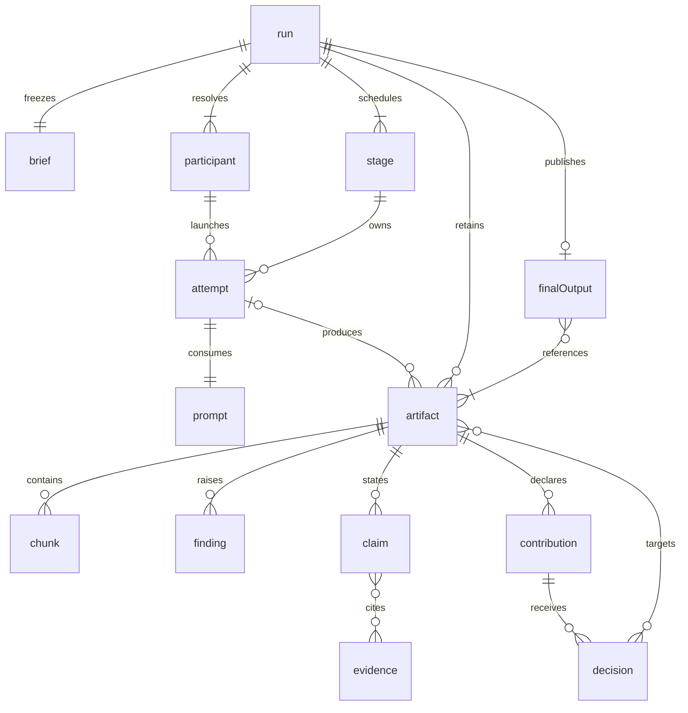
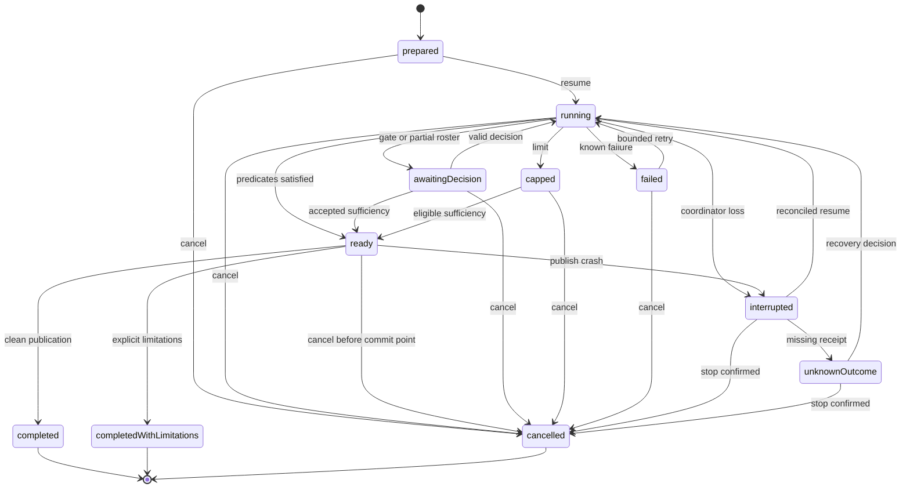
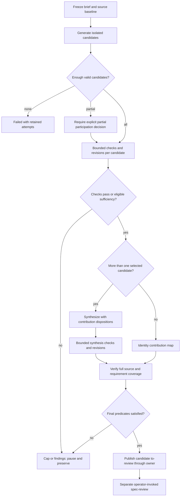
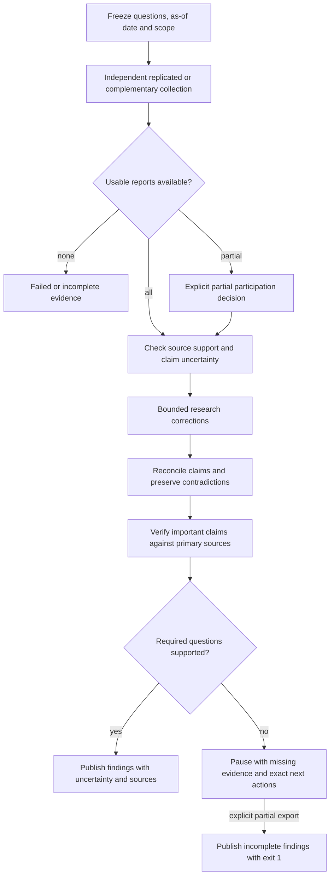

# Spec: Configurable spec and research synthesis: independent candidate

- Date: 2026-10-25
- Status: draft
- Id: 1tx9t8
- Author: aw specs new
- Scope: Bounded synthesis with auditable contributions and capability-checked participants

- Set: specflow
- Order: 2
## Workflow history

- 2026-10-26 created (aw specs): Bounded synthesis with auditable contributions and capability-checked participants

## 1. Summary and release boundary

This independent candidate proposes `aw synth`: a bounded process that turns a brief or research question into independently generated contributions, checks and improves them, and assembles one traceable result. A participant is a configured agent coding environment (ACE), exact model, reasoning setting and independent session. A contribution is an immutable candidate revision, not a vote. A synthesis run is not a spec review or an implementation run.

The actors are the operator who sets scope and accepts tradeoffs, the coordinator that owns state and artifact publication, and workers that propose text and evidence. The coordinator performs deterministic validation; workers perform semantic judgments. Neither can attest human approval. Goals are repeatable invocation, bounded expenditure, preserved minority contributions, honest uncertainty, recoverability, and useful standalone research. Non-goals are implementation, automatic `/spec-review`, model benchmarking, consensus scoring, unlimited deliberation, and replacing the repository's artifact owners or run engine.

Release one includes new briefs, reconsideration of an existing spec without altering it, previously adopted candidate inputs, prompt preparation without dispatch, one or many participants, quick/thorough modes, stage decisions, interruption recovery, split documents, and research reconciliation. It supports one synthesizer per run. Multiple alternative syntheses are deferred: operators can start separate runs against the same frozen inputs and explicitly choose one; no recursive merge is scheduled. This removes a second election protocol from the first release while preserving independent alternatives.

Release one ships a proven OpenCode transport and an external prepare/import route for other ACEs. Antigravity dispatch is eligible only for settings its adapter can enforce. Native Codex dispatch and Antigravity High reasoning are adapter extensions, not prerequisites for useful synthesis. A preferred but unsupported binding refuses dispatch; it never silently becomes OpenCode or loses High. A user may explicitly choose a different binding, prepare a manual task, or wait for adapter support. Unknown provider identities are never filled from marketing labels.

All `aw synth` syntax below is PROPOSED. Existing commands are explicitly marked. This document is a candidate, not an approved contract. The initiating prompt targeted Codex/GPT-6.1 Sol Medium. The maintainer subsequently specified the filename attribution `codex.gpt-6-astra-medium`; the filename follows that explicit instruction. This label is maintainer-supplied attribution, not an independently measured runtime attestation.

## 2. Repository baseline and integration evidence

Inspected branch: `main`; commit: `933b94b74c2c0f8cb2507cd93c56c3601afc7c6a`. Sources below are pinned to that revision. The reference snapshot in the initiating prompt was not substituted for this checkout. Supporting research is the tool-owned assessment `ear8qy` in Set `specflow`. An existing draft candidate `18hh1u` was discovered; it is parallel design work, not approved or shipped behavior, and is not replaced by this candidate.

| Area | Existing fact and source | Reuse / required change |
| --- | --- | --- |
| CLI and completion | [CLI parser and dispatch](https://github.com/fariello/agent-workflows/blob/933b94b74c2c0f8cb2507cd93c56c3601afc7c6a/agent_workflows/cli.py), parser registration and dispatch; [README, Shell Tab Completion](https://github.com/fariello/agent-workflows/blob/933b94b74c2c0f8cb2507cd93c56c3601afc7c6a/README.md#shell-tab-completion) | Add one process noun, register every leaf in command inventory and completion; no dynamic commands named after profiles. |
| Launch profiles | [runner_profiles](https://github.com/fariello/agent-workflows/blob/933b94b74c2c0f8cb2507cd93c56c3601afc7c6a/agent_workflows/runner_profiles.py), `RUNNER_REGISTRY`, `parse_profile`, `resolve`, `ROLE_NAMES` | Reuse version-2 launch store and its per-field provenance. Registry has `oc` and `agy`; only `oc` supports variant/persona. Add synthesis preferences referencing profiles, not another model store. |
| Transport profiles | [workflow_profile](https://github.com/fariello/agent-workflows/blob/933b94b74c2c0f8cb2507cd93c56c3601afc7c6a/agent_workflows/workflow_profile.py), `ALLOWED_PROFILE_KEYS`, `semantic_view` | Reuse packet sizing and semantic parity. A `reasoning_level` transport hint is not proof an ACE honored it. |
| Adapters and capability evidence | [host_adapters](https://github.com/fariello/agent-workflows/blob/933b94b74c2c0f8cb2507cd93c56c3601afc7c6a/agent_workflows/host_adapters.py), `HOST_NONINTERACTIVE_RUNTIME`; [capability registry](https://github.com/fariello/agent-workflows/blob/933b94b74c2c0f8cb2507cd93c56c3601afc7c6a/agent_workflows/host_capability_registry.py), status constants and TTL | Adapter metadata mentioning `codex exec` is not a registered runner profile or a tested synthesis transport. Add task-output collection and evidence probes per supported adapter. |
| Compilation and gates | [workflow_compiler](https://github.com/fariello/agent-workflows/blob/933b94b74c2c0f8cb2507cd93c56c3601afc7c6a/agent_workflows/workflow_compiler.py), `compile_workflow`; [run_engine](https://github.com/fariello/agent-workflows/blob/933b94b74c2c0f8cb2507cd93c56c3601afc7c6a/agent_workflows/run_engine.py), `RunEngine` | Compile a finite directed acyclic graph with conditional refinement nodes. Reuse dependency checks and single-writer lease. Add synthesis predicates and transport dispatcher, not another scheduler. |
| Freeze, persistence, recovery | [run_freeze](https://github.com/fariello/agent-workflows/blob/933b94b74c2c0f8cb2507cd93c56c3601afc7c6a/agent_workflows/run_freeze.py), requirement digests; [run_ledger_store](https://github.com/fariello/agent-workflows/blob/933b94b74c2c0f8cb2507cd93c56c3601afc7c6a/agent_workflows/run_ledger_store.py), `RunLedgerStore`; [run_recovery](https://github.com/fariello/agent-workflows/blob/933b94b74c2c0f8cb2507cd93c56c3601afc7c6a/agent_workflows/run_recovery.py), `plan_retry`, `resume` | Reuse hash chain, lock, invalidation and unknown-outcome refusal. Retry helpers are not evidence that every driver uses them; synthesis must wire and test them. |
| Run ownership and exits | [run_cli](https://github.com/fariello/agent-workflows/blob/933b94b74c2c0f8cb2507cd93c56c3601afc7c6a/agent_workflows/run_cli.py), module contract and exit constants; [output contract 3.1](https://github.com/fariello/agent-workflows/blob/933b94b74c2c0f8cb2507cd93c56c3601afc7c6a/docs/cli-output-contract.md#31-run-execution-exit-vocabulary) | `aw run` writes, `aw runs` reads ledger state; `aw runs resume` does not dispatch. Preserve their wider exit codes and bare JSON exceptions. Typed synthesis facade uses its own declared 0/1/2 contract. |
| Specs and review | [specs README](https://github.com/fariello/agent-workflows/blob/933b94b74c2c0f8cb2507cd93c56c3601afc7c6a/.aw/records/specs/README.md), Status and history; [spec-review, Three prohibitions](https://github.com/fariello/agent-workflows/blob/933b94b74c2c0f8cb2507cd93c56c3601afc7c6a/.aw/system/workflows/spec-review/spec-review.md) | Owner verbs create/check/move; review records belong to `/spec-review`. Synthesis writes research assessments, never review attestations or `Readiness`. |
| Research | [research README](https://github.com/fariello/agent-workflows/blob/933b94b74c2c0f8cb2507cd93c56c3601afc7c6a/.aw/records/research/README.md), Naming, States, Companion files; [research_contract](https://github.com/fariello/agent-workflows/blob/933b94b74c2c0f8cb2507cd93c56c3601afc7c6a/agent_workflows/research_contract.py), `KINDS`, `parse_name` | Reuse kinds, model vocabulary, shelf status, owner-created IDs, manifests and companions. Pipeline `synthesized` is a body-presence view, not proof of quality. |
| Names and selectors | [artifact_naming](https://github.com/fariello/agent-workflows/blob/933b94b74c2c0f8cb2507cd93c56c3601afc7c6a/agent_workflows/artifact_naming.py), `_CLUSTERED_RE`; [selectors](https://github.com/fariello/agent-workflows/blob/933b94b74c2c0f8cb2507cd93c56c3601afc7c6a/agent_workflows/selectors.py), `resolve_for_mutation`; [D177](https://github.com/fariello/agent-workflows/blob/933b94b74c2c0f8cb2507cd93c56c3601afc7c6a/DECISIONS.md) | D177's facet order is decided; generalized attribution and cross-tree allocation still need implementation. Reuse typed resolution and collision refusals. |
| Placement | [record_producers](https://github.com/fariello/agent-workflows/blob/933b94b74c2c0f8cb2507cd93c56c3601afc7c6a/agent_workflows/record_producers.py), `resolve_record_path`; [storage](https://github.com/fariello/agent-workflows/blob/933b94b74c2c0f8cb2507cd93c56c3601afc7c6a/agent_workflows/storage.py), companion preflight | Resolve records/durable/runtime classes through existing APIs; honor companion and home placements and commit boundaries. |

Discrepancies must not become design assumptions. Guiding principle P5 still describes stable spec paths, while the spec README and setters relocate by status. `specs.py`'s introductory docstring describes an older interactive-only approval rule; current owner guidance documents `--by-human`. The agent protocol guide has an example missing mandatory `verified`, and an old claim that find bounding is not honored; the newer output contract documents bounded find. This candidate follows current contracts and validated output, not those illustrative remnants. No installed model catalog, private provider configuration or live model execution was examined; availability of the preferred labels remains unknown. `aw host capabilities --agent` reported the represented hosts `opencode`, `antigravity`, and `scripted`, which is a contract inventory, not a live preferred-model test.

## 3. CLI decision and full surface

### 3.1 Compared grammars

| Approach | Strength | Cost / collision / deterministic use |
| --- | --- | --- |
| `aw specs flow ...`, `aw research flow ...` | Discoverable beside artifacts; familiar nouns; concise for one task | Duplicates every cross-type config/resume/decision leaf or hides a third common namespace. Research already has `new-comparison`; users must distinguish scaffolding from dispatch. Strongest alternative. |
| `aw synth <verb>` with typed start | One memorable process; identical one/many-participant controls; shared preferences and resume; no overlap with existing verbs | New noun needs help cross-links from specs/research; longer explicit `--kind` but short starts infer kind from `--brief`, `--spec`, `--question`. Recommended. |
| `aw run synth ...`, inspection through `aw runs ...` | Fits write/read ownership and reuse of ledger | Existing run leaves mix lifecycle and host forwarding plus two exit tables. Adds typed process policy to generic dispatch and creates unwieldy stage-specific flags. No shorter than shared noun in common use. |

Choose `aw synth` as a typed client of the existing engine. Do not add aliases in release one. `aw specs --help`, `aw research --help`, `aw run --help` link to it. The alternative artifact-noun grammar loses because configuration and recovery concern one process even when it produces different record types. Comparison includes typing cost: `aw synth start --brief brief.md --apply` versus `aw specs flow start --brief brief.md --apply`; shell quoting is identical and file arguments avoid long literal quoting. All verbs are fixed tokens, with preference/profile names only in argument positions. Completion offers verbs, enums, profile names and typed identifiers; it never calls models or reads secrets.

### 3.2 Command matrix

Every row here is PROPOSED, except the final two marked EXISTING. `R` denotes an exact synthesis run ID, `S` an exact stage ID, and `A` an artifact id6. Names such as `team` and `sol` are user-defined references, not installed defaults.

| Invocation | Default/result | Side effects when authorized |
| --- | --- | --- |
| `aw synth config put team --file team.json --scope user --apply` | Validate versioned JSON; scope required (`user` or `project`); no implicit default | Atomically save preferences; project file contains profile references, never credentials |
| `aw synth config use team --scope user --apply` | Select saved preference for subsequent invocations | Update selection only |
| `aw synth config show --preset team --agent` | Resolved preferences, origins and capability gaps; no dispatch | None |
| `aw synth start --brief brief.md --apply` | Spec, selected preferences, thorough mode | Freeze inputs, create run and records, dispatch eligible graph |
| `aw synth start --kind spec --spec A --apply` | New candidate derived from an existing spec | Snapshot source; preserve original status/content/identity |
| `aw synth start --question 'Which storage model fits?' --apply` | Research, same roster, thorough | Create research run and durable question record |
| `aw synth start --question-file questions.md --coverage complementary --apply` | Research questions assigned to bounded subquestions | Same; comparison explicitly states non-overlapping coverage |
| `aw synth start --brief brief.md --participant sol --mode quick --apply` | Replace roster with one participant; one refinement allowance | No synthesis invocation, still final verification |
| `aw synth start --brief brief.md --participant opus --participant flash --participant sol --role synthesis=sol --role check=opus --mode thorough --apply` | Explicit ordered roster and two role overrides | Same graph policy, changed role bindings |
| `aw synth prepare --brief brief.md --preset team --apply` | Freeze and render initial tasks without dispatch | Durable prepared run; external workers may return typed outputs |
| `aw synth preview --brief brief.md --preset team --mode thorough --agent` | Resolved plan, task/attempt bounds, authority and costs known/unknown | None; no IDs reserved, preview names provisional |
| `aw synth show R --view progress --agent` | Views: `progress`, `findings`, `artifacts`, `plan`, `config` | None; reports current state, not a success claim about work |
| `aw synth resume R --apply` | Verify frozen inputs and receipts; dispatch only eligible unfinished nodes | Append recovery events; never override limits/settings |
| `aw synth decide R S --accept --reason 'Sufficient with documented latency limitation' --apply` | Accept only a digest-bound eligible stage | Record operator decision; cannot waive hard finalization blockers |
| `aw synth decide R S --reject --reason 'Omitted migration behavior' --apply` | Reject selected version, pause affected successors | Record decision and invalidate dependents; no implicit extra budget |
| `aw synth cancel R --reason 'Stop expenditure' --apply` | Stop new work, terminate owned tasks, retain results | Cancellation event; no deletion |
| `aw synth import R --manifest returns.json --apply` | Import outputs for frozen prepared tasks | Validate hashes, task identities and provenance; adopt external records only with explicit manifest authorization |
| `aw synth start --kind spec --candidates inputs.json --brief brief.md --apply` | Merge-only; candidates must be already adopted typed IDs/revisions | Freeze candidate closure; skip generation; still coverage check/refinement/finalization |
| `aw synth fork R --config expanded.json --apply` | New run revision using explicit changed inputs/limits | Reuse digest-identical completed nodes; preserve old run and costs |
| `aw synth finalize R --apply` | Check selected output and publish candidate | Spec moves to `to-review` through owner; research becomes completed findings with honest caveats |
| `aw synth finalize R --allow-limitations --reason 'Noncritical source inaccessible' --apply` | Only nonblocking limitations or incomplete research export | Publish labeled result; exit 1 and no clean completion when work remains |
| `aw specs check <path>` (EXISTING) | Structural validation | None |
| `read and execute .aw/system/workflows/spec-review/spec-review.md for <final-id6>` (EXISTING workflow handoff) | Equivalent to `/spec-review <final-id6>` in a native host | Separate explicitly invoked review; never launched by synthesis |

`start` advances through finalization automatically when all gates permit. The explicit `finalize` leaf supports prepared/manual-gate runs and is idempotent after successful publication. Default `gates=exceptions` pauses only for unresolved conflicts, partial participation or caps; `--gates each` pauses after each candidate's final check and after synthesis verification. There is no redundant approval before every routine worker task.

### 3.3 Common argument contract

`start`, `prepare` and `preview` share input and planning flags. Exactly one source mode is required: `--brief PATH`, `--spec SELECTOR`, `--question TEXT`, `--question-file PATH`, or `--candidates MANIFEST`. Candidate mode additionally requires exactly one of `--brief PATH` or `--question-file PATH` as its common contract. `--kind spec|research` is optional when implied, required for candidate mode, and must agree with input. File `-` reads stdin once; multiple stdin consumers refuse. Plain positionals are never inferred as literal input. JSON manifests list typed artifact IDs and content hashes; raw text can never execute as workflow instructions. `--source PATH` repeats for supporting files. Relative paths resolve against invocation directory; the frozen record stores logical paths and hashes. Symlink escapes and inaccessible files refuse before dispatch.

`--participant PROFILE` repeats and replaces the entire roster; duplicate entries refuse, but two named slots referencing one profile are permitted in configuration. `--role ROLE=PROFILE` repeats for `author`, `check`, `revise`, `synthesis`, `verify`; duplicate role keys refuse. `author` defaults to the participant profile for each candidate, `revise` to that candidate's author, `check` to configured `check-content` role then author, `synthesis` to configured `write-prose` role then first participant, `verify` to configured `verify` role then synthesis. Research author defaults can use `research-online` only when no explicit participant binding supplies the role. Finalization and prompt rendering are deterministic coordinator work, not model roles.

`--mode quick|thorough` defaults thorough. Numeric flags are `--candidate-rounds`, `--merge-rounds` (0..10), `--retries` (0..10), `--max-invocations` (1..10000), `--concurrency` (1..32), `--timeout-seconds` (1..86400), `--max-seconds` (1..604800). Defaults are specified in section 5. `--coverage replicated|complementary` defaults replicated and is research-only. `--gates exceptions|each` defaults exceptions. `--preset NAME`, `--config PATH` and `--role` follow section 4. `--allow-partial` is an explicit policy to continue with at least one valid contribution; default false. `--allow-unconfirmed` is an explicit acknowledgment of unobservable reported model identity only, never of unsupported enforcement. `--apply` authorizes mutation/dispatch for every mutating leaf; without it, the leaf previews. `--agent` does not imply `--apply`, human consent, or an ACE persona. `--json` and `--agent` conflict. Common color, interactivity, field projection and verbose flags use existing presentation parents.

Run selectors require exact run ID or contained ledger path, never substring or latest. Single-input artifact selectors reuse typed resolution but demand exactly one match even when a Set denotes many. Candidate manifests name every member explicitly; duplicate ID/hash entries collapse with a visible notice, conflicting hashes refuse. Unknown options, roles, versions, ambiguous selectors, invalid numeric values, unavailable inputs or unsupported capabilities return exit 2 without dispatch. `config put` requires `--replace` to overwrite an existing name. `show` accepts `--limit N` for findings/artifacts and retains totals, omitted count and a continuation action.

### 3.4 Output and exit contract

The new facade uses 0 (requested operation verified complete), 1 (findings or incomplete workflow), 2 (invalid/cannot-run), matching `aw.agent/v1`. It does not change existing `aw run`/`aw runs` codes. On a reused engine error, preserve original run code as `data.engine_exit`; map blocked/invalid evidence to 1 and corruption/operational/wrong-format to 2. The typed `data.reason` remains specific, so integrity corruption is never represented as an ordinary convergence cap. SIGINT may exit 130 with no terminal agent record, per existing contract; the durable run receipt is recovered separately.

A completed `show` query may return 0 even for a capped run: `verified` applies to the query, while `data.run_state` states capped. In contrast `start`, `resume` and `finalize` return 1 for outstanding caps/findings. Use only existing outcome vocabulary: `preview`, `ok`, `findings`, `fail`, `cannot-run`, `error`. Do not emit `outcome: capped` or `outcome: approved`. A preview uses `applied:false`, `complete:true`, and `verified:false` unless validation itself completed. Human output names warnings and next actions without relying on color. Progress goes to stderr; stdout is one result/error record or item records plus one summary. Envelope exit equals process exit. `--fields` preserves mandatory fields and continuation.

Proposed conforming machine example for a cap (fictional run ID):

```json
{"schema":"aw.agent/v1","kind":"result","cmd":"synth start","exit":1,"outcome":"findings","verified":true,"complete":false,"findings":1,"data":{"run_id":"synth-example-01","run_state":"capped","reason":"candidate-round-limit","remaining":["F-0004"]},"next":"aw synth show synth-example-01 --view findings --agent"}
```

Here verification means the cap and finding were checked, not that the design is correct. No record claims positive completion while its work is partial.

## 4. Preferences, identities and capability resolution

A separate synthesis preference schema references existing launch profiles; it does not extend that store with workflow counters. User preferences live under the existing user configuration directory as `synthesis.json`; project-shareable preferences live under resolved project config as `synthesis.json`. A local override belongs to the resolved local config class. A file contains `schema_version:1`, named `presets`, and optional `selected`. Unknown keys/versions refuse with no partial load. Secrets, executable strings and arbitrary environment maps are forbidden. Profile names are resolved in the existing version-2 launch store and copied with their digest into the frozen run; a profile edited later cannot alter resume.

Proposed preference example (profile names must be bound by the operator):

```json
{
  "schema_version": 1,
  "selected": "team",
  "presets": {
    "team": {
      "participants": [
        {"slot":"opus","profile":"opus","packet_chars":24000},
        {"slot":"flash","profile":"flash","packet_chars":12000},
        {"slot":"sol","profile":"sol","packet_chars":24000}
      ],
      "roles":{"synthesis":"sol","check":"opus","verify":"sol"},
      "mode":"thorough",
      "limits":{"candidate_rounds":3,"merge_rounds":2,"retries":1,"max_invocations":64,"concurrency":3,"timeout_seconds":900,"max_seconds":7200},
      "coverage":"replicated",
      "gates":"exceptions",
      "allow_partial":false,
      "allow_unconfirmed":false
    }
  }
}
```

Preset lookup chooses explicit `--preset`, then local selected, project selected, user selected; absent selection refuses with a ready-to-run config example. Same-named preset lookup is local > project > user, replacing the entire preset rather than silently mixing rosters. `--config` is a self-contained expanded version-1 plan config and excludes `--preset`; it supplies full profile snapshots, role routing, scope, limits and template hashes without consulting mutable preferences. CLI field overrides win over selected/expanded config; mode defaults fill only absent fields. A preset SHOULD omit mode-dependent round counts when it wants `--mode quick` to change them. Preview lists each effective field's origin and warns if explicit rounds make quick as expensive as thorough. Expanded export is included in `show --view config --json`, redacted for distribution; unavailable private source paths prevent a claim of portable replay.

The preferred roster is a setup hint, never a default billable launch: Opus 5.5 High on OpenCode, Gemini 3.8 Flash High on agy, GPT-6.1 Sol Medium on either Codex or OpenCode. Sol is one selected binding, not both. The operator enters exact catalog/provider ID and host choice through existing profile tooling where supported. For example the EXISTING form `aw oc profile add sol --model 'provider/exact-model' --variant medium --yes` is structurally valid; `provider/exact-model` is illustrative, not an availability assertion. Native Codex requires a registered and tested profile adapter first. Current agy profiles refuse `variant`; the requested High setting therefore cannot be represented as supported today. Manual preparation records that limitation and accepts returned identity as a claim, not confirmed runtime evidence.

For each launch freeze requested and resolved host/model/variant, profile digest, host version, executable provenance, enforcement capability, discovery timestamp, evidence TTL and requested permission boundary. Record reported identity separately with state `confirmed`, `unobservable`, or `mismatch`; a command-line echo is not confirmation. Exact-model or reasoning mismatch quarantines output and blocks reuse until a new explicit configuration revision. Unobservable reporting can proceed only under `allow_unconfirmed`, remains visible in final limitations, and never yields a confirmed-diversity claim. A requested setting that cannot be enforced refuses even with that flag. No comparable reasoning scale across providers is asserted.

No workers launch during config inspection/preview. Capability checks distinguish catalog absence, authentication error, unsupported feature, stale evidence and executable missing. Preflight refreshes read-only evidence where possible; a probe that incurs cost or side effects must appear in the authorized invocation budget. Preparing prompts remains possible when dispatch capabilities are unavailable. Prepared generation prompts are fully rendered; downstream templates retain typed input bindings until their candidate inputs exist. Such templates are not dispatchable prompts. The coordinator renders and validates each downstream prompt only after those bindings resolve, before its launch receipt.

## 5. Functional contracts and bounded refinement

The following stable requirements are normative for this proposal. Sections 6 to 9 supply their exact data, placement and state rules; section 10 maps each requirement to observable acceptance tests.

| ID | Required behavior and failure outcome |
| --- | --- |
| R-01 | Freeze a common brief, constraints, acceptance criteria, source revision and hashes before generation. Refuse missing required inputs. |
| R-02 | Resolve a nonempty roster and every role before dispatch. Never replace host/model/tier implicitly; expose enforcement and reporting separately. |
| R-03 | Render versioned prompts from frozen inputs; preserve the full rendered bytes and hashes before invoking a worker. Invalid templates or missing requirement references refuse. |
| R-04 | Isolate candidate input visibility. Generation sees only shared inputs and its task; refinement sees only its own candidate history and findings until synthesis. Record exceptions such as imported candidates already influenced by peers. |
| R-05 | Execute finite review/revision cycles with stable findings and separate transport retries. Counters persist across resume; no reset by reissuing a command. |
| R-06 | Classify convergence, operator sufficiency, caps, incomplete evidence and execution failure distinctly. Caps never imply clean completion. |
| R-07 | Reconcile every material suggestion and requirement into a coherent result, preserving minority ideas, exclusions, novel additions and unresolved conflicts. |
| R-08 | Make one-participant runs fully valid; skip merge generation, retain an identity contribution map and final check. Repeated sessions of one model are not model diversity. |
| R-09 | Research must maintain claim-to-source support, uncertainty, contradictions and as-of scope independently of spec approval semantics. |
| R-10 | Fit bounded tasks to measured/configured limits, split when required, and verify coverage and integration across all chunks. Missing or truncated chunks prohibit completion. |
| R-11 | Reuse the engine's lock, ledger, freeze, evidence and recovery primitives. Unknown external outcomes require reconciliation before a retry can spend again. |
| R-12 | Atomically publish through artifact owners with stable IDs, valid names and durable lineage, on every supported storage backend. |
| R-13 | Keep synthesis decisions out of spec review/approval fields. Finalization creates a candidate and exact handoff, not a reviewed or approved spec. |
| R-14 | Keep machine protocol parity, actionable human output, bounded listings and deterministic selector behavior. |
| R-15 | Restrict authority, preserve private-source boundaries and record redaction without manufacturing evidence. Model outputs never execute commands. |
| R-16 | Persist expected/actual work, known/unknown usage, duration and cost; enforce work caps even without cost telemetry. |
| R-17 | Import and fork explicitly with common-scope validation, immutable parent links and selective downstream invalidation. |
| R-18 | Apply D177 naming with tool-owned cross-tree allocation and compatible owner extensions; no hand-created independent IDs or competing index. |
| R-19 | Preserve every accepted contribution, material finding, decision and final version through rename, movement, archive and cancellation. |
| R-20 | Ship one documented canonical grammar and finite first-release integration, including discovery/help/completion and unsupported-adapter failures. |

### 5.1 Brief and templates

A brief is a `requirements` research record containing goals, actors, non-goals, fixed constraints, requirement IDs, acceptance criteria, source manifest, confidentiality/egress scope, repository revision, research questions when relevant, as-of time and objectives. Empty or incompatible required fields block preparation. Freeform input is preserved verbatim; the coordinator may deterministically wrap it but may not invent missing requirements. Optional model-assisted decomposition is an explicit counted task, not a hidden prompt-author turn. Operator edits become a new frozen brief revision.

Defaults are correctness, security and privacy within stated scope, maintainable integration and explicit verification. Performance, accessibility, usability and operability apply only where the feature has observable relevant behavior; each brief marks applicability with a reason. Cost is bounded by invocations/time by default; dollar/token caps require trustworthy telemetry. Task-specific priorities rank tradeoffs but cannot erase fixed constraints. A missing critical scope decision pauses at preparation; harmless authoring choices remain with the worker.

Reusable template assets live in the system workflow package, following its own source layout rather than pretending packaged files are authored records. They are versioned and hashed. Each used template is copied through the prompt owner into one durable snapshot per template version in the run's Set. Those snapshots, like rendered prompts, follow D177. No separate snapshot is needed when the exact packaged source is already preserved as a content-addressed native companion with a pinned repository revision; the run records which retention method it chose. The worked inventory uses native companions for these snapshots.

Template roles: generation consumes frozen brief/source packets; check consumes brief and one candidate plus prior findings; revision consumes checked candidate/findings; synthesis consumes all selected candidate versions and extracted contribution units; synthesis check consumes result, original sources and coverage map; finalization uses a deterministic report template. Template customization is restricted to objectives, formatting, task partitioning and explanatory text. Changes to permissions, output schema or gates require an explicit new run configuration, never a model-authored override. Validation checks required placeholders, schema version, full input manifest and output destination containment. Rendered prompt artifacts contain instructions addressed to the worker only, with metadata in the existing prompt-owner comment, and request Markdown plus structured native companion output.

### 5.2 Iterations and work accounting

A candidate starts with one generation invocation. A check invocation independently reads the current candidate in a fresh session and returns findings. If substantive changes are required and budget remains, one revision invocation produces a new immutable version. That check-plus-revision is one improvement iteration; its counter is reserved when check dispatch begins and completed when revision is validated. A check returning no material findings completes that iteration without a revision. A post-revision check is the next iteration's check, or the terminal check when the iteration allowance is exhausted. Generation and terminal checks are separate from iteration counters. Failed transports consume invocation attempts but do not create a completed quality iteration; the same reserved iteration resumes without increasing its allowance. Every dispatch, successful or failed, consumes one aggregate invocation.

| Bound | Quick | Thorough | Meaning |
| --- | --- | --- | --- |
| Candidate iterations | 1 | 3 | Per candidate, excluding initial generation and terminal check |
| Synthesis iterations | 1 | 2 | Only when more than one candidate is selected |
| Transport retries | 1 | 1 | Additional attempts per task, never another quality cycle |
| Invocation cap | 24 | 64 | Run-wide, includes all retry/verification/chunk/decomposition tasks |
| Concurrent workers | 3 | 3 | At most roster/tasks available; one coordinator writer |
| Per-attempt timeout | 900 seconds | 900 seconds | Includes adapter setup and collection |
| Wall budget | 3600 seconds | 7200 seconds | Count active execution time; paused operator time recorded separately |

Quick uses the entire configured roster; it reduces iterations, not evidence, independence, final checks or approval rules. Concise syntax uses preferences and is independent of rigor. Thorough permits more correction and higher budgets but is not a promise of better accuracy.

For N unsplit candidates, candidate round cap C and merge round cap M, a conservative no-retry upper bound is `N*(2+2*C) + (N>1 ? 2+2*M : 0) + 1`. The last invocation is cross-source final verification, including the solo case. Terminal checks may repeat the last check only if the candidate changed; identical checks are reused. With retry allowance T, multiply task bounds by `1+T`; deterministic render/finalize calls cost no model invocation. With N=3,C=3,M=2 the no-retry bound is 31 and with T=1 it is 62, within 64. Quick N=3,C=1,M=1 gives 17 before retries; its 24 invocation cap deliberately cannot fund every possible retry. Preview must state both potential demand and hard allowance, with a warning when the cap can halt work. If even the no-refinement minimum cannot fit, refuse before dispatch. Split planning enumerates actual tasks and recomputes both bounds; it does not rely on the unsplit formula.

Transport retry is allowed once for transient timeout/network failure or malformed output, with persisted deterministic delays of 2 then 4 seconds for higher configured retry counts, doubling to at most 60 seconds. Authentication, unsupported permissions, identity mismatch and invariant violations do not retry automatically. A hanging process is cancelled with the adapter's bounded termination procedure; inability to confirm termination creates `unknown-outcome`, not an automatic retry. A repair prompt for malformed output is a counted attempt with its own prompt hash and must preserve the original task requirements.

### 5.3 Findings and termination

A finding has run-stable ID `F-0001`, origin attempt/artifact/hash, affected requirement or claim IDs, severity `BLOCKER|HIGH|MEDIUM|LOW`, significance `material|editorial`, evidence, proposed remedy, disposition `open|fixed|accepted|rejected|duplicate`, rationale, related finding IDs and append-only history. Finding IDs are allocated under the run lock and never reused; they are not repository id6s. A substantive requirement, contract, security, evidence, feasibility or user-outcome defect is material. Pure spelling/layout suggestions are editorial and cannot force extra cycles. Severity follows impact: impossible or unsafe required behavior is BLOCKER; materially wrong critical behavior/evidence is HIGH; bounded important omissions MEDIUM; minor limitations LOW. Do not masquerade these assessments as `/spec-review` records.

`fixed` requires a subsequent checker to confirm the remedy on the new digest. A revision worker's claim is only proposed closure. `accepted` requires a digest-bound operator decision and a nonblocking limitation; `rejected` requires evidence/rationale; `duplicate` retains a link to the canonical finding. Deterministic checks validate IDs, references and cardinality, not semantic truth. A worker supplies semantic coverage/check results with citations; contradictory or unsupported conclusions remain findings.

Convergence means a fresh check of the selected revision found no open material finding and deterministic structural/coverage checks passed. It does not prove optimality, independence across models, or universal correctness. Terminal checks always run on the latest changed revision. Operator sufficiency is a separate reason for stopping, visible in metadata; it may accept MEDIUM/LOW limitations but not absent requirements, safety constraints or critical unsupported evidence. At a cap preserve every output and print `CAP REACHED`, unclosed IDs and exact next commands: inspect, accept eligible limitations, cancel, or fork with changed limits. Cap plus zero unresolved material findings after a terminal check is converged; merely reaching the last revision is not.

Repeated semantic finding fingerprints (requirement/claim, category, evidence target) are linked, not renumbered as novel. Reopening the same issue twice or returning to a prior candidate content hash pauses as `oscillation`; operator must reject a remedy or fork changed constraints. No numeric self-rating or majority tally can satisfy convergence.

## 6. Entities, state and recovery

### 6.1 Persisted records and derived views

The run manifest and ledger are authoritative for process state. Markdown artifacts are authoritative for authored content. Native JSON companions define machine-readable content units and links, hash-bound to that Markdown. The coordinator refuses disagreement between them; a human edit requires explicit re-ingestion into a new revision, never silent reparsing that erases history.



All entities above are persisted: run/stage/attempt and decision events in the ledger plus manifest; brief/prompt/artifact content in owner-managed records; participant snapshots and chunk manifests in native companions; findings, claims, evidence and contributions in JSON companions with readable Markdown projections. `finalOutput` is a publication receipt referencing existing artifact IDs, not a cloned spec. A chunk is a manifest entry pointing to a separately owned artifact when materialized; a small section may instead be an anchor in its parent. An imported artifact has no local generation attempt, explaining the optional attempt relationship. Each attempt consumes exactly one rendered prompt; retries may reuse the same prompt artifact when bytes match. Profiles are immutable snapshots inside participants, not foreign keys that resume resolves anew. Progress, totals, matrices rendered from decisions, and independence/diversity summaries are derived views; their source digests are persisted. The ER relationships do not imply all entities exist before a prepared run has dispatched.

The manifest includes schema version, run ID, parent-run/revision, Set IDs, baseline commit, source hashes, frozen config/template digests, requirement IDs, participant bindings, graph nodes/dependencies, allocated artifact IDs, selected output hashes and publication state. Attempts include stage/iteration/task/attempt IDs, UTC start/end timestamps, host/session, requested/resolved/reported identity, prompt hash, input/output manifests, exit reason, retries used, usage and nullable cost. Unknown metrics are null with a reason, never zero. A launch receipt precedes dispatch; an output receipt precedes graph completion.

### 6.1a Structured output and configuration boundary

Every worker return has a version-1 JSON envelope with required `schema_version` (integer 1), `task_id`, `attempt_id`, `input_digest`, `result_kind`, `documents` and `coverage`. Identifiers/digests must exactly match the dispatch receipt. `result_kind` is `candidate|check|revision|synthesis|verification`; the coordinator rejects any other kind. Each document entry declares a relative staged path, media type, byte count and SHA-256; Markdown bytes are not embedded into control fields. A required `completed_parts` list and `expected_parts_digest` bind split returns to the frozen manifest. Empty required lists, unlisted output files, path escapes, unknown schema versions or malformed JSON fail validation. Workers never choose repository id6s, statuses, final filenames or publish destinations.

Candidate/revision payloads require `requirement_map` (every required ID mapped to section anchors), `contributions` (stable source-local IDs, text/anchor, origin and evidence refs), `assumptions`, `open_questions` and `limitations`. Revisions additionally require `parent_digest`, `finding_responses` and `contribution_lineage`. Check/verification payloads require `findings`, `checked_input_digests`, `checks` (predicate, pass/fail/unknown, evidence refs), and `unprocessed_inputs`; an empty finding list cannot hide failed/unknown required checks. Synthesis requires candidate payload fields plus complete `dispositions` and matrix cluster rows. Research candidate/synthesis returns additionally require `questions`, `claims`, `sources`, `contradictions` and `unverified_claims`. Lists may be empty only where semantically applicable; absence is not interpreted as an empty list. The coordinator assigns run finding IDs after ingestion, preserving worker-local references in a translation table. A worker's `pass` is a semantic claim, never an automatic engine transition or artifact approval.

Configuration stores use strict object schemas: a preset has `participants`, optional `roles`, `mode`, `limits`, `coverage`, `gates`, `allow_partial`, `allow_unconfirmed`, `allow_weak_isolation`, and `permissions`. Participant fields are `slot`, `profile`, `packet_chars` and optional `output_chars`; slot is a unique safe kebab token and budgets are positive integers. Limits fields are the named round/retry/invocation/concurrency/time limits above, plus optional `max_tokens` positive integer and `max_cost` object with nonnegative decimal amount and explicit currency. Permissions contain `isolation` (`enforced|instruction-only`), `source_scope` (allowlisted logical paths), `network` (`deny|allowlist`) and `destinations` (explicit provider/source identities). Defaults are enforced isolation, frozen explicit input files only, and denied extra network access; research source acquisition requires an explicit browsing policy. Launch-profile execution permissions cannot widen these rules. A preset missing permissions inherits these restrictive defaults, which preview always shows.

An expanded configuration is a version-1 object with `kind`, `participants` (including immutable `launch` snapshots with runner/model/variant/persona and profile digest), `roles` (references to those snapshots), all resolved limits/policies, `template_digests`, `source_manifest`, and `requirement_digest`. `show --view config --json` supplies that object as `data.export`. External-only participants use a declared manual transport identity and requested settings, never an invented current launch profile. Config loading accepts this form only via `--config` or fork; user preferences continue to contain profile references. Migration from future schema versions refuses without mutation; adding new fields requires an explicit schema revision and converter, not permissive ignoring of misspellings.

### 6.2 State table

These are synthesis domain states projected from the generic ledger. They are not new spec statuses, and the projection does not require changing the engine's closed state enum. Block reasons and quality outcomes live in typed evidence payloads; any new event shape needs schema validation before shipping.

| Domain state | Trigger | Permitted next action |
| --- | --- | --- |
| prepared | Frozen, no launch yet | resume, import, cancel, fork |
| running | Eligible task dispatched | completion, pause, failure, interruption, cancellation |
| awaiting-decision | Stage gate, conflict, partial participation or oscillation | decide, cancel, fork; resume alone cannot waive gate |
| capped | Quality/work/time cap before predicates satisfied | inspect, eligible decide/finalize, fork, cancel |
| failed | Known execution failure with outputs retained | resume retryable task within budget; otherwise fork/cancel |
| interrupted | Coordinator lost while attempt active | reconcile receipts; then resume or unknown-outcome |
| unknown-outcome | Worker may still run or have charged | recover session output/termination evidence; explicit decision to abandon uncertain attempt before retry |
| ready | Final predicates satisfied, finalization pending | finalize or automatic finalization |
| completed | Clean publication receipt | inspect; repeat finalize is no-op; fork for changes |
| completed-with-limitations | Published with explicit nonblocking acceptance or partial research export | inspect/fork; receipt declares quality/incompleteness |
| cancelled | No new tasks; owned workers stopped or uncertainty recorded | inspect/fork; cannot resume cancelled run |

`decide` also accepts `--recover-result returns.json` or `--abandon-attempt ATTEMPT --reason TEXT` instead of accept/reject. These recovery alternatives are mutually exclusive, require `--apply`, and only operate on unknown-outcome attempts. Abandonment explicitly acknowledges duplicate-charge risk, records uncertainty and requires confirmed worker termination before retry; otherwise the run remains blocked. Completed outputs found by session ID are validated and ingested without re-launch.



The diagram shows same-run transitions only. Forking from any retained state creates another prepared run; it does not mutate the parent's terminal state. Partial research export from capped/failed/awaiting-decision is allowed through an explicit limitations decision to `ready` with `publication_kind=partial-research`, then `completed-with-limitations`. It does not satisfy missing research predicates. A critical spec failure never follows that edge. A hard invocation/time cap can still publish already validated content without more model calls, but cannot bypass a missing final check. Cancellation racing publication uses the journal commit point: before it aborts publication; after it reports already published and retains the receipt.

### 6.3 Integrity and resume

Hold the existing ledger single-writer lock across state transitions, not entire model calls. Reserve a task and append its launch receipt atomically before releasing the lock. Worker output goes to a task-owned runtime staging directory. Validate schema, completion manifest, content hashes, full byte lengths, required chunks and references; store raw malformed/truncated output as `.txt` or `.json` evidence before bounded retry. An end marker alone never proves completeness. Publication uses temporary owner-created files and a journal: allocate identity, validate, write, fsync where supported, rename, update owner indexes, then commit a receipt. There is no cross-filesystem atomic rename promise. A journal records each completed owner operation and recovery rolls forward idempotently or leaves an explicit pending publication, never marks a half-published output completed.

Task identity is a digest of frozen requirements, input artifact hashes, template version, role binding, permission scope and chunk contract. Resume reuses successful validated output only when all those inputs and capability requirements still match and no dependent evidence was invalidated. It does not re-charge completed tasks. Changed source bytes, rules, profiles or limits require `fork`, with a change record and dependency closure invalidation. Only unrelated digest-identical tasks carry forward. Auth restoration with identical config may resume a known failed task; it does not create new limits. Corrupt ledger or changed published hashes fail closed; never auto-repair history from model text.

A partial roster requires explicit `--allow-partial` policy or a digest-bound operator decision listing missing participants. At least one valid contribution must remain. With one survivor, use the solo path and label requested versus actual participation. A failed participant is not a blank candidate whose omission silently counts as agreement. Imported candidates of incompatible baseline or constraints pause for a new common brief revision before merge.

## 7. Synthesis, research and context contracts

### 7.1 Spec flow



Each material suggestion receives source-local stable ID `C-0001` and references candidate id6/hash plus requirement anchors. Splits carry these IDs forward or create explicit `derived-from` edges; merging two suggestions creates a many-to-one mapping. A suggestion ledger has disposition `adopted|adapted|deduplicated|rejected|unresolved`, target requirement/section IDs, rationale, and evidence references. Novel synthesizer ideas are tagged `origin=synthesizer` and checked against the frozen brief. Provenance means who proposed it; evidence means why it is justified. These are separate fields.

The similarities/differences matrix has one row per material requirement or proposal cluster, input contribution references for every candidate, shared/different/missing positions, conflict, chosen resolution and rationale. It is not a second full spec. A minority idea can win by satisfying objectives better. Majority votes and model reputation are never tie-breakers. Each input contribution must have a disposition, each fixed brief requirement a target or unresolved blocker, and each final normative statement an origin or novel tag. Deterministic checks catch missing links; final semantic verification checks whether those links actually support the text. Unresolved public-contract or priority conflicts require an operator decision with the alternatives and consequences.

Candidate and synthesis refinement preserve history and contribution identity. Rewriting prose does not reset dispositions. If a final requirement is removed, its original inputs get explicit rejection or successor links. A single candidate receives the same coverage and novelty accounting with no fabricated similarity claims.

### 7.2 Research flow and evidence



Research brief questions have stable `Q-*` IDs. Replicated mode assigns every question to each participant; complementary mode assigns subquestions with declared overlaps and dependencies. Completeness is judged against the union of required questions; a complementary participant's silence on another question is not disagreement. If only one report exists, reconciliation is an identity transformation with source checking, not an extra merge invocation.

A claim record has ID, text, kind `fact|inference|recommendation`, importance, question IDs, source IDs and locators, support relation `supports|contradicts|context`, confidence `supported|tentative|unverified`, rationale, limitations and verification timestamp. Sources retain canonical URL or repository revision/path, title, author/publisher when available, publication/update date if available, access time, content digest/excerpt where permitted, accessibility and source-family identity. Unknown dates are null, never guessed. Inference states its premises; recommendation states objectives/tradeoffs. Citation reachability alone is not support.

Important claims are those that determine a recommendation or answer a required question. A checker must examine their cited primary material, scope and freshness, not merely repeat another model's citation. Deduplicate common upstream sources; three reports citing one source are one evidence family. Preserve contradictions with their applicability, date and methodology differences; if unresolved, the final report states both and does not raise confidence. Missing/stale sources reduce confidence or leave the question incomplete. An inaccessible critical source blocks clean completion, though partial export is useful. Noncritical inaccessible material may be an accepted limitation. A research report can finish with a well-supported explanation that the evidence is inconclusive; it cannot claim completion where required investigation was not performed.

Final research is a `findings` record, shelf `active` while informing current work and promotable by the research owner to `reference` when cold. `todo/active/reference/archive` are retention states, not review verdicts. Completion and evidence quality live in the report and run receipt. No `approved` research state is invented. Later specs cite the final research and exact claim IDs; research completion neither creates nor approves a spec.

### 7.3 Context, splitting and independence

Use host-reported context/output limits only with capability evidence. Operator packet budgets are conservative operational limits, not model benchmarks. When model limits are unknown, default to 12000 input characters and 4000 requested output characters per task; reserve another input-sized allowance for tool results and reasoning where those consume context. Warn that character estimates are not token guarantees; if a tokenizer is available, use it with a recorded version and reserve at least 30 percent for output/tools/reasoning. Effective limit is the minimum of known host constraints and configured budgets. Refuse an unfit indivisible task rather than silently truncate. Flash's smaller packet preference is configurable and labeled a user observation, not a universal model ranking.

Partition only when the planner's conservative bound would be exceeded or explicit scope has separable contracts. A split manifest assigns each original requirement/claim to parts, shared terms, dependency order and interface definitions. Shared contracts go to every dependent part; referenced originals remain available by hash. Required global constraints may not exist solely in a lossy summary. The assembly check verifies exact part IDs/hashes, complete requirement mapping, no conflicting definitions and a cross-chunk integration review. The verification worker receives the original material in bounded batches plus durable cross-links; unresolved/unprocessed material blocks completion. A missing part is not treated as empty text.

If full candidate inputs exceed synthesis context, first extract contribution records per bounded source packet, verify extraction against each original, then reconcile clusters, then assemble sections, then cross-check global contracts and full manifest coverage. Every extraction, reconciliation and integration check is in the finite task graph and invocation cap. Do not recursively spawn more workers at runtime beyond reserved tasks. If observed overflow or output truncation demands another partition, stop and fork a revised graph with evidence; preserve the partial attempt. A single document remains preferred when it fits, because splits add interfaces and checks.

Isolation uses distinct sessions and least-authority source packets/workspaces that exclude peers, prior candidates and private records. A model prompt saying "do not read peers" is not an enforced boundary. When an adapter cannot restrict filesystem/tool visibility, preflight labels isolation `instruction-only`; automatic independent-generation claims require an enforceable restricted source workspace or a manual external task that records its weaker guarantee. The operator can explicitly accept weak isolation in a new config, but the final result cannot claim enforced independence. Fresh checks using the same model are separate sessions, not independent-model corroboration.

## 8. Artifact naming, placement and ownership

### 8.1 Normative allocation rules

Use D177 unchanged: `YYYYMMDD-<setid>-NN-<id6>-<slug>[.<ace>][.<model>].<type>.md`. Zero authorship facets means unattributed; one means model; two mean ACE then model. Type is always last. Facets use `[a-z0-9-]+`; model tokens denote the whole model-plus-effort identity, for example `gpt61solmedium`, never a dotted provider ID or a guessed reversible model/variant join. ACE vocabulary is initially `opencode|agy|codex|claude`. A multi-contributor synthesis uses `.reconciliation.<type>.md` without an ACE. Exact identities stay in metadata.

One logical process has a root Set, shared across prompts, research and specs. Branches and iterations stay in that Set until allocation would exceed 100 records. Then allocate a linked volume Set with a fresh short tool-generated key and `Parent-Set`/run link, same canonical date and a volume index in the manifest. Do not squeeze counters into id6, slug or model. Existing adopted inputs retain their Sets; the new run links them, never regroups them implicitly. Joining a user-selected existing Set requires allocation under the same lock and preservation of its canonical date; conflicting existing dates pause for owner-mediated reconciliation. Set IDs match existing kebab syntax, prefer <=14, warn at 15..24, refuse >24. A generated key remains <=14 even for later volumes. A Set is grouping, not identity.

Date is the Set's canonical UTC creation date, preserved across midnight/resume; `created_at`/`updated_at` record actual UTC timestamps separately. Existing filenames that use different dates are not silently migrated. `NN` is stable allocation/read order within one physical volume Set, across all artifact trees, not attempt/iteration or exact dependency order. Reserve `00` for the root dispatch prompt, allocate `01..99` in topological task order during preparation, and retain holes after cancelled/unused reservations. The manifest supplies actual dependency and temporal order. Concurrent reservations serialize on the repository artifact-owner allocation lock, shared with all participating `new` verbs; retries reuse prompt identity only for identical bytes, but each changed candidate/review output gets a new artifact id6 and unused order. If more reservations are needed, allocate at the end or a linked volume, never renumber published artifacts. This deliberate extension makes a cross-tree run inventory unambiguous; historical independent per-tree orders remain valid.

The existing `artifact_core` ID minting primitive remains the owner, extended to check all artifact trees and reservations under one transaction. An id6 is immutable and globally unique in the resolved records store, including cold shards. It cannot equal another independent record's ID even in another Set or backend attachment. Run/stage/attempt IDs are separate namespaces, never substituted. Regroup/rename/status moves preserve id6. An unpublished in-progress editor buffer may update before its first durable publication; after an artifact has been consumed by a task or decision, any content change creates a new artifact with `Supersedes` and parent hash. Metadata-only lifecycle transitions use the same ID and owner history. Finalization moves the selected spec revision into `to-review`, preserving its identity; a split final spec moves its index and all required parts as one recoverable publication. No independent final copy clones an ID. Research finalization creates a `findings` record with new identity linked to selected reports; changing research kind is not disguised as a lifecycle move.

Slugs are deterministic short kebab purpose labels, <=48 characters, omit model/session IDs and secrets, and have no dots. Filename byte length must be <=240; excessive values refuse with a shorter-slug remedy, never silently truncate distinguishing content. Existing kinds are sufficient: `prompt`, `spec`, research `requirements`, `notes`, `assessment`, `research-report`, `reconciliation-report`, `test-evidence`, `findings`. Stage, revision and lifecycle are metadata, not new type tokens. Use `assessment` for iterative findings so research's existing `findings` synthesis heuristic does not claim the whole run is synthesized prematurely.

Normalize known requested/reported identity pairs through the model vocabulary only when the mapping is unambiguous. Register new model tokens using existing `aw research add-model`; warn for open-vocabulary tokens until blessed. Unknown identities use no filename facet and explicit metadata. If reported identity conflicts with requested identity, quarantine the output and do not publish a falsely attributed name. A prompt targeting an unconfirmed model remains unattributed with `intended_participant` metadata; intention is not authorship. Human/template-derived prompts are also unattributed. A single-agent result may use ACE/model once adequately established; multi-author synthesis always uses reconciliation. Imported author claims remain labeled `reported-by-import` and do not become runtime confirmation.

### 8.2 Placement matrix

Let `P = resolve_record_path('prompts')`, `S = resolve_record_path('specs')`, and `Q = resolve_record_path('research')`. On this checkout these resolve to `.aw/records/prompts`, `.aw/records/specs`, `.aw/records/research`. On companion/home storage they resolve through project context to those stores, not through string substitution. `D` and `T` are resolved durable/runtime state roots. `C` is the brief research record's sibling `<full-stem>.data/` companion directory. All entries retain run/stage/attempt, input/output hashes, author identity confidence and parent links as applicable. The matrix below specializes that common metadata rather than repeating it in every row.

`N(slug,type,facet)` means the full D177 form with tool-assigned date/Set/order/id6, optionally `facet`. All durable run-authored records use the shared root/volume Set policy above. Spec records remain `draft` until selected for finalization; prompt lifecycle is controlled by the prompt owner; research shelf is `active` after adoption, then `reference` for retained evidence or `archive` for rejected material when no longer in flight. Research `todo` during initial staging is not a completion signal.

| Purpose/stage | Type and naming | Logical/resolved destination here | Owner and lifecycle | Additional provenance and retention |
| --- | --- | --- | --- | --- |
| Original brief/objectives | `N(brief,requirements,none)` | `Q/` | research new; active | Raw input, baseline, requirement IDs; retain permanently with final lineage |
| Reusable template snapshot | `N(template-generation,prompt,none)` if Markdown record; otherwise native source snapshot | `P/pending` or `C/templates/` native source | prompts new for records; coordinator for native snapshot | Source package revision/hash; retain every used version, no duplicated mutable authority |
| Root and rendered prompts | `N(dispatch,prompt,none)`, `N(candidate-check,prompt,none)` | `P/pending`, owner moves used prompts to `P/executed` | prompts new and lifecycle owner | Intended binding, task hash and exact frozen bytes; retain even for failed attempts |
| Context/source packets | `N(context,notes,none)` | `Q/` | research new | Source IDs, byte ranges and hashes; retain exact dispatched content |
| Independent spec candidates | `N(candidate,spec,ace.model)` where known | `S/draft` | specs new, draft | Contribution IDs, requirement map; retain every consumed revision |
| Independent research reports | `N(candidate,research-report,ace.model)` where known | `Q/` | research new, active | Claims, sources, as-of; same retention |
| Split parts and index | `N(candidate-part,spec,ace.model)` plus `N(candidate-index,spec,ace.model)`; research uses `research-report` for both | `S/draft` or `Q/` | corresponding owner | Every part owns its own ID; index links exact versions; retain full closure |
| Per-iteration findings | `N(candidate-check,assessment,ace.model)` | `Q/` | research new | Finding history/target digest; never review attestation |
| Revisions | Same candidate type, fresh identity; optional `revision` slug | `S/draft` or `Q/` | corresponding new owner | Supersedes/hash/iteration; retain consumed old versions |
| Comparison matrix and decisions | `N(comparison,reconciliation-report,reconciliation)` | `Q/` | research new | Matrix and readable decisions embedded together; JSON projection in C, no separate competing index |
| Merged candidate | `N(synthesis,spec,reconciliation)` or research `research-report` | `S/draft` or `Q/` | corresponding new owner | All selected inputs, dispositions, novel ideas; immutable consumed versions |
| Synthesis checks/revisions | `assessment` checks; same output type for revision | `Q/` and `S/draft` as appropriate | corresponding owners | Check references all source contributions; retain |
| Final validation report | `N(validation,test-evidence,none)` | `Q/` | research new | Deterministic results plus semantic check references; no invented test evidence |
| Final candidate spec | Same selected spec/index/part identities and names | `S/to-review` | specs check then specs set | Publication receipt and `/spec-review` handoff; retain history |
| Final research findings | `N(final,findings,reconciliation)` for multi-contributor; attributable or plain for solo | `Q/`, later `Q/reference/YYYYMM` | research new then promote | All questions, claims, caveats and report lineage; useful independently of later specs |

Human-readable source evidence excerpts may be embedded in context notes, not automatically promoted to separate records. Small objective tables belong in the brief. Findings histories may be embedded in each assessment with the full event history in its native JSON; they do not need one Markdown record per finding. Final decision rationale and matrix share one reconciliation report. Embedded material has stable anchors and enclosing artifact hash, not fabricated standalone IDs.

Native artifacts are not Markdown: `C/manifest.json`, `C/config.json`, `C/requirements.json`, `C/contributions.json`, `C/claims.json`, `C/decisions.jsonl`, `C/metrics.json`, `C/templates/<digest>.txt`, and `C/sources/<digest>.<native-extension>`. These are coordinator-owned, hash-bound companions retained with the brief. Exact raw model outputs use `.txt`/`.json`; sanitized copies are durable, unredacted credential-bearing data is never retained. Run ledger and launch receipts use the engine's resolved durable run location under `D`; the publication receipt includes a durable export in C so disposable run views are never the sole provenance. `T` holds leases, process handles, temporary writes, download caches and rebuildable projections. Indexes remain existing owner-generated, gitignored local views, never a new handwritten corpus index. The per-run manifest is a dependency/provenance manifest, not a replacement corpus selector index.

Owner extensions needed before shipping: generalized D177 parse/build/check/rename/index support, ACE metadata consistency, optional Set/date/order/attribution inputs on spec/prompt creation, cross-tree transactional reservation, native-companion manifest registration and multi-record publication journal. Research currently handles zero/one model facet, not the full ACE/model extension. Existing attributed prompts already failing name checks do not grant permission to bypass owners. Legacy valid forms remain readable and grandfathered; no repository-wide migration in this feature. Rename/move must update owner references and companion paths, refuse collision without partial changes, and preserve stable id-based lineage. External intake requires a proposed type/kind/slug/Set manifest and explicit human confirmation (`import --apply` with that manifest); quoted IDs in raw inputs are never adopted as real identities.

### 8.3 Complete illustrative inventories

All IDs below are FICTIONAL, all future naming/attribution is PROPOSED, and none of these rows authorizes creating those records. The inventory shows a three-participant thorough spec run with exactly two candidate improvement iterations per participant, two split parts for the Flash candidate, one synthesis improvement iteration, mandatory terminal checks and final verification. `NN` is assigned once across trees; the ledger separately records iteration numbers. Used prompts are shown at their eventual `executed` location. `x00001` etc. are fictional stable IDs, not IDs minted for this candidate.

All paths are relative to resolved records root (here `.aw/records/`).

| Complete path | Purpose |
| --- | --- |
| `prompts/executed/20261025-demo-00-x00000-dispatch.prompt.md` | Root contract prompt; order 00 |
| `research/20261025-demo-01-x00001-brief.requirements.md` | Shared objectives; companion owner |
| `research/20261025-demo-02-x00002-context.notes.md` | Common source packet with baseline hash |
| `prompts/executed/20261025-demo-03-x00003-opus-generate.prompt.md` | opus generation, intended identity in metadata |
| `specs/draft/20261025-demo-04-x00004-opus-candidate-0.opencode.opus55high.spec.md` | Version 0; whole candidate |
| `prompts/executed/20261025-demo-05-x00005-opus-check-0.prompt.md` | Iteration 1 check |
| `research/20261025-demo-06-x00006-opus-check-0.opencode.opus55high.assessment.md` | Confirmed checker identity assumed only for this illustration |
| `prompts/executed/20261025-demo-07-x00007-opus-revise-1.prompt.md` | Iteration 1 revision |
| `specs/draft/20261025-demo-08-x00008-opus-candidate-1.opencode.opus55high.spec.md` | Version 1; whole candidate |
| `prompts/executed/20261025-demo-09-x00009-opus-check-1.prompt.md` | Iteration 2 check |
| `research/20261025-demo-10-x00010-opus-check-1.opencode.opus55high.assessment.md` | Confirmed checker identity assumed only for this illustration |
| `prompts/executed/20261025-demo-11-x00011-opus-revise-2.prompt.md` | Iteration 2 revision |
| `specs/draft/20261025-demo-12-x00012-opus-candidate-2.opencode.opus55high.spec.md` | Version 2; whole candidate |
| `prompts/executed/20261025-demo-13-x00013-opus-check-2.prompt.md` | Terminal check |
| `research/20261025-demo-14-x00014-opus-check-2.opencode.opus55high.assessment.md` | Confirmed checker identity assumed only for this illustration |
| `prompts/executed/20261025-demo-15-x00015-flash-generate.prompt.md` | flash generation, intended identity in metadata |
| `prompts/executed/20261025-demo-16-x00016-flash-part-two.prompt.md` | Second bounded generation task |
| `specs/draft/20261025-demo-17-x00017-flash-candidate-0.agy.gemini38flashhigh.spec.md` | Version 0; split index |
| `specs/draft/20261025-demo-18-x00018-flash-interface-0.agy.gemini38flashhigh.spec.md` | Version 0, part 1 |
| `specs/draft/20261025-demo-19-x00019-flash-recovery-0.agy.gemini38flashhigh.spec.md` | Version 0, part 2 |
| `prompts/executed/20261025-demo-20-x00020-flash-check-0.prompt.md` | Iteration 1 check |
| `research/20261025-demo-21-x00021-flash-check-0.agy.gemini38flashhigh.assessment.md` | Confirmed checker identity assumed only for this illustration |
| `prompts/executed/20261025-demo-22-x00022-flash-revise-1.prompt.md` | Iteration 1 revision |
| `prompts/executed/20261025-demo-23-x00023-flash-part-two-revise-1.prompt.md` | Iteration 1 second part revision |
| `specs/draft/20261025-demo-24-x00024-flash-candidate-1.agy.gemini38flashhigh.spec.md` | Version 1; split index |
| `specs/draft/20261025-demo-25-x00025-flash-interface-1.agy.gemini38flashhigh.spec.md` | Version 1, part 1 |
| `specs/draft/20261025-demo-26-x00026-flash-recovery-1.agy.gemini38flashhigh.spec.md` | Version 1, part 2 |
| `prompts/executed/20261025-demo-27-x00027-flash-check-1.prompt.md` | Iteration 2 check |
| `research/20261025-demo-28-x00028-flash-check-1.agy.gemini38flashhigh.assessment.md` | Confirmed checker identity assumed only for this illustration |
| `prompts/executed/20261025-demo-29-x00029-flash-revise-2.prompt.md` | Iteration 2 revision |
| `prompts/executed/20261025-demo-30-x00030-flash-part-two-revise-2.prompt.md` | Iteration 2 second part revision |
| `specs/draft/20261025-demo-31-x00031-flash-candidate-2.agy.gemini38flashhigh.spec.md` | Version 2; split index |
| `specs/draft/20261025-demo-32-x00032-flash-interface-2.agy.gemini38flashhigh.spec.md` | Version 2, part 1 |
| `specs/draft/20261025-demo-33-x00033-flash-recovery-2.agy.gemini38flashhigh.spec.md` | Version 2, part 2 |
| `prompts/executed/20261025-demo-34-x00034-flash-check-2.prompt.md` | Terminal check |
| `research/20261025-demo-35-x00035-flash-check-2.agy.gemini38flashhigh.assessment.md` | Confirmed checker identity assumed only for this illustration |
| `prompts/executed/20261025-demo-36-x00036-sol-generate.prompt.md` | sol generation, intended identity in metadata |
| `specs/draft/20261025-demo-37-x00037-sol-candidate-0.codex.gpt61solmedium.spec.md` | Version 0; whole candidate |
| `prompts/executed/20261025-demo-38-x00038-sol-check-0.prompt.md` | Iteration 1 check |
| `research/20261025-demo-39-x00039-sol-check-0.codex.gpt61solmedium.assessment.md` | Confirmed checker identity assumed only for this illustration |
| `prompts/executed/20261025-demo-40-x00040-sol-revise-1.prompt.md` | Iteration 1 revision |
| `specs/draft/20261025-demo-41-x00041-sol-candidate-1.codex.gpt61solmedium.spec.md` | Version 1; whole candidate |
| `prompts/executed/20261025-demo-42-x00042-sol-check-1.prompt.md` | Iteration 2 check |
| `research/20261025-demo-43-x00043-sol-check-1.codex.gpt61solmedium.assessment.md` | Confirmed checker identity assumed only for this illustration |
| `prompts/executed/20261025-demo-44-x00044-sol-revise-2.prompt.md` | Iteration 2 revision |
| `specs/draft/20261025-demo-45-x00045-sol-candidate-2.codex.gpt61solmedium.spec.md` | Version 2; whole candidate |
| `prompts/executed/20261025-demo-46-x00046-sol-check-2.prompt.md` | Terminal check |
| `research/20261025-demo-47-x00047-sol-check-2.codex.gpt61solmedium.assessment.md` | Confirmed checker identity assumed only for this illustration |
| `prompts/executed/20261025-demo-48-x00048-synthesize.prompt.md` | Consumes all three selected candidates |
| `research/20261025-demo-49-x00049-comparison.reconciliation.reconciliation-report.md` | Material decisions and similarities/differences |
| `specs/draft/20261025-demo-50-x00050-synthesis-zero.reconciliation.spec.md` | Initial merged candidate |
| `prompts/executed/20261025-demo-51-x00051-synthesis-check.prompt.md` | Synthesis iteration 1 check |
| `research/20261025-demo-52-x00052-synthesis-check.codex.gpt61solmedium.assessment.md` | Checker contribution, not multi-author output |
| `prompts/executed/20261025-demo-53-x00053-synthesis-revise.prompt.md` | Synthesis iteration 1 revision |
| `specs/to-review/20261025-demo-54-x00054-synthesis-one.reconciliation.spec.md` | Final selected revision; created draft then moved with SAME id6 |
| `prompts/executed/20261025-demo-55-x00055-synthesis-terminal-check.prompt.md` | Check selected changed revision |
| `research/20261025-demo-56-x00056-synthesis-terminal-check.codex.gpt61solmedium.assessment.md` | Terminal check evidence |
| `prompts/executed/20261025-demo-57-x00057-integration-verify.prompt.md` | Full-source final semantic verification |
| `research/20261025-demo-58-x00058-integration-verify.opencode.opus55high.assessment.md` | Independent session, full source coverage |
| `research/20261025-demo-59-x00059-validation.test-evidence.md` | Deterministic finalization checklist and verification references |

This inventory allocates 60 Markdown records, all within 00..99. Attribution assumes confirmed identities solely for the example; it does not assert current adapter availability. Template snapshots are native `research/20261025-demo-01-x00001-brief.requirements.data/templates/<digest>.txt`; five exact used templates (generation, check, revision, synthesis, final-verification) and their manifest are retained there. Per-task rendered prompts above remain separate. The same companion holds config, manifest, contribution/decision/claim schemas, source snapshots, metrics, raw attempts and publication receipt. No durable Markdown file is hidden inside a cache.

A one-participant quick run uses no synthesis task and no reconciliation claim. Complete illustrative inventory, again relative to the resolved records root:

| Complete path | Purpose |
| --- | --- |
| `prompts/executed/20261025-solo-00-y00000-dispatch.prompt.md` | Root task |
| `research/20261025-solo-01-y00001-brief.requirements.md` | Brief and native companions |
| `research/20261025-solo-02-y00002-context.notes.md` | Source packet |
| `prompts/executed/20261025-solo-03-y00003-generate.prompt.md` | Generation |
| `specs/draft/20261025-solo-04-y00004-candidate-zero.opencode.gpt61solmedium.spec.md` | First candidate |
| `prompts/executed/20261025-solo-05-y00005-check.prompt.md` | Iteration 1 check |
| `research/20261025-solo-06-y00006-check.opencode.gpt61solmedium.assessment.md` | Findings |
| `prompts/executed/20261025-solo-07-y00007-revise.prompt.md` | Iteration 1 revision |
| `specs/to-review/20261025-solo-08-y00008-candidate-one.opencode.gpt61solmedium.spec.md` | Revised candidate, same identity on final move |
| `prompts/executed/20261025-solo-09-y00009-terminal-check.prompt.md` | Latest-version check |
| `research/20261025-solo-10-y00010-terminal-check.opencode.gpt61solmedium.assessment.md` | Closure evidence |
| `prompts/executed/20261025-solo-11-y00011-verify.prompt.md` | Full-scope final check |
| `research/20261025-solo-12-y00012-verify.opencode.gpt61solmedium.assessment.md` | Final semantic evidence |
| `research/20261025-solo-13-y00013-validation.test-evidence.md` | Deterministic validation and identity contribution map |

The solo brief companion owns the same native files as the three-participant example. The identity contribution map is embedded in validation plus native contribution JSON; no extra merge/matrix record is needed. Five model invocations occur when iteration 1 revises: generation, check, revision, terminal check, final verification. Same-model fresh checks do not become independent-model consensus.

Resume illustration: the solo run stops after dispatching revision at order 07 on October 25, resumes on October 26, and recovers a valid output receipt. Orders 00..07 and their IDs/hashes stay unchanged. The recovered revision publishes to the already reserved `20261025-solo-08-y00008-candidate-one.opencode.gpt61solmedium.spec.md` with `created_at` on October 26 and original canonical prefix. Remaining 09..13 are unchanged reservations; no duplicated generation/check/revision charge occurs. If outcome remains unknown, no new file or launch is allowed until recovery. If a known failed attempt is retried with identical prompt bytes, order 07 remains the same prompt; attempt counter 2 and new raw output receipts live in native state. A changed repair prompt takes a newly reserved order 14 and ID, for example `prompts/executed/20261025-solo-14-y00014-repair.prompt.md`, linked to the failed attempt; old prompt and raw output remain. A changed configuration creates a new run/Set link, not a disguised same-run resume.

Research equivalents replace candidate/index/part `.spec.md` records with `.research-report.md` under research, retain source/claim companions, and add a final findings record with a fresh ID. Example final multi-contributor output: `research/20261025-study-25-z00025-final.reconciliation.findings.md`; after cold promotion its exact same filename/id6 lives under `research/reference/202610/`. Solo research uses its confirmed author facet or no facet. The final report links all selected report IDs, comparison and validation; it does not overwrite source reports.

### 8.4 Compatibility of this delivered candidate

This authoring pass uses current `aw specs new`, `aw group specs` and `aw research new`, not the proposed allocator. The current tools created spec `1tx9t8` with a 20261025 prefix and research `ear8qy` with the existing Set's 20261024 prefix. `aw group specs ... --date 20261024` preserved the existing spec date in its emitted name. This is observed behavior, not a reason to hand-rename the record. The candidate initially retained the owner-generated name. At the maintainer's explicit request, it now carries `.codex.gpt-6-astra-medium` before `.spec.md`, preserving its stable identity and date. Current owner tools do not expose these attribution fields, so this requested rename is a manual compatibility exception. The candidate explicitly proposes consistent canonical dates for new synthesis-owned records. Historical Set order/date discrepancies remain legacy data; this proposal does not rewrite them. The metadata and creation history produced by owners are preserved, including their timestamps.

## 9. Safety, quality, finalization and nonfunctional behavior

Workers receive task-specific source packets and an output directory, never coordinator credentials, artifact mutation authority, review setters, implementation commands or a shell built by string interpolation. Invoke adapters with argument arrays; reject embedded NUL/control characters and path traversal. Treat citations, imported Markdown and model-generated commands as data. Tool permissions and network egress must be stated per adapter; an unenforced prompt policy is labeled as such. Confidential sources cannot be sent to a newly selected remote provider without the user's configured authorization for that source scope. Default egress is no new destinations beyond explicitly bound provider/source policies; research browsing domains and private source access are frozen separately. Credentials remain in ACE configuration, not prompts, manifests or receipts.

Synthesis cannot broaden an adapter sandbox. Requested enforced isolation/permissions that cannot be delivered refuse. `allow_weak_isolation` is an explicit version-1 preference boolean, default false, set only by a configuration revision; its receipt names lost guarantees and all affected stages. It allows instruction-only candidate separation, not secret leakage or unsupported model settings. No output may claim enforced independence in that case. Manual import preserves human-confirmed origin claims and records the inability to attest runtime enforcement.

Preflight includes storage accessibility, native adapter support, output retention, source privacy and work bounds. The leak sanitizer runs on public artifacts before publication; if material evidence needs redaction, the record notes the omission and cannot pretend the removed evidence is available. Private retained evidence uses the configured private storage boundary and referenced hashes; the tool never publishes it to make a report appear complete. Raw external source reproduction follows source permissions and keeps only necessary permitted excerpts.

Final spec checklist: all mandatory inputs processed; current requirement and contribution maps complete; no unresolved BLOCKER/HIGH or fixed-constraint violation; no missing chunks, broken lineage, unsupported critical claims or conflicting public interfaces; latest candidate check and final integration check valid for selected hashes; structural spec checks pass; full provenance and limitations retained; identity/isolation claims accurate. MEDIUM/LOW limitations require explicit reason to finalize with `--allow-limitations`; output remains a candidate and reports `completed-with-limitations`, exit 1. Clean finalization uses `completed`, exit 0. Neither is review approval. Spec status may be `to-review` with explicit nonblocking limitations; a blocking result stays `draft`. One participant can reach `to-review` under the same rules as three; diversity is not a lifecycle prerequisite.

If a severe spec blocker remains, finalization refuses with specific findings and draft artifact links; it never exports it as a clean final candidate. Research may explicitly export an incomplete findings report, preserving unanswered questions and `complete:false`, exit 1. A well-investigated but inconclusive research answer can be clean if uncertainty is the supported answer rather than omitted work. Research reports remain active while useful in current work, with shelf transitions separate from quality.

Publication writes a receipt containing final IDs/hashes, input closure, validation refs, remaining limitations, participation, confirmed versus requested identities and exact handoff. Finalization is idempotent: repeated calls return the same receipt without new records or model spend. A spec handoff is `/spec-review <id6>` in hosts with native commands, or `read and execute .aw/system/workflows/spec-review/spec-review.md for <id6>` otherwise. No `Readiness`, `Approval`, human attestation or review record is written by this workflow, including in full automation.

Performance/usability: render preview from local snapshots without paid work; cap input file sizes through the configured packet plan, stream large source reads, and bound concurrency/backpressure. Cancellation stops scheduling immediately and reports termination uncertainty. All progress is textual and keyboard-operable; no color-only significance, spinner-only progress or mandatory interactive prompt for noninteractive use. Human summaries show requested/surviving participants, stage, remaining budget, warnings and next command. Machine listings support bounded output. Timings include queue/dispatch/model/validation durations separately; costs include currency/pricing-source timestamp when known. Unknown output tokens/prices are null and do not disable invocation/time limits. Optional `max_tokens` and `max_cost` config fields refuse as enforceable hard caps if the adapter cannot reserve and measure them; user estimates may be displayed but must be labeled nonbinding.

## 10. Requirement-to-acceptance matrix

These tests exercise behavior, emitted records, files and recovery outcomes. They must not pin production source strings or counts. Fixtures use scripted transports for deterministic failures and success; live adapter probes are separate, opt-in, finite, and never required to run ordinary tests.

| Test / requirements | Observable pass/fail condition |
| --- | --- |
| A-01 / R-01,R-03 | Two participants receive byte-identical brief/source hashes and no peer candidate. Change the source after preparation: resume refuses and names the changed hash; fork preserves the old run. |
| A-02 / R-02,R-20 | Unknown profile, unsupported agy variant and unsupported Codex runner each refuse before launch with setting-specific recovery. No fallback launches. Unobservable reporting requires explicit policy and stays labeled; mismatch quarantines output. |
| A-03 / R-03,R-15 | A missing template requirement field fails preparation. A source containing shell syntax or fake approvals is preserved as data and performs no command or lifecycle change. |
| A-04 / R-04,R-08 | Enforced packets exclude peers; weak isolation is explicit. One-model/two-session roster reports two sessions and one model, never diverse agreement. |
| A-05 / R-05,R-16 | Scripted check/revise/check consumes defined iterations. Timeout retry increments attempt/invocation but not completed quality iterations. Repeated resume cannot reset any counter. |
| A-06 / R-06 | At last revision with unresolved HIGH, emit cap/findings and exit 1; no to-review move. Terminal clean check may converge; operator-accepted LOW remains a limitations outcome. |
| A-07 / R-07 | Feed two agreeing but unsupported proposals and one evidenced minority proposal: synthesis may choose minority; every input gets a disposition and novel claims are explicit. Missing contribution disposition fails verification. |
| A-08 / R-08 | Solo quick run invokes no merge, still performs final verification, publishes to-review when clean and emits no consensus claim. |
| A-09 / R-09 | Three reports citing one article count one evidence family. Conflicting primary sources remain visible; unvisited critical citation prevents clean completion. Inconclusive supported answer can finish. |
| A-10 / R-10 | Split candidate missing one part, truncated JSON or incomplete original-source coverage refuses completion; valid complete parts pass assembly plus semantic integration checks. Overflow cannot silently drop text. |
| A-11 / R-11 | Crash after launch before receipt yields unknown-outcome, no second charge. Recover a matching session result and resume without relaunch. Abandon without confirmed stop remains blocked. |
| A-12 / R-11,R-12 | Concurrent coordinators reserve one task once; inject faults at each publication journal boundary and recover to one artifact/receipt or explicit incomplete publication, never duplicate final IDs. |
| A-13 / R-13 | Clean finalization moves draft to to-review through owner, never creates review/approval. Blocking spec refuses; explicit partial research export retains missing questions and exit 1. |
| A-14 / R-14 | Each JSONL example validates; stdout contains no progress/ANSI. Process/envelope exits match; existing run-family 3..7 retain their documented behavior. Limit projections retain totals/next. |
| A-15 / R-15 | Egress-denied source cannot be sent; unavailable requested sandbox refuses. Public leak check rejects identifying artifacts; diagnostics do not expose secrets. |
| A-16 / R-16 | Missing telemetry displays unknown cost/tokens while hard invocation cap still stops dispatch. Preview computes no-retry/retry bounds and warns when configured ceiling is lower. |
| A-17 / R-17 | Import raw file containing a quoted id6 does not reuse it; missing adoption authorization refuses. Mismatched brief hashes require revision. Fork only reuses exact input/config/template/authority matches. |
| A-18 / R-18 | Concurrent owner allocations across prompt/spec/research yield unique IDs and NN within the new volume; allocate record 101 into a linked volume without widening NN, overwrite, renumber or lost reservation. |
| A-19 / R-18,R-19 | Parse/build round trips preserve zero/one/two facets, normalize aliases, reject dotted tokens and filename/metadata contradictions. Unknown tokens warn without false identity. Legacy accepted names remain accepted. |
| A-20 / R-12,R-19 | Rename/regroup/cold promotion preserves ID and companion closure; destination collision refuses atomically. Resolve final output back to every retained contribution, prompt and decision after moves. |
| A-21 / R-12,R-18 | Repeat complete lifecycle in in-repo, companion and home placements: every write lands in resolved owner root; no private runtime cache is sole provenance; commit boundaries remain separate. |
| A-22 / R-06,R-17 | One of three participants fails: default awaits decision; explicit partial permission follows solo/two-candidate path and records missing participant. Zero survivors never finalizes. |
| A-23 / R-05,R-06 | Recurring finding reopens twice or candidate hash oscillates: pause with linked history; no endless self-score loop or fresh budget. |
| A-24 / R-14,R-20 | Help and completion expose canonical leaves and typed arguments without model calls; malformed/ambiguous selections return 2; preview has no durable mutation. |
| A-25 / R-11,R-19 | Cancel at dispatch/verification/publication boundary: no new task after cancellation, retained artifacts remain, publication receipt follows journal commit point. Cancelled parent can fork but cannot resume. |
| A-26 / R-01,R-17,R-18 | Cross-midnight resume preserves canonical Set date and IDs while created timestamps change; identical preparation request with explicit idempotency token returns existing prepared run rather than duplicate allocation. |

Preparation accepts optional `--request-id TOKEN` (1..64 safe ASCII alphanumerics/hyphens) on start/prepare. Under the project lock, identical token plus identical frozen request returns the existing run; identical token with changed request refuses. Without this token, intentionally repeating start creates another run. Resume and finalize are intrinsically idempotent by run/task/receipt identity. This flag is completed and documented alongside other planning flags.

## 11. Worked invocations and transcripts

Every transcript is PROPOSED and uses fictional run/artifact IDs. Examples assume operator-created profiles resolving to available adapters; they do not claim preferred model availability. Text output shown is illustrative, not runner output from this authoring pass.

### 11.1 Solo quick and concise/expanded equivalence

```sh
aw synth start --brief brief.md --participant sol --mode quick --apply
# Requested 1 participant; 1 confirmed model; candidate iterations <=1.
# Completed: candidate y00008, spec status to-review.
# Next: /spec-review y00008
```

After selecting preset `solo-quick` with those identical settings, the concise form is `aw synth start --brief brief.md --apply`. Its fully explicit, replayable equivalent uses the resolved export rather than silently looking up profiles again:

```sh
aw synth start --kind spec --brief brief.md --config frozen-solo.json --candidate-rounds 1 --merge-rounds 1 --retries 1 --max-invocations 24 --concurrency 3 --timeout-seconds 900 --max-seconds 3600 --gates exceptions --request-id solo-example --apply --agent --no-interactive
```

`frozen-solo.json` contains exact launch snapshots, permissions, roles, packet budgets and template versions from the `data.export` object of `show --view config --json`; input hashes are checked against the current files. This is equivalent only when those bytes match the concise run's resolved plan. The request ID makes an agent retry of preparation safe. Explicit settings do not claim deterministic model text.

### 11.2 Configured thorough roster

```sh
aw synth config put team --file team.json --scope user --apply
aw synth config use team --scope user --apply
aw synth preview --brief brief.md --mode thorough --agent
# Plan: 3 participants, 31 no-retry invocations, 62 including all retries.
# Hard cap 64; reported usage/cost unknown until host reports it.
aw synth start --brief brief.md --apply
# Candidates checked separately; merged with 27 contribution dispositions.
# Completed: final candidate x00054 (illustrative ID), no review attestation.
```

If the preferred agy High or native Codex binding is unsupported, preview names it and start refuses with exit 2, before spend. The operator explicitly binds Sol to an available OpenCode profile or uses `prepare` and import for externally executed tasks. The tool never makes that choice silently. A nonempty roster of any size is accepted if its minimum work fits configured limits; more participants do not bypass finite caps.

### 11.3 Research with contradictory evidence

```sh
aw synth start --question-file storage-questions.md --coverage replicated --apply
# Q-02: two primary sources disagree under different load conditions.
# Awaiting decision: required applicability experiment unavailable.
aw synth show synth-study-01 --view findings --agent
aw synth finalize synth-study-01 --allow-limitations --reason 'Export current evidence; Q-02 remains unanswered' --apply
# Published incomplete research findings z00025; exit 1, complete false.
```

The report cites both sources, their dates and conditions; it does not promote majority opinion into fact. If reconciliation instead establishes that each source applies to a different required scenario and all questions are answered, clean completion is possible with the disagreement explained.

### 11.4 Interruption and cap

```sh
aw synth resume synth-example-01 --apply --agent
# exit 1: unknown-outcome, stage candidate-sol-revision, no new invocation.
aw synth decide synth-example-01 candidate-sol-revision --recover-result recovered.json --apply
aw synth resume synth-example-01 --apply
# CAP REACHED: F-0004 HIGH remains. Draft retained; no to-review transition.
aw synth show synth-example-01 --view findings --agent
aw synth fork synth-example-01 --config higher-cap.json --apply
# New prepared run, changed limits recorded; reusable completed tasks linked.
aw synth resume synth-example-02 --apply
```

The recovery import validates task/output hashes before marking an attempt complete. The fork raises only explicitly selected limits and preserves the original capped run. A rejected stage without remaining quality budget similarly requires fork; `decide --reject` cannot create free extra iterations.

## 12. Decisions, risks and bounded implementation approach

| Decision | Recommendation and rationale | Status |
| --- | --- | --- |
| D-01 | Shared `synth` noun over duplicated artifact flows; engine and owners remain shared | Proposed here |
| D-02 | One synthesizer, no recursive alternative merging in release one | Proposed scope boundary |
| D-03 | Same roster in quick; fewer correction cycles, unchanged evidence gates | Proposed here |
| D-04 | Fresh checker sessions, same model permitted with honest independence labels | Proposed here |
| D-05 | Cross-tree NN reservation with linked volume Sets; preserve two digits | Proposed extension, not repository-wide normalization |
| D-06 | Set canonical date for new process records; do not rewrite historic owners' output | Proposed extension |
| D-07 | D177 facet order and vocabulary shape | Existing decided convention, not reopened |
| D-08 | Final solo specs may reach to-review; review remains separate | Proposed here, supported by lifecycle separation |
| D-09 | Preserve general run codes; facade explicitly maps engine reasons into 0/1/2 | Proposed additive surface, no protocol version change |
| D-10 | Native preferred-roster adapters may be deferred; preparation/import mandatory | Proposed pragmatic release boundary |

Risks: semantic coverage can be wrong despite complete links; independent checks mitigate but cannot prove quality. Profiles and host catalogs drift; freeze identity and refresh capability evidence without changing requested settings. Large provenance inventories increase files; embed small records and use native companions, but do not delete source evidence. Global NN reservation requires coordination with existing owner verbs and migration of their API inputs, though historic records need no renumbering. Unknown external outcomes cannot guarantee zero duplicate billing; explicit recovery preserves uncertainty. Multi-file publication across companion roots needs journal recovery, not a fictitious global atomic filesystem operation.

No blocking product question is left for this candidate: grammar, first-release boundary, one-participant behavior, quick semantics, role defaults, naming overflow and finalization policy are chosen above. Operational prerequisites remain: exact preferred provider IDs and ACE versions must be supplied by the operator's installation; live support for enforced settings, context windows and sandbox behavior must be measured before enabling a binding. These are dispatch gates, not grounds to invent model availability or postpone a useful specification. Nonblocking future choices include native Codex adapter prioritization and support for multiple alternative synthesizers; neither is silently included in release one.

Implementation is bounded to six integration seams, not an execution plan: (1) typed synthesis request/config/output schemas and canonical CLI/completion declarations; (2) owner naming/allocation/publication extensions implementing D177 and Set volumes; (3) versioned spec/research templates compiled into finite graphs; (4) task transport adapter with proven OpenCode output/identity/cancellation behavior and external import; (5) finding/contribution/evidence validators plus journaled recovery/finalization; (6) protocol, storage-backend and scripted end-to-end acceptance coverage. Reuse existing runner profile/role resolution, compiler, ledger, locks, recovery, selectors, record producers, sanitizer and indexes. Do not repurpose the IPD execution queue to generate specs or add a second run database. Existing closed schema vocabularies receive deliberate additive entries with fixtures/migration refusal for future versions; old profile/run/artifact data stays readable.

## 13. Source inventory, completeness and authoring limitations

Section 2 contains revision-pinned implementation sources and symbols. Additional consulted authorities: [GUIDING_PRINCIPLES, P2/P4/P6/P11/P16](https://github.com/fariello/agent-workflows/blob/933b94b74c2c0f8cb2507cd93c56c3601afc7c6a/GUIDING_PRINCIPLES.md), [runner profiles guide](https://github.com/fariello/agent-workflows/blob/933b94b74c2c0f8cb2507cd93c56c3601afc7c6a/docs/runner-profiles.md), [agent protocol reference](https://github.com/fariello/agent-workflows/blob/933b94b74c2c0f8cb2507cd93c56c3601afc7c6a/docs/cli-agent-protocol.md), [human CLI guide](https://github.com/fariello/agent-workflows/blob/933b94b74c2c0f8cb2507cd93c56c3601afc7c6a/docs/cli-human-guide.md), and [spec workflow](https://github.com/fariello/agent-workflows/blob/933b94b74c2c0f8cb2507cd93c56c3601afc7c6a/.aw/system/workflows/spec/spec.md). These were read as design evidence, not invoked as an extra approval workflow.

Behavioral test sources inspected include [profile resolution and round trips](https://github.com/fariello/agent-workflows/blob/933b94b74c2c0f8cb2507cd93c56c3601afc7c6a/tests/test_runner_profiles.py), [artifact naming round trips](https://github.com/fariello/agent-workflows/blob/933b94b74c2c0f8cb2507cd93c56c3601afc7c6a/tests/test_artifact_naming_round_trip.py), and [spec lifecycle gate parity](https://github.com/fariello/agent-workflows/blob/933b94b74c2c0f8cb2507cd93c56c3601afc7c6a/tests/test_specs_set_gate_parity.py). Inspection does not assert that those test suites ran during this authoring pass. The supporting research records actual validation separately.

Completeness self-check: product scope and alternatives (1/3); shipped versus proposed integration (2); exact commands, configuration, participants and mode differences (3/4); requirements, prompt generation and bounded cycles (5); entity/recovery contracts and diagrams (6); independent generation, synthesis, research and chunking (7); all intermediate artifact classes, naming decisions, worked multi/solo/resume inventories and placement (8); authority/finalization and nonfunctional behavior (9); observable acceptance mapping (10); transcripts/machine sample (3/11); choices/risks/integration seams (12). Every R-01..R-20 has acceptance coverage. This is a consistency self-check, not `/spec-review` and not evidence that the feature exists.

This authoring pass has not invoked other models, run the proposed process, checked live catalogs, rendered Mermaid, implemented code, or attested approval. Diagrams are source syntax checked by reading; renderer execution must not be inferred. Local structural and artifact validation results belong to the supporting assessment. The candidate remains draft for the operator's requested independent refinement stage, even though it describes a future workflow that can finalize its own clean outputs to-review.

The current research index checker treats eight explicitly fictional full research filenames in section 8 as dangling citations. Its parser has only two hardcoded example IDs and no scoped example-block exemption. Keeping unique, valid sample identities is required for this inventory, so this authoring-only candidate does not change code or mislabel those examples as real records. The D177/owner integration must include a declared example-inventory convention that excludes only marked illustrative references from corpus citation checks, while still validating their grammar and internal uniqueness. Unmarked real dangling references must continue to fail. This is an additional compatibility acceptance case under A-19, not a reason to reuse one fictional ID across independent records. Full research index validation is therefore not clean for this authoring pass; supporting assessment ear8qy records the actual result.
