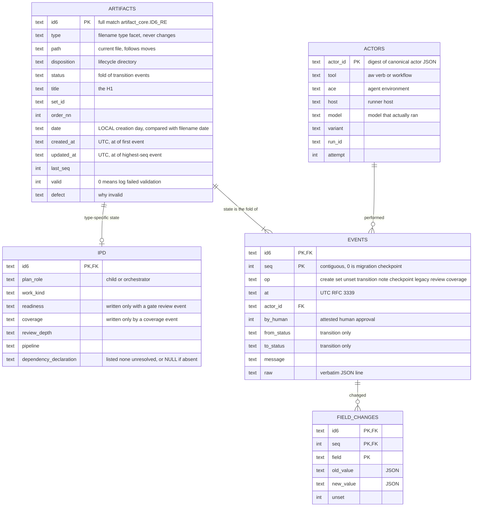
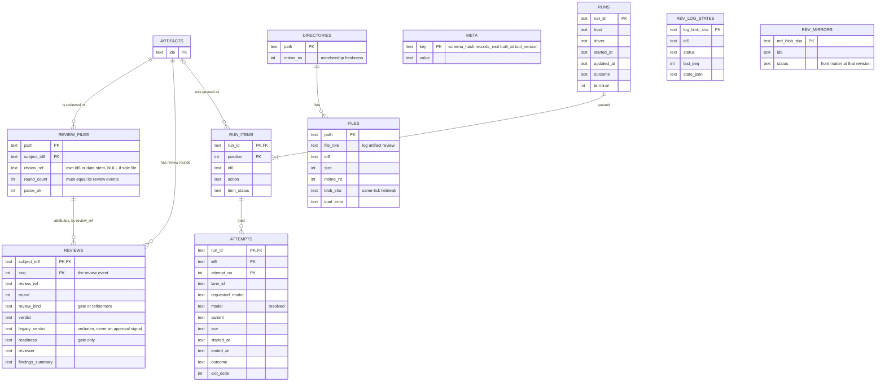
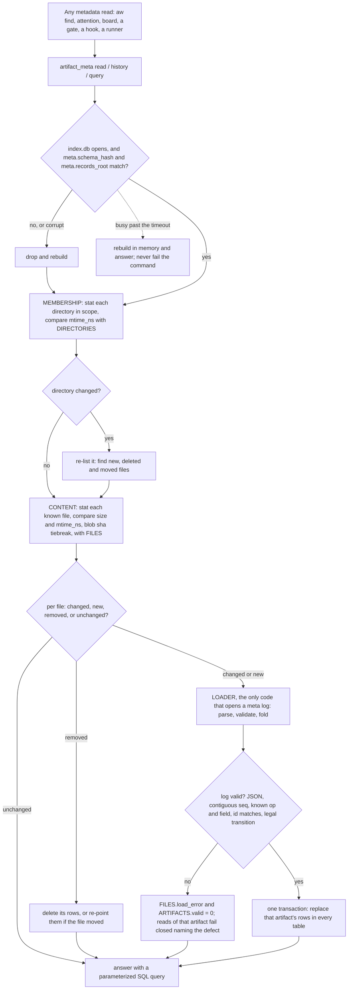
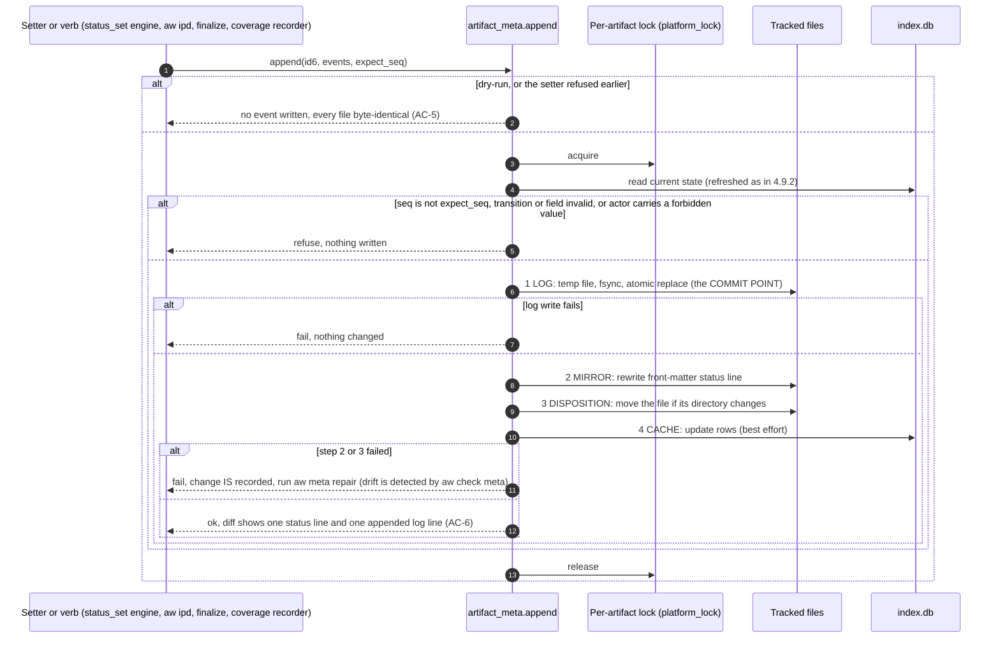
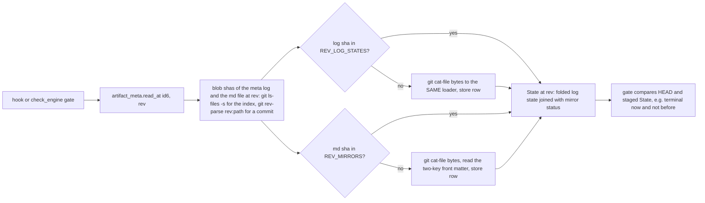
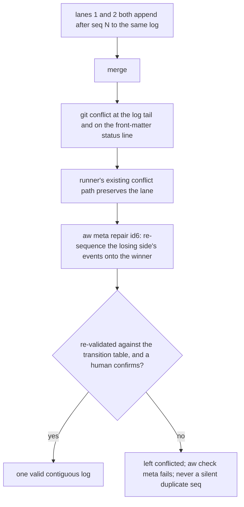
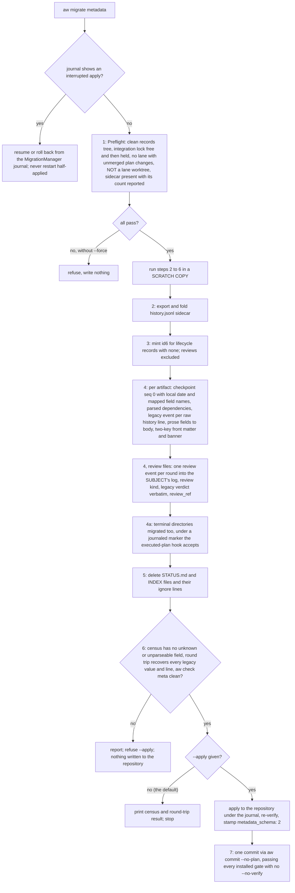
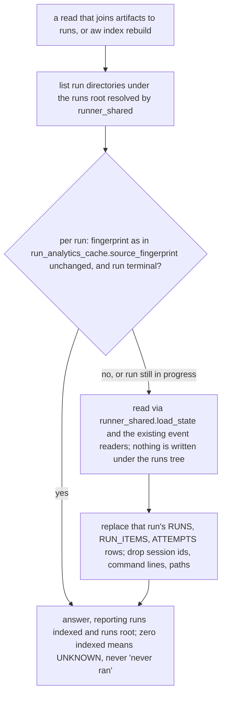

# Spec: Artifact metadata store: id+status front matter, per-artifact event logs, SQLite cache

- Date: 2026-09-25
- Status: reviewed
- Blocks-Release: next
- Id: 4sd62s
- Author: aw specs new
- Scope: Move all aw artifact metadata and history into tracked per-artifact JSONL event logs at .aw/records/meta/<id6>.jsonl; compact front matter (id, status); a gitignored SQLite cache built only from the logs is the sole read path and replaces INDEX.* and STATUS.md; facade-first build, then a hard cutover via aw migrate metadata
- Work-Kind: feature
- Relation to prior work: SUPERSEDES approved spec `2vev8j` (artifact metadata storage), maintainer ruling 2026-10-24 (spec-review round 2, SR-102). Its surviving rules are FOLDED IN here: seq ordering (4.3 -> this spec 4.2), the UTC and reader-clock rule (4.4 as amended 2026-10-13 -> this spec 4.2b), the cache rule (4.6 -> 4.5), and legacy import (4.7 -> 4.2a). Its backward-edge ruling (4.8) already lives in the IPD spec and `ipd_lifecycle._LEGAL_BACKWARD_EDGES`. Its C4, 4.5, C8 and AC-11 are REPLACED, and its OQ-2/OQ-3 are resolved. Section 9 lists the specs this one must stay compatible with.

- Set: metastore
## 1. Problem statement

Artifact metadata today is a hand-editable `- Field: value` bullet block plus an unbounded
`## Workflow history` section in every Markdown artifact. Measured at authoring (HEAD `83b14a5f`,
2026-09-25), at review round 1 (HEAD `44df26b3`, same day), at review round 2 (HEAD
`46ab9fdbf`, 2026-10-24, about 7950 commits later), RE-MEASURED at review round 5 (HEAD
`e12f81ac1`, 2026-10-24, 12,137 commits after baseline), and spot-checked at review round 6 (HEAD
`61fce3bfd`, 12,139 commits; the rows that moved are marked "r6"), and again at round 7 (HEAD
`2edf1f3ac`, 12,144 commits; marked "r7"). The table shows round-5 values
unless marked; round-1 values are in brackets where they differ. Re-derive at implementation time; these drift daily, and the growth
between rounds (the corpus more than doubled in a month) is itself the strongest argument for doing
this before 2.0.0.

| Fact | Value |
|---|---|
| Package modules reading or writing bullet metadata | 49 of 208 [37 of 174] (a coarse `rg` for the bullet patterns) |
| Independent generic key/value parsers | 11+ [~9]: `ipd_schema.parse_metadata_block`, `runner_shared._front_matter_bullets`, `status_set` finditer, `plan_readiness._OQ_FIELD_RE`, `backlog.parse_item`, the `specs._read_*` line readers, `research_contract.parse_frontmatter` (YAML), `comms.parse_envelope_header`, `prompts.read_metadata_id6`/`read_metadata_status`, PLUS `prompts_index._parse_metadata_comment` (new), `review_findings._META_RE`, the `attention_contract` shared history-block reader (backlog `kgv213`), and the per-field public readers `selectors.read_front_matter_id`/`_status`/`_blocks_release` used by 9 modules. Smaller helpers: `check_engine._metadata_status`, `releases._in_metadata_region`, `attention._frontmatter_block` |
| Copies of `Id`/`Status`/`Set` regexes | 95 regex literals [50+], 86 anchored `^-` across 30 files, with inconsistent whitespace (`^- ` 71, `^-\s*` 18, `^-[ \t]*` 9) and capture rules. A live consequence, fixed 2026-09-25 in `44df26b3`: `attention._plans_id` rendered plan `je74a0` as `je7` on the board |
| Modules referencing `## Workflow history` | 27 [23], with four incompatible orderings (see `2vev8j` section 1) |
| Readers that DISAGREE on the same corpus | `selectors` vs `plans_index`: 24 plans (the PARITY CONSTRAINT note in `selectors.py`, still present) |
| Distinct pre-`##` field names in use | 68 [57]. New since round 1 include `Coverage`, `Coverage-Fingerprint`, `Coverage-Checked`, `Scope-Exceeded`, `Close-Evidence`, `Attended`, `Findings` (reviews), and from specs `Review-Depth`/`Pipeline` (see 4.2c) |
| Tracked `.md` records under `.aw/records/` | 4382 (r6: 4383; r7: 4391) [1969]: plans 1696, reviews 1275, backlog 1113, research 171, specs 45, prompts 36, walkthroughs 27, other 19. 2922 [1411] carry `## Workflow history`; 1535 [549] carry no `- Id:` BULLET, 1275 of which are reviews; 39 non-review records carry no id6 in ANY form (excluding 24 READMEs, 4 prompt-library templates, and 2 research templates) |
| Review records | 1275 `.review.md` (r6: 1276; r7: 1278) [338] (re-counted at round 5). 1257 have a filename id6 equal to their `Subject-Id`, by design; 18 (r6: 19; r7: 21) do not (all of them `specflow` refinement records for `18hh1u`, which grows by one per refinement iteration). Subjects reviewed by more than one record file: 5 (`18hh1u` by 18 (r6: 19; r7: 21) files, plus `rtvdak`, `e25iy9`, `l4vw9o`, and `urv602` with 2 each). Rounds per file: 1151 one, 109 two, 12 three, 2 four, 1 six. 29 (r6: 30; r7: 32) carry a verdict outside `plan_readiness.VERDICTS` (14 (r6: 15; r7: 17) `REVIEWED - MATERIAL CHANGES APPLIED`, 11 `REVIEWED`, 3 `REVIEWED - NO MATERIAL IMPROVEMENTS FOUND IN THIS ITERATION`, 1 `REVIEWED - CONVERGED WITH REVISIONS`; see 4.1a) |
| Terminal-directory records | 2828 [1055]: executed 1650, done 1086, superseded 59, implemented 17, not-executed 16 |
| Generated index files | 6 gitignored `INDEX.{json,md}` [4]: plans, research, and prompts (`prompts_index.py`, new), plus committed `plans/STATUS.md`, stale since 2026-08-17 |
| History sidecar `.aw/records/history.jsonl` (gitignored) | 413 (r7: 414) records over 296 id6s [306 records]: backlog 309, specs 82, research 11, plans 8, walkthroughs 2, roadmaps 1 |
| INDEX churn before untracking | 14 of 328 commits in 14 days only fixed INDEX drift (backlog `ila6vl`) |

Consequences:

- P1 Duplication. Every consumer re-derives metadata with its own regex, so behavior differs by
  consumer, and a fix in one reader does not reach the others.
- P2 Forgeable attestations. `Readiness`, `Approval`, and `Status` are prose that any editor can
  write; AGENTS.md devotes a section to forbidding it, and lint (`IPD-M107`) and hooks
  (`status_untooled_gate`) exist only to detect it after the fact.
- P3 History is unordered and partly lost (`2vev8j` E1-E4): prepend vs append vs replace, and the
  only full backlog/spec log is gitignored.
- P4 Context cost. Every agent read of an artifact pays for ~16 metadata bullets and an
  append-forever history that is almost never relevant to the task.
- P5 Query cost. `aw find`, `aw attention`, and `aw ipd board` re-read the entire corpus per call.
  The worst redundancies were fixed since round 1 (backlog `59t9x5`, Set `findonce`, and `8cpbia`,
  plan `jpn6hy`, both `done`), so P5 now rests on the whole-corpus re-read itself, which grows with a
  corpus that doubled in a month, not on the double reads. AC-13 measures it rather than this text
  asserting it.

## 2. Evidence and options considered

The maintainer asked for the optimal solution across cost, maintainability, and UX, noting adoption
is effectively zero and nothing has shipped since 1.2.0 (`v1.3.0-rc.1..HEAD` was 4050 commits at
authoring, 4125 at round 1, 12,133 at round 3, 12,135 at round 4, and 12,137 at round 5), so a
breaking change costs the community almost nothing. `CHANGELOG.md` already carries `2.0.0 (pending)`.

Storage options, evaluated against this repo's execution model (isolated git worktree per execute
item, merge back through `runner_shared.integrate_lane_branch`):

| Option | Verdict | Reason |
|---|---|---|
| O1 SQLite as the tracked authority | REJECTED | Binary; every parallel lane finalize conflicts on merge; no diff/review visibility; breaks the code paths that compare HEAD vs staged content (4.4 inventory). A SQLite merge driver is local-only and not cloned. |
| O2 SQLite gitignored as the ONLY store (incl. history) | REJECTED | Fresh clone, CI, second machine, or collaborator gets no metadata. This is exactly the data loss `2vev8j` E4 measured (176 of 177 sidecar records existed only on one machine at the time; at round 2 the sidecar holds 408 records that exist nowhere else). IPD-S405 and finalize evidence gates would fail on any checkout without the DB. O5 keeps SQLite as the sole READ path but never as the store, which is what separates it from O2. |
| O3 History derived from `git log` + commit trailers, SQLite indexes it | REJECTED | Squash merges and rebases destroy intermediate transitions; shallow clones, sdists, tarballs lose history; a hand edit plus raw commit silently skips an event; needs a trailer convention enforced everywhere. |
| O4 Per-artifact state snapshot `<id6>.json` + history array | REJECTED | Stores state and history side by side, so they can disagree, requiring an intra-file drift check on top of front-matter drift. Multi-line diffs per change. |
| O5 Per-artifact append-only event log `<id6>.jsonl` as the tracked durable record; SQLite as the SOLE READ PATH, built only from the logs (4.5) | CHOSEN | Tracked, survives clone/squash/tarball; path is a pure function of the immutable id6 so renames and moves never touch it; different artifacts never contend (satisfies C3); one appended line per change; ordering by explicit `seq`; state cannot contradict history because it is derived from it. Every reader queries SQLite (maintainer ruling 2026-10-24, SR-101), so no consumer parses a log and query cost is indexed. |

Front-matter options:

| Option | Verdict | Reason |
|---|---|---|
| F1 `id` only | REJECTED | Loses at-a-glance status on GitHub, in raw file views, and in `.md` diffs. |
| F2 `id` + `status` | CHOSEN (maintainer, 2026-09-25) | Status is the one field humans scan for; cost is one cached field kept honest by a drift check. |
| F3 All current fields as YAML | REJECTED | Not compact; reintroduces P1/P2. |

## 3. Criteria

- C1 `[Must]` ONE authority for every aw-owned metadata field and all history: the per-artifact event
  log. No other surface (front matter, filename, SQLite, directory) is authoritative except where
  section 4.6 names a deliberate, checked mirror.
- C2 `[Must]` A fresh clone (including `--depth 1`) carries all current metadata and full history.
- C3 `[Must]` Two lanes changing DIFFERENT artifacts never write the same tracked file.
- C4 `[Must]` Ordering is explicit (`seq`), never inferred from line position, dates, or commits
  (inherits `2vev8j` C1).
- C5 `[Must]` Exactly ONE read/write API (`artifact_meta`) for metadata; no module outside it parses
  front matter or event logs.
- C5a `[Must]` Every metadata READ, by every command, gate, hook, runner and workflow helper, is
  answered from the SQLite cache through `artifact_meta`. The ONLY code that parses a `meta/*.jsonl`
  log is the cache LOADER inside `artifact_meta`; no other code opens a log, even read-only
  (maintainer ruling 2026-10-24, SR-101). The log remains the durable, tracked record and wins any
  disagreement (4.5).
- C6 `[Must]` A refused or `--dry-run` change writes no event; a failed event write fails the change
  (inherits `2vev8j` C5).
- C7 `[Must]` A status change remains visible in a review diff (front-matter `status` line and one
  appended event line).
- C8 `[Constraint]` No new runtime dependency. `sqlite3` and `json` are stdlib; `filelock` is present.
- C9 `[Constraint]` Hard cutover: after migration the toolkit reads ONE format. No dual-format
  readers (maintainer, 2026-09-25).
- C10 `[Constraint]` Filename-encoded metadata (date, setid, NN order, id6, slug, type facet) is
  UNCHANGED (maintainer, 2026-09-25). The filename remains a checked mirror of `set`/`order`.
- C10a `[Must]` Every commit on `main` during implementation reads and writes exactly ONE on-disk
  metadata format, and the suite passes at every such commit: the core tier (the runner's merge gate,
  bare `python3 -m pytest`) at every merge, and the thorough tier (`make test-all`) at the end of each
  phase of section 7 and at the cutover commit. Before the cutover commit that
  format is the legacy bullet format, reached only through `artifact_meta`; from it on, the log
  format. This is how C9 is honored by a runner that merges each plan to `main` as it finishes
  (section 7, maintainer ruling 2026-10-24, SR-103).
- C11 `[Want]` Measurably lower agent context per artifact read and faster `aw find`/`attention`/board.

## 3a. Non-goals

- N1 NOT a change to the artifact-naming grammar or the directory lifecycle (`pending/` ->
  `executed/` etc.). Directories still carry disposition.
- N2 NOT a change to status vocabularies or the lifecycle transition tables (the backward-edge
  ruling of `2vev8j` 4.8 already lives in the IPD spec and `ipd_lifecycle._LEGAL_BACKWARD_EDGES`).
  The one vocabulary this spec adds is the refinement review verdict set (4.1a), which governs a new
  event kind and changes no status.
- N3 NOT a move of prose. Body sections (execution/validation checklists, open questions, E/V items)
  stay in Markdown. Only aw-owned metadata FIELDS and history move.
- N4 NOT a change to comms envelopes, or to how run records (`.aw/records/runs/`) and run analytics
  are STORED or written. The cache INDEXES run records read-only (4.5b; maintainer decision
  2026-10-25, finding SR-701); it never writes to them, and they stay gitignored and machine-local.
- N5 NOT a dual-format transition period (C9).

## 3b. Acceptance criteria

| ID | Covers | Criterion | Evidence that satisfies it |
|---|---|---|---|
| AC-1 | C1, C5 | No module outside `artifact_meta` reads or writes front matter, bullet metadata, `## Workflow history`, or `meta/*.jsonl`. | A pasted `rg` over `agent_workflows/` for the legacy bullet/heading patterns and for `records/meta` returning hits ONLY in `artifact_meta.py` and `migrations/m0001_metadata_v2.py`, with body-prose bullets that N3 keeps in Markdown (for example the plan OQ rows' `Carrier`/`Carrier-Evidence`/`Carrier-Declined`) excluded by an explicit, listed pattern rather than silently; plus a BEHAVIORAL test that seeds a fixture repo and observes that a metadata command's result changes only through `artifact_meta` (no source-reading test, per the repository's no-code-pinning rule). |
| AC-1a | C5a | Every metadata read is served from SQLite; only the loader opens a log. | From the cutover commit: a test that builds the cache, then counts every open of a `meta/*.jsonl` file during `aw find`, `aw attention --format json`, `aw show <id6> --history`, a status setter, `aw check meta` and one pre-commit gate (for example via an `open` audit hook in a subprocess), asserting identical output and that every open is attributed to the loader; plus a test that edits a log behind the cache's back (as a `git pull` would) and asserts the next read reflects the log, pasted. In phase B, the same test runs against the legacy loader and the artifact `.md` files instead (3c). |
| AC-1b | C10a | `main` is single-format and green at every commit of the Set. | For each child plan's merge, the pasted core-tier summary line; for each phase end and the cutover commit, the pasted thorough-tier summary line; and for the cutover commit, a pasted check that no legacy bullet block remains in a migrated record and that no `meta/` existed before it. |
| AC-2 | C2 | A `git clone --depth 1` yields full state and history. | Clone to a temp dir, run `aw show <id6> --history` on a migrated plan with a multi-event history, paste output. |
| AC-3 | C3 | Two branches transitioning different artifacts merge cleanly. | Two-branch merge test, pasted. |
| AC-4 | C4 | Read order is independent of line order on disk. | Test shuffling a log's lines and asserting `seq`-ordered replay is unchanged; test rejecting a gapped or duplicate `seq`. |
| AC-5 | C6, 4.3 | Refused and dry-run transitions leave the log byte-identical; a forced LOG write failure leaves every file unchanged; a forced failure AFTER the log commit (mirror or move step) is reported as a failure naming `aw meta repair`, is detected by `aw check meta`, and is fully restored by `aw meta repair --apply`. | Tests for each case (fault injection at each of the 4.3 write steps), pasted. |
| AC-6 | C7 | A status transition diff shows the front-matter `status` line and one added log line. | `git diff` of a real transition, pasted. |
| AC-7 | 4.6 | Every mirror (front-matter `status`, filename `set`/`order`/`id`, disposition directory) is checked against the log. | `aw check meta` detects each drift kind in a fixture, output pasted; zero findings on the migrated corpus, pasted. |
| AC-8 | 4.5 | The SQLite cache is disposable: deleting it changes no command output. | Run `aw find`/`aw attention --format json` with and without `.aw/state/index.db`, diff empty, pasted. |
| AC-9 | 4.5, C11 | INDEX.* and STATUS.md are gone and nothing regenerates them. | `git ls-files` and filesystem check, pasted; `rg` for `INDEX.json`/`STATUS.md` in `agent_workflows/` returns only the migrator's cleanup. |
| AC-10 | 5 | Migration is idempotent, journaled, dry-run by default, and loses no information. | Run on a copy of this repo: dry-run report; apply; second apply is a no-op; every legacy field value and every raw legacy history line is present in the logs (automated round-trip check), pasted. |
| AC-11 | C9 | An unmigrated repo is refused by every metadata-reading command with a message naming `aw migrate metadata`. | Test, pasted. |
| AC-12 | C8 | `pyproject.toml` `dependencies` unchanged. | Pasted. |
| AC-13 | C11 | Measured before/after: bytes per plan read by an agent, and warm/cold end-to-end `aw find` and `aw attention`. | Numbers pasted, measured per the AGENTS.md end-to-end rule. No target asserted. |
| AC-14 | 4.1a | A review record has no log of its own; each review round is ONE `op: review` event in its SUBJECT's log, and the file's round count equals the subject's review-event count attributed to that file. | `rg` showing no `meta/*.jsonl` is created for a review; a test that runs a review and asserts exactly one `review` event is appended to the subject's log; `aw check meta` detecting a round-count mismatch in a fixture, pasted. |
| AC-14a | 4.1a | Review kinds are typed: a `gate` event accepts only `plan_readiness.VERDICTS`, a `refinement` event accepts only the refinement vocabulary and never carries `readiness`, and migrated legacy verdicts are preserved verbatim. | Tests: a `gate` event with a refinement verdict is refused; a `refinement` event carrying `readiness` is refused; any number of `refinement` rounds append in `seq` order; a spec whose log holds only `refinement` review events is refused `->reviewed` by both setter spellings and flagged by `check.spec-review-unattested`, while one `gate` event (migrated or new) satisfies it (4.4, SR-601); and after a migration fixture containing each DISTINCT off-vocabulary verdict string found in the corpus at implementation time (4 distinct strings over 29 records at round 5, 30 at round 6, 32 at round 7), every original verdict string is recoverable byte for byte, pasted. |
| AC-15 | 4.4 | `readiness` (plans) is refused unless the same append carries an `op: review` event of kind `gate` for that subject in the same transaction; the same coupling holds for the coverage record (`coverage`, 4.4). | A test in which a bare `set readiness=go` is refused and the same write accompanied by a gate review event succeeds; and the equivalent pair for `coverage`, pasted. |
| AC-16 | 5.2 | The migration's one commit may rewrite terminal-directory artifacts, and ONLY the migration may; and it passes every installed gate. | The migration commit passes the executed-plan hook, `backlog_blocking_close_gate`, and the pre-push `aw attention --check --agent` gate with no `--no-verify`; a separate raw edit to an executed plan after cutover is still refused, all pasted. |
| AC-17 | C3, 4.7 | Two lanes changing the SAME artifact produce a detected, non-silent conflict, and nothing merges a duplicated `seq`. | A two-branch test on one artifact asserting the merge does not produce a valid log with duplicate `seq` (it conflicts or `aw check meta` fails), pasted. |
| AC-18 | 4.5 | With a non-`repository` records backend (companion/home), logs live beside the records they describe and the cache still resolves. | A companion-backend fixture showing `meta/<id6>.jsonl` under the resolved records root and `aw find` working, pasted. |
| AC-19 | 4.2b | The creation date in the log is compared on the clock that wrote the filename date. | A fixture artifact created at 23:30 local time on a UTC-ahead host: `aw check meta` reports no filename-date drift, and `tests/test_date_reader_clock_parity.py` (or its successor) passes with the date readers re-pointed at `artifact_meta`, pasted. |
| AC-20 | 4.2c | Every field the corpus or an approved spec carries is in the registry, and nothing is dropped. | The migration dry-run's per-field census on this repo listing every distinct pre-`##` field with its disposition (log field, body section, or a recorded deliberate drop), with zero `unknown-field` refusals, pasted. |
| AC-21 | 4.4a | Obligations handed to this spec by executed plans are met. | For each row of 4.4a, the pasted evidence its row names. |
| AC-23 | 4.5, 4.5a | The cache schema is the one 4.5a defines and is generated from the registry. | A test asserting the table set and each table's columns against 4.5a; a test that adding a field to the registry, with no other change, causes the next read to rebuild the cache and expose the new column; `EXPLAIN QUERY PLAN` for `aw find` by status and set, for dependents-of, and for latest-gate-review-of, each using an index, pasted. |
| AC-24 | 4.2, 4.5a | Dependencies, lineage and actors round-trip in structured form. | Migration fixture with each `Item-Dependencies` form (`executed:`, `exists:`, `state:`, `none`, `unresolved`, and absent) asserting the parsed conditions and `dependency_declaration`, and that `none` and absent stay distinct; a test that a log event carrying a session id, path or username in `actor` is refused by the writer and flagged by the sanitizer; `aw graduation` agreeing in both directions from `lineage` alone, pasted. |
| AC-25 | 4.5b | Run records are indexed read-only, and their absence is never read as "never ran". | A fixture runs tree indexed into `runs`/`run_items`/`attempts` matching the runner's own reader output; a byte-for-byte check that indexing modified no file under the runs tree; on a fresh clone, a query for an artifact's attempts reporting `runs_indexed: 0` (unknown) rather than an empty success, pasted. |
| AC-26 | 4.3 | A new, deleted or moved record is seen by the next read with no `aw index rebuild`. | Tests that add a log and artifact, delete one, and `git mv` one between disposition directories outside the API (as a pull or checkout would), each followed by `aw find` showing the change, pasted. |
| AC-22 | 5.2 | The cutover refuses to run where the history sidecar is absent, and does not lose it when run correctly. | A test running the migration preflight in a lane-style worktree with no sidecar asserting a refusal naming the sidecar; and the real cutover's pasted preflight line reporting the sidecar's record count, pasted. |

## 3c. Honest limits

- The blast-radius counts are from one inventory pass; re-measure at planning time.
- Two lanes changing the SAME artifact still conflict at the end of its log. This is judged rare
  (lanes own distinct plans) and is surfaced loudly, not auto-resolved (4.7).
- Moving attestations into tool-written events makes forgery HARDER, not impossible: a party with
  write access can still append a line by hand. Hooks and `aw check` detect malformed or untooled
  events; neither is an enforcement boundary (same honesty as the integration lock).
- Front-matter `status` is a cache that can drift under hand edits; it is detected, not prevented.
- Token savings (C11) are directional until AC-13 measures them.
- C2 holds for the RECORDS, not for machine-local context. `aw attention` also surfaces stranded
  lanes and run state, which live in gitignored `.aw/records/runs/` and worktrees; a fresh clone has
  none of that, before and after this spec. Do not read C2 as "a clone sees everything a machine
  sees".
- The review verdict becomes tool-written (4.1a), but the findings and decisions TABLES stay prose in
  the review file. A hand edit that changes a severity or a decision is still possible and is caught
  only by the existing `review_findings` parse and gating rules, not by the log.
- The migration rewrites every terminal artifact once (5.2 step 4a). That single commit is a
  deliberate, one-time exception to the rule that executed plans are never re-committed, and it
  makes `git blame` on those files point at the migration. The history itself is preserved in the
  logs; line-level blame on the old bullet blocks is not.
- "SQLite is the sole read path" (C5a) is a property of THIS toolkit's code, enforced by a behavioral
  test. A human or foreign tool can still `cat` a log, and git itself reads logs on merge; neither is
  a metadata read in C5a's sense. The SQLite file is never the durable record: deleting it loses
  nothing (AC-8), and on any disagreement the tracked log wins.
- Phase B of the facade-first order (section 7) temporarily routes reads of the LEGACY format
  through `artifact_meta`; until the cutover commit, the cache is fed from bullet blocks rather than
  logs. C5a's "only the loader parses a log" therefore becomes testable only from the cutover commit.
  Before it, the testable property is the same one with the artifact `.md` files in place of the
  logs: only the legacy loader parses metadata out of them (AC-1, AC-1a phase-B form).
- The cutover depends on machine-local state. The gitignored history sidecar is the only copy of 413
  records, and it exists only in the maintainer's main checkout. So the cutover must run there, not
  in a runner lane worktree, where the sidecar is absent (AC-22). That makes the cutover an attended
  step by construction, not an unattended runner item.
- A tooled write is NOT atomic across files (4.3, SR-705). The log commit is atomic; the
  front-matter mirror and the directory move follow it. A crash between them leaves detectable,
  deterministically repairable drift, never lost or contradictory history, but a reader can briefly
  see a `status:` line or a directory that lags the log.
- The run index (4.5b) is machine-local and incomplete by construction: it shows only the runs whose
  records exist on this machine, and a count of zero means unknown, not "never ran".
- The `actor` object is self-asserted by the writing tool (as is the comms sender). It records who
  CLAIMED to act; it is not an authentication of the agent or model.
- The C10a guarantee depends on the full suite catching a regression. A behavior no test exercises
  can still change silently during phase B, which is why each phase-B plan must name the behavior
  its moved consumers had and the test that pins it (section 7).

## 4. Design

### 4.1 Artifact file shape

```
---
id: abc123
status: approved
---
<!-- aw-managed: metadata lives in .aw/records/meta/<id>.jsonl; use `aw show <id>`; agents read .aw/AGENT_QUICKSTART.md -->
# <Title>
...body...
```

- YAML-delimited. For lifecycle records: exactly two keys (`id`, `status`), fixed order. For review
  records: `subject`, `subject_type`, and optional `ref` (4.1a). Parsed by `artifact_meta` with a
  strict line grammar, not a YAML library (C8; no ambiguity).
- The banner is ONE HTML comment, not the proposed `# START README FIRST` H1 block. Reason: an H1
  renders as a large heading on GitHub, collides with the "first H1 is the title" rule in
  `ipd_schema` section-order checks, and ~80 tokens across ~2000 files is a real recurring cost. The
  comment is invisible when rendered and still read by agents. Its exact text is a template owned by
  `artifact_meta` and checked for presence (for lifecycle records: pointing to `meta/<id>.jsonl` and
  `aw show <id>`; for review records per 4.1a: `<!-- aw-managed: review metadata lives in .aw/records/meta/<subject>.jsonl; use aw show <subject>; agents read .aw/AGENT_QUICKSTART.md -->`).
- `.aw/AGENT_QUICKSTART.md` and `.aw/QUICKSTART.md` are created by the installer (they do not exist
  today).
- No `## Workflow history` section. `aw show <id6> --history` renders it.
- Artifacts that are not aw-lifecycle records (walkthroughs, research reference packages, comms
  messages) get front matter only if they carry an id today; this is settled per type in the plan.
  The plan must also settle, by name: `roadmaps/` (1 record, bold-prose metadata, excluded from
  attention by ruling `uxb0tz`), `prompt-library/` (4 files, no id), research companion directories
  `<doc-stem>.data/` (backlog `mtdxiu`), and READMEs (not records; excluded).

### 4.1a Review records are events in their SUBJECT's log

MAINTAINER DECISION, 2026-09-25, made during spec review (finding SR-001).

THE PROBLEM IT SETTLES: a review record's filename id6 is the REVIEWED artifact's id6, by deliberate
design (`.aw/records/reviews/README.md`, "Naming": "`<id6>` is the REVIEWED ARTIFACT's id6, not a fresh
identifier"), so it survives renames. Measured at review: all 338 review records reuse their
subject's id6 and none carries an id of its own. Under 4.2's path rule a review and its subject would
therefore claim the SAME `meta/<id6>.jsonl`, and the second writer would corrupt or refuse the
first's history. The authored spec did not address this, while its 4.2 field list named
`subject-id/type (reviews)`, implying reviews get a log.

THE DECISION: a review has NO log and NO id of its own. Each review ROUND is recorded as ONE event
in the SUBJECT's log. A review is metadata about its subject, and this is where the spec already
needs it: 4.4 makes `readiness` settable only by a review event, which requires the review to be an
event in the subject's log.

WHAT FOLLOWS:

1. A new event `op: review` (added to 4.2's op list) carrying `round` (int, matching the file's
   `## Round <n>`), `verdict` (one of `plan_readiness.VERDICTS`), `reviewer`, and, for a plan,
   `readiness`. The verdict becomes tool-written; today it is a hand-editable `- Verdict:` line.
2. The review FILE keeps its findings and decisions TABLES as readable prose (N3), unchanged in shape
   and still parsed by `review_findings`. Its front matter is `subject: <id6>` and `subject_type:
   <ipd|spec>`, NOT `id:`, so no tool can mistake it for an artifact with its own log.
3. `aw check meta` (4.6) treats a review file as a DEPENDENT of its subject rather than an orphan, and
   adds one drift rule: the file's round count must equal the number of `review` events in the
   subject's log.
4. `review_findings.subject_gating_blocks` keeps reading the current round's findings from the FILE;
   only the verdict and readiness move to the log.

ALTERNATIVES REJECTED: (a) no log for reviews, fields stay in the file, rejected because it leaves
the verdict forgeable, which is P2, the problem this spec exists to fix; (b) mint an id6 per review
and link via a separate field, rejected because it renames all 338 records and reverses the
deliberate link-by-subject design for no benefit the subject log does not already give.

IRREVERSIBILITY: it fixes the review record's front-matter shape and a new event type in a tracked
format that every later review writes. Reversing it later means rewriting every review event.

ROUND-2 AMENDMENT: TYPED REVIEW KINDS (maintainer decision 2026-10-24, finding SR-104). Since round 1,
the spec-refinement pipeline (spec `18hh1u`, Set `specflow`) began writing review records that break
two assumptions above: 18 of them carry their OWN id6 at round 3 (for example
`20261024-specflow-04-vprs7o-spec-refinement.agy.gemini38flashhigh.review.md`, subject `18hh1u`), and
their verdicts are CONVERGENCE outcomes (`18hh1u` section 6.3: `REVIEWED - MATERIAL CHANGES APPLIED |
NO MATERIAL IMPROVEMENTS FOUND`), not approval outcomes. The maintainer requires that multi-round
iteration of that kind keep working. Therefore:

1. Every `op: review` event carries `kind`, one of `gate` or `refinement`.
2. `gate` is what `/plan-review`, `/spec-review` and `aw ipd recheck-readiness` write. Its `verdict` is
   one of `plan_readiness.VERDICTS`, and only a `gate` event may carry `readiness` (4.4).
3. `refinement` is what an iterative refinement pipeline writes. Its `verdict` is drawn from a
   separate closed vocabulary that the registry owns (at minimum the two `18hh1u` values). It NEVER
   carries `readiness` and never satisfies the `->reviewed` transition authority on its own. Any number
   of rounds is legal; the round number orders them, and `seq` orders everything.
4. Disambiguation across review files (`review_ref`). ANY review record whose filename id6 differs
   from its subject (18 at round 5, 19 at round 6, 21 at round 7: all `specflow` refinement records for `18hh1u`) keeps that id6
   as a REFERENCE (`review_ref`) inside the subject's events and its front matter (`ref: <own-id6>`).
   Where multiple review files share the subject's id6 (such as the 4 historical gate re-review pairs
   for `rtvdak`, `e25iy9`, `l4vw9o`, `urv602` across 2026-09-30 and 2026-10-07), each file's date
   prefix or clustered stem (e.g. `20260930-reqids-02` vs `20261007-reqids-02`) serves as `review_ref`
   in its front matter (`ref: <stem>`) and events, so rounds are attributed unambiguously. A single
   review file sharing its subject id6 omits `review_ref`. No record is renamed. A subject may have
   SEVERAL review files (5 subjects do at round 5; `18hh1u` has 18), so the 4.6 round-count rule
   counts events per (subject, review file): it matches each file's rounds to the subject's `review`
   events carrying that file's `review_ref` (or unreferenced events for single-file subjects). It does
   not compare a single file against all of the subject's events.
5. Migration preserves every legacy verdict string VERBATIM in the event (`legacy_verdict`), and the
   vocabulary checks apply only to events written after the cutover. The 29 off-vocabulary verdicts
   measured at round 5 (14 `REVIEWED - MATERIAL CHANGES APPLIED`, 11 `REVIEWED`, 3 `REVIEWED - NO MATERIAL IMPROVEMENTS FOUND IN THIS ITERATION`,
   and 1 `REVIEWED - CONVERGED WITH REVISIONS`) are therefore kept, not mapped (inherits the legacy-import rule, 4.2a). A
   legacy verdict is assigned `kind` by its writer where the record shows it (the `specflow`
   refinement files are `refinement`; the rest are `gate`), and an event carrying `legacy_verdict` is
   never consulted as a readiness or approval signal.
5a. A file's `- Verdict:` line is ONE verdict for the whole file, while a file may hold several rounds
   (124 files have two or more at round 3). So the migration attaches the file's verdict, together
   with the file's single `Reviewer` and `Reviewed-At` values, to the event of the LAST round only.
   Earlier rounds' events carry `legacy_verdict: null` and the observed round number. Inventing a
   per-round verdict would be fabricated precision (4.2a).
6. Review-record front-matter fields beyond the verdict (`Reviewer`, `Reviewed-At`, and the `Findings`
   summary bullet that `/plan-review` began writing 2026-10-12, 431 records) become fields OF THE
   REVIEW EVENT (`reviewer`, `at`, `findings_summary`). `Findings` is a derived summary of the file's
   table, so the event copy is checked against the table rather than trusted.

Coordination: `18hh1u` is at `draft`. Whichever of the two specs is implemented second must conform
to this section, and the refinement verdict vocabulary is owned by the registry rather than by
either spec's prose.

### 4.2 Event log: `.aw/records/meta/<id6>.jsonl`

- Tracked. Flat directory (resolves `2vev8j` OQ-3; about 3100 logs at round 2 is fine for git and
  filesystems; sharding is a later reversible change). The identifier `<id6>` is strictly validated
  with a FULL match (`artifact_core.ID6_RE`, `\A[0-9a-z]{6}\Z`) on every API and path resolution call
  to prevent directory traversal. A `^...$` pattern under `re.match` is NOT sufficient, because `$`
  also matches before a trailing newline.
- One JSON object per line, UTF-8, sorted keys, no trailing whitespace, LF-terminated.
- Event schema (v1):
  - `v`: schema version (int)
  - `seq`: contiguous int per artifact. `0` is the migration checkpoint for migrated artifacts; `1`
    is creation for artifacts born under this spec (inherits `2vev8j` 4.3).
  - `at`: RFC 3339 UTC timestamp, display only (inherits `2vev8j` 4.4).
  - `actor`: a STRUCTURED object, not a string (round 8, finding SR-702), with keys `tool` (the `aw`
    verb or workflow, e.g. `aw specs set`, `/spec-review`), and, where known, `ace` (the agent
    environment, e.g. `opencode`, `antigravity`), `host` (runner host id, e.g. `oc`, `agy`), `model`
    (the model that ACTUALLY ran, the resolved id), `variant` (effort/variant), `run_id`, and
    `attempt` (int). Absent keys are omitted, never written as null. FORBIDDEN in a tracked log:
    session ids (the sanitizer's `session-id` rule, `leak_sanitizer.py` `ses_` pattern), command
    lines, filesystem paths, usernames and hostnames; those stay in the gitignored run records. The
    REQUESTED model belongs to the run attempt (4.5b), not to the event. Reason it is structured
    now: the log is tracked and its schema is irreversible once the corpus is migrated, while the
    cache can be rebuilt at will, so "which model changed what in which run" must be answerable
    without parsing free text (P1).
  - `op`: one of `create`, `set`, `unset`, `transition`, `note`, `checkpoint`, `legacy`, `review`
    (4.1a), `coverage` (4.4).
  - `fields`: object of field -> new value for `create`/`set`/`checkpoint`; list of names for `unset`.
  - `from`/`to`: for `transition` (status), validated against that TYPE's lifecycle table. Not every
    type has an enforced table (at round 2: specs `attention_contract.SPEC_TRANSITIONS`, backlog
    `attention_contract.BACKLOG_TRANSITIONS` (added since round 1, backlog `cc2m29`), plans the
    `ipd_lifecycle` ranks plus `ipd_lifecycle._LEGAL_BACKWARD_EDGES`; research, prompts, and releases
    validate the target VALUE only). A type with no table validates the value only, exactly as
    today; this spec does not invent tables (N2), and it consumes whichever tables exist at
    implementation time rather than this list.
  - `by_human`: bool, only on events the setter records via `--by-human`.
  - `message`: optional free text.
  - `legacy`: for `op: legacy`, the verbatim original line, observed day, original ordinal, and
    `ordering_confidence` (`known` / `inferred-from-git` / `unknown`) per 4.2a.
  - For `op: review` (4.1a): `round` (int), `verdict` (str), `kind` (`gate` | `refinement`), `reviewer`
    (str), optional `review_ref` (str), optional `findings_summary` (str), optional `legacy_verdict`
    (str), optional `readiness` (str, plans only).
  - For `op: coverage` (4.4): `coverage` (str), `coverage_fingerprint` (str), `coverage_checked` (str).
- FIELD NAMES IN THE LOG are lower snake_case and follow the naming rule in 4.5c. The migration
  renames the legacy bullet `Kind` (plan role: `child`, `orchestrator`, ...) to `plan_role`
  (maintainer decision 2026-10-25, finding SR-703; irreversible, because every migrated log and every
  later writer uses the new name). Other legacy names map one-to-one (`Work-Kind` -> `work_kind`,
  `Gate-Kind` -> `gate_kind`, `Blocks-Release` -> `blocks_release`). The `aw` flags and docs that name
  `Kind` are updated in the same Set (5.4).
- `item_dependencies` is stored PARSED, not as the raw bullet string: a `dependency_declaration`
  (`listed` | `none` | `unresolved`; field absent means none was declared) plus an ordered list of
  conditions, each `{condition, target_type, required_status, target_id6, raw}`, where `condition` is
  `executed`, `exists` or `state`. The three forms in use (measured at round 8:
  `executed:<id6>` 464 times, `exists:<type>:<id6>` 5, `state:<type>:<status>:<id6>` 5) are the
  closed grammar today; `none` is a POSITIVE declaration that `ipd_dependency_statement_gate`
  distinguishes from an absent field, so the two must never collapse.
- Current state = fold of events in `seq` order. The log carries EVERY aw-owned field (4.2c). Review
  records carry no log (4.1a). The exact per-type field registry is a table in `artifact_meta`, and
  unknown fields are refused.
- Prose-valued fields (`Summary`, `Scope`, `Concern`, `Motivation`, `Relation to prior work`) move
  into BODY sections at migration, not into the log (N3). `title` stays the H1. The
  unsafe-descriptive-value refusals that guard these fields today at every write path (specs and
  releases `uz05bl`, research `deftzy`, backlog Summary `dtg7dz`, research checker `xnogdl`) MUST
  survive: they move with the field to the body-section writer, and they also apply to every string
  value `artifact_meta` writes into a log or the two-key front matter.

### 4.2a Legacy import without invented precision (folded in from `2vev8j` 4.7)

Preserve each legacy history line verbatim as a `legacy` event carrying the observed day, its
original file ordinal, and an `ordering_confidence` marker (`known` / `inferred-from-git` /
`unknown`). The real chain starts from the `seq` 0 checkpoint that accepts the migrated snapshot, and
forward-transition validation is NOT run across unordered pre-checkpoint records. This is what lets
cross-day round trips no reader can order stop being false failures WITHOUT fabricating an order. The
same rule governs every other legacy value with no faithful mapping into the new vocabulary (for
example the off-vocabulary review verdicts in 4.1a): keep it verbatim, mark it legacy, do not map it.

### 4.2b One clock per stored value (folded in from `2vev8j` 4.4, as amended 2026-10-13)

- Every writer records event `at` in UTC; local time is a RENDER-TIME concern only. Reuse the shared
  UTC helper in `artifact_core` (Set `5ivkdh`) rather than a new one.
- READERS ARE BOUND BY THE CLOCK OF THEIR STORED OPERAND. Code comparing a stored date against
  "today" (age, staleness, retention, sweep) computes today on the SAME clock that wrote the value. A
  UTC value (event `at`) is compared against a UTC today. A LOCAL value (the filename date prefix and
  the workflow-artifacts RUN_ID, ruled LOCAL by `DECISIONS.md` D55) is compared against a LOCAL today.
  Readers do NOT adopt UTC by default. Measured motivation: plan `840y6i` F-01 found ten artifacts
  whose staleness verdict flipped with the reader's timezone.
- CONSEQUENCE FOR THIS SPEC (finding SR-105). Today `- Date:` and research `created` are stamped on
  the LOCAL clock, beside the filename date that carries the same day. Moving them into the log must
  not turn them into UTC values: the 4.6 rule "filename date must equal `create.at` day" would
  otherwise report drift for every evening creation. So the log carries the creation day as a
  separate LOCAL-clock field `date` (on `create`/`checkpoint`), and the drift rule compares the
  filename date with `date`, never with `at`. Every current `- Date:` reader is re-pointed at that
  field with its clock unchanged: `plans_archive._age_days`, `research_archive._age_days`,
  `check_engine`'s dependency-schema and carrier grandfathering (`_DATE_LINE_RE`), `ipd_lint`'s
  citation plan-date rule, `plans_refs`, `artifact_rename`, and `config.applies_to_artifact_date`,
  which every per-repo cutover in `.aw/config/project.json` `cutovers` (8 entries at round 2) depends
  on to grandfather by artifact date.
- Guarded by `tests/test_date_reader_clock_parity.py` (or its successor) (AC-19).

### 4.2c Field registry obligations (round 2, finding SR-106)

The registry (OQ-1) must carry every field the corpus carries, or record a deliberate disposition for
it (log field, body section, review-event field, or drop with a reason), checked by the migration's
census (AC-20). At round 2 that includes, beyond the authored list (type, set, order, kind, priority,
work-kind, blocks-release, readiness, approval, from-backlog, from-spec, graduated-to,
item-dependencies, gate-kind/ref/summary, version):

| Field | Carried by | Source | Disposition owed |
|---|---|---|---|
| `coverage`, `coverage-fingerprint`, `coverage-checked` | orchestrator plans (34) | spec `25kzda` 2.5e, `coverage_record.py` | Attestation; written ONLY by an `op: coverage` event (4.4) |
| `review-depth` | plans | approved spec `k3yx72` (its Section 12 maps itself onto this spec) | Field set by the gate `review` event, per `k3yx72` 12 |
| `pipeline` (`standard`/`quick`) | plans | reviewed spec `4iyd78` | Closed-set field; a bad value is refused |
| `scope-exceeded` | plans (40) | finalize, `ipd_lifecycle` | Field written by the finalize event |
| `attended` | plans (2) | runner | Field |
| `close-evidence` | backlog (55) | backlog setter | Field written by the `done` transition |
| `release-exempt-kind`, `release-exempt-ref` | backlog | `backlog/README.md` (`ghna7l`) | Fields |
| `scope-paths`, `item-dependencies`, `from-plan`, `supersedes`, `canonical`, `target-id` | various | existing | Fields |
| `reviewer`, `reviewed-at`, `findings`, `verdict` | review records | `review_findings.render_review`, `/plan-review` | Review-event fields (4.1a point 6) |

Specs still in `draft` that add fields (`18hh1u`: `Prior-Id`, `Slot`, `ACE`, `Requested-Model`,
`Resolved-Model`, `Variant`, `Iteration`, `Contributors`, `Matrix-Ref`, `Supersedes`; `yfz5u9`'s
research YAML keys) are NOT pre-registered here. Whichever of those specs and this one is implemented
second conforms to the other (section 9).

### 4.3 The single API: `agent_workflows/artifact_meta.py`

- `read(id6) -> State`, `history(id6) -> list[Event]`, `query(...)` (corpus-wide, for find,
  attention and the board), `append(id6, events, *, expect_seq)`, `create(...)`, `resolve(path|id6)`,
  and `read_at(id6, rev)` for a staged or committed revision (4.4).
- READS ARE SERVED FROM SQLITE (C5a). Every public read function first brings the cache up to date
  for what it is about to return, then answers with a SQL query. "Up to date" is TWO checks, because
  neither alone is sufficient (round 8, finding SR-704): (1) MEMBERSHIP: for each directory in scope
  (`meta/` and every records type and disposition directory), compare its `mtime_ns` against the
  `directories` row (4.5); a changed directory is re-listed, which is the only way a NEW, DELETED or
  MOVED file is noticed (a `stat` of known files cannot discover a new one); (2) CONTENT: for each
  known file, compare `(size, mtime_ns)`, with the blob-sha tiebreak, against the `files` row, which
  catches an in-place edit that leaves the directory mtime unchanged. Any changed or new file goes
  to the LOADER. The loader is the ONE code path
  that opens and parses a `meta/*.jsonl` log: it validates the log, folds it, and writes the rows. It
  may be several functions, but they form one internal component of `artifact_meta` with one entry
  point. Nothing else, inside or outside `artifact_meta`, opens a log. The `aw meta repair` writer
  and the migration READ through the loader too, and WRITE through the same atomic write path as
  `append`.
- STALENESS CHECK COST. The baseline is one `stat` per file in scope, about 7,500 files (logs plus
  artifacts) plus one per directory for a corpus-wide query on this repository. A cheaper strategy
  is acceptable ONLY if it can never serve a row older than its file. Directory mtimes alone do NOT
  meet that bar, because an in-place edit of a file does not change its directory's mtime; they are
  used for MEMBERSHIP only, never instead of the per-file check. Neither does `HEAD` plus the index
  mtime, which miss unstaged edits. AC-13 measures the end-to-end cost of whichever strategy is
  built, rather than this text asserting it is fast enough.
- Writes take a per-artifact lock (`platform_lock`, the repository's single `filelock` wrapper),
  verify `expect_seq` (optimistic concurrency), and then perform, IN THIS ORDER, inside the lock
  (round 8, finding SR-705, which replaces the earlier claim that the log and the mirror change
  "together or not at all": three separate files cannot be replaced as one atomic step):
  1. LOG, the COMMIT POINT: write the whole log via temp file + `fsync` + atomic replace (logs are
     small). If this fails, nothing has changed and the write fails (C6).
  2. FRONT-MATTER MIRROR: rewrite the `status` line, same atomic-replace technique.
  3. DISPOSITION: move the artifact file if the new status maps to a different lifecycle
     directory.
  4. CACHE rows, best effort.
  Once step 1 has succeeded, the change HAS happened, because the log is the authority. A crash or
  failure in steps 2 to 4 leaves only DERIVED copies behind, which is exactly the drift `aw check
  meta` already detects (4.6, front-matter status and disposition rows) and which `aw meta repair`
  restores DETERMINISTICALLY from the log, with no human decision needed. The setter reports such a
  partial completion as a failure naming the repair command, never as success. A failed cache
  update needs nothing: the next read reloads from the log.
- AUTHORITY ON DISAGREEMENT. The log wins. A gitignored cache cannot be the durable record (option
  O2), and git delivers changes from pull, merge, checkout and other worktrees as log edits. So
  staleness detection is what makes C5a safe, not a fallback to reading the log.
- Validation in the loader: fail closed on malformed JSON, gapped/duplicate `seq`, unknown `op` or
  field, id mismatch with the artifact, or a status transition not in the lifecycle table. A log
  that fails validation is NOT cached as valid; reads of that artifact fail closed and name the
  defect.
- BEFORE CUTOVER (section 7, phase B) the same API is served by a legacy loader that parses today's
  bullet block and history section into the same rows, so every caller already reads from SQLite
  through `artifact_meta` before the format changes. At the cutover commit that loader moves, frozen,
  into `migrations/m0001_metadata_v2.py` (5.2).
- All parsers listed in section 1 (11+ plus the smaller helpers) and the 95 ad-hoc regex literals
  are deleted, and their callers are routed here. The `selectors` vs `plans_index` 24-record
  disagreement is resolved by construction: there is one reader. The plan must record which behavior
  each disagreeing consumer loses.

### 4.4 Consumers that change behavior (not just port)

- `IPD-S405` and every gate reading history query `artifact_meta.history`, never Markdown.
- `attention_contract.last_history_at` = `at` of the highest-`seq` event. (Round 2: the file-order
  defect `2vev8j` E3 described was since fixed in place by `attention_contract.newest_history_record`,
  so this is now a port, not a bug fix.)
- HEAD-vs-STAGED READS GO THROUGH THE CACHE TOO (C5a). A gate that compares a staged or committed
  revision calls `artifact_meta.read_at(id6, rev)`. The function resolves the blob sha of
  `meta/<id6>.jsonl` and the artifact `.md` at that revision (`git ls-files -s` for the index, `git rev-parse <rev>:<path>`
  for a commit), looking each up in cache tables keyed by blob sha. If a sha is missing, it hands
  the blob bytes (`git cat-file`) to the SAME loader. Gates never parse a blob themselves. The returned
  `State` carries both the replayed log state and the artifact's front-matter mirror status at that revision. Rule
  rewrites:
  - "status changed without a matching history line" becomes "front-matter `status` differs from the
    folded state" (drift), or "the log gained an event not produced by a tool" (untooled).
  - "an executed transition" becomes "the staged state's status is terminal and the HEAD state's is
    not".
- INVENTORY OF HEAD/STAGED/BRANCH CONTENT READERS, re-derived at round 2 (finding SR-107). It is still
  a FLOOR; the implementing plan re-derives it by searching for `git show`, `--cached`, `cat-file`,
  `ls-files -s` and `<ref>:<path>`, and records each consumer's disposition.
  - **Blob-content readers that must move to `read_at`:**
    - `check_engine._status_meta` and `_blob_text`, with callers `check_status_untooled`,
      `check_status_untooled_range`, `check_staged_illegal_backlog_transition`,
      `_lane_carrier_is_executed`, `_staged_backlog_done_items` and `check_release_gate_consistency`.
    - `agent_workflows/hooks/executed_transition_gate.py`.
    - `agent_workflows/hooks/ipd_dependency_statement_gate.py`.
    - `agent_workflows/hooks/status_untooled_gate.py`, which delegates to `check_engine`.
    - `agent_workflows/hooks/backlog_blocking_close_gate.py`, which was omitted at round 1.
    - `status_set._prepare_status_change`, which reads the HEAD status.
    - `plan_readiness.review_staleness_index`, which reads plan blobs at review commits.
    - `runner_shared`: `backlog_item_paths_for_commit`, `check_review_lane_artifacts`,
      `read_merge_stage`, `classify_conflict_set_for_rederivation` and `integrate_lane_branch`.
    - `ipd_lifecycle._release_own_plan_edit_before_landing`.
  - **Not metadata readers:**
    - `leak_sanitizer.scan_working_tree_counted` reads tracked files for leaks. That is not a metadata
      read, and it must scan `meta/*.jsonl` as ordinary text: logs carry an `actor` object and are a
      new leak surface.
    - `artifact_audit.FinalizeEvidenceIndex` reads commit SUBJECTS, not blobs, so it is NOT a
      content reader; round 1 mis-listed it.
    - Readers of path lists only (`work_cmd`, `cli`, `git_commit_helper`, `commit_lock`,
      `clean_delta`) are unaffected.
  The hooks live under `agent_workflows/hooks/`, not top-level `hooks/` as round 1 wrote.
- `runner_shared._body_change_is_history_insert_only` and similar finalize scope logic treat
  `meta/<id6>.jsonl` for the plan being finalized as an owned path.
- `IPD-M107` (unattested Readiness) is replaced by: `readiness` can only be written in the same
  append as an `op: review` event of kind `gate` for that subject (4.1a); the setter refuses
  otherwise (AC-15). `IPD-M113` (Readiness REQUIRED at reviewed/approved, plan `fhinri`) and the
  auto-approve refusal of an absent readiness (plan `l56tyz`) are ported to read the folded state,
  unchanged in meaning. `plan-review` and `spec-review` are agent workflows, not `aw` verbs, so the
  review workflow's instructions change from "write `- Readiness:` into the plan" (`plan-review.md`,
  "Write the structured `Readiness` field") to a tooled review-recording command that appends the
  event. The implementing plan names that command. `aw ipd recheck-readiness`
  (`readiness_recheck.py`, which today regex-substitutes the field) likewise appends a gate
  `review` event rather than editing a field.
- THE `->reviewed` SPEC ATTESTATION IS RE-POINTED AND NARROWED (round 7, finding SR-601). Today
  `attention_contract.TRANSITION_AUTHORITY["->reviewed"]` (`review_record: True`) is enforced by ONE
  predicate, `review_findings.review_attestation_missing`, consulted by both spec setters
  (`specs._review_attestation_refusal`, `status_set` positional path) and by
  `check_engine.check_spec_review_attestation` (`check.spec-review-unattested`). It accepts ANY record
  that names the subject, declares `Subject-Type: spec`, and parses; it does not look at the verdict,
  so each of the 21 `specflow` refinement records for `18hh1u` would satisfy it today. Under this spec
  the same single predicate (still one function, still consulted by all three) is satisfied only when
  the subject's folded state holds at least one `review` event of kind `gate` whose review file parses;
  a subject with only `refinement` events is refused. Migrated gate events count whatever their
  `legacy_verdict` (4.1a point 5 assigns `kind` at migration), so no spec already at `reviewed` is
  invalidated by the cutover; the check stays scoped to specs currently at `reviewed`, as today. This
  is the consumer that implements 4.1a point 3; it is a deliberate behavior change, and the plan that
  ports the predicate names it as such.
- THE COVERAGE RECORD IS THE SAME KIND OF ATTESTATION (round 2, finding SR-106). Spec `25kzda` 2.5e
  (added 2026-10-06) records the orchestrator coverage verdict as `- Coverage:`,
  `- Coverage-Fingerprint:`, `- Coverage-Checked:` bullets, plus a required history line (`IPD-M112`)
  and a `## Coverage findings` body section, all written by `coverage_record.py`. Under this spec, the
  three fields are written ONLY by an `op: coverage` event carrying them. `IPD-M112`'s "attested in
  workflow history" becomes "the fields' last writer is a `coverage` event". The `## Coverage
  findings` section stays body prose (N3). The record stays outside `frozen_region_digest`, as
  `25kzda` requires.
- Backlog `v5m5y8` (refuse a backlog item whose history block is empty) is replaced by the 4.6
  orphan rule ("an artifact with no log is an error"), which is strictly stronger.
- Scanners that walk `.aw/records/` (`selectors`, `artifact_refs`, `check_engine`, `ipd_lint`,
  `specs`, `releases`, `artifact_core.iter_scan_files`) exclude `records/meta/` through ONE shared
  exclusion list. At round 2 no such list exists in `artifact_core`: the nearest is
  `layout.TRAVERSAL_EXCLUSIONS`, used only by `selectors`, and `_SKIP_NAMES` is defined three times
  (`check_engine`, `selectors`, `artifact_refs`). The plan chooses the home and deletes the copies.
  (`attention_contract`, listed at round 1, walks no directories.)

### 4.4a Obligations inherited from executed plans (round 2, finding SR-108)

Executed plans declined to carry these items because this spec owns them. "A spec is not an accepted
carrier type", so this table is the only place the obligation is recorded, and AC-21 checks it.

| From plan | Obligation owned here | Evidence owed |
|---|---|---|
| `me227c` (researchsel) | Research readers are routed through `artifact_meta` | Covered by AC-1 |
| `wja06w` (faov03) | The `aw find` rewrite keeps `tests/test_find_filters.py` passing | Pasted run of that module |
| `zyj8io` (selquiet) | A zero-match `aw find` selector still exits 2 | Pasted exit code |
| `pw2ln3` (gradtravers) | `graduated-to`, `from-backlog` and `from-spec` are one store, so `aw graduation` agrees in both directions by construction | A test with a link written in each direction |
| `fhinri` (rdyreq) | Retire `IPD-M107` in favor of the event-coupled rule (4.4) | Covered by AC-15 |
| `l56tyz` (rdyclosed) | Auto-approve keeps refusing an absent readiness | A pasted test |
| `63zo2f` (setdisp) | Its `Carrier: 4sd62s` row, discharged by the setter re-pointing in 4.8 | Cite the closing evidence |
| backlog `6tjye0` (done, retired as moot by this spec) | Every lifecycle record lacking an id6 gets one (5.2 step 3) | Covered by AC-20's census |

### 4.5 SQLite cache: `.aw/state/index.db`

- Gitignored (under the existing `/state/` rule in `.aw/.gitignore`). Stdlib `sqlite3`, WAL mode.
- Resolved through the project-context authority (`project_context.resolve_project_context`, the
  way `runner_shared.state_root` resolves run state), NOT by assuming `<repo>/.aw/`. A repository
  whose `records_backend` is `companion` or `home` keeps its records, and therefore its
  `meta/*.jsonl` logs, OUTSIDE the repo; the logs always live under the RESOLVED records root, beside
  the records they describe (AC-18). PLACEMENT FACT (measured at round 6, finding SR-501): for the
  `repository` backend, `resolve_project_context` called from inside a runner lane worktree returns
  that worktree's OWN `.aw/state`, so under this resolution rule each lane gets its own `index.db`
  and starts cold; lanes do NOT share a cache. This spec does NOT move the `repository`-backend
  cache to `--git-common-dir` to share it; a lane's cold first build is a cost AC-13 measures, not
  one this text assumes away.
- ONE CACHE PER RESOLVED RECORDS ROOT, AND NO WORKTREE COLUMN (round 8, finding SR-706, which
  replaces the round-5 worktree keying). A cache file describes exactly one records root. For the
  `repository` backend that root is inside each worktree, so each worktree already has its own
  cache file and a worktree column would hold one constant value. For `companion`/`home`, every
  worktree of the repository resolves to the SAME records files, so per-worktree rows would be
  identical duplicates of one truth. Either way the key is `id6` alone. The `meta` table records the
  resolved records root, and a cache whose recorded root differs from the one being resolved is
  dropped and rebuilt, which is the protection the worktree key was meant to give. Pruning by
  worktree (round 5) is therefore deleted; lane teardown removes a per-worktree cache with its
  worktree.
- ROLE: the SOLE READ PATH for metadata (C5a), and never the durable record. It is filled ONLY by the
  `artifact_meta` loader (4.3). All SQL queries in `artifact_meta` MUST use parameterized bindings (`?`),
  never string formatting.
- Tables: defined in 4.5a. Refresh is incremental (4.3): a directory is re-listed only when its
  mtime changes, and a log or artifact is re-read only when size/mtime_ns change, with a blob-sha
  tiebreak to close the same-tick mtime gap measured in backlog `8mkt5l`. Removing or moving a file
  (such as a lifecycle transition) drops or re-points its rows. The `rev_*` tables are
  content-addressed by git blob sha, so they never go stale and need no freshness check.
- SCHEMA VERSION = A HASH OF THE REGISTRY (round 8, finding SR-707). The cache's per-type tables are
  GENERATED from the field registry (4.2c, OQ-1), so `meta.schema_hash` is a digest of the registry
  plus the cache layout version. Any registry change (a field added, renamed, retyped) therefore
  rebuilds the cache on the next read with no hand-maintained version bump to forget. Any
  open/corruption error also drops and rebuilds. A command must never fail because the cache is
  missing or broken (AC-8). Concurrent processes (parallel lanes, a hook running during a command)
  are serialized by SQLite's own locking under WAL, plus a busy timeout; a busy cache degrades to a
  rebuild-in-memory read, never a failed command.
- Precedents in-repo: `run_analytics_cache.py` is already a disposable, fingerprinted, rebuildable
  cache over the runs tree (the model for 4.5b); `run_ledger_store.py` is an append-only JSONL store
  under `platform_lock`.
- Replaces: `plans/INDEX.{json,md}`, `research/INDEX.{json,md}`, `prompts/INDEX.{json,md}` (added
  since round 1, `prompts_index.py`), `plans/STATUS.md`, the `artifact_audit._INDEX_CACHE`, and the
  whole-corpus rescans in `aw find`, `aw attention`, `aw ipd board`. `aw index <type>` becomes
  `aw index rebuild`, while `aw index plans`, `aw index research`, and `aw index prompts` are retained
  as backward-compatible aliases routing to `aw index rebuild` with an informational notice. The `--check`
  drift checks for INDEX files are deleted along with `check.stale-index-*`, which today is emitted by
  `plans_index`, `research_index` and `prompts_index`. The hard-coded INDEX ignore lines in
  `placement_switch.py` go too.
- Contracts the rewrite of `aw find` must keep (inherited from executed plans, 4.4a):
  `tests/test_find_filters.py` passes, and a zero-match selector still exits 2.

### 4.5a Cache schema (round 8, findings SR-706..SR-709; maintainer-directed design pass 2026-10-25)

DESIGN RULES, each of which decides a case the round-1 sketch left open:

1. TYPED COLUMNS, NOT NAME/VALUE ROWS. The registry is closed (4.2: unknown fields are refused) and
   the cache is disposable (a schema change costs one rebuild, never a data migration), so the usual
   reasons for a generic entity-attribute-value table do not apply, while its costs (every value text,
   multi-field queries need pivots, weak indexes) would. Each field is a typed column on its type's
   table. A field that can hold several values gets a CHILD TABLE, never a delimited string.
2. RELATIONSHIPS ARE NAMED FOR WHAT THEY MEAN. Edges with different semantics live in different
   tables (`dependencies`, `lineage`, `release_gates`, `gates`), not one generic `links` table.
3. EVERY REFERENCE KEEPS ITS RAW TEXT AND ITS RESOLUTION. A reference column pair is `<x>_raw` (as
   written) and `<x>_id6` (resolved, NULL when it resolves to nothing). There are NO foreign-key
   constraints on reference columns: a dangling reference is a FINDING for `aw check`
   (`check.from-backlog-dangling` and siblings become queries), not a reason for the cache to refuse
   rows.
4. HISTORY IS EVENTS; CURRENT STATE IS DERIVED FROM THEM. `events` is the cached log. Every other
   artifact table is the fold of `events`, materialized for query speed. Status changes are `events`
   rows with `op = 'transition'`; per-field changes are `field_changes` rows with old and new values.
5. TIMESTAMPS FOLLOW 4.2b. Columns ending `_at` are UTC RFC 3339 text; columns named `date` are the
   LOCAL-clock creation day (`YYYY-MM-DD`). No column mixes the two.

TABLES (PK = primary key). Columns shown are the minimum; the per-type tables carry one column per
registry field for that type, generated from the registry.

| Table | Columns | What it answers |
|---|---|---|
| `meta` | `key` PK, `value` | `schema_hash`, `records_root`, `built_at`, `tool_version`. Mismatch on the first two rebuilds. |
| `directories` | `path` PK, `mtime_ns` | Membership freshness (4.3 check 1). |
| `files` | `path` PK, `file_role` (`log` \| `artifact` \| `review`), `id6`, `size`, `mtime_ns`, `blob_sha`, `loaded_at`, `load_error` | Content freshness (4.3 check 2); a log that failed validation keeps its `load_error` here. |
| `artifacts` | `id6` PK, `type`, `path`, `disposition`, `status`, `title`, `set_id`, `order_nn`, `date`, `created_at`, `updated_at`, `last_seq`, `valid`, `defect` | One row per lifecycle record: the columns every type shares and most queries filter on. `updated_at` is the `at` of the highest-`seq` event (`attention_contract.last_history_at`). `valid = 0` rows are never answered as state; their `defect` names why. |
| `ipd`, `spec`, `backlog`, `research`, `release`, `prompt`, ... | `id6` PK and FK to `artifacts`, plus the registry's fields for that type (e.g. `ipd`: `plan_role`, `work_kind`, `readiness`, `coverage`, `coverage_fingerprint`, `coverage_checked`, `review_depth`, `pipeline`, `scope_exceeded`, `attended`, `dependency_declaration`; `backlog`: `priority`, `work_kind`, `close_evidence`, `release_exempt_kind`, `release_exempt_ref`) | Type-specific current state. Table names are the filename type facet (rule 4.5c). |
| `scope_paths` | (`id6`, `ordinal`) PK, `path` | Multi-valued `scope-paths`. |
| `dependencies` | (`dependent_id6`, `ordinal`) PK, `condition` (`executed` \| `exists` \| `state`), `target_type`, `required_status`, `target_raw`, `target_id6` | `Item-Dependencies`, parsed (4.2). Indexed on `target_id6` so "what waits on X" is one lookup. |
| `lineage` | (`child_id6`, `relation`, `parent_raw`) PK, `parent_id6` | `relation` is `from_backlog`, `from_spec`, `from_plan`, `supersedes`. `graduated-to` is NOT stored: it is this table read in reverse, so `aw graduation` agrees in both directions by construction (obligation `pw2ln3`). |
| `release_gates` | (`id6`, `release_raw`) PK, `release_id6` | `Blocks-Release`; `release_raw` keeps `next` as written, `release_id6` holds what it resolved to at load time. |
| `gates` | `id6` PK, `gate_kind`, `gate_ref`, `gate_summary` | The typed blocked-by gate. `gate_ref` may name an issue, date or external thing, so it is never resolved as an id6. |
| `actors` | `actor_id` PK (digest of the canonical actor JSON), `tool`, `ace`, `host`, `model`, `variant`, `run_id`, `attempt` | Who acted (4.2). The same actor gets the same key on every rebuild. |
| `events` | (`id6`, `seq`) PK, `op`, `at`, `actor_id` FK, `by_human`, `from_status`, `to_status`, `message`, `raw` | The cached log, one row per line; `raw` is the verbatim JSON line so nothing in the log is lost to the projection. Status history is `WHERE op = 'transition'`. |
| `field_changes` | (`id6`, `seq`, `field`) PK, `old_value`, `new_value`, `unset` | Per-field audit trail derived while folding (who changed `blocks_release`, from what, when). Values are JSON-encoded text so one table serves every field type. |
| `review_files` | `path` PK, `subject_id6`, `review_ref`, `round_count`, `parse_ok` | One row per review record file, for the 4.6 round-count rule. |
| `reviews` | (`subject_id6`, `seq`) PK, `review_ref`, `round`, `review_kind` (`gate` \| `refinement`), `verdict`, `legacy_verdict`, `readiness`, `findings_summary`, `reviewer` | Typed projection of `op = 'review'` events (4.1a). "Latest gate review of X" is one indexed query. Findings themselves stay prose in the file (N3). |
| `rev_log_states` | `log_blob_sha` PK, `id6`, `status`, `last_seq`, `state_json` | Fold of a log AT A REVISION, for `read_at` (4.4). |
| `rev_mirrors` | `md_blob_sha` PK, `id6`, `status` | Front-matter mirror AT A REVISION. `read_at` joins the two; one sha could not key both, because the state at a revision depends on two blobs. |

Indexes at minimum: `artifacts(status)`, `artifacts(type, status)`, `artifacts(set_id, order_nn)`,
`dependencies(target_id6)`, `lineage(parent_id6)`, `release_gates(release_id6)`,
`events(id6, op)`, `reviews(subject_id6, review_kind, seq)`, `attempts(id6)` (4.5b).

Considered and rejected: a generic `fields(id6, name, value)` table (rule 1); one `links` table
(rule 2); foreign-key constraints on references (rule 3); caching review findings (they stay prose
that `review_findings` parses, N3, and re-reading them is cheap); a `worktree` column (SR-706).

### 4.5b Run records are indexed, never written (maintainer decision 2026-10-25, finding SR-701)

The cache also indexes the gitignored runs tree (`.aw/records/runs/`, resolved through
`runner_shared`; measured at round 8: 597 run directories, about 34,000 run events, per-item attempt
lists in each `state.json`), so a query can join an artifact to the runs that acted on it.

- READ THROUGH THE RUNNER'S OWN READERS (`runner_shared.load_state` and the event readers that
  `run_analytics_cache` already uses), never a new parser: a second parser of run state would
  recreate P1. Freshness uses the same fingerprint rule `run_analytics_cache.source_fingerprint`
  already defines (a non-terminal run is never a stable hit).
- READ-ONLY. Indexing writes nothing under the runs tree (AC-25). Run storage, format and
  retention are unchanged (N4).
- Tables: `runs(run_id PK, host, driver, started_at, updated_at, outcome, terminal)`,
  `run_items(run_id, position, id6, action, item_status, plan_role, PK(run_id, position))`,
  `attempts(run_id, id6, attempt_no, lane_id, branch, requested_model, model, variant, ace,
  started_at, ended_at, outcome, exit_code, PK(run_id, id6, attempt_no))`. Session ids, command
  lines and paths are NOT copied in, even though the cache is gitignored, because `aw find --format
  json` output is routinely pasted.
- HONEST LIMIT, ENFORCED IN OUTPUT. Run data is MACHINE-LOCAL. A fresh clone has none, and a lane
  worktree's cache does not see the main checkout's runs. So "no attempts" must never be presented
  as "never run": any answer drawing on these tables reports how many runs were indexed and from
  which runs root, and zero means UNKNOWN (AC-25).
- Event `actor.run_id`/`attempt` (4.2) is the bridge: a tracked event can name the run that wrote
  it, and the join works wherever that run's records exist.

### 4.5c Naming rule: `type`, `kind`, `status`, `disposition`, `op`

The corpus overloads these words today (measured: `Kind` is plan role on 1,596 plans, `Work-Kind`
the nature of the work, `Gate-Kind` what blocks an item, `Subject-Type: ipd|spec` the artifact
class). From the cutover, in logs, cache columns, API fields and JSON output:

| Word | Meaning | Changes? | Values |
|---|---|---|---|
| `type` | The CLASS of a record: decides which schema and table apply. Exactly one per record; its values are the filename type facet. | Never | `ipd`, `spec`, `backlog`, `review`, ... |
| `<thing>_kind` | A behavior-affecting variant WITHIN a type. Always qualified by what it classifies; a bare `kind` column or field is not allowed, because one entity may carry several. | Rarely | `work_kind`, `review_kind`, `gate_kind`, `release_exempt_kind` |
| `<thing>_role` | A record's structural position relative to others. | Rarely | `plan_role` (`child`, `orchestrator`), `file_role` |
| `status` | Lifecycle position, changed only by a `transition` event. | Yes | `approved`, `executed` |
| `disposition` | The lifecycle DIRECTORY a status maps to (N1). | With status | `pending`, `executed` |
| `op` | What an event did. Events are immutable. | No | `set`, `transition`, `review` |
| `relation`, `condition` | The meaning of an edge in a relationship table. | No | `from_spec`; `executed` |

Exceptions are kept, not renamed, where the name is someone else's published contract: the
filename grammar (C10) and `Subject-Type` inside review FILES, which `review_findings` parses (N3).

### 4.6 Mirrors and drift (`aw check meta`)

The log is the authority. These are deliberate mirrors, each checked, each repairable with
`aw meta repair --apply`:

| Mirror | Reason it exists | Drift rule |
|---|---|---|
| Front-matter `status` | Human visibility (F2) | Must equal replayed status |
| Front-matter `id` | Links file to log | Must equal filename id6 and log identity |
| Filename `setid`, `NN`, `id6`, date | C10 | Must equal replayed `set`/`order`/`id`; date must equal the LOCAL-clock creation `date` field, never the UTC `at` (4.2b) |
| Research filename facets (order, model, kind) | C10 | Must equal the replayed fields; this absorbs today's research index mirror checks (`okw4ke`, and the rename-time rewrite `ax8eg1`) |
| Disposition directory | N1 | Must be consistent with replayed status per type |
| Orphans | | A log with no artifact, or an artifact with no log, is an error. A review file is a DEPENDENT of its subject, never an orphan (4.1a) |
| Review rounds | 4.1a | A review file's `## Round <n>` count must equal the `review` events in its subject's log attributed to that file (4.1a point 4) |

### 4.7 Concurrency and merges

- Different artifacts: disjoint files, clean merges (C3).
- Same artifact on two branches: both sides append after the same `seq`, giving a git conflict at
  the log tail (AC-17). The same collision also hits the front-matter `status` mirror, since both
  sides rewrite that line. NOT resolved with `merge=union` (it would silently duplicate `seq`). The runner's
  existing conflict path preserves the lane; `aw meta repair <id6>` offers a re-sequence of the
  losing side's events onto the winner, re-validated against the transition table, human-confirmed.

### 4.8 Tooled writes only

- Every metadata change goes through `aw set`, `aw specs set`, `aw backlog set`, `aw ipd ...`,
  `aw group`, `aw rename`, finalize, retirement, and the coverage recorder. These already exist; they
  are re-pointed at `artifact_meta`. Since round 1, approved spec `wy9aru` made `status_set` the single
  setter engine. The re-pointing therefore happens once, inside that engine, and the `history.jsonl`
  sidecar writer that `wy9aru` 4.3 keeps for backlog and specs is retired at the cutover (5.2 step 2).
  That retirement is consistent with `wy9aru` 3a, which defers storage to this spec.
- EXTEND the existing `aw show` (today `aw show <action_ref>` prints a record's full content and has
  no `--history`) with `--history` and `--format json`, and add `aw meta repair` and `aw check meta`.
  Do not create a second `show`.
- The opt-in hooks extend to reject staged `meta/*.jsonl` changes that are not a pure append of
  valid events.

### 4.9 Diagrams (informative)

These diagrams illustrate 4.1a, 4.3, 4.4, 4.5, 4.5a, 4.5b, 4.7, 5.2 and section 7. They are INFORMATIVE: the prose
sections they cite are normative, and if a diagram and its section disagree, the section wins and the
diagram is the defect. They add no requirement.

#### 4.9.1 SQLite cache entities (`.aw/state/index.db`, 4.5a, 4.5b)

Every row is DERIVED: deleting the file loses nothing (AC-8). The tracked logs under `meta/` are
the durable record of artifact metadata; the runs tree is the durable record of runs. Reference
columns carry NO foreign-key constraint (4.5a rule 3); the relationship lines below show what a
reference RESOLVES to, and a dangling one is an `aw check` finding. `ipd` stands for each per-type
table (`spec`, `backlog`, ...), whose columns are generated from the registry.

Core artifact state and history:



Relationships between artifacts (each table named for what its edge means, 4.5a rule 2):


Reviews, runs, freshness and revisions:



`META`, `DIRECTORIES`, `FILES` and the two `REV_*` tables are bookkeeping: they say how fresh the
cache is and what a file looked like at a git revision. They hold no metadata of their own.

#### 4.9.2 A metadata read (4.3, 4.5; C5a)



Before the cutover (phase B) the LOADER box is the legacy loader reading bullet blocks and
`## Workflow history` from the artifact `.md` files; nothing else in the diagram changes (4.3, 3c).

#### 4.9.3 A tooled metadata write (4.3, 4.8; C6, C7)



#### 4.9.4 A gate reading a staged or committed revision (4.4 `read_at`)



#### 4.9.5 Same artifact changed on two branches (4.7)



#### 4.9.6 Cutover migration `m0001` (5.2)



#### 4.9.7 Facade-first build order (section 7; C10a)

```mermaid
flowchart LR
    subgraph A["Phase A, additive, legacy format on disk"]
        A1["1: artifact_meta, registry, cache, legacy loader; supersede 2vev8j"] --> A2["2: aw show --history, aw index rebuild"] --> A3["3: migration framework and m0001, run on a COPY only"]
    end
    subgraph B["Phase B, one green merge per plan, legacy format on disk"]
        B4["4: writers via artifact_meta"] --> B5["5: readers via artifact_meta and read_at"] --> B6["6: fixtures on one shared builder"] --> B7["7: delete INDEX, STATUS and legacy parsers; AC-1 test"]
    end
    subgraph C["Phase C, ONE attended commit in the sidecar-holding checkout"]
        C8["8: docs, managed block, templates"] --- C9["9: loader and writer switch to logs, legacy loader into m0001, migrate, stamp; measure AC-13"]
    end
    A3 --> B4
    B7 --> C8
```



#### 4.9.8 Indexing run records (4.5b)



## 5. Installer and migration

### 5.1 Versioned migration chain (new)

- Today there is no numbered chain. (Commit `19313eed` deleted the migration test suites; they were
  re-added 2026-10-16/17. The four `migration_*`/`compat_migration` modules migrate workflow bodies
  and command shims, not records, and are not a chain.) `.aw/config/project.json` already carries
  `schema_version: 2` for its CONFIG schema, so the new stamp must be a distinct key. Add
  `agent_workflows/migrations/` with ordered, numbered migrations and a `metadata_schema` stamp in
  `.aw/config/project.json`. `aw install` runs pending migrations after the bundle install (dry-run
  report unless `--apply`/`-y`), and `aw migrate metadata` runs this one directly. `aw migrate` does
  NOT exist today; the existing `aw migrate-layout` is a separate top-level verb. Decide in plan step
  3 whether `migrate-layout` becomes `aw migrate layout` beside `aw migrate metadata`, so the CLI does
   not ship two migration spellings (see the CLI command inventory, research `ffi66q`, status `todo`,
   which feeds the naming review). `aw migrate-layout` today carries the actions `inventory`, `plan`,
   `apply`, `status`, `resume`, `rollback`, `cleanup` and `wizard`.
- Reuse `layout_migration.MigrationManager` machinery (transaction journal, writer lock, rollback)
  rather than inventing new ones.

### 5.2 Migration 0001 `metadata-v2` (hard cutover, one commit)

0. DRY-RUN IS THE DEFAULT. Without `--apply` the migration performs steps 1 to 6 in a scratch copy
   and prints the census (AC-20) and the round-trip result, writing nothing to the repository. Any
   `unknown-field` or unparseable value in the census refuses `--apply`. An interrupted `--apply`
   resumes or rolls back from the `MigrationManager` journal (5.1); it never restarts half-applied.
1. Preflight: clean tree for `.aw/records/`, no live run holding the integration lock, no lane
   worktrees with unmerged plan changes (report them; refuse without `--force`). The migration runs
   in the checkout that holds the history sidecar, under the integration lock, and refuses in a
   lane worktree (3c, AC-22). It is therefore performed attended, not as an unattended runner item.
2. Export and fold the gitignored `.aw/records/history.jsonl` sidecar FIRST. At round 5 it holds
   the only copy of 413 records over 296 id6s (backlog 309, specs 82, research 11, plans 8,
   walkthroughs 2, roadmaps 1), and it exists only on the machine running the migration. A repository
   migrated on a machine WITHOUT that sidecar loses those records. The preflight must report the
   sidecar's presence and record count, and refuse without `--force` when a sidecar is expected but
   absent. After the fold, the sidecar writer is retired (4.8), and the sidecar's `.gitignore` line
   goes with it.
3. Mint an id6 for each LIFECYCLE record that has none in any form. At round 5 there are 39 such
   records (excluding 24 READMEs, 4 prompt-library templates, and 2 research templates). Among them:
   14 legacy specs in `implemented/`/`superseded/`, 8 walkthroughs, 7 comms, 3 companion data files
   (`s1..s3.md`), and `plans/STATUS.md` (which is deleted instead, step 5). Review records are EXCLUDED
   (4.1a). `aw rename ... --to-id6` handles ONLY legacy timestamp names (`YYYYMMDD-HHMM-NN-<slug>`), so
   records whose names are in another shape need a minting path the plan must name, rather than an
   assumption that the existing verb covers them.
4. For each artifact: parse with the legacy loader (the phase-B `artifact_meta` legacy loader, moved
   into the migration, 4.3), emit `checkpoint` (seq 0) holding every field (including the LOCAL
   creation `date`, 4.2b; field names mapped to the 4.2/4.5c names, `Kind` -> `plan_role`;
   `Item-Dependencies` parsed into structured conditions, and a value that does not parse is a
   census refusal, not a silent string), emit `legacy` events for every raw history line (4.2a, optionally enriched
   with `inferred-from-git` ordering from `git log -p`), move prose fields into body sections, write
   the new two-key front matter and banner, delete the bullet block and `## Workflow history`. For a
   review record, emit one `review` event per round into the SUBJECT's log instead, with `kind`, the
   verbatim legacy verdict, and the record's own id6 as `review_ref` when it has one (4.1a).
4a. TERMINAL ARTIFACTS ARE MIGRATED TOO, AS A NAMED ONE-TIME EXCEPTION. MAINTAINER DECISION,
   2026-09-25, during spec review (finding SR-002). The repository forbids re-committing an executed
   plan (AGENTS.md: "Do NOT add commits to a plan already in `.aw/records/plans/executed/`"), and the
   `ipd-executed-gate` pre-commit hook enforces its terminal-state half. C9 (one format, no dual
   readers) means terminal artifacts cannot be left in the old format, so this migration commit is
   the single, deliberate exception: it rewrites every artifact in `executed/`, `superseded/`,
   `not-executed/`, `implemented/`, and `done/` (2828 files at round 2, 1055 at round 1) with no
   change to their meaning. The hook named here lives at
   `agent_workflows/hooks/executed_transition_gate.py`. The same commit must also pass
   `backlog_blocking_close_gate` and the pre-push `aw attention --check --agent` gate, which fails
   closed on metadata drift (AC-16). The hook must accept the migration's own commit through a
   positive, journaled marker the migration writes (the same kind of evidence finalize leaves), NOT
   through `--no-verify`, and must
   keep refusing any other edit to a terminal artifact after cutover (AC-16). AGENTS.md's rule is
   amended to name this exception. Rejected alternative: freezing terminal artifacts unmigrated,
   because it breaks C9 and leaves two formats in the tree permanently.
5. Delete `plans/STATUS.md`. Remove the INDEX ignore lines (plans, research, prompts) from the
   `.aw/.gitignore` template and from `placement_switch.py`. Delete the INDEX files on disk.
6. Verify: automated round-trip (every legacy field value, under its mapped name, and raw history line recoverable from the
   logs), `aw check meta` clean, then stamp `metadata_schema: 2`.
7. Commit via `aw commit --no-plan` with the migration's own path list.

The legacy readers live ONLY in `migrations/m0001_metadata_v2.py` after the cutover, frozen, and are
deleted once no supported version needs to migrate from 1.x (C9).

### 5.3 Everything else refuses unmigrated repos

Any command that reads metadata checks `metadata_schema`; below 2 it exits nonzero with
"run `aw migrate metadata`" (AC-11).

### 5.4 Managed block, templates, docs

- `engine.py` managed block (AGENTS.md text on attestations, Status fields, `- From-Backlog:`,
  `- Blocks-Release:`, and, added since round 1, `- Coverage:` field syntax), the repo-local
  AGENTS.md text below the managed block (`- Work-Kind:`, `- Release-Exempt-Kind:`/`-Ref:`,
  `- From-Spec:`, and the close-legitimacy rule's field syntax), 25 workflow files (heaviest: `plan-review.md`,
  `assess/templates/ipd.md`, `assess/templates/orchestrator-ipd.md`, `templates/plans-README.md`,
  `spec-review.md`, `plan-review-long/03-resolve-and-finalize.md`), 5 records READMEs,
  `docs/artifact-lifecycles.md`, `ipd_schema.py` section schema, and the ipd-spec reference docs are
  rewritten to describe verbs instead of field syntax. (Round 2: `aw set` has no `--priority`; only
  `aw backlog set` does. Where docs need a verb that does not exist yet, the plan adds it or names
  the type-specific verb rather than documenting a missing one.)
- Research `research_contract` YAML front matter folds into the same two-key format.
- Every `aw` flag, help text and doc that names the legacy `Kind` field (plan role) is updated to
  `plan_role` in the cutover commit (4.2, SR-703), and JSON output keys follow 4.5c from the cutover.

## 6. Blast radius and cost

Round-2 values (round-1 values in brackets). Re-derive at planning time.

| Area | Size | Work |
|---|---|---|
| Package modules touching metadata | 49 of 208 [35] | Route to `artifact_meta`; delete local parsers |
| History-parsing modules | 27 [~13] | Replace with `history()` |
| Filename-metadata code | ~20 sites | Unchanged (C10), but the ~8 bypassing `artifact_naming` should route through it while touched |
| Git-evidence code | about 15 content readers (4.4 inventory) [6] | Route through `read_at` (4.4) |
| Tests | 680 test files, 268 with 2607 legacy-string hits [51 of 80; ~740] | Rewrite fixtures via ONE shared builder in phase B, so the cutover changes the builder, not 268 files |
| Docs/workflows | 44 non-record docs plus 44 specs mentioning the format | Rewrite live docs; historical specs left as history |
| Corpus | 4374 tracked records [~1990] | One scripted migration commit |
| Deleted | 6 INDEX files, STATUS.md, the `plans_index`/`research_index`/`prompts_index` drift checks, 11+ parsers | |

Benefits: one parser instead of 11+; no INDEX drift or conflicts; tool-owned attestations (readiness,
review verdict, coverage); explicit ordering and clone-safe history; smaller artifact reads; indexed
queries for every reader.

Costs: metadata other than status no longer visible in the `.md` (mitigated by `aw show`); a large
refactor concentrated in `runner_shared.py` (52,534 lines at round 2), `check_engine.py` (10,905),
`status_set.py` (4,571), `attention.py` (5,066); a one-shot risky corpus migration (mitigated by
dry-run, round-trip verification, journal, and a single revertible commit).

## 7. Suggested plan decomposition (for the IPD Set)

FACADE-FIRST (maintainer decision 2026-10-24, finding SR-103; replaces the round-1 order, in which
steps 4-6 had to "land together on one branch" that the runner, which merges each plan to `main` as
it finishes, does not provide). The order changes HOW the work is sequenced, not WHAT this spec
decides: C9 holds at every commit (C10a), because the disk keeps exactly one format until the cutover
commit, and no caller ever has two readers.

PHASE A: build the single API, over today's format (additive).
1. `artifact_meta` API, event schema (structured actor, parsed dependencies, 4.2), field registry
   (OQ-1, 4.2c), the registry-generated cache schema (4.5a, 4.5c), the run index (4.5b), the SQLite cache and its loader
   contract (4.3, 4.5), and the LEGACY loader that fills the cache from bullet blocks and history
   sections. Tests. No callers yet.
2. `aw show --history`/`--format json`, `aw index rebuild`, served through the API.
3. Migration chain framework and `m0001_metadata_v2`, with dry-run, census (AC-20) and round-trip
   verifier, run on a COPY of this repo only.

PHASE B: move every consumer onto the API, still over today's format (one merge per plan, each green).
4. Writers, routed through `artifact_meta` writes (which still emit bullets and history lines in
   phase B): first the `status_set` engine (`wy9aru`), then `specs`, `backlog`, `releases`,
   `ipd_authoring`, `artifact_rename`, `plans_refs`, `plan_readiness`/`readiness_recheck`,
   `set_records`, `coverage_record`, finalize and retirement.
5. Readers, a few modules per plan: `selectors`, `check_engine`, `attention*`, `ipd_lint`,
   `runner_shared`, the runners, `plans*`, `research*`, `prompts*`, `artifact_audit`,
   `review_findings`, the hooks, and every HEAD/staged reader in 4.4 via `read_at`.
6. Test fixtures, moved onto ONE shared record builder that writes through `artifact_meta`.
7. Delete the INDEX/STATUS machinery and every legacy parser outside `artifact_meta`; add the AC-1
   test.
Each phase-B plan names the behavior its moved consumers had, the test that pins it, and, where two
old readers disagreed, which behavior is kept (4.3).

PHASE C: swap the storage and migrate the corpus (one commit).
8. Docs, managed block, templates and quickstarts, written against the post-cutover verbs. They land
   IN the cutover commit, not before it: docs that describe log-based verbs and `aw show` instead of
   field syntax would be false on a `main` still in the legacy format, and C10a forbids that.
9. One commit: switch `artifact_meta`'s loader and writer to logs, move the legacy loader into
   `m0001`, run the migration on this repo (attended, in the checkout holding the sidecar, 5.2 step 1),
   and stamp `metadata_schema`. Measure AC-13. Because a runner lane worktree has no sidecar, the plan
   that carries this step is executed attended, and its code is prepared and verified on a COPY in
   phase A, step 3.

THE SUPERSESSION OF `2vev8j` (OQ-4) belongs to the first plan of phase A, so the record is consistent
before any code moves.

AN APPROVED SPEC WRITTEN SINCE ROUND 1 MAY LAND DURING THE SET (section 9). An implementing plan of
`k3yx72` or `4iyd78` that adds a metadata field in phase B adds it through `artifact_meta`'s registry,
since by then the facade owns every field.

Because the maintainer pauses other repository work for the duration (2026-10-24), phase B carries no
merge-contention risk. Phase B exists for proof at each step, not for concurrency.

## 8. Open questions

- OQ-1 `[Non-blocking]` Exact per-type field registry, especially for prompts (id in an HTML
  comment today) and research (YAML today). Reviews are settled by 4.1a. Decide in plan step 1.
- OQ-2 `[Non-blocking]` Which record types carry front matter at all (walkthroughs, comms, research
  reference packages). Decide in plan step 1.
- OQ-3 `[Non-blocking]` Whether `aw install` runs migrations automatically with confirmation, or only
  reports them and requires `aw migrate metadata`. Recommended: report plus explicit command.
- OQ-4 `[RESOLVED 2026-10-24 by the maintainer]` `2vev8j` is SUPERSEDED, and its surviving rules
  are folded in here (4.2, 4.2a, 4.2b, 4.5; finding SR-102). The first plan of the implementing Set
  retires `2vev8j` to `superseded` with a pointer to this spec, re-points the 16 code and test files
  that cite it, and re-homes backlog `ms06pi`'s release-gate handoff (it graduated to `2vev8j`, which
  carries `Blocks-Release: next`) onto this spec. That plan must list `2vev8j` in its `Scope-Paths`.
- OQ-5 `[RESOLVED 2026-09-25 by the maintainer]` How review records map onto a per-id6 log. See
  4.1a.
- OQ-6 `[RESOLVED 2026-09-25 by the maintainer]` Whether the migration rewrites terminal-directory
  artifacts despite the no-edit rule. See 5.2 step 4a.
- OQ-7 `[RESOLVED 2026-10-24 by the maintainer]` Whether SQLite or the logs serve reads. SQLite is
  the sole read path, and the logs feed it (C5a, 4.3, 4.5; finding SR-101).
- OQ-8 `[RESOLVED 2026-10-24 by the maintainer]` Build order. Facade-first (section 7; SR-103).
- OQ-9 `[RESOLVED 2026-10-24 by the maintainer]` Iterative (refinement) reviews. Typed review kinds,
  with legacy verdicts kept verbatim (4.1a round-2 amendment; SR-104).

## 9. Compatibility with specs written since round 1

| Spec | Status at round 5 | Relation |
|---|---|---|
| `2vev8j` artifact metadata storage | approved | SUPERSEDED by this spec (OQ-4) |
| `k3yx72` plan-review redesign | approved, gates 2.0.0 | Its Section 12 maps itself onto this spec: `review-depth` becomes a field set by the gate `review` event, one verdict-bearing `review` event per invocation, and its structural check compares folded state. Whichever is implemented second conforms to the other; its plans must say which format they target |
| `4iyd78` quick pipeline | reviewed, gates 2.0.0 | Adds the `pipeline` field (4.2c). Its 6.1 row "Plan `## Workflow history`: Kept" means the AUDIT TRAIL is kept; under this spec that trail lives in the log. If `4iyd78` is implemented first, its history writes go through `status_set` and migrate like any other |
| `wy9aru` canonical set dispatch | approved | Its setter engine is where writers are re-pointed (4.8). The sidecar it keeps is retired at the cutover, which its 3a defers to this spec |
| `25kzda` runner (2.5e coverage record) | approved | The coverage record becomes an `op: coverage` attestation (4.4) |
| `18hh1u` spec/research synthesis | draft | Refinement reviews are typed (4.1a). Its new fields are not pre-registered (4.2c). Its review records already exist on disk (18 at round 5) and are migrated under 4.1a whatever `18hh1u`'s own status is |
| `yfz5u9` multi-participant synthesis | draft | Its research YAML keys and its `.<ace>.` filename facet must be reconciled with the two-key front matter and C10 by whichever spec lands second. Its own `events.jsonl` is a RUN log (N4), not artifact metadata, so the two are distinct by design and must stay that way |
| `89xjll` requirement IDs | implemented | No conflict; it grandfathers this spec's C/P/F ids |
| `tg80ht` spec-to-plan bridge | open (backlog) | Bridges approved specs to runner dispatch and IPD Set authoring; automates graduation from this spec into the implementing IPD Set without modifying the metadata schema |

## Workflow history

- 2026-10-25 note (aw specs): /spec-review round 8 (opencode/its_direct/pt3-claude-opus-5.5-1m-us): APPROVE WITH REVISIONS APPLIED; SR-701..SR-709 FIXED (maintainer decisions D-20 index runs read-only, D-21 Kind->plan_role); new 4.5a cache schema, 4.5b run index, 4.5c naming rule; 4.3 ordered write and two-check staleness; AC-23..AC-26; diagrams redrawn; no Readiness written
- 2026-10-25 note (aw specs): diagrams: added informative section 4.9 (SQLite entity diagram; read, write, read_at, same-artifact merge, cutover migration and build-order flows) at maintainer request; no requirement changed; all 7 mermaid blocks render with mermaid-cli
- 2026-10-25 note (aw specs): /spec-review round 7 (opencode/its_direct/pt3-claude-opus-5.5-1m-us): APPROVE WITH REVISIONS APPLIED; SR-601 (refinement-only reviews must not satisfy ->reviewed; named the consumer and AC), SR-602 (counts) FIXED; no maintainer question needed; no Readiness written
- 2026-10-25 reviewed (aw set): /spec-review round 7: APPROVE WITH REVISIONS APPLIED; SR-601, SR-602 FIXED

- 2026-10-25 note (aw specs): /spec-review round 6 (opencode/its_direct/pt3-claude-opus-5.5-1m-us): APPROVE WITH REVISIONS APPLIED; SR-501..SR-504 all FIXED (SR-501 per-worktree cache placement measured, SR-502 nonexistent cleanup_lane_worktree, SR-503 full-match ID6_RE); no maintainer question needed; no Readiness written
- 2026-10-25 note (aw specs): /spec-review round 5 (antigravity/gemini-3.8-flash): APPROVE WITH REVISIONS APPLIED; SR-401..SR-407 all FIXED (SR-401 show-toplevel worktree keying, SR-402 read_at dual resolution, SR-403 worktree cache pruning, SR-404 review front matter ref key, SR-405 aw index aliases); no maintainer question needed; no Readiness written
- 2026-10-25 note (aw specs): /spec-review round 4 (antigravity/gemini-3.8-flash): APPROVE WITH REVISIONS APPLIED; SR-301..SR-308 all FIXED (SR-301 multi-review attribution via date/stem review_ref, SR-302 AC-14 alignment, SR-303 review banner template); no maintainer question needed; no Readiness written
- 2026-10-25 note (aw specs): /spec-review round 3 (opencode/its_direct/pt3-claude-opus-5.5-1m-us): APPROVE WITH REVISIONS APPLIED; SR-201..SR-208 all FIXED (SR-201 attended cutover in the sidecar-holding checkout, SR-202 per-file review verdict and round attribution); no maintainer question needed; no Readiness written
- 2026-10-25 note (aw specs): /spec-review round 2 (opencode/its_direct/pt3-claude-opus-5.5-1m-us): APPROVE WITH REVISIONS APPLIED; SR-101..SR-114 all FIXED (SR-101 SQLite sole read path, SR-102 supersede 2vev8j, SR-103 facade-first, SR-104 typed review kinds, by maintainer decision 2026-10-24); no Readiness written
- 2026-09-26 same-status (aw set): Maintainer 2026-09-25: implementing this spec blocks the 2.0.0 release

- 2026-09-25 note (aw specs): /spec-review (opencode/its_direct/pt3-claude-opus-5.5-1m-us): APPROVE WITH REVISIONS APPLIED; SR-001..SR-013 FIXED; SR-001 (reviews logged in subject's log, new 4.1a) and SR-002 (terminal artifacts migrated as a named exception, 5.2 step 4a) decided by the maintainer; no Readiness written
- 2026-09-25 reviewed (aw set): /spec-review: APPROVE WITH REVISIONS APPLIED; SR-001..SR-013 all FIXED (SR-001, SR-002 by maintainer decision)

- 2026-09-25 to-review (aw specs): Authored from maintainer design discussion 2026-09-25
- 2026-09-25 created (aw specs): Move all aw artifact metadata and history into tracked per-artifact JSONL event logs at .aw/records/meta/<id6>.jsonl; compact front matter (id, status); gitignored SQLite index replaces INDEX.* and STATUS.md; hard cutover via aw migrate metadata
